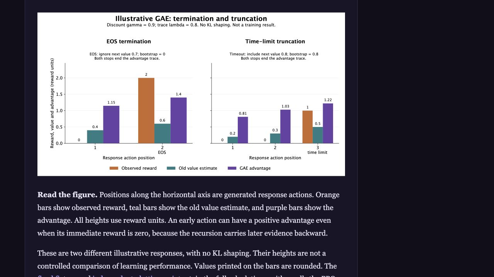
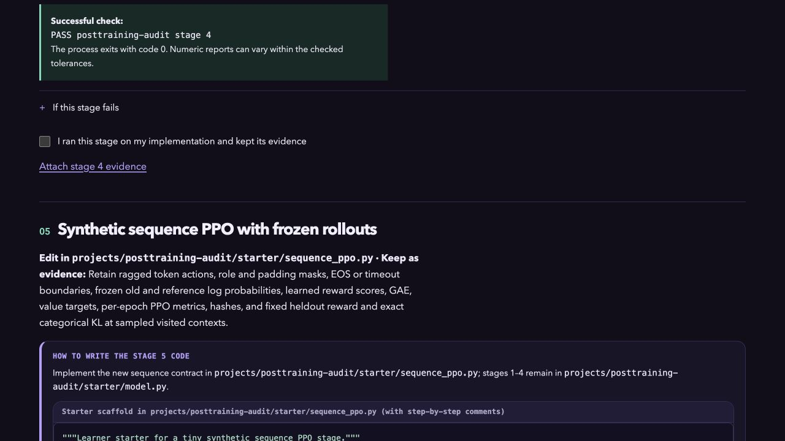
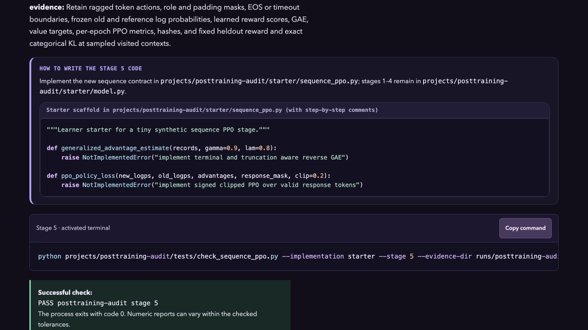

# Course review qualification: 0.16.0

The [verification manifest](verification.json) binds the source files, immutable preview artifacts and retained check logs. The earlier failed link audit remains in `main-check-first-failure.log`; the corrected run is `main-check.log`. The independent browser failure during a concurrent Pages-path rebuild is identified in the [sequence review](../sequence-ppo-2026-10-22/independent-review.json), together with its passing isolated rerun.

The final local checks passed: 177 Node tests, 11 Python identity tests, 52 desktop/mobile Chromium cases, 53 pinned formatter inputs, the root and Pages-base link/schema checks, and EPUBCheck 5.4.0 with no messages. The actual 14-file project ZIP passed in a fresh CPU environment; [source and run evidence](../sequence-ppo-2026-10-22/) records that separately.

The frozen preview is at http://127.0.0.1:4200/book.html. Browser observations cover its book overview, stage-specific file/code/command, and the complete explained GAE figure at 1280 × 720. Native EPUB, assistive-technology speech, full-book print and human teaching acceptance remain pending. This packet does not qualify full language-model RLHF or any full capstone.

