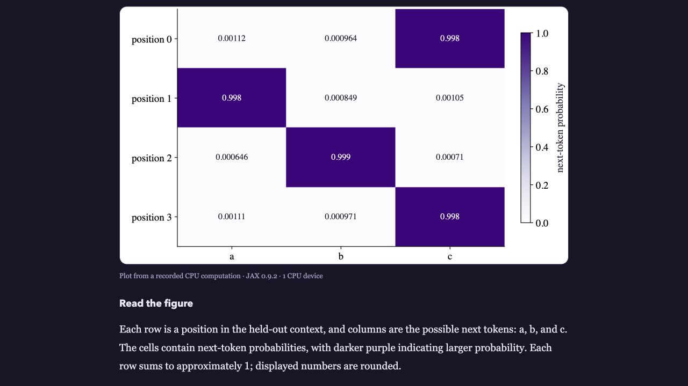
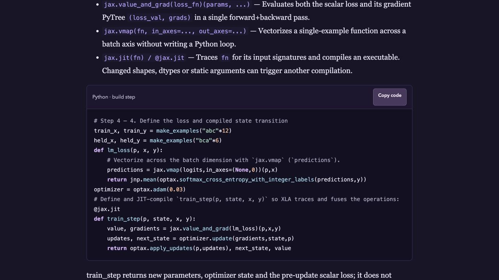
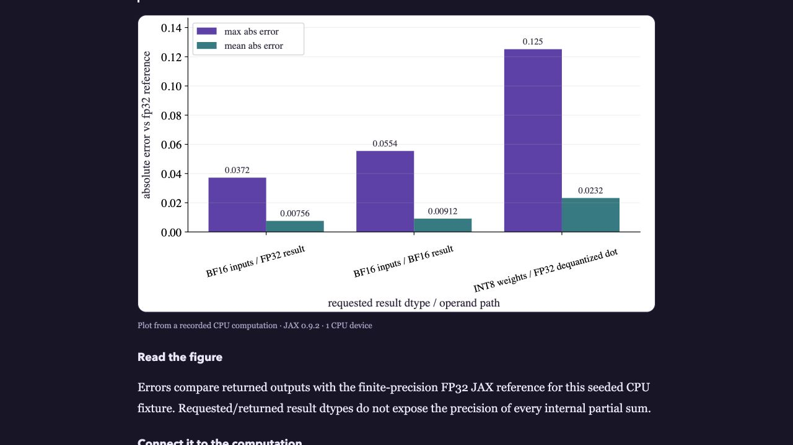

# Browser visual follow-up: edition 0.15.1

The frozen review reader was inspected at 1280 × 720 in the in-app browser. The Transformer heatmap and training-state code, and the TPU precision chart and adjoining explanation, were readable in the selected samples. See [the receipt](receipt.json) for exact artifact hashes, navigation observations and scope limits.

The user reported unlocking the Mac. A fresh native Finder control call still returned a locked-Mac error. No Apple Books result was obtained in this follow-up. Native EPUB, second-engine, speech, full-book print and human teaching checks remain pending.

These are supplemental observations. They do not modify or supersede the frozen 0.15.1 evidence, and do not represent author feedback.

