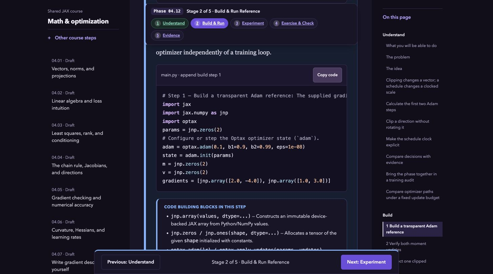
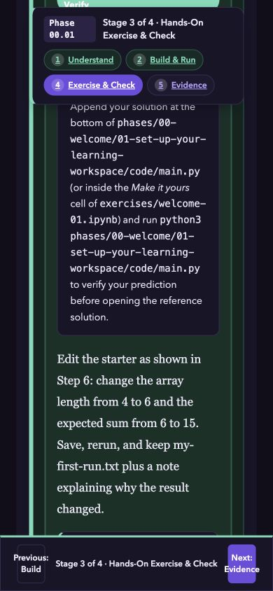
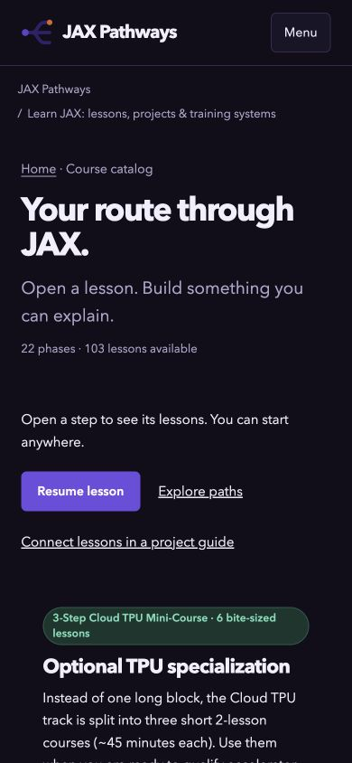

# Content, learner experience and Astro review

Reviewed October 20, 2026. Baseline: **v0.7.2**, commit `f4f9944735fe1c115b817aa427dca6676f6382bd`.

The site has a sound static Astro foundation, substantial runnable material and useful source-bound verification. The next work should make the learning system more coherent and easier to use. Increasing the lesson count or changing frameworks would not address the strongest findings.

The highest priorities are the first lesson's contradictory workspace paths and the shared reader's blanket TPU execution claims. Native browser review also found a section heading hidden by sticky controls and unnamed links inserted into the project catalog. All of these survive the current automated gates.

[GitHub review backlog #58](https://github.com/mlnomadpy/jaxpathways/issues/58) tracks all findings. Created 19 new actionable issues, reopened three matching historical issues with updated evidence, and created the tracking issue.

## Scope and method

- Corpus-wide structural inventory: **103 lessons, 22 phases, 10 pathways, 7 careers, 30 registered projects, 10 separately planned lifecycle capstones, 11 synthesis assessments**.
- Figure inventory: **101 recorded-execution figures, 2 analytic figures, 29 additional mechanism diagrams**. Every lesson has the expected source/companion artifacts. All source-bound lesson receipts match the current content: 98 ordinary CPU and five logical-CPU references.
- Source review: Astro layouts/pages/components, browser boot and state, reader/catalog/project/career flows, manifest validators, JS typing boundaries, CSS, build/export scripts and GitHub workflows.
- Native Chrome review: published homepage; fresh local production preview of homepage, catalog, setup and optimizer lessons, projects, workshop, careers and book overview. Desktop and **390x844** mobile views; light and dark theme spot checks. The local origin keeps test progress separate from the learner's published-site records.
- Close content/code reading: setup and foundations; representative optimization, pretraining, SFT/reward/RLHF, probability, solver differentiation, precision, interoperability, edge and container lessons; the small embedding lineage, project checkers and ten unregistered legacy capstone references.
- Existing issue review: all 38 prior issues checked. Reuse unresolved #37 for physical TPU receipts and Windows execution validation. Reopen #29, #31 and #32 with current evidence and preserve their original descriptions as historical context.

This is a full system and corpus-structure review with selective technical close reading. It is not a sentence-by-sentence proof of 103 lessons or a visual inspection of every plot. No physical TPU, native low-bit target, Windows execution, native EPUB reader or screen reader was qualified here. File presence, numerical execution, target behavior and learner comprehension remain separate evidence.

## What to preserve

- Static Astro rendering, shared layouts and design tokens, pure domain functions, source/generated-content boundaries and deployment-base checks.
- Distinct available/planned labels, CPU versus target qualification, and public-check versus independent-review wording.
- Independent numerical references, replay and corruption checks, complete training-state examples, staged harnesses, and the experiments workshop's real local logger readback.
- KaTeX/MathML, embedded offline book figures and fonts, EPUB solution appendix, feedback links and revision metadata.
- The violet visual identity and readable code palette. The most useful UI changes are hierarchy, density and navigation repairs, not a new theme or framework rewrite.

## Verified baseline

| Check executed in this review | Result |
| --- | --- |
| `npm test` | 102 passing, zero failures |
| `npm run check:site` | 213 pages, 11,123 local references, 22 phase guides, 208 canonical sitemap URLs reachable within three clicks |
| `npm run check:astro` | 136 files, zero errors/warnings/hints |
| `npm run check:types` | Pass for its configured include list |
| `npm run lint` | Pass |
| `npm run format:check` | Pass |
| `npm audit --json` | Zero known npm advisories reported at audit time; not a complete security assessment |
| Content inventory with temporary report outputs | 102 teaching structures plus one setup walkthrough; expected artifacts present; 103 matching existing lesson receipts |
| Expanded audit-only JS type check | 646 diagnostics in 19 files, 592 in browser scripts; mostly missing contracts/nullability, not 646 demonstrated runtime defects |
| Same-site absolute-link scan and fresh HTTP status | Book history URL missing from build and returns HTTP 404 |

No numerical teaching code changed, and the full lesson/project CPU suites were not rerun. The previously published source-bound execution receipts were checked for currency, not presented as newly executed hardware runs. Full deployment CI was not triggered for this review.

## Prioritized issues

P1: repair before relying on the affected learner flow or runtime guidance. P2: substantive quality, usability, maintainability or qualification work. There is no P0 finding in this review.

| Issue | Priority | Area | Work |
| --- | --- | --- | --- |
| [#39](https://github.com/mlnomadpy/jaxpathways/issues/39) | P1 | Content/UX | Keep the setup lesson inside the beginner workspace throughout |
| [#40](https://github.com/mlnomadpy/jaxpathways/issues/40) | P2 | Content | Replace generic build-step labels with mechanisms the code actually performs |
| [#41](https://github.com/mlnomadpy/jaxpathways/issues/41) | P1 | Content | Remove blanket TPU execution claims from the shared reader |
| [#42](https://github.com/mlnomadpy/jaxpathways/issues/42) | P2 | Content | Separate mathematical notation from CLI flags and onboarding metadata |
| [#43](https://github.com/mlnomadpy/jaxpathways/issues/43) | P2 | UI | Generate stage numbers and totals from the stages present in each lesson |
| [#44](https://github.com/mlnomadpy/jaxpathways/issues/44) | P2 | UX/UI | Keep lesson section jumps visible and reachable on narrow screens |
| [#45](https://github.com/mlnomadpy/jaxpathways/issues/45) | P2 | Accessibility | Scope project stage enhancement to workspace stage lists |
| [#46](https://github.com/mlnomadpy/jaxpathways/issues/46) | P2 | UX/UI | Put the core learning sequence before optional TPU promotion in the catalog |
| [#47](https://github.com/mlnomadpy/jaxpathways/issues/47) | P2 | UX/UI | Turn the 30-project catalog into a scannable learning progression |
| [#48](https://github.com/mlnomadpy/jaxpathways/issues/48) | P2 | UX | Expose existing full-text lesson search through an optional search action |
| [#49](https://github.com/mlnomadpy/jaxpathways/issues/49) | P2 | Content/UX | Cover every required phase in career milestone plans |
| [#50](https://github.com/mlnomadpy/jaxpathways/issues/50) | P2 | Book/Engineering | Repair the book changelog link and validate absolute links to our own pages |
| [#51](https://github.com/mlnomadpy/jaxpathways/issues/51) | P2 | Astro/Performance | Load lesson-sized data instead of the full teaching corpus during reader boot |
| [#52](https://github.com/mlnomadpy/jaxpathways/issues/52) | P2 | Astro/Engineering | Extend type contracts to the learner-facing controllers omitted from check:types |
| [#53](https://github.com/mlnomadpy/jaxpathways/issues/53) | P2 | Engineering/QA | Add native-browser accessibility and responsive smoke coverage |
| [#54](https://github.com/mlnomadpy/jaxpathways/issues/54) | P2 | UX/Engineering | Use minimal task-specific environments and render each project setup contract accurately |
| [#55](https://github.com/mlnomadpy/jaxpathways/issues/55) | P2 | Content/Engineering | Remove hardcoded stale assessment and project counts from current guidance |
| [#56](https://github.com/mlnomadpy/jaxpathways/issues/56) | P2 | Book/QA | Qualify EPUB and print reading in named native reading environments |
| [#57](https://github.com/mlnomadpy/jaxpathways/issues/57) | P2 | Content/QA | Run expert and novice reviews against explicit lesson and career evidence |
| [#29](https://github.com/mlnomadpy/jaxpathways/issues/29) | P2 | Content | Complete the planned modality lifecycles with real model and stage lineage |
| [#31](https://github.com/mlnomadpy/jaxpathways/issues/31) | P2 | Code quality | Finish formatting newly added project Python into readable statements |
| [#32](https://github.com/mlnomadpy/jaxpathways/issues/32) | P2 | Content | Finish replacing mechanical code comments with domain explanations |
| [#37](https://github.com/mlnomadpy/jaxpathways/issues/37) | Existing | Hardware/QA | Physical TPU execution receipts and Windows PowerShell checks; retain this issue rather than duplicate it |

Each issue has a problem statement, concrete reproduction/source evidence, proposed acceptance criteria and immutable source links. Planned model implementations and unperformed reading-environment validation are explicitly distinguished from reproduced bugs.

## Evidence behind the main findings

- **Beginner continuity:** the five-file beginner archive contains `first_experiment.py`, while shared Build/Practice chrome tells the learner to edit a nonexistent `phases/.../code/main.py`. The lesson-specific OS walkthrough and the generic wrapper disagree.
- **Runtime accuracy:** the optional setup drawer explains CPU-only scripts accurately, while the common runtime note says the lesson stages directly to TPU. The setup code explicitly sets `JAX_PLATFORMS=cpu`.
- **Anchor occlusion:** after the optimizer lesson's Build jump, the target heading occupies y=53.9..88.4 and the sticky bar occupies y=10..132.8. The target is completely hidden. At 390px the setup article is about 27,810px tall and the full outline starts around y=28,039.
- **Stage consistency:** setup Practice is dynamically "Stage 3 of 4", but its banner says "Stage 4 of 5" and pill numbers are 1, 2, 4, 5.
- **Catalog discovery:** at 390px the first phase container begins around y=2,044. The optional TPU promotion alone is about 891px tall. The grouped phase order starts 00, 19, 20, 21, 01.
- **Project discovery:** at 390px the page is about 54,671px tall and its modality guides begin around y=49,829. All 30 cards repeat detailed setup content. JavaScript also inserts two empty `href="#"` anchors into the first card because a generic selector matches the wrong kind of stage container.
- **Career completeness:** training and operations default routes require deployment, but neither milestone sequence includes it. The training plan counts 53 lessons while its milestones cover 45.
- **Delivery costs:** the full curriculum JSON is 3,184,771 raw bytes (671,069 with local gzip); it is fetched before reader interactions initialize. The release-notice bundle is 209,750 raw bytes. These are file sizes, not measured mobile Core Web Vitals.
- **Code quality:** canonical lesson code has no semicolon-packed statement lines after the prior repair. Registered projects contain 153 such lines in 20 Python files. A narrow mechanical-comment scan finds 371 comments in 82 canonical lesson code blocks. Do not treat these counts as substitutes for editorial review.
- **Planned capstones:** all ten unregistered model solution ASTs match after removing the introductory docstring and normalizing project ID. The website honestly keeps them planned; repository readers still need protection from treating them as real modality references.

## Phase inventory and next review focus

Lesson minutes below are authored estimates, not measured completion times. No phase is certified as independently reviewed by this table.

| Phase | Lessons | Declared minutes | Next quality focus |
| --- | --- | --- | --- |
| 00 Setup & first steps | 4 | 190 | Beginner file/environment continuity, relevant notation, optional TPU boundary |
| 01 Arrays & pure functions | 4 | 185 | Semantic incremental builds and novice explanation checks |
| 02 JAX transformations | 5 | 285 | Build contracts, stable navigation and mechanism explanations |
| 03 State, randomness & control flow | 4 | 245 | Explicit-state and random-key transfer practice; editorial comment pass |
| 04 Math & optimization | 12 | 930 | Preserve independent calculations; anchor visibility and code presentation |
| 05 Neural network training | 5 | 455 | Trace a model/state/update through the classifier evidence |
| 06 Data & checkpoint recovery | 6 | 515 | Readable project checkers; carry full-state and data lineage into later models |
| 07 Transformers & language models | 4 | 390 | Connect token/objective/cache mechanics to planned causal lineage |
| 08 Performance diagnosis | 5 | 455 | Real trace interpretation; preserve measured versus inferred boundaries |
| 09 Distributed training | 4 | 375 | Logical versus physical execution, complete participant and recovery evidence |
| 10 Scientific computing | 4 | 405 | Domain-specific comments and specialist review of solver sensitivities |
| 11 Probabilistic modeling | 4 | 465 | Expert review of inference diagnostics and uncertainty interpretation |
| 12 Reinforcement learning | 4 | 360 | Expert review and learner transfer of rollout, masking and evaluation contracts |
| 13 Pallas kernels | 4 | 445 | Separate CPU/interpreter checks from target kernel qualification |
| 14 Autodiff & JAX internals | 4 | 445 | Typed-program/derivative explanations and numerical reference review |
| 15 Deployment, interoperability & edge AI | 8 | 940 | Per-project environment, live release links, honest device qualification |
| 16 Workload operations | 8 | 680 | Reconcile required career milestones and actual operations evidence |
| 17 Self-supervised pretraining: masked and contrastive learning | 3 | 315 | Connect objective labs to real-data, stage-linked model training |
| 18 Post-training: SFT, LoRA, reward models and RLHF | 5 | 525 | Domain-specific scaffold explanations and distinct objective/model outcomes |
| 19 TPU Setup: Provisioning & Runtime Verification | 2 | 45 | Align common chrome with reviewed execution matrix; existing #37 |
| 20 TPU Workflows: Launching Jobs & Checkpointed Experiments | 2 | 45 | Qualify actual multi-host work separately from receipt simulations |
| 21 TPU Systems: Generations, Memory, Precision & XProf | 2 | 50 | Physical target precision/profile evidence, readable reference utilities |

## Implementation order

1. Repair beginner paths and shared runtime language; fix hidden anchor destinations, unnamed links, stage numbering and the book's dead history link.
2. Restore catalog/project discovery, optional search and complete career milestones. Keep detailed setup on the page where it is needed, and preserve the user's preference for direct choices over required forms.
3. Split reader data payloads and environment contracts; extend controller type checking and native-browser regression coverage.
4. Continue the editorial comment/build-step pass and qualify book/learner environments.
5. Deliver the planned modality lifecycles in genuine domain-specific stages. Improve the small embedding pilot before describing it as a production-quality or target-scale benchmark reference.

## Visual evidence

## Review artifacts and state

`full-review-2026-10-20.json` retains the complete lesson inventory and the issue mapping. Evidence screenshots come from a local preview with no published-site learner state modified. No source fixes or deployment were performed. The review report and screenshots remain local workspace artifacts unless separately published.
