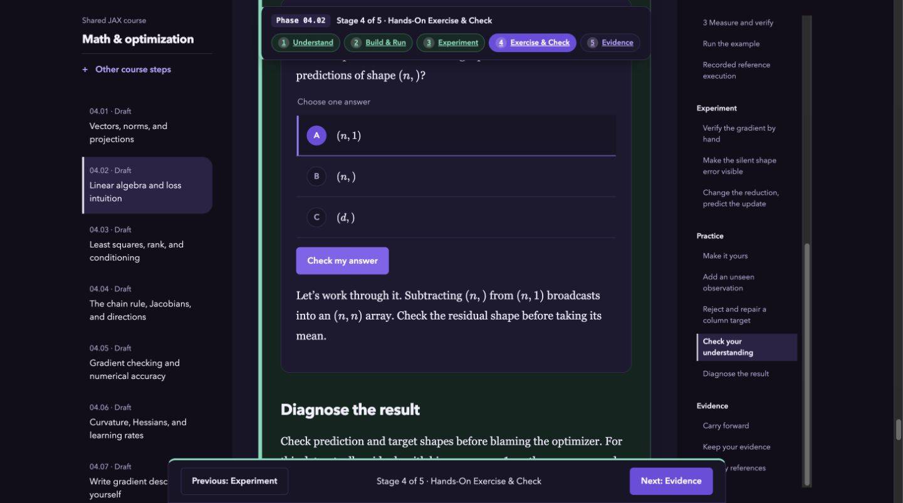
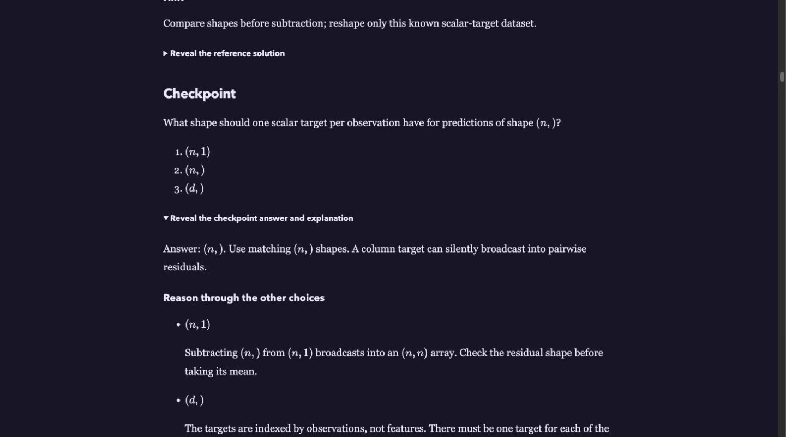

# Review the next JAX Pathways edition

Candidate edition: **0.10.0**. Base: `86b9874d86ca764e70f9764f3fe6f408460b4da6` (published 0.9.0). Prepared 2026-10-21 for Taha Bouhsine’s review. This is an author revision, not an independent acceptance report. Keep the candidate unmerged until review.

## Start with these six checks

1. Open the preview’s **book.html** and standalone **downloads/jax-foundations.html**. In the setup chapter, attempt the checkpoint before revealing its answer. Confirm that wrong choices teach different misconceptions, the reading is approachable and solutions remain an intentional reveal.
2. In **lesson-optimization-01.html**, choose the wrong target-shape answer. Check the explanation of accidental pairwise broadcasting. Then inspect the [optimization transfer case](../phases/04-optimization/README.md): does the scalar recurrence make the three learning-rate behaviors clear?
3. Read the [recovery case](../phases/06-recovery/README.md). Decide whether the equal-norm counterexample makes clear why elementwise full-state and next-batch comparisons are needed.
4. Read [RL](../phases/12-rl/README.md) and [probability](../phases/11-probability/README.md). Check terminal versus truncation semantics and the reverse-KL covariance example especially carefully. These are teaching extensions, not claims of a new general-purpose actor-critic or probabilistic-library implementation.
5. Review [TPU provisioning](../phases/19-tpu/01-get-a-tpu-running-and-verify-the-runtime/lesson.json), [systems](../phases/21-tpu-systems/01-tpu-generations-and-hbm-memory-budgeting/lesson.json) and the [performance guide](../content/guides/tpu-performance.md). Check API boundaries, units, topology and target-evidence limits. No cloud resources were requested for this revision.
6. Pick a modality you know well and one you know less well. Inspect its project’s new **Review handoff** and a planned capstone’s **Recipe decision rehearsal**. Ask whether the expected artifact would let you accept or reject the learner’s claim without trusting a dashboard or a reference solution blindly.

Use [the blank review record](review-notes-2026-10-21.md) to retain decisions. Do not add a human acceptance receipt simply because automated checks pass. If an independent specialist or a novice participates later, follow the [teaching-review protocol](teaching-review-protocol.md), with consent and exact source binding.

## What this revision changes

| Material | Authored change | What to judge |
| --- | --- | --- |
| 103 lessons | One rationale per answer choice, with specific wrong-answer diagnosis; seven correct rationales tightened; six TPU lessons corrected | Accuracy, whether feedback addresses the actual selected misconception, and whether it suggests a useful check |
| 22 phase guides | Concrete transfer cases with worked values, counterexamples and bounded claims | Whether the cases connect the lessons and require explanation rather than copying |
| 31 runnable projects | A distinct changed-condition handoff in every manual | Inspectability of evidence, independence of checks and distinction between current checker coverage and proposed extensions |
| 11 assessments | Discussion case plus separate reviewer notes | Partial credit for correct reasoning, explicit missing evidence and fair scope |
| 10 pathways / 7 careers | Specific review advice and realistic work scenarios | Preparation, appropriate ordering and whether the portfolio supports the stated work |
| 4 modality tracks | Better figure/evaluation reading guidance | Actual axes, counts, failure examples and limits of synthetic tasks |
| 10 planned capstones | Distinct recipe decision, controlled comparison and rejection evidence | Data rights/splits, objective transitions, metric contracts and a realistic implementation gate |
| 3 practical guides | Paired-run comparison example, provisioning/cleanup boundary and dimensional roofline calculation | Whether the workflow can be followed and its evidence interpreted |
| Reader / exports | Selected-answer feedback and guarded progress recording; answer reasoning in quiz/Markdown/notebook/HTML/EPUB companions | Consistent meaning, accessible feedback and intentional solution reveals |

## Verification and limits

The completed local verification record is below. Automated execution checks the supplied examples and reference solutions, not learner understanding or every proposed extension. There are no new independent expert reviews, novice pilots, physical TPU qualifications, real-device inference benchmarks or trained 300M reference releases in this candidate.

The ten larger capstones stay **planned**. The tiny embedding/causal lineage projects keep their weak-quality caveats. The thirteen phases already marked **in development** retain that label: this revision improves explanations and review tasks but does not invent missing full implementations or specialist acceptance. The four existing physical v5e receipts keep their exact original scope.

## Review all phase guides

Read the new transfer prompt before its reasoning. Ask what observation would falsify the proposed explanation. The linked phase README and permanent preview route expose the same canonical study guide.

| Phase | Source guide | Preview route | Review decision |
| --- | --- | --- | --- |
| 00: Setup & first steps | [Read](../phases/00-welcome/README.md) | `phase-guides/welcome.html` | Pending |
| 01: Arrays & pure functions | [Read](../phases/01-arrays/README.md) | `phase-guides/arrays.html` | Pending |
| 02: JAX transformations | [Read](../phases/02-transforms/README.md) | `phase-guides/transforms.html` | Pending |
| 03: State, randomness & control flow | [Read](../phases/03-state/README.md) | `phase-guides/state.html` | Pending |
| 04: Math & optimization | [Read](../phases/04-optimization/README.md) | `phase-guides/optimization.html` | Pending |
| 05: Neural network training | [Read](../phases/05-networks/README.md) | `phase-guides/networks.html` | Pending |
| 06: Data & checkpoint recovery | [Read](../phases/06-recovery/README.md) | `phase-guides/recovery.html` | Pending |
| 07: Transformers & language models | [Read](../phases/07-transformers/README.md) | `phase-guides/transformers.html` | Pending |
| 08: Performance diagnosis | [Read](../phases/08-performance/README.md) | `phase-guides/performance.html` | Pending |
| 09: Distributed training | [Read](../phases/09-distributed/README.md) | `phase-guides/distributed.html` | Pending |
| 10: Scientific computing | [Read](../phases/10-science/README.md) | `phase-guides/science.html` | Pending |
| 11: Probabilistic modeling | [Read](../phases/11-probability/README.md) | `phase-guides/probability.html` | Pending |
| 12: Reinforcement learning | [Read](../phases/12-rl/README.md) | `phase-guides/rl.html` | Pending |
| 13: Pallas kernels | [Read](../phases/13-kernels/README.md) | `phase-guides/kernels.html` | Pending |
| 14: Autodiff & JAX internals | [Read](../phases/14-internals/README.md) | `phase-guides/internals.html` | Pending |
| 15: Deployment, interoperability & edge AI | [Read](../phases/15-deployment/README.md) | `phase-guides/deployment.html` | Pending |
| 16: Workload operations | [Read](../phases/16-operations/README.md) | `phase-guides/operations.html` | Pending |
| 17: Self-supervised pretraining: masked and contrastive learning | [Read](../phases/17-pretraining/README.md) | `phase-guides/pretraining.html` | Pending |
| 18: Post-training: SFT, LoRA, reward models and RLHF | [Read](../phases/18-posttraining/README.md) | `phase-guides/posttraining.html` | Pending |
| 19: TPU Setup: Provisioning & Runtime Verification | [Read](../phases/19-tpu/README.md) | `phase-guides/tpu.html` | Pending |
| 20: TPU Workflows: Launching Jobs & Checkpointed Experiments | [Read](../phases/20-tpu-workflows/README.md) | `phase-guides/tpu-workflows.html` | Pending |
| 21: TPU Systems: Generations, Memory, Precision & XProf | [Read](../phases/21-tpu-systems/README.md) | `phase-guides/tpu-systems.html` | Pending |

## Review all runnable projects

Each source manual ends with a project-specific review handoff. Run the existing reference command to see the supplied checker’s scope; do not infer that it verifies the new qualitative extension. Then ask the learner to explain their own changed case before revealing reference code.

| Project | Source manual | Existing reference command |
| --- | --- | --- |
| Build a regression training audit | [Read](../projects/regression-audit/README.md) | `python3 projects/regression-audit/tests/check.py --implementation solution --stage all` |
| Build a reproducible classifier audit | [Read](../projects/mlp-classifier/README.md) | `python3 projects/mlp-classifier/tests/check.py --stage 3 --implementation solution` |
| Audit a differentiable scientific inverse problem | [Read](../projects/scientific-inverse/README.md) | `python3 projects/scientific-inverse/tests/check.py --implementation solution --stage all` |
| Train and audit a policy from interaction | [Read](../projects/policy-evaluation/README.md) | `python3 projects/policy-evaluation/tests/check.py --stage 4 --implementation solution` |
| Audit a Bayesian regression model | [Read](../projects/bayesian-regression/README.md) | `python3 projects/bayesian-regression/tests/check.py --stage all --implementation solution` |
| Audit derivatives and compile a tiny transformation | [Read](../projects/derivative-audit/README.md) | `python3 projects/derivative-audit/tests/check.py --implementation solution --stage all` |
| Release a trained computation with a deployment audit | [Read](../projects/deployment-audit/README.md) | `python3 projects/deployment-audit/tests/check.py --implementation solution --stage all` |
| Operate and recover a local JAX workload | [Read](../projects/workload-operations/README.md) | `python3 projects/workload-operations/tests/check.py --stage 5 --implementation solution` |
| Build an audio waveform-to-inference harness | [Read](../projects/audio-harness/README.md) | `python3 projects/audio-harness/tests/check.py --implementation solution --stage all` |
| Build and audit image–text retrieval | [Read](../projects/cross-modal-harness/README.md) | `python3 projects/cross-modal-harness/tests/check.py --implementation solution --stage all` |
| Audit a Pallas kernel and its target evidence | [Read](../projects/kernel-audit/README.md) | `python3 projects/kernel-audit/tests/check.py --implementation solution --stage all` |
| Build a recoverable image classifier through exported inference | [Read](../projects/image-harness/README.md) | `python3 projects/image-harness/tests/check.py --stage 8 --implementation solution` |
| Connect arrays, transformations and explicit state | [Read](../projects/foundation-toolkit/README.md) | `python3 projects/foundation-toolkit/tests/check.py --implementation solution --stage all` |
| Resume and profile a sharded training run | [Read](../projects/sharded-training/README.md) | `python3 projects/sharded-training/tests/check.py --implementation solution --stage all` |
| Build a causal Transformer training and inference harness | [Read](../projects/text-harness/README.md) | `python3 projects/text-harness/tests/check.py --implementation solution --stage all` |
| Audit conditioning, gradient noise and optimizer decisions | [Read](../projects/optimizer-audit/README.md) | `python3 projects/optimizer-audit/tests/check.py --implementation solution --stage all` |
| Ship a tracked and containerized model release | [Read](../projects/engineering-release/README.md) | `python3 projects/engineering-release/tests/check.py --implementation solution --stage all` |
| Audit pretraining and post-training objectives | [Read](../projects/training-methods/README.md) | `python3 projects/training-methods/tests/check.py --implementation solution --stage all` |
| Convert PyTorch weights and audit Flax architecture parity | [Read](../projects/weight-conversion/README.md) | `python3 projects/weight-conversion/tests/check.py --implementation solution --stage all` |
| Check the CPU environment and a saved matrix arithmetic identity | [Read](../projects/welcome-audit/README.md) | `python3 projects/welcome-audit/tests/check.py --implementation solution --stage 4` |
| Audit masked batch moments and padding-sensitive denominators | [Read](../projects/arrays-audit/README.md) | `python3 projects/arrays-audit/tests/check.py --implementation solution --stage 4` |
| Compare scalar, vmap, autodiff, and changed-shape JIT behavior | [Read](../projects/transforms-audit/README.md) | `python3 projects/transforms-audit/tests/check.py --implementation solution --stage 4` |
| Resume optimizer and PRNG state across an interrupted training update | [Read](../projects/recovery-audit/README.md) | `python3 projects/recovery-audit/tests/check.py --implementation solution --stage 4` |
| Measure CPU JIT latency and changed-shape traces with retained JAXPR evidence | [Read](../projects/performance-audit/README.md) | `python3 projects/performance-audit/tests/check.py --implementation solution --stage 4` |
| Audit response-token SFT masking and preference-pair loss | [Read](../projects/posttraining-audit/README.md) | `python3 projects/posttraining-audit/tests/check.py --implementation solution --stage 4` |
| Inspect CPU device inventory, BF16 storage, and collective participant arithmetic | [Read](../projects/tpu-runtime-audit/README.md) | `python3 projects/tpu-runtime-audit/tests/check.py --implementation solution --stage 4` |
| Gate simulated multi-worker checkpoint publication on complete receipts | [Read](../projects/tpu-workflow-audit/README.md) | `python3 projects/tpu-workflow-audit/tests/check.py --implementation solution --stage 4` |
| Estimate optimizer-state bytes and calculate supplied-rate scaling efficiency | [Read](../projects/tpu-systems-audit/README.md) | `python3 projects/tpu-systems-audit/tests/check.py --implementation solution --stage 4` |
| Reproducible JAX/Flax experiments workshop | [Read](../projects/reproducible-experiments/README.md) | `python3 projects/reproducible-experiments/tests/check.py --implementation solution --stage all` |
| Trace a tiny bidirectional encoder from pretraining to retrieval | [Read](../projects/embedding-lineage/README.md) | `python3 projects/embedding-lineage/tests/check.py --implementation solution --stage all --output runs/embedding-lineage/reference` |
| Trace a tiny causal Transformer from pretraining to instruction-style adaptation | [Read](../projects/causal-lineage/README.md) | `python3 projects/causal-lineage/tests/check.py --implementation solution --stage all` |

## Review synthesis assessments

Attempt the discussion case before opening the reviewer notes. The added discussion has no new automatic score.

| Assessment | Learner source | Reviewer notes |
| --- | --- | --- |
| Regression synthesis | [Attempt](../assessments/foundations.md) | [Notes](../assessments/foundations-reviewer.md) |
| Classifier and image lifecycle synthesis | [Attempt](../assessments/models.md) | [Notes](../assessments/models-reviewer.md) |
| Math & optimization synthesis | [Attempt](../assessments/math.md) | [Notes](../assessments/math-reviewer.md) |
| Scientific inverse-problem synthesis | [Attempt](../assessments/science.md) | [Notes](../assessments/science-reviewer.md) |
| Reinforcement-learning synthesis | [Attempt](../assessments/rl.md) | [Notes](../assessments/rl-reviewer.md) |
| Bayesian regression synthesis | [Attempt](../assessments/probability.md) | [Notes](../assessments/probability-reviewer.md) |
| Derivative synthesis | [Attempt](../assessments/internals.md) | [Notes](../assessments/internals-reviewer.md) |
| Shipping synthesis | [Attempt](../assessments/ship.md) | [Notes](../assessments/ship-reviewer.md) |
| Workload operations synthesis | [Attempt](../assessments/ops.md) | [Notes](../assessments/ops-reviewer.md) |
| Profiling, partitioning and kernel synthesis | [Attempt](../assessments/scale.md) | [Notes](../assessments/scale-reviewer.md) |
| Training-system synthesis | [Attempt](../assessments/tpu.md) | [Notes](../assessments/tpu-reviewer.md) |

## Review planned model recipes

These remain implementation specifications. Require a controlled real-data pilot, exact checkpoint lineage and honest evaluation before budgeting a target-scale run or announcing model quality.

| Capstone | Specification | Status |
| --- | --- | --- |
| Train a CLIP image–text model | [Read](../projects/clip-model/README.md) | Planned |
| Train and compare a SigLIP model | [Read](../projects/siglip-model/README.md) | Planned |
| Build a measured retrieval service | [Read](../projects/retrieval-system/README.md) | Planned |
| Build a staged embedding model | [Read](../projects/embedding-model-300m/README.md) | Planned |
| Build a causal language model | [Read](../projects/causal-model-300m/README.md) | Planned |
| Build an image understanding model | [Read](../projects/image-model-300m/README.md) | Planned |
| Build an image generation pipeline | [Read](../projects/image-generation-model/README.md) | Planned |
| Build an audio understanding model | [Read](../projects/audio-model-300m/README.md) | Planned |
| Build an audio generation pipeline | [Read](../projects/audio-generation-model/README.md) | Planned |
| Build a grounded multimodal model | [Read](../projects/multimodal-model/README.md) | Planned |

## Routes, careers and practical workflow

- [Start with JAX](../learning-paths/foundations.json): read the final review advice beside its capstone evidence.
- [Understand JAX itself](../learning-paths/internals.json): read the final review advice beside its capstone evidence.
- [Train neural networks](../learning-paths/models.json): read the final review advice beside its capstone evidence.
- [Operate JAX workloads](../learning-paths/ops.json): read the final review advice beside its capstone evidence.
- [Model uncertainty](../learning-paths/probability.json): read the final review advice beside its capstone evidence.
- [Learn by interacting](../learning-paths/rl.json): read the final review advice beside its capstone evidence.
- [Make it fast. Make it scale.](../learning-paths/scale.json): read the final review advice beside its capstone evidence.
- [Simulate and discover](../learning-paths/science.json): read the final review advice beside its capstone evidence.
- [Ship and adapt JAX workloads](../learning-paths/ship.json): read the final review advice beside its capstone evidence.
- [Learn TPUs and Google Cloud](../learning-paths/tpu.json): read the final review advice beside its capstone evidence.

Review all seven `roles[].workExample` scenarios in [the course manifest](../curriculum/course.json), the figure guidance in [the modality registry](../curriculum/modality-tracks.json), and the [project workflow](../content/guides/project-workflow.md), [TPU/GCP workflow](../content/guides/tpu-gcp.md) and [TPU performance](../content/guides/tpu-performance.md) guides.

## Completed local verification

| Check | Result |
| --- | --- |
| Release snapshot | Candidate 0.10.0 matches its canonical sources; published snapshots retained |
| Fresh lesson execution | 103 scripts and 103 notebook companions passed on CPU; final edited cases rerun |
| Figures | All 103 regenerated from canonical source; edited cases refreshed after final math/prose changes |
| Project reference suites | 31 passed with current project source hashes |
| Synthesis reference checks | All 11 passed |
| Automated tests | 129 passed, including answer selection, empty/invalid attempts, prior-pass preservation and export reasoning |
| Astro / types / lint / format | Passed; Astro reported zero errors, warnings or hints |
| Root and Pages builds | 215 pages checked at `/` and `/jaxpathways/`, including local references and guide coverage |
| SEO / schema / discovery | 210 canonical sitemap URLs, structured data, share metadata, revisions and feedback checks passed at both bases |
| Maturity labels | All 202 entries checked; 103 current CPU lessons, 31 current project references, 103 choice-specific feedback lessons |
| Book distribution | HTML embedding, EPUB XML/math/links, separate solutions and bundle fidelity checks passed |
| Browser spot checks | Both wrong-answer branches, KaTeX shapes, standalone book reveal and 103 chapters inspected; narrow book page at 390 by 844 fit without horizontal overflow; temporary viewport restored |

These checks do not constitute Google Rich Results testing of a newly published edition: this candidate has not been published. They also do not establish human teaching acceptance, performance on an unmeasured device or coverage of every proposed review extension.

### Browser proof

The selected wrong answer receives a specific diagnosis with typeset shapes. The standalone book keeps the same reasoning inside an explicit reveal.

