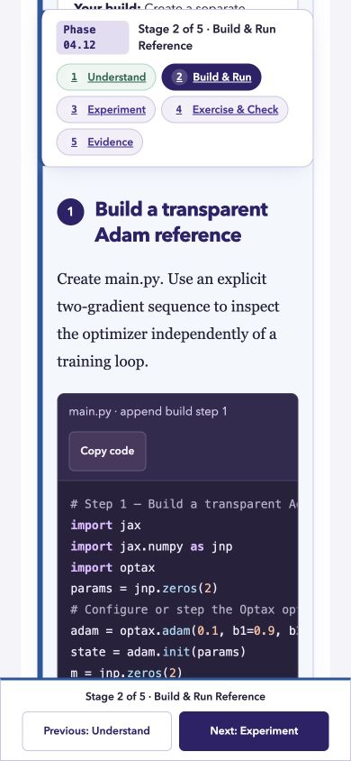
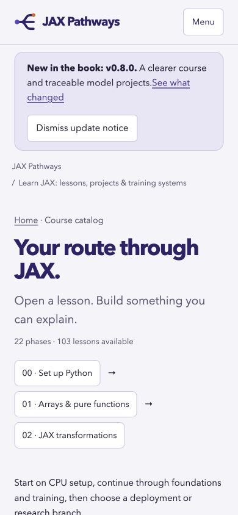
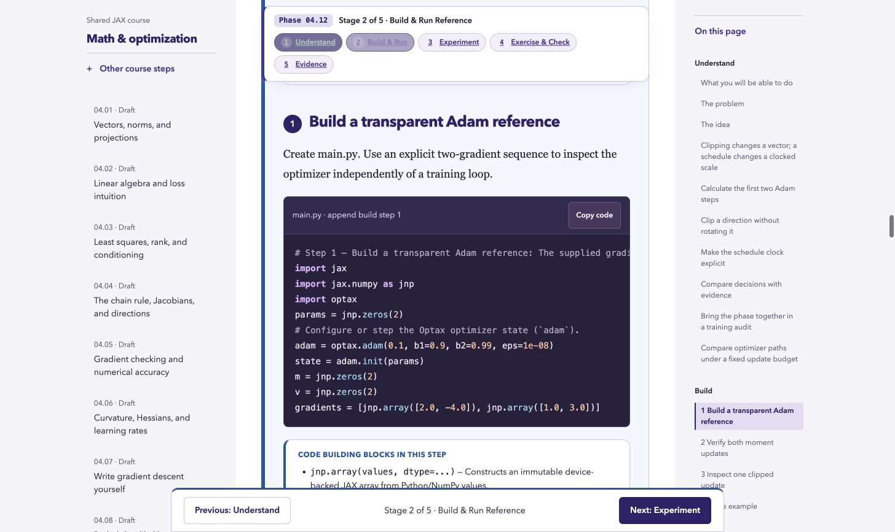

# Repairs from the October 20 review

Edition: **0.8.0**. The [original review](full-review-2026-10-20.md) describes the 0.7.2 baseline. Three Luna agents implemented the repairs, followed by integration review, numerical reruns and native Chrome checks. The software changes are implemented and locally verified; hosted checks and publication are recorded separately on the pull request.

## Implemented software repairs

| Issues | Result |
| --- | --- |
| #39, #41 (P1) | Setup stays inside the extracted beginner folder in Build, Practice, evidence templates and book instructions. Runtime guidance distinguishes CPU references, logical devices, implemented target programs and outstanding physical qualification. |
| #40, #42, #32 | Eleven generic incremental builds now describe their mechanisms; setup metadata and CLI flags remain code while formulas use KaTeX. Removed residual mechanical comments, including misleading configuration comments and stale TPU guard narration. API help no longer guesses explanations from arbitrary function names. |
| #43, #44 | Stage numbers use the stages present. Section offsets follow the measured sticky bar. The mobile outline precedes the article, and activity controls have room for readable labels. |
| #45–49 | Workspace stage enhancement no longer inserts unnamed catalog links. Core CPU steps are linked at catalog entry; TPU is a separate compact branch. Projects are grouped and filterable, search opens on demand with focus restoration, and career milestones cover required deployment work. |
| #50, #55 | Book edition links resolve to actual update anchors. Site checks include absolute links to this site's pages. Current counts come from registries, including the README status block. |
| #51, #52 | Reader boot fetches compact navigation and uses embedded current-lesson data. It preserves SSR content and no longer imports the full lesson rendering/release history into the client. Every browser script is covered by strict `checkJs`, including reader, catalog, project, planner and notebook controllers. |
| #53, #54 | Added desktop/mobile Chromium CI checks, manifest-driven project environments, a minimal beginner environment, layered dependencies, duplicate ZIP-entry checks and source-matching environment instructions. |
| #31 | Formatted the affected project Python; a pinned Black gate covers the repaired files and new causal pilot (28 files). |

The final integration checks exposed and repaired a textarea-versus-input guard that prevented notebook saves, a learner checker bound to the reference file instead of the learner's implementation, and a project-guide link that resolved a planned capstone as an available guide.

## Remaining issues and actual limits

- **#29, partly implemented:** removed 30 misleading placeholder Python files from ten distinct planned capstones. Added a separate real-data causal pilot alongside embedding-lineage. The ten target-scale capstones remain planned; domain-specific production implementations, large training runs, external benchmark receipts and released models are not complete.
- **#37, partly implemented:** added a Windows beginner ZIP workflow and a manually triggered workflow for an existing trusted TPU VM. `scripts/smoke-tpu.py` rejects CPU fallback and retains training/resume/precision logs, source hashes, hardware identity and a receipt. It does not provision cloud resources. Neither a successful hosted Windows run nor an actual physical TPU receipt is claimed by the local checks.
- **#56, open:** structural EPUB/HTML checks pass. Apple Books was encountered at first-run onboarding and native app control was interrupted; no reading qualification was established. Two-reader, assistive-technology and print pagination checks remain in [the compatibility matrix](book-compatibility.md).
- **#57, open:** [the review protocol](teaching-review-protocol.md) and source-bound review registry now distinguish expert review from novice pilots and execution checks. No human review or novice session was invented; both current totals remain zero.

## Recorded verification

- All **103** canonical scripts and notebook companions passed fresh CPU execution (**206** executions), followed by targeted reruns after final notation/comment edits. All 103 current content hashes match their receipts: 98 ordinary CPU and five logical-CPU examples.
- Regenerated every lesson's primary figure and its mechanism diagram where present. The six performance-related image changes reflect actual repeated timing measurements, not fixed illustrative values.
- All **31** registered reference project suites passed. Every project source hash still matches that complete receipt. The new causal pilot also passed separate learner-file stage 1 and stage 2 invocations, including predecessor rejection and fresh-process inference.
- A freshly extracted beginner ZIP installed only its JAX/NumPy environment and dependencies into an isolated Python 3.14.3 environment. Its original program printed `Sum: 6.0`; the learner's range and assertion changes printed `Sum: 15.0` from that same folder.
- `npm run check` passed Astro (**138 files, zero diagnostics**), strict browser/domain types, lint, formatting, curriculum validation, build, unit/DOM tests, distribution fidelity and site/SEO checks. The build contains **214 pages**, 22 phase guides and **209** canonical URLs reachable within three clicks. The final unit/DOM suite passes 113 tests, including the beginner-book regression.
- Native Chrome checks used desktop **1456×867** and mobile **390×844** views. Both optimizer Build jumps leave the heading about 50px below the sticky bar and show Stage 2 of 5. On mobile, Phase 01's direct entry is at y≈641, before the optional TPU branch. Project filtering shows the eight model projects with zero visible unnamed links. A disposable notebook artifact was saved, recovered after reload, then removed through the real UI.
- Reader navigation is **280,193 bytes raw / 73,461 gzip**, versus **3,082,786 / 658,321** for the full corpus. The checked optimizer lesson embeds about 24KB of lesson data. The release-notice bundle is about 1.1KB. These file-size checks are not measured Core Web Vitals.

## Real causal lifecycle pilot

[Causal lineage](../projects/causal-lineage/README.md) trains a 70,704-parameter causal Transformer on pinned Gutenberg text. It uses train-only tokenization and continuation records, chapter-isolated evaluation, response-masked adaptation, actual checkpoint predecessors and verified export sampling. Its [retained result](../projects/causal-lineage/outputs/pilot-results.json) records all updates and identities.

On the same 4,954 held-out targets, perplexity is **797.32** after pretraining, **690.75** after adaptation and **568.13** for the unigram baseline. Lower is better. The model loses to the baseline, and its sample is repetitive. The separate training/evaluation plots explain those failures; passing checks does not establish model quality or complete the planned 300M project.

## Native UI evidence

