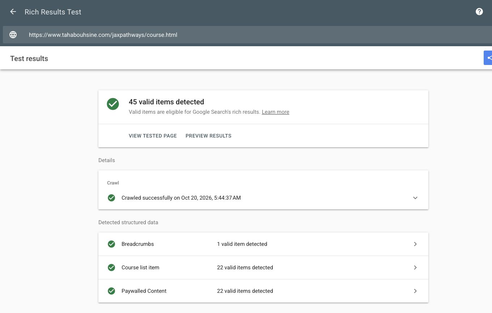

# Google Rich Results Test validation, 2026-10-20

Test target: published JAX Pathways v0.7.1; correction: v0.7.2. Tests use Google's smartphone URL inspection through the actual Rich Results Test browser UI. Local JSON parsing and schema-vocabulary checks are separate evidence.

## Published baseline

| Published page | Google result | Finding |
| --- | --- | --- |
| `/course.html` | [Result](https://search.google.com/test/rich-results/result?id=0Lk7iSNuhIDzO7xbOp5Uyg) | 45 valid items: one Breadcrumb, 22 Course list items and 22 Paywalled Content items. Non-critical issues in the paywall items. |
| `/phase-guides/arrays.html` | [Result](https://search.google.com/test/rich-results/result?id=AVv4XLHBBNiLxnxod1VaNw) | Three valid items. The course's paywall interpretation reports four optional `Invalid object type for field "hasPart"` issues, one for each lesson. |
| `/lesson-arrays-01.html` | [Result](https://search.google.com/test/rich-results/result?id=6qffrShDJ9a1P9db0PpTZw) | Three valid items, with non-critical issues in the embedded phase Course's paywall interpretation. |
| `/book.html` | [Result](https://search.google.com/test/rich-results/result?id=H-_5cczMjps0P5yn04E-hw) | One valid Breadcrumb item, no reported warnings. Book is not a separately supported rich-result type in this tool. |

Initial catalog attempts encountered Google's reCAPTCHA connection error. A subsequent normal URL test completed; no CAPTCHA challenge was solved or bypassed.

## Cause and correction

The lesson list used Schema.org's general-purpose `Course.hasPart`, containing `LearningResource` objects. This is a valid CreativeWork relationship in Schema.org, but Google's paywall validator also interprets this property and expects paywall page elements. The free course therefore acquired unrelated optional paywall warnings.

The correction uses the course-specific `syllabusSections` property with typed `Syllabus` entries. Each outline has its lesson URL, title and learning objective. It has its own `#syllabus` identity; the actual lesson retains its `#lesson` identity and `isPartOf` course relationship. Free-access declarations remain true. No paid-access fragments or CSS selectors are fabricated.

A regression check rejects `Course.hasPart` and verifies typed syllabus entries, nonempty descriptions and canonical lesson destinations across the generated phase pages.

## Candidate validation before publication

The corrected phase's complete generated HTML was submitted through Google's CODE mode: [candidate result](https://search.google.com/test/rich-results/result?id=ukp8k0m8nlIqEnowI0ZYQw). Google reported three valid items with no non-critical warnings. The same shared course-schema function is used by the catalog, all 22 phase pages and embedded phase entities in the 103 lessons.

## Live retest

Version 0.7.2 deployed successfully in [GitHub Pages run 39422142425](https://github.com/mlnomadpy/jaxpathways/actions/runs/39422142425). A direct fetch confirmed the new syllabus markup in the actual published phase before Google retesting.

| Published v0.7.2 target | Mode and result | Remaining schema issues |
| --- | --- | --- |
| Catalog, including all 22 Course entities | [Google URL result](https://search.google.com/test/rich-results/result?id=tAw6gup9ke88tEJrG77-Ug): 45 valid items | No errors or warnings reported in any detected category |
| Arrays phase | [Google URL result](https://search.google.com/test/rich-results/result?id=nMxEeoG-iMGTmXbjh6azNw): three valid items | No errors or warnings reported |
| Arrays lesson | [Google URL result](https://search.google.com/test/rich-results/result?id=2ZNc00nhNwspnHFJXjSYtg): three valid items | No errors or warnings reported |
| Book overview | [Google URL result](https://search.google.com/test/rich-results/result?id=klV4varm2JL_R13RckUXFA): one valid Breadcrumb item | No errors or warnings reported |
| Standalone reader's exact published JSON-LD | [Google CODE result](https://search.google.com/test/rich-results/result?id=KtW3f_Ioh2lqufpCh7GZUQ): one valid Breadcrumb item | No errors or warnings reported for the excerpt |

Google still groups the free Course entities in a category called Paywalled Content; their `isAccessibleForFree` value is true. The important change is that those category rows no longer contain non-critical issues.

### Book validation and full-reader limitation

The [published book overview's complete graph](https://validator.schema.org/#url=https%3A%2F%2Fwww.tahabouhsine.com%2Fjaxpathways%2Fbook.html) was separately validated in Schema.org's browser validator: **0 errors, 0 warnings**, including its Book entity and edition 0.7.2. This complements Google's supported-rich-result checks, which do not report Book as a standalone result type.

The full standalone HTML reader returned Google's generic “Something went wrong” service error on URL-test attempts. Schema.org explicitly refused that full document because it exceeds its 2.5 MB input limit. Neither failure is presented as a successful full-reader URL validation or as a diagnosed schema fault.

For the reader, the exact JSON-LD script was extracted from the actual published v0.7.2 file without changing any entity or field. That excerpt passed Google's CODE test above and Schema.org's snippet test with **0 errors and 0 warnings**. This validates its metadata, not a complete Google crawl of the large offline document. Its intentional noindex policy is retained; the book overview is the indexable entry point.

The checked examples cover the shared catalog, phase, lesson and book templates; no claim is made that Google individually tested all 103 lesson URLs. Automated site checks cover all 208 canonical destinations, and the deployment's site, lesson, project and logger verification jobs all passed.

Google result links expire after approximately 90 days. Rich Results Test checks supported search features, not every Schema.org type or property and not indexing or ranking guarantees. The standalone download reader deliberately remains noindex; the indexable book overview is the search entry point.

## References

- [Google: Rich Results Test and supported types](https://support.google.com/webmasters/answer/7445569)
- [Google: Subscription and paywalled content](https://developers.google.com/search/docs/appearance/structured-data/paywalled-content)
- [Schema.org: syllabusSections](https://schema.org/syllabusSections)
- [Schema.org: Syllabus](https://schema.org/Syllabus)
