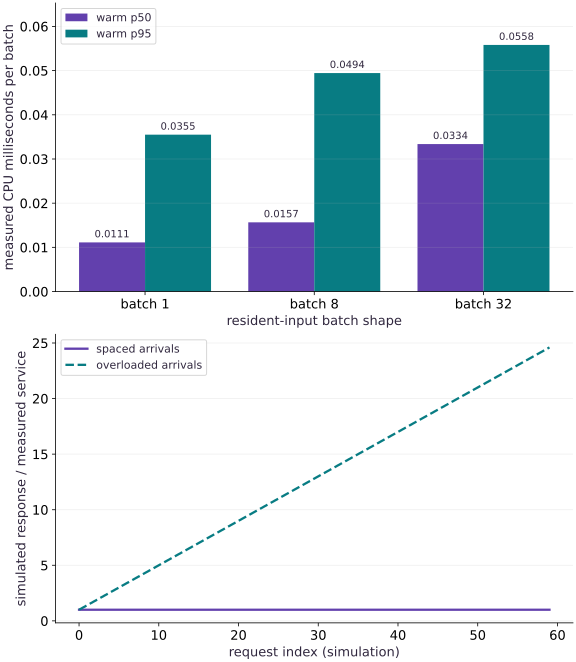

# Inference capacity, batching, and autoscaling

Phase 15: Deployment, interoperability & edge AI · about 130 minutes · CPU

This worked reference is validated on CPU. Accelerator compatibility requires a separate source review and target execution receipt. Use the execution matrix to review device selection and data ownership before adapting a separate target program.

**Before this lesson:** [Containerize a model service and verify its boundary](https://www.tahabouhsine.com/jaxpathways/lesson-deployment-07.html).

## What you will be able to do

- Measure completed inference after warming each batch shape
- Report batch latency and example throughput with correct units
- Implement and independently check a serial queue timeline
- Distinguish utilization, batch-collection delay and hypothetical replica planning from measured service evidence

## The problem

A model call looks fast in isolation, yet users may wait when requests arrive together. We will measure actual completed inference at several batch sizes, then use those observations in a clearly labeled queue simulation. The aim is to connect milliseconds per batch, examples per second and response latency without confusing a local benchmark with a deployed service.

## The idea

Inference capacity depends on arrivals, queueing, batching, service time and response work. A fast model call is one component. Define the request boundary before estimating throughput or deciding when to add capacity.

## A request spends time before and after computation

A request may wait for a batch, wait behind existing work, execute and then be encoded for response. Larger batches can improve work per call while increasing the first waiting request's latency. These objectives can conflict.

Draw arrival, enqueue, dispatch and completion on one timeline. Then measure or model each interval with its source stated. Tail latency depends on the arrival pattern and concurrency, not just the mean of isolated calls.

This lesson combines measured CPU batch computation with a separately simulated queue. Keep those panels distinct. A queue simulation explores stated assumptions; it is not an observed autoscaling system or a production traffic measurement.

The upper panel measures resident-input CPU computation per batch; it reports a median and p95 for each of three batch shapes. These very short timings can change order across captures, so use them to practice reading per-batch units rather than declaring an optimal batch size. The lower panel is a separate queue simulation using one measured service duration as its time unit.

### Pause and reason

Can higher batch throughput coexist with worse user latency?

<details><summary>Compare your reasoning</summary>

Yes. Requests can wait longer to form a batch or reach service. Report both completed throughput and the declared end-to-end latency distribution.

</details>

## Choose the clock boundary first

JAX dispatch may return before numerical work has completed. The timer calls block_until_ready inside the measured interval. Inputs and weights are already resident; preprocessing, device placement, request decoding and response encoding are excluded. The first call for each shape can include compilation and is recorded separately from $40$ warm calls. A p95 from $40$ samples is a small descriptive statistic, not a reliable production tail estimate. Timings change across hosts and repeated runs; correctness checks must not assert a fixed speedup.

## Keep request units and example units separate

Let a batch of $B$ examples take $t_B$ milliseconds. A serial worker completing full batches has a compute-throughput proxy $1000B/t_B$ examples per second. The batch still takes $t_B$ milliseconds; dividing by $B$ describes amortized cost per example, not the response time experienced by one example in that batch. Partial batches, memory pressure, shape recompilation and preprocessing can change both numbers.

$$
q_B=\frac{1000B}{t_B}\quad\text{examples/second}
$$

## Trace a queue before using a rate formula

For one first-come-first-served worker, a request starts at the later of its arrival and the previous finish. With arrivals at $0,1,4$ milliseconds and service duration $2$ milliseconds, starts are $0,2,4$, finishes are $2,4,6$, and response times are $2,3,2$. The second request waits one millisecond because the worker is busy. This independent hand timeline checks our simulation before we feed it measured service durations.

$$
s_i=\max(a_i,f_{i-1}),\qquad f_i=s_i+t,\qquad r_i=f_i-a_i
$$

## A utilization estimate is not a latency guarantee

If arrival rate is $\lambda$ requests per second and each request consumes $t$ milliseconds on one serial worker, the utilization proxy is $\rho=\lambda t/1000$. Sustained offered work above capacity makes backlog grow in this unlimited-queue model. Even below capacity, bursts and service-time variation can cause long waits. Our stable arrivals are spaced $1.5t$ apart, so no queue forms. Overloaded arrivals are $0.6t$ apart; waiting grows by $0.4t$ per request and the sixtieth response takes $24.6t$. These are simulated consequences of declared inputs, not measured user latencies.

## Batch collection trades waiting for throughput

With regularly spaced arrivals separated by $\delta$, filling a batch of $B$ from empty makes its first example wait $(B-1)\delta$ before execution; the average collection wait is $(B-1)\delta/2$ if all positions are equally represented. A timeout permits partial batches and limits intentional collection delay, but a busy worker can still add queueing. A production experiment should replay realistic arrivals, batch sizes and sequence lengths, record queue, collection and execution times separately, and compare tail latency against an explicit service-level objective. **TODO (Dynamic Batching Server Extension):** Replay this arrival trace against a live dynamic-batching HTTP server and compare p99 queue + execution latency.

## Plan replicas with headroom, then test the plan

For a measured effective capacity $q$ requests per second per replica and target utilization $u$, a first estimate is $R=\lceil\lambda/(u q)\rceil$. This assumes compatible units, balanced routing and an actual capacity measurement for the workload. Autoscaling also has observation windows, startup time, warming and cooldown; it cannot erase a burst that arrives before new capacity is ready. Keep the formula labeled as a planning assumption until a load test includes the real request boundary, concurrency limits, failures and startup behavior.

## A percentile is a sample summary, not a latency promise

Sort twenty observed request times. If nineteen are $1$ millisecond and one is $100$ milliseconds, NumPy's default linear percentile interpolation reports p95 as $5.95$ milliseconds. The maximum remains $100$. The interpolated value need not be an observed request time.

That summary does not guarantee that future requests will stay below p95, and a small sample gives weak evidence about rare slow requests. State the sample size and percentile method, retain the full samples, and repeat the run under the intended workload. Do not average percentiles from separate workers; combine request samples or use an aggregation method appropriate to the monitoring system.

### Pause and reason

Would reporting only p95 reveal the actual worst observed request in this example?

<details><summary>Compare your reasoning</summary>

No. The worst observed request is $100$ milliseconds, while interpolated p95 is $5.95$. Report the distribution and maximum alongside the requested percentile when those distinctions matter.

</details>

## 1. Define and check the inference workload

Create a fresh main.py. This fixed dense-network fixture measures an inference boundary; its random weights are not presented as a pretrained or accurate model.

```python
# Step 1 — 1. Define and check the inference workload
import math
import time
import numpy as np
import jax
import jax.numpy as jnp
rng=np.random.default_rng(82)
W1=jnp.asarray(rng.normal(0,.1,(64,32)).astype(np.float32))
W2=jnp.asarray(rng.normal(0,.1,(32,8)).astype(np.float32))
# Define and JIT-compile `infer(inputs)` so XLA traces and fuses the operations:
@jax.jit
def infer(inputs):
    return jnp.tanh(inputs@W1)@W2
def measure(batch_size,repeats=40):
    host=rng.normal(size=(batch_size,64)).astype(np.float32)
    device=jnp.asarray(host)
    began=time.perf_counter()
    # Wait for device work to finish before timing it or comparing its result on the host.
    first=infer(device).block_until_ready()
    first_ms=(time.perf_counter()-began)*1000
    # Transfer the device result to the host for an independent NumPy comparison.
    expected=np.tanh(host@np.asarray(W1))@np.asarray(W2)
    np.testing.assert_allclose(first,expected,rtol=2e-5,atol=2e-6)
    samples=[]
    for _ in range(repeats):
        began=time.perf_counter()
        # Wait for device work to finish before timing it or comparing its result on the host.
        infer(device).block_until_ready()
        samples.append((time.perf_counter()-began)*1000)
    p50=float(np.percentile(samples,50))
    return {'batch':batch_size,'first_call_ms':first_ms,'samples_ms':samples,
            'p50_ms':p50,'p95_ms':float(np.percentile(samples,95)),
            'steady_examples_per_second':1000*batch_size/p50}
```

The timer includes dispatch and completion for already resident inputs. JSON, networking, queueing and host-to-device placement are outside this boundary.

## 2. Measure each batch shape separately

Append three batch shapes and print all timing boundaries. Each shape has its own first call and warmed sample distribution.

```python
# Step 2 — 2. Measure each batch shape separately: Do not assume a larger batch is faster per request.
measurements=[measure(batch) for batch in (1,8,32)]
for report in measurements:
    assert len(report['samples_ms'])==40
    # Ensure all array elements remain finite: `all(value>0 and np.isfinite(value) for value in report['samples_m...`
    assert all(value>0 and np.isfinite(value) for value in report['samples_ms'])
    print({key:value for key,value in report.items() if key!='samples_ms'})
service_ms=measurements[0]['p50_ms']
```

Do not assume a larger batch is faster per request. Examples per second and milliseconds per batch answer different questions.

## 3. Model a queue with an independent hand-check

Append the FCFS simulator and two hypothetical arrival schedules. Times are milliseconds throughout the simulation.

```python
# Step 3 — 3. Model a queue with an independent hand-check
def simulate_queue(arrival_ms,service_ms):
    # Transfer the device result to the host for an independent NumPy comparison.
    arrivals=np.asarray(arrival_ms,dtype=float)
    if arrivals.ndim!=1 or np.any(~np.isfinite(arrivals)) or np.any(np.diff(arrivals)<0):
        raise ValueError('arrivals must be a finite ordered vector')
    if not np.isfinite(service_ms) or service_ms<=0:
        raise ValueError('service duration must be positive milliseconds')
    ready=0.
    starts=[]
    finishes=[]
    for arrival in arrivals:
        start=max(float(arrival),ready)
        ready=start+service_ms
        starts.append(start)
        finishes.append(ready)
    return np.array(starts),np.array(finishes),np.array(finishes)-arrivals
hand_start,hand_finish,hand_latency=simulate_queue([0.,1.,4.],2.)
np.testing.assert_allclose(hand_start,[0.,2.,4.])
np.testing.assert_allclose(hand_finish,[2.,4.,6.])
np.testing.assert_allclose(hand_latency,[2.,3.,2.])
request_index=np.arange(60)
stable_arrivals=request_index*1.5*service_ms
overloaded_arrivals=request_index*.6*service_ms
_,_,stable_latency=simulate_queue(stable_arrivals,service_ms)
_,_,overloaded_latency=simulate_queue(overloaded_arrivals,service_ms)
assert np.allclose(stable_latency,service_ms)
assert np.isclose(overloaded_latency[-1],24.6*service_ms)
print('measured batch-one service proxy (ms):',service_ms)
print('simulated last stable/overloaded response (ms):',stable_latency[-1],overloaded_latency[-1])
```

This simulator assumes one serial worker and a constant service duration derived from the measured median. It is not a load test, an HTTP server or an autoscaler.

## Run the example

```python
# Step 1 — 1. Define and check the inference workload
import math
import time
import numpy as np
import jax
import jax.numpy as jnp
rng=np.random.default_rng(82)
W1=jnp.asarray(rng.normal(0,.1,(64,32)).astype(np.float32))
W2=jnp.asarray(rng.normal(0,.1,(32,8)).astype(np.float32))
# Define and JIT-compile `infer(inputs)` so XLA traces and fuses the operations:
@jax.jit
def infer(inputs):
    return jnp.tanh(inputs@W1)@W2
def measure(batch_size,repeats=40):
    host=rng.normal(size=(batch_size,64)).astype(np.float32)
    device=jnp.asarray(host)
    began=time.perf_counter()
    # Wait for device work to finish before timing it or comparing its result on the host.
    first=infer(device).block_until_ready()
    first_ms=(time.perf_counter()-began)*1000
    # Transfer the device result to the host for an independent NumPy comparison.
    expected=np.tanh(host@np.asarray(W1))@np.asarray(W2)
    np.testing.assert_allclose(first,expected,rtol=2e-5,atol=2e-6)
    samples=[]
    for _ in range(repeats):
        began=time.perf_counter()
        # Wait for device work to finish before timing it or comparing its result on the host.
        infer(device).block_until_ready()
        samples.append((time.perf_counter()-began)*1000)
    p50=float(np.percentile(samples,50))
    return {'batch':batch_size,'first_call_ms':first_ms,'samples_ms':samples,
            'p50_ms':p50,'p95_ms':float(np.percentile(samples,95)),
            'steady_examples_per_second':1000*batch_size/p50}

# Step 2 — 2. Measure each batch shape separately: Do not assume a larger batch is faster per request.
measurements=[measure(batch) for batch in (1,8,32)]
for report in measurements:
    assert len(report['samples_ms'])==40
    # Ensure all array elements remain finite: `all(value>0 and np.isfinite(value) for value in report['samples_m...`
    assert all(value>0 and np.isfinite(value) for value in report['samples_ms'])
    print({key:value for key,value in report.items() if key!='samples_ms'})
service_ms=measurements[0]['p50_ms']

# Step 3 — 3. Model a queue with an independent hand-check
def simulate_queue(arrival_ms,service_ms):
    # Transfer the device result to the host for an independent NumPy comparison.
    arrivals=np.asarray(arrival_ms,dtype=float)
    if arrivals.ndim!=1 or np.any(~np.isfinite(arrivals)) or np.any(np.diff(arrivals)<0):
        raise ValueError('arrivals must be a finite ordered vector')
    if not np.isfinite(service_ms) or service_ms<=0:
        raise ValueError('service duration must be positive milliseconds')
    ready=0.
    starts=[]
    finishes=[]
    for arrival in arrivals:
        start=max(float(arrival),ready)
        ready=start+service_ms
        starts.append(start)
        finishes.append(ready)
    return np.array(starts),np.array(finishes),np.array(finishes)-arrivals
hand_start,hand_finish,hand_latency=simulate_queue([0.,1.,4.],2.)
np.testing.assert_allclose(hand_start,[0.,2.,4.])
np.testing.assert_allclose(hand_finish,[2.,4.,6.])
np.testing.assert_allclose(hand_latency,[2.,3.,2.])
request_index=np.arange(60)
stable_arrivals=request_index*1.5*service_ms
overloaded_arrivals=request_index*.6*service_ms
_,_,stable_latency=simulate_queue(stable_arrivals,service_ms)
_,_,overloaded_latency=simulate_queue(overloaded_arrivals,service_ms)
assert np.allclose(stable_latency,service_ms)
assert np.isclose(overloaded_latency[-1],24.6*service_ms)
print('measured batch-one service proxy (ms):',service_ms)
print('simulated last stable/overloaded response (ms):',stable_latency[-1],overloaded_latency[-1])
```

Expected: The program prints first-call, warm p50/p95 and examples-per-second measurements for each batch size. Absolute timings are host-dependent. The independent queue example yields response times of 2, 3 and 2 milliseconds.

## Measured batch computation and a separately simulated queue

**Predict:** Can a queue grow even when the duration of each individual model call is unchanged?



**Recorded CPU computation**

### Read the figure

Read the upper panel as milliseconds per complete batch, with batch sizes $1$, $8$ and $32$ along the horizontal axis. For each shape, p50 summarizes the middle of its warm sample and p95 describes a higher sample percentile. Compare those bars within the same batch before comparing shapes. Dividing a batch time by its size gives an amortized per-example cost; it does not make an individual request finish before its batch completes.

The lower panel uses request index horizontally and response time divided by the chosen service time vertically. Spaced arrivals stay at $1$ service-time unit. Overloaded arrivals increase from $1$ to $24.6$ units by request index $59$. The queue panel therefore explains backlog under its declared arrivals; it does not measure live traffic or prove a production latency target.

### Connect it to the computation

The measured batch bars answer a compute question, while the simulated curves answer a waiting question. With arrivals $0.6t$ apart and service duration $t$, each request adds $0.4t$ of backlog in the serial-worker model. That arithmetic explains the rising lower curve even though the numerical model and service duration are unchanged.

Predict two different interventions: a shorter service duration can increase capacity, while collecting a larger batch can add intentional waiting before service. Measure each boundary and replay an arrival pattern before deciding which intervention helps the user's response time. Small CPU timing differences between these batches are not a device ranking.

```python
visual_data={"kind":"panels","panels":[{"kind":"bar","x":[0,1,2],"labels":["batch 1","batch 8","batch 32"],"xlabel":"resident-input batch shape","ylabel":"measured CPU milliseconds per batch","series":[{"label":"warm p50","y":[r["p50_ms"] for r in measurements]},{"label":"warm p95","y":[r["p95_ms"] for r in measurements]}]},{"kind":"line","x":request_index.tolist(),"xlabel":"request index (simulation)","ylabel":"simulated response / measured service","series":[{"label":"spaced arrivals","y":(stable_latency/service_ms).tolist()},{"label":"overloaded arrivals","y":(overloaded_latency/service_ms).tolist()}]}]}
```

## Recorded reference execution

CPU run: 2026-10-27T17:15:10.318871+00:00. JAX 0.9.2.

```text
{'batch': 1, 'first_call_ms': 49.99895812943578, 'p50_ms': 0.02291705459356308, 'p95_ms': 0.06364851724356407, 'steady_examples_per_second': 43635.624984760434}
{'batch': 8, 'first_call_ms': 34.4394170679152, 'p50_ms': 0.02925051376223564, 'p95_ms': 0.24676243774592854, 'steady_examples_per_second': 273499.46961712965}
{'batch': 32, 'first_call_ms': 33.450540620833635, 'p50_ms': 0.03277091309428215, 'p95_ms': 0.0826959265395999, 'steady_examples_per_second': 976475.6907424511}
measured batch-one service proxy (ms): 0.02291705459356308
simulated last stable/overloaded response (ms): 0.02291705459356308 0.5637595430016518
{'batch': 1, 'first_call_ms': 30.60975018888712, 'p50_ms': 0.025562476366758347, 'p95_ms': 0.0629498856142163, 'steady_examples_per_second': 39119.84056835777}
{'batch': 8, 'first_call_ms': 28.963209129869938, 'p50_ms': 0.027937814593315125, 'p95_ms': 0.07306882180273531, 'steady_examples_per_second': 286350.2430828722}
{'batch': 32, 'first_call_ms': 26.724332943558693, 'p50_ms': 0.04395795986056328, 'p95_ms': 0.07016286253929117, 'steady_examples_per_second': 727968.2701723535}
measured batch-one service proxy (ms): 0.025562476366758347
simulated last stable/overloaded response (ms): 0.025562476366758347 0.6288369186222553
hypothetical planned replicas: 3
Analytic sample p95 / max (ms): 5.95000000000007 100.0
Requests beyond the declared deadline: 2
PASS: deployment-04

```

## Compute a replica estimate with explicit units

**Predict before running:** At 300 requests per second, 200 requests per second of effective capacity per replica, and 70% target utilization, how many replicas does the planning formula suggest?

```python
# Experiment — Compute a replica estimate with explicit units
arrival_per_s=300.
capacity_per_s=200.
target_utilization=.7
replicas=math.ceil(arrival_per_s/(target_utilization*capacity_per_s))
assert replicas==3
print("hypothetical planned replicas:",replicas)
```

**Expected:** The formula suggests three replicas under the stated assumptions.

This is arithmetic on hypothetical effective capacities, not an executed autoscaling test.

## Estimate batch-collection delay

**Predict before running:** For eight requests arriving two milliseconds apart, how long do the earliest and average request wait for a full batch before computation?

```python
# Experiment — Estimate batch-collection delay
batch=8
spacing_ms=2.
collection_wait=(batch-1-np.arange(batch))*spacing_ms
assert collection_wait[0]==14.
assert collection_wait.mean()==7.
```

**Expected:** The first waits fourteen milliseconds; mean collection delay is seven milliseconds.

A throughput improvement can be overwhelmed by waiting for a batch at low arrival rates.

## Inspect the interpolation behind p95

**Predict before running:** With nineteen $1$-millisecond samples and one $100$-millisecond sample, must p95 equal an observed sample?

```python
# Experiment — Inspect the interpolation behind p95
illustrative_ms=np.array([1.]*19+[100.])
interpolated_p95=float(np.percentile(illustrative_ms,95,method='linear'))
np.testing.assert_allclose(interpolated_p95,5.95,atol=1e-10)
assert interpolated_p95 not in illustrative_ms and illustrative_ms.max()==100.
print('Analytic sample p95 / max (ms):',interpolated_p95,illustrative_ms.max())
```

**Expected:** The interpolated p95 is $5.95$ milliseconds and the maximum is $100$ milliseconds.

These deliberately constructed values explain the percentile calculation. They are not measurements of the course model or an accelerator. The timed figure retains its actual measured samples.

## Make it yours

Simulate a burst of four requests arriving at time zero with a two-millisecond serial service duration. Derive all finish times and response times before executing.

### How to write this exercise — Step-by-step recipe & starter scaffold

**Inputs:**
- Four arrival times all equal to zero and a two-millisecond serial service time.

**Outputs:**
- The four finish times and four response times in arrival order.

**Invariants to check:**
- Each request starts when the prior serial request finishes; response time is finish time minus arrival time.

**Hints:**
- Derive each finish as the previous finish plus service time.
- Keep queue arithmetic separate from model execution timing.

**Starter code scaffold (fill in the TODOs):**

```python
import numpy as np

def simulate_four_request_burst(service_ms):
    # TODO: Calculate serial finish and response times for four arrivals at time zero.
    raise NotImplementedError
```

<details><summary>Reference solution</summary>

```python
# Exercise solution
_,burst_finish,burst_latency=simulate_queue([0.,0.,0.,0.],2.)
np.testing.assert_allclose(burst_finish,[2.,4.,6.,8.])
np.testing.assert_allclose(burst_latency,[2.,4.,6.,8.])
```

</details>

## Expose burst sensitivity

**Transfer / diagnosis**

Compare five requests spaced three milliseconds apart with five simultaneous requests. Use two-millisecond service and compare maximum response latency.

<details><summary>Hint</summary>

The worker is idle between spaced requests but never idle during the burst.

</details>

### How to write: Expose burst sensitivity — Step-by-step recipe & starter scaffold

**Inputs:**
- Compare five requests spaced three milliseconds apart with five simultaneous requests. Use two-millisecond service and compare maximum response latency.

**Outputs:**
- Two simulated response-time vectors and their maxima.

**Invariants to check:**
- Both cases use five arrivals and the same 2 ms service assumption.

**Hints:**
- The worker is idle between spaced requests but never idle during the burst.
- Keep spaced and simultaneous arrival vectors separate.

**Starter code scaffold (fill in the TODOs):**

```python
import math

def practice_expose_burst_sensitivity(spaced_arrivals_ms, simultaneous_arrivals_ms, service_ms):
    """Complete the expose burst sensitivity check."""
    # TODO: ('Simulate five requests spaced 3 ms apart and five simultaneous requests with 2 ms service.', 'Two response-time vectors and their maximum latencies.', 'Service duration is fixed at 2 ms and the two scenarios differ only in arrivals.')
    raise NotImplementedError
```

<details><summary>Reference solution and reasoning</summary>

```python
# Expose burst sensitivity (Transfer / diagnosis)
_,_,smooth=simulate_queue(np.arange(5)*3.,2.)
_,_,burst=simulate_queue(np.zeros(5),2.)
assert smooth.max()==2. and burst.max()==10.
```

An average arrival rate alone does not describe a burst or tail latency.

</details>

## Reject a broken timeline

**Transfer / diagnosis**

Pass an out-of-order arrival vector and a zero service duration. Confirm both are rejected instead of returning a plausible chart.

<details><summary>Hint</summary>

Public simulation inputs need finite, ordered values and positive service time.

</details>

### How to write: Reject a broken timeline — Step-by-step recipe & starter scaffold

**Inputs:**
- Pass an out-of-order arrival vector and a zero service duration. Confirm both are rejected instead of returning a plausible chart.

**Outputs:**
- Explicit input errors for unsorted arrivals and nonpositive service.

**Invariants to check:**
- Queue calculation runs only for ordered arrivals and positive service duration.

**Hints:**
- Public simulation inputs need finite, ordered values and positive service time.
- Validate the timeline before deriving finish times.

**Starter code scaffold (fill in the TODOs):**

```python
import math

def practice_reject_a_broken_timeline(arrival_ms, service_ms):
    """Complete the reject a broken timeline check."""
    # TODO: ('Validate monotone arrival times and strictly positive service duration before queue simulation.', 'Clear errors for out-of-order arrivals and zero service time.', 'Invalid timing inputs are rejected instead of yielding a chart or capacity estimate.')
    raise NotImplementedError
```

<details><summary>Reference solution and reasoning</summary>

```python
# Reject a broken timeline (Transfer / diagnosis)
for arrivals,duration in [([2.,1.],2.),([0.,1.],0.)]:
    try:
        simulate_queue(arrivals,duration)
    except ValueError:
        pass
    else:
        raise AssertionError("invalid timeline was accepted")
```

Validating assumptions prevents a simulation from silently supporting a false capacity story.

</details>

## Measure the margin below a response deadline

**Transfer / diagnosis**

For five simultaneous requests and a $2$-millisecond serial service, count responses that exceed a $6$-millisecond deadline. Explain why adding a faster model alone is not the only intervention.

<details><summary>Hint</summary>

Compute finish minus arrival for each request. Here a response exactly at the deadline is accepted; declare that convention.

</details>

### How to write: Measure the margin below a response deadline — Step-by-step recipe & starter scaffold

**Inputs:**
- For five simultaneous requests and a $2$-millisecond serial service, count responses that exceed a $6$-millisecond deadline. Explain why adding a faster model alone is not the only intervention.

**Outputs:**
- A simulated count of requests past the deadline.

**Invariants to check:**
- Deadline violations use completion-minus-arrival response time.

**Hints:**
- Compute finish minus arrival for each request. Here a response exactly at the deadline is accepted; declare that convention.
- Label the result as serial queue simulation, not a measured service SLO.

**Starter code scaffold (fill in the TODOs):**

```python
import math

def practice_measure_the_margin_below_a_response_deadline(arrival_ms, service_ms, deadline_ms):
    """Complete the measure the margin below a response deadline check."""
    # TODO: ('Count serial burst responses exceeding the declared 6 ms deadline and compare with an alternative queue intervention.', 'Deadline violation count and an explicitly labeled simulated response-time result.', 'The deadline and service-time assumptions remain fixed across the comparison.')
    raise NotImplementedError
```

<details><summary>Reference solution and reasoning</summary>

```python
# Measure the margin below a response deadline (Transfer / diagnosis): Two responses miss the deadline in this serial simulation.
_,_,deadline_latencies=simulate_queue(np.zeros(5),2.)
np.testing.assert_array_equal(deadline_latencies,[2.,4.,6.,8.,10.])
missed_deadlines=int(np.count_nonzero(deadline_latencies>6.))
assert missed_deadlines==2
print('Requests beyond the declared deadline:',missed_deadlines)
```

Two responses miss the deadline in this serial simulation. Admission control, batching policy or additional workers could change the queue, but each requires a new model or measurement. The example does not execute a real autoscaler.

</details>

## Check your understanding

A batch of eight finishes in four milliseconds. Which statement follows for a fully occupied serial worker?

1. Every example experiences half a millisecond of response latency
2. The compute-throughput proxy is two thousand examples per second, while batch execution still takes four milliseconds
3. The service can guarantee the same throughput for every arrival pattern

<details><summary>Answer and explanation</summary>

**1. Every example experiences half a millisecond of response latency**

Dividing batch time by eight gives an amortized throughput cost, not each request’s elapsed latency. Requests still wait for batch execution.

**2. The compute-throughput proxy is two thousand examples per second, while batch execution still takes four milliseconds (correct)**

Eight examples per four milliseconds gives two thousand per second when batches remain full. A request still waits for collection and the full execution, plus any other boundary costs.

**3. The service can guarantee the same throughput for every arrival pattern**

Arrival rate and batching wait change latency. Measure the chosen traffic pattern instead of inferring a universal service guarantee.

</details>

## Diagnose the result

If timings look impossibly small, check that completion is inside the timer. If a larger batch improves examples per second but misses a latency target, inspect collection and queue delay before choosing replicas. If a capacity calculation differs by a thousand, label milliseconds versus seconds at every conversion.

## Carry forward

- Measure completion and declare the boundary.
- Batch throughput, amortized cost and individual response time are different quantities.
- A queue simulation and replica formula guide experiments; neither replaces a real service load test.

## Keep your evidence

Warm timing samples, latency/throughput units, independent queue timeline and labeled simulation/replica assumptions. Keep the environment, observed outputs and your explanation of the figure.

Save your predictions, modified code, terminal outputs, and reasoning in your engineering portfolio.

## Primary references

- [JAX benchmarking guidance](https://docs.jax.dev/en/latest/benchmarking.html)
- [JAX asynchronous dispatch](https://docs.jax.dev/en/latest/async_dispatch.html)

