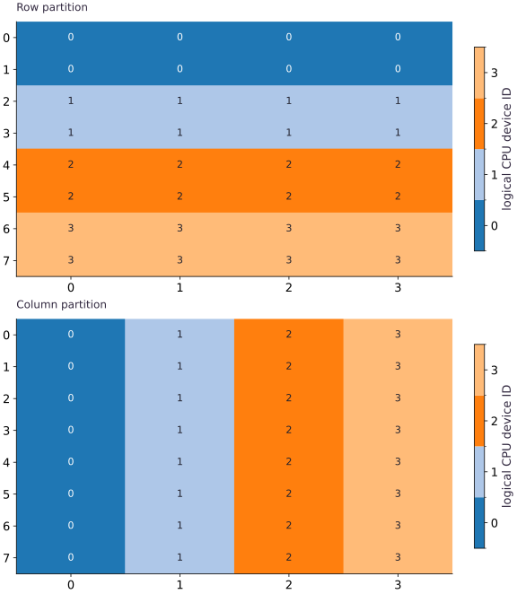

# Arrays, meshes, and sharding

Phase 09: Distributed training · about 80 minutes · 4 logical CPU devices

This reference configures logical CPU devices to practice placement and sharding. Logical devices do not measure TPU performance. Use the execution matrix to review device selection and data ownership before adapting a separate target program.

## What you will be able to do

- Translate a PartitionSpec into local shard shapes.
- Inspect shard indices and verify values.
- Explain communication needs of a global reduction.
- Repair uneven batch statistics with padding and masks.

## The problem

We can split examples across devices, split features across devices, or keep a full copy on each one. Let’s make those choices visible on four logical CPU devices. You’ll inspect the pieces and see why some reductions must combine results. No cluster is needed, and these observations do not measure accelerator performance.

## The idea

Sharding places one global array across a named mesh. Global shape, local shard shape and replication describe different views of the same computation. Make ownership explicit before reasoning about communication.

## Compare the global array with each local piece

The recorded global array has shape $8,4$, not four-by-four: it contains rows 0 through 7 and four columns. On four logical CPU devices, row sharding assigns two complete rows to each device, while column sharding assigns one complete column. Both layouts preserve the same 32 values; they change which values are local.

For example, device 0 owns rows 0 and 1 in the row layout, but column 0 across all eight rows in the column layout. Replication would instead give every device all 32 values. Keep those three ownership patterns distinct when predicting the shape of local work.

The ownership heatmaps show device IDs, not matrix values or speed. Read one cell at a time: the upper panel's first two rows are device 0, while every cell in its first column belongs to device 0 in the lower panel. The execution confirms local shapes $2,4$ and $8,1$.

$$
\text{Mesh}((P_d,P_m), (\texttt{'data'},\texttt{'model'}));\quad P(\texttt{data},\texttt{model}):Y\mapsto\mathbb{R}^{(B/P_d)\times(H/P_m)}
$$

### Pause and reason

Must changing row sharding to column sharding change the answer?

<details><summary>Compare your reasoning</summary>

No. A correct compatible computation preserves the intended global result. Storage and communication can change even when the result agrees. In the following lesson, the batch uses the data axis and parameter output columns use the model axis, so a local parameter shard has shape $(4,2)$.

</details>

## Read the mapping from left to right

Start with the executed global array $8,4$ and a one-dimensional mesh of four devices named `data`. `P("data", None)` divides the first axis into four two-row slices and leaves all four columns together, so each local shape is $2,4$. `P(None, "data")` leaves all eight rows together and divides the second axis into four one-column slices, so each local shape is $8,1$.

`None` means that this array axis is not partitioned by the spec; `P()` instead replicates the full array. If the row count changed from 8 to 10 while the mesh still had four devices, the even split would no longer hold. The lesson's divisibility check makes that changed condition visible instead of silently describing equal shards.

```text
Array (8,4) → P(data,None) → 4 pieces (2,4)
Array (8,4) → P(None,data) → 4 pieces (8,1)
Array (8,4) → P() → 4 full copies (8,4)
```

## Inspect indices rather than guessing ordering

addressable_shards lists pieces this process can access. Each piece carries a device, global index and data. For row partitioning the indices select successive two-row slices; for column partitioning they select individual columns. Compare host[shard.index] with shard.data. This catches a mismatch between the intended assignment and the actual data.

All four devices are addressable here because we have one process. In a multi-process program, the global device set may include devices another process owns. `np.asarray` on a global array that is not fully addressable is not a general multi-host gathering recipe. This lesson deliberately exercises only the single-process case.

## A reduction has a communication requirement

The array is `arange(32).reshape(8,4)`, so row 0 is $[0,1,2,3]$ and row 1 is $[4,5,6,7]$. Under row sharding, device 0 can sum those rows locally to $[4,6,8,10]$; device 1 contributes $[20,22,24,26]$, with devices 2 and 3 contributing the remaining partial sums. Combining them gives the executed global column sums $[112,120,128,136]$.

The first result, 112, is the sum of the first column's values $0+4+8+\cdots+28$. No row shard contains all eight terms, so a replicated result requires combining partial sums across the mesh. JAX executes the placement-aware sum; the values establish the needed global result, while this CPU fixture does not measure how a particular accelerator lowers or times that communication.

```text
partial sums device 0: [4,6,8,10]
partial sums device 1: [20,22,24,26]
partial sums device 2: [36,38,40,42]
partial sums device 3: [52,54,56,58]
combine → [112,120,128,136]
```

## Choose placement for the operation you will perform and run it on a TPU mesh

Elementwise functions naturally preserve local independence. Reductions across a partitioned dimension and matrix multiplications can require communication. Choosing columns instead of rows changes which values are locally available; it does not alter the mathematical answer.

`device_put` from a host NumPy array places that array according to the requested sharding. Moving an already placed JAX array to a different sharding is a resharding operation. Host reconstruction is useful for our tiny verification case but should not be inserted into a real training loop. The experiments compare two layouts for correctness, not speed. Save global shapes, specs and shard tables as the evidence needed to reason about a future workload.

To run this exact mesh and `NamedSharding` contract on a real 4-chip TPU VM (for example `v5litepod-4` or `v6e-4`, provisioned via `lesson-welcome-03.html` and `tpu-gcp.html`), remove the `jax_platforms=cpu` override so `jax.devices()` discovers the four physical TPU chips. On a multi-host TPU slice (`v5litepod-8` or larger), call `jax.distributed.initialize()` at process startup and launch across all workers with `--worker=all`.

**Run the 4-device sharding check on a 4-chip TPU VM (single host)**

```bash
gcloud compute tpus tpu-vm scp exercises/distributed-01.py $TPU_NAME:~/jax-tpu-lab/ --zone=$ZONE
gcloud compute tpus tpu-vm ssh $TPU_NAME --zone=$ZONE \
  --command="sed 's/jax.config.update(\"jax_platforms\", \"cpu\")/# use default TPU backend/; s/jax.devices(\"cpu\")/jax.devices()[:4]/' ~/jax-tpu-lab/distributed-01.py > ~/jax-tpu-lab/distributed-01-tpu.py && JAX_PLATFORMS=tpu ~/jax-tpu-lab/.venv/bin/python ~/jax-tpu-lab/distributed-01-tpu.py"
```

**Expected:** Places the (8, 4) array across four TPU chips, verifies row-shard (2, 4) and column-shard (8, 1) local shapes, and checks the replicated column sum [112, 120, 128, 136].

## Start a fresh CPU runtime

Create main.py in your course workspace. Paste this block first. If using a notebook, restart its kernel before running any cell.

```python
# Step 1 — Start a fresh CPU runtime
import jax
jax.config.update("jax_platforms", "cpu")
# Select the CPU backend and virtual device count before initializing JAX.
jax.config.update("jax_num_cpu_devices", 4)
import jax.numpy as jnp
import numpy as np
from jax.sharding import Mesh, NamedSharding, PartitionSpec as P
devices = jax.devices("cpu")
if len(devices) != 4:
    raise RuntimeError("Expected four CPU devices. Restart the notebook kernel, then Run all; do not run an earlier JAX cell first.")
mesh = Mesh(np.array(devices), ("data",))
rows = NamedSharding(mesh, P("data", None))
replicated = NamedSharding(mesh, P())
```

Configuration happens before `devices()` or array creation initializes a backend. This file explicitly chooses CPU even on a GPU machine.

## Place and compute

Append this block in the same file. Predict the shapes and values before running.

```python
# Step 2 — Place and compute: Mesh axis names describe placement.
host = np.arange(32, dtype=np.float32).reshape(8,4)
# Place `x` explicitly onto the target JAX device.
x = jax.device_put(host, rows)
columns = NamedSharding(mesh, P(None, "data"))
# Place `x_columns` explicitly onto the target JAX device.
x_columns = jax.device_put(host, columns)
# Wrap with `jax.jit` (`sum_rows`) so XLA traces and compiles the function.
sum_rows = jax.jit(lambda a:a.sum(axis=0), in_shardings=rows, out_shardings=replicated)(x)
# Wait for device work to finish before timing it or comparing its result on the host.
sum_rows.block_until_ready()
```

Mesh axis names describe placement. They are separate from the numerical array dimensions.

## Inspect and verify

Append the checks, save the file and run python main.py with the setup lesson environment.

```python
# Step 3 — Inspect and verify
np.testing.assert_array_equal(np.asarray(sum_rows), np.array([112,120,128,136],dtype=np.float32))
for shard in x.addressable_shards:
    # Check tensor shape invariant: `shard.data.shape == (2,4)`
    assert shard.data.shape == (2,4)
    # Transfer the device result to the host for an independent NumPy comparison.
    np.testing.assert_array_equal(np.asarray(shard.data), host[shard.index])
for shard in x_columns.addressable_shards:
    # Check tensor shape invariant: `shard.data.shape == (8,1)`
    assert shard.data.shape == (8,1)
    # Transfer the device result to the host for an independent NumPy comparison.
    np.testing.assert_array_equal(np.asarray(shard.data), host[shard.index])
print("Row-shard shapes:", [s.data.shape for s in x.addressable_shards])
print("Column-shard shapes:", [s.data.shape for s in x_columns.addressable_shards])
print("Column sums:", np.asarray(sum_rows))
```

Assertions compare against host calculations or hand-derived values; printing a sharding object alone is separate from correctness.

## Run the example

```python
# Step 1 — Start a fresh CPU runtime
import jax
jax.config.update("jax_platforms", "cpu")
# Select the CPU backend and virtual device count before initializing JAX.
jax.config.update("jax_num_cpu_devices", 4)
import jax.numpy as jnp
import numpy as np
from jax.sharding import Mesh, NamedSharding, PartitionSpec as P
devices = jax.devices("cpu")
if len(devices) != 4:
    raise RuntimeError("Expected four CPU devices. Restart the notebook kernel, then Run all; do not run an earlier JAX cell first.")
mesh = Mesh(np.array(devices), ("data",))
rows = NamedSharding(mesh, P("data", None))
replicated = NamedSharding(mesh, P())

# Step 2 — Place and compute: Mesh axis names describe placement.
host = np.arange(32, dtype=np.float32).reshape(8,4)
# Place `x` explicitly onto the target JAX device.
x = jax.device_put(host, rows)
columns = NamedSharding(mesh, P(None, "data"))
# Place `x_columns` explicitly onto the target JAX device.
x_columns = jax.device_put(host, columns)
# Wrap with `jax.jit` (`sum_rows`) so XLA traces and compiles the function.
sum_rows = jax.jit(lambda a:a.sum(axis=0), in_shardings=rows, out_shardings=replicated)(x)
# Wait for device work to finish before timing it or comparing its result on the host.
sum_rows.block_until_ready()

# Step 3 — Inspect and verify
np.testing.assert_array_equal(np.asarray(sum_rows), np.array([112,120,128,136],dtype=np.float32))
for shard in x.addressable_shards:
    # Check tensor shape invariant: `shard.data.shape == (2,4)`
    assert shard.data.shape == (2,4)
    # Transfer the device result to the host for an independent NumPy comparison.
    np.testing.assert_array_equal(np.asarray(shard.data), host[shard.index])
for shard in x_columns.addressable_shards:
    # Check tensor shape invariant: `shard.data.shape == (8,1)`
    assert shard.data.shape == (8,1)
    # Transfer the device result to the host for an independent NumPy comparison.
    np.testing.assert_array_equal(np.asarray(shard.data), host[shard.index])
print("Row-shard shapes:", [s.data.shape for s in x.addressable_shards])
print("Column-shard shapes:", [s.data.shape for s in x_columns.addressable_shards])
print("Column sums:", np.asarray(sum_rows))
```

Expected: Four row shards $(2,4)$; four column shards $(8,1)$. Column sums $[112,120,128,136]$.

## Row sharding and column sharding place the same array differently

**Predict:** Which dimension is split across devices in each panel?



**Recorded CPU computation**

### Read the figure

Both heatmaps have array row on the vertical axis and array column on the horizontal axis; each cell is colored and labeled by its logical CPU device ID. The upper, row-partition panel has two-row bands: device 0 owns rows 0 and 1. The lower, column-partition panel has one-column bands: device 0 owns column 0 across all eight rows. The displayed IDs are categorical ownership labels, not array values.

### Connect it to the computation

The actual local shapes are $2,4$ in the upper panel and $8,1$ below, so each device owns eight values in either layout. For the row-0 sum, $0+4+8+\cdots+28=112$, row sharding makes two terms local to each device and the global reduction combines four partials; column sharding leaves the whole first column local to one device. The next decision is therefore to match the partitioned axis to the operation, then check whether the chosen output must be combined or replicated.

```python
panels = []
for name, array in [('Row partition', x), ('Column partition', x_columns)]:
    owner = np.empty(host.shape, dtype=int)
    for s in array.addressable_shards:
        owner[s.index] = s.device.id
    panels.append({'kind': 'heatmap', 'title': name, 'values': owner.tolist(), 'unit': 'logical CPU device ID'})
visual_data = {'kind': 'panels', 'panels': panels}
```

## Recorded reference execution

CPU run: 2026-10-27T17:06:02.965182+00:00. JAX 0.9.2.

```text
Row-shard shapes: [(2, 4), (2, 4), (2, 4), (2, 4)]
Column-shard shapes: [(8, 1), (8, 1), (8, 1), (8, 1)]
Column sums: [112. 120. 128. 136.]
Row-shard shapes: [(2, 4), (2, 4), (2, 4), (2, 4)]
Column-shard shapes: [(8, 1), (8, 1), (8, 1), (8, 1)]
Column sums: [112. 120. 128. 136.]
Resharded values preserved
Row sums: [  6.  22.  38.  54.  70.  86. 102. 118.]
Expected indivisible batch
Expected indivisible batch
PASS: distributed-01

```

## Reshard the same global values

**Predict before running:** Moving $x$ from row partitioning to column partitioning changes local shapes. Does it change the global values?

```python
# Experiment — Reshard the same global values
moved = jax.device_put(x, columns)
# Transfer the device result to the host for an independent NumPy comparison.
np.testing.assert_array_equal(np.asarray(moved), host)
# Check tensor shape invariant: `all(s.data.shape == (8,1) for s in moved.addressable_shards)`
assert all(s.data.shape == (8,1) for s in moved.addressable_shards)
print("Resharded values preserved")
```

**Expected:** Global array unchanged; local shards now $(8,1)$.

Resharding changes ownership of values, not their mathematical identity.

## Reduce a dimension that is not partitioned

**Predict before running:** Sum each row. Predict the output shape and which mesh axis should partition it.

```python
# Experiment — Reduce a dimension that is not partitioned
vector_rows = NamedSharding(mesh, P("data"))
# Wrap with `jax.jit` (`per_row`) so XLA traces and compiles the function.
per_row = jax.jit(lambda a:a.sum(axis=1), in_shardings=rows, out_shardings=vector_rows)(x)
np.testing.assert_array_equal(np.asarray(per_row), np.arange(6,119,16,dtype=np.float32))
# Check tensor shape invariant: `all(s.data.shape == (2,) for s in per_row.addressable_shards)`
assert all(s.data.shape == (2,) for s in per_row.addressable_shards)
print("Row sums:", np.asarray(per_row))
```

**Expected:** Row sums $[6,22,38,54,70,86,102,118]$; local shapes $(2,)$.

All four columns for a row are already local in row partitioning; this reduction does not mathematically require combining data-axis pieces.

## Make it yours

Compare row and column layouts of a $(12,8)$ array, and repair a ten-row mean with padding plus an explicit mask.

### How to write this exercise — Step-by-step recipe & starter scaffold

**Inputs:**
- Four logical CPU devices; row and column NamedSharding objects.
- A (12, 8) matrix and a separate ten-observation, four-feature batch.

**Outputs:**
- Per-device local shapes and values for both (12, 8) layouts.
- A masked ten-row column mean plus an unmasked padded mean for diagnosis.

**Invariants to check:**
- Both placements preserve the same global matrix and each shard matches its indexed host slice.
- Padded rows contribute to neither the masked numerator nor the valid-row denominator.
- The masked mean agrees with the original ten-row host mean.

**Hints:**
- Read each PartitionSpec against the axis it partitions.
- Use shard.index for local-value comparisons; mask padded rows before summing and divide by valid rows.

**Starter code scaffold (fill in the TODOs):**

```python
import numpy as np
import jax
import jax.numpy as jnp

def verify_layouts_and_masked_mean(host, uneven_batch, row_sharding, column_sharding):
    # TODO: compare both placements and their indexed shard values.
    # Then pad the ten-row batch, place a validity mask, and compare masked/unmasked means.
    raise NotImplementedError("Verify both shard layouts and mask-preserved batch statistics")
```

<details><summary>Reference solution</summary>

```python
# Exercise solution
other = np.arange(96,dtype=np.float32).reshape(12,8)
for spec, expected in [(rows,(3,8)),(columns,(12,2))]:
    # Place `placed` explicitly onto the target JAX device.
    placed = jax.device_put(other,spec)
    for shard in placed.addressable_shards:
        # Check tensor shape invariant: `shard.data.shape == expected`
        assert shard.data.shape == expected
        # Transfer the device result to the host for an independent NumPy comparison.
        np.testing.assert_array_equal(np.asarray(shard.data),other[shard.index])

original = np.arange(40,dtype=np.float32).reshape(10,4)
try:
    jax.device_put(original, rows)
except ValueError:
    print("Expected indivisible batch")
else:
    raise AssertionError("Expected divisibility failure")
# Place `padded` explicitly onto the target JAX device.
padded = jax.device_put(np.pad(original,((0,2),(0,0))),rows)
mask_sharding = NamedSharding(mesh,P("data"))
mask = jax.device_put(np.array([1]*10+[0]*2,dtype=np.float32),mask_sharding)
# Wrap with `jax.jit` (`masked_mean`) so XLA traces and compiles the function.
masked_mean = jax.jit(lambda a,m:(a*m[:,None]).sum(axis=0)/m.sum(),in_shardings=(rows,mask_sharding),out_shardings=replicated)(padded,mask)
# Transfer the device result to the host for an independent NumPy comparison.
np.testing.assert_allclose(np.asarray(masked_mean),original.mean(axis=0),rtol=1e-6)
assert not np.allclose(np.asarray(padded.mean(axis=0)), original.mean(axis=0))
```

</details>

## Change both dimensions

**Challenge**

Use a $(12,8)$ array. Verify row and column layouts and predict every local shape.

<details><summary>Hint</summary>

Four devices divide twelve rows or eight columns.

</details>

### How to write: Change both dimensions — Step-by-step recipe & starter scaffold

**Inputs:**
- A (12,8) host matrix and four logical CPU devices.
- Row and column shardings from the lesson.

**Outputs:**
- Exact per-device shapes for both placements.

**Invariants to check:**
- Every shard contains the indexed global slice.
- The global matrix is unchanged by placement.

**Hints:**
- Divide the partitioned dimension by four.
- Check shard.index as well as shard.data.shape.

**Starter code scaffold (fill in the TODOs):**

```python
import numpy as np
import jax

def verify_changed_layout(host, row_sharding, column_sharding):
    # TODO: place the matrix under both shardings and check each local slice.
    raise NotImplementedError("Verify both local shapes and indexed values")
```

<details><summary>Reference solution and reasoning</summary>

```python
# Change both dimensions (Challenge)
other = np.arange(96,dtype=np.float32).reshape(12,8)
for spec, expected in [(rows,(3,8)),(columns,(12,2))]:
    # Place `placed` explicitly onto the target JAX device.
    placed = jax.device_put(other,spec)
    for shard in placed.addressable_shards:
        # Check tensor shape invariant: `shard.data.shape == expected`
        assert shard.data.shape == expected
        # Transfer the device result to the host for an independent NumPy comparison.
        np.testing.assert_array_equal(np.asarray(shard.data),other[shard.index])
```

The row layout owns three complete feature vectors per device; the column layout owns two features for every observation.

</details>

## Pad an uneven batch without corrupting its mean

**Challenge**

Ten observations cannot be row-partitioned over four devices. Pad to twelve and use a mask to recover the true column mean. Demonstrate the wrong unmasked mean.

<details><summary>Hint</summary>

The divisor is the sum of the mask, not padded length.

</details>

### How to write: Pad an uneven batch without corrupting its mean — Step-by-step recipe & starter scaffold

**Inputs:**
- A ten-row host batch with four features and a four-device row sharding.

**Outputs:**
- Masked column mean with shape (4,).
- Unmasked padded mean as a diagnostic.

**Invariants to check:**
- Padding contributes zero to both the numerator and valid-count denominator.
- The masked result matches the original ten-row host mean.

**Hints:**
- Pad only the row axis to a device-divisible length.
- Mask invalid rows before summing and divide by valid rows.

**Starter code scaffold (fill in the TODOs):**

```python
import numpy as np
import jax
import jax.numpy as jnp

def masked_column_mean(batch, row_sharding):
    # TODO: pad rows, place the values and mask, then compute both means.
    # Return device results as host arrays for comparison.
    raise NotImplementedError("Implement masked statistics for the ten valid rows")
```

<details><summary>Reference solution and reasoning</summary>

```python
# Pad an uneven batch without corrupting its mean (Challenge): Padding repairs the shape but adds artificial rows.
original = np.arange(40,dtype=np.float32).reshape(10,4)
try:
    jax.device_put(original, rows)
except ValueError:
    print("Expected indivisible batch")
else:
    raise AssertionError("Expected divisibility failure")
# Place `padded` explicitly onto the target JAX device.
padded = jax.device_put(np.pad(original,((0,2),(0,0))),rows)
mask_sharding = NamedSharding(mesh,P("data"))
mask = jax.device_put(np.array([1]*10+[0]*2,dtype=np.float32),mask_sharding)
# Wrap with `jax.jit` (`masked_mean`) so XLA traces and compiles the function.
masked_mean = jax.jit(lambda a,m:(a*m[:,None]).sum(axis=0)/m.sum(),in_shardings=(rows,mask_sharding),out_shardings=replicated)(padded,mask)
# Transfer the device result to the host for an independent NumPy comparison.
np.testing.assert_allclose(np.asarray(masked_mean),original.mean(axis=0),rtol=1e-6)
assert not np.allclose(np.asarray(padded.mean(axis=0)), original.mean(axis=0))
```

Padding repairs the shape but adds artificial rows. The mask keeps them out of both numerator and denominator. Checking only divisibility would miss this statistical error.

</details>

## Check your understanding

With row sharding, why does a global column sum need results from other devices?

1. Each device initially holds only some rows.
2. Every sum requires host Python.
3. Partitioning changes the mathematical definition of sum.

<details><summary>Answer and explanation</summary>

**1. Each device initially holds only some rows. (correct)**

The reduction spans the partitioned row dimension, so partial contributions must be combined.

**2. Every sum requires host Python.**

The array reduction can execute as device collectives. Global semantics do not require collecting the rows into a Python list.

**3. Partitioning changes the mathematical definition of sum.**

The sum is still over the same global observations. Placement changes the required communication, not the mathematical definition.

</details>

## Diagnose the result

Padding repairs the shape but adds artificial rows. The mask keeps them out of both numerator and denominator. Checking only divisibility would miss this statistical error.

## Carry forward

- Read the mapping from left to right
- Inspect indices rather than guessing ordering
- A reduction has a communication requirement
- Choose placement for the operation you will perform

## Keep your evidence

Padding repairs the shape but adds artificial rows. The mask keeps them out of both numerator and denominator. Checking only divisibility would miss this statistical error.

Save your predictions, modified code, terminal outputs, and reasoning in your engineering portfolio.

## Primary references

- [JAX CPU device configuration (set before initialization)](https://docs.jax.dev/en/latest/config_options.html#num-cpu-devices)
- [Distributed arrays and automatic parallelization](https://docs.jax.dev/en/latest/201/sharding.html)

