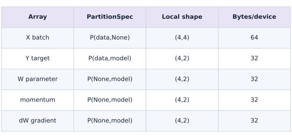
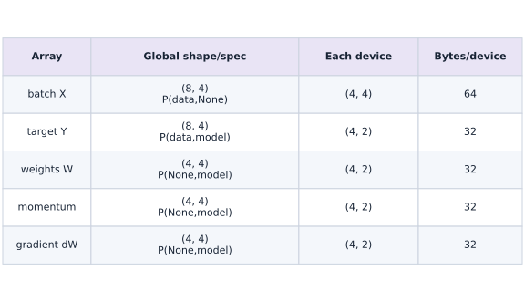

# A sharded training step

Phase 09: Distributed training · about 90 minutes · 4 logical CPU devices

This reference configures logical CPU devices to practice placement and sharding. Logical devices do not measure TPU performance. Use the execution matrix to review device selection and data ownership before adapting a separate target program.

**Before this lesson:** [Arrays, meshes, and sharding](https://www.tahabouhsine.com/jaxpathways/lesson-distributed-01.html).

## What you will be able to do

- Derive the global mean loss and gradient.
- Specify aligned data and replicated parameter placement.
- Verify sharded updates against independent host arithmetic.
- Diagnose normalization errors in equal and unequal local batches.
- Execute a 2x2 parameter-sharded forward/backward/update and compare it with an unsharded oracle.
- Explain per-device parameter and optimizer ownership, bytes, and global reduction axes for unequal and empty valid counts.

## The problem

If we split a batch across four devices, should the model learn four times as much in one step? It should still follow the same global loss. We’ll compare a sharded regression update with a formula we can check on the host, then reproduce the scaling mistake caused by summing local mean gradients.

## The idea

A sharded training step must preserve the intended global objective. Local reductions and collective operations should produce the same normalized gradient as an unsharded reference on the same examples. A follow-on $2\times2$ mesh exercise shards the parameter columns and momentum state as well as the batch, then checks the complete update against an unsharded host oracle.

## Derive the global denominator

Splitting a batch should change where the work happens, not which objective we optimize. Imagine one shard contains two examples, each contributing gradient $1$, while another contains one example contributing gradient $4$. Add the three contributions first: the global mean is $(1+1+4)/3=2$. Averaging the two local means instead gives $(1+4)/2=2.5$, so the single example gets too much influence.

This is why every local contribution needs its matching count. For a masked language loss, the count may be valid targets; for this regression example, it is the examples or output elements declared by the objective. Decide the denominator before choosing a collective.

We begin with a replicated two-weight model and a host calculation you can do by hand. Then the 2x2 exercise splits parameter columns as well as batch rows. Use the ownership table to answer where each value lives, and the independent NumPy update to answer whether moving it changed the mathematics.

### Data and parameter ownership on the 2x2 mesh

**Predict:** Which devices share each input batch slice, and which devices own the two-column parameter slices?



*Observed logical-CPU shapes and float32 ownership for this lesson fixture; not hardware capacity or communication measurements.*

Device labels are mesh coordinates (data,model). Feature rows are split by data and copied across model coordinates. Weight columns are split by model and copied across data coordinates. Momentum matches the weight ownership, allowing each update to pair a parameter shard with its optimizer-state shard. These shapes and byte counts are checked by the executable exercise.

### Pause and reason

Which test exposes an incorrect average of local means?

<details><summary>Compare your reasoning</summary>

Use unequal example or valid-token counts per shard and compare with an independently calculated global mean.

</details>

## Write the objective before splitting the data

Our model predicts $Xw$ with two weights and no bias. The synthetic labels use true weights $[2,-1]$, but the initial weights are zero. The squared-error loss averages eight residuals. Its gradient is $\frac{2}{N}X^\mathsf{T}r$, where $r=Xw-y$ and $N=8$. This host formula is independent of JAX autodiff and supplies a useful reference for the first update.

At $w=0$ the targets are $[2,-1,1,4,-2,3,0,2]$. Squared targets sum to $39$, so initial loss is $39/8=4.875$. $X^\mathsf{T}y=[21,3]$, so the gradient is $[-5.25,-0.75]$. With learning rate $0.1$ the new weights are $[0.525,0.075]$. Check these values before looking at a training curve.

$$
\begin{aligned}L(w)&=\frac{1}{8}\sum_{i=1}^{8}(x_i^\mathsf{T}w-y_i)^2\\g&=\frac{2}{8}X^\mathsf{T}(Xw-y)\\w_{\mathrm{next}}&=w-0.1g\end{aligned}
$$

## Give batch and parameters different placements

The feature matrix has shape $(8,2)$ and uses `P("data",None)`; each of four devices owns two examples. Labels have shape $(8,)$ and use `P("data")`, so their shards align with the feature rows. Parameters have shape $(2,)$ and use `P()`, giving every device both weights.

The input sharding tree supplied to jit has one entry per argument. Outputs are weights, scalar loss and a two-element gradient; all three are replicated in this small example. Replication does not mean four independently trained models. The replicas represent the same global parameters and must receive the same global update.

That one-dimensional exercise keeps parameters replicated. The follow-on exercise below uses a $2\times2$ mesh: $X$ is placed with $P(\texttt{data},None)$, the weight matrix and momentum with $P(None,\texttt{model})$, and the prediction/target matrix with $P(\texttt{data},\texttt{model})$. Each device owns a batch slice and two output columns of the parameters and optimizer state.

```text
CPU 0: X rows 0:2, y rows 0:2, full w
CPU 1: X rows 2:4, y rows 2:4, full w
CPU 2: X rows 4:6, y rows 4:6, full w
CPU 3: X rows 6:8, y rows 6:8, full w
partial contributions → global gradient → same w_next
```

## Differentiate the global function rather than inventing a local objective

loss operates on global JAX arrays. value_and_grad evaluates the objective and obtains its parameter derivative together. jit compiles that function with explicit placement contracts; you do not call a Python training loop separately on each device. Combining contributions is necessary because each local batch alone cannot determine the global mean gradient.

This lesson uses automatic global-array parallelization, not manual shard_map or an explicit pmean. The compiler arranges required operations. Do not add an extra collective to an already global reduction merely because the input is sharded. If you later implement a manual local program, you must derive its aggregation and normalization from the same objective.

## A correct first update is stronger evidence than a falling curve — on CPU and on a 4-chip TPU VM

A loss curve can decrease even with a normalization bug, especially at a small learning rate. Compare the initial loss, every gradient component and updated weights with NumPy. Then change the batch contents and order: a correct global mean should not depend on which device receives a row. Check replicated weight shards separately.

A ten-step loop is included as a transfer experiment, but this is not a complete resilient training system. It has no data pipeline, optimizer moments, checkpoint or multi-host failure handling. CPU virtual devices demonstrate placement and numerical equivalence; to verify the same sharded `train_step` across four physical TPU chips (`v5litepod-4` or `v6e-4`), upload the lesson script to your TPU VM and target `jax.devices()[:4]` with `JAX_PLATFORMS=tpu`. Float32 reduction order may differ slightly across hardware, so use stated tolerances instead of bitwise comparisons.

**Run the sharded training step across four physical TPU chips**

```bash
gcloud compute tpus tpu-vm scp exercises/distributed-02.py $TPU_NAME:~/jax-tpu-lab/ --zone=$ZONE
gcloud compute tpus tpu-vm ssh $TPU_NAME --zone=$ZONE \
  --command="sed 's/jax.config.update(\"jax_platforms\", \"cpu\")/# use default TPU backend/; s/jax.devices(\"cpu\")/jax.devices()[:4]/' ~/jax-tpu-lab/distributed-02.py > ~/jax-tpu-lab/distributed-02-tpu.py && JAX_PLATFORMS=tpu ~/jax-tpu-lab/.venv/bin/python ~/jax-tpu-lab/distributed-02-tpu.py"
```

**Expected:** Executes the sharded value_and_grad update across 4 TPU devices and verifies that the initial loss (4.875), global gradient ([-5.25, -0.75]), and updated weights ([0.525, 0.075]) match the host reference within tolerance.

## Shard parameter columns and carry optimizer state with them

Think of the four devices as two rows and two columns. A row coordinate selects a data slice; a column coordinate selects an output-column slice. The weight matrix is $(4,4)$. Splitting its columns across two model coordinates gives a local $(4,2)$ shard, which contains eight FP32 values and therefore occupies $32$ bytes.

Momentum stores one value for each parameter, so give it the same placement. A device can then pair its local weight, gradient and momentum entries in the elementwise update. The input slice is copied across the two model coordinates because both sets of output columns need those same features. Targets and predictions have both their rows and output columns split.

Read the table one row at a time. The input shard is $(4,4)$, or $64$ bytes; weight, momentum, gradient and target shards are each $(4,2)$, or $32$ bytes. These sizes are obtained from the actual local arrays. After checking ownership, compare the forward result, gradient, next weights and next momentum against the unsharded NumPy calculation. Matching only the loss would leave mistakes in the update undetected.

### Pause and reason

On the 2x2 mesh, which axis splits parameter columns, and where should momentum live?

<details><summary>Compare your reasoning</summary>

The model axis splits columns. Momentum follows the weight sharding P(None, "model"), giving matching (4,2) local slices on each device.

</details>

## Reduce valid contributions across both mesh axes

Padding makes the array shape convenient, but it must not create extra training examples. With five valid rows, the two data slices contain four and one valid rows. With three valid rows, they contain three and zero. The empty slice contributes a zero numerator and zero count; it does not get a fabricated local average.

The printed per-device counts are $[4,4,1,1]$ in the five-row case. Why do they appear to add to ten? Each data slice is represented at both model coordinates. Those entries describe local ownership, not ten distinct examples. The global loss combines residuals over all four output columns and divides by five valid rows times four output columns. Counting each replicated row again would change that objective.

The observed five-row loss is $0.048550$. Equally averaging the nonempty data-slice means instead gives $0.068350$, exposing the weighting bug. The three-row case returns $0.037083$ even with an empty data slice. Use these two cases together: unequal counts test weighting, and an empty slice tests whether zero contributions are handled safely.

JAX differentiates the global objective with the declared array shardings. The resulting parameter gradient combines data contributions while keeping its output columns sharded. If you later write a manual local program, derive its sums and counts from this same objective before adding communication.

### Pause and reason

For valid counts 4 and 1, why can the two local means not be averaged equally?

<details><summary>Compare your reasoning</summary>

The first local mean represents four examples and the second represents one. The global mean weights their sums by valid count and divides by five.

</details>

## Start a fresh CPU runtime

Create main.py in your course workspace. Paste this block first. If using a notebook, restart its kernel before running any cell.

```python
# Step 1 — Start a fresh CPU runtime
import jax
jax.config.update("jax_platforms", "cpu")
# Select the CPU backend and virtual device count before initializing JAX.
jax.config.update("jax_num_cpu_devices", 4)
import jax.numpy as jnp
import numpy as np
from jax.sharding import Mesh, NamedSharding, PartitionSpec as P
devices = jax.devices("cpu")
if len(devices) != 4:
    raise RuntimeError("Expected four CPU devices. Restart the notebook kernel, then Run all; do not run an earlier JAX cell first.")
mesh = Mesh(np.array(devices), ("data",))
rows = NamedSharding(mesh, P("data", None))
replicated = NamedSharding(mesh, P())
```

Configuration happens before `devices()` or array creation initializes a backend. This file explicitly chooses CPU even on a GPU machine.

## Place and compute

Append this block in the same file. Predict the shapes and values before running.

```python
# Step 2 — Place and compute: Mesh axis names describe placement.
host_x = np.array([[1,0],[0,1],[1,1],[2,0],[0,2],[2,1],[1,2],[2,2]],dtype=np.float32)
true_w = np.array([2.,-1.],dtype=np.float32)
host_y = host_x @ true_w
labels_sharding = NamedSharding(mesh,P("data"))
# Place `x` explicitly onto the target JAX device.
x = jax.device_put(host_x, rows)
# Place `y` explicitly onto the target JAX device.
y = jax.device_put(host_y, labels_sharding)
# Place `w` explicitly onto the target JAX device.
w = jax.device_put(np.zeros(2,dtype=np.float32),replicated)
def loss(weights, features, labels):
    return jnp.mean((features @ weights-labels)**2)
def update(weights, features, labels):
    value, gradient = jax.value_and_grad(loss)(weights,features,labels)
    return weights - 0.1*gradient, value, gradient
# Wrap with `jax.jit` (`train_step`) so XLA traces and compiles the function.
train_step = jax.jit(update, in_shardings=(replicated,rows,labels_sharding),out_shardings=(replicated,replicated,replicated))
new_w, before, gradient = train_step(w,x,y)
```

Mesh axis names describe placement. They are separate from the numerical array dimensions.

## Inspect and verify

Append the checks, save the file and run python main.py with the setup lesson environment.

```python
# Step 3 — Inspect and verify
expected_gradient = 2 * host_x.T @ (-host_y) / len(host_y)
# Transfer the device result to the host for an independent NumPy comparison.
np.testing.assert_allclose(np.asarray(gradient),expected_gradient,rtol=1e-6,atol=1e-6)
# Transfer the device result to the host for an independent NumPy comparison.
np.testing.assert_allclose(np.asarray(new_w),-0.1*expected_gradient,rtol=1e-6,atol=1e-6)
expected_loss = np.mean(host_y**2)
# Transfer the device result to the host for an independent NumPy comparison.
np.testing.assert_allclose(np.asarray(before), expected_loss,rtol=1e-6)
assert float(loss(new_w,x,y)) < float(before)
for shard in new_w.addressable_shards:
    # Transfer the device result to the host for an independent NumPy comparison.
    np.testing.assert_allclose(np.asarray(shard.data),np.asarray(new_w))
print("Initial loss:",float(before))
print("Gradient:",np.asarray(gradient),"updated weights:",np.asarray(new_w))
print("Updated loss:",float(loss(new_w,x,y)))
```

Assertions compare against host calculations or hand-derived values; printing a sharding object alone is separate from correctness.

## Run the 2D parameter-sharded update

Continue in the same fresh process after the four-CPU setup. Paste and run this block. It uses a 2x2 (data, model) mesh, checks five-valid and three-valid masked batches, compares the complete update with a NumPy oracle, and prints each device’s actual shard shapes and bytes.

```python
# Step 4 — Run an actual 2D parameter-sharded training update
# This independent task uses 8 padded rows, 4 input features, and 4 output columns.
# It runs on a 2x2 logical CPU mesh and compares against an unsharded NumPy oracle.
import jax
import jax.numpy as jnp
import numpy as np
from jax.sharding import Mesh, NamedSharding, PartitionSpec as P

mesh2d = Mesh(np.asarray(jax.devices("cpu")).reshape(2, 2), ("data", "model"))
x_shard = NamedSharding(mesh2d, P("data", None))
weight_shard = NamedSharding(mesh2d, P(None, "model"))
target_shard = NamedSharding(mesh2d, P("data", "model"))
mask_shard = NamedSharding(mesh2d, P("data"))
replicated_scalar = NamedSharding(mesh2d, P())

x_host = (np.arange(32, dtype=np.float32).reshape(8, 4) - 7) / 10
weight_host = (np.arange(16, dtype=np.float32).reshape(4, 4) - 5) / 20
truth_host = np.full((4, 4), 0.2, dtype=np.float32)
target_host = x_host @ truth_host
momentum_host = np.full((4, 4), 0.1, dtype=np.float32)
x_2d = jax.device_put(x_host, x_shard)
target_2d = jax.device_put(target_host, target_shard)
weight_2d = jax.device_put(weight_host, weight_shard)
momentum_2d = jax.device_put(momentum_host, weight_shard)

# The global masked mean is numerator / (valid examples * output columns).
def masked_loss_2d(weight, features, targets, valid):
    residual = features @ weight - targets
    numerator = jnp.sum(jnp.square(residual) * valid[:, None])
    denominator = jnp.sum(valid) * targets.shape[1]
    return numerator / denominator

@jax.jit(
    in_shardings=(weight_shard, x_shard, target_shard, mask_shard),
    out_shardings=(replicated_scalar, weight_shard),
)
def value_and_grad_2d(weight, features, targets, valid):
    return jax.value_and_grad(masked_loss_2d)(weight, features, targets, valid)

learning_rate_2d = 0.05
momentum_rate_2d = 0.8
@jax.jit(
    in_shardings=(weight_shard, weight_shard, weight_shard),
    out_shardings=(weight_shard, weight_shard),
)
def momentum_update_2d(weight, momentum, gradient):
    next_momentum = momentum_rate_2d * momentum + gradient
    next_weight = weight - learning_rate_2d * next_momentum
    return next_weight, next_momentum

# Five valid rows create unequal local counts (4 and 1); three create an empty shard (3 and 0).
for valid_count_2d in (5, 3):
    valid_host_2d = np.r_[np.ones(valid_count_2d, np.float32),
                          np.zeros(8 - valid_count_2d, np.float32)]
    valid_2d = jax.device_put(valid_host_2d, mask_shard)
    loss_2d, gradient_2d = value_and_grad_2d(
        weight_2d, x_2d, target_2d, valid_2d
    )
    next_weight_2d, next_momentum_2d = momentum_update_2d(
        weight_2d, momentum_2d, gradient_2d
    )
    loss_2d.block_until_ready()

    # Independent unsharded oracle: no JAX sharding or autodiff is used here.
    residual_host_2d = x_host @ weight_host - target_host
    oracle_loss_2d = np.sum(residual_host_2d ** 2 * valid_host_2d[:, None]) / (valid_count_2d * 4)
    oracle_gradient_2d = (
        2 * x_host.T @ (residual_host_2d * valid_host_2d[:, None])
        / (valid_count_2d * 4)
    )
    oracle_momentum_2d = momentum_rate_2d * momentum_host + oracle_gradient_2d
    oracle_weight_2d = weight_host - learning_rate_2d * oracle_momentum_2d
    np.testing.assert_allclose(np.asarray(loss_2d), oracle_loss_2d, rtol=2e-5, atol=2e-6)
    np.testing.assert_allclose(np.asarray(gradient_2d), oracle_gradient_2d, rtol=2e-5, atol=2e-6)
    np.testing.assert_allclose(np.asarray(next_weight_2d), oracle_weight_2d, rtol=2e-5, atol=2e-6)
    np.testing.assert_allclose(np.asarray(next_momentum_2d), oracle_momentum_2d, rtol=2e-5, atol=2e-6)
    local_valid_counts_2d = [
        int(np.asarray(shard.data).sum())
        for shard in valid_2d.addressable_shards
    ]
    expected_counts_2d = [4, 4, 1, 1] if valid_count_2d == 5 else [3, 3, 0, 0]
    assert sorted(local_valid_counts_2d) == sorted(expected_counts_2d)
    local_means_2d = []
    for row_start_2d in (0, 4):
        row_stop_2d = row_start_2d + 4
        shard_count_2d = valid_host_2d[row_start_2d:row_stop_2d].sum()
        shard_numerator_2d = np.sum(
            residual_host_2d[row_start_2d:row_stop_2d] ** 2
            * valid_host_2d[row_start_2d:row_stop_2d, None]
        )
        if shard_count_2d:
            local_means_2d.append(shard_numerator_2d / (shard_count_2d * 4))
        else:
            assert shard_numerator_2d == 0
    if valid_count_2d == 5:
        # Negative control: equal averaging of 4-example and 1-example means is wrong.
        naive_local_mean_2d = float(np.mean(local_means_2d))
        assert not np.isclose(naive_local_mean_2d, oracle_loss_2d)
        print(f"valid=5; naive equal mean of nonempty shard means={naive_local_mean_2d:.6f} (wrong); weighted global loss={oracle_loss_2d:.6f}")
    else:
        print("valid=3; empty data shard contributes zero sum and zero count")
    print(f"valid={valid_count_2d}; device valid counts={local_valid_counts_2d}; loss={float(loss_2d):.6f}")

# Report per-device ownership from the actual addressable shards. All are float32.
def shard_report_2d(name, array):
    rows = []
    for shard in array.addressable_shards:
        rows.append((shard.device.id, shard.data.shape, int(shard.data.size * shard.data.dtype.itemsize)))
    print(f"{name} per device (device id, local shape, bytes): {rows}")

for name_2d, value_2d in [
    ("batch features", x_2d),
    ("targets", target_2d),
    ("parameters", weight_2d),
    ("momentum state", momentum_2d),
    ("parameter gradient", gradient_2d),
    ("updated parameters", next_weight_2d),
    ("updated momentum", next_momentum_2d),
]:
    shard_report_2d(name_2d, value_2d)
print("2D parameter-sharded forward/backward/update matches the unsharded NumPy oracle")
```

The model axis partitions parameter output columns; momentum follows those columns. The data axis partitions rows. Compare the 4/1 local means before trusting a global mean, and check that the empty 3/0 shard contributes neither numerator nor count.

## Run the example

```python
# Step 1 — Start a fresh CPU runtime
import jax
jax.config.update("jax_platforms", "cpu")
# Select the CPU backend and virtual device count before initializing JAX.
jax.config.update("jax_num_cpu_devices", 4)
import jax.numpy as jnp
import numpy as np
from jax.sharding import Mesh, NamedSharding, PartitionSpec as P
devices = jax.devices("cpu")
if len(devices) != 4:
    raise RuntimeError("Expected four CPU devices. Restart the notebook kernel, then Run all; do not run an earlier JAX cell first.")
mesh = Mesh(np.array(devices), ("data",))
rows = NamedSharding(mesh, P("data", None))
replicated = NamedSharding(mesh, P())

# Step 2 — Place and compute: Mesh axis names describe placement.
host_x = np.array([[1,0],[0,1],[1,1],[2,0],[0,2],[2,1],[1,2],[2,2]],dtype=np.float32)
true_w = np.array([2.,-1.],dtype=np.float32)
host_y = host_x @ true_w
labels_sharding = NamedSharding(mesh,P("data"))
# Place `x` explicitly onto the target JAX device.
x = jax.device_put(host_x, rows)
# Place `y` explicitly onto the target JAX device.
y = jax.device_put(host_y, labels_sharding)
# Place `w` explicitly onto the target JAX device.
w = jax.device_put(np.zeros(2,dtype=np.float32),replicated)
def loss(weights, features, labels):
    return jnp.mean((features @ weights-labels)**2)
def update(weights, features, labels):
    value, gradient = jax.value_and_grad(loss)(weights,features,labels)
    return weights - 0.1*gradient, value, gradient
# Wrap with `jax.jit` (`train_step`) so XLA traces and compiles the function.
train_step = jax.jit(update, in_shardings=(replicated,rows,labels_sharding),out_shardings=(replicated,replicated,replicated))
new_w, before, gradient = train_step(w,x,y)

# Step 3 — Inspect and verify
expected_gradient = 2 * host_x.T @ (-host_y) / len(host_y)
# Transfer the device result to the host for an independent NumPy comparison.
np.testing.assert_allclose(np.asarray(gradient),expected_gradient,rtol=1e-6,atol=1e-6)
# Transfer the device result to the host for an independent NumPy comparison.
np.testing.assert_allclose(np.asarray(new_w),-0.1*expected_gradient,rtol=1e-6,atol=1e-6)
expected_loss = np.mean(host_y**2)
# Transfer the device result to the host for an independent NumPy comparison.
np.testing.assert_allclose(np.asarray(before), expected_loss,rtol=1e-6)
assert float(loss(new_w,x,y)) < float(before)
for shard in new_w.addressable_shards:
    # Transfer the device result to the host for an independent NumPy comparison.
    np.testing.assert_allclose(np.asarray(shard.data),np.asarray(new_w))
print("Initial loss:",float(before))
print("Gradient:",np.asarray(gradient),"updated weights:",np.asarray(new_w))
print("Updated loss:",float(loss(new_w,x,y)))

# Step 4 — Run an actual 2D parameter-sharded training update
# This independent task uses 8 padded rows, 4 input features, and 4 output columns.
# It runs on a 2x2 logical CPU mesh and compares against an unsharded NumPy oracle.
import jax
import jax.numpy as jnp
import numpy as np
from jax.sharding import Mesh, NamedSharding, PartitionSpec as P

mesh2d = Mesh(np.asarray(jax.devices("cpu")).reshape(2, 2), ("data", "model"))
x_shard = NamedSharding(mesh2d, P("data", None))
weight_shard = NamedSharding(mesh2d, P(None, "model"))
target_shard = NamedSharding(mesh2d, P("data", "model"))
mask_shard = NamedSharding(mesh2d, P("data"))
replicated_scalar = NamedSharding(mesh2d, P())

x_host = (np.arange(32, dtype=np.float32).reshape(8, 4) - 7) / 10
weight_host = (np.arange(16, dtype=np.float32).reshape(4, 4) - 5) / 20
truth_host = np.full((4, 4), 0.2, dtype=np.float32)
target_host = x_host @ truth_host
momentum_host = np.full((4, 4), 0.1, dtype=np.float32)
x_2d = jax.device_put(x_host, x_shard)
target_2d = jax.device_put(target_host, target_shard)
weight_2d = jax.device_put(weight_host, weight_shard)
momentum_2d = jax.device_put(momentum_host, weight_shard)

# The global masked mean is numerator / (valid examples * output columns).
def masked_loss_2d(weight, features, targets, valid):
    residual = features @ weight - targets
    numerator = jnp.sum(jnp.square(residual) * valid[:, None])
    denominator = jnp.sum(valid) * targets.shape[1]
    return numerator / denominator

@jax.jit(
    in_shardings=(weight_shard, x_shard, target_shard, mask_shard),
    out_shardings=(replicated_scalar, weight_shard),
)
def value_and_grad_2d(weight, features, targets, valid):
    return jax.value_and_grad(masked_loss_2d)(weight, features, targets, valid)

learning_rate_2d = 0.05
momentum_rate_2d = 0.8
@jax.jit(
    in_shardings=(weight_shard, weight_shard, weight_shard),
    out_shardings=(weight_shard, weight_shard),
)
def momentum_update_2d(weight, momentum, gradient):
    next_momentum = momentum_rate_2d * momentum + gradient
    next_weight = weight - learning_rate_2d * next_momentum
    return next_weight, next_momentum

# Five valid rows create unequal local counts (4 and 1); three create an empty shard (3 and 0).
for valid_count_2d in (5, 3):
    valid_host_2d = np.r_[np.ones(valid_count_2d, np.float32),
                          np.zeros(8 - valid_count_2d, np.float32)]
    valid_2d = jax.device_put(valid_host_2d, mask_shard)
    loss_2d, gradient_2d = value_and_grad_2d(
        weight_2d, x_2d, target_2d, valid_2d
    )
    next_weight_2d, next_momentum_2d = momentum_update_2d(
        weight_2d, momentum_2d, gradient_2d
    )
    loss_2d.block_until_ready()

    # Independent unsharded oracle: no JAX sharding or autodiff is used here.
    residual_host_2d = x_host @ weight_host - target_host
    oracle_loss_2d = np.sum(residual_host_2d ** 2 * valid_host_2d[:, None]) / (valid_count_2d * 4)
    oracle_gradient_2d = (
        2 * x_host.T @ (residual_host_2d * valid_host_2d[:, None])
        / (valid_count_2d * 4)
    )
    oracle_momentum_2d = momentum_rate_2d * momentum_host + oracle_gradient_2d
    oracle_weight_2d = weight_host - learning_rate_2d * oracle_momentum_2d
    np.testing.assert_allclose(np.asarray(loss_2d), oracle_loss_2d, rtol=2e-5, atol=2e-6)
    np.testing.assert_allclose(np.asarray(gradient_2d), oracle_gradient_2d, rtol=2e-5, atol=2e-6)
    np.testing.assert_allclose(np.asarray(next_weight_2d), oracle_weight_2d, rtol=2e-5, atol=2e-6)
    np.testing.assert_allclose(np.asarray(next_momentum_2d), oracle_momentum_2d, rtol=2e-5, atol=2e-6)
    local_valid_counts_2d = [
        int(np.asarray(shard.data).sum())
        for shard in valid_2d.addressable_shards
    ]
    expected_counts_2d = [4, 4, 1, 1] if valid_count_2d == 5 else [3, 3, 0, 0]
    assert sorted(local_valid_counts_2d) == sorted(expected_counts_2d)
    local_means_2d = []
    for row_start_2d in (0, 4):
        row_stop_2d = row_start_2d + 4
        shard_count_2d = valid_host_2d[row_start_2d:row_stop_2d].sum()
        shard_numerator_2d = np.sum(
            residual_host_2d[row_start_2d:row_stop_2d] ** 2
            * valid_host_2d[row_start_2d:row_stop_2d, None]
        )
        if shard_count_2d:
            local_means_2d.append(shard_numerator_2d / (shard_count_2d * 4))
        else:
            assert shard_numerator_2d == 0
    if valid_count_2d == 5:
        # Negative control: equal averaging of 4-example and 1-example means is wrong.
        naive_local_mean_2d = float(np.mean(local_means_2d))
        assert not np.isclose(naive_local_mean_2d, oracle_loss_2d)
        print(f"valid=5; naive equal mean of nonempty shard means={naive_local_mean_2d:.6f} (wrong); weighted global loss={oracle_loss_2d:.6f}")
    else:
        print("valid=3; empty data shard contributes zero sum and zero count")
    print(f"valid={valid_count_2d}; device valid counts={local_valid_counts_2d}; loss={float(loss_2d):.6f}")

# Report per-device ownership from the actual addressable shards. All are float32.
def shard_report_2d(name, array):
    rows = []
    for shard in array.addressable_shards:
        rows.append((shard.device.id, shard.data.shape, int(shard.data.size * shard.data.dtype.itemsize)))
    print(f"{name} per device (device id, local shape, bytes): {rows}")

for name_2d, value_2d in [
    ("batch features", x_2d),
    ("targets", target_2d),
    ("parameters", weight_2d),
    ("momentum state", momentum_2d),
    ("parameter gradient", gradient_2d),
    ("updated parameters", next_weight_2d),
    ("updated momentum", next_momentum_2d),
]:
    shard_report_2d(name_2d, value_2d)
print("2D parameter-sharded forward/backward/update matches the unsharded NumPy oracle")
```

Expected: Initial loss $4.875$; gradient $[-5.25,-0.75]$; weights $[0.525,0.075]$; updated loss is lower. Small float32 printing differences are expected.

The 2D parameter-sharded task compares the masked loss, gradient, updated weights and updated momentum with an unsharded NumPy oracle for valid counts five and three. Its report prints actual local shapes and bytes for each device.

## A 2x2 mesh owns batch rows and parameter columns

**Predict:** Which values are split along data, and which are split along model?



**Recorded CPU computation**

### Read the figure

Each table row describes one global array and the slice visible on a device. Read the placement before the bytes: `P(data,None)` splits input rows while retaining all feature columns; `P(None,model)` retains all input-feature rows but splits parameter output columns. `P(data,model)` splits both dimensions of the target.

For the input, a local $(4,4)$ slice contains sixteen FP32 values, so the table reports $64$ bytes. A local $(4,2)$ weight slice contains eight values, so it reports $32$ bytes. Momentum and the parameter gradient have the same local shape as the weights. These are logical array sizes derived from this CPU run, rather than total allocator usage.

### Connect it to the computation

Use the table to reason about the next update: which device already owns the matching weight, gradient and momentum entries? Then ask which inputs are copied to both model coordinates. This separates two questions that are easy to mix up: where values live, and how distinct examples contribute to the global loss. The NumPy comparison checks the second question while the local shape/byte table checks the first.

```python
# Derive the table from actual local shards rather than hardcoded byte labels.
table_rows = []
for label, array, spec_label in [
    ('batch X', x_2d, 'P(data,None)'),
    ('target Y', target_2d, 'P(data,model)'),
    ('weights W', weight_2d, 'P(None,model)'),
    ('momentum', momentum_2d, 'P(None,model)'),
    ('gradient dW', gradient_2d, 'P(None,model)'),
]:
    shards = array.addressable_shards
    shapes = {tuple(s.data.shape) for s in shards}
    sizes = {int(s.data.size * s.data.dtype.itemsize) for s in shards}
    assert len(shapes) == len(sizes) == 1
    table_rows.append([label, str(tuple(array.shape)) + '\n' + spec_label,
                       str(next(iter(shapes))), next(iter(sizes))])
visual_data = {'kind': 'table', 'headers': ['Array','Global shape/spec','Each device','Bytes/device'],
               'rows': table_rows, 'widths': [.17,.40,.23,.20]}

```

## Recorded reference execution

CPU run: 2026-10-27T16:11:11.618608+00:00. JAX 0.9.2.

```text
Initial loss: 4.875
Gradient: [-5.25 -0.75] updated weights: [0.52500004 0.075     ]
Updated loss: 2.6784372329711914
valid=5; naive equal mean of nonempty shard means=0.068350 (wrong); weighted global loss=0.048550
valid=5; device valid counts=[4, 4, 1, 1]; loss=0.048550
valid=3; empty data shard contributes zero sum and zero count
valid=3; device valid counts=[3, 3, 0, 0]; loss=0.037083
batch features per device (device id, local shape, bytes): [(0, (4, 4), 64), (1, (4, 4), 64), (2, (4, 4), 64), (3, (4, 4), 64)]
targets per device (device id, local shape, bytes): [(0, (4, 2), 32), (1, (4, 2), 32), (2, (4, 2), 32), (3, (4, 2), 32)]
parameters per device (device id, local shape, bytes): [(0, (4, 2), 32), (1, (4, 2), 32), (2, (4, 2), 32), (3, (4, 2), 32)]
momentum state per device (device id, local shape, bytes): [(0, (4, 2), 32), (1, (4, 2), 32), (2, (4, 2), 32), (3, (4, 2), 32)]
parameter gradient per device (device id, local shape, bytes): [(0, (4, 2), 32), (1, (4, 2), 32), (2, (4, 2), 32), (3, (4, 2), 32)]
updated parameters per device (device id, local shape, bytes): [(0, (4, 2), 32), (1, (4, 2), 32), (2, (4, 2), 32), (3, (4, 2), 32)]
updated momentum per device (device id, local shape, bytes): [(0, (4, 2), 32), (1, (4, 2), 32), (2, (4, 2), 32), (3, (4, 2), 32)]
2D parameter-sharded forward/backward/update matches the unsharded NumPy oracle
Initial loss: 4.875
Gradient: [-5.25 -0.75] updated weights: [0.52500004 0.075     ]
Updated loss: 2.6784372329711914
valid=5; naive equal mean of nonempty shard means=0.068350 (wrong); weighted global loss=0.048550
valid=5; device valid counts=[4, 4, 1, 1]; loss=0.048550
valid=3; empty data shard contributes zero sum and zero count
valid=3; device valid counts=[3, 3, 0, 0]; loss=0.037083
batch features per device (device id, local shape, bytes): [(0, (4, 4), 64), (1, (4, 4), 64), (2, (4, 4), 64), (3, (4, 4), 64)]
targets per device (device id, local shape, bytes): [(0, (4, 2), 32), (1, (4, 2), 32), (2, (4, 2), 32), (3, (4, 2), 32)]
parameters per device (device id, local shape, bytes): [(0, (4, 2), 32), (1, (4, 2), 32), (2, (4, 2), 32), (3, (4, 2), 32)]
momentum state per device (device id, local shape, bytes): [(0, (4, 2), 32), (1, (4, 2), 32), (2, (4, 2), 32), (3, (4, 2), 32)]
parameter gradient per device (device id, local shape, bytes): [(0, (4, 2), 32), (1, (4, 2), 32), (2, (4, 2), 32), (3, (4, 2), 32)]
updated parameters per device (device id, local shape, bytes): [(0, (4, 2), 32), (1, (4, 2), 32), (2, (4, 2), 32), (3, (4, 2), 32)]
updated momentum per device (device id, local shape, bytes): [(0, (4, 2), 32), (1, (4, 2), 32), (2, (4, 2), 32), (3, (4, 2), 32)]
2D parameter-sharded forward/backward/update matches the unsharded NumPy oracle
Permutation preserves the global update
Ten-step weights: [ 1.704636  -0.7047408]
valid=5; naive equal mean of nonempty shard means=0.068350 (wrong); weighted global loss=0.048550
valid=5; device valid counts=[4, 4, 1, 1]; loss=0.048550
valid=3; empty data shard contributes zero sum and zero count
valid=3; device valid counts=[3, 3, 0, 0]; loss=0.037083
batch features per device (device id, local shape, bytes): [(0, (4, 4), 64), (1, (4, 4), 64), (2, (4, 4), 64), (3, (4, 4), 64)]
targets per device (device id, local shape, bytes): [(0, (4, 2), 32), (1, (4, 2), 32), (2, (4, 2), 32), (3, (4, 2), 32)]
parameters per device (device id, local shape, bytes): [(0, (4, 2), 32), (1, (4, 2), 32), (2, (4, 2), 32), (3, (4, 2), 32)]
momentum state per device (device id, local shape, bytes): [(0, (4, 2), 32), (1, (4, 2), 32), (2, (4, 2), 32), (3, (4, 2), 32)]
parameter gradient per device (device id, local shape, bytes): [(0, (4, 2), 32), (1, (4, 2), 32), (2, (4, 2), 32), (3, (4, 2), 32)]
updated parameters per device (device id, local shape, bytes): [(0, (4, 2), 32), (1, (4, 2), 32), (2, (4, 2), 32), (3, (4, 2), 32)]
updated momentum per device (device id, local shape, bytes): [(0, (4, 2), 32), (1, (4, 2), 32), (2, (4, 2), 32), (3, (4, 2), 32)]
2D parameter-sharded forward/backward/update matches the unsharded NumPy oracle
Summed local means are four times too large; weighted aggregation repaired
Summed local means are four times too large; weighted aggregation repaired
12-row transfer: valid counts=[6, 6, 1, 1]; loss=0.032743; parameter shards=(4,2), 32 bytes/device
PASS: distributed-02

```

## Permutation across shards

**Predict before running:** Reversing example order changes which device owns each example. Should the global gradient change?

```python
# Experiment — Permutation across shards: The global mean is invariant to row order.
reverse_x = jax.device_put(host_x[::-1].copy(),rows)
# Place `reverse_y` explicitly onto the target JAX device.
reverse_y = jax.device_put(host_y[::-1].copy(),labels_sharding)
reverse_w,reverse_loss,reverse_gradient = train_step(w,reverse_x,reverse_y)
# Transfer the device result to the host for an independent NumPy comparison.
np.testing.assert_allclose(np.asarray(reverse_gradient),expected_gradient,rtol=1e-6,atol=1e-6)
# Transfer the device result to the host for an independent NumPy comparison.
np.testing.assert_allclose(np.asarray(reverse_w),np.asarray(new_w),rtol=1e-6,atol=1e-6)
print("Permutation preserves the global update")
```

**Expected:** Gradient and update agree within $10^{-6}$.

The global mean is invariant to row order. This check exposes accidental dependence on a particular local subset.

## Ten updates against a host training loop

**Predict before running:** Predict whether the two implementations should track each other, not whether loss reaches zero in ten steps.

```python
# Experiment — Ten updates against a host training loop
cpu_weights = w
reference_weights = np.zeros(2,dtype=np.float32)
for step_index in range(10):
    cpu_weights,_,_ = train_step(cpu_weights,x,y)
    residual = host_x @ reference_weights-host_y
    # Accumulate the next contribution into `reference_weights`.
    reference_weights -= 0.1*(2*host_x.T @ residual/len(host_y))
    # Transfer the device result to the host for an independent NumPy comparison.
    np.testing.assert_allclose(np.asarray(cpu_weights),reference_weights,rtol=1e-5,atol=1e-6)
print("Ten-step weights:",np.asarray(cpu_weights))
```

**Expected:** Each of ten parameter updates agrees with the independent host loop within the stated tolerance.

Checking every update catches transient mismatches that a single final loss comparison could hide.

## Parameter-sharded update with unequal and empty valid counts

**Predict before running:** On a 2x2 data/model mesh, predict each device’s weight and momentum shape. Then predict the two data-shard valid counts when five rows, and then three rows, are valid.

```python
# This independent task uses 8 padded rows, 4 input features, and 4 output columns.
# It runs on a 2x2 logical CPU mesh and compares against an unsharded NumPy oracle.
import jax
import jax.numpy as jnp
import numpy as np
from jax.sharding import Mesh, NamedSharding, PartitionSpec as P

mesh2d = Mesh(np.asarray(jax.devices("cpu")).reshape(2, 2), ("data", "model"))
x_shard = NamedSharding(mesh2d, P("data", None))
weight_shard = NamedSharding(mesh2d, P(None, "model"))
target_shard = NamedSharding(mesh2d, P("data", "model"))
mask_shard = NamedSharding(mesh2d, P("data"))
replicated_scalar = NamedSharding(mesh2d, P())

x_host = (np.arange(32, dtype=np.float32).reshape(8, 4) - 7) / 10
weight_host = (np.arange(16, dtype=np.float32).reshape(4, 4) - 5) / 20
truth_host = np.full((4, 4), 0.2, dtype=np.float32)
target_host = x_host @ truth_host
momentum_host = np.full((4, 4), 0.1, dtype=np.float32)
x_2d = jax.device_put(x_host, x_shard)
target_2d = jax.device_put(target_host, target_shard)
weight_2d = jax.device_put(weight_host, weight_shard)
momentum_2d = jax.device_put(momentum_host, weight_shard)

# The global masked mean is numerator / (valid examples * output columns).
def masked_loss_2d(weight, features, targets, valid):
    residual = features @ weight - targets
    numerator = jnp.sum(jnp.square(residual) * valid[:, None])
    denominator = jnp.sum(valid) * targets.shape[1]
    return numerator / denominator

@jax.jit(
    in_shardings=(weight_shard, x_shard, target_shard, mask_shard),
    out_shardings=(replicated_scalar, weight_shard),
)
def value_and_grad_2d(weight, features, targets, valid):
    return jax.value_and_grad(masked_loss_2d)(weight, features, targets, valid)

learning_rate_2d = 0.05
momentum_rate_2d = 0.8
@jax.jit(
    in_shardings=(weight_shard, weight_shard, weight_shard),
    out_shardings=(weight_shard, weight_shard),
)
def momentum_update_2d(weight, momentum, gradient):
    next_momentum = momentum_rate_2d * momentum + gradient
    next_weight = weight - learning_rate_2d * next_momentum
    return next_weight, next_momentum

# Five valid rows create unequal local counts (4 and 1); three create an empty shard (3 and 0).
for valid_count_2d in (5, 3):
    valid_host_2d = np.r_[np.ones(valid_count_2d, np.float32),
                          np.zeros(8 - valid_count_2d, np.float32)]
    valid_2d = jax.device_put(valid_host_2d, mask_shard)
    loss_2d, gradient_2d = value_and_grad_2d(
        weight_2d, x_2d, target_2d, valid_2d
    )
    next_weight_2d, next_momentum_2d = momentum_update_2d(
        weight_2d, momentum_2d, gradient_2d
    )
    loss_2d.block_until_ready()

    # Independent unsharded oracle: no JAX sharding or autodiff is used here.
    residual_host_2d = x_host @ weight_host - target_host
    oracle_loss_2d = np.sum(residual_host_2d ** 2 * valid_host_2d[:, None]) / (valid_count_2d * 4)
    oracle_gradient_2d = (
        2 * x_host.T @ (residual_host_2d * valid_host_2d[:, None])
        / (valid_count_2d * 4)
    )
    oracle_momentum_2d = momentum_rate_2d * momentum_host + oracle_gradient_2d
    oracle_weight_2d = weight_host - learning_rate_2d * oracle_momentum_2d
    np.testing.assert_allclose(np.asarray(loss_2d), oracle_loss_2d, rtol=2e-5, atol=2e-6)
    np.testing.assert_allclose(np.asarray(gradient_2d), oracle_gradient_2d, rtol=2e-5, atol=2e-6)
    np.testing.assert_allclose(np.asarray(next_weight_2d), oracle_weight_2d, rtol=2e-5, atol=2e-6)
    np.testing.assert_allclose(np.asarray(next_momentum_2d), oracle_momentum_2d, rtol=2e-5, atol=2e-6)
    local_valid_counts_2d = [
        int(np.asarray(shard.data).sum())
        for shard in valid_2d.addressable_shards
    ]
    expected_counts_2d = [4, 4, 1, 1] if valid_count_2d == 5 else [3, 3, 0, 0]
    assert sorted(local_valid_counts_2d) == sorted(expected_counts_2d)
    local_means_2d = []
    for row_start_2d in (0, 4):
        row_stop_2d = row_start_2d + 4
        shard_count_2d = valid_host_2d[row_start_2d:row_stop_2d].sum()
        shard_numerator_2d = np.sum(
            residual_host_2d[row_start_2d:row_stop_2d] ** 2
            * valid_host_2d[row_start_2d:row_stop_2d, None]
        )
        if shard_count_2d:
            local_means_2d.append(shard_numerator_2d / (shard_count_2d * 4))
        else:
            assert shard_numerator_2d == 0
    if valid_count_2d == 5:
        # Negative control: equal averaging of 4-example and 1-example means is wrong.
        naive_local_mean_2d = float(np.mean(local_means_2d))
        assert not np.isclose(naive_local_mean_2d, oracle_loss_2d)
        print(f"valid=5; naive equal mean of nonempty shard means={naive_local_mean_2d:.6f} (wrong); weighted global loss={oracle_loss_2d:.6f}")
    else:
        print("valid=3; empty data shard contributes zero sum and zero count")
    print(f"valid={valid_count_2d}; device valid counts={local_valid_counts_2d}; loss={float(loss_2d):.6f}")

# Report per-device ownership from the actual addressable shards. All are float32.
def shard_report_2d(name, array):
    rows = []
    for shard in array.addressable_shards:
        rows.append((shard.device.id, shard.data.shape, int(shard.data.size * shard.data.dtype.itemsize)))
    print(f"{name} per device (device id, local shape, bytes): {rows}")

for name_2d, value_2d in [
    ("batch features", x_2d),
    ("targets", target_2d),
    ("parameters", weight_2d),
    ("momentum state", momentum_2d),
    ("parameter gradient", gradient_2d),
    ("updated parameters", next_weight_2d),
    ("updated momentum", next_momentum_2d),
]:
    shard_report_2d(name_2d, value_2d)
print("2D parameter-sharded forward/backward/update matches the unsharded NumPy oracle")
```

**Expected:** Four (4,2) parameter shards and four matching momentum shards; each contains 32 float32 bytes. For five valid rows, data-axis counts are 4 and 1 (replicated over model); for three valid rows they are 3 and 0. Loss, gradient and one momentum update match the unsharded NumPy oracle.

The model axis partitions output columns. The data axis partitions rows. Valid counts weight the row contributions, and an all-invalid local row shard contributes zero while the global denominator stays positive. Global reduction semantics combine the masked numerator and valid count across the mesh dimensions required by this objective; the parameter gradient keeps its model-sharded column ownership.

## Make it yours

Run a changed target/initial-state update, then diagnose the factor-of-four local-mean bug and repair uneven-batch aggregation.

### How to write this exercise — Step-by-step recipe & starter scaffold

**Inputs:**
- Feature matrix and labels for a linear model; changed true weights [-1, 3], initial weights [0.2, -0.1], and learning rate 0.05.
- Four equal-size host shards and one uneven-size partition of the same examples.

**Outputs:**
- One changed-target parameter update and an independent gradient check.
- Four local mean gradients, their naive sum, the correctly averaged global gradient, and an example-count-weighted uneven-shard result.

**Invariants to check:**
- Summing four local means scales the result by four; averaging equal-size local means recovers the global mean.
- Unequal local batches must be weighted by example count.
- The update uses the changed target and starts from the supplied initial weights.

**Hints:**
- Derive labels from the changed true weights, then differentiate the mean loss.
- Compare local-mean aggregation separately from the changed one-step update.
- For unequal shards, weight each local mean by its local count.

**Starter code scaffold (fill in the TODOs):**

```python
import numpy as np
import jax
import jax.numpy as jnp

def diagnose_sharded_update(features, labels, true_weights, initial_weights, learning_rate, equal_shards, uneven_shards):
    # TODO: derive the changed target update and compare local/global gradients.
    # Report both the naive local-mean sum and count-weighted uneven aggregation.
    raise NotImplementedError("Separate the changed training step from local-mean aggregation")
```

<details><summary>Reference solution</summary>

```python
# Exercise solution
changed_y = host_x @ np.array([-1.,3.],dtype=np.float32)
start = np.array([0.2,-0.1],dtype=np.float32)
def changed_update(weights,features,labels):
    return weights-0.05*jax.grad(loss)(weights,features,labels)
# Wrap with `jax.jit` (`changed_step`) so XLA traces and compiles the function.
changed_step = jax.jit(changed_update,in_shardings=(replicated,rows,labels_sharding),out_shardings=replicated)
# Place `result` explicitly onto the target JAX device.
result = changed_step(jax.device_put(start,replicated),x,jax.device_put(changed_y,labels_sharding))
reference_gradient = 2*host_x.T @ (host_x@start-changed_y)/len(changed_y)
# Transfer the device result to the host for an independent NumPy comparison.
np.testing.assert_allclose(np.asarray(result),start-0.05*reference_gradient,rtol=1e-6,atol=1e-6)

local_gradients = []
for features,labels in zip(np.split(host_x,4),np.split(host_y,4)):
    local_gradients.append(2*features.T @ (-labels)/len(labels))
# Reduce along axis=0 to compute `wrong`.
wrong = np.sum(local_gradients,axis=0)
# Reduce along axis=0 to compute `right`.
right = np.mean(local_gradients,axis=0)
np.testing.assert_allclose(wrong,4*expected_gradient,rtol=1e-6)
np.testing.assert_allclose(right,expected_gradient,rtol=1e-6)
# Unequal partitions: weight local mean gradients by their observation counts.
parts = [(host_x[:3],host_y[:3]),(host_x[3:],host_y[3:])]
weighted = sum(len(b)*(2*a.T @ (-b)/len(b)) for a,b in parts)/len(host_y)
np.testing.assert_allclose(weighted,expected_gradient,rtol=1e-6)
print("Summed local means are four times too large; weighted aggregation repaired")
```

</details>

## Transfer to a different target model

**Challenge**

Change true weights to $[-1,3]$, start at $[0.2,-0.1]$ and use learning rate $0.05$. Derive and check the new update without reusing the original numeric answer.

<details><summary>Hint</summary>

The original train_step hardcodes $0.1$; define a new step with the changed rate.

</details>

### How to write: Transfer to a different target model — Step-by-step recipe & starter scaffold

**Inputs:**
- Features and labels for a linear model, changed true weights [-1,3], starting weights [0.2,-0.1], and step size 0.05.

**Outputs:**
- Changed one-step parameter vector.
- Independent objective and gradient comparison.

**Invariants to check:**
- The check derives labels from the changed true weights.
- The update starts from the supplied initial weights.

**Hints:**
- Use a mean over examples in the loss.
- Keep truth weights separate from the fitted parameter vector.

**Starter code scaffold (fill in the TODOs):**

```python
import numpy as np
import jax
import jax.numpy as jnp

def transfer_update(features, initial_weights, true_weights, learning_rate):
    # TODO: build labels, differentiate the mean loss, and check the update independently.
    raise NotImplementedError("Implement the changed target and initial state")
```

<details><summary>Reference solution and reasoning</summary>

```python
# Transfer to a different target model (Challenge)
changed_y = host_x @ np.array([-1.,3.],dtype=np.float32)
start = np.array([0.2,-0.1],dtype=np.float32)
def changed_update(weights,features,labels):
    return weights-0.05*jax.grad(loss)(weights,features,labels)
# Wrap with `jax.jit` (`changed_step`) so XLA traces and compiles the function.
changed_step = jax.jit(changed_update,in_shardings=(replicated,rows,labels_sharding),out_shardings=replicated)
# Place `result` explicitly onto the target JAX device.
result = changed_step(jax.device_put(start,replicated),x,jax.device_put(changed_y,labels_sharding))
reference_gradient = 2*host_x.T @ (host_x@start-changed_y)/len(changed_y)
# Transfer the device result to the host for an independent NumPy comparison.
np.testing.assert_allclose(np.asarray(result),start-0.05*reference_gradient,rtol=1e-6,atol=1e-6)
```

The independent formula follows the new target, initial state and learning rate. Reusing a hard-coded expected weight vector would not test transfer.

</details>

## Diagnose summed local means

**Challenge**

Compute four host local mean gradients. Show why summing them gives four times the global mean, then repair the aggregation. Also explain the unequal-batch generalization.

<details><summary>Hint</summary>

A mean of equal-size local means works; unequal sizes require weighting by local counts.

</details>

### How to write: Diagnose summed local means — Step-by-step recipe & starter scaffold

**Inputs:**
- Four equal-sized feature/label shards and a parameter vector.
- An additional unequal-sized partitioning for the generalization check.

**Outputs:**
- Local mean gradients, their sum, and the correctly aggregated global gradient.

**Invariants to check:**
- Summing four local means is scaled by the number of shards.
- Unequal shard sizes require weighting by example count.

**Hints:**
- Compare sums of losses with sums of gradients before averaging.
- Weight each local mean by its local count for unequal partitions.

**Starter code scaffold (fill in the TODOs):**

```python
import numpy as np

def compare_local_mean_gradients(feature_shards, label_shards, weights):
    # TODO: calculate each local mean gradient and both aggregations.
    # Also return an example-count-weighted aggregation.
    raise NotImplementedError("Diagnose local-mean scaling and size-weight the shards")
```

<details><summary>Reference solution and reasoning</summary>

```python
# Diagnose summed local means (Challenge): Each local gradient already divides by its local count.
local_gradients = []
for features,labels in zip(np.split(host_x,4),np.split(host_y,4)):
    local_gradients.append(2*features.T @ (-labels)/len(labels))
# Reduce along axis=0 to compute `wrong`.
wrong = np.sum(local_gradients,axis=0)
# Reduce along axis=0 to compute `right`.
right = np.mean(local_gradients,axis=0)
np.testing.assert_allclose(wrong,4*expected_gradient,rtol=1e-6)
np.testing.assert_allclose(right,expected_gradient,rtol=1e-6)
# Unequal partitions: weight local mean gradients by their observation counts.
parts = [(host_x[:3],host_y[:3]),(host_x[3:],host_y[3:])]
weighted = sum(len(b)*(2*a.T @ (-b)/len(b)) for a,b in parts)/len(host_y)
np.testing.assert_allclose(weighted,expected_gradient,rtol=1e-6)
print("Summed local means are four times too large; weighted aggregation repaired")
```

Each local gradient already divides by its local count. Summing four equal local means omits division by four. For unequal counts, an unweighted mean also misrepresents examples; sum count-weighted local means and divide by total count.

</details>

## Change the mesh-sized regression fixture

**Transfer**

Change the padded batch to twelve rows and use a 2x2 mesh. Choose seven valid rows. State the valid counts on each data shard, preserve the parameter-column and momentum placement, then compare loss, gradient and one update with the independent unsharded formula. Report local shapes and bytes.

<details><summary>Hint</summary>

Each data shard gets six padded rows. The model axis still owns two output columns per device. Divide by seven valid examples times four output columns.

</details>

### How to write: Change the mesh-sized regression fixture — Step-by-step recipe & starter scaffold

**Inputs:**
- A 2x2 logical CPU mesh, padded eight-row feature and target arrays, a valid-row mask, a (4,4) weight matrix and matching momentum.
- Two mask cases: five valid examples (counts 4/1) and three valid examples (counts 3/0).

**Outputs:**
- Per-device local shapes and float32 bytes for batch, target, parameter, momentum and gradient shards.
- Masked loss, gradient, updated weights and updated momentum checked against an independent unsharded calculation.

**Invariants to check:**
- X uses P("data",None); W and momentum use P(None,"model"); prediction and target use P("data","model").
- The loss divides by valid-example count times output width.
- An empty local shard contributes zero numerator and zero valid count.

**Hints:**
- Use jax.value_and_grad for the global masked objective and an explicitly sharded jax.jit call.
- For 4/1 counts, compare equal averaging of local means with the correctly weighted global mean.

**Starter code scaffold (fill in the TODOs):**

```python
import jax
import jax.numpy as jnp
import numpy as np

def parameter_sharded_update(mesh, features, targets, weights, momentum, valid_rows):
    # TODO: make NamedSharding objects for data, model, targets, and parameters.
    # Place inputs, differentiate the masked global mean, and apply one momentum step.
    # Return loss, gradient, new weights, new momentum, and a per-device byte ledger.
    raise NotImplementedError("Complete and verify the 2x2 parameter-sharded update")
```

<details><summary>Reference solution and reasoning</summary>

```python
# Transfer the fixture to twelve padded rows with seven valid examples.
x12_host = (np.arange(48, dtype=np.float32).reshape(12, 4) - 11) / 12
truth12_host = np.full((4, 4), 0.15, dtype=np.float32)
target12_host = x12_host @ truth12_host
valid12_host = np.r_[np.ones(7, np.float32), np.zeros(5, np.float32)]
x12_2d = jax.device_put(x12_host, x_shard)
target12_2d = jax.device_put(target12_host, target_shard)
valid12_2d = jax.device_put(valid12_host, mask_shard)
loss12_2d, gradient12_2d = value_and_grad_2d(
    weight_2d, x12_2d, target12_2d, valid12_2d
)
next_weight12_2d, next_momentum12_2d = momentum_update_2d(
    weight_2d, momentum_2d, gradient12_2d
)
residual12_host = x12_host @ weight_host - target12_host
oracle_loss12 = np.sum(residual12_host[:7] ** 2) / (7 * 4)
oracle_gradient12 = 2 * x12_host[:7].T @ residual12_host[:7] / (7 * 4)
oracle_momentum12 = momentum_rate_2d * momentum_host + oracle_gradient12
oracle_weight12 = weight_host - learning_rate_2d * oracle_momentum12
np.testing.assert_allclose(np.asarray(loss12_2d), oracle_loss12, rtol=2e-5, atol=2e-6)
np.testing.assert_allclose(np.asarray(gradient12_2d), oracle_gradient12, rtol=2e-5, atol=2e-6)
np.testing.assert_allclose(np.asarray(next_weight12_2d), oracle_weight12, rtol=2e-5, atol=2e-6)
np.testing.assert_allclose(np.asarray(next_momentum12_2d), oracle_momentum12, rtol=2e-5, atol=2e-6)
counts12 = [int(np.asarray(s.data).sum()) for s in valid12_2d.addressable_shards]
assert sorted(counts12) == [1, 1, 6, 6]
assert all(s.data.shape == (4, 2) and s.data.nbytes == 32 for s in next_weight12_2d.addressable_shards)
print(f"12-row transfer: valid counts={counts12}; loss={float(loss12_2d):.6f}; parameter shards=(4,2), 32 bytes/device")
```

This transfer checks that valid-count weighting and the placement contract come from shapes and the objective, not the original eight-row numeric fixture.

</details>

## Check your understanding

Four equal-size shards compute local mean gradients. Which aggregation gives the global mean gradient?

1. Sum them without scaling.
2. Average them, or sum local gradient numerators and divide by total examples.
3. Choose the device with the lowest local loss.

<details><summary>Answer and explanation</summary>

**1. Sum them without scaling.**

Summing local means multiplies the gradient for equal shard sizes. Compare the result with a single-device global mean.

**2. Average them, or sum local gradient numerators and divide by total examples. (correct)**

A global mean gives each observation equal weight. With equal local counts, averaging local means preserves that weighting.

**3. Choose the device with the lowest local loss.**

Choosing one device discards the other data. Aggregate all example contributions with the correct observation denominator.

</details>

## Diagnose the result

Each local gradient already divides by its local count. Summing four equal local means omits division by four. For unequal counts, an unweighted mean also misrepresents examples; sum count-weighted local means and divide by total count. The additional two-dimensional exercise carries model-sharded parameters and matching momentum through one checked optimizer update. Its tiny float32 ownership ledger is not a hardware memory-capacity estimate.

## Carry forward

- Write the objective before splitting the data
- Give batch and parameters different placements
- Differentiate the global function rather than inventing a local objective
- A correct first update is stronger evidence than a falling curve
- Parameter and optimizer-state shards follow the model axis through a complete update.

## Keep your evidence

Keep 1D and 2D shard ownership, per-device parameter/momentum bytes, asymmetric-input forward/backward/update comparisons, unequal and empty valid-count cases and the wrong local-mean control.

Save your predictions, modified code, terminal outputs, and reasoning in your engineering portfolio.

## Primary references

- [JAX CPU device configuration (set before initialization)](https://docs.jax.dev/en/latest/config_options.html#num-cpu-devices)
- [Distributed arrays and automatic parallelization](https://docs.jax.dev/en/latest/201/sharding.html)
- [JAX distributed arrays and automatic parallelization](https://docs.jax.dev/en/latest/201/sharding.html)

