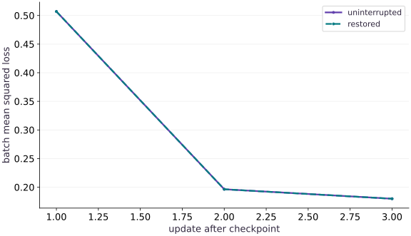

# Resilient distributed training

Phase 09: Distributed training · about 105 minutes · 4 logical CPU devices

This reference configures logical CPU devices to practice placement and sharding. Logical devices do not measure TPU performance. Use the execution matrix to review device selection and data ownership before adapting a separate target program.

**Before this lesson:** [Communication-efficient algorithms](https://www.tahabouhsine.com/jaxpathways/lesson-distributed-03.html).

## What you will be able to do

- Restore a complete training state with explicit target sharding.
- Compare next sample IDs, optimizer state and losses across an epoch boundary.
- Explain single-controller evidence and the additional requirements of a real multi-controller restart.

## The problem

A restarted sharded run loads the right weights, yet its next update differs. Which missing state could explain that? We will checkpoint a real sharded training step, restore its parameters, momentum, random key and data position, then compare three subsequent updates across an epoch boundary.

## The idea

Distributed recovery must reconstruct a consistent global state. Participants cannot independently load arbitrary local snapshots and assume the pieces describe one completed update. Checkpoint identity and step meaning must agree.

## Agree on one global recovery boundary

Two local files from different steps can each load successfully while forming no valid global checkpoint. A shared manifest should identify which pieces belong together and what happens if a required piece is missing.

After restore, compare the next global computation with an uninterrupted reference, including input position and random-state ownership. Silent partial recovery changes the computation instead of continuing it.

The CPU replay checks this bounded fixture's continuation. It is separate from multi-host failure handling, storage durability or accelerator networking. Those require additional operational evidence when deploying the design.

### Pause and reason

Why is successful loading on every worker insufficient?

<details><summary>Compare your reasoning</summary>

Workers may load incompatible steps or pieces. Correct recovery requires one consistent global identity and the intended next computation.

</details>

## Name the values that determine the next transition

The state contains weights $w$, momentum $v$, a random key, the current example permutation, the cursor into that permutation and the completed step. A batch is selected from the saved order, then a global mean gradient updates momentum and weights. After the final batch in an epoch, a new split key creates the next order. Saving only the current permutation can therefore reproduce the first resumed batch but fail at the next epoch.

$$
v_{t+1}=0.8v_t+\nabla L_t(w_t),\qquad w_{t+1}=w_t-0.04v_{t+1}
$$

## Checkpoint one completed global step

The example partitions examples across four logical CPU devices and keeps its small parameter state replicated. It waits for the step loss, saves the entire state with a real Orbax StandardCheckpointer, waits for saving to finish and restores against a target whose arrays carry the intended mesh and sharding. Every restored leaf is compared with the saved snapshot.

The dataset is a deterministic tiny NumPy fixture. Every controller can reconstruct it from the same declared seed, dimensions and target rule. Real input systems need data identity, preprocessing configuration and iterator recovery, as covered in the recovery phase; matching a seed alone is not enough for a changing dataset. Changing the number of devices here changes fixture dimensions and is deliberately outside this restart contract.

## Prove the next updates, including the next epoch

After restoring step 1, compare the next three transitions in order. The recorded sample IDs are $[12,5,4,1,8,13,2,11]$, then $[9,0,7,15,11,13,8,14]$, then $[1,6,5,4,3,12,2,10]$. The second batch begins a new shuffled epoch, so matching it checks the saved random key as well as the current permutation and cursor.

The pre-update batch losses match at about $0.5070, 0.1964, 0.1798$, and every state leaf is also compared after each update. A separate NumPy gradient formula checks the update itself, since two runs could reproduce the same bug. If momentum were omitted, the same next sample IDs would still appear but the weights would differ; if the key were wrong, the current-epoch batch could match and the next-epoch IDs would expose it.

## Move the protocol to multiple controllers explicitly

The default run has one controller and four logical CPU devices. It does not kill a worker or test cross-host storage failure. The optional COURSE_MULTIPROCESS branch calls jax.distributed.initialize before any device query and builds a global mesh. Every controller must run the same script, take the same branches and call save and restore in the same order. The tiny fixture is intentionally duplicated on each host; the callback supplies only the slices required by each addressable shard.

On a supported existing multi-host TPU environment, give every worker the same new shared checkpoint directory and run the command below on every worker. The launcher must supply the environment that JAX uses for initialization. A path local to only one worker is not shared storage. For a fresh-process restart of this drill, run every controller again with COURSE_RESUME=1 and the same checkpoint directory. Resume skips saving and restores the existing accepted step-one snapshot; the script recomputes the deterministic step-one baseline only to verify this teaching fixture. A general training job must select and validate its own accepted step. Restart the whole worker group according to your job manager; this lesson does not implement elastic membership or automatic worker replacement. This target branch is executable but has not been run on a multi-host cluster here.

**Distribute the script and launch across every worker of a multi-host TPU slice**

```bash
# Distribute the script and launch across every worker of a multi-host TPU slice
gcloud compute tpus tpu-vm scp exercises/distributed-04.py $TPU_NAME:~/jax-tpu-lab/ --zone=$ZONE --worker=all
gcloud compute tpus tpu-vm ssh $TPU_NAME --zone=$ZONE --worker=all \
  --command="COURSE_MULTIPROCESS=1 JAX_PLATFORMS=tpu COURSE_CHECKPOINT_DIR=/shared/new-recovery-run ~/jax-tpu-lab/.venv/bin/python ~/jax-tpu-lab/distributed-04.py"
```

**Expected:** All workers initialize distributed JAX, coordinate, save and restore through the same shared path, and report tpu with a process count greater than one. This command needs a configured multi-host TPU slice and shared storage.

**Resume the same accepted checkpoint across every TPU slice worker**

```bash
# Resume the same accepted checkpoint across every TPU slice worker
gcloud compute tpus tpu-vm ssh $TPU_NAME --zone=$ZONE --worker=all \
  --command="COURSE_MULTIPROCESS=1 COURSE_RESUME=1 JAX_PLATFORMS=tpu COURSE_CHECKPOINT_DIR=/shared/new-recovery-run ~/jax-tpu-lab/.venv/bin/python ~/jax-tpu-lab/distributed-04.py"
```

**Expected:** The worker group loads its existing step-one checkpoint without overwriting it, then verifies subsequent updates across the epoch boundary.

## Reject an inconsistent recovery point

The fault-injection checks change one restored value at a time. Removing momentum changes weights by about $0.0195$ on the next update despite matching sample IDs; replacing the key preserves the current batch but changes the next epoch's permutation. Those outcomes show why a checkpoint boundary includes optimizer and random state, not only parameters.

This replay uses one controller and four logical CPU devices. It validates the saved fixture and its next transitions; it does not exercise a worker crash, shared-storage durability or elastic membership. For a multi-controller run, all workers must restore the same accepted step and data identity before any update, then compare a global reference rather than treating readable local files as proof of a consistent checkpoint.

## Initialize the runtime before device access

Add this block after the preceding block in main.py and run the assembled file in a fresh process.

```python
# Step 1 — Initialize the runtime before device access
import os
import tempfile
from pathlib import Path
import jax
# Read `multi` from environment configuration (with a default fallback).
multi = os.environ.get('COURSE_MULTIPROCESS') == '1'
# Read `resume` from environment configuration (with a default fallback).
resume = os.environ.get('COURSE_RESUME') == '1'
if multi:
    # Every controller runs this before querying devices or creating arrays.
    jax.distributed.initialize()
else:
    jax.config.update('jax_platforms', 'cpu')
    jax.config.update('jax_num_cpu_devices', 4)
import jax.numpy as jnp
import numpy as np
import orbax.checkpoint as ocp
from jax.sharding import Mesh, NamedSharding, PartitionSpec as P
```

Every controller must use consistent state, data and collective order; the default exercise runs on four logical CPU devices.

## Define the global fixture and placements

Add this block after the preceding block in main.py and run the assembled file in a fresh process.

```python
# Step 2 — Define the global fixture and placements
count = jax.device_count()
assert count >= 2, 'Use at least two devices for the placement exercise'
mesh = Mesh(np.asarray(jax.devices()), ('data',))
rep = NamedSharding(mesh, P())
row = NamedSharding(mesh, P('data', None))
label = NamedSharding(mesh, P('data'))
batch_size, size, width = 2 * count, 4 * count, 2 * count
# Identical tiny synthetic fixture on each controller; not distributed data ingestion.
data = np.random.default_rng(41).normal(size=(size, width)).astype(np.float32)
truth = np.linspace(-0.3, 0.4, width, dtype=np.float32)
targets = data @ truth
```

Every controller must use consistent state, data and collective order; the default exercise runs on four logical CPU devices.

## Carry complete transition state

Add this block after the preceding block in main.py and run the assembled file in a fresh process.

```python
# Step 3 — Carry complete transition state
def placed(value, sharding=rep):
    # Transfer the device result to the host for an independent NumPy comparison.
    a = np.asarray(value)
    return jax.make_array_from_callback(a.shape, sharding, lambda index: a[index])
```

Every controller must use consistent state, data and collective order; the default exercise runs on four logical CPU devices.

## Checkpoint and verify replay

Add this block after the preceding block in main.py and run the assembled file in a fresh process.

```python
# Step 4 — Checkpoint and verify replay
def initial():
    # Create or split explicit PRNG key(s) (`(key, order_key)`) for reproducible randomness.
    key, order_key = jax.random.split(jax.random.PRNGKey(17))
    return { 'weights': placed(np.zeros(width, np.float32)),
             'momentum': placed(np.zeros(width, np.float32)),
             'key': placed(np.asarray(key)),
             'order': placed(np.asarray(jax.random.permutation(order_key, size))),
             'cursor': placed(np.int32(0)), 'step': placed(np.int32(0)) }
```

Every controller must use consistent state, data and collective order; the default exercise runs on four logical CPU devices.

## Checkpoint and verify replay

Add this block after the preceding block in main.py and run the assembled file in a fresh process.

```python
# Step 5 — Checkpoint and verify replay
# Define and JIT-compile `update(w, velocity, x, y)` so XLA traces and fuses the operations:
@jax.jit
def update(w, velocity, x, y):
    loss, grad = jax.value_and_grad(lambda a: jnp.mean((x @ a - y)**2))(w)
    v = 0.8 * velocity + grad
    return w - 0.04 * v, v, loss
```

Every controller must use consistent state, data and collective order; the default exercise runs on four logical CPU devices.

## Checkpoint and verify replay

Add this block after the preceding block in main.py and run the assembled file in a fresh process.

```python
# Step 6 — Checkpoint and verify replay
def transition(state):
    cursor = int(state['cursor'])
    # Transfer the device result to the host for an independent NumPy comparison.
    order = np.asarray(state['order'])
    key = state['key']
    if cursor == size:
        key, shuffle_key = jax.random.split(key)
        order = np.asarray(jax.random.permutation(shuffle_key, size))
        cursor = 0
    ids = order[cursor:cursor + batch_size]
    x, y = placed(data[ids], row), placed(targets[ids], label)
    w, v, loss = update(state['weights'], state['momentum'], x, y)
    # Wait for device work to finish before timing it or comparing its result on the host.
    loss.block_until_ready()
    # Independent global derivative and momentum update on the host.
    old_w, old_v = np.asarray(state['weights']), np.asarray(state['momentum'])
    g = 2 * data[ids].T @ (data[ids] @ old_w - targets[ids]) / batch_size
    # Transfer the device result to the host for an independent NumPy comparison.
    np.testing.assert_allclose(np.asarray(v), 0.8 * old_v + g, rtol=2e-5, atol=2e-6)
    # Transfer the device result to the host for an independent NumPy comparison.
    np.testing.assert_allclose(np.asarray(w), old_w - 0.04 * np.asarray(v), rtol=2e-5, atol=2e-6)
    # Transfer the device result to the host for an independent NumPy comparison.
    new = dict(weights=w, momentum=v, key=placed(np.asarray(key)),
               order=placed(order), cursor=placed(np.int32(cursor+batch_size)),
               step=placed(np.int32(int(state['step'])+1)))
    return new, ids.copy(), float(loss)
```

Every controller must use consistent state, data and collective order; the default exercise runs on four logical CPU devices.

## Checkpoint and verify replay

Add this block after the preceding block in main.py and run the assembled file in a fresh process.

```python
# Step 7 — Checkpoint and verify replay
state = initial()
state, first_ids, _ = transition(state)
# Shared path is mandatory for real multi-controller execution.
if multi:
    root = Path(os.environ['COURSE_CHECKPOINT_DIR']).resolve()
else:
    root = Path(os.environ['COURSE_CHECKPOINT_DIR']).resolve() if os.environ.get('COURSE_CHECKPOINT_DIR') else Path(tempfile.mkdtemp(prefix='jax-distributed-recovery-'))
checkpoint_path = root / 'step-one'
if resume and not checkpoint_path.exists():
    raise FileNotFoundError('Resume needs an existing step-one checkpoint')
if not resume and checkpoint_path.exists():
    raise FileExistsError('Use a new folder or set COURSE_RESUME=1 for the accepted checkpoint')
with ocp.StandardCheckpointer() as checkpointer:
    if not resume:
        checkpointer.save(checkpoint_path, state)
        checkpointer.wait_until_finished()
    # Target carries the current mesh/sharding, rather than inferring it from old metadata.
    restored = checkpointer.restore(checkpoint_path, target=initial())
    for name in state:
        # Transfer the device result to the host for an independent NumPy comparison.
        np.testing.assert_array_equal(np.asarray(restored[name]), np.asarray(state[name]))
    baseline, resumed = state, restored
    baseline_losses, resumed_losses, replay_ids = [], [], []
    for _ in range(3):
        baseline, ids_a, loss_a = transition(baseline)
        resumed, ids_b, loss_b = transition(resumed)
        np.testing.assert_array_equal(ids_a, ids_b)
        for name in baseline:
            # Transfer the device result to the host for an independent NumPy comparison.
            np.testing.assert_allclose(np.asarray(baseline[name]), np.asarray(resumed[name]), rtol=2e-5, atol=2e-6)
        baseline_losses.append(loss_a)
        resumed_losses.append(loss_b)
        replay_ids.append(ids_a.tolist())
print('Recorded backend/processes/devices:', jax.default_backend(), jax.process_count(), count)
print('Restored step/cursor:', int(restored['step']), int(restored['cursor']))
print('Next sample IDs across epoch boundary:', replay_ids)
print('Uninterrupted losses:', baseline_losses)
print('Restored losses:', resumed_losses)
print('Checkpoint:', checkpoint_path)
```

Every controller must use consistent state, data and collective order; the default exercise runs on four logical CPU devices.

## Run the example

```python
# Step 1 — Initialize the runtime before device access
import os
import tempfile
from pathlib import Path
import jax
# Read `multi` from environment configuration (with a default fallback).
multi = os.environ.get('COURSE_MULTIPROCESS') == '1'
# Read `resume` from environment configuration (with a default fallback).
resume = os.environ.get('COURSE_RESUME') == '1'
if multi:
    # Every controller runs this before querying devices or creating arrays.
    jax.distributed.initialize()
else:
    jax.config.update('jax_platforms', 'cpu')
    jax.config.update('jax_num_cpu_devices', 4)
import jax.numpy as jnp
import numpy as np
import orbax.checkpoint as ocp
from jax.sharding import Mesh, NamedSharding, PartitionSpec as P

# Step 2 — Define the global fixture and placements
count = jax.device_count()
assert count >= 2, 'Use at least two devices for the placement exercise'
mesh = Mesh(np.asarray(jax.devices()), ('data',))
rep = NamedSharding(mesh, P())
row = NamedSharding(mesh, P('data', None))
label = NamedSharding(mesh, P('data'))
batch_size, size, width = 2 * count, 4 * count, 2 * count
# Identical tiny synthetic fixture on each controller; not distributed data ingestion.
data = np.random.default_rng(41).normal(size=(size, width)).astype(np.float32)
truth = np.linspace(-0.3, 0.4, width, dtype=np.float32)
targets = data @ truth

# Step 3 — Carry complete transition state
def placed(value, sharding=rep):
    # Transfer the device result to the host for an independent NumPy comparison.
    a = np.asarray(value)
    return jax.make_array_from_callback(a.shape, sharding, lambda index: a[index])

# Step 4 — Checkpoint and verify replay
def initial():
    # Create or split explicit PRNG key(s) (`(key, order_key)`) for reproducible randomness.
    key, order_key = jax.random.split(jax.random.PRNGKey(17))
    return { 'weights': placed(np.zeros(width, np.float32)),
             'momentum': placed(np.zeros(width, np.float32)),
             'key': placed(np.asarray(key)),
             'order': placed(np.asarray(jax.random.permutation(order_key, size))),
             'cursor': placed(np.int32(0)), 'step': placed(np.int32(0)) }

# Step 5 — Checkpoint and verify replay
# Define and JIT-compile `update(w, velocity, x, y)` so XLA traces and fuses the operations:
@jax.jit
def update(w, velocity, x, y):
    loss, grad = jax.value_and_grad(lambda a: jnp.mean((x @ a - y)**2))(w)
    v = 0.8 * velocity + grad
    return w - 0.04 * v, v, loss

# Step 6 — Checkpoint and verify replay
def transition(state):
    cursor = int(state['cursor'])
    # Transfer the device result to the host for an independent NumPy comparison.
    order = np.asarray(state['order'])
    key = state['key']
    if cursor == size:
        key, shuffle_key = jax.random.split(key)
        order = np.asarray(jax.random.permutation(shuffle_key, size))
        cursor = 0
    ids = order[cursor:cursor + batch_size]
    x, y = placed(data[ids], row), placed(targets[ids], label)
    w, v, loss = update(state['weights'], state['momentum'], x, y)
    # Wait for device work to finish before timing it or comparing its result on the host.
    loss.block_until_ready()
    # Independent global derivative and momentum update on the host.
    old_w, old_v = np.asarray(state['weights']), np.asarray(state['momentum'])
    g = 2 * data[ids].T @ (data[ids] @ old_w - targets[ids]) / batch_size
    # Transfer the device result to the host for an independent NumPy comparison.
    np.testing.assert_allclose(np.asarray(v), 0.8 * old_v + g, rtol=2e-5, atol=2e-6)
    # Transfer the device result to the host for an independent NumPy comparison.
    np.testing.assert_allclose(np.asarray(w), old_w - 0.04 * np.asarray(v), rtol=2e-5, atol=2e-6)
    # Transfer the device result to the host for an independent NumPy comparison.
    new = dict(weights=w, momentum=v, key=placed(np.asarray(key)),
               order=placed(order), cursor=placed(np.int32(cursor+batch_size)),
               step=placed(np.int32(int(state['step'])+1)))
    return new, ids.copy(), float(loss)

# Step 7 — Checkpoint and verify replay
state = initial()
state, first_ids, _ = transition(state)
# Shared path is mandatory for real multi-controller execution.
if multi:
    root = Path(os.environ['COURSE_CHECKPOINT_DIR']).resolve()
else:
    root = Path(os.environ['COURSE_CHECKPOINT_DIR']).resolve() if os.environ.get('COURSE_CHECKPOINT_DIR') else Path(tempfile.mkdtemp(prefix='jax-distributed-recovery-'))
checkpoint_path = root / 'step-one'
if resume and not checkpoint_path.exists():
    raise FileNotFoundError('Resume needs an existing step-one checkpoint')
if not resume and checkpoint_path.exists():
    raise FileExistsError('Use a new folder or set COURSE_RESUME=1 for the accepted checkpoint')
with ocp.StandardCheckpointer() as checkpointer:
    if not resume:
        checkpointer.save(checkpoint_path, state)
        checkpointer.wait_until_finished()
    # Target carries the current mesh/sharding, rather than inferring it from old metadata.
    restored = checkpointer.restore(checkpoint_path, target=initial())
    for name in state:
        # Transfer the device result to the host for an independent NumPy comparison.
        np.testing.assert_array_equal(np.asarray(restored[name]), np.asarray(state[name]))
    baseline, resumed = state, restored
    baseline_losses, resumed_losses, replay_ids = [], [], []
    for _ in range(3):
        baseline, ids_a, loss_a = transition(baseline)
        resumed, ids_b, loss_b = transition(resumed)
        np.testing.assert_array_equal(ids_a, ids_b)
        for name in baseline:
            # Transfer the device result to the host for an independent NumPy comparison.
            np.testing.assert_allclose(np.asarray(baseline[name]), np.asarray(resumed[name]), rtol=2e-5, atol=2e-6)
        baseline_losses.append(loss_a)
        resumed_losses.append(loss_b)
        replay_ids.append(ids_a.tolist())
print('Recorded backend/processes/devices:', jax.default_backend(), jax.process_count(), count)
print('Restored step/cursor:', int(restored['step']), int(restored['cursor']))
print('Next sample IDs across epoch boundary:', replay_ids)
print('Uninterrupted losses:', baseline_losses)
print('Restored losses:', resumed_losses)
print('Checkpoint:', checkpoint_path)
```

Expected: On the four-device CPU fixture, restoration starts at completed step 1 with cursor 8. The next three sample-ID lists and complete states agree with uninterrupted execution. Reference losses are approximately 0.5070, 0.1964 and 0.1798. The real checkpoint path is printed.

## Restored updates reproduce the reference trajectory

**Predict:** Where might two apparently equal restarts first diverge if the next epoch needs an unsaved random key?



**Recorded CPU computation**

### Read the figure

The horizontal axis counts the first, second and third updates after the saved step. The vertical axis is batch mean squared loss in squared target units before each update. The uninterrupted and restored lines overlap at $0.50696$, $0.19637$ and $0.17984$ on this CPU fixture. The second point is the first batch of a newly shuffled epoch, so its match follows a new-key transition, not merely a continuation through the old permutation.

### Connect it to the computation

The line comparison is a quick replay check; the code also matches sample IDs and every state leaf, and compares each update against an independent NumPy gradient. If the random key were wrong, the first point could still match but the second batch and its loss would diverge. If momentum were missing, IDs would match while the updated state would not. The plot says nothing about multi-host failure recovery or throughput.

```python
visual_data={'kind':'line','x':[1,2,3],'xlabel':'update after checkpoint','ylabel':'batch mean squared loss','series':[{'label':'uninterrupted','y':baseline_losses},{'label':'restored','y':resumed_losses}]}
```

## Recorded reference execution

CPU run: 2026-10-27T17:06:09.581751+00:00. JAX 0.9.2.

```text
Recorded backend/processes/devices: cpu 1 4
Restored step/cursor: 1 8
Next sample IDs across epoch boundary: [[12, 5, 4, 1, 8, 13, 2, 11], [9, 0, 7, 15, 11, 13, 8, 14], [1, 6, 5, 4, 3, 12, 2, 10]]
Uninterrupted losses: [0.5069587826728821, 0.19637340307235718, 0.1798383891582489]
Restored losses: [0.5069587826728821, 0.19637340307235718, 0.1798383891582489]
Checkpoint: /var/folders/mp/_mq7srqx2y10p5nhjz9m7hj40000gn/T/jax-distributed-recovery-9_msq6j2/step-one
Recorded backend/processes/devices: cpu 1 4
Restored step/cursor: 1 8
Next sample IDs across epoch boundary: [[12, 5, 4, 1, 8, 13, 2, 11], [9, 0, 7, 15, 11, 13, 8, 14], [1, 6, 5, 4, 3, 12, 2, 10]]
Uninterrupted losses: [0.5069587826728821, 0.19637340307235718, 0.1798383891582489]
Restored losses: [0.5069587826728821, 0.19637340307235718, 0.1798383891582489]
Checkpoint: /var/folders/mp/_mq7srqx2y10p5nhjz9m7hj40000gn/T/jax-distributed-recovery-yxa817hp/step-one
Same next sample IDs, different weights after missing momentum: 0.0195157527923584
Five resumed transitions and all addressable parameter replicas agree.
Current-epoch batch matches; next-epoch batch exposes the wrong key.
PASS: distributed-04

```

## Keep weights but discard momentum

**Predict before running:** Will restoring the correct weights be enough to reproduce the very next update?

```python
# Experiment — Keep weights but discard momentum: The data stream is correct in this injected failure.
incomplete = {**restored, 'momentum': placed(np.zeros(width, np.float32))}
wrong_next, wrong_ids, _ = transition(incomplete)
right_next, right_ids, _ = transition(restored)
np.testing.assert_array_equal(wrong_ids, right_ids)
weight_gap = float(np.max(np.abs(np.asarray(wrong_next['weights']) - np.asarray(right_next['weights']))))
assert weight_gap > 1e-5
print('Same next sample IDs, different weights after missing momentum:', weight_gap)
```

**Expected:** The next sample IDs match but the updated weights differ.

The data stream is correct in this injected failure. The missing optimizer memory explains the different update, so restarting the data loader would not repair it.

## Make it yours

Extend uninterrupted and restored execution by two additional steps. Verify sample IDs, complete state and every local parameter replica. Explain which comparison would fail if a single replica held a different parameter vector.

### How to write this exercise — Step-by-step recipe & starter scaffold

**Inputs:**
- An uninterrupted training run and a checkpoint taken before the final two updates.

**Outputs:**
- Sample IDs and full training state after two extra steps on both paths.
- Per-replica parameter comparisons.

**Invariants to check:**
- Restored and uninterrupted paths consume the same subsequent IDs.
- Parameters, optimizer, key, cursor, and step agree after each update.

**Hints:**
- Advance both paths by exactly two updates.
- Compare tree leaves and each local replica, not only the primary state.

**Starter code scaffold (fill in the TODOs):**

```python
import numpy as np

def compare_two_step_resume(uninterrupted, checkpoint, train_step):
    # TODO: extend the uninterrupted and restored paths by two updates.
    raise NotImplementedError("Verify complete-state replay across two additional steps")
```

<details><summary>Reference solution</summary>

```python
# Exercise solution: Extend uninterrupted and restored execution by two additional steps.
for _ in range(2):
    baseline, ids_a, _ = transition(baseline)
    resumed, ids_b, _ = transition(resumed)
    np.testing.assert_array_equal(ids_a, ids_b)
    for name in baseline:
        # Transfer the device result to the host for an independent NumPy comparison.
        np.testing.assert_allclose(np.asarray(baseline[name]), np.asarray(resumed[name]), rtol=2e-5, atol=2e-6)
    for shard in resumed['weights'].addressable_shards:
        # Transfer the device result to the host for an independent NumPy comparison.
        np.testing.assert_allclose(np.asarray(shard.data), np.asarray(baseline['weights']), rtol=2e-5, atol=2e-6)
assert int(resumed['step']) == 6
print('Five resumed transitions and all addressable parameter replicas agree.')
```

</details>

## Find a delayed random-state failure

**Transfer**

Restore the saved order and cursor but replace the saved key with a different key. Compare the first resumed batch and the following epoch’s first batch. Predict where replay will first fail.

<details><summary>Hint</summary>

The saved order supplies the remaining current-epoch batch. The key is consumed when the next permutation is generated.

</details>

### How to write: Find a delayed random-state failure — Step-by-step recipe & starter scaffold

**Inputs:**
- A checkpoint with saved sample order, cursor, key, parameters, optimizer state, and step.
- A deliberately replaced random key.

**Outputs:**
- First resumed batch and following epoch first batch for both key choices.

**Invariants to check:**
- Restored sample order/cursor initially agree even if later randomness diverges.
- Compare all replay state, not only model parameters.

**Hints:**
- Hold checkpoint fields fixed one at a time.
- Inspect the next epoch boundary where the key affects a fresh permutation.

**Starter code scaffold (fill in the TODOs):**

```python
import numpy as np

def compare_replay_keys(checkpoint, alternate_key):
    # TODO: restore twice, changing only the random key.
    raise NotImplementedError("Locate the first replay divergence caused by the changed key")
```

<details><summary>Reference solution and reasoning</summary>

```python
# Find a delayed random-state failure (Transfer)
# Create or split explicit PRNG key(s) (`wrong_key_state`) for reproducible randomness.
wrong_key_state = {**restored, 'key': placed(np.asarray(jax.random.PRNGKey(999)))}
correct_a, ids_a, _ = transition(restored)
wrong_a, ids_b, _ = transition(wrong_key_state)
np.testing.assert_array_equal(ids_a, ids_b)
# Transfer the device result to the host for an independent NumPy comparison.
np.testing.assert_allclose(np.asarray(correct_a['weights']), np.asarray(wrong_a['weights']), rtol=2e-5, atol=2e-6)
correct_b, ids_c, _ = transition(correct_a)
wrong_b, ids_d, _ = transition(wrong_a)
assert not np.array_equal(ids_c, ids_d)
print('Current-epoch batch matches; next-epoch batch exposes the wrong key.')
```

A successful first resumed update is separate from future replay when later branches consume state that was not yet used. Crossing the epoch boundary reveals the changed key.

</details>

## Check your understanding

The first resumed batch and update match, but sample IDs differ at the next epoch. Which saved value should you inspect first?

1. Only the learning-rate constant.
2. The random key used to construct the next permutation.
3. The display formatting of the loss.

<details><summary>Answer and explanation</summary>

**1. Only the learning-rate constant.**

A learning rate changes updates, not the next permutation. Compare the saved random key and loader cursor first.

**2. The random key used to construct the next permutation. (correct)**

The current order can reproduce the rest of one epoch while an incorrect saved key changes the next shuffle. Check complete random state at the accepted boundary.

**3. The display formatting of the loss.**

Print formatting cannot change IDs. Inspect the actual next-epoch order and the key used to generate it.

</details>

## Diagnose the result

Matching IDs with differing weights suggests parameter or optimizer-state mismatch. Differing IDs suggests order, cursor, data identity or shuffle-key mismatch. On multiple hosts also inspect consistent configuration, shared checkpoint access and collective call order; a local CPU pass is distinct from those conditions.

## Carry forward

- Restore parameters, optimizer, random and input-position state together.
- Compare more than one resumed update and cross a state-consuming boundary.
- Keep single-host correctness evidence separate from multi-host fault-tolerance evidence.

## Keep your evidence

Keep the checkpoint path, saved/restored full state, subsequent sample IDs and losses through a new epoch. Diagnose missing momentum and a changed shuffle key; state the untested multi-host boundary.

Save your predictions, modified code, terminal outputs, and reasoning in your engineering portfolio.

## Primary references

- [Orbax checkpointing](https://orbax.readthedocs.io/en/latest/guides/checkpoint/orbax_checkpoint_101.html)
- [JAX multi-controller execution](https://docs.jax.dev/en/latest/multi_process.html)
- [JAX distributed data loading](https://docs.jax.dev/en/latest/distributed_data_loading.html)

