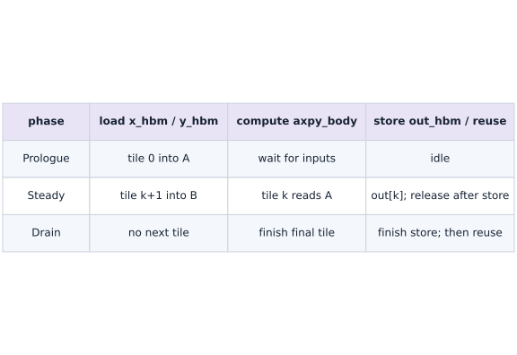
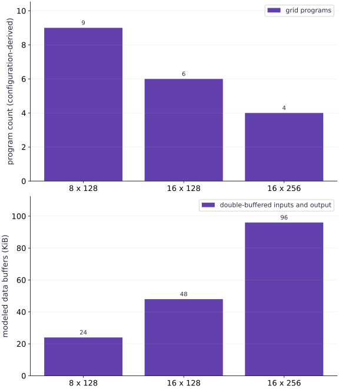

# Tiling, memory, and pipelining

Phase 13: Pallas kernels · about 120 minutes · CPU

This worked reference is validated on CPU. Accelerator compatibility requires a separate source review and target execution receipt. Use the execution matrix to review device selection and data ownership before adapting a separate target program.

**Before this lesson:** [A first TPU kernel](https://www.tahabouhsine.com/jaxpathways/lesson-kernels-02.html).

## What you will be able to do

- Execute actual emit_pipeline semantics under explicit CPU TPU-layout simulation.
- Compare synchronous and buffered schedules against an independent oracle.
- Explain tile count, padding and modeled local-buffer footprint separately.
- Distinguish correctness of scheduling from measured transfer/compute overlap.

## The problem

A larger tile reduces the number of kernel invocations, but it also consumes more local memory and may compute more padded values. Can we make those tradeoffs concrete and execute a real buffered pipeline without claiming that CPU simulation measures TPU overlap?

## The idea

Pipelining overlaps stages such as loading, computing and storing by giving work separate buffers and a valid schedule. The key question is when each buffer becomes safe to reuse, not merely how many buffers exist.

## A buffer cannot be reused while a consumer still needs it

The pipeline changes where tiles wait, not the $2X+Y$ result. During steady state, tile `k` is still read by `axpy_body` while tile `k+1` may load into another input slot. Reusing the first slot too soon overwrites live data; reusing an output slot before its store finishes loses a result. Follow one tile from load through last use, then predict when that slot becomes free.

### Buffer lifetime through prologue, steady state, and drain

**Predict:** Which slot can receive tile k+1 while the compute stage still reads tile k?



*Schematic schedule of buffer lifetimes; stage overlap is illustrative, not measured.*

The nodes/columns show load → compute → store; the phase rows show prologue → steady state → drain. In prologue tile 0 enters A; in steady state tile `k+1` enters B while `axpy_body` consumes `k` in A; in drain the last compute and store complete. Input Refs become reusable after compute consumes them, and output slots after store completes. Buffer letters describe this schedule, not Pallas variable names. Predict the failure if A were overwritten before compute: the result could read the next tile's values.

### Pause and reason

Why is double buffering not automatically faster?

<details><summary>Compare your reasoning</summary>

It requires useful overlap and enough resources without creating another bottleneck. Correct buffer lifetimes establish validity; measured target behavior establishes any performance benefit.

</details>

## Keep one numerical operation while changing data movement

`axpy_body` always computes $2x+y$; the outer Pallas kernel handles whole buffers and the inner body sees block-local Refs. Keeping that body fixed isolates changes to data movement. In the recorded execution, synchronous and buffered endpoints are both `-1.75` and `2.25`; matching values are a correctness check, not a claim that overlap made the CPU run faster.

## What buffering is trying to overlap

With two input slots, one can hold tile `k` for compute while the other receives `k+1`; a consumer must finish before its slot is reused. The code allows two or three input buffers and keeps two output buffers. Three input slots add modeled storage but may hide more transfer latency only on a target workload; they do not change arithmetic. Predict what should happen to the output if the buffer count changes: it should remain identical.

## Use the appropriate interpreter for memory operations

Ordinary Pallas `interpret=True` covers the first lesson's arithmetic grid, but this pipeline also models memory spaces and synchronization with `pltpu.InterpretParams` and an `AbstractMesh`. The retained run reports actual backend `cpu` and a simulated TPU v5 lite layout. That lets the interpreter check schedule semantics; the simulated layout label is not a TPU device receipt or timing result.

## Use synchronous execution as a debugging comparison

`no_pipelining=True` requests synchronous copies through the same windows and arithmetic. Compare its output elementwise with the buffered result to isolate a scheduling bug while holding the math constant. Passing CPU race checks is useful evidence for this fixture, but target compiler behavior and every hardware interleaving still need a real target run.

## Count the cost of a tile choice

For logical $(17,257)$, tile sizes $(8,128)$, $(16,128)$, $(16,256)$ launch 9, 6, and 4 programs. Yet padded work rises 9,216 → 12,288 → 16,384 elements, and modeled two-input/two-slot-plus-output storage rises 24 → 48 → 96 KiB. Fewer programs therefore trades off against more padding and local storage. These counts predict resource pressure, not runtime; choose a candidate to measure on target.

$$
B_{\mathrm{model}}=(2n_{\mathrm{input\ buffers}}+2)\,B_mB_n\,\mathrm{bytes\ per\ element}
$$

## Only target measurements can rank pipeline speed

The CPU interpreter performs simulation and bookkeeping that are not TPU execution. Its timings cannot rank pipeline configurations. A target comparison must use the guarded TPU runner, synchronize completed outputs and compare against a strong baseline under the same shapes and arithmetic. This retained receipt contains correctness and modeled counts, but no TPU latency.

## Reuse the checked arithmetic and add a real pipeline

Create main.py for the first block, then append each block in order in your course CPU environment.

```python
# Step 1 — Reuse the checked arithmetic and add a real pipeline
import jax
import jax.numpy as jnp
import numpy as np
from jax.experimental import pallas as pl
from jax.experimental.pallas import tpu as pltpu

def validate_pair(x,y,block):
    if x.ndim!=2 or x.shape!=y.shape or min(x.shape)<1:
        raise ValueError("inputs must be nonempty matrices with identical shapes")
    if x.dtype!=y.dtype or x.dtype not in (jnp.float32,jnp.bfloat16):
        raise ValueError("matching float32 or bfloat16 inputs required")
    if len(block)!=2 or any(not isinstance(n,int) or n<1 for n in block):
        raise ValueError("two positive integer block dimensions required")

def pad_pair(x,y,block):
    validate_pair(x,y,block)
    m,n=x.shape
    bm,bn=block
    padded=((m+bm-1)//bm*bm,(n+bn-1)//bn*bn)
    pads=((0,padded[0]-m),(0,padded[1]-n))
    return jnp.pad(x,pads),jnp.pad(y,pads),padded

def axpy_body(x_ref,y_ref,out_ref):
    result=2.0*x_ref[...].astype(jnp.float32)+y_ref[...].astype(jnp.float32)
    out_ref[...]=result.astype(out_ref.dtype)

def blocked_axpy(x,y,block=(2,4)):
    px,py,padded=pad_pair(x,y,block)
    bm,bn=block
    spec=pl.BlockSpec(block,lambda i,j:(i,j))
    out=pl.pallas_call(axpy_body,
        out_shape=jax.ShapeDtypeStruct(padded,x.dtype),
        grid=(padded[0]//bm,padded[1]//bn),
        in_specs=(spec,spec),out_specs=spec,interpret=True)(px,py)
    return out[:x.shape[0],:x.shape[1]]

def pipelined_axpy(x,y,block=(8,128),buffers=2,no_pipelining=False,mode="simulate"):
    px,py,padded=pad_pair(x,y,block)
    bm,bn=block
    if bm%8 or bn%128:
        raise ValueError("pipeline blocks must be multiples of (8,128)")
    if buffers not in (2,3):
        raise ValueError("this lab supports two or three buffers")
    if mode not in ("simulate","tpu"):
        raise ValueError("mode must explicitly be simulate or tpu")
    if mode=="tpu" and (jax.default_backend()!="tpu" or any(not isinstance(a,jax.core.Tracer) and any(d.platform!="tpu" for d in a.devices()) for a in (x,y))):
        raise RuntimeError("Real TPU inputs/backend required; simulation fallback is disabled")
    spec=pl.BlockSpec(block,lambda i,j:(i,j),pipeline_mode=pl.Buffered(buffer_count=buffers))
    output_spec=pl.BlockSpec(block,lambda i,j:(i,j),pipeline_mode=pl.Buffered(buffer_count=2))
    def outer(x_hbm,y_hbm,out_hbm):
        pltpu.emit_pipeline(axpy_body,grid=(padded[0]//bm,padded[1]//bn),
            in_specs=(spec,spec),out_specs=output_spec,
            no_pipelining=no_pipelining)(x_hbm,y_hbm,out_hbm)
    whole=pl.BlockSpec(memory_space=pl.ANY)
    interpretation=pltpu.InterpretParams(detect_races=True) if mode=="simulate" else False
    call=pl.pallas_call(outer,out_shape=jax.ShapeDtypeStruct(padded,x.dtype),
        in_specs=(whole,whole),out_specs=whole,interpret=interpretation)
    if mode=="simulate":
        # This describes a SIMULATED TPU layout, not the machine running the code.
        abstract=jax.sharding.AbstractMesh((1,),("simulated_device",),
            abstract_device=jax.sharding.AbstractDevice(device_kind="TPU v5 lite",num_cores=1))
        with jax.sharding.use_abstract_mesh(abstract):
            output=call(px,py)
    else:
        output=call(px,py)
    return output[:x.shape[0],:x.shape[1]]
```

The outer kernel receives global-memory references and emits an actual TPU pipeline. BlockSpecs describe its VMEM windows; the pipeline manages buffer copies and waits. CPU execution uses the TPU interpreter with explicitly simulated layout metadata.

## Compare synchronous and buffered pipeline semantics

Create main.py for the first block, then append each block in order in your course CPU environment.

```python
# Step 2 — Compare synchronous and buffered pipeline semantics: Both schedules execute real pipeline semantics under CPU simulation.
x=jnp.linspace(-1,1,17*257,dtype=jnp.float32).reshape(17,257)
y=jnp.full_like(x,.25)
# Transfer the device result to the host for an independent NumPy comparison.
reference=2*np.asarray(x)+np.asarray(y)
synchronous=pipelined_axpy(x,y,no_pipelining=True)
buffered=pipelined_axpy(x,y,no_pipelining=False)
np.testing.assert_allclose(synchronous,reference,rtol=1e-6,atol=1e-6)
np.testing.assert_allclose(buffered,reference,rtol=1e-6,atol=1e-6)
np.testing.assert_array_equal(synchronous,buffered)
print("Actual backend:",jax.default_backend(),"simulated layout: TPU v5 lite")
print("Synchronous/buffered endpoints:",float(buffered[0,0]),float(buffered[-1,-1]))
```

Both schedules execute real pipeline semantics under CPU simulation. Equality checks copies, writes and tails; it is distinct from that transfers overlap with computation on a real TPU.

## Quantify tile tradeoffs before measuring hardware

Create main.py for the first block, then append each block in order in your course CPU environment.

```python
# Step 3 — Quantify tile tradeoffs before measuring hardware: This footprint counts only the declared data buffers.
configurations=[(8,128),(16,128),(16,256)]
metadata=[]
for bm,bn in configurations:
    gm=(17+bm-1)//bm
    gn=(257+bn-1)//bn
    programs=gm*gn
    padded_elements=programs*bm*bn
    # Two input buffers and one output buffer, each double buffered, FP32.
    modeled_buffer_bytes=3*2*bm*bn*4
    metadata.append((programs,padded_elements,modeled_buffer_bytes))
    result=pipelined_axpy(x,y,(bm,bn))
    np.testing.assert_allclose(result,reference,rtol=1e-6,atol=1e-6)
print("programs, padded elements, modeled data-buffer bytes:",metadata)
```

This footprint counts only the declared data buffers. It excludes runtime bookkeeping, semaphores, compiler scratch, register allocation and target-specific layout padding; it is not a measured device-memory statistic.

## Run the example

```python
# Step 1 — Reuse the checked arithmetic and add a real pipeline
import jax
import jax.numpy as jnp
import numpy as np
from jax.experimental import pallas as pl
from jax.experimental.pallas import tpu as pltpu

def validate_pair(x,y,block):
    if x.ndim!=2 or x.shape!=y.shape or min(x.shape)<1:
        raise ValueError("inputs must be nonempty matrices with identical shapes")
    if x.dtype!=y.dtype or x.dtype not in (jnp.float32,jnp.bfloat16):
        raise ValueError("matching float32 or bfloat16 inputs required")
    if len(block)!=2 or any(not isinstance(n,int) or n<1 for n in block):
        raise ValueError("two positive integer block dimensions required")

def pad_pair(x,y,block):
    validate_pair(x,y,block)
    m,n=x.shape
    bm,bn=block
    padded=((m+bm-1)//bm*bm,(n+bn-1)//bn*bn)
    pads=((0,padded[0]-m),(0,padded[1]-n))
    return jnp.pad(x,pads),jnp.pad(y,pads),padded

def axpy_body(x_ref,y_ref,out_ref):
    result=2.0*x_ref[...].astype(jnp.float32)+y_ref[...].astype(jnp.float32)
    out_ref[...]=result.astype(out_ref.dtype)

def blocked_axpy(x,y,block=(2,4)):
    px,py,padded=pad_pair(x,y,block)
    bm,bn=block
    spec=pl.BlockSpec(block,lambda i,j:(i,j))
    out=pl.pallas_call(axpy_body,
        out_shape=jax.ShapeDtypeStruct(padded,x.dtype),
        grid=(padded[0]//bm,padded[1]//bn),
        in_specs=(spec,spec),out_specs=spec,interpret=True)(px,py)
    return out[:x.shape[0],:x.shape[1]]

def pipelined_axpy(x,y,block=(8,128),buffers=2,no_pipelining=False,mode="simulate"):
    px,py,padded=pad_pair(x,y,block)
    bm,bn=block
    if bm%8 or bn%128:
        raise ValueError("pipeline blocks must be multiples of (8,128)")
    if buffers not in (2,3):
        raise ValueError("this lab supports two or three buffers")
    if mode not in ("simulate","tpu"):
        raise ValueError("mode must explicitly be simulate or tpu")
    if mode=="tpu" and (jax.default_backend()!="tpu" or any(not isinstance(a,jax.core.Tracer) and any(d.platform!="tpu" for d in a.devices()) for a in (x,y))):
        raise RuntimeError("Real TPU inputs/backend required; simulation fallback is disabled")
    spec=pl.BlockSpec(block,lambda i,j:(i,j),pipeline_mode=pl.Buffered(buffer_count=buffers))
    output_spec=pl.BlockSpec(block,lambda i,j:(i,j),pipeline_mode=pl.Buffered(buffer_count=2))
    def outer(x_hbm,y_hbm,out_hbm):
        pltpu.emit_pipeline(axpy_body,grid=(padded[0]//bm,padded[1]//bn),
            in_specs=(spec,spec),out_specs=output_spec,
            no_pipelining=no_pipelining)(x_hbm,y_hbm,out_hbm)
    whole=pl.BlockSpec(memory_space=pl.ANY)
    interpretation=pltpu.InterpretParams(detect_races=True) if mode=="simulate" else False
    call=pl.pallas_call(outer,out_shape=jax.ShapeDtypeStruct(padded,x.dtype),
        in_specs=(whole,whole),out_specs=whole,interpret=interpretation)
    if mode=="simulate":
        # This describes a SIMULATED TPU layout, not the machine running the code.
        abstract=jax.sharding.AbstractMesh((1,),("simulated_device",),
            abstract_device=jax.sharding.AbstractDevice(device_kind="TPU v5 lite",num_cores=1))
        with jax.sharding.use_abstract_mesh(abstract):
            output=call(px,py)
    else:
        output=call(px,py)
    return output[:x.shape[0],:x.shape[1]]

# Step 2 — Compare synchronous and buffered pipeline semantics: Both schedules execute real pipeline semantics under CPU simulation.
x=jnp.linspace(-1,1,17*257,dtype=jnp.float32).reshape(17,257)
y=jnp.full_like(x,.25)
# Transfer the device result to the host for an independent NumPy comparison.
reference=2*np.asarray(x)+np.asarray(y)
synchronous=pipelined_axpy(x,y,no_pipelining=True)
buffered=pipelined_axpy(x,y,no_pipelining=False)
np.testing.assert_allclose(synchronous,reference,rtol=1e-6,atol=1e-6)
np.testing.assert_allclose(buffered,reference,rtol=1e-6,atol=1e-6)
np.testing.assert_array_equal(synchronous,buffered)
print("Actual backend:",jax.default_backend(),"simulated layout: TPU v5 lite")
print("Synchronous/buffered endpoints:",float(buffered[0,0]),float(buffered[-1,-1]))

# Step 3 — Quantify tile tradeoffs before measuring hardware: This footprint counts only the declared data buffers.
configurations=[(8,128),(16,128),(16,256)]
metadata=[]
for bm,bn in configurations:
    gm=(17+bm-1)//bm
    gn=(257+bn-1)//bn
    programs=gm*gn
    padded_elements=programs*bm*bn
    # Two input buffers and one output buffer, each double buffered, FP32.
    modeled_buffer_bytes=3*2*bm*bn*4
    metadata.append((programs,padded_elements,modeled_buffer_bytes))
    result=pipelined_axpy(x,y,(bm,bn))
    np.testing.assert_allclose(result,reference,rtol=1e-6,atol=1e-6)
print("programs, padded elements, modeled data-buffer bytes:",metadata)
```

Expected: Synchronous and buffered CPU simulations agree with NumPy and each other; endpoints -1.75 and 2.25. Tile program counts [9,6,4], padded elements [9216,12288,16384], modeled data buffers [24576,49152,98304] bytes.

## Input and output slots have distinct lifetimes across a tile pipeline

**Predict:** During steady state, why may tile k+1 load into a different slot while tile k computes?



**Recorded CPU computation**

### Read the figure

Read the three table columns as load `x_hbm/y_hbm`, compute `axpy_body`, then store `out_hbm`; rows are prologue, steady state and drain. In steady state, load `k+1` fills input slot B while compute reads tile `k` from A, then output `k` is stored. The arrow of time is left to right across stages and top to bottom across phases. Predict which slot can be reused: only after that tile's last consumer or store has finished. The schedule is schematic, not measured overlap.

### Connect it to the computation

The actual code declares `x_hbm` and `y_hbm` input buffers with a configurable count of two or three and `out_hbm` with two slots. Thus adding an input slot raises storage while retaining the same output count and same $2X+Y$ values. The retained CPU execution confirms synchronous and buffered endpoints match; the figure explains the lifetime condition that makes this safe, not a speedup.

```python
visual_data = {'kind': 'flow', 'layout': 'sequence', 'nodes': ['prologue: load first tile', 'steady state: load next while compute consumes live refs', 'drain: finish compute and store before reuse']}
```

## Recorded reference execution

CPU run: 2026-10-27T17:14:51.820014+00:00. JAX 0.9.2.

```text
Actual backend: cpu simulated layout: TPU v5 lite
Synchronous/buffered endpoints: -1.75 2.25
programs, padded elements, modeled data-buffer bytes: [(9, 9216, 24576), (6, 12288, 49152), (4, 16384, 98304)]
Actual backend: cpu simulated layout: TPU v5 lite
Synchronous/buffered endpoints: -1.75 2.25
programs, padded elements, modeled data-buffer bytes: [(9, 9216, 24576), (6, 12288, 49152), (4, 16384, 98304)]
Three-buffer schedule matches the two-buffer result
Single-tile pipeline checked
Changed shape, dtype and schedules verified
Unsupported pipeline tile rejected
Tile, two/three-input-slot modeled bytes: (8, 128) 24576 32768
Tile, two/three-input-slot modeled bytes: (16, 128) 49152 65536
Tile, two/three-input-slot modeled bytes: (16, 256) 98304 131072
PASS: kernels-03

```

## Change input buffer count without changing the result

**Predict before running:** Can adding a third slot to each input change the numerical answer?

```python
# Experiment — Change input buffer count without changing the result
three=pipelined_axpy(x,y,buffers=3)
np.testing.assert_allclose(three,reference,rtol=1e-6,atol=1e-6)
np.testing.assert_array_equal(three,buffered)
print("Three-buffer schedule matches the two-buffer result")
```

**Expected:** Two and three input slots produce the same logical result; outputs retain two slots.

More input buffering changes potential overlap and storage, not arithmetic. This installed emitter only supports up to two output slots. A speed benefit remains a target measurement question.

## Check a one-tile pipeline

**Predict before running:** What work can be overlapped when there is only one tile?

```python
# Experiment — Check a one-tile pipeline
small_x=jnp.arange(8*128,dtype=jnp.float32).reshape(8,128)/100
small_y=jnp.ones_like(small_x)
small=pipelined_axpy(small_x,small_y)
# Transfer the device result to the host for an independent NumPy comparison.
np.testing.assert_allclose(small,2*np.asarray(small_x)+1,rtol=1e-6,atol=1e-6)
print("Single-tile pipeline checked")
```

**Expected:** The one-tile result matches the oracle.

A one-tile pipeline has no next tile with which to overlap its initial fetch. Prologue and drain overhead can dominate small workloads; correctness does not imply a benefit.

## Make it yours

Use a (9,129) random fixture and verify synchronous, double-input-buffered and triple-input-buffered pipelines for both float32 and bfloat16 represented-input contracts. Keep output buffering at two slots.

### How to write this exercise — Step-by-step recipe & starter scaffold

**Inputs:**
- Two frozen (9,129) arrays generated from a local NumPy random generator with seed 23.
- Float32 and bfloat16 represented-input variants, valid tile, and buffer modes (2 input slots synchronous, 2 buffered, 3 buffered).

**Outputs:**
- Outputs for all three schedules at each dtype.
- Exact comparison with the reference computed from the represented input values.

**Invariants to check:**
- The same source values are used across schedules.
- Every schedule uses two output slots; the synchronous case is separate from buffered execution.

**Hints:**
- Cast the reference operands to float32 for arithmetic, then cast the result to the requested output dtype.
- Keep input and output buffer counts separate.

**Starter code scaffold (fill in the TODOs):**

```python
import numpy as np
import jax.numpy as jnp

def compare_pipeline_modes(run_pipeline, seed, tile, dtypes):
    # TODO: generate the two fixed arrays once and compare all schedule/dtype combinations.
    raise NotImplementedError("Compare synchronous and buffered pipelines on fixed represented inputs")
```

<details><summary>Reference solution</summary>

```python
# Exercise solution
rng=np.random.default_rng(23)
for dtype in (jnp.float32,jnp.bfloat16):
    a=jnp.asarray(rng.normal(size=(9,129)),dtype=dtype)
    b=jnp.asarray(rng.normal(size=(9,129)),dtype=dtype)
    expected=(2*a.astype(jnp.float32)+b.astype(jnp.float32)).astype(dtype)
    for buffers,sync in [(2,True),(2,False),(3,False)]:
        result=pipelined_axpy(a,b,buffers=buffers,no_pipelining=sync)
        # Transfer the device result to the host for an independent NumPy comparison.
        np.testing.assert_array_equal(np.asarray(result),np.asarray(expected))
print("Changed shape, dtype and schedules verified")
```

</details>

## Reject an unsupported pipeline tile

**Practice**

Try a (3,5) block and verify that the pipeline wrapper refuses it rather than using the permissive arithmetic interpreter as a hidden fallback.

<details><summary>Hint</summary>

The pipeline lab deliberately uses a conservative TPU-compatible tile family.

</details>

### How to write: Reject an unsupported pipeline tile — Step-by-step recipe & starter scaffold

**Inputs:**
- Two shape-compatible arrays and the pipeline wrapper.
- A supported tile for the valid control case and unsupported tile (3,5).

**Outputs:**
- A clear ValueError for unsupported geometry before arithmetic interpretation or accelerator launch.

**Invariants to check:**
- The valid control establishes that inputs are otherwise acceptable.
- The arithmetic interpreter is never used as a hidden fallback for the rejected pipeline configuration.

**Hints:**
- Place supported-tile validation before selecting execution backend.
- Use a test double to confirm no arithmetic path was invoked.

**Starter code scaffold (fill in the TODOs):**

```python
def reject_unsupported_pipeline_tile(pipeline, first, second, supported_tile):
    # TODO: confirm the supported control works, then require rejection for tile (3,5).
    raise NotImplementedError("Reject unsupported pipeline geometry before dispatch")
```

<details><summary>Reference solution and reasoning</summary>

```python
# Reject an unsupported pipeline tile (Practice): Different wrappers may expose different supported contracts.
rejected=False
try:pipelined_axpy(x,y,(3,5))
except ValueError:rejected=True
assert rejected
print("Unsupported pipeline tile rejected")
```

Different wrappers may expose different supported contracts. A narrower explicit contract is safer than implying the generic interpreter established target compatibility.

</details>

## Estimate the price of a third input buffer

**Challenge**

Compute the declared data-buffer footprint for two and three input slots at each tile size, with two output slots in both cases. State at least two omitted memory costs.

<details><summary>Hint</summary>

Count two input arrays and one output array separately because their buffer counts differ.

</details>

### How to write: Estimate the price of a third input buffer — Step-by-step recipe & starter scaffold

**Inputs:**
- Matrix shape (9,129), candidate tile sizes, element size, and two output buffer slots.

**Outputs:**
- Data-buffer byte counts for two and three input slots.
- Explicit list of excluded memory costs.
- At least two memory costs explicitly excluded from the data-buffer estimate.

**Invariants to check:**
- Output slots stay fixed at two in both estimates.
- The third input slot adds one input-tile allocation.
- The footprint is a declared-buffer model, not total HBM usage.

**Hints:**
- Count padded tile elements times bytes per element and slots.
- Do not include compiler, allocator, or runtime overhead in this data-only estimate.

**Starter code scaffold (fill in the TODOs):**

```python
import math

def estimate_pipeline_buffers(shape, tile_sizes, bytes_per_element):
    # TODO: compute padded input tile bytes for two/three slots and fixed output slots.
    # Return excluded costs alongside estimates.
    raise NotImplementedError("Separate declared data buffers from total device memory")
```

<details><summary>Reference solution and reasoning</summary>

```python
# Estimate the price of a third input buffer (Challenge)
for bm,bn in configurations:
    two=(2*2+2)*bm*bn*4
    three=(2*3+2)*bm*bn*4
    assert three*3==two*4
    print("Tile, two/three-input-slot modeled bytes:",(bm,bn),two,three)
```

A third slot for each input increases this limited data-buffer model by one third. Output buffering stays at two slots. The estimate excludes registers, semaphores, compiler scratch and layout effects.

</details>

## Check your understanding

The three-buffer simulation is correct and has fewer grid programs after a tile change. Can you conclude the TPU version is faster?

1. Yes; program count determines runtime.
2. Yes; simulation latency is the TPU latency.
3. No; padding, local memory and actual target overlap must be measured with synchronized target execution.

<details><summary>Answer and explanation</summary>

**1. Yes; program count determines runtime.**

Fewer programs can still mean more padding, pressure or stalls. Compare target measurements for identical useful work.

**2. Yes; simulation latency is the TPU latency.**

A simulator’s schedule is not device latency. Record actual target timing and inspect memory/overlap behavior.

**3. No; padding, local memory and actual target overlap must be measured with synchronized target execution. (correct)**

Simulation establishes tested semantics. Buffering and tile changes affect several costs, and only actual target measurements can rank performance.

</details>

## Diagnose the result

If the buffered result differs from synchronous execution, keep arithmetic and tile geometry fixed while inspecting copies, ownership and synchronization. If the interpreter cannot infer TPU layout on CPU, choose the documented TPU simulation API and label the metadata as simulated. If a larger tile uses fewer programs but more padded work, neither count alone ranks its performance.

## Carry forward

- Keep one numerical operation while changing data movement
- What buffering is trying to overlap
- Use the appropriate interpreter for memory operations
- Use synchronous execution as a debugging comparison
- Count the cost of a tile choice
- Only target measurements can rank pipeline speed

## Keep your evidence

Synchronous/buffered CPU simulation agreement, two/three input slots, unchanged output buffering, correctness across tiles and modeled footprint counts. Keep the environment, observed outputs and your explanation of the figure.

Save your predictions, modified code, terminal outputs, and reasoning in your engineering portfolio.

## Primary references

- [Pallas grids and block specifications](https://docs.jax.dev/en/latest/pallas/grid_blockspec.html)
- [Writing TPU kernels: layout and memory restrictions](https://docs.jax.dev/en/latest/pallas/tpu/details.html)
- [TPU pipelining and emit_pipeline](https://docs.jax.dev/en/latest/pallas/tpu/pipelining.html)
- [TPU interpretation is simulation, not target execution](https://docs.jax.dev/en/latest/_autosummary/jax.experimental.pallas.tpu.InterpretParams.html)

