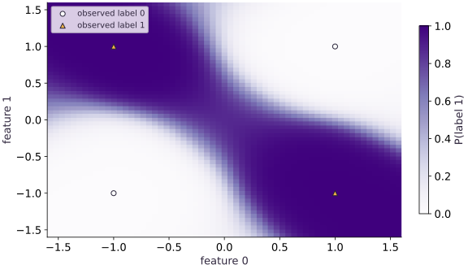

# Build a tiny multilayer perceptron

Phase 05: Neural network training · about 85 minutes · CPU

This worked reference is validated on CPU. Accelerator compatibility requires a separate source review and target execution receipt. Use the execution matrix to review device selection and data ownership before adapting a separate target program.

## What you will be able to do

- Trace the shapes from observations to logits
- Explain why the hidden activation matters
- Use stable binary cross-entropy
- Separate learning from held-out measurement

## The problem

Four points can give us a useful puzzle: how do we separate the two diagonal pairs in XOR? A single straight line cannot do it. We’ll add a small hidden layer and a nonlinear activation, check the shapes, and train a classifier. Then we’ll test nearby points to see what it has learned beyond the four training examples.

## The idea

A multilayer perceptron combines learned linear maps with nonlinear activations. The hidden layer builds features that the output layer can combine. The activation lets the composition represent boundaries that a single linear map cannot.

## Why hidden layers need nonlinear operations

The four training points alternate labels around the square: $(-1,1)$ and $(1,-1)$ are class one, while the other corners are class zero. A straight boundary puts each class on one side, so it cannot separate both diagonals. The trained field later shows two separated class-one regions, one around each triangle.

If you remove tanh, the two affine maps combine into one: $xW_1W_2+b_1W_2+b_2$. Increasing width then adds parameters but still leaves a straight decision boundary. Keep the activation when you want the hidden layer to build nonlinear features.

The four corner labels are the only observed labels in the training set. The grid between them is the model's extension of that pattern, so use held-out points to check nearby behavior instead of treating every colored pixel as evidence.

### Pause and reason

Does fitting all four XOR points establish generalization to another dataset?

<details><summary>Compare your reasoning</summary>

No. It checks representation and optimization on this teaching fixture. A different population requires its own held-out evaluation.

</details>

## Trace the shapes from observations to logits

Follow one batch row through the actual matrix shapes. The input has two features, so $(B,2)$ multiplied by $W_1$ of shape $2,8$ gives $(B,8)$. The bias $(8,)$ is added to each row, and tanh keeps the same shape. Multiplying by $W_2$ of shape $8,1)$ gives $(B,1)$; squeezing only the last axis yields one score per example, $(B,)$.

For a single example, the result is still $(1,)$, not a scalar and not an eight-example batch. A positive score favors class one because sigmoid maps it above (0.5). Keep labels in the matching $(B,)$ shape so each score is paired with one target.

```text
(B, 2) → affine → (B, 8) → tanh → (B, 8) → affine → (B, 1) → (B,)
```

## Explain why the hidden activation matters

The activation is the operation that stops the two affine layers from collapsing into one line. With tanh, each of the eight hidden coordinates can respond differently to an input; the output combines those responses to form the two separated XOR regions. The width-three NNX model in the next lesson changes the number of features, but not this role of a nonlinearity.

This run used 33 trainable values and ended at training loss (0.0015879), with accuracy (1.0) on 32 nearby points from held-out seed 12. Those measurements show that this initialization fit this small task. They do not establish that width eight is optimal or that every random initialization will converge.

## Use stable binary cross-entropy

For score $z_i$ and binary label $y_i$, the per-example loss is $\operatorname{logaddexp}(0,z_i)-y_i z_i$. At $z_i=0$, either label gives $\log 2$, which the zero-parameter check confirms. The script also computes the same mean with NumPy, independently of JAX autodiff and Optax.

The score vector and label vector both have shape $B$, so the loss has one value per example before the mean. If labels instead have shape $(B,1)$, broadcasting against scores of shape $(B,)$ creates $(B,B)$: every score is paired with every label. Inspect the unreduced shape before averaging, because a plausible scalar can hide this changed objective. Repeating every row three times leaves the mean loss and gradient unchanged.

## Separate learning from held-out measurement

The optimizer sees only the four exact corners for 200 updates. Afterward, the script creates 32 perturbed points with NumPy seed 12 and labels them from the original sign rule. The run reports final training loss (0.0015879) and held-out accuracy (1.0); the held-out points are near the corners, so this tests local transfer on the same simple rule.

Keep the seed, width, rate, update count, and split together when recording the result. Use held-out data for a declared evaluation, not repeated tuning. Neither the four-point fit nor nearby accuracy tests arbitrary points across the plane or a real population.

## Read the classification loss one example at a time

A score (z) is not a probability. For label (y=1), positive (z) reduces loss; for (y=0), it increases loss. At (z=0), sigmoid gives (0.5) and both labels have loss $\log 2$.

`logaddexp(0, z)` computes the softplus term without first rounding a sigmoid to zero or one. That stable per-example value is then averaged across examples; it is the same quantity the NumPy reference checks.

$$
\ell(z,y)=\underbrace{\log(1+e^z)}_{\mathrm{softplus}(z)}-yz
$$

## 1. Define the fixture and parameter tree

Create main.py and copy this block. Before running, write the four XOR labels and the expected shape of each parameter.

```python
# Step 1 — 1. Define the fixture and parameter tree: The parameter count is 16+8+8+1=33.
import jax
import jax.numpy as jnp
import numpy as np
import optax
x = jnp.array([[-1.,-1.],[-1.,1.],[1.,-1.],[1.,1.]])
y = jnp.array([0.,1.,1.,0.])
# Create or split explicit PRNG key(s) (`(k1, k2)`) for reproducible randomness.
k1, k2 = jax.random.split(jax.random.key(0))
# Sample deterministic random values into `params` using an explicit PRNG key.
params = {'w1':jax.random.normal(k1,(2,8))*.4, 'b1':jnp.zeros(8),
          'w2':jax.random.normal(k2,(8,1))*.4, 'b2':jnp.zeros(1)}
assert sum(a.size for a in jax.tree.leaves(params)) == 33
```

The parameter count is $16+8+8+1=33$. Independent keys initialize the two layers; biases start at zero.

## 2. Write prediction and verify the loss

Append these functions. The NumPy reference has no autodiff or optimizer and tests the objective itself.

```python
# Step 2 — 2. Write prediction and verify the loss: The zero-score baseline is about 0.693147.
def logits(p, batch):
    return (jnp.tanh(batch@p['w1']+p['b1'])@p['w2']+p['b2']).squeeze(-1)
def loss(p, batch, labels):
    return jnp.mean(optax.sigmoid_binary_cross_entropy(logits(p,batch),labels))
# Transfer the device result to the host for an independent NumPy comparison.
scores = np.asarray(logits(params,x))
expected = np.mean(np.logaddexp(0.,scores)-np.asarray(y)*scores)
np.testing.assert_allclose(loss(params,x,y), expected, rtol=1e-6)
zeros = jax.tree.map(jnp.zeros_like, params)
np.testing.assert_allclose(loss(zeros,x,y),np.log(2.),rtol=1e-6)
# Check tensor shape invariant: `logits(params,jnp.ones((1,2))).shape == (1,)`
assert logits(params,jnp.ones((1,2))).shape == (1,)
```

The zero-score baseline is about $0.693147$. A loss below it alone does not prove held-out skill.

## 3. Train and evaluate untouched points

Append the compiled step and loop. Prediction: can the nonlinear model beat chance on points near each training corner?

```python
# Step 3 — 3. Train and evaluate untouched points: The independent held-out seed changes input coordinates.
tx = optax.adam(.03)
state = tx.init(params)
# Define and JIT-compile `step(p, s)` so XLA traces and fuses the operations:
@jax.jit
def step(p,s):
    value,grads = jax.value_and_grad(loss)(p,x,y)
    updates,s = tx.update(grads,s,p)
    return optax.apply_updates(p,updates),s,value
initial = float(loss(params,x,y))
for _ in range(200): params,state,_ = step(params,state)
rng = np.random.default_rng(12)
# Transfer the device result to the host for an independent NumPy comparison.
held_x = np.repeat(np.asarray(x),8,axis=0)+rng.normal(0,.12,(32,2))
held_y = (held_x[:,0]*held_x[:,1]<0).astype(np.float32)
held_scores = np.asarray(logits(params,jnp.array(held_x)))
accuracy = np.mean((held_scores>0)==held_y)
final = float(loss(params,x,y))
assert final < .03 and accuracy >= .95
print('Training loss:', initial, '->', final, 'held-out accuracy:', accuracy)
```

The independent held-out seed changes input coordinates. Passing this check establishes behavior on this fixture only.

## Run the example

```python
# Step 1 — 1. Define the fixture and parameter tree: The parameter count is 16+8+8+1=33.
import jax
import jax.numpy as jnp
import numpy as np
import optax
x = jnp.array([[-1.,-1.],[-1.,1.],[1.,-1.],[1.,1.]])
y = jnp.array([0.,1.,1.,0.])
# Create or split explicit PRNG key(s) (`(k1, k2)`) for reproducible randomness.
k1, k2 = jax.random.split(jax.random.key(0))
# Sample deterministic random values into `params` using an explicit PRNG key.
params = {'w1':jax.random.normal(k1,(2,8))*.4, 'b1':jnp.zeros(8),
          'w2':jax.random.normal(k2,(8,1))*.4, 'b2':jnp.zeros(1)}
assert sum(a.size for a in jax.tree.leaves(params)) == 33

# Step 2 — 2. Write prediction and verify the loss: The zero-score baseline is about 0.693147.
def logits(p, batch):
    return (jnp.tanh(batch@p['w1']+p['b1'])@p['w2']+p['b2']).squeeze(-1)
def loss(p, batch, labels):
    return jnp.mean(optax.sigmoid_binary_cross_entropy(logits(p,batch),labels))
# Transfer the device result to the host for an independent NumPy comparison.
scores = np.asarray(logits(params,x))
expected = np.mean(np.logaddexp(0.,scores)-np.asarray(y)*scores)
np.testing.assert_allclose(loss(params,x,y), expected, rtol=1e-6)
zeros = jax.tree.map(jnp.zeros_like, params)
np.testing.assert_allclose(loss(zeros,x,y),np.log(2.),rtol=1e-6)
# Check tensor shape invariant: `logits(params,jnp.ones((1,2))).shape == (1,)`
assert logits(params,jnp.ones((1,2))).shape == (1,)

# Step 3 — 3. Train and evaluate untouched points: The independent held-out seed changes input coordinates.
tx = optax.adam(.03)
state = tx.init(params)
# Define and JIT-compile `step(p, s)` so XLA traces and fuses the operations:
@jax.jit
def step(p,s):
    value,grads = jax.value_and_grad(loss)(p,x,y)
    updates,s = tx.update(grads,s,p)
    return optax.apply_updates(p,updates),s,value
initial = float(loss(params,x,y))
for _ in range(200): params,state,_ = step(params,state)
rng = np.random.default_rng(12)
# Transfer the device result to the host for an independent NumPy comparison.
held_x = np.repeat(np.asarray(x),8,axis=0)+rng.normal(0,.12,(32,2))
held_y = (held_x[:,0]*held_x[:,1]<0).astype(np.float32)
held_scores = np.asarray(logits(params,jnp.array(held_x)))
accuracy = np.mean((held_scores>0)==held_y)
final = float(loss(params,x,y))
assert final < .03 and accuracy >= .95
print('Training loss:', initial, '->', final, 'held-out accuracy:', accuracy)
```

Expected: Loss falls below $0.03$ and nearby held-out accuracy is at least $0.95$. Exact initialization and losses may vary across backend/version.

## A tiny MLP separates the XOR regions

**Predict:** Can a single straight boundary separate these labels?



**Recorded CPU computation**

### Read the figure

The horizontal axis is feature 0 and the vertical axis is feature 1; color is predicted probability of class one, from pale near 0 to dark near 1. The four markers are the only training observations: triangles at opposite-sign corners are label 1, and circles at same-sign corners are label 0. In the retained run the corresponding class-one corners sit in dark regions and class-zero corners in pale regions.

### Connect it to the computation

The alternating corners cannot be divided by one straight line, while this learned field bends into two class-one regions. Use the (0.5) color transition to inspect where the model changes its decision, then compare predictions at the separately generated nearby points. Grid colors are model queries, not new labeled examples or a calibration measurement.

```python
axis = jnp.linspace(-1.6, 1.6, 61)
gx, gy = jnp.meshgrid(axis, axis)
grid = jnp.stack([gx.ravel(), gy.ravel()], axis=-1)
# Rearrange tensor axes to match the required layout for `prob`.
prob = jax.nn.sigmoid(logits(params, grid)).reshape(gx.shape)
visual_data = {'kind': 'field', 'values': prob.tolist(), 'extent': [-1.6, 1.6, -1.6, 1.6], 'xlabel': 'feature 0', 'ylabel': 'feature 1', 'unit': 'P(label 1)', 'points': x.tolist(), 'labels': y.tolist()}
```

## Recorded reference execution

CPU run: 2026-10-27T17:04:17.932100+00:00. JAX 0.9.2.

```text
Training loss: 0.7047799825668335 -> 0.0015878621488809586 held-out accuracy: 1.0
Training loss: 0.7047799825668335 -> 0.0015878621488809586 held-out accuracy: 1.0
Consistent hidden permutation preserves logits; one-sided permutation changes them.
PASS: networks-01

```

## Duplication preserves a mean objective

**Predict before running:** If every observation is repeated three times, should the loss and gradient change?

```python
# Experiment — Duplication preserves a mean objective: Averaging normalizes repeated identical data.
repeated_x=jnp.repeat(x,3,axis=0)
repeated_y=jnp.repeat(y,3)
np.testing.assert_allclose(loss(params,repeated_x,repeated_y),loss(params,x,y),rtol=1e-5)
original_g=jax.grad(loss)(params,x,y)
repeated_g=jax.grad(loss)(params,repeated_x,repeated_y)
for a,b in zip(jax.tree.leaves(original_g),jax.tree.leaves(repeated_g)):
    np.testing.assert_allclose(a,b,rtol=1e-4,atol=1e-7)
```

**Expected:** The losses and corresponding gradient leaves agree within tolerance.

Averaging normalizes repeated identical data. Summing would change the learning-rate interpretation.

## An affine stack stays affine

**Predict before running:** Can removing tanh create a nonlinear XOR separator merely by keeping two matrices?

```python
# Experiment — An affine stack stays affine
def affine_stack(batch):return (batch@params['w1']+params['b1'])@params['w2']+params['b2']
midpoint=jnp.array([[.2,-.3]])
delta=jnp.array([[.4,.1]])
np.testing.assert_allclose(affine_stack(midpoint),.5*(affine_stack(midpoint+delta)+affine_stack(midpoint-delta)),atol=1e-6)
```

**Expected:** The midpoint identity holds for the affine stack.

This exact affine identity explains why removing the nonlinearity limits the class of functions, regardless of width.

## Make it yours

Swap class zero and one. Transform only the trained output layer to preserve the boundary and verify predictions on new coordinates.

### How to write this exercise — Step-by-step recipe & starter scaffold

**Inputs:**
- An MLP parameter pytree and a permutation of its output classes.

**Outputs:**
- Transformed output-layer parameters and logits on held-out coordinates.

**Invariants to check:**
- The transformed model preserves or intentionally permutes class scores as specified; hidden-unit changes must be paired.

**Hints:**
- Inspect which parameter axis represents classes.
- Test a new coordinate batch, not only the training points.

**Starter code scaffold (fill in the TODOs):**

```python
import jax.numpy as jnp

def permute_output_classes(params, class_permutation):
    """Transformed output-layer parameters and logits on held-out coordinates."""
    # TODO: Transform the output-layer class axis and verify logits on new input coordinates.
    raise NotImplementedError
```

<details><summary>Reference solution</summary>

```python
# Exercise solution: Swap class zero and one.
complemented=dict(params,w2=-params['w2'],b2=-params['b2'])
changed_x=jnp.array([[-.8,.7],[.7,.9],[-1.1,-.8]])
np.testing.assert_allclose(logits(complemented,changed_x),-logits(params,changed_x),atol=1e-6)
# Transfer the device result to the host for an independent NumPy comparison.
expected_labels=(np.asarray(changed_x)[:,0]*np.asarray(changed_x)[:,1]>0)
assert np.array_equal(np.asarray(logits(complemented,changed_x)>0),expected_labels)
```

</details>

## Reorder hidden units without changing predictions

**Transfer**

Permute the hidden units and make the matching change to the output layer. Predict whether the logits change. Test the result on new coordinates, then show why permuting only one side breaks the contract.

<details><summary>Hint</summary>

Columns of the first kernel and rows of the second kernel describe the same hidden units.

</details>

### How to write: Reorder hidden units without changing predictions — Step-by-step recipe & starter scaffold

**Inputs:**
- Permute the hidden units and make the matching change to the output layer. Predict whether the logits change. Test the result on new coordinates, then show why permuting only one side breaks the contract.

**Outputs:**
- Logit parity on new inputs plus a one-sided-permutation counterexample.

**Invariants to check:**
- Incoming and outgoing parameter axes use the same hidden-unit permutation.

**Hints:**
- Columns of the first kernel and rows of the second kernel describe the same hidden units.

**Starter code scaffold (fill in the TODOs):**

```python
import jax.numpy as jnp

def practice_reorder_hidden_units_without_changing_predictions(hidden_permutation, hidden_weights, output_weights):
    """Implement the reorder hidden units without changing predictions check."""
    # TODO: Permute the hidden-unit axis and apply the matching inverse permutation to outgoing weights and biases.
    raise NotImplementedError
```

<details><summary>Reference solution and reasoning</summary>

```python
# Reorder hidden units without changing predictions (Transfer): A hidden unit has no intrinsic index.
order=jnp.array([7,0,6,1,5,2,4,3])
probe=jnp.array([[.2,-.9],[-.4,.6],[.8,.1]])
permuted=dict(params,w1=params['w1'][:,order],b1=params['b1'][order],w2=params['w2'][order,:])
np.testing.assert_allclose(logits(permuted,probe),logits(params,probe),rtol=1e-5,atol=1e-5)
broken=dict(params,w1=params['w1'][:,order],b1=params['b1'][order])
assert not np.allclose(logits(broken,probe),logits(params,probe),atol=1e-5)
print('Consistent hidden permutation preserves logits; one-sided permutation changes them.')
```

A hidden unit has no intrinsic index. Reordering its incoming weights, bias and outgoing weights together preserves the function. This is a parameter-layout invariant, not another training run.

</details>

## Diagnose accidental pairwise broadcasting

**Intermediate**

Demonstrate how labels shaped $(B, 1)$ and scores shaped $(B,)$ create a $(B, B)$ loss. Repair the contract before averaging.

<details><summary>Hint</summary>

Inspect the unreduced loss shape; a scalar mean can hide the error.

</details>

### How to write: Diagnose accidental pairwise broadcasting — Step-by-step recipe & starter scaffold

**Inputs:**
- Demonstrate how labels shaped $(B, 1)$ and scores shaped $(B,)$ create a $(B, B)$ loss. Repair the contract before averaging.

**Outputs:**
- Rejected mismatched shape and a per-example loss after alignment.

**Invariants to check:**
- One score is paired with one label; the reduction is over examples only.

**Hints:**
- Inspect the unreduced loss shape; a scalar mean can hide the error.

**Starter code scaffold (fill in the TODOs):**

```python
import jax.numpy as jnp

def practice_diagnose_accidental_pairwise_broadcasting(scores, labels):
    """Implement the diagnose accidental pairwise broadcasting check."""
    # TODO: Assert score and label shapes match before subtraction, then show the (B,1) by (B,) broadcast shape and repair it.
    raise NotImplementedError
```

<details><summary>Reference solution and reasoning</summary>

```python
# Diagnose accidental pairwise broadcasting (Intermediate)
bad=optax.sigmoid_binary_cross_entropy(logits(params,x),y[:,None])
# Check tensor shape invariant: `bad.shape==(4,4)`
assert bad.shape==(4,4)
good=optax.sigmoid_binary_cross_entropy(logits(params,x),y)
# Check tensor shape invariant: `good.shape==(4,)`
assert good.shape==(4,)
np.testing.assert_allclose(jnp.mean(good),loss(params,x,y),rtol=1e-6)
```

The incorrect scalar still looks plausible, but it compares each score with every label. A shape check catches the silent objective change.

</details>

## Check your understanding

Why does the two-layer XOR model need a nonlinear activation?

1. Without it the composition is still affine
2. Two affine layers always separate XOR
3. Cross-entropy itself changes the prediction boundary

<details><summary>Answer and explanation</summary>

**1. Without it the composition is still affine (correct)**

The optimizer can change coefficients but cannot enlarge the affine function class. The activation supplies nonlinear intermediate features.

**2. Two affine layers always separate XOR**

Two affine layers compose into another affine map. Write their combined matrix and bias to see why another layer alone is insufficient.

**3. Cross-entropy itself changes the prediction boundary**

The loss changes how parameters are fitted, not which functions the architecture can represent. Inspect the forward map for a nonlinearity.

</details>

## Diagnose the result

Inspect unreduced loss shapes before tuning learning rate. Compare the loss with NumPy, check finite gradients, and test $B=1$. If fit succeeds but perturbed held-out points fail, investigate the learned boundary rather than claiming generalization from four exact predictions.

## Carry forward

- Trace the shapes from observations to logits
- Explain why the hidden activation matters
- Use stable binary cross-entropy
- Separate learning from held-out measurement

## Keep your evidence

Keep the 33-parameter shape calculation, independent NumPy cross-entropy, train and held-out seeds, initial/final loss, nearby held-out accuracy, and one repaired score/label shape failure.

Save your predictions, modified code, terminal outputs, and reasoning in your engineering portfolio.

## Primary references

- [Optax sigmoid binary cross-entropy](https://optax.readthedocs.io/en/latest/api/losses.html#optax.losses.sigmoid_binary_cross_entropy)
- [JAX automatic differentiation](https://docs.jax.dev/en/latest/automatic-differentiation.html)

