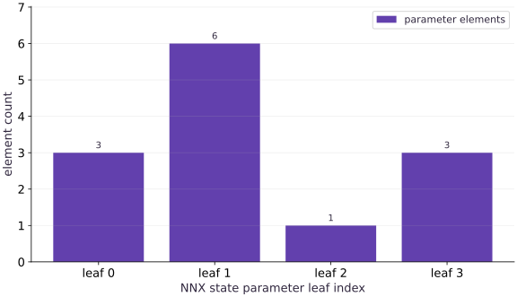

# Model and state with Flax NNX

Phase 05: Neural network training · about 80 minutes · CPU

This worked reference is validated on CPU. Accelerator compatibility requires a separate source review and target execution receipt. Use the execution matrix to review device selection and data ownership before adapting a separate target program.

## What you will be able to do

- Move the explicit equations into a module
- Separate parameter state from diagnostic state
- Reconstruct an independent graph from a snapshot
- Check a library forward pass independently

## The problem

A model library can organize weights for us, but we still want to see what is being learned. We’ll build a small Flax NNX module, compare its predictions with NumPy, and inspect its state. A diagnostic counter will help us distinguish trainable parameters from other values a model carries.

## The idea

A model has a computation structure and state values. Some state is trainable; other state may record statistics or randomness. Flax NNX helps manage these objects, but we still need to understand which identities are shared and which values an update changes.

## Distinguish shared structure from changing values

Imagine two attributes referring to the same layer object. They share one parameter set. Drawing two independent weight boxes would misrepresent the computation, even if the printed values initially match.

Separating graph structure and state lets us transform the numerical state while preserving the intended relationships. Compare paths and values before and after splitting, merging or cloning; copying a Python reference does not create independent model state.

The existing merge figure is a map of these roles. Use the actual NNX operations in the lesson to test the map, especially when a model has state beyond parameters. Evaluation should follow its declared state rules rather than silently repeating training updates.

$$
(\mathcal{G}, \Theta, \mathcal{S}) = \operatorname{split}(M), \qquad M' = \operatorname{merge}(\mathcal{G}, \Theta', \mathcal{S}')
$$

### Pause and reason

What should a diagram show when two attributes use the same layer?

<details><summary>Compare your reasoning</summary>

One shared parameter identity with two uses. Show independent copies only after an explicit operation and identity/value checks establish independence.

</details>

## Move the explicit equations into a module

A module groups the same equations from the previous lesson with the arrays that they use. `nnx.Linear` owns a kernel and bias; `hidden( x )` computes $xW+b$. A second Linear consumes tanh of the hidden values. The constructor must know the feature dimensions, so an input feature mismatch is a contract error rather than a request to infer a new model. Our width-three example has $6+3+3+1=13$ trainable scalars. A batch dimension can vary without adding parameters. Class-based organization has not changed the mathematics.

## Separate parameter state from diagnostic state

The calls counter is an ordinary `nnx.Variable`, not `nnx.Param.` Calling the model with `record=True` increments it as a deliberate teaching example. It is not a learned weight and should not enter optimizer updates. `nnx.state(model, nnx.Param)` selects trainable variables; `nnx.state(model, nnx.Not(nnx.Param))` selects the remaining state. A real model may have batch-normalization statistics or dropout RNG counts in this second category. Excluding a variable from gradients does not make it immutable. You still need to specify when forward passes may change it.

```text
model
├─ hidden: kernel, bias [Param]
├─ out: kernel, bias [Param]
└─ calls: diagnostic counter [Variable]
```

## Reconstruct an independent graph from a snapshot

`nnx.split` separates the graph definition from dynamic state; `nnx.merge` reconstructs a module from those pieces. In the tested Flax version, merging the original State can reuse Variable objects; map a copying function over state leaves to reconstruct independent typed state first. Think of graph definition as the wiring and state as the current array contents. This is an in-memory demonstration, not a durable checkpoint format. The copied-state clone starts with identical values and independent mutable variables, which we verify below. Incrementing its counter must not increment the original. Copying an attribute reference, in contrast, may share a module. Explicitly test independence rather than assuming any assignment or shallow copy creates a training snapshot.

## Check a library forward pass independently

Reading model.hidden.kernel[...] retrieves its array contents in the tested Flax API. Compute the affine maps and tanh with NumPy using those arrays and compare the logits on several observations. This verifies the wiring, activation placement, and squeeze axis; it does not independently validate the initializer. Then change one output bias and predict the exact added logit shift. Keep this algebraic test separate from classification accuracy. A library refactor can preserve predictions but change state ownership, so both numerical and ownership checks are necessary.

## 1. Define typed state and the model

Create `main.py`. From the repository root, run `python3 -m pip install -r requirements-cpu.txt` in your activated environment; the course pins Flax `0.12.6`. Copy the model before adding any optimizer.

```python
# Step 1 — 1. Define typed state and the model: nnx.Rngs manages initializer keys.
from flax import nnx
import jax
import jax.numpy as jnp
import numpy as np
# Define `TinyMLP` module / container with explicit state and forward pass:
class TinyMLP(nnx.Module):
    def __init__(self,seed=0):
        rngs=nnx.Rngs(seed)
        self.hidden=nnx.Linear(2,3,rngs=rngs)
        self.out=nnx.Linear(3,1,rngs=rngs)
        self.calls=nnx.Variable(jnp.array(0,dtype=jnp.int32))
    def __call__(self,x,record=False):
        if record:self.calls[...] += 1
        return self.out(nnx.tanh(self.hidden(x))).squeeze(-1)
model=TinyMLP()
batch=jnp.array([[1.,2.],[-1.,.5],[0.,0.]])
```

`nnx.Rngs` manages initializer keys. The optional diagnostic counter changes only when explicitly requested.

## 2. Verify equations and inspect the filters

Append an independent NumPy computation. Count only `nnx.Param` leaves, not the counter.

```python
# Step 2 — 2. Verify equations and inspect the filters: The matching forward pass verifies the network wiring.
scores=model(batch,record=True)
# Transfer the device result to the host for an independent NumPy comparison.
h=np.tanh(np.asarray(batch)@np.asarray(model.hidden.kernel[...])+np.asarray(model.hidden.bias[...]))
# Transfer the device result to the host for an independent NumPy comparison.
expected=(h@np.asarray(model.out.kernel[...])+np.asarray(model.out.bias[...])).squeeze(-1)
np.testing.assert_allclose(scores,expected,rtol=1e-5,atol=1e-6)
param_state=nnx.state(model,nnx.Param)
other_state=nnx.state(model,nnx.Not(nnx.Param))
assert sum(a.size for a in jax.tree.leaves(param_state))==13
assert sum(a.size for a in jax.tree.leaves(other_state))==1
assert int(model.calls[...])==1
```

The matching forward pass verifies the network wiring. The filters identify $13$ learned scalars and one unlearned state scalar.

## 3. Split, merge, and test independence

Append the clone test. Predict which counter changes when the clone executes.

```python
# Step 3 — 3. Split, merge, and test independence: nnx.grad differentiates Param variables by default.
graphdef,state=nnx.split(model)
clone=nnx.merge(graphdef,jax.tree.map(lambda a:jnp.array(a,copy=True),state))
np.testing.assert_allclose(clone(batch),model(batch),rtol=1e-6)
clone(batch,record=True)
assert int(clone.calls[...])==2 and int(model.calls[...])==1
grads=nnx.grad(lambda m:jnp.mean(m(batch)**2))(model)
assert sum(a.size for a in jax.tree.leaves(grads))==13
assert 'calls' not in grads
print('Trainable scalars: 13; other state: 1; clone counters:',int(model.calls[...]),int(clone.calls[...]))
```

`nnx.grad` differentiates Param variables by default. Counter independence is a state-ownership invariant, not a performance measurement.

## Run the example

```python
# Step 1 — 1. Define typed state and the model: nnx.Rngs manages initializer keys.
from flax import nnx
import jax
import jax.numpy as jnp
import numpy as np
# Define `TinyMLP` module / container with explicit state and forward pass:
class TinyMLP(nnx.Module):
    def __init__(self,seed=0):
        rngs=nnx.Rngs(seed)
        self.hidden=nnx.Linear(2,3,rngs=rngs)
        self.out=nnx.Linear(3,1,rngs=rngs)
        self.calls=nnx.Variable(jnp.array(0,dtype=jnp.int32))
    def __call__(self,x,record=False):
        if record:self.calls[...] += 1
        return self.out(nnx.tanh(self.hidden(x))).squeeze(-1)
model=TinyMLP()
batch=jnp.array([[1.,2.],[-1.,.5],[0.,0.]])

# Step 2 — 2. Verify equations and inspect the filters: The matching forward pass verifies the network wiring.
scores=model(batch,record=True)
# Transfer the device result to the host for an independent NumPy comparison.
h=np.tanh(np.asarray(batch)@np.asarray(model.hidden.kernel[...])+np.asarray(model.hidden.bias[...]))
# Transfer the device result to the host for an independent NumPy comparison.
expected=(h@np.asarray(model.out.kernel[...])+np.asarray(model.out.bias[...])).squeeze(-1)
np.testing.assert_allclose(scores,expected,rtol=1e-5,atol=1e-6)
param_state=nnx.state(model,nnx.Param)
other_state=nnx.state(model,nnx.Not(nnx.Param))
assert sum(a.size for a in jax.tree.leaves(param_state))==13
assert sum(a.size for a in jax.tree.leaves(other_state))==1
assert int(model.calls[...])==1

# Step 3 — 3. Split, merge, and test independence: nnx.grad differentiates Param variables by default.
graphdef,state=nnx.split(model)
clone=nnx.merge(graphdef,jax.tree.map(lambda a:jnp.array(a,copy=True),state))
np.testing.assert_allclose(clone(batch),model(batch),rtol=1e-6)
clone(batch,record=True)
assert int(clone.calls[...])==2 and int(model.calls[...])==1
grads=nnx.grad(lambda m:jnp.mean(m(batch)**2))(model)
assert sum(a.size for a in jax.tree.leaves(grads))==13
assert 'calls' not in grads
print('Trainable scalars: 13; other state: 1; clone counters:',int(model.calls[...]),int(clone.calls[...]))
```

Expected: Trainable scalars: $13$; other state: $1$; original and cloned counters are $1$ and $2$.

## Layer parameter counts across the NNX module tree

**Predict:** Predict how many trainable parameters live in the kernel versus the bias of the NNX module.



**Recorded CPU computation**

### Read the figure

Each bar shows the exact element count of a parameter leaf extracted by `nnx.state(model, nnx.Param)`.

### Connect it to the computation

Splitting an NNX module into its graph definition and state PyTree makes every parameter leaf inspectable and transformable by standard JAX functions.

```python
# Count parameters in each leaf of the extracted NNX `param_state`:
leaves_vis = jax.tree.leaves(param_state)
visual_data = {'kind': 'bar', 'x': list(range(len(leaves_vis))), 'labels': [f'leaf {i}' for i in range(len(leaves_vis))], 'xlabel': 'NNX state parameter leaf index', 'ylabel': 'element count', 'series': [{'label': 'parameter elements', 'y': [float(a.size) for a in leaves_vis]}]}
```

## Recorded reference execution

CPU run: 2026-10-21T16:05:00.472904+00:00. JAX 0.9.2.

```text
Trainable scalars: 13; other state: 1; clone counters: 1 2
Trainable scalars: 13; other state: 1; clone counters: 1 2
Clone logits shifted by one; original parameters unchanged.
PASS: networks-02

```

## Bias shifts every score equally

**Predict before running:** Adding $0.25$ to the output bias should do what to each logit?

```python
# Experiment — Bias shifts every score equally
before=np.asarray(model(batch))
saved=model.out.bias[...]
model.out.bias[...] = saved+.25
np.testing.assert_allclose(model(batch),before+.25,atol=1e-6)
model.out.bias[...] = saved
```

**Expected:** All logits increase by $0.25$.

An affine output bias changes the decision threshold uniformly; the hidden representation is unchanged.

## Repeated construction reproduces state

**Predict before running:** Will two modules initialized with the same seed produce equal parameters?

```python
# Experiment — Repeated construction reproduces state: Replay is checked in one pinned environment.
replay=TinyMLP(0)
for a,b in zip(jax.tree.leaves(nnx.state(replay,nnx.Param)),jax.tree.leaves(param_state)):
    np.testing.assert_array_equal(a,b)
different=TinyMLP(1)
assert not np.array_equal(np.asarray(different.hidden.kernel[...]),np.asarray(model.hidden.kernel[...]))
```

**Expected:** Equal seeds reproduce the parameter arrays; a changed seed changes the hidden kernel.

Replay is checked in one pinned environment. Seeds alone do not promise identical bytes across package versions or backends.

## Make it yours

Apply the model to one new row and to five rows. Verify the scalar parameter count stays $13$ and the batch axis survives.

### How to write this exercise — Step-by-step recipe & starter scaffold

**Inputs:**
- The lesson’s Flax NNX model and one input row plus a five-row batch.

**Outputs:**
- Predictions whose leading dimensions match the input batch sizes, and the trainable scalar count.

**Invariants to check:**
- Applying the same model to one row and five rows preserves the leading batch axis; the parameter count remains unchanged.

**Hints:**
- Use inputs shaped (1, 2) and (5, 2), then inspect output shapes.
- Count only nnx.Param leaves, not the non-parameter call counter.

**Starter code scaffold (fill in the TODOs):**

```python
from flax import nnx
import jax
import jax.numpy as jnp

def check_model_batch_contract(model, single_row, five_rows):
    # TODO: Apply the model to both batches and verify output shapes and trainable scalar count.
    raise NotImplementedError
```

<details><summary>Reference solution</summary>

```python
# Exercise solution: Apply the model to one new row and to five rows.
single=jnp.array([[.3,-.7]])
# Check tensor shape invariant: `model(single).shape==(1,)`
assert model(single).shape==(1,)
# Check tensor shape invariant: `model(jnp.repeat(single,5,axis=0)).shape==(5,)`
assert model(jnp.repeat(single,5,axis=0)).shape==(5,)
assert sum(a.size for a in jax.tree.leaves(nnx.state(model,nnx.Param)))==13
```

</details>

## Change a clone without changing its source

**Transfer**

Increase only the cloned model’s output bias by one. Predict the change in every logit and verify the original model’s parameter leaves remain unchanged.

<details><summary>Hint</summary>

Snapshot the original parameters before editing clone.out.bias.

</details>

### How to write: Change a clone without changing its source — Step-by-step recipe & starter scaffold

**Inputs:**
- Increase only the cloned model’s output bias by one. Predict the change in every logit and verify the original model’s parameter leaves remain unchanged.

**Outputs:**
- Logit shift on the clone and an unchanged source snapshot.

**Invariants to check:**
- The clone owns independent variable state rather than aliasing the original module.

**Hints:**
- Snapshot the original parameters before editing clone.out.bias.

**Starter code scaffold (fill in the TODOs):**

```python
from flax import nnx
import jax.numpy as jnp

def practice_change_a_clone_without_changing_its_source(model, cloned_model):
    """Implement the change a clone without changing its source check."""
    # TODO: Clone model state, increment only the clone output bias, and compare all source parameter leaves before and after.
    raise NotImplementedError
```

<details><summary>Reference solution and reasoning</summary>

```python
# Change a clone without changing its source (Transfer)
original_leaves=[np.array(a,copy=True) for a in jax.tree.leaves(nnx.state(model,nnx.Param))]
# Transfer the device result to the host for an independent NumPy comparison.
old_clone=np.asarray(clone(batch)).copy()
clone.out.bias[...] = clone.out.bias[...] + 1.
np.testing.assert_allclose(clone(batch),old_clone+1.,rtol=1e-5,atol=1e-6)
for before,after in zip(original_leaves,jax.tree.leaves(nnx.state(model,nnx.Param))):
    np.testing.assert_array_equal(before,after)
print('Clone logits shifted by one; original parameters unchanged.')
```

The bias is broadcast over observations, so every logit shifts equally. Comparing original leaves detects accidental aliasing; equal parameter counts cannot detect that bug.

</details>

## Diagnose a shared module reference

**Intermediate**

Assign `shared = model`, increment its counter, and demonstrate why this is not a snapshot. Then reconstruct an independent module.

<details><summary>Hint</summary>

Assignment changes which name refers to the same object.

</details>

### How to write: Diagnose a shared module reference — Step-by-step recipe & starter scaffold

**Inputs:**
- Assign `shared = model`, increment its counter, and demonstrate why this is not a snapshot. Then reconstruct an independent module.

**Outputs:**
- The shared-reference mutation and an isolated copy check.

**Invariants to check:**
- Assignment preserves object identity; a snapshot must preserve values without shared mutable state.

**Hints:**
- Assignment changes which name refers to the same object.

**Starter code scaffold (fill in the TODOs):**

```python
from flax import nnx

def practice_diagnose_a_shared_module_reference(model):
    """Implement the diagnose a shared module reference check."""
    # TODO: Assign an alias, mutate its counter, compare the original object, and then construct an independent copy.
    raise NotImplementedError
```

<details><summary>Reference solution and reasoning</summary>

```python
# Diagnose a shared module reference (Intermediate)
saved_count=int(model.calls[...])
shared=model
shared(batch,record=True)
assert int(model.calls[...])==saved_count+1
graph,state=nnx.split(model)
independent=nnx.merge(graph,jax.tree.map(lambda a:jnp.array(a,copy=True),state))
independent(batch,record=True)
assert int(model.calls[...])==saved_count+1
assert int(independent.calls[...])==saved_count+2
```

Sharing a graph is useful for tied layers but wrong for an independent evaluation copy. Split, copy state, and merge supply independent variables in this example.

</details>

## Check your understanding

What does excluding the counter from `nnx.Param` guarantee?

1. It is excluded from parameter gradients, but may still change in a forward pass
2. It can never change
3. It is automatically saved to disk

<details><summary>Answer and explanation</summary>

**1. It is excluded from parameter gradients, but may still change in a forward pass (correct)**

Trainability and mutability are different properties. Filtering controls differentiation; the forward function still controls state updates.

**2. It can never change**

Excluding a value from nnx.Param does not freeze it. State such as a counter can still change in the forward computation.

**3. It is automatically saved to disk**

State classification does not persist anything to disk. Saving and restoring requires an explicit checkpoint contract.

</details>

## Diagnose the result

If evaluation changes state, inspect every nonparameter variable and forward flag. If a clone changes the original, inspect shared references. If an NNX module fails under a raw JAX transform, use nnx transformations or split it into graph/state deliberately instead of hiding the error.

## Carry forward

- Move the explicit equations into a module
- Separate parameter state from diagnostic state
- Reconstruct an independent graph from a snapshot
- Check a library forward pass independently

## Keep your evidence

Keep the NumPy forward comparison, count of 13 trainable scalars and one diagnostic counter, counter independence after copying state, and logits for batch size one and five.

Save your predictions, modified code, terminal outputs, and reasoning in your engineering portfolio.

## Primary references

- [Flax NNX basics](https://flax.readthedocs.io/en/latest/nnx_basics.html)
- [NNX module and pytree guide](https://flax.readthedocs.io/en/latest/guides/pytree.html)

