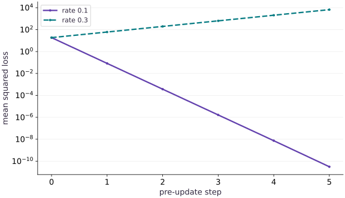

# Debug unstable learning

Phase 05: Neural network training · about 85 minutes · CPU

This worked reference is validated on CPU. Accelerator compatibility requires a separate source review and target execution receipt. Use the execution matrix to review device selection and data ownership before adapting a separate target program.

**Before this lesson:** [Train a CNN on a small dataset](https://www.tahabouhsine.com/jaxpathways/lesson-networks-04.html).

## What you will be able to do

- Derive the gradient and curvature on paper
- Record pre-update and post-update quantities distinctly
- Use gradient clipping for a bounded symptom, not a diagnosis
- Change the feature scale and predict the new bound
- Localize isolated data, hidden-activation, and update-scale faults in an MLP
- Repair one condition at a time and verify on fixed held-out examples

## The problem

The loss is growing. Should you immediately lower the learning rate? Let’s first gather evidence. We’ll use a one-weight model whose update we can derive, deliberately make it unstable, and inspect its losses, gradients and weights. You’ll learn how to connect a symptom to a cause. The scalar example is an analytic warm-up. The added lab below carries the same evidence-first method into an actual two-layer MLP, with one injected cause at a time and held-out comparisons.

## The idea

Unstable learning is a symptom with several possible causes. Connect the first unexpected value to inputs, forward computation, loss, gradients, optimizer state or the applied update. That ordering turns a vague failure into a testable diagnosis. In the MLP lab, inspect the first bad boundary and named layer gradient norms instead of inferring a cause from loss alone.

## Locate the first broken boundary

A loss curve tells you that something went wrong. A diagnosis tells you where it first went wrong and why a particular repair should help. We will build that explanation in two stages: a one-weight model whose stability we can calculate exactly, then an MLP where the failure can start in the input, hidden layer or update.

Follow the computation in order: input, hidden activations, predictions and loss, gradients, then updated parameters. Stop at the first boundary that violates your expectation. A NaN already present in the input calls for a different repair from finite gradients followed by a destructive update.

For each fault, keep the initialization and examples fixed. Predict the observation, change one factor, then compare the repaired run on the same training and held-out data. This turns debugging into a small causal experiment rather than a search for a hyperparameter that happens to make the curve look better.

### Pause and reason

Why is “the loss is NaN” not yet a diagnosis?

<details><summary>Compare your reasoning</summary>

It names the final symptom. Find the earliest nonfinite value and its producing operation, then test a specific repair against the same failing case.

</details>

## Derive the gradient and curvature on paper

The training pairs are $x=[1, 2, 3]$ and $y=2x$. The head predicts $wx$, so the mean squared loss is $\operatorname{mean}(x^2)(w-2)^2=\frac{14}{3}(w-2)^2$. The gradient is $\frac{28}{3}(w-2)$, and the constant curvature is $28/3$. Gradient descent transforms the weight error $e=w-2$ into $(1-\eta\,28/3)e$. Stability requires the magnitude of that multiplier to be less than one, hence $0<\eta<\frac{3}{14}$ for this specific objective. This calculation lets us predict failure before observing a plot.

$$
\begin{aligned}L(w)&=\frac{14}{3}(w-2)^2\\e_{\mathrm{next}}&=\left(1-\eta\frac{28}{3}\right)e\\0&<\eta<\frac{3}{14}\approx0.214286\end{aligned}
$$

## Record pre-update and post-update quantities distinctly

At each iteration, record the current weight, loss, and absolute gradient, then compute the new weight. The history therefore describes the parameter entering each update. At rate $0.1$ the error multiplier is about $0.066667$; the weight converges quickly. At rate $0.3$ the multiplier is $-1.8$; errors alternate sign and grow in magnitude, with loss increasing by a factor $3.24$ per update until precision limits intervene. We run only six unstable steps to preserve a readable finite trace. A finite-number check catches overflow, but finite values can still represent a badly diverging run.

## Use gradient clipping for a bounded symptom, not a diagnosis

Clipping a scalar gradient to magnitude one limits each rate-0.3 update to at most $0.3$. That prevents the explosive trajectory in this small example, but it is separate from a generally correct learning rate, good final accuracy, or a solved numerical problem. Inspect the original norm as well as the clipped update. A repeatedly clipped run may indicate badly scaled features or excessive rate. Diagnose the data and objective before adopting clipping as a permanent fix. For cross-entropy models, large steps can produce confidently wrong finite predictions; monitoring only NaNs would miss them.

## Change the feature scale and predict the new bound

Multiply every $x$ and $y$ by ten while keeping the true weight two. The loss and curvature multiply by $100$, and the stable learning-rate ceiling divides by $100$. A rate of $0.1$ that was stable on the original data is now unstable. This demonstrates why a copied learning rate can fail after preprocessing changes. Standardization, objective normalization, adaptive optimizers, and clipping affect update behavior in different ways. Preserve an independent analytic check when possible, then instrument real networks with finite checks, gradient norms, prediction ranges, class balance, and evaluation isolation. Do not apply the quadratic bound to an unrelated model.

## Localize failures inside a small MLP

Now use the same reasoning on the two-layer tanh classifier. It has 128 training rows and 96 separately generated held-out rows. The reference run lowers training BCE from $0.6258$ to $0.5295$, and held-out BCE from $0.6397$ to $0.5417$. Keep this reference initialization so each fault has a clear comparison.

Start with the data fault. One feature at row 7, column 1 is NaN. The input check finds it before the forward pass. Lowering the learning rate cannot repair a missing numerical value; restoring the original source row can. Locate the earliest invalid value before inspecting the optimizer.

Next add $20$ to every hidden bias. The tanh outputs saturate: all measured magnitudes exceed $0.99$. Because tanh is almost flat there, the hidden-layer gradient norm becomes zero while the output-layer norm remains $0.19231$. This contrast localizes the blocked learning signal. Restoring only the hidden bias lowers held-out loss from $0.69029$ to $0.63973$; clipping an already zero hidden gradient would not address the cause.

Finally compare learning rates $100$ and $0.03$ for three updates. The oversized run has finite gradients, yet its first update raises training loss from $0.6258$ to $1.6054$, and its held-out loss reaches about $71.85$ by update three. With rate $0.03$, training and held-out losses both fall. Here the update size is the changed cause. The independent NumPy `logaddexp` calculation checks that the held-out BCE itself is being measured correctly.

Before moving on, name the earliest failing boundary for all three cases and the single change that repaired it. The exact quadratic stability bound from the warm-up belongs to that quadratic; the MLP diagnosis comes from these controlled observations.

### Pause and reason

The MLP has finite forward values and finite gradients, but held-out loss rises after each oversized update. Which boundary should you inspect first?

<details><summary>Compare your reasoning</summary>

The update: compare the learning rate times gradient with the parameter scale and verify the post-update held-out loss. Finite autodiff does not guarantee a safe step.

</details>

## 1. Localize and repair three isolated MLP faults

Append the MLP lab. Before each diagnostic, predict the earliest failing boundary, the one measurement that will identify it, and which single changed condition should repair it. The fixed held-out arrays remain untouched by training.

```python
# MLP failure-localization lab : each case changes one condition and uses the same held-out rows.
import jax
import jax.numpy as jnp
import numpy as np
rng = np.random.default_rng(8)
train_np = rng.normal(size=(128, 2)).astype(np.float32)
test_np = rng.normal(size=(96, 2)).astype(np.float32)
train_labels_np = (train_np[:, 0] - 0.6 * train_np[:, 1] > 0.1).astype(np.float32)
test_labels_np = (test_np[:, 0] - 0.6 * test_np[:, 1] > 0.1).astype(np.float32)
train_x, train_y = jnp.asarray(train_np), jnp.asarray(train_labels_np)
test_x, test_y = jnp.asarray(test_np), jnp.asarray(test_labels_np)
k1, k2 = jax.random.split(jax.random.key(4))
initial = {'w1': jax.random.normal(k1, (2, 8)) * 0.5, 'b1': jnp.zeros((8,)),
           'w2': jax.random.normal(k2, (8, 1)) * 0.5, 'b2': jnp.zeros((1,))}
def mlp_forward(params, x, input_scale=1.0):
    preactivation = (input_scale * x) @ params['w1'] + params['b1']
    hidden = jnp.tanh(preactivation)
    logits = (hidden @ params['w2'] + params['b2']).squeeze(-1)
    return logits, (preactivation, hidden)
def mlp_loss(params, x, y, input_scale=1.0):
    logits, _ = mlp_forward(params, x, input_scale)
    return jnp.mean(jax.nn.softplus(logits) - y * logits)
def tree_l2(tree):
    return jnp.sqrt(sum(jnp.sum(value * value) for value in jax.tree.leaves(tree)))
def train_mlp(params, rate, steps, x=train_x, y=train_y):
    losses = []
    for _ in range(steps):
        value, grads = jax.value_and_grad(mlp_loss)(params, x, y)
        assert np.isfinite(float(value)) and np.isfinite(float(tree_l2(grads)))
        params = jax.tree.map(lambda p, g: p - rate * g, params, grads)
        losses.append(float(value))
    return params, np.asarray(losses)
# Sound reference: one MLP run improves a distinct held-out set; NumPy computes BCE independently.
reference_model, reference_curve = train_mlp(initial, 0.03, 20)
reference_logits, _ = mlp_forward(reference_model, test_x)
reference_test = float(mlp_loss(reference_model, test_x, test_y))
np.testing.assert_allclose(reference_test,
    np.mean(np.logaddexp(0.0, np.asarray(reference_logits)) - test_labels_np * np.asarray(reference_logits)),
    rtol=1e-5, atol=1e-6)
assert reference_curve[-1] < reference_curve[0] and reference_test < float(mlp_loss(initial, test_x, test_y))
# Fault A: one corrupted feature. Predict the first failing boundary before running a forward pass.
initial_heldout = float(mlp_loss(initial, test_x, test_y))
corrupt_x = train_x.at[7, 1].set(jnp.nan)
first_bad_input = np.argwhere(~np.isfinite(np.asarray(corrupt_x)))
assert first_bad_input.tolist() == [[7, 1]]
bad_data_loss = mlp_loss(initial, corrupt_x, train_y)
assert not np.isfinite(float(bad_data_loss))
# Repair only the source row by restoring its known clean feature value.
repaired_x = corrupt_x.at[7, 1].set(train_x[7, 1])
assert np.isfinite(float(mlp_loss(initial, repaired_x, train_y)))
data_repaired_heldout = float(mlp_loss(initial, test_x, test_y))
np.testing.assert_allclose(data_repaired_heldout, initial_heldout, rtol=1e-6)
np.testing.assert_array_equal(repaired_x, train_x)
# Fault B: change only the input scale entering the first layer. Locate tanh saturation and its gradients.
saturation_params = {**initial, 'b1': jnp.full((8,), 20.0)}
_, (preact_bad, hidden_bad) = mlp_forward(saturation_params, train_x)
saturated = jnp.mean(jnp.abs(hidden_bad) > 0.99)
grad_bad = jax.grad(mlp_loss)(saturation_params, train_x, train_y)
grad_by_layer = {'hidden (w1,b1)': tree_l2({'w1': grad_bad['w1'], 'b1': grad_bad['b1']}),
                 'output (w2,b2)': tree_l2({'w2': grad_bad['w2'], 'b2': grad_bad['b2']})}
assert float(saturated) > 0.99
assert np.all(np.isfinite([float(value) for value in grad_by_layer.values()]))
saturated_test = float(mlp_loss(saturation_params, test_x, test_y))
base_test = float(mlp_loss(initial, test_x, test_y))
saturation_repaired = {**saturation_params, 'b1': initial['b1']}
np.testing.assert_allclose(mlp_loss(saturation_repaired, test_x, test_y), base_test, rtol=1e-6)
assert saturated_test > base_test
# Fault C: leave data, initialization, and gradient calculation fixed; use a grossly oversized learning rate.
large_rate_model, large_rate_curve = train_mlp(initial, 100.0, 3)
small_rate_model, small_rate_curve = train_mlp(initial, 0.03, 3)
large_test = float(mlp_loss(large_rate_model, test_x, test_y))
small_test = float(mlp_loss(small_rate_model, test_x, test_y))
assert large_rate_curve[1] > large_rate_curve[0] and large_rate_curve[2] > large_rate_curve[1]
assert large_test > float(mlp_loss(initial, test_x, test_y))
assert small_rate_curve[-1] < small_rate_curve[0] and small_test < float(mlp_loss(initial, test_x, test_y))
# Plot values are computed from each actual update; x=0 is the initialized model.
def loss_path(rate, steps=3):
    params = initial
    train_values = [float(mlp_loss(params, train_x, train_y))]
    heldout_values = [float(mlp_loss(params, test_x, test_y))]
    for _ in range(steps):
        _, grads = jax.value_and_grad(mlp_loss)(params, train_x, train_y)
        params = jax.tree.map(lambda value, grad: value - rate * grad, params, grads)
        train_values.append(float(mlp_loss(params, train_x, train_y)))
        heldout_values.append(float(mlp_loss(params, test_x, test_y)))
    return train_values, heldout_values
safe_train_path, safe_test_path = loss_path(0.03)
fast_train_path, fast_test_path = loss_path(100.0)
visual_data = {'kind': 'line', 'x': [0, 1, 2, 3], 'xlabel': 'completed full-batch updates (0 = initialized model)',
 'ylabel': 'binary cross-entropy (natural log units)', 'series': [
  {'label': 'training, lr=0.03', 'y': safe_train_path},
  {'label': 'held-out, lr=0.03', 'y': safe_test_path},
  {'label': 'training, lr=100', 'y': fast_train_path},
  {'label': 'held-out, lr=100', 'y': fast_test_path}]}
assert fast_train_path[1] > fast_train_path[0] and fast_test_path[-1] > fast_test_path[0]
assert safe_train_path[-1] < safe_train_path[0] and safe_test_path[-1] < safe_test_path[0]
print('Reference MLP: train loss %.4f -> %.4f; held-out loss %.4f -> %.4f' % (reference_curve[0], reference_curve[-1], float(mlp_loss(initial, test_x, test_y)), reference_test))
print('Data fault: earliest invalid input at row 7, feature 1; repair restored source row and held-out BCE %.4f.' % data_repaired_heldout)
print('Saturation fault: %.1f%% |tanh(h)| > .99; hidden gradient %.5f, output gradient %.5f; held-out loss %.4f versus %.4f after restoring the hidden bias.' % (100 * float(saturated), float(grad_by_layer['hidden (w1,b1)']), float(grad_by_layer['output (w2,b2)']), saturated_test, base_test))
print('Update fault: lr=100 loss %.4f -> %.4f -> %.4f, held-out %.4f; repair lr=.03 ends train %.4f, held-out %.4f.' % (large_rate_curve[0], large_rate_curve[1], large_rate_curve[2], large_test, small_rate_curve[-1], small_test))
```

The failures are independent experiments from the same initialized MLP. The NaN is detected at input ingestion; activation scaling is localized by the tanh saturation fraction and per-layer gradients; the oversized rate is localized after finite gradients by its update trajectory and held-out loss. The repair checks hold the remaining conditions fixed.

## Analytic reference 1. Define the controlled objective

Create main.py. Calculate $\operatorname{mean}(x^2)$ and the gradient at $w=0$ before running this block.

```python
# Step 1 : 1. Define the controlled objective: The initial loss is 56/3 and the initial gradient is -56/3.
import jax
import jax.numpy as jnp
import numpy as np
x=jnp.array([1.,2.,3.])
y=2*x
def loss(w,features=x,targets=y):return jnp.mean((w*features-targets)**2)
def analytic_gradient(w):return (28/3)*(w-2)
np.testing.assert_allclose(loss(0.),56/3,rtol=1e-6)
np.testing.assert_allclose(jax.grad(loss)(0.),-56/3,rtol=1e-6)
```

The initial loss is $56/3$ and the initial gradient is $-56/3$. These values independently anchor the autodiff trace.

## Analytic reference 2. Instrument the update loop

Append the runner. Each history row stores pre-update weight, loss, and gradient magnitude; no optimizer library hides the update.

```python
# Step 2 : 2. Instrument the update loop: The rate changes while initial state, data, and objective stay fixed.
def run(rate,steps,features=x,targets=y,clip=None):
    w=jnp.array(0.)
    history=[]
    objective=lambda value:loss(value,features,targets)
    for _ in range(steps):
        value,grad=jax.value_and_grad(objective)(w)
        history.append([float(w),float(value),float(jnp.abs(grad))])
        assert np.all(np.isfinite(history[-1]))
        update=jnp.clip(grad,-clip,clip) if clip is not None else grad
        w=w-rate*update
    return float(w),np.asarray(history)
stable,good=run(.1,6)
unstable,bad=run(.3,6)
assert abs(stable-2)<1e-5 and bad[-1,1]>bad[0,1]*100
```

The rate changes while initial state, data, and objective stay fixed. This isolates the intervention.

## Analytic reference 3. Match the recorded failure to the exact recurrence

Append analytic comparisons for every recorded iteration, then print the finite divergence trace.

```python
# Step 3 : 3. Match the recorded failure to the exact recurrence
for rate,history in [(.1,good),(.3,bad)]:
    expected_w=2-2*(1-rate*28/3)**np.arange(len(history))
    expected_loss=(14/3)*(expected_w-2)**2
    np.testing.assert_allclose(history[:,0],expected_w,rtol=2e-5,atol=1e-5)
    np.testing.assert_allclose(history[:,1],expected_loss,rtol=2e-5,atol=1e-8)
np.testing.assert_allclose(bad[1:,1]/bad[:-1,1],3.24,rtol=1e-5)
print('Stable final weight:',stable,'unstable pre-update [weight,loss,|gradient|]:\n',bad)
```

An alternating parameter error and a $3.24$ loss multiplier support the learning-rate diagnosis. Near zero, float32 cancellation makes relative loss error misleading, so the analytic comparison uses a $10^{-8}$ absolute floor. No timing or accelerator result is claimed.

## Run the example

```python
# Step 1 : 1. Define the controlled objective: The initial loss is 56/3 and the initial gradient is -56/3.
import jax
import jax.numpy as jnp
import numpy as np
x=jnp.array([1.,2.,3.])
y=2*x
def loss(w,features=x,targets=y):return jnp.mean((w*features-targets)**2)
def analytic_gradient(w):return (28/3)*(w-2)
np.testing.assert_allclose(loss(0.),56/3,rtol=1e-6)
np.testing.assert_allclose(jax.grad(loss)(0.),-56/3,rtol=1e-6)

# Step 2 : 2. Instrument the update loop: The rate changes while initial state, data, and objective stay fixed.
def run(rate,steps,features=x,targets=y,clip=None):
    w=jnp.array(0.)
    history=[]
    objective=lambda value:loss(value,features,targets)
    for _ in range(steps):
        value,grad=jax.value_and_grad(objective)(w)
        history.append([float(w),float(value),float(jnp.abs(grad))])
        assert np.all(np.isfinite(history[-1]))
        update=jnp.clip(grad,-clip,clip) if clip is not None else grad
        w=w-rate*update
    return float(w),np.asarray(history)
stable,good=run(.1,6)
unstable,bad=run(.3,6)
assert abs(stable-2)<1e-5 and bad[-1,1]>bad[0,1]*100

# Step 3 : 3. Match the recorded failure to the exact recurrence
for rate,history in [(.1,good),(.3,bad)]:
    expected_w=2-2*(1-rate*28/3)**np.arange(len(history))
    expected_loss=(14/3)*(expected_w-2)**2
    np.testing.assert_allclose(history[:,0],expected_w,rtol=2e-5,atol=1e-5)
    np.testing.assert_allclose(history[:,1],expected_loss,rtol=2e-5,atol=1e-8)
np.testing.assert_allclose(bad[1:,1]/bad[:-1,1],3.24,rtol=1e-5)
print('Stable final weight:',stable,'unstable pre-update [weight,loss,|gradient|]:\n',bad)

# MLP failure-localization lab : each case changes one condition and uses the same held-out rows.
import jax
import jax.numpy as jnp
import numpy as np
rng = np.random.default_rng(8)
train_np = rng.normal(size=(128, 2)).astype(np.float32)
test_np = rng.normal(size=(96, 2)).astype(np.float32)
train_labels_np = (train_np[:, 0] - 0.6 * train_np[:, 1] > 0.1).astype(np.float32)
test_labels_np = (test_np[:, 0] - 0.6 * test_np[:, 1] > 0.1).astype(np.float32)
train_x, train_y = jnp.asarray(train_np), jnp.asarray(train_labels_np)
test_x, test_y = jnp.asarray(test_np), jnp.asarray(test_labels_np)
k1, k2 = jax.random.split(jax.random.key(4))
initial = {'w1': jax.random.normal(k1, (2, 8)) * 0.5, 'b1': jnp.zeros((8,)),
           'w2': jax.random.normal(k2, (8, 1)) * 0.5, 'b2': jnp.zeros((1,))}
def mlp_forward(params, x, input_scale=1.0):
    preactivation = (input_scale * x) @ params['w1'] + params['b1']
    hidden = jnp.tanh(preactivation)
    logits = (hidden @ params['w2'] + params['b2']).squeeze(-1)
    return logits, (preactivation, hidden)
def mlp_loss(params, x, y, input_scale=1.0):
    logits, _ = mlp_forward(params, x, input_scale)
    return jnp.mean(jax.nn.softplus(logits) - y * logits)
def tree_l2(tree):
    return jnp.sqrt(sum(jnp.sum(value * value) for value in jax.tree.leaves(tree)))
def train_mlp(params, rate, steps, x=train_x, y=train_y):
    losses = []
    for _ in range(steps):
        value, grads = jax.value_and_grad(mlp_loss)(params, x, y)
        assert np.isfinite(float(value)) and np.isfinite(float(tree_l2(grads)))
        params = jax.tree.map(lambda p, g: p - rate * g, params, grads)
        losses.append(float(value))
    return params, np.asarray(losses)
# Sound reference: one MLP run improves a distinct held-out set; NumPy computes BCE independently.
reference_model, reference_curve = train_mlp(initial, 0.03, 20)
reference_logits, _ = mlp_forward(reference_model, test_x)
reference_test = float(mlp_loss(reference_model, test_x, test_y))
np.testing.assert_allclose(reference_test,
    np.mean(np.logaddexp(0.0, np.asarray(reference_logits)) - test_labels_np * np.asarray(reference_logits)),
    rtol=1e-5, atol=1e-6)
assert reference_curve[-1] < reference_curve[0] and reference_test < float(mlp_loss(initial, test_x, test_y))
# Fault A: one corrupted feature. Predict the first failing boundary before running a forward pass.
initial_heldout = float(mlp_loss(initial, test_x, test_y))
corrupt_x = train_x.at[7, 1].set(jnp.nan)
first_bad_input = np.argwhere(~np.isfinite(np.asarray(corrupt_x)))
assert first_bad_input.tolist() == [[7, 1]]
bad_data_loss = mlp_loss(initial, corrupt_x, train_y)
assert not np.isfinite(float(bad_data_loss))
# Repair only the source row by restoring its known clean feature value.
repaired_x = corrupt_x.at[7, 1].set(train_x[7, 1])
assert np.isfinite(float(mlp_loss(initial, repaired_x, train_y)))
data_repaired_heldout = float(mlp_loss(initial, test_x, test_y))
np.testing.assert_allclose(data_repaired_heldout, initial_heldout, rtol=1e-6)
np.testing.assert_array_equal(repaired_x, train_x)
# Fault B: change only the input scale entering the first layer. Locate tanh saturation and its gradients.
saturation_params = {**initial, 'b1': jnp.full((8,), 20.0)}
_, (preact_bad, hidden_bad) = mlp_forward(saturation_params, train_x)
saturated = jnp.mean(jnp.abs(hidden_bad) > 0.99)
grad_bad = jax.grad(mlp_loss)(saturation_params, train_x, train_y)
grad_by_layer = {'hidden (w1,b1)': tree_l2({'w1': grad_bad['w1'], 'b1': grad_bad['b1']}),
                 'output (w2,b2)': tree_l2({'w2': grad_bad['w2'], 'b2': grad_bad['b2']})}
assert float(saturated) > 0.99
assert np.all(np.isfinite([float(value) for value in grad_by_layer.values()]))
saturated_test = float(mlp_loss(saturation_params, test_x, test_y))
base_test = float(mlp_loss(initial, test_x, test_y))
saturation_repaired = {**saturation_params, 'b1': initial['b1']}
np.testing.assert_allclose(mlp_loss(saturation_repaired, test_x, test_y), base_test, rtol=1e-6)
assert saturated_test > base_test
# Fault C: leave data, initialization, and gradient calculation fixed; use a grossly oversized learning rate.
large_rate_model, large_rate_curve = train_mlp(initial, 100.0, 3)
small_rate_model, small_rate_curve = train_mlp(initial, 0.03, 3)
large_test = float(mlp_loss(large_rate_model, test_x, test_y))
small_test = float(mlp_loss(small_rate_model, test_x, test_y))
assert large_rate_curve[1] > large_rate_curve[0] and large_rate_curve[2] > large_rate_curve[1]
assert large_test > float(mlp_loss(initial, test_x, test_y))
assert small_rate_curve[-1] < small_rate_curve[0] and small_test < float(mlp_loss(initial, test_x, test_y))
# Plot values are computed from each actual update; x=0 is the initialized model.
def loss_path(rate, steps=3):
    params = initial
    train_values = [float(mlp_loss(params, train_x, train_y))]
    heldout_values = [float(mlp_loss(params, test_x, test_y))]
    for _ in range(steps):
        _, grads = jax.value_and_grad(mlp_loss)(params, train_x, train_y)
        params = jax.tree.map(lambda value, grad: value - rate * grad, params, grads)
        train_values.append(float(mlp_loss(params, train_x, train_y)))
        heldout_values.append(float(mlp_loss(params, test_x, test_y)))
    return train_values, heldout_values
safe_train_path, safe_test_path = loss_path(0.03)
fast_train_path, fast_test_path = loss_path(100.0)
visual_data = {'kind': 'line', 'x': [0, 1, 2, 3], 'xlabel': 'completed full-batch updates (0 = initialized model)',
 'ylabel': 'binary cross-entropy (natural log units)', 'series': [
  {'label': 'training, lr=0.03', 'y': safe_train_path},
  {'label': 'held-out, lr=0.03', 'y': safe_test_path},
  {'label': 'training, lr=100', 'y': fast_train_path},
  {'label': 'held-out, lr=100', 'y': fast_test_path}]}
assert fast_train_path[1] > fast_train_path[0] and fast_test_path[-1] > fast_test_path[0]
assert safe_train_path[-1] < safe_train_path[0] and safe_test_path[-1] < safe_test_path[0]
print('Reference MLP: train loss %.4f -> %.4f; held-out loss %.4f -> %.4f' % (reference_curve[0], reference_curve[-1], float(mlp_loss(initial, test_x, test_y)), reference_test))
print('Data fault: earliest invalid input at row 7, feature 1; repair restored source row and held-out BCE %.4f.' % data_repaired_heldout)
print('Saturation fault: %.1f%% |tanh(h)| > .99; hidden gradient %.5f, output gradient %.5f; held-out loss %.4f versus %.4f after restoring the hidden bias.' % (100 * float(saturated), float(grad_by_layer['hidden (w1,b1)']), float(grad_by_layer['output (w2,b2)']), saturated_test, base_test))
print('Update fault: lr=100 loss %.4f -> %.4f -> %.4f, held-out %.4f; repair lr=.03 ends train %.4f, held-out %.4f.' % (large_rate_curve[0], large_rate_curve[1], large_rate_curve[2], large_test, small_rate_curve[-1], small_test))
```

Expected: Rate $0.1$ approaches weight $2$. Rate $0.3$ produces alternating growing errors; consecutive unstable losses have ratio $3.24$ before overflow. The additional MLP lab prints its actual held-out comparison, exact corrupted coordinate, saturation fraction, layer gradient norms, and three-step loss traces.

## MLP fault localization: loss after each update

**Predict:** At which completed update does the rate-100 held-out loss first exceed its starting value, while the rate-0.03 run improves?



**Recorded CPU computation**

### Read the figure

Read left to right from update zero, which is the initialized MLP. Each line reports BCE after the indicated number of full-batch updates, using the same training or held-out rows throughout. The vertical axis uses a logarithmic scale so the small safe-run improvement and the much larger unstable-run increase are both visible. Equal vertical distances represent equal ratios of loss, not equal absolute differences.

With rate $100$, training loss rises from $0.6258$ to $1.6054$ after the first update; by update three, held-out loss is about $71.85$. Both rate-$0.03$ lines instead move downward. Compare the direction of training and held-out lines together: the high-rate failure harms the fitted data as well as unseen rows. This is an update-scale failure, rather than a training-only gain accompanied by worse generalization.

### Connect it to the computation

The plot answers when the oversized update fails. The diagnostic measurements answer where the other faults begin: the NaN appears at the input, while saturation blocks the hidden-layer gradient even though the output layer still receives a signal. Keep the plot beside those measurements. A finite loss or gradient alone cannot tell you whether the next update will be useful.

```python
# Plot values are computed from each actual update; x=0 is the initialized model.
def loss_path(rate, steps=3):
    params = initial
    train_values = [float(mlp_loss(params, train_x, train_y))]
    heldout_values = [float(mlp_loss(params, test_x, test_y))]
    for _ in range(steps):
        _, grads = jax.value_and_grad(mlp_loss)(params, train_x, train_y)
        params = jax.tree.map(lambda value, grad: value - rate * grad, params, grads)
        train_values.append(float(mlp_loss(params, train_x, train_y)))
        heldout_values.append(float(mlp_loss(params, test_x, test_y)))
    return train_values, heldout_values
safe_train_path, safe_test_path = loss_path(0.03)
fast_train_path, fast_test_path = loss_path(100.0)
visual_data = {'kind': 'line', 'x': [0, 1, 2, 3], 'xlabel': 'completed full-batch updates (0 = initialized model)',
 'ylabel': 'binary cross-entropy (nats; log axis)', 'yscale': 'log', 'series': [
  {'label': 'training, lr=0.03', 'y': safe_train_path},
  {'label': 'held-out, lr=0.03', 'y': safe_test_path},
  {'label': 'training, lr=100', 'y': fast_train_path},
  {'label': 'held-out, lr=100', 'y': fast_test_path}]}
assert fast_train_path[1] > fast_train_path[0] and fast_test_path[-1] > fast_test_path[0]
assert safe_train_path[-1] < safe_train_path[0] and safe_test_path[-1] < safe_test_path[0]
```

## Recorded reference execution

CPU run: 2026-10-27T16:11:08.806464+00:00. JAX 0.9.2.

```text
Reference MLP: train loss 0.6258 -> 0.5295; held-out loss 0.6397 -> 0.5417
Data fault: earliest invalid input at row 7, feature 1; repair restored source row and held-out BCE 0.6397.
Saturation fault: 100.0% |tanh(h)| > .99; hidden gradient 0.00000, output gradient 0.19231; held-out loss 0.6903 versus 0.6397 after restoring the hidden bias.
Update fault: lr=100 loss 0.6258 -> 1.6054 -> 32.9974, held-out 71.8487; repair lr=.03 ends train 0.6142, held-out 0.6230.
Stable final weight: 1.999999761581421 unstable pre-update [weight,loss,|gradient|]:
 [[ 0.00000000e+00  1.86666679e+01  1.86666679e+01]
 [ 5.60000038e+00  6.04800110e+01  3.36000061e+01]
 [-4.48000145e+00  1.95955292e+02  6.04800148e+01]
 [ 1.36640034e+01  6.34895264e+02  1.08864037e+02]
 [-1.89952106e+01  2.05706152e+03  1.95955322e+02]
 [ 3.97913895e+01  6.66488281e+03  3.52719635e+02]]
Stable final weight: 1.999999761581421 unstable pre-update [weight,loss,|gradient|]:
 [[ 0.00000000e+00  1.86666679e+01  1.86666679e+01]
 [ 5.60000038e+00  6.04800110e+01  3.36000061e+01]
 [-4.48000145e+00  1.95955292e+02  6.04800148e+01]
 [ 1.36640034e+01  6.34895264e+02  1.08864037e+02]
 [-1.89952106e+01  2.05706152e+03  1.95955322e+02]
 [ 3.97913895e+01  6.66488281e+03  3.52719635e+02]]
Reference MLP: train loss 0.6258 -> 0.5295; held-out loss 0.6397 -> 0.5417
Data fault: earliest invalid input at row 7, feature 1; repair restored source row and held-out BCE 0.6397.
Saturation fault: 100.0% |tanh(h)| > .99; hidden gradient 0.00000, output gradient 0.19231; held-out loss 0.6903 versus 0.6397 after restoring the hidden bias.
Update fault: lr=100 loss 0.6258 -> 1.6054 -> 32.9974, held-out 71.8487; repair lr=.03 ends train 0.6142, held-out 0.6230.
Each isolated MLP failure was localized and its one-factor repair passed the held-out check.
Reference / compensated / unchanged-rate updates: 1.8833334 1.8833332 8.416667
PASS: networks-05

```

## Bounded clipped updates

**Predict before running:** At rate $0.3$ with clipping threshold one, how far can one scalar update move?

```python
# Experiment : Bounded clipped updates: Clipping changes the effective update.
clipped,clipped_history=run(.3,6,clip=1.)
assert np.all(np.abs(np.diff(clipped_history[:,0]))<=.300001)
assert clipped_history[-1,1]<clipped_history[0,1]
assert clipped_history[0,2]>1.
```

**Expected:** Each recorded displacement is at most $0.3$ while the original gradient norm initially exceeds one.

Clipping changes the effective update. Its boundedness is a useful invariant, not proof of optimal training.

## Feature scaling changes curvature

**Predict before running:** Scale both features and targets by ten. Does the original stable rate remain stable?

```python
# Experiment : Feature scaling changes curvature
scaled_final,scaled=run(.1,3,x*10,y*10)
assert scaled[-1,1]>scaled[0,1]
adjusted_final,adjusted=run(.001,6,x*10,y*10)
np.testing.assert_allclose(adjusted[:,0],good[:,0],rtol=1e-5,atol=1e-5)
np.testing.assert_allclose(adjusted[:,1],good[:,1]*100,rtol=1e-4,atol=1e-8)
```

**Expected:** Rate $0.1$ diverges after scaling. Dividing the rate by $100$ restores the original weight trajectory.

The gradient multiplies by $100$ because both prediction and target are scaled; adjusting rate compensates for this fixture.

## Make it yours

In the MLP lab, compare the corrupted batch, the +20 hidden-bias saturation, and the rate-100 run. Write the expected first diagnostic for each before executing it. Then repair exactly one condition in each case and verify finite or decreasing held-out loss with the fixed held-out arrays.

### How to write this exercise — Step-by-step recipe & starter scaffold

**Inputs:**
- A scalar linear model features, targets, initial weight, and candidate rates.

**Outputs:**
- Loss/parameter histories that distinguish stable from unstable updates.

**Invariants to check:**
- The stability limit is recomputed for the changed feature scale; reject nonfinite inputs before updating.

**Hints:**
- Differentiate the mean squared objective at the supplied data.
- Scale the rate when scaling the objective, and check the assumption behind that relation.

**Starter code scaffold (fill in the TODOs):**

```python
import jax
import jax.numpy as jnp

def compare_learning_rates(features, targets, initial_weight, rates):
    """Loss/parameter histories that distinguish stable from unstable updates."""
    # TODO: Compare finite loss/gradient updates across rates and feature/objective scales before accepting a step.
    raise NotImplementedError
```

<details><summary>Reference solution</summary>

```python
# Exercise solution: use the exact fixture and diagnostics defined in first MLP build step.
assert first_bad_input.tolist() == [[7, 1]]
assert np.isfinite(float(mlp_loss(initial, repaired_x, train_y)))
assert float(saturated) > 0.99
assert large_test > float(mlp_loss(initial, test_x, test_y))
assert small_test < float(mlp_loss(initial, test_x, test_y))
np.testing.assert_array_equal(repaired_x, train_x)
print('Each isolated MLP failure was localized and its one-factor repair passed the held-out check.')
```

</details>

## Rescale the objective and compensate the update

**Transfer**

Multiply the squared-loss objective by five. Compare one plain gradient-descent update at the old rate and at one fifth of that rate. Explain why this compensation does not automatically describe Adam or clipping.

<details><summary>Hint</summary>

Differentiate the scaled objective; plain gradient descent multiplies its gradient by the learning rate.

</details>

### How to write: Rescale the objective and compensate the update — Step-by-step recipe & starter scaffold

**Inputs:**
- Multiply the squared-loss objective by five. Compare one plain gradient-descent update at the old rate and at one fifth of that rate. Explain why this compensation does not automatically describe Adam or clipping.

**Outputs:**
- Both parameter changes and losses for the two rate/objective pairs.

**Invariants to check:**
- The compensation is evaluated for plain gradient descent at the same initial point.

**Hints:**
- Differentiate the scaled objective; plain gradient descent multiplies its gradient by the learning rate.

**Starter code scaffold (fill in the TODOs):**

```python
import jax
import jax.numpy as jnp

def practice_rescale_the_objective_and_compensate_the_update(features, targets, old_rate, scale_factor):
    """Implement the rescale the objective and compensate the update check."""
    # TODO: Compare one gradient update before and after multiplying the objective by five, using the original and one-fifth rates.
    raise NotImplementedError
```

<details><summary>Reference solution and reasoning</summary>

```python
# Rescale the objective and compensate the update (Transfer): Scaling the objective scales the gradient.
w0=jnp.array(.25)
base_gradient=jax.grad(loss)(w0)
scaled_gradient=jax.grad(lambda w:5*loss(w))(w0)
np.testing.assert_allclose(scaled_gradient,5*base_gradient,rtol=1e-6)
reference=w0-.1*base_gradient
compensated=w0-(.1/5)*scaled_gradient
uncompensated=w0-.1*scaled_gradient
np.testing.assert_allclose(compensated,reference,rtol=1e-6)
assert not np.isclose(uncompensated,reference)
print('Reference / compensated / unchanged-rate updates:',reference,compensated,uncompensated)
```

Scaling the objective scales the gradient. For this plain update the inverse rate change cancels it exactly. Stateful normalization, clipping and regularization need their own analysis.

</details>

## Diagnose a nonfinite input before an update

**Intermediate**

Insert one NaN feature. Show that loss/gradient finite checks fail, then repair the source data and recheck the independent initial gradient.

<details><summary>Hint</summary>

Changing the learning rate cannot make a NaN observation valid.

</details>

### How to write: Diagnose a nonfinite input before an update — Step-by-step recipe & starter scaffold

**Inputs:**
- Insert one NaN feature. Show that loss/gradient finite checks fail, then repair the source data and recheck the independent initial gradient.

**Outputs:**
- A rejected nonfinite batch and a finite independent initial gradient after repair.

**Invariants to check:**
- No optimizer transition runs on a batch with nonfinite features.

**Hints:**
- Changing the learning rate cannot make a NaN observation valid.

**Starter code scaffold (fill in the TODOs):**

```python
import jax
import jax.numpy as jnp

def practice_diagnose_a_nonfinite_input_before_an_update(features, targets, weight):
    """Implement the diagnose a nonfinite input before an update check."""
    # TODO: Insert one NaN feature, check input/loss/gradient finiteness before stepping, then repair the source row.
    raise NotImplementedError
```

<details><summary>Reference solution and reasoning</summary>

```python
# Diagnose a nonfinite input before an update (Intermediate): Nonfinite data is a different cause than excessive step size.
corrupted=x.at[1].set(jnp.nan)
bad_value,bad_grad=jax.value_and_grad(lambda w:loss(w,corrupted,y))(0.)
assert not np.isfinite(float(bad_value)) and not np.isfinite(float(bad_grad))
repaired=jnp.array([1.,2.,3.])
repaired_value,repaired_grad=jax.value_and_grad(lambda w:loss(w,repaired,y))(0.)
np.testing.assert_allclose(repaired_grad,-56/3,rtol=1e-6)
assert np.isfinite(float(repaired_value))
```

Nonfinite data is a different cause than excessive step size. Repair it at ingestion and validate the objective before taking another update.

</details>

## Check your understanding

Why does scaling both $x$ and $y$ by ten require a different stable step-size range?

1. The squared-loss curvature grows by $100$
2. Autodiff stops working on scaled inputs
3. The number of observations changes

<details><summary>Answer and explanation</summary>

**1. The squared-loss curvature grows by $100$ (correct)**

Both the residual scale and its weight derivative scale by ten, so the gradient and curvature scale by $100$. This is specific to the squared objective and paired scaling.

**2. Autodiff stops working on scaled inputs**

Scaling inputs changes gradient curvature even when AD remains correct. Derive the squared input factor in the Hessian.

**3. The number of observations changes**

Multiplying values does not add observations. Compare the data shape with the scale of the quadratic loss.

</details>

## Diagnose the result

Start with finite input and loss checks, then inspect shape contracts and independent objective values. Record gradient norm, parameter norm, learning rate, and step index. Alternating growing errors can support a curvature diagnosis; NaNs from corrupted inputs require data repair. Preserve separate train and held-out metrics before declaring the fix successful. In an MLP, name the boundary and layer: finite inputs → finite logits/loss → activation distribution → per-layer gradient norms → update and parameter displacement → held-out loss. For the supplied lab, the data fault first appears at `(row 7, feature 1)`, the activation fault sets the hidden bias to 20 and saturates all hidden tanh outputs beyond 0.99, and only the rate-100 run has finite gradients followed by rising held-out loss. Do not infer one of these causes from a scalar curve alone.

## Carry forward

- Derive the gradient and curvature on paper
- Record pre-update and post-update quantities distinctly
- Use gradient clipping for a bounded symptom, not a diagnosis
- Change the feature scale and predict the new bound
- Trace the first invalid MLP input and measure activation/gradient distributions by layer
- Compare a one-factor repair on held-out rows

## Keep your evidence

Keep the NaN input diagnosis, saturation and excessive-rate controls, per-layer gradient/activation evidence and held-out comparisons for each one-factor repair.

Save your predictions, modified code, terminal outputs, and reasoning in your engineering portfolio.

## Primary references

- [JAX numerical accuracy](https://docs.jax.dev/en/latest/faq.html#numerical-accuracy)
- [Optax clipping transformations](https://optax.readthedocs.io/en/latest/api/transformations.html#optax.clip_by_global_norm)

