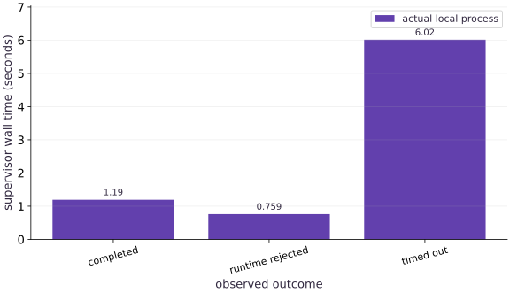

# Accelerator jobs and runtime lifecycle

Phase 16: Workload operations · about 90 minutes · CPU

This worked reference is validated on CPU. Accelerator compatibility requires a separate source review and target execution receipt. Use the execution matrix to review device selection and data ownership before adapting a separate target program.

## What you will be able to do

- Launch and reap a real bounded subprocess with explicit runtime requirements.
- Distinguish successful completion, worker failure and supervisor timeout.
- Keep configuration and observed runtime evidence with the run artifact.

## The problem

A training command starts, but that does not tell us whether its runtime is correct, its initialization finished, or its process will ever exit. We will supervise a real small JAX worker through success, rejected runtime requirements and an intentionally stalled update. The result will contain observed process outcomes rather than a list of assumed job statuses.

## The idea

Workload lifecycle states describe what a job can do now. Creation, startup, readiness, execution, completion and failure are different transitions. Observing the process alone is separate from that its useful work is available.

## A running process is not necessarily a ready service

A launched process can still be importing JAX, checking devices, or compiling its first update. In this worker, `started` means only that Python began; `ready` comes after the runtime contract passes and a disposable compiled update finishes. That boundary matters because compile time is not training progress.

Follow the recorded run: request CPU with one device; the child reports CPU/1, emits `ready`, then eight `progress` events and `completed`. Requesting 999 devices yields `started` then `failed`, with no update. With the recorded stall injected at step 0, before the first update, the child reaches `ready` and `stall_injected`, then the supervisor times out, terminates, and reaps it. The recorded exits were 0, 23, and -15; the last value is a signal result on this POSIX run, not a portable timeout code.

The figure measures launch-to-reaped-exit wall time: about 0.60 s for completion, 0.41 s for runtime rejection, and 6.01 s for timeout. The rejected bar is shorter because it exits before training; it is not a faster training run. First locate the last event, then choose whether to inspect initialization, update work, or cancellation.

$$
\text{State}_{\text{job}} \in \{\texttt{provisioned}, \texttt{started}, \texttt{completed}, \texttt{timed\_out}, \texttt{cleaned\_up}\}
$$

### Pause and reason

Why separate startup duration from useful execution duration?

<details><summary>Compare your reasoning</summary>

They have different causes and operational effects. Provisioning or loading changes may improve startup without changing the numerical workload's speed.

</details>

## Separate intent from observation

The config file records intent; the `started` event records what JAX actually found. In the accepted run those values are backend `cpu` and one device. The `min_devices=999` request fails the worker's preflight, so no progress event can be mistaken for partial success. A zero exit is also insufficient by itself: this supervisor requires the final `completed` event as evidence that the worker met its contract. When you read a run record, compare requested config, observed runtime, final event, and process exit before calling it complete.

## The process handle is the lifecycle authority

The supervisor keeps the `Popen` handle and waits with a deadline. In the injected stall, it first calls `terminate`, waits briefly, escalates to `kill` only if needed, and calls `communicate` again so the child is reaped and its output collected. Writing `timed_out` into JSON without ending the process would leave the worker alive and able to hold resources or write files. This fixture has no descendants; a scheduler or process tree needs its own cancellation boundary.

## Ready means initialization finished

`ready` is emitted only after JAX discovers the requested device, builds the fixture data, compiles an update, and blocks until that disposable result is available. The warmup uses temporary values, so the saved parameters, momentum, and random key still describe step 0. This is why `started` without `ready` points to runtime or initialization, while `ready` without `progress` points later in the path. The eight measured progress events then represent actual updates.

## Configuration should reject nonsense early

The worker's request is validated before a child is created: step count, checkpoint cadence, batch size, and minimum device count must be positive integers. The fixture has 64 examples and samples without replacement, so a batch larger than 64 is invalid here. Momentum and learning rate are bounded for this demonstration. These checks make a malformed request fail at the caller boundary instead of consuming startup time; they are not universal optimizer rules.

## Treat a deadline as evidence, not a diagnosis

The intentional stall sleeps after `ready` and writes `stall_injected`, so this trace identifies a pause after initialization and before the first update. A production timeout alone cannot tell you whether work was compiling, starved for input, deadlocked, or simply under-budgeted. Preserve the last structured event, stderr, requested backend, and device discovery before changing the deadline or retrying. Here the deliberate marker supplies a cause for the drill; a generic deadline would not.

## Transfer the contract to available hardware

On a prepared accelerator host, the same launch contract can request `tpu` or `gpu`; `JAX_PLATFORMS` constrains discovery and the `started` record captures what was found. If the runtime cannot satisfy the requested backend or device count, the child fails before training. The provided SSH example runs on an existing TPU VM and copies back its run record; it does not provision hardware. Treat this CPU exercise as a lifecycle rehearsal, then verify allocation, credentials, multi-host startup, and cancellation on the actual target.

**Supervise a bounded TPU worker on a Cloud TPU VM and copy back the run record**

```bash
# Supervise a bounded TPU worker on a Cloud TPU VM and copy back the run record
gcloud compute tpus tpu-vm scp exercises/operations-01.py $TPU_NAME:~/jax-tpu-lab/ --zone=$ZONE
gcloud compute tpus tpu-vm ssh $TPU_NAME --zone=$ZONE \
  --command="JAX_PLATFORMS=tpu ~/jax-tpu-lab/.venv/bin/python -c 'import operations_01 as op; r = op.launch(\"/tmp/tpu-ops-run\", dict(backend=\"tpu\", min_devices=1, steps=4)); assert r[\"status\"] == \"completed\"; print(r[\"events\"][0], r[\"events\"][-1])'"
```

**Expected:** Launches the supervised worker on the TPU VM with backend='tpu', verifies that started reports backend='tpu' and device_count >= 1, and records completed status in /tmp/tpu-ops-run/run.json.

## Classify timeout before completion

Define this small decision function before inspecting the full process wrapper.

```python
def classify_outcome(timed_out, returncode, malformed, events):
    if timed_out:
        return 'timed_out'
    if returncode == 0 and not malformed and completed_event(events):
        return 'completed'
    return 'failed'
```

The full instructor example uses the same decision after collecting the process and its events.

## Separate completion evidence from exit status

Read this test as the work contract.

```python
def completed_event(events):
    return bool(events) and events[-1]['event'] == 'completed'
```

A zero return code without a final completed event is not a completed job.

## Treat a timeout as a process action

Inspect the timeout label alongside the supervisor cleanup block.

```python
def timeout_outcome(timed_out):
    return 'timed_out' if timed_out else None
```

The supervisor still must terminate and reap the child; this label alone does not stop it.

## Run the example

```python
# Complete runnable example (operations-01)
"""Bounded local JAX subprocess supervisor and lifecycle verifier."""
from pathlib import Path
import hashlib
import json
import math
import os
import subprocess
import sys
import tempfile
import time


def digest(value):
    return hashlib.sha256(json.dumps(value, sort_keys=True, separators=(',', ':'), allow_nan=False).encode()).hexdigest()


def atomic_json(path, value):
    """Replace one local JSON file only after its bytes have been flushed."""
    path = Path(path)
    path.parent.mkdir(parents=True, exist_ok=True)
    fd, temporary = tempfile.mkstemp(prefix=path.name+'.', suffix='.tmp', dir=path.parent)
    try:
        with os.fdopen(fd, 'w') as stream:
            json.dump(value, stream, sort_keys=True, allow_nan=False)
            stream.flush()
            os.fsync(stream.fileno())
        os.replace(temporary, path)
    finally:
        if os.path.exists(temporary):
            os.unlink(temporary)

def completed_event(events):
    return bool(events) and events[-1]['event'] == 'completed'

def timeout_outcome(timed_out):
    return 'timed_out' if timed_out else None

def classify_outcome(timed_out, returncode, malformed, events):
    if timed_out:
        return 'timed_out'
    if returncode == 0 and not malformed and completed_event(events):
        return 'completed'
    return 'failed'

# This file is materialized only inside the caller-owned temporary run folder.
WORKER = r'''
import hashlib, json, os, sys, time
from pathlib import Path
import jax
import jax.numpy as jnp
import numpy as np
root = Path(sys.argv[1])
cfg = json.loads((root/'config.json').read_text())
worker_hash = hashlib.sha256(Path(__file__).read_bytes()).hexdigest()
def emit(event, **fields):
    print(json.dumps(dict(event=event, monotonic_s=time.monotonic(), **fields)), flush=True)
def digest(value):
    return hashlib.sha256(json.dumps(value,sort_keys=True,separators=(',', ':'),allow_nan=False).encode()).hexdigest()
def write_checkpoint(state):
    target = root/'checkpoint.json'
    temporary = root/'checkpoint.pending'
    with temporary.open('w') as stream:
        json.dump(dict(state,checksum=digest(state)),stream,sort_keys=True,allow_nan=False)
        stream.flush()
        os.fsync(stream.fileno())
    os.replace(temporary,target)
    emit('checkpoint',step=state['step'],state_hash=digest(state))
try:
    emit('started',pid=os.getpid(),backend=jax.default_backend(),device_count=jax.device_count())
    if jax.default_backend() != cfg['backend'] or jax.device_count() < cfg['min_devices']:
        raise ValueError('runtime backend/device contract failed')
    x = jnp.linspace(-1.,1.,64)
    y = 2*x+1
    data_hash = digest(dict(x=np.asarray(x).tolist(),y=np.asarray(y).tolist()))
    training = {name:cfg[name] for name in ('seed','learning_rate','momentum','batch_size')}
    config_hash = digest(training)
    if cfg['resume']:
        saved = json.loads((root/'checkpoint.json').read_text())
        checksum = saved.pop('checksum',None)
        if checksum != digest(saved) or saved.get('worker_hash') != worker_hash:
            raise ValueError('checkpoint checksum/source mismatch')
        if saved['schema_version'] != 1 or saved['config_hash'] != config_hash or saved['data_hash'] != data_hash:
            raise ValueError('checkpoint provenance mismatch')
        state = saved
        step = saved['step']
        params=jnp.array(saved['params'])
        velocity=jnp.array(saved['velocity'])
        key=jnp.array(saved['key'],dtype=jnp.uint32)
        if not isinstance(step,int) or isinstance(step,bool) or step < 0 or step > cfg['steps'] or params.shape != (2,) or velocity.shape != (2,) or key.shape != (2,):
            raise ValueError('invalid checkpoint state shape or step')
        if not bool(jnp.all(jnp.isfinite(params))) or not bool(jnp.all(jnp.isfinite(velocity))):
            raise ValueError('nonfinite checkpoint state')
        emit('restored',step=step,state_hash=digest(saved))
    else:
        step=0
        params=jnp.zeros(2)
        velocity=jnp.zeros(2)
        key=jax.random.PRNGKey(cfg['seed'])
    def update(params,velocity,key):
        key, sample = jax.random.split(key)
        indices=jax.random.choice(sample,64,(cfg['batch_size'],),replace=False)
        objective=lambda p:jnp.mean((p[0]*x[indices]+p[1]-y[indices])**2)
        loss, grad=jax.value_and_grad(objective)(params)
        velocity=cfg['momentum']*velocity+grad
        params=params-cfg['learning_rate']*velocity
        return params,velocity,key,loss
    compiled=jax.jit(update)
    # Compile and synchronize once without consuming actual training state.
    begin=time.perf_counter()
    warm=compiled(params,velocity,key)
    jax.block_until_ready(warm)
    emit('ready',compile_warmup_s=time.perf_counter()-begin,step=step)
    while step < cfg['steps']:
        if cfg.get('stall_at') == step:
            emit('stall_injected',step=step)
            time.sleep(cfg.get('stall_seconds',10.))
        begin=time.perf_counter()
        params,velocity,key,loss=compiled(params,velocity,key)
        jax.block_until_ready((params,velocity,key,loss))
        elapsed=time.perf_counter()-begin
        step+=1
        state=dict(schema_version=1,worker_hash=worker_hash,step=step,params=np.asarray(params).tolist(),velocity=np.asarray(velocity).tolist(),key=np.asarray(key).tolist(),config_hash=config_hash,data_hash=data_hash)
        emit('progress',step=step,loss=float(loss),examples=cfg['batch_size'],update_s=elapsed,state_hash=digest(state))
        if step % cfg['checkpoint_every'] == 0 or step == cfg['steps']:
            write_checkpoint(state)
        if cfg.get('fail_after') == step:
            raise RuntimeError('controlled failure after update')
    write_checkpoint(state)
    emit('completed',step=step,state_hash=digest(state))
except Exception as error:
    emit('failed',kind=type(error).__name__,message=str(error))
    raise SystemExit(23)
'''

# Step 3 — Add bounded launch and result collection
def default_config(**changes):
    cfg=dict(seed=3,learning_rate=.04,momentum=.8,batch_size=8,steps=8,
             checkpoint_every=2,backend='cpu',min_devices=1,resume=False,
             fail_after=None,stall_at=None,stall_seconds=10.)
    # Apply configuration overrides before validating the resulting fields.
    cfg.update(changes)
    for name in ('steps','checkpoint_every','batch_size','min_devices'):
        if not isinstance(cfg[name],int) or isinstance(cfg[name],bool) or cfg[name] < 1:
            raise ValueError(name+' must be a positive integer')
    if cfg['batch_size'] > 64 or not 0 <= cfg['momentum'] < 1 or not 0 < cfg['learning_rate'] < 1:
        raise ValueError('invalid training configuration')
    return cfg


def launch(root, config=None, timeout=10.):
    root=Path(root)
    root.mkdir(parents=True,exist_ok=True)
    cfg=default_config(**(config or {}))
    if timeout <= 0:
        raise ValueError('timeout must be positive')
    atomic_json(root/'config.json',cfg)
    worker=root/'worker.py'
    worker.write_text(WORKER)
    env=dict(os.environ,JAX_PLATFORMS=cfg['backend'],PYTHONUNBUFFERED='1')
    started=time.perf_counter()
    process=subprocess.Popen([sys.executable,str(worker),str(root)],stdout=subprocess.PIPE,stderr=subprocess.PIPE,text=True,env=env)
    timed_out=False
    try:
        stdout,stderr=process.communicate(timeout=timeout)
    except subprocess.TimeoutExpired:
        timed_out=True
        process.terminate()
        try:
            stdout,stderr=process.communicate(timeout=1.)
        except subprocess.TimeoutExpired:
            process.kill()
            stdout,stderr=process.communicate(timeout=1.)
    wall=time.perf_counter()-started
    events=[]
    malformed=[]
    for line in stdout.splitlines():
        if not line.strip():
            continue
        try:
            event=json.loads(line)
            if not isinstance(event,dict) or 'event' not in event:
                raise ValueError('not an event')
            events.append(event)
        except (ValueError,TypeError):
            malformed.append(line)
    status=timeout_outcome(timed_out) or classify_outcome(False,process.returncode,malformed,events)
    result=dict(status=status,returncode=process.returncode,wall_s=wall,events=events,stderr=stderr,
                worker_hash=hashlib.sha256(WORKER.encode()).hexdigest(),config=cfg,malformed_stdout=malformed)
    atomic_json(root/'run.json',result)
    return result

# Step 4 — Exercise all three lifecycle outcomes: Each outcome comes from a real subprocess.
# Keep this run’s database and artifacts in a scratch directory removed on exit.
with tempfile.TemporaryDirectory(prefix='ops-lifecycle-') as folder:
    base = Path(folder)
    successful = launch(base/'success')
    rejected = launch(base/'wrong-runtime',dict(min_devices=999))
    stalled = launch(base/'timeout',dict(stall_at=0,stall_seconds=20),timeout=6)
assert successful['status'] == 'completed'
assert rejected['status'] == 'failed' and rejected['returncode'] != 0
assert stalled['status'] == 'timed_out' and stalled['returncode'] != 0
assert any(e['event']=='stall_injected' for e in stalled['events'])
print('statuses:',successful['status'],rejected['status'],stalled['status'])
print('actual exit codes:',successful['returncode'],rejected['returncode'],stalled['returncode'])
```

Expected: The actual child outcomes are completed, failed and timed_out. A worker requirement failure exits nonzero; the stalled worker is terminated and reaped.

## Three actual process lifetimes

**Predict:** Will the runtime-rejected job spend time training?



**Recorded CPU computation**

### Read the figure

The horizontal categories are three different outcomes: completed work, runtime rejection and timeout. The vertical axis is supervisor wall time from child launch through reaped exit, in seconds. These bars time the whole local process lifecycle, including startup and shutdown, rather than the numerical update alone.

Compare the timeout bar with the configured six-second deadline. Its extra interval includes the supervisor's cancellation and reap work. The shorter rejection bar means the child exited sooner, not that it trained more efficiently; its event stream has no completed updates. Read an outcome and its events together before interpreting a duration.

### Connect it to the computation

Completion contains eight updates and a final `completed` event. Rejection exits before `ready` or progress. The injected timeout reaches `ready` and `stall_injected` but no update. The event sequence supplies the meaning that a bar height cannot.

Predict what changes if invalid configuration is rejected before spawning a process: that request avoids startup work, but still needs a clear rejection result. By contrast, cancelling an already running child must end and reap that child. This distinction explains why returning a `timed_out` label alone is insufficient.

```python
visual_data={'kind':'bar','labels':['completed','runtime rejected','timed out'],'xlabel':'observed outcome','ylabel':'supervisor wall time (seconds)','series':[{'label':'actual local process','y':[successful['wall_s'],rejected['wall_s'],stalled['wall_s']]}]}
```

## Recorded reference execution

CPU run: 2026-10-27T17:15:33.327373+00:00. JAX 0.9.2.

```text
statuses: completed failed timed_out
actual exit codes: 0 23 -15
timed-out worker events: ['started', 'ready', 'stall_injected']
PASS: operations-01

```

## A child that fails before training

**Predict before running:** Can an impossible device requirement produce valid training progress?

```python
# Experiment — A child that fails before training
assert any(e['event']=='failed' and 'runtime' in e['message'] for e in rejected['events'])
assert not any(e['event']=='progress' for e in rejected['events'])
```

**Expected:** The runtime mismatch is recorded, and no update event exists.

This check links the failure classification to a concrete boundary in the worker lifecycle.

## A started process need not be ready

**Predict before running:** Which events occur before the injected stall?

```python
# Experiment — A started process need not be ready: The sequence rules out startup failure in this controlled drill.
names=[e['event'] for e in stalled['events']]
assert names.index('started') < names.index('ready') < names.index('stall_injected')
assert 'completed' not in names
print('timed-out worker events:',names)
```

**Expected:** The worker reaches ready, then stalls before its first update.

The sequence rules out startup failure in this controlled drill. A different trace would demand a different diagnosis.

## Make it yours

Change the request to 3 updates and batch size 5. Use the actual events to report the last observed transition, completed updates and final outcome. Then set min_devices=999 and explain why a nonzero exit is not the only evidence of rejection.

### How to write this exercise — Step-by-step recipe & starter scaffold

**Inputs:**
- A local child-process command, a finite timeout, and a serialized run configuration.

**Outputs:**
- Structured launch/progress/completion or failure events, exit status, and proof the child was reaped.

**Invariants to check:**
- A zero/oversized work configuration is rejected before spawning; process exit code alone does not prove completed work.

**Hints:**
- Validate configuration before creating the subprocess.
- Keep timeout termination and child reaping in the supervisor boundary.

**Starter code scaffold (fill in the TODOs):**

```python
from pathlib import Path
import hashlib
import json
import math
import os
import subprocess
import sys
import tempfile
import time

def run_bounded_worker(command, timeout_seconds, config):
    """Structured launch/progress/completion or failure events, exit status, and proof the child was reaped."""
    # TODO: Reject invalid config before spawn; capture bounded subprocess events and reap the child after completion or timeout.
    raise NotImplementedError
```

<details><summary>Reference solution</summary>

```python
# Exercise solution: Launch a changed job with 3 updates and batch size 5.
# Keep this run’s database and artifacts in a scratch directory removed on exit.
with tempfile.TemporaryDirectory() as folder:
    short=launch(folder,dict(steps=3,batch_size=5))
assert short['status']=='completed'
assert [e['step'] for e in short['events'] if e['event']=='progress']==[1,2,3]
assert short['events'][-1]['step']==3
```

</details>

## Reject invalid work before spawning

**Transfer / diagnosis**

Try a zero step budget and an oversized minibatch. Require a clear configuration error for each.

<details><summary>Hint</summary>

Call default_config directly; no child should be needed.

</details>

### How to write: Reject invalid work before spawning — Step-by-step recipe & starter scaffold

**Inputs:**
- Try a zero step budget and an oversized minibatch. Require a clear configuration error for each.

**Outputs:**
- Configuration errors with a zero-spawn assertion.

**Invariants to check:**
- No child process starts for invalid step or minibatch settings.

**Hints:**
- Call default_config directly; no child should be needed.
- Validate both bounds before process creation.

**Starter code scaffold (fill in the TODOs):**

```python
from pathlib import Path
import hashlib
import json
import math
import os
import subprocess
import sys
import tempfile
import time

def practice_reject_invalid_work_before_spawning(config, spawn_worker):
    """Complete the reject invalid work before spawning check."""
    # TODO: ('Validate positive step budget and minibatch bounds before creating a child process.', 'Two configuration errors and proof the spawn function was not called.', 'Rejected configuration starts no worker.')
    raise NotImplementedError
```

<details><summary>Reference solution and reasoning</summary>

```python
# Reject invalid work before spawning (Transfer / diagnosis)
for values in [dict(steps=0),dict(batch_size=65)]:
    try:
        default_config(**values)
    except ValueError:
        pass
    else:
        raise AssertionError('invalid work accepted')
```

Validation makes an impossible workload fail at the caller boundary instead of consuming runtime first.

</details>

## Preserve a successful checkpoint

**Transfer / diagnosis**

Run $4$ updates in a temporary directory and verify that the final checkpoint and run record both refer to the completed work.

<details><summary>Hint</summary>

Read the files before leaving the temporary-directory context.

</details>

### How to write: Preserve a successful checkpoint — Step-by-step recipe & starter scaffold

**Inputs:**
- Run $4$ updates in a temporary directory and verify that the final checkpoint and run record both refer to the completed work.

**Outputs:**
- A run record and checkpoint pointing to the same completed update.

**Invariants to check:**
- Completion status follows the final update and checkpoint write.

**Hints:**
- Read the files before leaving the temporary-directory context.
- Check the recorded step, not only process exit status.

**Starter code scaffold (fill in the TODOs):**

```python
from pathlib import Path
import hashlib
import json
import math
import os
import subprocess
import sys
import tempfile
import time

def practice_preserve_a_successful_checkpoint(run_record, checkpoint, expected_updates):
    """Complete the preserve a successful checkpoint check."""
    # TODO: ('Run four local updates in a temporary directory and validate checkpoint step and run-record completion identity.', 'Matching completed step references in checkpoint and run record.', 'The checkpoint is accepted only after the run reports completed work.')
    raise NotImplementedError
```

<details><summary>Reference solution and reasoning</summary>

```python
# Preserve a successful checkpoint (Transfer / diagnosis)
# Keep this run’s database and artifacts in a scratch directory removed on exit.
with tempfile.TemporaryDirectory() as folder:
    result=launch(folder,dict(steps=4))
    saved=json.loads((Path(folder)/'checkpoint.json').read_text())
    record=json.loads((Path(folder)/'run.json').read_text())
    assert saved['step']==4 and record['status']=='completed'
    assert record['worker_hash']==saved['worker_hash']
```

A status and a durable artifact should agree about what was completed; neither should be assumed from the command alone.

</details>

## Check your understanding

What must a timeout handler do beyond recording a timeout status?

1. Leave the child running so it might finish later
2. Terminate or kill as required, then wait for the actual child to exit
3. Delete the last log line

<details><summary>Answer and explanation</summary>

**1. Leave the child running so it might finish later**

A timed-out parent can leave the child consuming resources. Terminate the process group, escalate if needed and reap its exit.

**2. Terminate or kill as required, then wait for the actual child to exit (correct)**

The supervisor must resolve the actual process lifetime. A status label does not stop computation or release process resources.

**3. Delete the last log line**

Editing a log does not stop a process. Check process termination and the resulting exit status.

</details>

## Diagnose the result

Use the last structured event to locate the boundary: no ready event points toward runtime or initialization; ready without progress points toward update/input work; completed with a nonzero exit still requires investigation. Preserve stderr. Verify the child has exited before retrying so two runs do not write the same checkpoint.

## Carry forward

- A requested runtime and an observed runtime are separate facts.
- A process deadline needs cancellation and reaping, not just a status string.

## Keep your evidence

Keep actual child exit codes, bounded timeout/termination output and proof that children were reaped. Distinguish launch failure, failed preflight, slow work and a stalled job.

Save your predictions, modified code, terminal outputs, and reasoning in your engineering portfolio.

## Primary references

- [Python subprocess management](https://docs.python.org/3/library/subprocess.html)
- [Python os.replace and fsync](https://docs.python.org/3/library/os.html#os.replace)
- [JAX asynchronous dispatch and synchronization](https://docs.jax.dev/en/latest/async_dispatch.html)
- [JAX device discovery](https://docs.jax.dev/en/latest/_autosummary/jax.devices.html)

