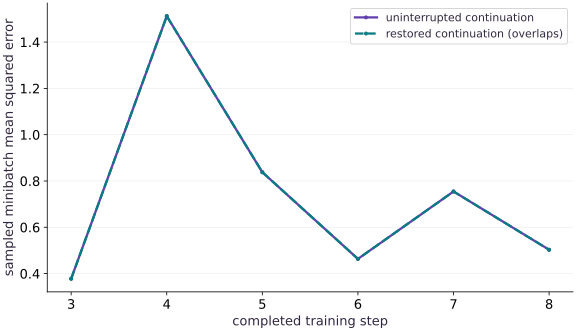

# Failure recovery and operational runbooks

Phase 16: Workload operations · about 110 minutes · CPU

This worked reference is validated on CPU. Accelerator compatibility requires a separate source review and target execution receipt. Use the execution matrix to review device selection and data ownership before adapting a separate target program.

**Before this lesson:** [Health, logs, and workload observability](https://www.tahabouhsine.com/jaxpathways/lesson-operations-02.html).

## What you will be able to do

- Rehearse a real worker failure and resume from an atomic complete-state checkpoint.
- Verify the next update and every later state against an uninterrupted reference.
- Reject corrupted or incompatible recovery artifacts and record a usable runbook.

## The problem

A restarted job reaches a plausible final loss, but did it continue the same experiment? We will force a worker to fail after an uncheckpointed update, restore its last committed state, and compare every subsequent update with an uninterrupted run. A matching final metric alone will not be accepted as recovery evidence.

## The idea

An operational runbook connects a symptom with evidence, a decision and a verified recovery action. Its purpose is to reduce uncertainty during failure, not merely list restart commands.

## A runbook should choose the next diagnostic action

A runbook should tell an operator what evidence to check before retrying. Here the child completes update 3 in memory and then raises the controlled failure; the last accepted checkpoint is step 2. The failed run is preserved, the checkpoint is checked for checksum and matching worker/data/config identity, and the retry restores step 2.

The resumed worker replays updates 3 through 8. Each full state hash matches the uninterrupted run, including parameters, momentum, and PRNG key. Matching final loss alone would be weaker evidence: two runs can land on a similar loss while using a different minibatch or optimizer state. After identifying the boundary, verify the first resumed transition before letting the retry continue.

### Pause and reason

What makes “restart the job” an incomplete runbook instruction?

<details><summary>Compare your reasoning</summary>

It does not identify a valid recovery point, compatibility checks or a success criterion. Specify those decisions and the evidence needed to make them.

</details>

## Identify the boundary before issuing a retry

The checkpoint cadence is two updates, so failure after update 3 leaves the durable boundary at step 2. First confirm the failed process has exited and preserve its events; then inspect the latest accepted checkpoint. Restarting from the progress counter 3 would skip an update whose state was never saved. Restarting from step 0 would be safe only if you intentionally accept replaying all prior work. Select the recovery point from the artifact, not from the last log line.

## Momentum is part of the experiment

The next parameter update depends on more than the weights. This worker uses $v_{t+1}=\beta v_t+g_t$ and $\theta_{t+1}=\theta_t-\alpha v_{t+1}$, so restoring weights without velocity changes the next step. The random key also determines which minibatch is sampled. The checkpoint stores both, and the resumed update 3 matches only when the full state is restored. A seed is not a substitute for the advanced key.

$$
v_{t+1}=\beta v_t+g_t,\qquad \theta_{t+1}=\theta_t-\alpha v_{t+1}
$$

## Write the complete artifact before selecting it

To replace a checkpoint, the worker writes the complete state and checksum to a sibling pending file, flushes it, calls `fsync`, then uses `os.replace`. A reader therefore sees the old complete checkpoint or the new complete one under this local filesystem's replace behavior, rather than a partly written JSON file. That boundary protects against an interrupted write; it does not establish power-loss durability or guarantees for every remote filesystem.

## Compatibility is more than array shape

A matching array shape does not mean a checkpoint belongs to this run. Restore verifies schema, worker source, data, and training-configuration hashes, then checks shapes and finite values. The checksum catches accidental payload damage, but is not a signature if someone can change both bytes and checksum. Failure-injection settings and the requested end step are deliberately outside the training identity so a compatible retry can finish the same experiment.

## Prove the continuation at the next update

The retained run restores step 2, replays $3,4,5,6,7,8$, and reports that all subsequent full-state hashes match. The plotted minibatch loss also overlaps exactly: for example, update 3 is about 0.378 and update 4 about 1.512 in both runs. That rebound is sampling variation, not a restore error. Timings are expected to differ because a retry pays startup, compilation, and restore costs again.

## Write a runbook from the failed drill

For this failure, the runbook is: verify the child exited; preserve its log; find the newest committed step; validate checksum and provenance; restore into one writer; compare the first new state with the uninterrupted reference; then continue and check the final artifact. An incompatible checkpoint is an escalation, not an invitation to remove fields. This drill demonstrates exact replay on the pinned CPU fixture; it does not promise bitwise replay across JAX versions or accelerator kernels.

## Name the committed restart point

Read the checkpoint step as the last durable transition.

```python
def recovery_point(committed_state):
    return committed_state['step']
```

The progress log can be ahead of this accepted state.

## List the updates that must replay

Apply this calculation to the logged checkpoint and target step.

```python
def replay_steps(checkpoint_step, final_step):
    return list(range(checkpoint_step + 1, final_step + 1))
```

The failed in-memory update is repeated from the committed state.

## Compare resumed transition identities

Use state identity after each resumed update.

```python
def state_hashes_match(resumed_events, reference_events):
    reference={event['step']:event['state_hash'] for event in reference_events}
    return all(event['state_hash'] == reference[event['step']] for event in resumed_events)
```

A matching final metric alone does not establish a matching continuation.

## Run the example

```python
# Complete runnable example (operations-03)
"""Bounded local JAX subprocess supervisor and lifecycle verifier."""
from pathlib import Path
import hashlib
import json
import math
import os
import subprocess
import sys
import tempfile
import time


def digest(value):
    return hashlib.sha256(json.dumps(value, sort_keys=True, separators=(',', ':'), allow_nan=False).encode()).hexdigest()


def atomic_json(path, value):
    """Replace one local JSON file only after its bytes have been flushed."""
    path = Path(path)
    path.parent.mkdir(parents=True, exist_ok=True)
    fd, temporary = tempfile.mkstemp(prefix=path.name+'.', suffix='.tmp', dir=path.parent)
    try:
        with os.fdopen(fd, 'w') as stream:
            json.dump(value, stream, sort_keys=True, allow_nan=False)
            stream.flush()
            os.fsync(stream.fileno())
        os.replace(temporary, path)
    finally:
        if os.path.exists(temporary):
            os.unlink(temporary)

def replay_steps(checkpoint_step, final_step):
    return list(range(checkpoint_step + 1, final_step + 1))

def state_hashes_match(resumed_events, reference_events):
    reference={event['step']:event['state_hash'] for event in reference_events}
    return all(event['state_hash'] == reference[event['step']] for event in resumed_events)

def recovery_point(committed_state):
    return committed_state['step']

# This file is materialized only inside the caller-owned temporary run folder.
WORKER = r'''
import hashlib, json, os, sys, time
from pathlib import Path
import jax
import jax.numpy as jnp
import numpy as np
root = Path(sys.argv[1])
cfg = json.loads((root/'config.json').read_text())
worker_hash = hashlib.sha256(Path(__file__).read_bytes()).hexdigest()
def emit(event, **fields):
    print(json.dumps(dict(event=event, monotonic_s=time.monotonic(), **fields)), flush=True)
def digest(value):
    return hashlib.sha256(json.dumps(value,sort_keys=True,separators=(',', ':'),allow_nan=False).encode()).hexdigest()
def write_checkpoint(state):
    target = root/'checkpoint.json'
    temporary = root/'checkpoint.pending'
    with temporary.open('w') as stream:
        json.dump(dict(state,checksum=digest(state)),stream,sort_keys=True,allow_nan=False)
        stream.flush()
        os.fsync(stream.fileno())
    os.replace(temporary,target)
    emit('checkpoint',step=state['step'],state_hash=digest(state))
try:
    emit('started',pid=os.getpid(),backend=jax.default_backend(),device_count=jax.device_count())
    if jax.default_backend() != cfg['backend'] or jax.device_count() < cfg['min_devices']:
        raise ValueError('runtime backend/device contract failed')
    x = jnp.linspace(-1.,1.,64)
    y = 2*x+1
    data_hash = digest(dict(x=np.asarray(x).tolist(),y=np.asarray(y).tolist()))
    training = {name:cfg[name] for name in ('seed','learning_rate','momentum','batch_size')}
    config_hash = digest(training)
    if cfg['resume']:
        saved = json.loads((root/'checkpoint.json').read_text())
        checksum = saved.pop('checksum',None)
        if checksum != digest(saved) or saved.get('worker_hash') != worker_hash:
            raise ValueError('checkpoint checksum/source mismatch')
        if saved['schema_version'] != 1 or saved['config_hash'] != config_hash or saved['data_hash'] != data_hash:
            raise ValueError('checkpoint provenance mismatch')
        state = saved
        step = saved['step']
        params=jnp.array(saved['params'])
        velocity=jnp.array(saved['velocity'])
        key=jnp.array(saved['key'],dtype=jnp.uint32)
        if not isinstance(step,int) or isinstance(step,bool) or step < 0 or step > cfg['steps'] or params.shape != (2,) or velocity.shape != (2,) or key.shape != (2,):
            raise ValueError('invalid checkpoint state shape or step')
        if not bool(jnp.all(jnp.isfinite(params))) or not bool(jnp.all(jnp.isfinite(velocity))):
            raise ValueError('nonfinite checkpoint state')
        emit('restored',step=step,state_hash=digest(saved))
    else:
        step=0
        params=jnp.zeros(2)
        velocity=jnp.zeros(2)
        key=jax.random.PRNGKey(cfg['seed'])
    def update(params,velocity,key):
        key, sample = jax.random.split(key)
        indices=jax.random.choice(sample,64,(cfg['batch_size'],),replace=False)
        objective=lambda p:jnp.mean((p[0]*x[indices]+p[1]-y[indices])**2)
        loss, grad=jax.value_and_grad(objective)(params)
        velocity=cfg['momentum']*velocity+grad
        params=params-cfg['learning_rate']*velocity
        return params,velocity,key,loss
    compiled=jax.jit(update)
    # Compile and synchronize once without consuming actual training state.
    begin=time.perf_counter()
    warm=compiled(params,velocity,key)
    jax.block_until_ready(warm)
    emit('ready',compile_warmup_s=time.perf_counter()-begin,step=step)
    while step < cfg['steps']:
        if cfg.get('stall_at') == step:
            emit('stall_injected',step=step)
            time.sleep(cfg.get('stall_seconds',10.))
        begin=time.perf_counter()
        params,velocity,key,loss=compiled(params,velocity,key)
        jax.block_until_ready((params,velocity,key,loss))
        elapsed=time.perf_counter()-begin
        step+=1
        state=dict(schema_version=1,worker_hash=worker_hash,step=step,params=np.asarray(params).tolist(),velocity=np.asarray(velocity).tolist(),key=np.asarray(key).tolist(),config_hash=config_hash,data_hash=data_hash)
        emit('progress',step=step,loss=float(loss),examples=cfg['batch_size'],update_s=elapsed,state_hash=digest(state))
        if step % cfg['checkpoint_every'] == 0 or step == cfg['steps']:
            write_checkpoint(state)
        if cfg.get('fail_after') == step:
            raise RuntimeError('controlled failure after update')
    write_checkpoint(state)
    emit('completed',step=step,state_hash=digest(state))
except Exception as error:
    emit('failed',kind=type(error).__name__,message=str(error))
    raise SystemExit(23)
'''

# Step 3 — Add bounded launch and result collection
def default_config(**changes):
    cfg=dict(seed=3,learning_rate=.04,momentum=.8,batch_size=8,steps=8,
             checkpoint_every=2,backend='cpu',min_devices=1,resume=False,
             fail_after=None,stall_at=None,stall_seconds=10.)
    # Apply configuration overrides before validating the resulting fields.
    cfg.update(changes)
    for name in ('steps','checkpoint_every','batch_size','min_devices'):
        if not isinstance(cfg[name],int) or isinstance(cfg[name],bool) or cfg[name] < 1:
            raise ValueError(name+' must be a positive integer')
    if cfg['batch_size'] > 64 or not 0 <= cfg['momentum'] < 1 or not 0 < cfg['learning_rate'] < 1:
        raise ValueError('invalid training configuration')
    return cfg


def launch(root, config=None, timeout=10.):
    root=Path(root)
    root.mkdir(parents=True,exist_ok=True)
    cfg=default_config(**(config or {}))
    if timeout <= 0:
        raise ValueError('timeout must be positive')
    atomic_json(root/'config.json',cfg)
    worker=root/'worker.py'
    worker.write_text(WORKER)
    env=dict(os.environ,JAX_PLATFORMS=cfg['backend'],PYTHONUNBUFFERED='1')
    started=time.perf_counter()
    process=subprocess.Popen([sys.executable,str(worker),str(root)],stdout=subprocess.PIPE,stderr=subprocess.PIPE,text=True,env=env)
    timed_out=False
    try:
        stdout,stderr=process.communicate(timeout=timeout)
    except subprocess.TimeoutExpired:
        timed_out=True
        process.terminate()
        try:
            stdout,stderr=process.communicate(timeout=1.)
        except subprocess.TimeoutExpired:
            process.kill()
            stdout,stderr=process.communicate(timeout=1.)
    wall=time.perf_counter()-started
    events=[]
    malformed=[]
    for line in stdout.splitlines():
        if not line.strip():
            continue
        try:
            event=json.loads(line)
            if not isinstance(event,dict) or 'event' not in event:
                raise ValueError('not an event')
            events.append(event)
        except (ValueError,TypeError):
            malformed.append(line)
    status='timed_out' if timed_out else 'completed' if process.returncode == 0 and not malformed and events and events[-1]['event']=='completed' else 'failed'
    result=dict(status=status,returncode=process.returncode,wall_s=wall,events=events,stderr=stderr,
                worker_hash=hashlib.sha256(WORKER.encode()).hexdigest(),config=cfg,malformed_stdout=malformed)
    atomic_json(root/'run.json',result)
    return result

# Step 4 — Rehearse a failure and verify every resumed update
# Keep this run’s database and artifacts in a scratch directory removed on exit.
with tempfile.TemporaryDirectory(prefix='ops-recovery-') as folder:
    base=Path(folder)
    uninterrupted=launch(base/'full')
    failed=launch(base/'resume',dict(fail_after=3))
    committed=json.loads((base/'resume'/'checkpoint.json').read_text())
    assert committed['step']==2
    resumed=launch(base/'resume',dict(resume=True))
    final_full=json.loads((base/'full'/'checkpoint.json').read_text())
    final_resumed=json.loads((base/'resume'/'checkpoint.json').read_text())
assert failed['status']=='failed' and resumed['status']=='completed'
assert final_full==final_resumed
full_events={e['step']:e for e in uninterrupted['events'] if e['event']=='progress'}
resume_events=[e for e in resumed['events'] if e['event']=='progress']
assert [e['step'] for e in resume_events]==replay_steps(recovery_point(committed),8)
assert state_hashes_match(resume_events,list(full_events.values()))
print('restored step:',committed['step'],'replayed updates:',replay_steps(recovery_point(committed),8))
print('all next-update state hashes match:',final_full==final_resumed)
```

Expected: The failure leaves checkpoint step $2$. Resuming replays steps $3$ through $8$, and every complete-state hash plus the final checkpoint matches uninterrupted execution.

## Resumed loss follows the same continuation

**Predict:** Should timing and loss both match after a restart?



**Recorded CPU computation**

### Read the figure

The x-axis is completed training step 3–8; the y-axis is sampled minibatch mean squared error. Both lines overlap point for point after restoring step 2: the losses are about 0.378, 1.512, 0.838, 0.463, 0.755, and 0.503. The rebound at step 4 appears in both runs, so it is not evidence of a bad restore.

### Connect it to the computation

The numerical overlap is backed by matching full-state hashes for every resumed update, including optimizer velocity and random key; the run replays steps 3–8. Process startup and compilation can change elapsed time even when those state transitions match. Predict the result if the restored key were reset to the initial seed: sampled batches and later state hashes should diverge. The figure demonstrates deterministic replay for this pinned CPU fixture only.

```python
visual_data={'kind':'line','x':list(range(3,9)),'xlabel':'completed training step','ylabel':'sampled minibatch mean squared error','series':[{'label':'uninterrupted continuation','y':[full_events[i]['loss'] for i in range(3,9)]},{'label':'restored continuation (overlaps)','y':[e['loss'] for e in resume_events]}]}
```

## Recorded reference execution

CPU run: 2026-10-27T17:10:47.368498+00:00. JAX 0.9.2.

```text
restored step: 2 replayed updates: [3, 4, 5, 6, 7, 8]
all next-update state hashes match: True
PASS: operations-03

```

## Compare state, not only loss

**Predict before running:** Could two different states have the same current loss?

```python
# Experiment — Compare state, not only loss
for event in resume_events:
    original=full_events[event['step']]
    assert event['state_hash']==original['state_hash']
    assert event['loss']==original['loss']
assert all(name in committed for name in ['params','velocity','key','step','data_hash','config_hash','worker_hash'])
```

**Expected:** All state fields and later hashes support the continuation claim.

Loss is a scalar projection of a much larger state; equal loss alone would not prove the next update is correct.

## Reject a changed training rule

**Predict before running:** Should a learning-rate change be silently accepted as an exact resume?

```python
# Experiment — Reject a changed training rule
# Keep this run’s database and artifacts in a scratch directory removed on exit.
with tempfile.TemporaryDirectory() as folder:
    launch(folder,dict(steps=4))
    incompatible=launch(folder,dict(steps=8,resume=True,learning_rate=.05))
assert incompatible['status']=='failed'
assert any(e['event']=='failed' and 'provenance' in e['message'] for e in incompatible['events'])
```

**Expected:** Restore rejects the incompatible training configuration.

A deliberate branch experiment is valid when explicitly labeled, but it is not the same-run recovery being tested here.

## Make it yours

Repeat with seed 9, checkpoint cadence 3 and failure after update 5. Read the actual restored and progress events. Identify which updates replay and compare all resumed state hashes with uninterrupted execution.

### How to write this exercise — Step-by-step recipe & starter scaffold

**Inputs:**
- A deterministic training state, checkpoint location, injected failure point, and matching resume configuration.

**Outputs:**
- A restored continuation whose every post-resume state matches uninterrupted execution.

**Invariants to check:**
- Only an accepted full-state checkpoint is restored; verify parameters, momentum, random state, and step after each resumed update.

**Hints:**
- Retain a complete event timeline around the last committed checkpoint.
- Compare resumed and uninterrupted runs with identical seed and configuration.

**Starter code scaffold (fill in the TODOs):**

```python
from pathlib import Path
import hashlib
import json
import tempfile
import jax
import jax.numpy as jnp
import numpy as np

def resume_after_failure(initial_state, checkpoint_path, failure_step, config):
    """A restored continuation whose every post-resume state matches uninterrupted execution."""
    # TODO: Inject a local worker failure, restore only the last complete state, and compare every resumed transition with uninterrupted execution.
    raise NotImplementedError
```

<details><summary>Reference solution</summary>

```python
# Exercise solution
# Keep this run’s database and artifacts in a scratch directory removed on exit.
with tempfile.TemporaryDirectory() as folder:
    base=Path(folder)
    cfg=dict(seed=9,checkpoint_every=3)
    ref=launch(base/'ref',cfg)
    broken=launch(base/'broken',dict(cfg,fail_after=5))
    cp=json.loads((base/'broken'/'checkpoint.json').read_text())
    assert cp['step']==3
    fixed=launch(base/'broken',dict(cfg,resume=True))
    assert fixed['status']=='completed'
    assert json.loads((base/'ref'/'checkpoint.json').read_text())==json.loads((base/'broken'/'checkpoint.json').read_text())
```

</details>

## Reject accidental checkpoint corruption

**Transfer / diagnosis**

After saving a checkpoint, alter one momentum value without updating its checksum, then attempt to restore.

<details><summary>Hint</summary>

The expected outcome is a failed restore; preserve the failure event.

</details>

### How to write: Reject accidental checkpoint corruption — Step-by-step recipe & starter scaffold

**Inputs:**
- After saving a checkpoint, alter one momentum value without updating its checksum, then attempt to restore.

**Outputs:**
- Restore rejection for a changed payload with stale checksum.

**Invariants to check:**
- Corrupt state is rejected before a training update resumes.

**Hints:**
- The expected outcome is a failed restore; preserve the failure event.
- Checksum the exact serialized momentum content.

**Starter code scaffold (fill in the TODOs):**

```python
from pathlib import Path
import hashlib
import json
import tempfile
import jax
import jax.numpy as jnp
import numpy as np

def practice_reject_accidental_checkpoint_corruption(checkpoint_path):
    """Complete the reject accidental checkpoint corruption check."""
    # TODO: ('Change one serialized momentum value without recomputing its checksum and require restore rejection.', 'A checksum failure with no resumed transition.', 'The checkpoint payload is immutable after its recorded checksum.')
    raise NotImplementedError
```

<details><summary>Reference solution and reasoning</summary>

```python
# Reject accidental checkpoint corruption (Transfer / diagnosis)
# Keep this run’s database and artifacts in a scratch directory removed on exit.
with tempfile.TemporaryDirectory() as folder:
    launch(folder,dict(steps=4))
    path=Path(folder)/'checkpoint.json'
    state=json.loads(path.read_text())
    # Accumulate the next contribution into `state['velocity'][0]`.
    state['velocity'][0]+=1.
    path.write_text(json.dumps(state))
    bad=launch(folder,dict(resume=True))
assert bad['status']=='failed'
assert any(e['event']=='failed' and 'checksum' in e['message'] for e in bad['events'])
```

Rejecting corruption is safer and more inspectable than treating plausible parameter values as evidence of a valid checkpoint.

</details>

## Explain a weights-only mismatch by hand

**Transfer / diagnosis**

Let saved velocity be $2$, the next gradient $3$, momentum $0.8$, and learning rate $0.1$. Compare the correct parameter decrement with a reset-momentum decrement.

<details><summary>Hint</summary>

Apply the recurrence before multiplying by the learning rate.

</details>

### How to write: Explain a weights-only mismatch by hand — Step-by-step recipe & starter scaffold

**Inputs:**
- Let saved velocity be $2$, the next gradient $3$, momentum $0.8$, and learning rate $0.1$. Compare the correct parameter decrement with a reset-momentum decrement.

**Outputs:**
- Two parameter decrements for saved and reset momentum.

**Invariants to check:**
- Both cases share the same current gradient and learning rate.

**Hints:**
- Apply the recurrence before multiplying by the learning rate.
- Apply momentum recurrence before multiplying by learning rate.

**Starter code scaffold (fill in the TODOs):**

```python
from pathlib import Path
import hashlib
import json
import tempfile
import jax
import jax.numpy as jnp
import numpy as np

def practice_explain_a_weights_only_mismatch_by_hand(parameter, saved_velocity, gradient, momentum, learning_rate):
    """Complete the explain a weights-only mismatch by hand check."""
    # TODO: ('Compute the next momentum velocity and parameter decrement from saved velocity 2, gradient 3, momentum .8, and rate .1, then compare with zero velocity.', 'Correct and reset-momentum decrements from the same parameter.', 'Only the prior velocity differs between the two calculations.')
    raise NotImplementedError
```

<details><summary>Reference solution and reasoning</summary>

```python
# Explain a weights-only mismatch by hand (Transfer / diagnosis)
correct=.1*(.8*2+3)
weights_only=.1*3
assert abs(correct-.46)<1e-12 and abs(weights_only-.3)<1e-12
assert abs(correct-weights_only-.16)<1e-12
```

The next loss could initially look close, but the state transition has already changed.

</details>

## Check your understanding

Which evidence most directly supports a correct resume?

1. The process prints started again
2. The next and later complete training states match a compatible uninterrupted run
3. The final loss is finite

<details><summary>Answer and explanation</summary>

**1. The process prints started again**

Starting a process does not show correct continuation. Compare the next batches, state and losses with an uninterrupted baseline.

**2. The next and later complete training states match a compatible uninterrupted run (correct)**

Recovery preserves a continuation, so the first resumed update and subsequent state are the relevant evidence. Startup and a finite scalar loss are much weaker.

**3. The final loss is finite**

A finite loss can belong to a different trajectory. Test state equality and several subsequent updates at the same boundary.

</details>

## Diagnose the result

When replay diverges immediately, compare saved key, momentum, step and data/config/source hashes before changing numerical tolerances. When restore rejects a checksum, retain the artifact for diagnosis rather than rewriting its checksum. When two workers target one checkpoint directory, stop the duplicate writer before continuing.

## Carry forward

- A checkpoint is a precise state boundary, including optimizer and randomness.
- A runbook becomes evidence only after a controlled failure and verified recovery.

## Keep your evidence

Keep the injected failure timeline, accepted checkpoint identity and full-state comparisons for every resumed update. Record the incompatible and corrupted restore rejections.

Save your predictions, modified code, terminal outputs, and reasoning in your engineering portfolio.

## Primary references

- [Python subprocess management](https://docs.python.org/3/library/subprocess.html)
- [Python os.replace and fsync](https://docs.python.org/3/library/os.html#os.replace)
- [JAX asynchronous dispatch and synchronization](https://docs.jax.dev/en/latest/async_dispatch.html)
- [JAX device discovery](https://docs.jax.dev/en/latest/_autosummary/jax.devices.html)

