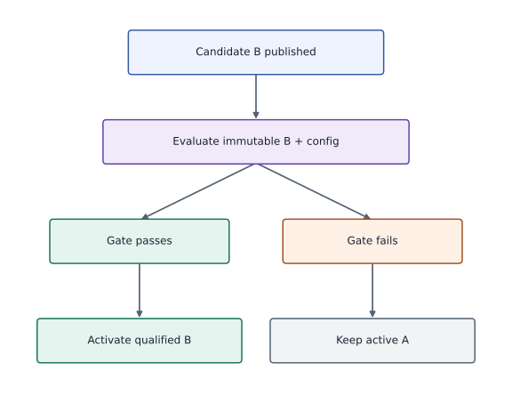
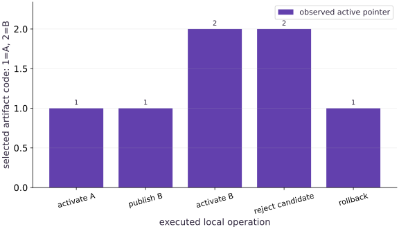

# Changes, rollback, and artifact provenance

Phase 16: Workload operations · about 95 minutes · CPU

This worked reference is validated on CPU. Accelerator compatibility requires a separate source review and target execution receipt. Use the execution matrix to review device selection and data ownership before adapting a separate target program.

**Before this lesson:** [Failure recovery and operational runbooks](https://www.tahabouhsine.com/jaxpathways/lesson-operations-03.html).

## What you will be able to do

- Separate content identity, validation evidence and active selection.
- Reject corrupt or failed artifacts before a pointer change.
- Rehearse a reversible local artifact selection and document its limits.

## The problem

A new artifact is available, but which exact bytes are currently selected, and can we return to the previous valid version after a bad change? We will create content-addressed artifacts from an actual trained checkpoint, test a validation gate, atomically change one local selection pointer and rehearse rollback.

## The idea

A candidate artifact can exist without serving users. Validation, activation and rollback are separate release transitions. Bind each decision to immutable artifact identity so rejected candidates cannot accidentally change the active system.

## Publishing is different from activating

Publishing candidate B stores its bytes but leaves artifact A selected. In the worked release, a consumer reading $x=1$ returns 3.0 before activation. B has a different digest and returns 3.4, but the same request still returns 3.0 after B is published. Only after the held-out gate passes does activation move the pointer to B and the consumer output change.

The figure's y values are categorical IDs: 1 means A and 2 means B. The sequence is A, A, B, B, A across activate A, publish B, activate B, rejected candidate, and rollback. The rejection leaves the pointer and response unchanged; rollback selects A and a fresh read returns 3.0. Next, check both selected identity and a real consumer result rather than trusting a successful command message.

$$
\text{ArtifactID} = \operatorname{sha256}(\text{weights} \;\|\; \text{config} \;\|\; \text{tokenizer})
$$

### Rejected candidates do not become active

**Predict:** Should a rejected candidate change the active artifact pointer?



*Architecture and dataflow mechanism diagram.*

Read the arrows as a release decision trace: published B flows to evaluation; a passing gate leads to activating B, while a failing gate leads to keeping A active. The worked consumer returns 3.0 for A and 3.4 for B at $x=1$, so the pointer choice has an observable effect. After activation, rollback uses the previous compatible ID and returns the output to 3.0. Predict the failed-gate branch: it must leave the old pointer and its 3.0 response unchanged.

### Pause and reason

Should a rejected candidate change the active artifact pointer?

<details><summary>Compare your reasoning</summary>

No. The rejection should leave the active release unchanged. Test that invariant directly, including its configuration and processor identities.

</details>

## A name is not a content identity

A filename such as `latest` can point to different bytes over time. Here each artifact ID is a SHA-256 digest of canonical JSON, so changing a parameter or release note creates a new identity. The recorded A and B digests differ. That lets the run record name the exact candidate and rollback target, but a digest says which bytes were read, not whether they are accurate or approved.

## Attach enough provenance to reproduce the question

The artifact carries source, configuration, data, state, and validation evidence so an operator can ask which experiment produced it. Activation also evaluates the parameters on four fixed held-out inputs and requires mean squared error at most 1. This is a deliberately permissive teaching gate, not a production threshold. The local `passed` flag is not authenticated approval; a real registry needs trusted validators and access controls.

## Publish without affecting the current reader

`publish` writes the complete content-addressed artifact without touching `active.json`; `activate` rereads the bytes, checks the digest and validation result, then replaces the pointer. In the failed-candidate branch, the pointer bytes stay unchanged and the consumer still returns 3.4 for $x=1$. Atomic sibling-file replacement protects this single-writer local exercise from a partial pointer file, not from concurrent deployment races or cross-file transactions.

## Keep selection atomic and scope the guarantee

Rollback calls the same validation and activation path using the previous artifact ID. The run shows the pointer returning to A and a new consumer read returning 3.0. That proves model selection reverted in this fixture; it does not undo requests already served, database changes, or incompatible external schemas. Include tokenizer, processor, and configuration identities with weights whenever those components affect the model's input or output.

## Rollback is another checked selection

Keep candidate and previous IDs, data/config/source hashes, held-out result, and the reason for the decision in the release record. The recorded B in the accepted pointer drill differs only by release metadata, so it is not evidence of a model quality improvement. A separate degraded-parameter candidate fails the measured gate. Treat artifact identity, gate outcome, and user-visible behavior as three linked but distinct facts.

## A change record should support diagnosis

Retain previous and candidate IDs, source/config/data hashes, the gate result, and why the change or rollback occurred. In this exercise the second valid artifact differs only in reviewed metadata, which makes the byte-level identity test unambiguous. The separate degraded-model experiment changes actual parameters and is rejected by the measured held-out gate; the accepted metadata revision is not claimed to improve predictions.

## Publish without selecting

Read the identity and storage boundary first.

```python
def publish(store, artifact):
    """Content-address one JSON artifact. Publishing does not activate it."""
    store=Path(store)
    identifier=digest(artifact)
    atomic_json(store/'artifacts'/(identifier+'.json'),artifact)
    return identifier
```

This definition appears before activation in the full reference; publication leaves the consumer selection untouched.

## Evaluate evidence before pointer mutation

Trace the gate that runs before the atomic selection write.

```python
def activation_evidence_passes(artifact):
    required=['worker_hash','config_hash','data_hash','state']
    return (artifact.get('validation',{}).get('passed') is True
            and all(name in artifact for name in required)
            and artifact_metrics(artifact)['passed'])
```

A failed gate raises before pointer bytes change.

## Read the selected artifact in the consumer

Use the observed output to check activation and rollback.

```python
def consumer_predict(store, x):
    """A fresh local consumer resolves selection and loads that exact artifact."""
    pointer=json.loads((Path(store)/'active.json').read_text())
    artifact=read_artifact(store,pointer['current'])
    params=artifact['state']['params']
    return float(params[0])*float(x)+float(params[1])
```

The exercise makes behavior, selected identity and validation failure observable.

## Run the example

```python
# Complete runnable example (operations-04)
"""Bounded local JAX subprocess supervisor and lifecycle verifier."""
from pathlib import Path
import hashlib
import json
import math
import os
import subprocess
import sys
import tempfile
import time


def digest(value):
    return hashlib.sha256(json.dumps(value, sort_keys=True, separators=(',', ':'), allow_nan=False).encode()).hexdigest()


def atomic_json(path, value):
    """Replace one local JSON file only after its bytes have been flushed."""
    path = Path(path)
    path.parent.mkdir(parents=True, exist_ok=True)
    fd, temporary = tempfile.mkstemp(prefix=path.name+'.', suffix='.tmp', dir=path.parent)
    try:
        with os.fdopen(fd, 'w') as stream:
            json.dump(value, stream, sort_keys=True, allow_nan=False)
            stream.flush()
            os.fsync(stream.fileno())
        os.replace(temporary, path)
    finally:
        if os.path.exists(temporary):
            os.unlink(temporary)

# This file is materialized only inside the caller-owned temporary run folder.
WORKER = r'''
import hashlib, json, os, sys, time
from pathlib import Path
import jax
import jax.numpy as jnp
import numpy as np
root = Path(sys.argv[1])
cfg = json.loads((root/'config.json').read_text())
worker_hash = hashlib.sha256(Path(__file__).read_bytes()).hexdigest()
def emit(event, **fields):
    print(json.dumps(dict(event=event, monotonic_s=time.monotonic(), **fields)), flush=True)
def digest(value):
    return hashlib.sha256(json.dumps(value,sort_keys=True,separators=(',', ':'),allow_nan=False).encode()).hexdigest()
def write_checkpoint(state):
    target = root/'checkpoint.json'
    temporary = root/'checkpoint.pending'
    with temporary.open('w') as stream:
        json.dump(dict(state,checksum=digest(state)),stream,sort_keys=True,allow_nan=False)
        stream.flush()
        os.fsync(stream.fileno())
    os.replace(temporary,target)
    emit('checkpoint',step=state['step'],state_hash=digest(state))
try:
    emit('started',pid=os.getpid(),backend=jax.default_backend(),device_count=jax.device_count())
    if jax.default_backend() != cfg['backend'] or jax.device_count() < cfg['min_devices']:
        raise ValueError('runtime backend/device contract failed')
    x = jnp.linspace(-1.,1.,64)
    y = 2*x+1
    data_hash = digest(dict(x=np.asarray(x).tolist(),y=np.asarray(y).tolist()))
    training = {name:cfg[name] for name in ('seed','learning_rate','momentum','batch_size')}
    config_hash = digest(training)
    if cfg['resume']:
        saved = json.loads((root/'checkpoint.json').read_text())
        checksum = saved.pop('checksum',None)
        if checksum != digest(saved) or saved.get('worker_hash') != worker_hash:
            raise ValueError('checkpoint checksum/source mismatch')
        if saved['schema_version'] != 1 or saved['config_hash'] != config_hash or saved['data_hash'] != data_hash:
            raise ValueError('checkpoint provenance mismatch')
        state = saved
        step = saved['step']
        params=jnp.array(saved['params'])
        velocity=jnp.array(saved['velocity'])
        key=jnp.array(saved['key'],dtype=jnp.uint32)
        if not isinstance(step,int) or isinstance(step,bool) or step < 0 or step > cfg['steps'] or params.shape != (2,) or velocity.shape != (2,) or key.shape != (2,):
            raise ValueError('invalid checkpoint state shape or step')
        if not bool(jnp.all(jnp.isfinite(params))) or not bool(jnp.all(jnp.isfinite(velocity))):
            raise ValueError('nonfinite checkpoint state')
        emit('restored',step=step,state_hash=digest(saved))
    else:
        step=0
        params=jnp.zeros(2)
        velocity=jnp.zeros(2)
        key=jax.random.PRNGKey(cfg['seed'])
    def update(params,velocity,key):
        key, sample = jax.random.split(key)
        indices=jax.random.choice(sample,64,(cfg['batch_size'],),replace=False)
        objective=lambda p:jnp.mean((p[0]*x[indices]+p[1]-y[indices])**2)
        loss, grad=jax.value_and_grad(objective)(params)
        velocity=cfg['momentum']*velocity+grad
        params=params-cfg['learning_rate']*velocity
        return params,velocity,key,loss
    compiled=jax.jit(update)
    # Compile and synchronize once without consuming actual training state.
    begin=time.perf_counter()
    warm=compiled(params,velocity,key)
    jax.block_until_ready(warm)
    emit('ready',compile_warmup_s=time.perf_counter()-begin,step=step)
    while step < cfg['steps']:
        if cfg.get('stall_at') == step:
            emit('stall_injected',step=step)
            time.sleep(cfg.get('stall_seconds',10.))
        begin=time.perf_counter()
        params,velocity,key,loss=compiled(params,velocity,key)
        jax.block_until_ready((params,velocity,key,loss))
        elapsed=time.perf_counter()-begin
        step+=1
        state=dict(schema_version=1,worker_hash=worker_hash,step=step,params=np.asarray(params).tolist(),velocity=np.asarray(velocity).tolist(),key=np.asarray(key).tolist(),config_hash=config_hash,data_hash=data_hash)
        emit('progress',step=step,loss=float(loss),examples=cfg['batch_size'],update_s=elapsed,state_hash=digest(state))
        if step % cfg['checkpoint_every'] == 0 or step == cfg['steps']:
            write_checkpoint(state)
        if cfg.get('fail_after') == step:
            raise RuntimeError('controlled failure after update')
    write_checkpoint(state)
    emit('completed',step=step,state_hash=digest(state))
except Exception as error:
    emit('failed',kind=type(error).__name__,message=str(error))
    raise SystemExit(23)
'''

# Step 3 — Add bounded launch and result collection
def default_config(**changes):
    cfg=dict(seed=3,learning_rate=.04,momentum=.8,batch_size=8,steps=8,
             checkpoint_every=2,backend='cpu',min_devices=1,resume=False,
             fail_after=None,stall_at=None,stall_seconds=10.)
    # Apply configuration overrides before validating the resulting fields.
    cfg.update(changes)
    for name in ('steps','checkpoint_every','batch_size','min_devices'):
        if not isinstance(cfg[name],int) or isinstance(cfg[name],bool) or cfg[name] < 1:
            raise ValueError(name+' must be a positive integer')
    if cfg['batch_size'] > 64 or not 0 <= cfg['momentum'] < 1 or not 0 < cfg['learning_rate'] < 1:
        raise ValueError('invalid training configuration')
    return cfg


def launch(root, config=None, timeout=10.):
    root=Path(root)
    root.mkdir(parents=True,exist_ok=True)
    cfg=default_config(**(config or {}))
    if timeout <= 0:
        raise ValueError('timeout must be positive')
    atomic_json(root/'config.json',cfg)
    worker=root/'worker.py'
    worker.write_text(WORKER)
    env=dict(os.environ,JAX_PLATFORMS=cfg['backend'],PYTHONUNBUFFERED='1')
    started=time.perf_counter()
    process=subprocess.Popen([sys.executable,str(worker),str(root)],stdout=subprocess.PIPE,stderr=subprocess.PIPE,text=True,env=env)
    timed_out=False
    try:
        stdout,stderr=process.communicate(timeout=timeout)
    except subprocess.TimeoutExpired:
        timed_out=True
        process.terminate()
        try:
            stdout,stderr=process.communicate(timeout=1.)
        except subprocess.TimeoutExpired:
            process.kill()
            stdout,stderr=process.communicate(timeout=1.)
    wall=time.perf_counter()-started
    events=[]
    malformed=[]
    for line in stdout.splitlines():
        if not line.strip():
            continue
        try:
            event=json.loads(line)
            if not isinstance(event,dict) or 'event' not in event:
                raise ValueError('not an event')
            events.append(event)
        except (ValueError,TypeError):
            malformed.append(line)
    status='timed_out' if timed_out else 'completed' if process.returncode == 0 and not malformed and events and events[-1]['event']=='completed' else 'failed'
    result=dict(status=status,returncode=process.returncode,wall_s=wall,events=events,stderr=stderr,
                worker_hash=hashlib.sha256(WORKER.encode()).hexdigest(),config=cfg,malformed_stdout=malformed)
    atomic_json(root/'run.json',result)
    return result

# Step 4 — Add content-addressed publication and selection
def publish(store, artifact):
    """Content-address one JSON artifact. Publishing does not activate it."""
    store=Path(store)
    identifier=digest(artifact)
    atomic_json(store/'artifacts'/(identifier+'.json'),artifact)
    return identifier


def read_artifact(store, identifier):
    if len(identifier) != 64 or any(c not in '0123456789abcdef' for c in identifier):
        raise ValueError('invalid artifact identifier')
    artifact=json.loads((Path(store)/'artifacts'/(identifier+'.json')).read_text())
    if digest(artifact) != identifier:
        raise ValueError('artifact digest mismatch')
    return artifact


def artifact_metrics(artifact):
    """Independent held-out arithmetic for this fixed linear-model release contract."""
    params=artifact.get('state',{}).get('params',[])
    if len(params)!=2 or any(not math.isfinite(float(v)) for v in params):
        raise ValueError('invalid model parameters')
    inputs=(-1.5,-.37,.22,1.5)
    mse=sum((params[0]*x+params[1]-(2*x+1))**2 for x in inputs)/len(inputs)
    return dict(held_out_mse=mse,acceptance_limit=1.,passed=mse<=1.)


def activation_evidence_passes(artifact):
    required=['worker_hash','config_hash','data_hash','state']
    return (artifact.get('validation',{}).get('passed') is True
            and all(name in artifact for name in required)
            and artifact_metrics(artifact)['passed'])

def activate(store, identifier):
    artifact=read_artifact(store,identifier)
    if not activation_evidence_passes(artifact):
        raise ValueError('artifact evidence or held-out validation failed')
    previous=None
    pointer=Path(store)/'active.json'
    if pointer.exists():previous=json.loads(pointer.read_text())['current']
    atomic_json(pointer,dict(current=identifier,previous=previous))
    return identifier


def consumer_predict(store, x):
    """A fresh local consumer resolves selection and loads that exact artifact."""
    pointer=json.loads((Path(store)/'active.json').read_text())
    artifact=read_artifact(store,pointer['current'])
    params=artifact['state']['params']
    return float(params[0])*float(x)+float(params[1])


def rollback(store):
    pointer=json.loads((Path(store)/'active.json').read_text())
    if not pointer.get('previous'):raise ValueError('no previous version')
    return activate(store,pointer['previous'])

# Step 5 — Observe consumer behavior across activation, rejection and rollback.
# This local, single-writer fixture has no authentication or production access control.
with tempfile.TemporaryDirectory(prefix='ops-release-') as folder:
    base=Path(folder)
    run=launch(base/'run')
    state=json.loads((base/'run'/'checkpoint.json').read_text())
    store=base/'registry'
    evidence=dict(worker_hash=run['worker_hash'],config_hash=state['config_hash'],data_hash=state['data_hash'],validation={'passed':True,'check':'completed CPU fixture and checksum'})
    # Two valid model payloads have different predictions at x=1.
    # Recompute the checkpoint checksum after changing each model state.
    state.pop('checksum',None)
    state_a=dict(state,params=[2.0,1.0])
    state_a['checksum']=digest(state_a)
    state_b=dict(state,params=[2.4,1.0])
    state_b['checksum']=digest(state_b)
    artifact_a=dict(evidence,state=state_a)
    artifact_a['validation'].update(artifact_metrics(artifact_a))
    version_a=publish(store,artifact_a)
    activate(store,version_a)
    before_b=consumer_predict(store,1.0)
    artifact_b=dict(evidence,state=state_b,release_note='validated slope revision')
    artifact_b['validation']=dict(evidence['validation'])
    artifact_b['validation'].update(artifact_metrics(artifact_b))
    version_b=publish(store,artifact_b)
    assert consumer_predict(store,1.0)==before_b==3.0  # publication alone changes no behavior
    activate(store,version_b)
    after_b=consumer_predict(store,1.0)
    assert after_b==3.4
    rejected_artifact=dict(artifact_b,validation={'passed':False,'check':'deliberate negative control'})
    rejected=publish(store,rejected_artifact)
    pointer_before=(store/'active.json').read_bytes()
    behavior_before=consumer_predict(store,1.0)
    try:
        activate(store,rejected)
    except ValueError:
        rejected_without_change=(store/'active.json').read_bytes()==pointer_before and consumer_predict(store,1.0)==behavior_before
    else:
        raise AssertionError('bad release activated')
    assert rejected_without_change
    rollback(store)
    after_rollback=consumer_predict(store,1.0)
    assert after_rollback==3.0
    selected=json.loads((store/'active.json').read_text())['current']
    assert selected==version_a
artifact=artifact_a  # later negative-control exercises start from this valid fixture artifact
print('consumer x=1 before B / after B / after rollback:',before_b,after_b,after_rollback)
print('A and B IDs:',version_a,version_b)
print('rejected activation unchanged selection and behavior:',rejected_without_change)
print('rollback selected A:',selected==version_a)

```

Expected: Publishing B leaves A selected and the local consumer predicts 3.0 at x=1. Activation selects valid B and the consumer predicts 3.4. A rejected activation leaves the selected ID and prediction unchanged. Rollback selects A and the consumer returns to 3.0. This is a single-writer local demonstration without authentication or production access control.

## The selected artifact changes only after a passing gate

**Predict:** Should publishing or rejecting a candidate move the active selection?



**Recorded CPU computation**

### Read the figure

The x-axis lists executed release actions; the y-axis is a categorical pointer code, where 1 means artifact A and 2 means B. The observed pointer sequence is 1, 1, 2, 2, 1: publishing B leaves A selected, activation selects B, rejection leaves B selected, and rollback selects A. The codes name artifacts; they are not quality scores.

### Connect it to the computation

The consumer trace confirms the pointer change has an effect: for $x=1$, output is 3.0 before B, 3.4 after B is activated, and 3.0 after rollback. A rejected candidate leaves both the selected ID and output unchanged. Predict the safe outcome if B's held-out gate fails: the pointer should remain at A and the output should remain 3.0. This is a single-writer local release drill, not a distributed rollout.

```python
with tempfile.TemporaryDirectory() as folder:
    a=publish(folder,artifact)
    activate(folder,a)
    values=[1]
    b=publish(folder,dict(artifact,release_note='B'))
    values.append(1 if json.loads((Path(folder)/'active.json').read_text())['current']==a else 2)
    activate(folder,b)
    values.append(2 if json.loads((Path(folder)/'active.json').read_text())['current']==b else 1)
    bad=publish(folder,dict(artifact,validation={'passed':False}))
    try:activate(folder,bad)
    except ValueError:pass
    values.append(2 if json.loads((Path(folder)/'active.json').read_text())['current']==b else 1)
    rollback(folder)
    values.append(1 if json.loads((Path(folder)/'active.json').read_text())['current']==a else 2)
assert values==[1,1,2,2,1]
visual_data={'kind':'bar','labels':['activate A','publish B','activate B','reject candidate','rollback'],'xlabel':'executed local operation','ylabel':'selected artifact code: 1=A, 2=B','series':[{'label':'observed active pointer','y':values}]}
```

## Recorded reference execution

CPU run: 2026-10-27T17:10:51.512226+00:00. JAX 0.9.2.

```text
consumer x=1 before B / after B / after rollback: 3.0 3.4 3.0
A and B IDs: 60b1a27a0bf2091fc537d43ba2ddd2ae0911dc1090bc3631a3ac6559de1b2e62 25ba7e29e933613158e1472cea0a3e1316e8cb697114f8bf44b0f3bc33759aae
rejected activation unchanged selection and behavior: True
rollback selected A: True
PASS: operations-04

```

## Identity follows content rather than key insertion order

**Predict before running:** Will dictionary key insertion order change the canonical content ID?

```python
# Experiment — Identity follows content rather than key insertion order
assert digest({'a':1,'b':2})==digest({'b':2,'a':1})
assert digest({'a':1,'b':2})!=digest({'a':1,'b':3})
```

**Expected:** Equivalent mappings share an ID; changed values do not.

Canonical encoding removes an incidental representation difference but preserves meaningful payload changes.

## Detect corruption before activation

**Predict before running:** What happens if the stored file no longer matches its content ID?

```python
# Experiment — Detect corruption before activation
# Keep this run’s database and artifacts in a scratch directory removed on exit.
with tempfile.TemporaryDirectory() as folder:
    identifier=publish(folder,artifact)
    # Write the serialized artifact payload to disk.
    (Path(folder)/'artifacts'/(identifier+'.json')).write_text('{}')
    try:
        activate(folder,identifier)
    except ValueError as error:
        assert 'digest' in str(error)
    else:
        raise AssertionError('corruption accepted')
    assert not (Path(folder)/'active.json').exists()
```

**Expected:** The corrupted artifact is rejected before any pointer appears.

A filename containing a hash is not enough: the reader must recompute and compare the payload digest.

## Reject an actually degraded model

**Predict before running:** Can a candidate with a claimed passing flag bypass the measured quality gate?

```python
# Experiment — Reject an actually degraded model: Measured validation and claimed validation are distinct.
# Keep this run’s database and artifacts in a scratch directory removed on exit.
with tempfile.TemporaryDirectory() as folder:
    stable=publish(folder,artifact)
    activate(folder,stable)
    degraded=dict(artifact,state=dict(artifact['state'],params=[100.,-100.]))
    candidate=publish(folder,degraded)
    assert artifact_metrics(degraded)['held_out_mse'] > 1.
    before=(Path(folder)/'active.json').read_bytes()
    try:activate(folder,candidate)
    except ValueError as error:assert 'held-out' in str(error)
    else:raise AssertionError('degraded model activated')
    assert before==(Path(folder)/'active.json').read_bytes()
```

**Expected:** The known held-out relationship detects the changed model despite its passing claim.

Measured validation and claimed validation are distinct. The local gate recomputes the prediction error before selection.

## Make it yours

Publish two validated models with distinct predictions at x=1. Record the consumer prediction while A is selected, after B activation, after a rejected candidate and after rollback. Change B’s slope while keeping the fixture validation threshold satisfied. Explain why publication alone does not change behavior and why the rejection must leave both selection and output unchanged.

### How to write this exercise — Step-by-step recipe & starter scaffold

**Inputs:**
- A candidate artifact, immutable payload/evidence hashes, validation record, and current release selection.

**Outputs:**
- An activation decision or rejection, followed by a rollback that selects the exact prior ID.

**Invariants to check:**
- Failed validation leaves the active pointer unchanged; approval binds to content and evidence identity.

**Hints:**
- Validate all required evidence before mutating the active selection.
- Compare IDs and payload hashes after rollback, not only a display label.

**Starter code scaffold (fill in the TODOs):**

```python
from pathlib import Path
import hashlib
import json
import tempfile

def promote_validated_artifact(store, artifact_id, payload, evidence, release_note):
    """An activation decision or rejection, followed by a rollback that selects the exact prior ID."""
    # TODO: Verify content and evidence identity before switching the active ID; preserve that ID whenever validation fails.
    raise NotImplementedError
```

<details><summary>Reference solution</summary>

```python
# Reference interpretation: A=[2.0,1.0] predicts 3.0 at x=1; B=[2.4,1.0] predicts 3.4. Publishing B leaves A selected, so prediction stays 3.0. Activating B changes it to 3.4. A failed validation keeps pointer bytes and output at 3.4. Rollback selects A and prediction returns to 3.0. The assertion checks consumer behavior as well as selected identity.
```

</details>

## Reject an incomplete provenance record

**Transfer / diagnosis**

Construct a payload claiming passing validation but lacking the worker-source hash. Verify that it cannot become active.

<details><summary>Hint</summary>

A boolean flag does not replace required source/config/data evidence.

</details>

### How to write: Reject an incomplete provenance record — Step-by-step recipe & starter scaffold

**Inputs:**
- Construct a payload claiming passing validation but lacking the worker-source hash. Verify that it cannot become active.

**Outputs:**
- A rejected candidate and the unchanged active artifact ID.

**Invariants to check:**
- Required source identity is present before activation.

**Hints:**
- A boolean flag does not replace required source/config/data evidence.
- Treat a claimed validation pass and artifact provenance as separate fields.

**Starter code scaffold (fill in the TODOs):**

```python
from pathlib import Path
import hashlib
import json
import tempfile

def practice_reject_an_incomplete_provenance_record(candidate, required_hashes, active_id):
    """Complete the reject an incomplete provenance record check."""
    # TODO: ('Require a worker-source hash before activating a payload even if its validation status says passed.', 'A provenance rejection and unchanged active artifact ID.', 'Passing metrics do not substitute for missing source identity.')
    raise NotImplementedError
```

<details><summary>Reference solution and reasoning</summary>

```python
# Reject an incomplete provenance record (Transfer / diagnosis)
# Keep this run’s database and artifacts in a scratch directory removed on exit.
with tempfile.TemporaryDirectory() as folder:
    incomplete=dict(artifact)
    del incomplete['worker_hash']
    identifier=publish(folder,incomplete)
    try:
        activate(folder,identifier)
    except ValueError:
        pass
    else:
        raise AssertionError('missing provenance accepted')
```

The gate establishes only the declared local contract; it still does not authenticate who supplied those claims.

</details>

## Check rollback without history

**Transfer / diagnosis**

Attempt rollback before any previous artifact exists, then verify the first activation remains selected.

<details><summary>Hint</summary>

A failed rollback must not clear the current selection.

</details>

### How to write: Check rollback without history — Step-by-step recipe & starter scaffold

**Inputs:**
- Attempt rollback before any previous artifact exists, then verify the first activation remains selected.

**Outputs:**
- A rollback rejection while preserving first activation.

**Invariants to check:**
- No nonexistent previous version is selected.

**Hints:**
- A failed rollback must not clear the current selection.
- Require a recorded rollback target.

**Starter code scaffold (fill in the TODOs):**

```python
from pathlib import Path
import hashlib
import json
import tempfile

def practice_check_rollback_without_history(store, active_id):
    """Complete the check rollback without history check."""
    # TODO: ('Attempt rollback before any prior artifact is recorded and verify the first active ID remains selected.', 'A rollback rejection and unchanged first activation.', 'No previous artifact means no rollback target exists.')
    raise NotImplementedError
```

<details><summary>Reference solution and reasoning</summary>

```python
# Check rollback without history (Transfer / diagnosis)
# Keep this run’s database and artifacts in a scratch directory removed on exit.
with tempfile.TemporaryDirectory() as folder:
    identifier=publish(folder,artifact)
    activate(folder,identifier)
    before=(Path(folder)/'active.json').read_bytes()
    try:
        rollback(folder)
    except ValueError:
        pass
    else:
        raise AssertionError('invented rollback history')
    assert before==(Path(folder)/'active.json').read_bytes()
```

A runbook needs a defined failure path when no compatible previous version is available.

</details>

## Check your understanding

What does a matching artifact digest establish?

1. The payload matches its recorded content identity
2. The model is accurate on all future data
3. The publisher is authenticated and authorized

<details><summary>Answer and explanation</summary>

**1. The payload matches its recorded content identity (correct)**

A digest is an integrity/identity mechanism. Quality evaluation and authenticated authority require separate evidence and controls.

**2. The model is accurate on all future data**

A digest binds bytes, not future behavior. Evaluate quality under a defined data and runtime contract.

**3. The publisher is authenticated and authorized**

Anyone can hash an artifact. Publisher authentication requires a separate trusted identity or signing mechanism.

</details>

## Diagnose the result

If the consumer prediction does not change after activation, inspect which ID active.json selects and confirm consumer_predict loads that exact content-addressed artifact on each call. If output changes before activation, check that the consumer is not reading a mutable latest filename. If rejection changes either pointer bytes or output, validation happened after mutation. These local files model selection for one writer only and provide no authenticated approval or access control.

## Carry forward

- Content identity, validation and activation answer separate questions.
- Rollback must be rehearsed against the actual selection and compatibility contracts.

## Keep your evidence

Keep model/checkpoint identities, observed predictions before activation, after activation and after rollback, and unchanged selection/behavior on rejection.

Save your predictions, modified code, terminal outputs, and reasoning in your engineering portfolio.

## Primary references

- [Python subprocess management](https://docs.python.org/3/library/subprocess.html)
- [Python os.replace and fsync](https://docs.python.org/3/library/os.html#os.replace)
- [JAX asynchronous dispatch and synchronization](https://docs.jax.dev/en/latest/async_dispatch.html)
- [JAX device discovery](https://docs.jax.dev/en/latest/_autosummary/jax.devices.html)

