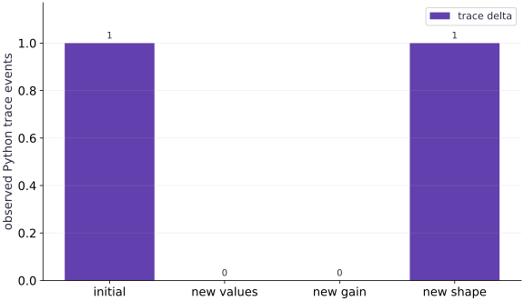

# Diagnose recompilation and host synchronization

Phase 08: Performance diagnosis · about 80 minutes · CPU

This reference explicitly selects CPU. Uploading the same file or setting JAX_PLATFORMS does not adapt it to TPU. Use the execution matrix to review device selection and data ownership before adapting a separate target program.

**Before this lesson:** [Benchmark asynchronous work correctly](https://www.tahabouhsine.com/jaxpathways/lesson-performance-01.html).

## What you will be able to do

- Record shapes, dtypes and dynamic/static choices beside observed tracing.
- Separate Python trace diagnostics from compilation evidence.
- Keep ordinary numerical hyperparameters dynamic when their values need not determine program structure.
- Compare per-step host consumption with one final host consumption while checking equivalent results.

## The problem

A new batch size makes one call pause; reading a metric makes another loop wait. Those delays can look similar, but they have different causes. We’ll record the shapes, dtypes and static choices of each call, then inspect where Python asks for device values. The evidence will guide the change.

## The idea

Slow steps can come from preparing new program specializations or from waiting for already-compiled work. Use a controlled call ledger and timing boundaries to separate those causes.

## Distinguish new tracing from host waiting

Two different costs can look like a pause: staging a new signature and waiting for already-dispatched work. First vary one signature component while keeping the function and process fixed; then inspect host-side reads such as converting a device scalar to Python. A `float(score)` wait does not itself imply a new trace.

The trace counter answers only whether this diagnostic observed Python tracing. Combine it with synchronized timing or a trace before deciding which change affected the workload.

$$
\sigma_r=(\operatorname{shape}(x_r),\operatorname{dtype}(x_r),c_{r,\rm static}),\qquad \Delta n_r=n_r-n_{r-1}
$$

### Pause and reason

If the trace count stays constant but a step is slow, what should you inspect?

<details><summary>Compare your reasoning</summary>

Inspect synchronization, transfers, data preparation and logging. A stable trace count does not rule out those boundaries.

</details>

## A call signature is different from its numerical data

The function sums squared inputs after multiplying by a gain. For $x=[0,\ldots,7]$, gain 1 gives 140 and gain 2 gives 560, yet changing the float32 scalar value leaves shape and dtype unchanged. The same specialization can therefore consume different numerical values.

Changing the input length from 8 to 12 changes its abstract shape and is a plausible reason for a new trace. Alter one factor at a time; sharding, callable identity and compiler context can also affect specialization.

```text
call → (shape, dtype, static choices) → specialization
             dynamic values → execution of that program
```

## Observe tracing without mislabeling compilation

The Python list append runs when JAX traces the function; later compiled numerical execution does not replay that Python statement. The list is an intentionally simple tracing diagnostic, not optimizer state or an accelerator callback.

In the recorded calls, observed trace deltas are $(1,0,0,1)$: initial signature, changed values, changed dynamic gain, then length 12. This counter records Python tracing events, not exact compiler invocations. Use compile logs or a profiler when the claim concerns compiler behavior, and name the observed event.

**Capture public compilation diagnostics on macOS/Linux**

```POSIX shell
# Capture public compilation diagnostics on macOS/Linux
JAX_LOG_COMPILES=1 python diagnosis.py 2> compile.log
```

**Expected:** The usual ledger appears in the terminal. compile.log contains JAX diagnostics, including tracing and compilation messages when observed. Read the named stage in each line; do not count every line as a compile.

**Capture diagnostics in PowerShell**

```PowerShell
# Capture diagnostics in PowerShell
$env:JAX_LOG_COMPILES="1"
python diagnosis.py 2> compile.log
Remove-Item Env:JAX_LOG_COMPILES
```

**Expected:** The ledger appears in the terminal and diagnostics are captured in compile.log. Removing the environment variable restores the shell setting after the run.

## Choose static arguments for structure rather than convenience

A static Boolean lets Python choose a branch during tracing, so changing its value can create a separate specialization. This is appropriate for structural choices, not rapidly changing numeric data. A typed scalar array keeps a changing gain dynamic; a runtime Boolean condition can use `lax.cond`.

Predict how many distinct structures the code can select before making an argument static. Static values must be hashable, and changing a static option changes the program branch as well as specialization.

## A host metric is an explicit synchronization boundary

Converting a scalar JAX value with `float(score)` asks Python for its contents, so it waits for the work needed to produce that value. Keeping it as a JAX scalar lets later device computations consume it; wait once at the final result when the metric is not needed immediately.

The exercise compares six dependent updates with a host read after each step against a final wait. Check that both produce the same scalar, then read their measured boundaries without assuming a speed ordering. If intermediate metrics matter, choose a bounded reporting interval rather than removing observability.

## Prepare a trace ledger

Create diagnosis.py in your activated course environment and add this block.

```python
# Step 1 — Prepare a trace ledger
import json
import time
import numpy as np
import jax
import jax.numpy as jnp
cpu = jax.devices("cpu")[0]
trace_events = []
def score(x, gain):
    # Authoring diagnostic: this Python effect happens during tracing.
    # It is NOT model state and does not count executable compilations.
    trace_events.append({"shape": list(x.shape), "dtype": str(x.dtype)})
    return jnp.sum((x * gain)**2)
# Wrap with `jax.jit` (`compiled_score`) so XLA traces and compiles the function.
compiled_score = jax.jit(score)
x8 = jax.device_put(np.arange(8, dtype=np.float32), cpu)
x12 = jax.device_put(np.arange(12, dtype=np.float32), cpu)
# Wait for device work to finish before timing it or comparing its result on the host.
jax.block_until_ready((x8, x12))
```

This CPU experiment deliberately keeps the trace ledger outside numerical state. Run it in a fresh process when comparing observations.

## Record call signatures and observed traces

Append this block to the same file. Run the assembled file with python diagnosis.py.

```python
# Step 2 — Record call signatures and observed traces
call_rows = []
def observed_call(label, x, gain):
    before = len(trace_events)
    # Place `result` explicitly onto the target JAX device.
    result = compiled_score(x, jax.device_put(np.float32(gain), cpu))
    # Wait for device work to finish before timing it or comparing its result on the host.
    result.block_until_ready()
    # Transfer the device result to the host for an independent NumPy comparison.
    expected = np.sum((np.asarray(x) * np.float32(gain))**2)
    # Transfer the device result to the host for an independent NumPy comparison.
    np.testing.assert_allclose(np.asarray(result), expected, rtol=2e-5, atol=2e-5)
    call_rows.append({"label": label, "shape": list(x.shape), "dtype": str(x.dtype),
                      "observed_trace_delta": len(trace_events) - before,
                      "result": float(result)})
    return result
```

The ledger relates each controlled signature change to the observed Python event delta, with an independent NumPy value check.

## Run the controlled call sequence

Append this block to the same file. Run the assembled file with python diagnosis.py.

```python
# Step 3 — Run the controlled call sequence: Inspect the event deltas on your own environment.
observed_call("initial signature", x8, 1.)
observed_call("same signature changed data", x8 + 1., 1.)
observed_call("same signature changed dynamic gain", x8, 2.)
observed_call("different input shape", x12, 1.)
print(json.dumps({"jax": jax.__version__, "backend": str(cpu),
                  "calls": call_rows, "python_trace_events": trace_events}, indent=2))
assert call_rows[0]["result"] == 140.
assert call_rows[2]["result"] == 560.
assert call_rows[3]["result"] == 506.
```

Inspect the event deltas on your own environment. The required outputs are checked numeric scores, not a fabricated trace or compilation count.

## Run the example

```python
# Step 1 — Prepare a trace ledger
import json
import time
import numpy as np
import jax
import jax.numpy as jnp
cpu = jax.devices("cpu")[0]
trace_events = []
def score(x, gain):
    # Authoring diagnostic: this Python effect happens during tracing.
    # It is NOT model state and does not count executable compilations.
    trace_events.append({"shape": list(x.shape), "dtype": str(x.dtype)})
    return jnp.sum((x * gain)**2)
# Wrap with `jax.jit` (`compiled_score`) so XLA traces and compiles the function.
compiled_score = jax.jit(score)
x8 = jax.device_put(np.arange(8, dtype=np.float32), cpu)
x12 = jax.device_put(np.arange(12, dtype=np.float32), cpu)
# Wait for device work to finish before timing it or comparing its result on the host.
jax.block_until_ready((x8, x12))
# Step 2 — Record call signatures and observed traces
call_rows = []
def observed_call(label, x, gain):
    before = len(trace_events)
    # Place `result` explicitly onto the target JAX device.
    result = compiled_score(x, jax.device_put(np.float32(gain), cpu))
    # Wait for device work to finish before timing it or comparing its result on the host.
    result.block_until_ready()
    # Transfer the device result to the host for an independent NumPy comparison.
    expected = np.sum((np.asarray(x) * np.float32(gain))**2)
    # Transfer the device result to the host for an independent NumPy comparison.
    np.testing.assert_allclose(np.asarray(result), expected, rtol=2e-5, atol=2e-5)
    call_rows.append({"label": label, "shape": list(x.shape), "dtype": str(x.dtype),
                      "observed_trace_delta": len(trace_events) - before,
                      "result": float(result)})
    return result
# Step 3 — Run the controlled call sequence: Inspect the event deltas on your own environment.
observed_call("initial signature", x8, 1.)
observed_call("same signature changed data", x8 + 1., 1.)
observed_call("same signature changed dynamic gain", x8, 2.)
observed_call("different input shape", x12, 1.)
print(json.dumps({"jax": jax.__version__, "backend": str(cpu),
                  "calls": call_rows, "python_trace_events": trace_events}, indent=2))
assert call_rows[0]["result"] == 140.
assert call_rows[2]["result"] == 560.
assert call_rows[3]["result"] == 506.
```

Expected: A JSON ledger of four calls and observed Python trace events. Checked scores include $140$, $560$ and $506$; event deltas are recorded rather than fixed by the lesson.

## A new value is not necessarily a new trace

**Predict:** Which call changes the input signature?



**Recorded CPU computation**

### Read the figure

The horizontal axis lists four call categories; the vertical axis is the additional observed Python trace-event count per call, not time. The bars are 1 for the first signature, 0 for changed array values, 0 for changed dynamic gain, and 1 for a length-12 input. Zero-height bars mean the call ran without a new Python trace event in this retained run.

### Connect it to the computation

Changing data and gain changed results while the signature stayed length 8; changing length to 12 produced the second observed trace. The bars support the narrow conclusion that this diagnostic saw events for the initial and changed-shape calls. They do not count device kernels or all compilation work. Next predict the trace delta when only a runtime scalar changes, then separately time any host read you suspect is waiting.

```python
visual_data = {'kind': 'bar', 'labels': ['initial', 'new values', 'new gain', 'new shape'], 'ylabel': 'observed Python trace events', 'series': [{'label': 'trace delta', 'y': [r['observed_trace_delta'] for r in call_rows]}]}
```

## Recorded reference execution

CPU run: 2026-10-27T17:05:53.544175+00:00. JAX 0.9.2.

```text
{
  "jax": "0.9.2",
  "backend": "TFRT_CPU_0",
  "calls": [
    {
      "label": "initial signature",
      "shape": [
        8
      ],
      "dtype": "float32",
      "observed_trace_delta": 1,
      "result": 140.0
    },
    {
      "label": "same signature changed data",
      "shape": [
        8
      ],
      "dtype": "float32",
      "observed_trace_delta": 0,
      "result": 204.0
    },
    {
      "label": "same signature changed dynamic gain",
      "shape": [
        8
      ],
      "dtype": "float32",
      "observed_trace_delta": 0,
      "result": 560.0
    },
    {
      "label": "different input shape",
      "shape": [
        12
      ],
      "dtype": "float32",
      "observed_trace_delta": 1,
      "result": 506.0
    }
  ],
  "python_trace_events": [
    {
      "shape": [
        8
      ],
      "dtype": "float32"
    },
    {
      "shape": [
        12
      ],
      "dtype": "float32"
    }
  ]
}
{
  "jax": "0.9.2",
  "backend": "TFRT_CPU_0",
  "calls": [
    {
      "label": "initial signature",
      "shape": [
        8
      ],
      "dtype": "float32",
      "observed_trace_delta": 1,
      "result": 140.0
    },
    {
      "label": "same signature changed data",
      "shape": [
        8
      ],
      "dtype": "float32",
      "observed_trace_delta": 0,
      "result": 204.0
    },
    {
      "label": "same signature changed dynamic gain",
      "shape": [
        8
      ],
      "dtype": "float32",
      "observed_trace_delta": 0,
      "result": 560.0
    },
    {
      "label": "different input shape",
      "shape": [
        12
      ],
      "dtype": "float32",
      "observed_trace_delta": 1,
      "result": 506.0
    }
  ],
  "python_trace_events": [
    {
      "shape": [
        8
      ],
      "dtype": "float32"
    },
    {
      "shape": [
        12
      ],
      "dtype": "float32"
    }
  ]
}
Static branch trace observations: [{'shape': [8], 'square': True}, {'shape': [8], 'square': False}]
Per-step host reads seconds: 0.00010458333417773247
Final-only wait seconds: 3.0084047466516495e-05
Added ledger row: {'label': 'new length sixteen', 'shape': [16], 'dtype': 'float32', 'observed_trace_delta': 1, 'result': 1240.0}
Masked versus unmasked padded objective: 55.0 58.0
Observed runtime-Python-branch tracing failure
PASS: performance-02

```

## Contrast static branch metadata with a dynamic gain

**Predict before running:** Which changes require a different Python branch to be selected while tracing? Is that the same as changing gain from $1$ to $2$?

```python
# Experiment — Contrast static branch metadata with a dynamic gain: The static Boolean controls Python program structure.
branch_events = []
def branch_score(x, square):
    branch_events.append({"shape": list(x.shape), "square": square})
    return jnp.sum(x**2) if square else jnp.sum(x)
# Wrap with `jax.jit` (`static_score`) so XLA traces and compiles the function.
static_score = jax.jit(branch_score, static_argnames=("square",))
for square in [True, True, False]:
    out = static_score(x8, square=square)
    # Transfer the device result to the host for an independent NumPy comparison.
    np.testing.assert_allclose(np.asarray(out), 140. if square else 28.)
print("Static branch trace observations:", branch_events)
```

**Expected:** Correct scores for both branches, plus the trace events observed in this process.

The static Boolean controls Python program structure. The earlier numerical gain was dynamic arithmetic data. These are distinct specialization choices; the printed diagnostic is not an executable compilation count.

## Keep a metric on device until the reporting boundary

**Predict before running:** Will six per-step host reads and one final read produce the same value? Must one be faster on this CPU?

```python
# Experiment — Keep a metric on device until the reporting boundary: The geometric-series result checks the computation independently.
# Wrap with `jax.jit` (`update`) so XLA traces and compiles the function.
update = jax.jit(lambda value: 0.9 * value + 1.)
# Place `initial` explicitly onto the target JAX device.
initial = jax.device_put(np.float32(0.), cpu)
# Wait for device work to finish before timing it or comparing its result on the host.
update(initial).block_until_ready()
def metric_run(read_each):
    value = initial
    observed = []
    start = time.perf_counter()
    for _ in range(6):
        value = update(value)
        if read_each:
            observed.append(float(value))
    # Wait for device work to finish before timing it or comparing its result on the host.
    value.block_until_ready()
    elapsed = time.perf_counter() - start
    return value, elapsed, observed
read_result, read_seconds, metrics = metric_run(True)
final_result, final_seconds, _ = metric_run(False)
reference_value = 10. * (1. - 0.9**6)
# Transfer the device result to the host for an independent NumPy comparison.
np.testing.assert_allclose(np.asarray(read_result), reference_value, rtol=2e-5)
# Transfer the device result to the host for an independent NumPy comparison.
np.testing.assert_allclose(np.asarray(final_result), reference_value, rtol=2e-5)
assert len(metrics) == 6
print("Per-step host reads seconds:", read_seconds)
print("Final-only wait seconds:", final_seconds)
```

**Expected:** Equivalent final values near $4.68559$ and two measured intervals; no required speed ordering.

The geometric-series result checks the computation independently. Moving host consumption changes the measurement/observability boundary, so keep that difference beside both times.

## Make it yours

Add a call with sixteen float32 elements. Calculate its expected score independently and extend the signature ledger without labeling a trace event as a compilation.

### How to write this exercise — Step-by-step recipe & starter scaffold

**Inputs:**
- The existing specialization ledger, a 16-element float32 input, and the observed-call helper.

**Outputs:**
- An independently checked score for the 16-element call and a new ledger row with its signature and trace observation.

**Invariants to check:**
- The changed input shape adds a signature entry; a Python trace event is not labeled as proof of compilation.

**Hints:**
- Calculate the sum of squared scaled elements on the host independently.
- Record shape, dtype, and trace delta as separate observations.

**Starter code scaffold (fill in the TODOs):**

```python
import numpy as np

def add_sixteen_element_call(ledger, values, gain, observed_call):
    # TODO: Run the new 16-element signature, verify its score independently, and append its observed ledger row.
    raise NotImplementedError
```

<details><summary>Reference solution</summary>

```python
# Exercise solution: Add a call with sixteen float32 elements.
x16 = jax.device_put(np.arange(16, dtype=np.float32), cpu)
observed_call("new length sixteen", x16, 1.)
assert call_rows[-1]["result"] == sum(i*i for i in range(16))
print("Added ledger row:", call_rows[-1])
```

</details>

## Pad a final batch while preserving the objective

**Transfer**

A final batch has five values while other batches have eight. Pad to eight and use an explicit validity mask in a dynamic array. Compare the masked sum of squares to an ordinary five-value calculation. Explain why padding without masking changes objectives with offsets.

<details><summary>Hint</summary>

Use a fixed-size input and mask; compute the offset transformation before masking.

</details>

### How to write: Pad a final batch while preserving the objective — Step-by-step recipe & starter scaffold

**Inputs:**
- A final batch has five values while other batches have eight. Pad to eight and use an explicit validity mask in a dynamic array. Compare the masked sum of squares to an ordinary five-value calculation. Explain why padding without masking changes objectives with offsets.

**Outputs:**
- Equal masked/unpadded objectives plus a counterexample without masking.

**Invariants to check:**
- Padded entries contribute neither residual nor offset terms.

**Hints:**
- Use a fixed-size input and mask; compute the offset transformation before masking.

**Starter code scaffold (fill in the TODOs):**

```python
import jax.numpy as jnp
import time

def practice_pad_a_final_batch_while_preserving_the_objective(values, valid_mask):
    """Implement the pad a final batch while preserving the objective check."""
    # TODO: Pad five values to eight with a validity mask and compare masked squared-error sum with the unpadded calculation.
    raise NotImplementedError
```

<details><summary>Reference solution and reasoning</summary>

```python
# Pad a final batch while preserving the objective (Transfer): The mask removes three synthetic rows.
# Wrap with `jax.jit` (`masked_score`) so XLA traces and compiles the function.
masked_score = jax.jit(lambda values, mask: jnp.sum(jnp.where(mask, (values + 1.)**2, 0.)))
five = np.arange(5, dtype=np.float32)
# Place `padded` explicitly onto the target JAX device.
padded = jax.device_put(np.pad(five, (0, 3)), cpu)
mask = jax.device_put(np.arange(8) < 5, cpu)
masked = masked_score(padded, mask)
# Transfer the device result to the host for an independent NumPy comparison.
np.testing.assert_allclose(np.asarray(masked), sum((i+1)**2 for i in range(5)))
wrong = jnp.sum((padded + 1.)**2)
assert float(wrong) == float(masked) + 3.
print("Masked versus unmasked padded objective:", float(masked), float(wrong))
```

The mask removes three synthetic rows. Zero padding alone adds three ones after the offset, so a fixed shape is useful only if it retains the original mathematical objective.

</details>

## Reproduce and repair runtime Python branching

**Diagnosis**

Write a jitted function using if gain > $1$ on a scalar array. Capture its tracing failure and replace the branch with lax.cond. Verify both branches against independent arithmetic.

<details><summary>Hint</summary>

A runtime scalar predicate is a tracer, so Python cannot decide its truth value during tracing.

</details>

### How to write: Reproduce and repair runtime Python branching — Step-by-step recipe & starter scaffold

**Inputs:**
- Write a jitted function using if gain > $1$ on a scalar array. Capture its tracing failure and replace the branch with lax.cond. Verify both branches against independent arithmetic.

**Outputs:**
- Captured tracing failure and correct outputs for both predicate outcomes.

**Invariants to check:**
- The branch predicate is a scalar JAX value and both branches return matching result types.

**Hints:**
- A runtime scalar predicate is a tracer, so Python cannot decide its truth value during tracing.

**Starter code scaffold (fill in the TODOs):**

```python
import jax
import jax.numpy as jnp
import time

def practice_reproduce_and_repair_runtime_python_branching(value, threshold):
    """Implement the reproduce and repair runtime python branching check."""
    # TODO: Trigger the traced scalar-array branch failure, then replace it with lax.cond and verify both branches against arithmetic.
    raise NotImplementedError
```

<details><summary>Reference solution and reasoning</summary>

```python
# Reproduce and repair runtime Python branching (Diagnosis)
def broken_branch(values, gain):
    if gain > 1.:
        return jnp.sum(values**2)
    return jnp.sum(values)
try:
    jax.jit(broken_branch)(x8, jax.device_put(np.float32(2.), cpu))
except jax.errors.TracerBoolConversionError:
    print("Observed runtime-Python-branch tracing failure")
else:
    raise AssertionError("runtime branch unexpectedly accepted")
# Wrap with `jax.jit` (`repaired`) so XLA traces and compiles the function.
repaired = jax.jit(lambda values, gain: jax.lax.cond(gain > 1., lambda v:jnp.sum(v**2), lambda v:jnp.sum(v), values))
for gain, expected in [(0.5, 28.), (2., 140.)]:
    # Place `result` explicitly onto the target JAX device.
    result = repaired(x8, jax.device_put(np.float32(gain), cpu))
    # Transfer the device result to the host for an independent NumPy comparison.
    np.testing.assert_allclose(np.asarray(result), expected)
```

The failure identifies a mismatch between Python control flow and runtime numerical data. lax.cond preserves a dynamic choice; declaring gain static would choose a different specialization contract instead.

</details>

## Check your understanding

What does an append to a Python list inside a jitted function demonstrate?

1. One recorded event per device execution
2. An observed Python tracing event, which is not an executable compilation count
3. An exact measure of compiler duration

<details><summary>Answer and explanation</summary>

**1. One recorded event per device execution**

Python runs during tracing and can run without a corresponding steady-state device event. Do not count appends as executed device steps.

**2. An observed Python tracing event, which is not an executable compilation count (correct)**

Python executes during tracing; compiled array computation may run repeatedly without that append. Correlate with public compiler logs or traces before claiming recompilation.

**3. An exact measure of compiler duration**

A side effect does not measure compiler duration. Use compile logs or an explicit timing boundary to investigate compilation.

</details>

## Diagnose the result

If pauses correlate with varying batch lengths, record their signatures and check an explicitly masked fixed-size alternative. If host reads appear inside every update, first specify the reporting boundary and verify numerical equivalence before comparing synchronized observations.

## Carry forward

- Record observed staging diagnostics without inventing compilation counts.
- Static metadata changes program specialization; ordinary arithmetic values can remain dynamic.
- Padding needs an objective-preserving mask.
- Host metrics provide useful observability and introduce completion boundaries.

## Keep your evidence

Keep the controlled call ledger, actual trace observations labeled as traces, static/dynamic explanation, observed host-consumption intervals, masked-versus-unmasked counterexample and reproduced/repaired tracing failure.

Save your predictions, modified code, terminal outputs, and reasoning in your engineering portfolio.

## Primary references

- [Just-in-time compilation and caching](https://docs.jax.dev/en/latest/jit-compilation.html)
- [jax.jit static arguments](https://docs.jax.dev/en/latest/_autosummary/jax.jit.html)
- [Asynchronous dispatch](https://docs.jax.dev/en/latest/async_dispatch.html)

