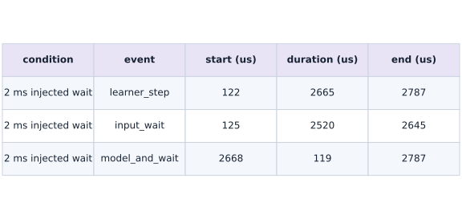
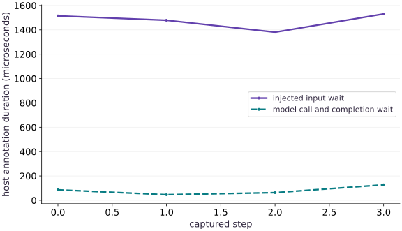

# Read an XProf trace

Phase 08: Performance diagnosis · about 100 minutes · CPU

This worked reference is validated on CPU. Accelerator compatibility requires a separate source review and target execution receipt. Use the execution matrix to review device selection and data ownership before adapting a separate target program.

**Before this lesson:** [Diagnose recompilation and host synchronization](https://www.tahabouhsine.com/jaxpathways/lesson-performance-02.html).

## What you will be able to do

- Capture an actual warmed CPU trace with named steps.
- Identify nested intervals and avoid double-counting their durations.
- Separate an injected host wait from a completed model call.
- Explain how to inspect the trace in XProf and bound a bottleneck claim.

## The problem

Your timer says a training step is slow, but it cannot show whether the time was spent waiting for input or computing. We will capture a real JAX trace, add names that match the code, and read four steps from the recorded events before proposing an optimization. A retained CPU excerpt provides actual event timestamps so we can account for nesting without counting the parent twice.

## The idea

A trace places events on a shared timeline so we can inspect order, waiting and overlap. Begin with a specific question about a slow step and identify which recorded events can answer it. Host annotations and device operations are different evidence.

## Do not add nested durations twice

A parent span already contains its children. In the retained 2 ms step, `learner_step` lasts 2665 microseconds; `input_wait` and `model_and_wait` occupy 2520 and 119 microseconds within it. Their union is 2639 microseconds, leaving 26 microseconds of the parent outside those annotations. Adding parent and children would count the same time twice.

Inspect event start, end, nesting and thread before summing. The remainder is unannotated host span, not evidence of another kernel.

$$
T_{\rm outer}=T_{\rm input\ wait}+T_{\rm model\ and\ wait}+T_{\rm other}\quad\text{(disjoint serial host regions only)}
$$

### Measured CPU trace event timeline

**Predict:** Which nested named event occupies most of the enclosing step?



*Actual retained CPU host event timestamps and durations. No accelerator-kernel or collective rows are present.*

The table's rows are `learner_step`, `input_wait`, and `model_and_wait`; the columns give condition, event start, duration and end, all in microseconds. In the 2 ms row, the parent runs 122–2787 us, containing `input_wait` from 125–2645 us and then `model_and_wait` from 2668–2787 us on the same host thread. The arrow/order is temporal nesting: the parent contains both children, and the children occur consecutively. The accompanying line plot compares child durations across the two sleep settings.

### Pause and reason

What should accompany a claimed trace-based optimization?

<details><summary>Compare your reasoning</summary>

The event boundary, comparable workload, specific intervention and repeated completed measurements showing its predicted effect. A changed unrelated interval is insufficient.

</details>

## Give the timeline a question

The trace asks where this example's step time falls. Input creation and compilation happen before capture; inside each step the code injects a host sleep, then dispatches a compiled model and waits for its result. The sleep is a deliberate stand-in for a stalled input stage, not a measurement of a real loader or storage system.

Predict that reducing the requested sleep should shorten `input_wait`, then compare the named host intervals.

## Capture warmed work without hiding completion

The exact shape and dtype are warmed before capture. `model_and_wait` ends after `block_until_ready`, so its span includes host dispatch and waiting for the requested CPU result. Without that wait, device work could remain pending after the host annotation ends.

The recorded `input_wait` comes before `model_and_wait`, and both fit inside `learner_step`. Those observed boundaries establish the order in this trace, not a simulated device schedule.

## Read the retained CPU timeline as nested intervals

The retained file contains six named host events from a synchronized CPU JIT workload, with timestamps and durations in microseconds. In the 2 ms condition, `learner_step` runs from 122 to 2787 us (2665 us); nested `input_wait` runs 125–2645 us (2520 us), followed by `model_and_wait` 2668–2787 us (119 us). The children share one host thread and do not overlap.

When requested sleep changes to 0.5 ms, the retained `input_wait` is 642 us and `model_and_wait` is 79 us; the enclosing step is 732 us. The input span falls by 1878 us. This comparison shows the controlled host wait changing in the expected direction; the smaller model span also varies, so do not read this single profiled pair as a performance guarantee. No accelerator device rows or collectives are present.

**Capture the small retained CPU timeline example**

```bash
python phases/08-performance/03-read-an-xprof-trace/code/capture_retained_cpu_timeline_p2_81.py
```

**Expected:** Writes a numeric-only excerpt of six named events, with source hash and backend/version labels. The capture warms and checks a finite tiny workload before profiling.

$$
T_{\rm step}=2665\,\mu s,\quad |[125,2645]\cup[2668,2787]|=2639\,\mu s,\quad T_{\rm remainder}=26\,\mu s
$$

### Pause and reason

Which event dominates the measured path in the retained 2 ms condition, and what can you conclude about its critical path?

<details><summary>Compare your reasoning</summary>

The 2520 us injected input_wait dominates these named host spans in this one CPU step. It is on this annotated serial host path before model_and_wait, but it does not establish that a real input source or accelerator is the bottleneck.

</details>

## Read a trace without adding the same time twice

The event timestamps and durations use microseconds, so 1000 us is 1 ms. For the first retained step, subtracting the child union from the 2665-us parent leaves 26 us; it does not add a new duration to the total. Convert units before comparing with a `perf_counter` report, which is usually expressed in seconds.

## Open the same evidence in XProf and on a TPU VM

The program prints the trace directory and retains the actual XPlane and Perfetto files there. To choose a durable folder, set `JAX_COURSE_TRACE_DIR` before running. Open the official XProf viewer in a compatible separately installed environment, select this log directory/profile, then open Trace Viewer and locate `learner_step`. Expand its host thread and inspect `input_wait` and `model_and_wait`.

Select one step and record its start, duration, enclosing thread and child intervals. When you run this lesson on a TPU VM provisioned with the workflow from `lesson-welcome-03.html` and `tpu-gcp.html`, set `JAX_PLATFORMS=tpu` and `JAX_COURSE_TRACE_DIR=/tmp/tpu-trace`, copy the trace directory back to your workstation with `gcloud compute tpus tpu-vm scp --recurse`, and inspect the `TPU:0` device lanes alongside host submission; an empty host region does not prove an idle device. **TODO (Cloud TPU Trace Extension):** Capture a TPU XPlane trace on a Cloud TPU VM and compare the `TPU:0` device lanes against this CPU trace.

**Optional viewer in a separate compatible Python environment**

```sh
# Run optional viewer in a separate compatible python environment using the course Python environment
python -m pip install xprof
xprof --port 8791 /absolute/path/to/your/trace-directory
```

**Expected:** Replace the final path with the trace directory printed by the lesson. The viewer prints a local URL. Select the recorded run and trace_viewer. The viewer dependency and GUI are not covered by the course CPU receipt.

**Capture the same trace on a Cloud TPU VM and copy it back for XProf**

```bash
# Capture the same trace on a Cloud TPU VM and copy it back for XProf
gcloud compute tpus tpu-vm scp exercises/performance-03.py $TPU_NAME:~/jax-tpu-lab/ --zone=$ZONE
gcloud compute tpus tpu-vm ssh $TPU_NAME --zone=$ZONE \
  --command="JAX_PLATFORMS=tpu JAX_COURSE_TRACE_DIR=/tmp/tpu-trace ~/jax-tpu-lab/.venv/bin/python ~/jax-tpu-lab/performance-03.py"
gcloud compute tpus tpu-vm scp --recurse $TPU_NAME:/tmp/tpu-trace ./tpu-trace --zone=$ZONE
xprof --port 8791 ./tpu-trace
```

**Expected:** Runs the trace capture on the TPU VM, copies the XPlane and Perfetto files back to ./tpu-trace on your workstation, and opens XProf so you can correlate host dispatch with TPU device execution lanes.

## Make one change and repeat the same question

To investigate a real input path, replace the synthetic sleep with the actual fetch while keeping the annotation boundary and comparable load. Then predict which host span should move and capture another trace. Removing the synthetic delay only shows that the stand-in was removed; it does not establish a model or production input speedup.

Keep a cold-start trace separate from warmed steps, and confirm any timing hypothesis with an independent synchronized benchmark.

## Prepare a traceable workload

Create a Python file in the course environment. Add this block after the preceding block, then run the assembled file.

```python
# Step 1 — Prepare a traceable workload: Inputs and compilation precede the measured steps.
import gzip
import json
import os
from pathlib import Path
import tempfile
import time
import numpy as np
import jax
import jax.numpy as jnp
# Read `trace_root` from environment configuration (with a default fallback).
trace_root=Path(os.environ.get('JAX_COURSE_TRACE_DIR') or tempfile.mkdtemp(prefix='jax-course-trace-')).resolve()
trace_root.mkdir(parents=True,exist_ok=True)
rng=np.random.default_rng(31)
host=rng.normal(size=(48,32)).astype(np.float32)
weights=rng.normal(size=(32,16)).astype(np.float32)
x,w=jnp.asarray(host),jnp.asarray(weights)
# Wrap with `jax.jit` (`compiled`) so XLA traces and compiles the function.
compiled=jax.jit(lambda a,b:jnp.tanh(a@b))
# Wait for device work to finish before timing it or comparing its result on the host.
compiled(x,w).block_until_ready()
```

Inputs and compilation precede the measured steps. The output remains independently checked against NumPy.

## Capture named intervals

Create a Python file in the course environment. Add this block after the preceding block, then run the assembled file.

```python
# Step 2 — Capture named intervals
with jax.profiler.trace(trace_root,create_perfetto_trace=True):
    for index in range(4):
        with jax.profiler.StepTraceAnnotation('learner_step',step_num=index):
            with jax.profiler.TraceAnnotation('input_wait'):
                time.sleep(.001)  # injected host delay; not a measured real input pipeline
            with jax.profiler.TraceAnnotation('model_and_wait'):
                result=compiled(x,w)
                # Wait for device work to finish before timing it or comparing its result on the host.
                result.block_until_ready()
np.testing.assert_allclose(result,np.tanh(host@weights),rtol=2e-5,atol=2e-5)
traces=sorted(trace_root.rglob('perfetto_trace.json.gz'),key=lambda p:p.stat().st_mtime_ns)
assert traces and list(trace_root.rglob('*.xplane.pb'))
events=json.loads(gzip.decompress(traces[-1].read_bytes()))['traceEvents']
def complete(name):
    return sorted([e for e in events if e.get('ph')=='X' and e.get('name')==name],key=lambda e:e['ts'])
steps=complete('learner_step')
input_events=complete('input_wait')
model_events=complete('model_and_wait')
assert len(steps)==len(input_events)==len(model_events)==4
for outer,waiting,compute in zip(steps,input_events,model_events):
    for inner in (waiting,compute):
        assert outer['ts']<=inner['ts']<=inner['ts']+inner['dur']<=outer['ts']+outer['dur']+1
    assert waiting['ts']+waiting['dur']<=compute['ts']+1
input_us=[e['dur'] for e in input_events]
model_us=[e['dur'] for e in model_events]
step_us=[e['dur'] for e in steps]
assert all(t>=0 for t in input_us+model_us+step_us)
print('Trace directory:',trace_root)
print(json.dumps({'input_wait_us':input_us,'model_and_wait_us':model_us,'step_us':step_us},indent=2))
print('Four named steps verified; host annotations are not isolated device kernels.')
```

The outer annotation provides context, while two nonoverlapping child regions distinguish injected waiting from completed computation.

## Step 3: Verify invariants on the completed state

Run the final shape and numerical assertions to confirm the state built in Steps 1 and 2.

```python
step_us=[e['dur'] for e in steps]
assert all(t>=0 for t in input_us+model_us+step_us)
```

Checking these invariants confirms the computation is ready for the full worked experiment.

## Run the example

```python
# Step 1 — Prepare a traceable workload: Inputs and compilation precede the measured steps.
import gzip
import json
import os
from pathlib import Path
import tempfile
import time
import numpy as np
import jax
import jax.numpy as jnp
# Read `trace_root` from environment configuration (with a default fallback).
trace_root=Path(os.environ.get('JAX_COURSE_TRACE_DIR') or tempfile.mkdtemp(prefix='jax-course-trace-')).resolve()
trace_root.mkdir(parents=True,exist_ok=True)
rng=np.random.default_rng(31)
host=rng.normal(size=(48,32)).astype(np.float32)
weights=rng.normal(size=(32,16)).astype(np.float32)
x,w=jnp.asarray(host),jnp.asarray(weights)
# Wrap with `jax.jit` (`compiled`) so XLA traces and compiles the function.
compiled=jax.jit(lambda a,b:jnp.tanh(a@b))
# Wait for device work to finish before timing it or comparing its result on the host.
compiled(x,w).block_until_ready()

# Step 2 — Capture named intervals
with jax.profiler.trace(trace_root,create_perfetto_trace=True):
    for index in range(4):
        with jax.profiler.StepTraceAnnotation('learner_step',step_num=index):
            with jax.profiler.TraceAnnotation('input_wait'):
                time.sleep(.001)  # injected host delay; not a measured real input pipeline
            with jax.profiler.TraceAnnotation('model_and_wait'):
                result=compiled(x,w)
                # Wait for device work to finish before timing it or comparing its result on the host.
                result.block_until_ready()
np.testing.assert_allclose(result,np.tanh(host@weights),rtol=2e-5,atol=2e-5)
traces=sorted(trace_root.rglob('perfetto_trace.json.gz'),key=lambda p:p.stat().st_mtime_ns)
assert traces and list(trace_root.rglob('*.xplane.pb'))
events=json.loads(gzip.decompress(traces[-1].read_bytes()))['traceEvents']
def complete(name):
    return sorted([e for e in events if e.get('ph')=='X' and e.get('name')==name],key=lambda e:e['ts'])
steps=complete('learner_step')
input_events=complete('input_wait')
model_events=complete('model_and_wait')
assert len(steps)==len(input_events)==len(model_events)==4
for outer,waiting,compute in zip(steps,input_events,model_events):
    for inner in (waiting,compute):
        assert outer['ts']<=inner['ts']<=inner['ts']+inner['dur']<=outer['ts']+outer['dur']+1
    assert waiting['ts']+waiting['dur']<=compute['ts']+1
input_us=[e['dur'] for e in input_events]
model_us=[e['dur'] for e in model_events]
step_us=[e['dur'] for e in steps]
assert all(t>=0 for t in input_us+model_us+step_us)
print('Trace directory:',trace_root)
print(json.dumps({'input_wait_us':input_us,'model_and_wait_us':model_us,'step_us':step_us},indent=2))
print('Four named steps verified; host annotations are not isolated device kernels.')
```

Expected: A real trace directory, four named intervals from the lesson capture, plus a retained two-condition CPU excerpt with event timestamps, durations, non-double-counted union accounting and a checked injected-wait prediction. Values include profiler overhead.

## Actual CPU trace: named spans and changed wait

**Predict:** If the requested sleep falls from 2 ms to 0.5 ms, which retained host span should shrink, and which should stay in a similar range?



**Recorded CPU computation**

### Read the figure

The x-axis is requested injected sleep in milliseconds (2.0 then 0.5); the y-axis is actual host annotation duration in microseconds. The `input_wait` series falls from 2520 to 642 us, while `model_and_wait` moves from 119 to 79 us. These are named CPU host spans from the retained Perfetto excerpt, not kernel timings.

### Connect it to the computation

The requested sleep reduction corresponds to a 1878-us shorter `input_wait`. The model span includes dispatch and waiting for the CPU result and also changed by 40 us in this two-step trace; that small movement is not a stable estimate. Both child spans sit inside `learner_step`, whose 2 ms-condition duration is 2665 us, so compare children within the parent rather than adding all three. Next test a real fetch under comparable conditions before using this shape of evidence to locate an input bottleneck.

```python
from pathlib import Path
import json
retained_events = [{'condition': '2 ms injected wait', 'name': 'learner_step', 'start_us': 122, 'duration_us': 2665, 'end_us': 2787, 'pid': 701, 'tid': 164376313}, {'condition': '2 ms injected wait', 'name': 'input_wait', 'start_us': 125, 'duration_us': 2520, 'end_us': 2645, 'pid': 701, 'tid': 164376313}, {'condition': '2 ms injected wait', 'name': 'model_and_wait', 'start_us': 2668, 'duration_us': 119, 'end_us': 2787, 'pid': 701, 'tid': 164376313}, {'condition': '0.5 ms injected wait', 'name': 'learner_step', 'start_us': 2796, 'duration_us': 732, 'end_us': 3528, 'pid': 701, 'tid': 164376313}, {'condition': '0.5 ms injected wait', 'name': 'input_wait', 'start_us': 2798, 'duration_us': 642, 'end_us': 3440, 'pid': 701, 'tid': 164376313}, {'condition': '0.5 ms injected wait', 'name': 'model_and_wait', 'start_us': 3448, 'duration_us': 79, 'end_us': 3527, 'pid': 701, 'tid': 164376313}]
# Use embedded measured rows for downloaded standalone lesson scripts. When the
# workspace excerpt is present, verify that its event records match exactly.
excerpt_path = Path('phases/08-performance/03-read-an-xprof-trace/data/retained_cpu_timeline_p2_81.json')
if excerpt_path.exists():
    excerpt = json.loads(excerpt_path.read_text())
    assert excerpt['events'] == retained_events
conditions = ['2 ms injected wait', '0.5 ms injected wait']
lookup = {(e['condition'], e['name']): e['duration_us'] for e in retained_events}
visual_data = {
    'kind': 'line',
    'x': [2.0, 0.5],
    'xlabel': 'requested injected sleep (milliseconds)',
    'ylabel': 'actual host annotation duration (microseconds)',
    'series': [
        {'label': 'input_wait', 'y': [lookup[(condition, 'input_wait')] for condition in conditions]},
        {'label': 'model_and_wait', 'y': [lookup[(condition, 'model_and_wait')] for condition in conditions]},
    ],
}
```

## Recorded reference execution

CPU run: 2026-10-27T17:05:55.689675+00:00. JAX 0.9.2.

```text
Trace directory: /private/var/folders/mp/_mq7srqx2y10p5nhjz9m7hj40000gn/T/jax-course-trace-0uym5n49
{
  "input_wait_us": [
    1201,
    1268,
    1026,
    1104
  ],
  "model_and_wait_us": [
    113,
    1078,
    108,
    94
  ],
  "step_us": [
    1328,
    2355,
    1145,
    1206
  ]
}
Four named steps verified; host annotations are not isolated device kernels.
Trace directory: /private/var/folders/mp/_mq7srqx2y10p5nhjz9m7hj40000gn/T/jax-course-trace-yt3veneq
{
  "input_wait_us": [
    1272,
    1273,
    1492,
    1539
  ],
  "model_and_wait_us": [
    96,
    192,
    858,
    1040
  ],
  "step_us": [
    1380,
    1500,
    2362,
    2589
  ]
}
Four named steps verified; host annotations are not isolated device kernels.
Unattributed outer time, microseconds: [12, 35, 12, 10]
Wrong double-counted totals: [2748, 2965, 4712, 5168]
{'input_wait_drop_us': 1878, 'model_before_us': 119, 'model_after_us': 79}
{'minimum_ms': 0.096, 'median_ms': 0.525, 'maximum_ms': 1.04}
{'outer_us': 2665, 'children_union_us': 2639, 'remainder_us': 26, 'wrong_parent_plus_children_us': 5304}
PASS: performance-03

```

## Account for the enclosing step

**Predict before running:** What happens if you sum outer and inner durations as though they were independent work?

```python
# Experiment — Account for the enclosing step: Outer and child intervals describe nested boundaries.
overhead=np.asarray(step_us)-np.asarray(input_us)-np.asarray(model_us)
assert np.all(overhead>=-2)
# Transfer the device result to the host for an independent NumPy comparison.
wrong=np.asarray(step_us)+np.asarray(input_us)+np.asarray(model_us)
assert np.all(wrong>=np.asarray(step_us))
print('Unattributed outer time, microseconds:',overhead.tolist())
print('Wrong double-counted totals:',wrong.tolist())
```

**Expected:** The remainder is nonnegative within rounding; the double-counted totals exceed the step durations.

Outer and child intervals describe nested boundaries. The remainder is host/annotation work inside the step but outside its two children; it is not automatically device idle time.

## Predict and check a changed input wait

**Predict before running:** Reducing the requested host sleep from 2 ms to 0.5 ms should shorten input_wait by about 1.5 ms while model_and_wait stays in roughly the same range.

```python
baseline_wait_us=2520
changed_wait_us=642
baseline_model_us=119
changed_model_us=79
measured_wait_drop_us=baseline_wait_us-changed_wait_us
assert measured_wait_drop_us==1878
assert abs(baseline_model_us-changed_model_us)<100
print({'input_wait_drop_us':measured_wait_drop_us,'model_before_us':baseline_model_us,'model_after_us':changed_model_us})
```

**Expected:** In this captured trace, input_wait fell by 1878 us; model_and_wait changed from 119 to 79 us.

The predicted direction appears in the retained named host events. This is a single trace with an injected sleep and profiler overhead, not evidence of a production pipeline speedup or a repeatable model latency improvement.

## Make it yours

Convert every model interval to milliseconds and summarize its minimum, median and maximum. Keep the individual samples and explain why four observations is distinct from a tail-latency service guarantee.

### How to write this exercise — Step-by-step recipe & starter scaffold

**Inputs:**
- Named nested trace intervals in a declared time unit.

**Outputs:**
- Per-model min/median/max and non-double-counted interval summaries.

**Invariants to check:**
- Nested event durations are not summed as independent wall time; small sample count is not a tail guarantee.

**Hints:**
- Convert units before summarizing.
- Compute interval unions when events overlap.

**Starter code scaffold (fill in the TODOs):**

```python
import gzip
import json
from pathlib import Path

def summarize_trace_intervals(intervals):
    """Per-model min/median/max and non-double-counted interval summaries."""
    # TODO: Parse interval units, identify nesting, and summarize model timings without double-counting overlaps.
    raise NotImplementedError
```

<details><summary>Reference solution</summary>

```python
# Exercise solution
model_ms=np.asarray(model_us)/1000
summary={'minimum_ms':float(model_ms.min()),'median_ms':float(np.median(model_ms)),'maximum_ms':float(model_ms.max())}
assert summary['minimum_ms']<=summary['median_ms']<=summary['maximum_ms']
np.testing.assert_allclose(model_ms*1000,model_us)
print(summary)
```

</details>

## Account for the actual nested timeline

**Transfer**

Use the retained 2 ms condition: learner_step [122,2787] us, input_wait [125,2645] us, model_and_wait [2668,2787] us. Compute the union of the child intervals, the outer remainder, and the naive sum that adds the parent to both children. Explain which interval is the measured host-path bottleneck and what this trace cannot establish.

<details><summary>Hint</summary>

Merge child intervals for child-union time. For total observed wall time, the parent already covers both children.

</details>

### How to write: Account for the actual nested timeline — Step-by-step recipe & starter scaffold

**Inputs:**
- Read phases/08-performance/03-read-an-xprof-trace/data/retained_cpu_timeline_p2_81.json.

**Outputs:**
- Child interval union, enclosing-step remainder, naive nested sum, and bounded critical-path interpretation.

**Invariants to check:**
- Intervals use microseconds; timestamps plus duration equal end time; nested parent is not independent work.

**Hints:**
- The children in the 2 ms condition are ordered and disjoint. The parent contains both.

**Starter code scaffold (fill in the TODOs):**

```python
import json
from pathlib import Path

def interpret_retained_cpu_timeline(path):
    data=json.loads(Path(path).read_text())
    events={e['name']:e for e in data['events'] if e['condition']=='2 ms injected wait'}
    # TODO: Verify start + duration = end; calculate child union and remainder;
    # then demonstrate the incorrect parent + child sum as a negative control.
    raise NotImplementedError
```

<details><summary>Reference solution and reasoning</summary>

```python
intervals=[('learner_step',122,2787),('input_wait',125,2645),('model_and_wait',2668,2787)]
children=[(125,2645),(2668,2787)]
child_union=(2645-125)+(2787-2668)
outer=2787-122
remainder=outer-child_union
negative_control=outer+(2645-125)+(2787-2668)
assert (outer,child_union,remainder,negative_control)==(2665,2639,26,5304)
assert max(children[0][1]-children[0][0],children[1][1]-children[1][0])==2520
print({'outer_us':outer,'children_union_us':child_union,'remainder_us':remainder,'wrong_parent_plus_children_us':negative_control})
```

The retained Perfetto timestamps show a single host thread with an injected 2520 us wait followed by a 119 us synchronized model annotation. Adding the parent to its children double-counts nested elapsed time. The synthetic wait dominates only this controlled annotated CPU path; it does not diagnose a production input pipeline or accelerator.

</details>

## Check your understanding

A step annotation lasts longer than its model annotation. What can this alone establish?

1. The accelerator was idle for the entire difference.
2. The whole difference is input loading.
3. The step includes time outside the model region; inspect the other regions and lanes to explain it.

<details><summary>Answer and explanation</summary>

**1. The accelerator was idle for the entire difference.**

The difference can include host work, transfers, synchronization or scheduling. Inspect trace lanes before assigning all of it to idle time.

**2. The whole difference is input loading.**

A wide step region alone cannot isolate data loading. Compare input, host and device events within the same time interval.

**3. The step includes time outside the model region; inspect the other regions and lanes to explain it. (correct)**

The annotation boundaries establish inclusion, not a universal attribution of the remaining time. Our injected wait is known from code; an actual workload needs trace evidence.

</details>

## Diagnose the result

If expected events are absent, verify that the trace scope surrounds execution, warmup is outside it, names match exactly, and the selected file belongs to the latest capture. If nested durations do not fit, inspect timestamps and thread IDs rather than adding unrelated lanes.

## Carry forward

- Name trace regions for a concrete diagnostic question.
- Read units, threads and nesting before attributing time.
- Confirm trace-driven changes with an independent benchmark.

## Keep your evidence

Keep the actual XPlane and Perfetto paths, named interval durations and nesting check, units and an interpretation separating injected input delay from completed computation.

Save your predictions, modified code, terminal outputs, and reasoning in your engineering portfolio.

## Primary references

- [JAX profiling guide and XProf workflow](https://docs.jax.dev/en/latest/profiling.html)

