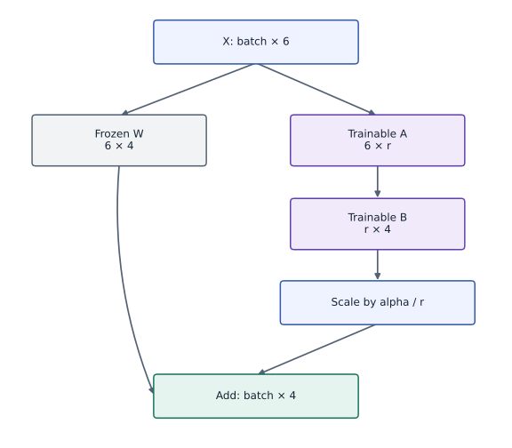
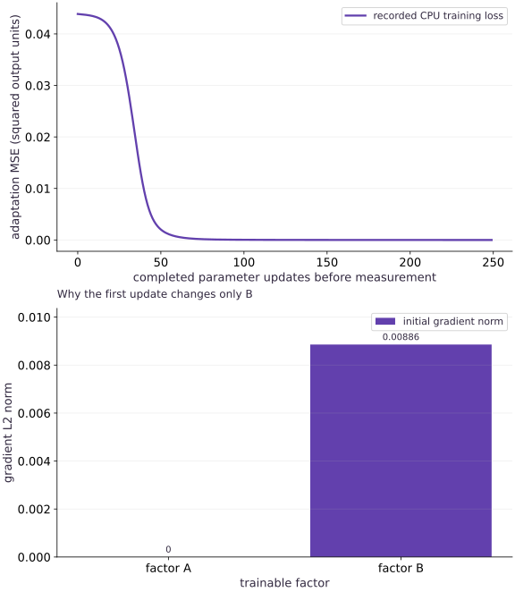

# LoRA: adapt, save and merge low-rank updates

Phase 18: Post-training: SFT, LoRA, reward models and RLHF · about 105 minutes · CPU

This worked reference is validated on CPU. Accelerator compatibility requires a separate source review and target execution receipt. Use the execution matrix to review device selection and data ownership before adapting a separate target program.

**Before this lesson:** [Supervised fine-tuning with response-only token loss](https://www.tahabouhsine.com/jaxpathways/lesson-posttraining-01.html).

## What you will be able to do

- Separate the frozen base from trainable adapters
- Understand initialization and the first gradient
- Verify the changed-condition exercise and explain the limits of this fixture.

## The problem

A trained dense layer already works, but the task changes. Can we fit the change while leaving the original weights untouched? We will first train a base, then learn and audit a low-rank update.

## The idea

LoRA adds a trainable low-rank correction to a frozen weight map. The base still participates in the forward pass while a smaller set of factors adapts the output. Shape convention and scaling determine how those paths combine.

## Separate the frozen path from the low-rank correction

LoRA is useful when a pretrained mapping already contains behavior worth retaining and the new task may need only a limited change. Instead of optimizing every entry of $W_0$, add a low-rank update. In this fixture, $W_0$ is $6\times4$, so rank one uses factors of shapes $6\times1$ and $1\times4$, or $10$ adapter values for $24$ base values. The base still runs in the forward pass; freezing stops its updates, not its computation.

The recorded adaptation loss goes from $0.04387$ to $2.47\times10^{-7}$, consistent with a target deliberately constructed to be rank one. Read the gradient panel next: it explains why training begins even though one factor starts with zero gradient.

### Frozen base plus a low-rank correction

**Predict:** If rank changes while alpha stays fixed, can you omit the scaling when merging?



*Architecture and dataflow mechanism diagram.*

Use the diagram to trace the frozen base and scaled adapter branches, then use the gradient panel to predict which factor changes first. Check the final merge on new inputs and verify the saved artifact in a fresh process; a low training loss alone does not test rank capacity or saved-model identity.

### Pause and reason

If rank changes while alpha stays fixed, can you omit the scaling when merging?

<details><summary>Compare your reasoning</summary>

No. Merge the exact scaled correction used in forward computation. Otherwise the merged model computes a different function.

</details>

## Before coding: adapt a change, not an entire matrix

Think of the source mapping as already useful and the adapter as a constrained correction. The factors first compress an input of width $d$ into $r$ coordinates and then expand to output width $k$. Their product cannot represent a change of rank greater than $r$, no matter how long it trains. That limit saves trainable parameters when the needed change is low rank, while also predicting which tasks may not fit.

## Separate the frozen base from trainable adapters

For input-by-output weights $W_0$, the dense branch computes $xW_0$; the adapter branch computes $s(xA)B$, where $s=\alpha/r$. Add the two outputs. Pass only $A,B$ to the gradient function and retain a copy of $W_0$. After fitting, compare that copy exactly: it verifies the frozen parameter contract, while the forward diagram shows why the base remains part of every prediction.

$$
Y=XW_0+\frac{\alpha}{r}XAB
$$

## Understand initialization and the first gradient

Initialize $A$ randomly and $B$ to zero. Then $AB=0$, so the starting output matches the base exactly. Because the derivative for $A$ is multiplied by $B$, its first gradient is zero; $B$ can receive a gradient through the nonzero random $A$. The recorded fixture confirms this asymmetry, and its all-zero control gives zero first gradients for both factors. After $B$ moves, $A$ can learn too. Check these gradients before changing the learning rate.

## Derive the first-step asymmetry

Let $G$ be the gradient at the dense output and $s=\alpha/r$. Differentiating $s(xA)B$ gives $\nabla_A L=sx^TGB^T$ and $\nabla_B L=s(xA)^TG$. Setting $B=0$ makes the first expression zero while the second can remain nonzero. Both-zero initialization blocks both. The recorded matrix-calculus check matches JAX at $\alpha/r=1.5$, so this first-step pattern is a consequence of the parameterization.

$$
\nabla_A L=sX^\top GB^\top,\qquad \nabla_B L=sA^\top X^\top G
$$

## Use rank to predict a failure before training

Rank is a capacity choice, not just a speed dial. A rank-one matrix cannot represent two independent singular directions: for singular values $3$ and $1$, its best approximation leaves squared Frobenius error $1$. In the identity-input exercise, the best rank-one MSE is $0.25$. More optimization steps cannot remove that representation limit. The main target is itself rank one, so its near-zero loss is expected; compare ranks on a harder held-out target to learn whether the constraint is useful.

## Count the right kind of savings

Count trainable values separately from total memory. Here the base has $24$ weights and rank one adds $6$+$4$=$10$ trainable scalars. The base remains resident, while training also needs adapter gradients, optimizer state, activations, and runtime buffers. The scalar count therefore shows the parameter reduction, not a complete memory or speed measurement. The low-bit frozen-base variant would add quantization and kernel requirements; this exercise does not implement QLoRA.

## Merge only under an explicit serving contract

At inference, the two branches can be combined as $W_{merged}=W_0+(\alpha/r)AB$ when there is no adapter dropout. The recorded check compares separate and merged outputs on new inputs; it also shows that applying the merge twice changes outputs. Keep the original base and adapter, include scale metadata, and verify after reload before serving. Quantized or packed weights need an explicit conversion contract.

## Save the adaptation identity

Make the adapter artifact identify the function it modifies: base checkpoint hash, target module names, rank, alpha, dtype, and factor arrays. Check adapted-task fit and source-task retention independently. The frozen base values are preserved here, but that alone cannot guarantee the combined model preserves old behavior; the rank-one teacher also does not tell you what rank a real task needs.

## Make an adapter artifact reproducible

Treat reload as part of the serving contract. Store the base identity, tensor orientation and shapes, target layers, rank, alpha, scale rule, dtype, and exact factors. In the fixture, rank two with $\alpha=3$ means scale $1.5$; rank one with $\alpha=1$ would hide a missing scale because it equals one. The recorded fresh-process round trip reproduces predictions at scale $1.5$, while altered same-shape base values and incorrect rank, alpha, target, or shape metadata are rejected. Keep a source-task metric when assessing behavior after the update.

## Bind adapter tensors to the exact base and reject shape-compatible substitutes

The diagram traces one input through the frozen $6\times4$ base branch and through trainable $A$ and $B$, then scales the adapter output by $\alpha/r$ before addition. The branches both produce four output features. The arrows show forward dataflow; only adapter factors receive parameter updates. If rank changes while alpha stays fixed, recompute the scale before merging.

## 1. Define the frozen-plus-adapter forward pass

Create main.py in your activated course environment. Paste this block, then run python main.py; function definitions alone print nothing.

```python
# Step 1 — 1. Define the frozen-plus-adapter forward pass
import jax
import jax.numpy as jnp
import numpy as np

def lora_forward(x, base, a, b, alpha=1.0):
    rank = a.shape[1]
    return x @ base + (alpha / rank) * (x @ a @ b)
```

The base is an input to the forward pass but is not in the adapter tuple differentiated by loss.

## 2. Train a base, freeze it and initialize the adapter

Append this block to main.py and run python main.py again. Keep the earlier blocks above it.

```python
# Step 2 — 2. Train a base, freeze it and initialize the adapter: This step includes the source-task training.
x = jnp.asarray(np.random.default_rng(4).normal(size=(24, 6)), jnp.float32)
source_w = jnp.arange(24, dtype=jnp.float32).reshape(6, 4) / 40
base = jnp.zeros_like(source_w)
base_step = jax.jit(jax.grad(lambda w: jnp.mean((x @ w - x @ source_w) ** 2)))
for _ in range(150):
    base = base - 0.15 * base_step(base)
assert float(jnp.mean((x @ base - x @ source_w) ** 2)) < 1e-4
# Transfer the device result to the host for an independent NumPy comparison.
frozen = np.asarray(base).copy()
u = jnp.array([[0.2], [-0.3], [0.1], [0.2], [-0.1], [0.4]])
v = jnp.array([[0.5, -0.2, 0.3, 0.1]])
target = x @ (base + u @ v)
a = jax.random.normal(jax.random.key(4), (6, 1)) * 0.1
b = jnp.zeros((1, 4))
params = (a, b)
loss = lambda ab: jnp.mean((lora_forward(x, base, *ab, alpha=1.0) - target) ** 2)
step = jax.jit(jax.value_and_grad(loss))
history = []
initial_grads = step(params)[1]
np.testing.assert_array_equal(initial_grads[0], np.zeros((6, 1)))
assert np.linalg.norm(initial_grads[1]) > 0
```

This step includes the source-task training. Inspect the initial factor gradients: A has zero gradient and B has a nonzero one.

## 3. Adapt and verify the serving merge

Append this block to main.py and run python main.py again. Keep the earlier blocks above it.

```python
# Step 3 — 3. Adapt and verify the serving merge: The reference target has rank one by construction.
for _ in range(250):
    value, g = step(params)
    history.append(float(value))
    params = jax.tree.map(lambda a, b: a - 0.4 * b, params, g)

a, b = params
assert history[-1] < history[0] * 0.02
np.testing.assert_array_equal(base, frozen)
merged = base + a @ b
np.testing.assert_allclose(
    lora_forward(x, base, a, b), x @ merged, rtol=1e-5, atol=1e-6
)
print(
    'LoRA initial/final:',
    history[0],
    history[-1],
    '; trainable:',
    a.size + b.size,
    'base:',
    base.size,
)
```

The reference target has rank one by construction. Exact base equality and changed-input merge checks answer different questions from adaptation loss.

## Run the example

```python
# Step 1 — 1. Define the frozen-plus-adapter forward pass
import jax
import jax.numpy as jnp
import numpy as np

def lora_forward(x, base, a, b, alpha=1.0):
    rank = a.shape[1]
    return x @ base + (alpha / rank) * (x @ a @ b)

# Step 2 — 2. Train a base, freeze it and initialize the adapter: This step includes the source-task training.
x = jnp.asarray(np.random.default_rng(4).normal(size=(24, 6)), jnp.float32)
source_w = jnp.arange(24, dtype=jnp.float32).reshape(6, 4) / 40
base = jnp.zeros_like(source_w)
base_step = jax.jit(jax.grad(lambda w: jnp.mean((x @ w - x @ source_w) ** 2)))
for _ in range(150):
    base = base - 0.15 * base_step(base)
assert float(jnp.mean((x @ base - x @ source_w) ** 2)) < 1e-4
# Transfer the device result to the host for an independent NumPy comparison.
frozen = np.asarray(base).copy()
u = jnp.array([[0.2], [-0.3], [0.1], [0.2], [-0.1], [0.4]])
v = jnp.array([[0.5, -0.2, 0.3, 0.1]])
target = x @ (base + u @ v)
a = jax.random.normal(jax.random.key(4), (6, 1)) * 0.1
b = jnp.zeros((1, 4))
params = (a, b)
loss = lambda ab: jnp.mean((lora_forward(x, base, *ab, alpha=1.0) - target) ** 2)
step = jax.jit(jax.value_and_grad(loss))
history = []
initial_grads = step(params)[1]
np.testing.assert_array_equal(initial_grads[0], np.zeros((6, 1)))
assert np.linalg.norm(initial_grads[1]) > 0

# Step 3 — 3. Adapt and verify the serving merge: The reference target has rank one by construction.
for _ in range(250):
    value, g = step(params)
    history.append(float(value))
    params = jax.tree.map(lambda a, b: a - 0.4 * b, params, g)

a, b = params
assert history[-1] < history[0] * 0.02
np.testing.assert_array_equal(base, frozen)
merged = base + a @ b
np.testing.assert_allclose(
    lora_forward(x, base, a, b), x @ merged, rtol=1e-5, atol=1e-6
)
print(
    'LoRA initial/final:',
    history[0],
    history[-1],
    '; trainable:',
    a.size + b.size,
    'base:',
    base.size,
)
```

Expected: The trained base stays unchanged; 10 adapter scalars fit the rank-one change and merge equivalently.

## LoRA: adapt, save and merge low-rank updates — recorded experiment

**Predict:** Which initial adapter-gradient bar is zero, and why can training still begin?



**Recorded CPU computation**

### Read the figure

The adaptation MSE falls from $0.04387$ to $2.47\times10^{-7}$; this target was constructed as rank one, so the curve shows that the factors fit this matrix fixture. The second panel shows initial factor-gradient norms: A is zero because B starts at zero, while B is nonzero and can start learning. The both-zero control confirms that zeroing both factors would block the first update. These panels describe different moments: the loss spans training, while the gradient bars are measured at initialization.

### Connect it to the computation

Use the diagram to trace the frozen base and scaled adapter branches, then use the gradient panel to predict which factor changes first. Check the final merge on new inputs and verify the saved artifact in a fresh process; a low training loss alone does not test rank capacity or saved-model identity.

```python
visual_data={'kind':'line','xlabel':'completed parameter updates before measurement','ylabel':'adaptation MSE (squared output units)','series':[{'label':'recorded CPU training loss','x':list(range(len(history))),'y':history}]}
for panel in visual_data.get('panels',[visual_data]):
    panel['x']=panel['series'][0]['x']

extra_panel={'kind':'bar','x':[0,1],'labels':['factor A','factor B'],'series':[{'label':'initial gradient norm','y':[float(jnp.linalg.norm(initial_grads[0])),float(jnp.linalg.norm(initial_grads[1]))]}],'xlabel':'trainable factor','ylabel':'gradient L2 norm','title':'Why the first update changes only B'}
visual_data={"panels":[*visual_data.get("panels",[visual_data]),extra_panel]}
```

## Recorded reference execution

CPU run: 2026-10-27T16:12:08.346225+00:00. JAX 0.9.2.

```text
LoRA initial/final: 0.043869297951459885 2.466217665642034e-07 ; trainable: 10 base: 24
LoRA initial/final: 0.043869297951459885 2.466217665642034e-07 ; trainable: 10 base: 24
Both zero factors produce zero first gradients.
Both LoRA factor gradients match the matrix-calculus oracle at alpha/r = 1.5.
New-input merge passes; accidental double merge changes outputs.
Nonunit scaling passes; best rank-one identity-input MSE is 0.25.
rank-two alpha/r=1.5 teaching-fit loss: 0.12098397314548492 1.915084067150019e-05
Fresh-process trained-factor round trip passed at alpha/r=1.5; wrong same-shape base and altered rank, alpha, target, and shape metadata were rejected.
PASS: posttraining-02

```

## Show why two zero factors cannot start learning

**Predict before running:** If both factors start at zero, can this first-order update move either one?

```python
# Experiment — Show why two zero factors cannot start learning: Each factor’s derivative contains the other factor.
zero = (jnp.zeros_like(a), jnp.zeros_like(b))
zero_grad = jax.grad(loss)(zero)
assert all(
    np.array_equal(np.asarray(g), np.zeros(g.shape)) for g in zero_grad
)
print('Both zero factors produce zero first gradients.')
```

**Expected:** Both factor gradients are exactly zero.

Each factor’s derivative contains the other factor. Randomizing one and zeroing the other preserves the initial base output without blocking the whole update.

## Check both factor gradients with matrix calculus

**Predict before running:** At nonzero factors, will the two matrix-gradient formulas agree with autodiff including nonunit alpha?

```python
# Experiment — Check both factor gradients with matrix calculus
rng = np.random.default_rng(14)
a_probe = jnp.asarray(rng.normal(size=(6, 2)) * 0.1, jnp.float32)
b_probe = jnp.asarray(rng.normal(size=(2, 4)) * 0.1, jnp.float32)
scale = 3.0 / 2
output_gradient = (
    2 * (lora_forward(x, base, a_probe, b_probe, 3.0) - target) / target.size
)
expected_a = scale * x.T @ output_gradient @ b_probe.T
expected_b = scale * a_probe.T @ x.T @ output_gradient
actual_a, actual_b = jax.grad(
    lambda aa, bb: jnp.mean(
        (lora_forward(x, base, aa, bb, 3.0) - target) ** 2
    ),
    argnums=(0, 1),
)(a_probe, b_probe)
np.testing.assert_allclose(actual_a, expected_a, atol=1e-6)
np.testing.assert_allclose(actual_b, expected_b, atol=1e-6)
print('Both LoRA factor gradients match the matrix-calculus oracle at alpha/r = 1.5.')
```

**Expected:** Both factor derivatives match the independent output-gradient calculation.

Nonzero factors exercise both gradient paths, while nonunit scaling catches a factor missing from the derivative. The separate all-zero experiment demonstrates the initialization failure.

## Make it yours

Run “Enforce base identity in a fresh-process adapter reload.” Save base bytes, adapter factors and a full manifest, then verify a fresh-process merge and rejection of a same-shape wrong base plus altered metadata.

### How to write this exercise — Step-by-step recipe & starter scaffold

**Inputs:**
- Frozen base checkpoint bytes and their expected SHA-256
- Actually trained adapter factor arrays and target module path
- Rank 2, alpha 3, scaling convention, tensor orientation, shapes and dtypes
- Changed held-out inputs

**Outputs:**
- A manifest-bound saved adapter bundle containing the trained factors
- Fresh-process unmerged and merged predictions on changed inputs
- Rejection results for a shape-compatible wrong base and altered rank, alpha, target path, factor shape or dtype metadata

**Invariants to check:**
- Verify the exact base bytes before activating adapter tensors
- Bind target modules, base and factor shapes/dtypes, rank, alpha and alpha/rank convention in the manifest
- Both serving paths use scale 1.5
- The base remains frozen during factor fitting
- The saved factor bytes match the trained factors in memory

**Hints:**
- Fit the adapter factors before saving; do not replace them with newly randomized test factors.
- Hash serialized base bytes and check the supplied base before applying the adapter.
- Use a separate interpreter for reload and inference.
- Compare adapter and merged paths on a fresh input matrix.
- Keep each wrong-base/metadata case shape-compatible where applicable and show it fails before prediction.

**Starter code scaffold (fill in the TODOs):**

```python
import hashlib, json, subprocess, sys
from pathlib import Path
import numpy as np

def save_and_verify_trained_adapter(base_path, factor_a, factor_b, rank, alpha, target_modules, heldout_x, bundle_dir):
    # TODO: hash the serialized base, save the trained factors and complete manifest,
    # then launch a fresh process that reloads, validates, compares merge parity,
    # and rejects same-shape wrong-base and metadata negative controls.
    raise NotImplementedError
```

<details><summary>Reference solution</summary>

```python
# Primary adapter-save exercise.
# Use the complete following practice: “Enforce base identity in a fresh-process adapter reload.”
# It writes a base-hash-bound manifest, checks target module/rank/alpha/scaling/dtypes/shapes,
# validates in a fresh interpreter, compares merged/unmerged predictions on new inputs,
# and rejects a shape-compatible wrong base before activation.
# The earlier unbound adapter.npz pattern is not a reusable adapter artifact.
```

</details>

## Check the merge on new inputs

**Transfer**

Draw a new input batch and compare the merged layer with the adapter path.

<details><summary>Hint</summary>

The equivalence is algebraic, so a new input should still agree.

</details>

### How to write: Check the merge on new inputs — Step-by-step recipe & starter scaffold

**Inputs:**
- Frozen base matrix, trained adapter factors, rank and alpha metadata, and a newly drawn input batch.

**Outputs:**
- Merged-layer and adapter-path predictions for the new batch, plus their maximum difference.

**Invariants to check:**
- The same alpha-over-rank scale is used in both paths; the frozen base is unchanged.

**Hints:**
- Draw a fresh input batch rather than reusing training examples.
- Compare predictions after applying the adapter and after merging its update into the base.

**Starter code scaffold (fill in the TODOs):**

```python
import jax.numpy as jnp
import numpy as np

def compare_lora_merge_on_new_inputs(base, a, b, alpha, new_x):
    # TODO: compare the adapter path with the merged matrix on this held-out batch.
    raise NotImplementedError
```

<details><summary>Reference solution and reasoning</summary>

```python
# Check the merge on new inputs (Transfer)
new_x = jnp.asarray(np.random.default_rng(91).normal(size=(7, 6)), jnp.float32)
np.testing.assert_allclose(
    lora_forward(new_x, base, a, b), new_x @ merged, atol=1e-6, rtol=1e-5
)
assert np.linalg.norm(np.asarray(new_x @ (base + 2 * a @ b) - new_x @ merged)) > 1e-3
print('New-input merge passes; accidental double merge changes outputs.')
```

The second check detects an operational merge error that training loss alone would not reveal.

</details>

## Test nonunit scaling and an impossible rank-one target

**Challenge**

Check merge equivalence at rank two with alpha three. Then use identity inputs and a diagonal target with singular values three and one to calculate the best rank-one residual.

<details><summary>Hint</summary>

Use an independent singular-value decomposition for the rank bound, and divide alpha by rank in both serving paths.

</details>

### How to write: Test nonunit scaling and an impossible rank-one target — Step-by-step recipe & starter scaffold

**Inputs:**
- A frozen base matrix, rank-two adapter factors, alpha equal to three, identity input rows, and a diagonal target with singular values three and one.

**Outputs:**
- The adapter-versus-merged predictions on identity inputs and the best rank-one residual norm for the diagonal target.

**Invariants to check:**
- The adapter contribution is scaled by alpha divided by rank; the rank-one residual is determined by the smaller nonzero singular value.

**Hints:**
- Compare adapter and merged predictions using the identity input rows.
- Then compute the best rank-one approximation residual for the specified diagonal target.

**Starter code scaffold (fill in the TODOs):**

```python
import jax.numpy as jnp
import numpy as np

def audit_lora_scaling_and_rank_limit(base, a, b, identity_inputs, target):
    # TODO: check alpha=3 rank-two merging and determine the best rank-one residual.
    raise NotImplementedError
```

<details><summary>Reference solution and reasoning</summary>

```python
# Test nonunit scaling and an impossible rank-one target (Challenge)
rng = np.random.default_rng(8)
a2 = jnp.asarray(rng.normal(size=(6, 2)), jnp.float32)
b2 = jnp.asarray(rng.normal(size=(2, 4)), jnp.float32)
np.testing.assert_allclose(
    lora_forward(x, base, a2, b2, alpha=3.0),
    x @ (base + 1.5 * a2 @ b2),
    rtol=1e-5,
    atol=2e-6,
)
target_update = np.diag([3.0, 1.0])
u_s, s_s, v_s = np.linalg.svd(target_update)
rank_one = (u_s[:, :1] * s_s[:1]) @ v_s[:1]
np.testing.assert_allclose(np.sum((target_update - rank_one) ** 2), 1.0)
np.testing.assert_allclose(
    np.mean((np.eye(2) @ target_update - np.eye(2) @ rank_one) ** 2), 0.25
)
print('Nonunit scaling passes; best rank-one identity-input MSE is 0.25.')
```

The residual predicts a capacity limit independently of an optimizer. The nonunit-alpha case catches a scaling bug that the main rank-one demonstration would miss.

</details>

## Enforce base identity in a fresh-process adapter reload

**Transfer**

Use the actual trained rank-two alpha-three factors from a bounded teaching fit on the frozen fitted base, then extend the save exercise so it writes a checkpoint hash and manifest, then loads the base and adapter in a separate Python process. Use rank two and alpha three. Verify merged/unmerged predictions on changed inputs. Reject a different same-shape base and altered rank, alpha, target-module, or tensor-shape metadata before inference.

<details><summary>Hint</summary>

Hash the exact serialized base file bytes. Validate manifest fields and array shapes/dtypes before calculating the adapter branch. Do not compare only parameter shapes.

</details>

### How to write: Enforce base identity in a fresh-process adapter reload — Step-by-step recipe & starter scaffold

**Inputs:**
- Frozen base matrix and trained adapter factors
- A new held-out input matrix
- Target module path, rank 2, alpha 3, factor dtype and orientation

**Outputs:**
- A manifest-bound adapter bundle
- Fresh-process merged/unmerged predictions
- Explicit rejection messages for a wrong base and altered metadata

**Invariants to check:**
- Base checkpoint SHA-256 is checked before adapter activation
- Target module list, base hash, rank, alpha, alpha/rank rule, shapes and dtypes are checked
- Both branches use the same 1.5 scale
- Base bytes are not modified during adaptation

**Hints:**
- Hash the serialized bytes, not a Python object representation.
- Start a separate interpreter with subprocess and reload base.npy, adapter.npz, and manifest.json.
- The negative base control must keep the shape and dtype unchanged.
- Check predictions on changed_x, not the training matrix.

**Starter code scaffold (fill in the TODOs):**

```python
# Adapt the existing save exercise with a base-byte hash, full manifest validation,
# and a subprocess that performs reload and both negative controls.
raise NotImplementedError
```

<details><summary>Reference solution and reasoning</summary>

```python
# Fresh-process adapter bundle round trip with base identity and negative controls.
import hashlib, json, os, subprocess, sys, tempfile
from pathlib import Path
import numpy as np

rng = np.random.default_rng(815)
base2 = np.asarray(base, dtype=np.float32).copy()
base_before_adapter_fit = base2.copy()
alpha, rank = 3.0, 2
scale = alpha / rank
# A bounded rank-two teaching target; fit the factors before serializing them.
u2 = jnp.asarray([[0.2, -0.1], [-0.3, 0.1], [0.1, 0.2], [0.2, -0.2], [-0.1, 0.1], [0.4, 0.2]], jnp.float32)
v2 = jnp.asarray([[0.5, -0.2, 0.3, 0.1], [-0.1, 0.4, 0.2, -0.3]], jnp.float32)
target2 = x @ (jnp.asarray(base2) + scale * u2 @ v2)
a2 = jax.random.normal(jax.random.key(815), (6, rank)) * 0.1
b2 = jnp.zeros((rank, 4), jnp.float32)
fit2 = jax.jit(jax.value_and_grad(lambda aa, bb: jnp.mean(
    (lora_forward(x, jnp.asarray(base2), aa, bb, alpha) - target2) ** 2
), argnums=(0, 1)))
fit_history = []
for _ in range(300):
    fit_loss, (grad_a, grad_b) = fit2(a2, b2)
    fit_history.append(float(fit_loss))
    a2 = a2 - 0.2 * grad_a
    b2 = b2 - 0.2 * grad_b
assert fit_history[-1] < fit_history[0] * 1e-3
np.testing.assert_array_equal(base2, base_before_adapter_fit)
a2 = np.asarray(a2, dtype=np.float32)
b2 = np.asarray(b2, dtype=np.float32)
changed_x = rng.normal(size=(5, 6)).astype(np.float32)
with tempfile.TemporaryDirectory() as tmp:
    root = Path(tmp)
    np.save(root / "base.npy", base2, allow_pickle=False)
    np.savez(root / "adapter.npz", A=a2, B=b2)
    with np.load(root / "adapter.npz", allow_pickle=False) as trained_bundle:
        np.testing.assert_array_equal(trained_bundle["A"], a2)
        np.testing.assert_array_equal(trained_bundle["B"], b2)
    base_hash = hashlib.sha256((root / "base.npy").read_bytes()).hexdigest()
    manifest = {
        "schema": 1, "base_sha256": base_hash,
        "target_modules": ["decoder.block.0.proj"],
        "base_shape": list(base2.shape), "base_dtype": str(base2.dtype),
        "rank": rank, "alpha": alpha, "scaling": "alpha_over_rank",
        "A_shape": list(a2.shape), "B_shape": list(b2.shape),
        "A_dtype": str(a2.dtype), "B_dtype": str(b2.dtype),
    }
    (root / "manifest.json").write_text(json.dumps(manifest, sort_keys=True))
    # New interpreter reloads all three artifacts from disk and validates before activation.
    child = r"""import hashlib,json,sys
from pathlib import Path
import numpy as np
root=Path(sys.argv[1]); m=json.loads((root/'manifest.json').read_text())
base_path=Path(sys.argv[2]) if len(sys.argv)>2 else root/'base.npy'
base_bytes=base_path.read_bytes()
if hashlib.sha256(base_bytes).hexdigest()!=m['base_sha256']: raise ValueError('base checkpoint identity mismatch')
base=np.load(base_path,allow_pickle=False)
with np.load(root/'adapter.npz',allow_pickle=False) as z: A=z['A']; B=z['B']
if list(base.shape)!=m['base_shape'] or str(base.dtype)!=m['base_dtype']: raise ValueError('base shape/dtype mismatch')
if list(A.shape)!=m['A_shape'] or list(B.shape)!=m['B_shape'] or str(A.dtype)!=m['A_dtype'] or str(B.dtype)!=m['B_dtype']: raise ValueError('adapter tensor metadata mismatch')
if m['rank']!=A.shape[1] or B.shape[0]!=m['rank'] or m['scaling']!='alpha_over_rank' or m['alpha']!=3.0: raise ValueError('rank/scaling metadata mismatch')
if m['target_modules']!=['decoder.block.0.proj']: raise ValueError('target module mismatch')
x=np.load(root/'inputs.npy',allow_pickle=False); scale=m['alpha']/m['rank']
separate=x@base+scale*(x@A@B); merged=x@(base+scale*A@B)
np.testing.assert_allclose(separate,merged,rtol=1e-6,atol=1e-6)
np.save(root/'child-predictions.npy',separate,allow_pickle=False)
print('fresh-process validated',m['base_sha256'],float(np.max(np.abs(separate-merged))))"""
    np.save(root / "inputs.npy", changed_x, allow_pickle=False)
    subprocess.run([sys.executable, "-c", child, str(root)], check=True, capture_output=True, text=True)
    child_predictions = np.load(root / "child-predictions.npy", allow_pickle=False)
    np.testing.assert_allclose(child_predictions, changed_x @ base2 + 1.5 * (changed_x @ a2 @ b2), rtol=1e-6, atol=1e-6)
    # Shape-compatible wrong base must fail on the base digest before activation.
    wrong = base2.copy(); wrong[0, 0] += 0.25
    np.save(root / "wrong-base.npy", wrong, allow_pickle=False)
    result = subprocess.run([sys.executable, "-c", child, str(root), str(root / "wrong-base.npy")], capture_output=True, text=True)
    assert result.returncode != 0 and "base checkpoint identity mismatch" in result.stderr
    # Each incompatible metadata edit must fail before predictions are activated.
    negatives = [
        ("rank", 1, "rank/scaling metadata mismatch"),
        ("alpha", 4.0, "rank/scaling metadata mismatch"),
        ("target_modules", ["decoder.block.1.proj"], "target module mismatch"),
        ("A_shape", [6, 1], "adapter tensor metadata mismatch"),
    ]
    for field, value, message in negatives:
        bad = dict(manifest, **{field: value})
        (root / "manifest.json").write_text(json.dumps(bad, sort_keys=True))
        result = subprocess.run([sys.executable, "-c", child, str(root)], capture_output=True, text=True)
        assert result.returncode != 0 and message in result.stderr, (field, result.stderr)
print("rank-two alpha/r=1.5 teaching-fit loss:", fit_history[0], fit_history[-1])
print("Fresh-process trained-factor round trip passed at alpha/r=1.5; wrong same-shape base and altered rank, alpha, target, and shape metadata were rejected.")
```

The new rank-two factors are fitted on the existing frozen base before save, and the child interpreter reloads those exact trained factor bytes. The child interpreter reads only serialized files and validates the base digest before multiplying. The rank-two, alpha-three case exercises nonunit scaling. New inputs check the serving merge algebra after reload. The wrong base has exactly the same dimensions and dtype; the hash is what distinguishes its identity. Manifest changes must be validated against tensor geometry and the declared scale before an adapter can be applied.

</details>

## Check your understanding

Does LoRA require updating the base weights during adapter training?

1. No. The base is frozen; the selected adapter parameters receive updates.
2. Yes, because initializing factor $B=0$ blocks all gradients until the base matrix moves.
3. No, and freezing the base weights guarantees that adapted outputs cannot forget the source task.

<details><summary>Answer and explanation</summary>

**1. No. The base is frozen; the selected adapter parameters receive updates. (correct)**

LoRA freezes the base parameters while optimizing the named adapter parameters. Verify parameter ownership and actual before/after deltas. Frozen base storage does not imply unchanged behavior or retained capability.

**2. Yes, because initializing factor $B=0$ blocks all gradients until the base matrix moves.**

With zero B and nonzero A, the B gradient can be nonzero while A initially receives zero gradient. Inspect both adapter gradients.

**3. No, and freezing the base weights guarantees that adapted outputs cannot forget the source task.**

Adapters can alter behavior even when the base weights are frozen. Test retention and task quality rather than inferring them from frozen storage.

</details>

## Diagnose the result

If neither factor moves, inspect initialization. If merged predictions drift, check factor orientation, rank scaling, dropout, base identity and accidental repeated merges.

## Carry forward

- Initialize one LoRA factor randomly and the other to zero so the initial correction is zero while the zero-initialized factor still receives a nonzero first gradient.
- Preserve the base checkpoint identity, rank $r$, and scale $\alpha/r$ in saved adapter artifacts, and verify merged weights $W_0 + (\alpha/r)AB$ against unmerged inference on new inputs.

## Keep your evidence

Keep frozen-base and gradient asymmetry checks, rank/alpha scaling, the serialized base digest and target/tensor manifest, fresh-process merge parity on new inputs and incompatible-base/metadata rejections.

Save your predictions, modified code, terminal outputs, and reasoning in your engineering portfolio.

## Primary references

- [LoRA](https://arxiv.org/abs/2106.09685)

