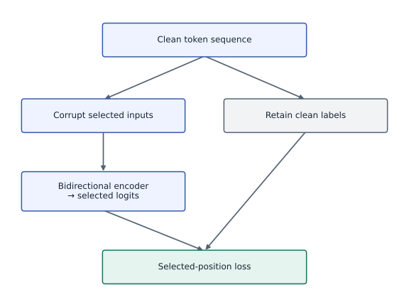
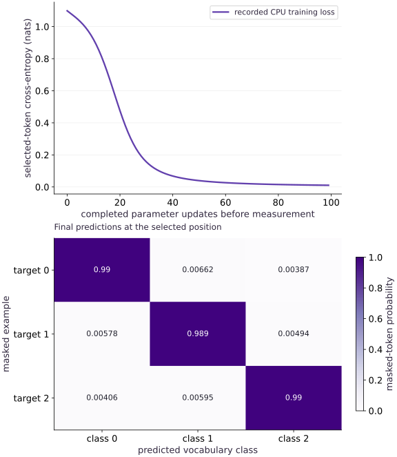

# Masked language modeling: predict hidden tokens

Phase 17: Self-supervised pretraining: masked and contrastive learning · about 105 minutes · CPU

This worked reference is validated on CPU. Accelerator compatibility requires a separate source review and target execution receipt. Use the execution matrix to review device selection and data ownership before adapting a separate target program.

## What you will be able to do

- Separate the clean targets from the corrupted input
- Normalize over selected target positions
- Verify the changed-condition exercise and explain the limits of this fixture.
- Save a small mask-aware encoder with its tokenizer and source-split identity, then evaluate a changed corruption condition and a frozen linear probe.

## The problem

A text model can see a sentence but one word is hidden. What prevents it from copying the answer, and which positions should contribute to its loss? We will train a small bidirectional attention model and audit those two boundaries.

## The idea

Masked language modeling removes selected token information from the model's input and asks it to predict the original tokens. The clean targets remain available to the loss, while the encoder receives only the corrupted sequence.

## Hide the input without hiding the teaching target

A masked language model has two views of the same example: the clean sequence supplies answers, while a corrupted copy is the encoder input. In the diagram, follow each path to see where they meet: only selected-position logits are compared with clean labels in the loss. If a clean hidden token reaches the encoder, the model can copy its answer.

The loss curve falls on the repeated-token training fixture, and the probability panel shows the selected target gaining probability. Those pictures show optimization and a correct information boundary; they do not establish transfer. The recorded two-slot held-out check is a useful counterexample, read below.

### Keep clean targets out of encoder inputs

**Predict:** If all visible tokens reveal the same class, what limit does that place on the experiment?



*Architecture and dataflow mechanism diagram.*

Clean tokens fork into labels and a corrupted-input path. Only corrupted inputs enter the encoder. Selected logits meet clean targets at the loss. This makes supervision available without leaking the hidden answer directly into the input.

### Pause and reason

If all visible tokens reveal the same class, what limit does that place on the experiment?

<details><summary>Compare your reasoning</summary>

It makes the objective easy and inspectable, but does not test rich contextual language understanding. Preserve the mechanism check while acknowledging that dataset limitation.

</details>

## Before coding: follow one hidden token

Take the first clean sequence, $[0,0,0,0]$. If its second position is selected, replace only that input position to get $[0,3,0,0]$; keep the target at that position equal to $0$. The ID $3$ means MASK and is not an output class. The visible zeros are context; the clean zero is the answer. Before training, write down the clean targets, corrupted input and Boolean selection mask separately.

Because every example repeats one token, visible context makes this exercise easy to inspect. It cannot tell us whether the model learned syntax, word order or meaning.

## Separate the clean targets from the corrupted input

The selection mask answers which positions receive supervision. Corruption answers what the encoder sees at those positions. Keep the original IDs unchanged for labels, and replace selected input IDs with $3$. Here the prediction classes remain $0,1,2$. Inspect the arrays together: under this lesson’s always-MASK policy, replace the original value at each selected input position. Copies of that same token at unselected positions remain valid visible context. If an unselected target is scored, the loss mask is wrong.

## Normalize over selected target positions

For each position, take log-softmax over the three vocabulary classes, gather the probability assigned to the original token, and average the negative log probabilities only where the selection mask is true. Uniform predictions give loss $\log 3\approx1.099$, whether one position or several are selected. The implementation rejects an empty mask because there is no selected-token mean to compute.

$$
L=-\frac{\sum_{b,t}m_{bt}\log p_\theta(x_{bt}\mid\widetilde x_b)}{\sum_{b,t}m_{bt}}
$$

## Trace the axes and the gradient

Trace the shapes to keep the two softmax operations distinct. Token embeddings have shape $(3,4,6)$, attention scores have shape $(3,4,4)$ over query and key positions, and vocabulary logits have shape $(3,4,3)$. Only the final axis of the logits is a choice among token classes.

In the derivative, $M$ is the number of selected targets. An unselected output has zero direct loss gradient. A visible input embedding can still receive gradient because attention uses it to predict a selected position.

$$
\frac{\partial L}{\partial z_{btv}}=\frac{m_{bt}}{M}\left(p_{btv}-\mathbf{1}[v=x_{bt}]\right)
$$

## Work out unequal masks before batching

Suppose one sequence has one selected-token loss of $2$, and a second has three selected-token losses of $1$ each. Averaging selected tokens gives $(2+1+1+1)/4=1.25$. Averaging the two sequence means gives $(2+1)/2=1.5$. The second reduction weights examples equally; the first weights selected tokens equally. The code uses the latter, so distributed accumulation must combine loss sums and selected counts.

The audit also perturbs unselected logits. The loss and their direct gradients remain unchanged, as expected.

## Use both sides without using the hidden value

Bidirectional attention lets a selected position use visible tokens on either side. There is no causal triangle in this encoder. That is useful for filling a missing word from both directions, but attention still sees only the corrupted input. This one-head model has no positional encoding, padding logic or tokenizer, so the fixture isolates information flow rather than a complete text encoder.

## Distinguish selection from replacement policy

Selection and replacement are separate choices. This lab always writes MASK at selected positions, making the input path easy to inspect. Other MLM recipes may replace a selected token with MASK, a random token or leave it unchanged; each selected position still contributes its original clean token as the target. In a corpus, exclude padding and special tokens from selection and make the corruption schedule reproducible.

## Test a different corruption before claiming progress

On the training fixture, loss moves from $1.0986$ to $0.0106$. Moving the single mask to another slot without training gives $0.0105$, showing that this repeated-token task transfers across positions. The broader handoff changes to two selected positions and three held-out source groups: its loss is $3.5711$, above the uniform baseline $\log 3=1.0986$, and the frozen probe reaches $2/3$ accuracy. That is a failure of this changed-condition transfer check, not evidence of general language ability.

## Move from this fixture to a corpus deliberately

A useful next experiment is a document-separated corpus with a frozen tokenizer, explicit padding exclusion and a documented mask schedule. Compare random initialization and the trained checkpoint on the same held-out task, and report the summed token loss and selected-token count. Keep a failure example alongside the average so you can tell whether a bad prediction comes from the objective, a missing dependency or the data split. Moving a mask among these three repeated-token sequences is not a held-out-language test.

## Route the bounded experiment into a frozen transfer check

Use this bounded CPU handoff to check whether the encoder survives saving and a stricter synthetic condition. It records vocabulary and source identity, saves and reloads the embedding and head with hashes, then evaluates two selected slots on groups g4–g6 against uniform loss $\log 3$. A ridge probe is fit only on g0–g2 and evaluated on g4–g6. The recorded two-slot loss is $3.5711$ and probe accuracy is $0.6667$; report these results as synthetic fixture evidence.

The project pilot files listed here are reading references. The public packet contains neither a loadable pilot checkpoint nor its tokenizer, and these synthetic groups are not SciFact or language-quality evidence.

## 1. Define corruption and the selected-token objective

Create main.py in your activated course environment. Paste this block, then run python main.py; function definitions alone print nothing.

```python
# Step 1 — 1. Define corruption and the selected-token objective
import jax
import jax.numpy as jnp
import numpy as np

def masked_ce(logits, targets, selected):
    # Caller validates a nonempty mask before a transformed training step.
    logp = jax.nn.log_softmax(logits, axis=-1)
    nll = -jnp.take_along_axis(logp, targets[..., None], axis=-1)[..., 0]
    return jnp.sum(jnp.where(selected, nll, 0.0)) / jnp.sum(selected)

def validate_mask(selected, shape):
    # Transfer the device result to the host for an independent NumPy comparison.
    a = np.asarray(selected)
    if a.shape != shape or a.dtype != np.bool_ or not a.any():
        raise ValueError('a nonempty Boolean mask of the target shape is required')

def corrupt_tokens(tokens, selected, mask_id):
    validate_mask(selected, tokens.shape)
    return jnp.where(selected, mask_id, tokens)

def mlm_logits(p, corrupted):
    h = p['embedding'][corrupted]
    # Bidirectional single-head attention, deliberately no causal mask.
    scores = h @ jnp.swapaxes(h, -1, -2) / jnp.sqrt(h.shape[-1])
    context = jax.nn.softmax(scores, axis=-1) @ h
    return context @ p['head']
```

The functions separate the input boundary from the differentiable objective. Read masked_ce from vocabulary normalization to target gather to selected-count reduction.

## 2. Construct a batch whose answers you can inspect

Append this block to main.py and run python main.py again. Keep the earlier blocks above it.

```python
# Step 2 — 2. Construct a batch whose answers you can inspect
tokens = jnp.array([[0, 0, 0, 0], [1, 1, 1, 1], [2, 2, 2, 2]], jnp.int32)
selected = jnp.array([[False, True, False, False]] * 3)
corrupted = corrupt_tokens(tokens, selected, 3)
# Create or split explicit PRNG key(s) (`key`) for reproducible randomness.
key = jax.random.key(7)
# Sample deterministic random values into `p` using an explicit PRNG key.
p = {
    'embedding': jax.random.normal(key, (4, 6)) * 0.2,
    'head': jnp.zeros((6, 3)),
}
loss = lambda p: masked_ce(mlm_logits(p, corrupted), tokens, selected)
step = jax.jit(jax.value_and_grad(loss))
history = []
```

Before continuing, inspect corrupted: each row must contain mask ID $3$ at the second position. The zero head makes the initial vocabulary distribution uniform.

## 3. Train, then change the corruption

Append this block to main.py and run python main.py again. Keep the earlier blocks above it.

```python
# Step 3 — 3. Train, then change the corruption: The loop measures loss before each update.
for _ in range(100):
    value, g = step(p)
    history.append(float(value))
    p = jax.tree.map(lambda a, b: a - 0.4 * b, p, g)

assert history[-1] < history[0] * 0.15
np.testing.assert_allclose(history[0], np.log(3), atol=1e-6)
# Changing the clean target after constructing corrupted input cannot change the forward pass.
changed_targets = tokens.at[:, 1].set((tokens[:, 1] + 1) % 3)
assert not np.isclose(
    float(masked_ce(mlm_logits(p, corrupted), changed_targets, selected)),
    history[-1],
)
held_mask = jnp.array([[False, False, True, False]] * 3)
held_loss = float(
    masked_ce(mlm_logits(p, corrupt_tokens(tokens, held_mask, 3)), tokens, held_mask)
)
assert held_loss < 0.2
print('MLM initial/final/changed-mask:', history[0], history[-1], held_loss)
```

The loop measures loss before each update. The final held-mask test uses the updated parameters; do not compare it as if it were the final recorded pre-update point.

## 4. Save the encoder, change one condition, and probe it

Run the preceding build cells first, then continue with this saved-encoder handoff. Run this block in a fresh Python process. It starts by recreating this lesson’s canonical synthetic fixture, then saves/reloads it, changes one declared condition, and runs the transfer check. The duplicated setup is intentional because generated scripts place staged blocks before the main example.

```python
# Changed condition + saved-encoder handoff + frozen probe (synthetic teaching fixture)
import hashlib, json, tempfile
from pathlib import Path

def digest_arrays(*arrays):
    h = hashlib.sha256()
    for a in arrays:
        h.update(np.ascontiguousarray(a).tobytes())
    return h.hexdigest()

# A changed corruption schedule selects two slots. Same clean targets and tokenizer.
changed_mask = jnp.array([[True, False, True, False]] * 3)
changed_input = corrupt_tokens(tokens, changed_mask, 3)
changed_loss = float(masked_ce(mlm_logits(p, changed_input), tokens, changed_mask))
uniform_baseline = float(np.log(3.0))
assert np.isfinite(changed_loss) and changed_mask.sum() == 6

# Source groups are explicit and disjoint; each held-out source repeats the frozen token map.
train_group_ids, heldout_group_ids = ['g0','g1','g2'], ['g4','g5','g6']
assert set(train_group_ids).isdisjoint(heldout_group_ids)
processor_id = 'lesson-vocab:0=zero,1=one,2=two,3=MASK'
source_split_id = 'synthetic-repeated-token-v1:g0-g2/g4-g6'
encoder_before = np.asarray(p['embedding']).copy()
head_before = np.asarray(p['head']).copy()
parameter_hash = digest_arrays(encoder_before, head_before)
manifest = {'model_id':'mlm-attention-4x6-v1','processor_id':processor_id,
            'source_split_id':source_split_id,'objective':'selected-token-CE',
            'mask_schedule':'two-of-four; positions 0 and 2','fit_group_ids':train_group_ids,'heldout_group_ids':['g4','g5','g6'],'seed':7,'parameter_sha256':parameter_hash}
output_dir = Path(tempfile.mkdtemp(prefix='jaxpathways-mlm-transfer-'))
artifact = output_dir / 'encoder.npz'

np.savez(artifact, embedding=encoder_before, head=head_before,
         manifest=np.array(json.dumps(manifest, sort_keys=True)))
with np.load(artifact, allow_pickle=False) as saved:
    loaded_manifest = json.loads(str(saved['manifest']))
    loaded_encoder = saved['embedding'].copy()
    loaded_head = saved['head'].copy()
assert loaded_manifest == manifest
assert digest_arrays(loaded_encoder, loaded_head) == manifest['parameter_sha256']
checkpoint_hash=hashlib.sha256(artifact.read_bytes()).hexdigest()
identity_path=output_dir/'identity.json'
identity={**manifest,'checkpoint_sha256':checkpoint_hash}
identity_path.write_text(json.dumps(identity,sort_keys=True))
assert hashlib.sha256(artifact.read_bytes()).hexdigest()==identity['checkpoint_sha256']
held_group_ids = ['g4','g5','g6']
assert set(train_group_ids).isdisjoint(held_group_ids)
held_tokens = jnp.array([[0,1,0,1],[1,2,1,2],[2,0,2,0]],jnp.int32)
held_input = corrupt_tokens(held_tokens, changed_mask, 3)
loaded_model = {'embedding':jnp.asarray(loaded_encoder),'head':jnp.asarray(loaded_head)}
changed_loss = float(masked_ce(mlm_logits(loaded_model,held_input),held_tokens,changed_mask))
# Frozen mean-token encoder representation. Fit probe weights on train groups only.
x = np.asarray(tokens)
features = loaded_encoder[x].mean(axis=1)
y = np.asarray([0,1,2])
design = np.c_[features, np.ones(len(features))]
probe = np.linalg.solve(design.T @ design + 1e-3*np.eye(design.shape[1]), design.T @ y)
held_tokens = np.asarray([[0,1,0,1],[1,2,1,2],[2,0,2,0]])
held_features = loaded_encoder[held_tokens].mean(axis=1)
held_pred = np.rint(np.c_[held_features, np.ones(3)] @ probe).astype(int)
held_accuracy = float(np.mean(held_pred == y))
assert np.allclose(loaded_encoder, encoder_before)
print('MLM changed-mask loss / uniform baseline / frozen held-out probe accuracy:',
      changed_loss, uniform_baseline, held_accuracy)
print('Artifact path:', artifact)
print('Identity sidecar:', identity_path)
print('Saved identity:', manifest['model_id'], manifest['processor_id'], manifest['source_split_id'])
```

This changed-condition run is deliberately a tiny synthetic extension of the lesson. The saved identity is checked before scoring. Only the probe coefficients are fit after load; the encoder arrays are compared byte-for-byte before and after.

## Run the example

```python
# Step 1 — 1. Define corruption and the selected-token objective
import jax
import jax.numpy as jnp
import numpy as np

def masked_ce(logits, targets, selected):
    # Caller validates a nonempty mask before a transformed training step.
    logp = jax.nn.log_softmax(logits, axis=-1)
    nll = -jnp.take_along_axis(logp, targets[..., None], axis=-1)[..., 0]
    return jnp.sum(jnp.where(selected, nll, 0.0)) / jnp.sum(selected)

def validate_mask(selected, shape):
    # Transfer the device result to the host for an independent NumPy comparison.
    a = np.asarray(selected)
    if a.shape != shape or a.dtype != np.bool_ or not a.any():
        raise ValueError('a nonempty Boolean mask of the target shape is required')

def corrupt_tokens(tokens, selected, mask_id):
    validate_mask(selected, tokens.shape)
    return jnp.where(selected, mask_id, tokens)

def mlm_logits(p, corrupted):
    h = p['embedding'][corrupted]
    # Bidirectional single-head attention, deliberately no causal mask.
    scores = h @ jnp.swapaxes(h, -1, -2) / jnp.sqrt(h.shape[-1])
    context = jax.nn.softmax(scores, axis=-1) @ h
    return context @ p['head']

# Step 2 — 2. Construct a batch whose answers you can inspect
tokens = jnp.array([[0, 0, 0, 0], [1, 1, 1, 1], [2, 2, 2, 2]], jnp.int32)
selected = jnp.array([[False, True, False, False]] * 3)
corrupted = corrupt_tokens(tokens, selected, 3)
# Create or split explicit PRNG key(s) (`key`) for reproducible randomness.
key = jax.random.key(7)
# Sample deterministic random values into `p` using an explicit PRNG key.
p = {
    'embedding': jax.random.normal(key, (4, 6)) * 0.2,
    'head': jnp.zeros((6, 3)),
}
loss = lambda p: masked_ce(mlm_logits(p, corrupted), tokens, selected)
step = jax.jit(jax.value_and_grad(loss))
history = []

# Step 3 — 3. Train, then change the corruption: The loop measures loss before each update.
for _ in range(100):
    value, g = step(p)
    history.append(float(value))
    p = jax.tree.map(lambda a, b: a - 0.4 * b, p, g)

assert history[-1] < history[0] * 0.15
np.testing.assert_allclose(history[0], np.log(3), atol=1e-6)
# Changing the clean target after constructing corrupted input cannot change the forward pass.
changed_targets = tokens.at[:, 1].set((tokens[:, 1] + 1) % 3)
assert not np.isclose(
    float(masked_ce(mlm_logits(p, corrupted), changed_targets, selected)),
    history[-1],
)
held_mask = jnp.array([[False, False, True, False]] * 3)
held_loss = float(
    masked_ce(mlm_logits(p, corrupt_tokens(tokens, held_mask, 3)), tokens, held_mask)
)
assert held_loss < 0.2
print('MLM initial/final/changed-mask:', history[0], history[-1], held_loss)
```

Expected: Loss starts near 1.099 and ends below 0.02; an unseen mask position remains below 0.2.

## Masked language modeling: predict hidden tokens — recorded experiment

**Predict:** Which cell should dominate each row of final masked-token probabilities, and what would a bright wrong cell tell you?



**Recorded CPU computation**

### Read the figure

The horizontal axis is the number of updates already applied; the vertical axis is selected-token cross-entropy in nats. The first value is about $1.099=\log 3$. It falls to about $0.011$ on the fixed synthetic sequences. This is training loss, not masked-token accuracy on natural text.

The second panel shows final class probabilities at the hidden position: rows are the three examples and columns are vocabulary classes. Read each row as a distribution that sums to one. The largest cell should lie at that row’s target class. This panel uses the parameters after the last update; the loss curve ends just before that update. Confident diagonal predictions establish this repetition task, not general language understanding.

### Connect it to the computation

The zero vocabulary head makes initial predictions uniform. Falling loss shows the trained attention/embedding/head system can use the remaining repeated tokens. A held mask position is checked separately; the plot does not show a held-out corpus or establish transfer quality.

```python
visual_data={'kind':'line','xlabel':'completed parameter updates before measurement','ylabel':'selected-token cross-entropy (nats)','series':[{'label':'recorded CPU training loss','x':list(range(len(history))),'y':history}]}
for panel in visual_data.get('panels',[visual_data]):
    panel['x']=panel['series'][0]['x']

# Transfer the device result to the host for an independent NumPy comparison.
final_probabilities=np.asarray(jax.nn.softmax(mlm_logits(p,corrupted)[:,1,:],axis=-1))
extra_panel={'kind':'heatmap','values':final_probabilities.tolist(),'rows':['target 0','target 1','target 2'],'columns':['class 0','class 1','class 2'],'unit':'masked-token probability','xlabel':'predicted vocabulary class','ylabel':'masked example','title':'Final predictions at the selected position'}
visual_data={"panels":[*visual_data.get("panels",[visual_data]),extra_panel]}
```

## Recorded reference execution

CPU run: 2026-10-27T16:11:23.672853+00:00. JAX 0.9.2.

```text
MLM initial/final/changed-mask: 1.0986123085021973 0.010633035562932491 0.010457751341164112
MLM changed-mask loss / uniform baseline / frozen held-out probe accuracy: 3.571091890335083 1.0986122886681098 0.6666666666666666
Artifact path: /var/folders/mp/_mq7srqx2y10p5nhjz9m7hj40000gn/T/jaxpathways-mlm-transfer-9wnh3y8w/encoder.npz
Identity sidecar: /var/folders/mp/_mq7srqx2y10p5nhjz9m7hj40000gn/T/jaxpathways-mlm-transfer-9wnh3y8w/identity.json
Saved identity: mlm-attention-4x6-v1 lesson-vocab:0=zero,1=one,2=two,3=MASK synthetic-repeated-token-v1:g0-g2/g4-g6
MLM initial/final/changed-mask: 1.0986123085021973 0.010633035562932491 0.010457751341164112
Unselected output logits have zero direct loss gradient.
Token-weighted / sequence-weighted: 0.6577723026275635 0.51289606
MLM changed-mask loss / uniform baseline / frozen held-out probe accuracy: 3.571091890335083 1.0986122886681098 0.6666666666666666
Artifact path: /var/folders/mp/_mq7srqx2y10p5nhjz9m7hj40000gn/T/jaxpathways-mlm-transfer-pue6iqn6/encoder.npz
Identity sidecar: /var/folders/mp/_mq7srqx2y10p5nhjz9m7hj40000gn/T/jaxpathways-mlm-transfer-pue6iqn6/identity.json
Saved identity: mlm-attention-4x6-v1 lesson-vocab:0=zero,1=one,2=two,3=MASK synthetic-repeated-token-v1:g0-g2/g4-g6
Changed position loss: 0.010457751341164112
Empty mask rejected
Independent masked softmax gradient agrees.
PASS: pretraining-01

```

## Show that unsupervised positions have no direct loss gradient

**Predict before running:** If we change logits only where the selection mask is false, does this masked objective change?

```python
# Experiment — Show that unsupervised positions have no direct loss gradient
logits = mlm_logits(p, corrupted)
changed_logits = jnp.where(
    selected[..., None], logits, logits + jnp.array([100.0, -50.0, 7.0])
)
np.testing.assert_allclose(
    masked_ce(changed_logits, tokens, selected),
    masked_ce(logits, tokens, selected),
    atol=1e-6,
)
grad_logits = jax.grad(masked_ce)(logits, tokens, selected)
# Transfer the device result to the host for an independent NumPy comparison.
np.testing.assert_array_equal(np.asarray(grad_logits)[~np.asarray(selected)], 0.0)
print('Unselected output logits have zero direct loss gradient.')
```

**Expected:** Unselected logits do not affect the masked loss and have zero direct gradient.

Visible input tokens can still influence selected predictions through attention. Zero direct gradient at an unselected output is not a claim that visible-token embeddings never learn. The perturbation changes class differences; adding one common scalar to every class would leave softmax unchanged even at supervised positions and would be a weak masking check.

## Use unequal selection counts and a host probability calculation

**Predict before running:** Will token-weighted aggregation equal an unweighted average of sequence losses?

```python
# Experiment — Use unequal selection counts and a host probability calculation: The second sequence supplies three of four selected tokens.
audit_probs = jnp.array([
    [[0.8, 0.1, 0.1], [0.2, 0.7, 0.1], [0.2, 0.3, 0.5]],
    [[0.1, 0.6, 0.3], [0.5, 0.2, 0.3], [0.3, 0.4, 0.3]],
])
audit_targets = jnp.array([[0, 1, 2], [1, 0, 2]])
audit_mask = jnp.array([[True, False, False], [True, True, True]])
audit_logits = jnp.log(audit_probs)
host_losses = -np.log(
    np.asarray(audit_probs)[
        np.arange(2)[:, None], np.arange(3)[None, :], np.asarray(audit_targets)
    ]
)
expected = host_losses[np.asarray(audit_mask)].mean()
observed = float(masked_ce(audit_logits, audit_targets, audit_mask))
np.testing.assert_allclose(observed, expected, atol=1e-6)
sequence_mean = np.mean(
    [host_losses[i][np.asarray(audit_mask[i])].mean() for i in range(2)]
)
assert not np.isclose(observed, sequence_mean)
print('Token-weighted / sequence-weighted:', observed, sequence_mean)
```

**Expected:** The independent selected-token mean agrees; the sequence-weighted mean differs.

The second sequence supplies three of four selected tokens. Equal sequence weighting gives the first sequence half of the influence instead of one quarter.

## Change the corruption schedule, reload the encoder, and fit a frozen probe

**Predict before running:** Does a checkpoint preserve its vocabulary/split identity, and what do two selected positions and a held-out frozen probe measure?

```python
# Changed condition + saved-encoder handoff + frozen probe (synthetic teaching fixture)
import hashlib, json, tempfile
from pathlib import Path

def digest_arrays(*arrays):
    h = hashlib.sha256()
    for a in arrays:
        h.update(np.ascontiguousarray(a).tobytes())
    return h.hexdigest()

# A changed corruption schedule selects two slots. Same clean targets and tokenizer.
changed_mask = jnp.array([[True, False, True, False]] * 3)
changed_input = corrupt_tokens(tokens, changed_mask, 3)
changed_loss = float(masked_ce(mlm_logits(p, changed_input), tokens, changed_mask))
uniform_baseline = float(np.log(3.0))
assert np.isfinite(changed_loss) and changed_mask.sum() == 6

# Source groups are explicit and disjoint; each held-out source repeats the frozen token map.
train_group_ids, heldout_group_ids = ['g0','g1','g2'], ['g4','g5','g6']
assert set(train_group_ids).isdisjoint(heldout_group_ids)
processor_id = 'lesson-vocab:0=zero,1=one,2=two,3=MASK'
source_split_id = 'synthetic-repeated-token-v1:g0-g2/g4-g6'
encoder_before = np.asarray(p['embedding']).copy()
head_before = np.asarray(p['head']).copy()
parameter_hash = digest_arrays(encoder_before, head_before)
manifest = {'model_id':'mlm-attention-4x6-v1','processor_id':processor_id,
            'source_split_id':source_split_id,'objective':'selected-token-CE',
            'mask_schedule':'two-of-four; positions 0 and 2','fit_group_ids':train_group_ids,'heldout_group_ids':['g4','g5','g6'],'seed':7,'parameter_sha256':parameter_hash}
output_dir = Path(tempfile.mkdtemp(prefix='jaxpathways-mlm-transfer-'))
artifact = output_dir / 'encoder.npz'

np.savez(artifact, embedding=encoder_before, head=head_before,
         manifest=np.array(json.dumps(manifest, sort_keys=True)))
with np.load(artifact, allow_pickle=False) as saved:
    loaded_manifest = json.loads(str(saved['manifest']))
    loaded_encoder = saved['embedding'].copy()
    loaded_head = saved['head'].copy()
assert loaded_manifest == manifest
assert digest_arrays(loaded_encoder, loaded_head) == manifest['parameter_sha256']
checkpoint_hash=hashlib.sha256(artifact.read_bytes()).hexdigest()
identity_path=output_dir/'identity.json'
identity={**manifest,'checkpoint_sha256':checkpoint_hash}
identity_path.write_text(json.dumps(identity,sort_keys=True))
assert hashlib.sha256(artifact.read_bytes()).hexdigest()==identity['checkpoint_sha256']
held_group_ids = ['g4','g5','g6']
assert set(train_group_ids).isdisjoint(held_group_ids)
held_tokens = jnp.array([[0,1,0,1],[1,2,1,2],[2,0,2,0]],jnp.int32)
held_input = corrupt_tokens(held_tokens, changed_mask, 3)
loaded_model = {'embedding':jnp.asarray(loaded_encoder),'head':jnp.asarray(loaded_head)}
changed_loss = float(masked_ce(mlm_logits(loaded_model,held_input),held_tokens,changed_mask))
# Frozen mean-token encoder representation. Fit probe weights on train groups only.
x = np.asarray(tokens)
features = loaded_encoder[x].mean(axis=1)
y = np.asarray([0,1,2])
design = np.c_[features, np.ones(len(features))]
probe = np.linalg.solve(design.T @ design + 1e-3*np.eye(design.shape[1]), design.T @ y)
held_tokens = np.asarray([[0,1,0,1],[1,2,1,2],[2,0,2,0]])
held_features = loaded_encoder[held_tokens].mean(axis=1)
held_pred = np.rint(np.c_[held_features, np.ones(3)] @ probe).astype(int)
held_accuracy = float(np.mean(held_pred == y))
assert np.allclose(loaded_encoder, encoder_before)
print('MLM changed-mask loss / uniform baseline / frozen held-out probe accuracy:',
      changed_loss, uniform_baseline, held_accuracy)
print('Artifact path:', artifact)
print('Identity sidecar:', identity_path)
print('Saved identity:', manifest['model_id'], manifest['processor_id'], manifest['source_split_id'])
```

**Expected:** The checkpoint and identity sidecar round-trip. The changed-mask held-out loss is compared with uniform log(3), and the frozen probe is evaluated without encoder updates.

In this run, changed-mask held-out loss is about 3.57 nats, above the uniform baseline of 1.10, and the three-row probe scores 2/3. These are clear failure signals for changed-condition transfer on this synthetic fixture. Do not summarize the low training loss as transfer success; a natural-language task needs its own split and baseline.

## Make it yours

Select the first position instead of the second and evaluate the trained model without updating it.

### How to write this exercise — Step-by-step recipe & starter scaffold

**Inputs:**
- A trained model apply function and parameters, token IDs, original target IDs, mask token ID, and a selection mask with the first position selected.

**Outputs:**
- Predictions and selected-token loss at the first position, evaluated without changing parameters.

**Invariants to check:**
- Only selected positions contribute to loss; clean target IDs are labels, not model inputs. Gradient from the selected loss may flow through shared attention into visible context representations.

**Hints:**
- Corrupt the selected input position while keeping its clean target separate.
- Run the trained parameters in evaluation mode and do not apply an optimizer update.

**Starter code scaffold (fill in the TODOs):**

```python
import jax.numpy as jnp

def evaluate_alternate_mask(apply_model, params, tokens, targets, mask_id, selected):
    # TODO: corrupt the selected input, run the trained model, and score the selected clean target.
    raise NotImplementedError
```

<details><summary>Reference solution</summary>

```python
# Exercise solution
first_mask = jnp.array([[True, False, False, False]] * 3)
first_loss = float(
    masked_ce(mlm_logits(p, corrupt_tokens(tokens, first_mask, 3)), tokens, first_mask)
)
assert first_loss < 0.2
print('Changed position loss:', first_loss)
```

</details>

## Reject a missing learning signal

**Transfer**

Pass an empty selection mask through the public corruption boundary and require a clear failure.

<details><summary>Hint</summary>

Validate outside the transformed objective before dividing by a count.

</details>

### How to write: Reject a missing learning signal — Step-by-step recipe & starter scaffold

**Inputs:**
- A token batch and an all-false Boolean selection mask.

**Outputs:**
- A clear ValueError before any zero-count loss reduction.

**Invariants to check:**
- A batch with no selected targets cannot silently produce NaN or a zero training signal.

**Hints:**
- Validate the mask at the public corruption boundary.
- Check shape and selected count before entering a transformed loss.

**Starter code scaffold (fill in the TODOs):**

```python
import jax.numpy as jnp
import numpy as np

def require_selected_positions(tokens, selected, mask_id):
    # TODO: validate the mask and return a corrupted token batch.
    raise NotImplementedError
```

<details><summary>Reference solution and reasoning</summary>

```python
# Reject a missing learning signal (Transfer): A skipped batch requires an explicit training policy.
try:
    corrupt_tokens(tokens, jnp.zeros_like(tokens, dtype=bool), 3)
except ValueError:
    print('Empty mask rejected')
else:
    raise AssertionError('empty mask accepted')
```

A skipped batch requires an explicit training policy. It must not silently become a zero loss or a NaN update.

</details>

## Derive the output gradient without autodiff

**Challenge**

Implement the probability-minus-one-hot formula for the unequal-mask fixture and compare every element with autodiff. Explain where visible context can still receive gradient.

<details><summary>Hint</summary>

Broadcast the mask over vocabulary and divide by the selected count, not the batch size.

</details>

### How to write: Derive the output gradient without autodiff — Step-by-step recipe & starter scaffold

**Inputs:**
- One logits tensor, integer target IDs, and a nonuniform selected mask.

**Outputs:**
- The analytical softmax-cross-entropy gradient and an autodiff comparison.

**Invariants to check:**
- Unselected token gradients are zero; selected token gradients sum to zero across vocabulary.

**Hints:**
- For each selected row, start from probability minus one-hot target.
- Include the selected-count normalization and compare with autodiff.

**Starter code scaffold (fill in the TODOs):**

```python
import jax.numpy as jnp
import numpy as np

def compare_masked_logit_gradients(logits, targets, selected):
    # TODO: derive the masked gradient and compare it elementwise with autodiff.
    raise NotImplementedError
```

<details><summary>Reference solution and reasoning</summary>

```python
# Derive the output gradient without autodiff (Challenge)
# Reduce along axis=-1 to compute `analytic`.
analytic = (
    (jax.nn.softmax(audit_logits, axis=-1) - jax.nn.one_hot(audit_targets, 3))
    * audit_mask[..., None]
    / audit_mask.sum()
)
np.testing.assert_allclose(
    jax.grad(masked_ce)(audit_logits, audit_targets, audit_mask),
    analytic,
    atol=1e-6,
)
print('Independent masked softmax gradient agrees.')
```

This verifies the entire derivative tensor, including zeros at unsupervised outputs. It says nothing by itself about intermediate embedding gradients.

</details>

## Check your understanding

Why are visible input tokens useful even when their output positions are excluded from the loss?

1. They supply context to predictions at selected positions through the encoder.
2. Unselected output logits still receive a nonzero direct cross-entropy gradient.
3. Excluding a position from the loss also masks its key and value vectors out of attention.

<details><summary>Answer and explanation</summary>

**1. They supply context to predictions at selected positions through the encoder. (correct)**

The mask controls the supervised outputs, while attention controls how input context influences them.

**2. Unselected output logits still receive a nonzero direct cross-entropy gradient.**

Only selected targets contribute direct loss, but other input tokens still provide context through attention. Distinguish input masking from loss masking.

**3. Excluding a position from the loss also masks its key and value vectors out of attention.**

A loss mask selects scored positions; it does not remove keys or values from attention. Test those masks independently.

</details>

## Diagnose the result

If loss is suspiciously perfect at initialization, inspect target leakage and the selection count. If loss becomes NaN, reject empty masks and inspect vocabulary indices before changing the optimizer.

## Carry forward

- Keep the input-corruption boundary separate from the loss mask: corrupted inputs with shape $(3,4)$ enter the encoder, while clean targets meet vocabulary logits of shape $(3,4,3)$ only inside the selected-token cross-entropy.
- Normalize masked loss by the count of selected tokens $\sum_{b,t} m_{bt}$, reject empty masks before entering a jitted step, and carry numerator and selected-token counts explicitly when accumulating across unequal batches.
- The lesson-level checkpoint is an auditable synthetic handoff, not the omitted final8 pilot weights. A held-out masked loss and frozen probe are separate measurements and neither overturns the pilot’s failed SciFact floors.

## Keep your evidence

Keep clean/corrupted masks, selected-position denominators and independent gradients, plus saved encoder/processor identity, held-out loss versus uniform baseline, a frozen probe and honest changed-condition failures.

Save your predictions, modified code, terminal outputs, and reasoning in your engineering portfolio.

## Primary references

- [BERT: masked language pretraining](https://arxiv.org/abs/1810.04805)
- [Saved embedding pilot: model and tokenizer/data contract](https://github.com/mlnomadpy/jaxpathways/blob/15bf7aa4fbd4460501cc4d6d7802324673a89f6f/projects/embedding-model-300m/model.py)
- [Saved embedding pilot: frozen data recipe](https://github.com/mlnomadpy/jaxpathways/blob/15bf7aa4fbd4460501cc4d6d7802324673a89f6f/projects/embedding-model-300m/data/frozen_recipe.json)
- [Saved embedding pilot evidence and limits](https://github.com/mlnomadpy/jaxpathways/blob/15bf7aa4fbd4460501cc4d6d7802324673a89f6f/projects/embedding-model-300m/reference/README.md)

