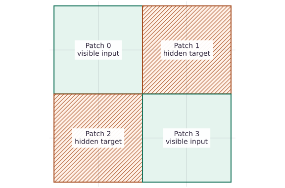
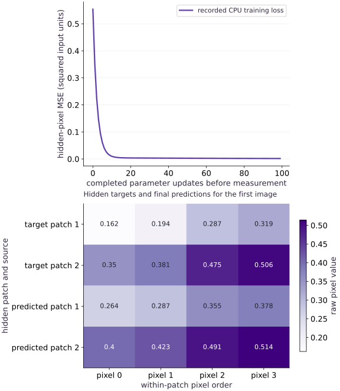

# Masked image modeling: reconstruct missing patches

Phase 17: Self-supervised pretraining: masked and contrastive learning · about 105 minutes · CPU

This worked reference is validated on CPU. Accelerator compatibility requires a separate source review and target execution receipt. Use the execution matrix to review device selection and data ownership before adapting a separate target program.

**Before this lesson:** [Masked language modeling: predict hidden tokens](https://www.tahabouhsine.com/jaxpathways/lesson-pretraining-01.html).

## What you will be able to do

- Preserve patch order and pixel order
- Keep hidden pixels out of the encoder
- Verify the changed-condition exercise and explain the limits of this fixture.
- Change the visible/hidden patch assignment, retain target pixels only for reconstruction, and audit a frozen feature probe with its shortcut stated.

## The problem

If part of an image is hidden, can the model infer it from visible patches? The important question is whether hidden pixels are truly absent from the encoder, not whether the reconstruction looks attractive.

## The idea

Masked image modeling learns from visible image content to predict missing content. To understand the objective, distinguish observed patches, hidden targets and predicted values in the original image coordinates.

## Keep hidden patches in their spatial positions

Masked image modeling hides selected image patches and asks a model to reconstruct their pixels. Follow the diagram’s two paths: visible patches become model features; the untouched image supplies reconstruction targets. Hatching marks hidden regions, not black observed pixels. A clean target entering the encoder would make reconstruction meaningless.

The training curve falls on the amplitude fixture, but the held-out comparison changes the interpretation: a simple visible-mean decoder beats the learned decoder on both mask layouts. Read the target and prediction at the same patch coordinates, then inspect the error map to see where that average metric comes from.

### Visible patches and hidden targets

**Predict:** Why should original and reconstructed images share a color scale?



*Architecture and dataflow mechanism diagram.*

The sixteen cells preserve the four-by-four image layout. Green patches 0 and 3 provide visible values. Hatched patches 1 and 2 are hidden targets for reconstruction loss. Hatching means missing input, not observed black pixels. This maps the actual mask without inventing a reconstructed image or error measurement.

### Pause and reason

Why should original and reconstructed images share a color scale?

<details><summary>Compare your reasoning</summary>

Independent scaling can make different intensities look equal. A shared scale preserves visual comparison; the error map should have its own clearly labeled scale.

</details>

## Before coding: what information can the model use?

Imagine a 4-by-4 grayscale image whose pixels are numbered row by row from 0 to 15. Cover the top-right and bottom-left 2-by-2 patches. The model sees the top-left and bottom-right patches, while the original image is kept aside as the target. Thus it sees eight pixel values plus a bias and must predict the hidden coordinates.

The fixture changes one brightness amplitude over a fixed spatial pattern. Visible pixels reveal that amplitude, so even a linear decoder can reconstruct well. This deliberate simplicity lets us inspect masking; it does not represent the variety of natural images.

## Preserve patch order and pixel order

Treat image layout as part of the model contract. Input axes are batch, height, width, channel. For 2-by-2 patches, transpose the patch-grid axes before flattening so patch IDs remain row-major and each pixel keeps its channel values. The first patch should match an independently sliced top-left region; this small oracle catches a reshape that silently scrambles coordinates.

## Keep hidden pixels out of the encoder

Build encoder features only after gathering the visible patches. Keep the clean image on the target path. A masked autoencoder often encodes visible patches and restores positions with a decoder and mask tokens; this lesson’s fixed linear decoder instead assigns each output to a known patch and pixel coordinate.

The reconstruction picture should combine unchanged visible pixels with predictions at hidden locations. The decoder’s visible-pixel outputs are not supervised by the hidden-only loss, so showing all its raw outputs as a full reconstruction would imply a guarantee it does not have.

## Work through a patch rather than memorizing reshape

The row-major example makes the ordering concrete: the top-left patch is $[0,1,4,5]$, not $[0,1,2,3]$, which is the top row strip. For image shape $(B,H,W,C)$ and patch width $p$, patchification yields $(B,HW/p^2,p^2C)$. Each patch contains all channels for its pixels.

Here two visible patches supply eight values; adding a bias gives nine decoder features, and sixteen outputs cover all pixel coordinates. The hidden-only objective scores only the hidden coordinates.

## Understand which uncertainty the objective can solve

Consider two images with identical visible pixels but hidden target values $0$ and $2$. A deterministic predictor must give the same answer for both. Under equally likely targets, the MSE-minimizing prediction is $1$, with average squared error $1$. The midpoint is optimal even though it matches neither image. This is ambiguity in the input, not something extra model capacity can fix.

When a reconstruction looks blurry, first check the mask path and patch order, then ask whether visible evidence uniquely determines the target. Only after those checks should you attribute the error to optimization or capacity. Pixel reconstruction alone does not measure downstream usefulness.

## Reduce over the hidden reconstruction targets

For each patch, average squared error over its pixels. Sum errors only for hidden patches and divide by the hidden-patch count. Since every patch has the same number of pixels, this is also an equal weighting of hidden pixels. Scoring visible outputs would let easy copied regions dilute the reconstruction error.

$$
L=\frac{\sum_{b,k}m_{bk}\,\frac1P\sum_{j=1}^{P}(\widehat x_{bkj}-x_{bkj})^2}{\sum_{b,k}m_{bk}}
$$

## Interpret normalization and reconstruction

This experiment uses raw synthetic intensities, so MSE is in squared input units. Per-patch normalization would change the task by removing brightness or contrast information and would require a defined way to interpret predictions. Compare loss values only when their pixel scaling and normalization conventions match.

## Evaluate beyond the training mask

Training loss falls from $0.5538$ to $0.00169$, and held-out brightness amplitudes under the training mask reach $0.00118$. That is interpolation on the same spatial pattern. In the separate transfer handoff, learned-decoder losses on two held-out masks are $0.0363$ and $0.0382$, while the visible-mean baseline gets $0.00879$ and $0.0244$. The baseline wins on both masks. The frozen probe’s $0.75$ accuracy is a separate synthetic measure, not proof that reconstruction produced a useful general image representation.

## Make a transfer test that can falsify your explanation

The current decoder assigns fixed meanings to its patch coordinates, so changing which positions are visible changes the input contract. To evaluate a variable-mask encoder, provide position information and a tested gather/restore path. Then test new source images, compare a frozen probe with a matched baseline, and inspect failures by class. Keep all patches from one source image together when splitting data.

For this lesson, the visible-mean baseline is the next reference to improve on. The project image pilot reported held-out balanced accuracy $0.3185$, below its $0.40$ floor; the actual pilot weights are not supplied and the flower runner is gated. These results call for further evaluation, not a claim of transfer.

## Route the bounded experiment into a frozen transfer check

The handoff preserves the original patch-transform exercise as a mechanism check and trains a separate tiny mask-aware encoder/decoder on synthetic fit groups g0–g3. It saves and reloads the model and processor identity, then tests two hidden-patch layouts on held-out groups g4–g7 against a visible-mean decoder. It also fits a probe on frozen encoder features. The recorded decoder loses to the baseline on both layouts, while probe accuracy is $0.75$; report these as distinct results.

The image pilot’s processor and source contracts are documented in the cited project files, but its MAE weights are absent and its balanced accuracy missed the stated floor. The synthetic run is not that pilot.

## 1. Define patch layout and masked error

Create main.py in your activated course environment. Paste this block, then run python main.py; function definitions alone print nothing.

```python
# Step 1 — 1. Define patch layout and masked error: Trace the transpose against the numbered top-left patch.
import jax
import jax.numpy as jnp
import numpy as np

def patchify(images, patch=2):
    b, h, w, c = images.shape
    if h % patch or w % patch:
        raise ValueError('image dimensions must be divisible by patch size')
    return (
        images.reshape(b, h // patch, patch, w // patch, patch, c)
        .transpose(0, 1, 3, 2, 4, 5)
        .reshape(b, (h // patch) * (w // patch), patch * patch * c)
    )

def masked_mse(prediction, target, hidden):
    # Reduce along axis=-1 to compute `per_patch`.
    per_patch = jnp.mean((prediction - target) ** 2, axis=-1)
    return jnp.sum(jnp.where(hidden, per_patch, 0.0)) / jnp.sum(hidden)

def validate_mask(selected, shape):
    # Transfer the device result to the host for an independent NumPy comparison.
    a = np.asarray(selected)
    if a.shape != shape or a.dtype != np.bool_ or not a.any():
        raise ValueError('a nonempty Boolean mask of the target shape is required')
```

Trace the transpose against the numbered top-left patch. masked_mse gives equal weight to each hidden pixel only because every patch has equal size.

## 2. Separate visible features from full targets

Append this block to main.py and run python main.py again. Keep the earlier blocks above it.

```python
# Four patches share an amplitude plus a fixed spatial offset; no real photographs.
amplitude = jnp.array([0.1, 0.3, 0.6, 0.8])
base_image = jnp.arange(16, dtype=jnp.float32).reshape(4, 4, 1) / 32
images = amplitude[:, None, None, None] + base_image[None]
patches = patchify(images)
# Transfer the device result to the host for an independent NumPy comparison.
np.testing.assert_array_equal(patches[0, 0], np.asarray(images[0, :2, :2, :]).reshape(-1))
hidden = jnp.array([[False, True, True, False]] * 4)
validate_mask(hidden, patches.shape[:2])
# The encoder receives only visible patches; original hidden pixels are targets only.
visible = patches[:, [0, 3], :]
features = jnp.concatenate([visible.reshape(4, -1), jnp.ones((4, 1))], axis=1)
w = jnp.zeros((9, 16))
history = []
loss = lambda w: masked_mse((features @ w).reshape(4, 4, 4), patches, hidden)
step = jax.jit(jax.value_and_grad(loss))
```

Only patches $0$ and $3$ enter features. The bias permits a spatial offset; hidden pixels remain solely in patches, the target array.

## 3. Fit the decoder and audit the reconstruction

Append this block to main.py and run python main.py again. Keep the earlier blocks above it.

```python
# Step 3 — 3. Fit the decoder and audit the reconstruction: The host loop checks the reduction independently.
for _ in range(100):
    value, g = step(w)
    history.append(float(value))
    w = w - 0.15 * g

prediction = (features @ w).reshape(4, 4, 4)
assert history[-1] < history[0] * 0.02
# A scalar host loop is independent of the vectorized reduction.
expected = np.mean(
    [
        float(np.mean((np.asarray(prediction[b, k]) - np.asarray(patches[b, k])) ** 2))
        for b in range(4)
        for k in [1, 2]
    ]
)
np.testing.assert_allclose(loss(w), expected, rtol=1e-5)
visible_changed = prediction.at[:, [0, 3], :].set(999.0)
np.testing.assert_allclose(
    masked_mse(visible_changed, patches, hidden), loss(w), atol=1e-7
)
held_images = jnp.array([0.2, 0.5])[:, None, None, None] + base_image[None]
held_patches = patchify(held_images)
held_features = jnp.concatenate(
    [held_patches[:, [0, 3], :].reshape(2, -1), jnp.ones((2, 1))], axis=1
)
held_loss = float(
    masked_mse((held_features @ w).reshape(2, 4, 4), held_patches, hidden[:2])
)
assert held_loss < 0.02
print(
    'Masked pixel MSE initial/final/held amplitudes:',
    history[0],
    history[-1],
    held_loss,
)
```

The host loop checks the reduction independently. Corrupting visible outputs checks the loss boundary; held amplitudes check a narrow interpolation claim.

## 4. Save the encoder, change one condition, and probe it

Run the preceding build cells first, then continue with this saved-encoder handoff. Run this block in a fresh Python process. It starts by recreating this lesson’s canonical synthetic fixture, then saves/reloads it, changes one declared condition, and runs the transfer check. The duplicated setup is intentional because generated scripts place staged blocks before the main example.

```python
# Changed mask schedule + learned saved encoder + frozen-probe transfer (synthetic)
import hashlib, json, tempfile
from pathlib import Path

# Eight source-group images vary amplitude; class labels are reserved for the probe.
transfer_amp = jnp.array([0.10,0.60,0.20,0.65,0.35,0.80,0.40,0.90])
transfer_images = transfer_amp[:,None,None,None] + base_image[None]
transfer_patches = patchify(transfer_images)
train_ids, held_ids = ['g0','g1','g2','g3'], ['g4','g5','g6','g7']
train_idx, held_idx = np.arange(4), np.arange(4,8)
assert set(train_ids).isdisjoint(held_ids)
# Each fit image gets one of two masks; across epochs the mask pattern alternates.
mask_a = jnp.array([False,True,True,False])
mask_b = jnp.array([True,False,False,True])
mask_schedule = [mask_a, mask_b]
key_e, key_d = jax.random.split(jax.random.key(19))
enc = jax.random.normal(key_e,(8,4))*0.1
# Decoder sees latent plus target patch position, never hidden pixels.
dec = jax.random.normal(key_d,(8,16))*0.1

def mae_loss_for(image_patches, enc, dec, mask):
    visible = (~mask).astype(jnp.float32)
    batch = len(image_patches)
    pooled = jnp.sum(image_patches * visible[None,:,None],axis=1) / visible.sum()
    encoder_input = jnp.concatenate([pooled, jnp.broadcast_to(visible,(batch,4))],axis=1)
    z = jnp.tanh(encoder_input @ enc)
    positions = jnp.eye(4)
    # Position-specific decoder: latent features plus one-hot patch index -> 4 pixels.
    pos_features = jnp.concatenate([jnp.broadcast_to(z[:,None,:],(batch,4,4)),
                                    jnp.broadcast_to(positions[None,:,:],(batch,4,4))],axis=-1)
    pred = pos_features @ dec
    per_patch = jnp.mean((pred-image_patches)**2,axis=-1)
    return jnp.sum(jnp.where(mask[None,:],per_patch,0.0))/ (batch*mask.sum())

def mae_loss(enc, dec, mask):
    return mae_loss_for(transfer_patches[train_idx],enc,dec,mask)

# [4 latent + 4 positional] x 4 target pixels.
dec = jax.random.normal(key_d,(8,4))*0.1
for epoch in range(120):
    mask = mask_schedule[epoch % 2]
    value, (ge,gd) = jax.value_and_grad(mae_loss,argnums=(0,1))(enc,dec,mask)
    enc, dec = enc - 0.08*ge, dec - 0.08*gd

# Recompute both masks without updating and compare with a visible-mean decoder baseline.
changed_mask_losses=[]
held_visible_baselines=[]
for mask in mask_schedule:
    changed_mask_losses.append(float(mae_loss_for(transfer_patches[held_idx],enc,dec,mask)))
    transfer_visible_mask=(~mask).astype(jnp.float32)
    transfer_visible_mean=jnp.sum(transfer_patches[held_idx]*transfer_visible_mask[None,:,None],axis=1)/transfer_visible_mask.sum()
    baseline=jnp.broadcast_to(transfer_visible_mean[:,None,:],transfer_patches[held_idx].shape)
    held_visible_baselines.append(float(masked_mse(baseline,transfer_patches[held_idx],jnp.broadcast_to(mask,(len(held_idx),4)))))
assert all(np.isfinite(changed_mask_losses))

def frozen_encode(images_patches, mask):
    visible=(~mask).astype(jnp.float32)
    pooled=jnp.sum(images_patches*visible[None,:,None],axis=1)/visible.sum()
    x=jnp.concatenate([pooled,jnp.broadcast_to(visible,(len(images_patches),4))],axis=1)
    return jnp.tanh(x @ enc)

# Save/reload exact encoder and decoder identity, then freeze encoder for probe fitting.
processor_id='gray-4x4-range-raw-patchify-2-v1'
source_split_id='synthetic-amplitude-v2:g0-g3/g4-g7'
parameter_hash=hashlib.sha256(np.ascontiguousarray(enc).tobytes()+np.ascontiguousarray(dec).tobytes()).hexdigest()
manifest={'model_id':'tiny-mask-aware-patch-encoder-v1','processor_id':processor_id,
          'source_split_id':source_split_id,'objective':'hidden-patch-MSE',
          'mask_schedule':'alternate center-pair and corner-pair; 50% hidden',
          'fit_group_ids':train_ids,'heldout_group_ids':held_ids,'seed':19,'parameter_sha256':parameter_hash}
output_dir = Path(tempfile.mkdtemp(prefix='jaxpathways-mim-encoder-'))
artifact = output_dir / 'encoder.npz'
np.savez(artifact,encoder=np.asarray(enc),decoder=np.asarray(dec),
         manifest=np.array(json.dumps(manifest,sort_keys=True)))
with np.load(artifact,allow_pickle=False) as saved:
    loaded_enc=saved['encoder'].copy(); loaded_dec=saved['decoder'].copy()
    loaded_manifest=json.loads(str(saved['manifest']))
rehash=hashlib.sha256(np.ascontiguousarray(loaded_enc).tobytes()+np.ascontiguousarray(loaded_dec).tobytes()).hexdigest()
assert loaded_manifest==manifest and rehash==parameter_hash
checkpoint_hash=hashlib.sha256(artifact.read_bytes()).hexdigest()
identity_path=output_dir/'identity.json'
identity={**manifest,'checkpoint_sha256':checkpoint_hash}
identity_path.write_text(json.dumps(identity,sort_keys=True))
assert hashlib.sha256(artifact.read_bytes()).hexdigest()==identity['checkpoint_sha256']
frozen_before=loaded_enc.copy()
z=np.asarray(frozen_encode(transfer_patches,mask_a))
labels=(np.asarray(transfer_amp)>=0.5).astype(int)
design=np.c_[z[train_idx],np.ones(len(train_idx))]
probe=np.linalg.solve(design.T@design+1e-3*np.eye(design.shape[1]),design.T@labels[train_idx])
pred=(np.c_[z[held_idx],np.ones(len(held_idx))]@probe>=0.5).astype(int)
frozen_probe_accuracy=float(np.mean(pred==labels[held_idx]))
np.testing.assert_array_equal(loaded_enc,frozen_before)
print('MIM held-out alternating-mask losses / visible-mean baseline / frozen held-out probe accuracy:',
      changed_mask_losses, held_visible_baselines, frozen_probe_accuracy)
print('Artifact path:', artifact)
print('Identity sidecar:', identity_path)
print('Saved identity:',manifest['model_id'],manifest['processor_id'],manifest['source_split_id'])
```

The transfer block trains a small encoder using only visible patches while the decoder alone receives target patch positions. Each update changes the mask pattern. The saved encoder is reloaded and frozen before fitting a probe; the hidden pixels remain loss targets only.

## Run the example

```python
# Step 1 — 1. Define patch layout and masked error: Trace the transpose against the numbered top-left patch.
import jax
import jax.numpy as jnp
import numpy as np

def patchify(images, patch=2):
    b, h, w, c = images.shape
    if h % patch or w % patch:
        raise ValueError('image dimensions must be divisible by patch size')
    return (
        images.reshape(b, h // patch, patch, w // patch, patch, c)
        .transpose(0, 1, 3, 2, 4, 5)
        .reshape(b, (h // patch) * (w // patch), patch * patch * c)
    )

def masked_mse(prediction, target, hidden):
    # Average pixelwise squared error within each patch to get one loss per patch.
    per_patch = jnp.mean((prediction - target) ** 2, axis=-1)
    return jnp.sum(jnp.where(hidden, per_patch, 0.0)) / jnp.sum(hidden)

def validate_mask(selected, shape):
    # Transfer the device result to the host for an independent NumPy comparison.
    a = np.asarray(selected)
    if a.shape != shape or a.dtype != np.bool_ or not a.any():
        raise ValueError('a nonempty Boolean mask of the target shape is required')

# Four patches share an amplitude plus a fixed spatial offset; no real photographs.
amplitude = jnp.array([0.1, 0.3, 0.6, 0.8])
base_image = jnp.arange(16, dtype=jnp.float32).reshape(4, 4, 1) / 32
images = amplitude[:, None, None, None] + base_image[None]
patches = patchify(images)
# Transfer the device result to the host for an independent NumPy comparison.
np.testing.assert_array_equal(patches[0, 0], np.asarray(images[0, :2, :2, :]).reshape(-1))
hidden = jnp.array([[False, True, True, False]] * 4)
validate_mask(hidden, patches.shape[:2])
# The encoder receives only visible patches; original hidden pixels are targets only.
visible = patches[:, [0, 3], :]
features = jnp.concatenate([visible.reshape(4, -1), jnp.ones((4, 1))], axis=1)
w = jnp.zeros((9, 16))
history = []
loss = lambda w: masked_mse((features @ w).reshape(4, 4, 4), patches, hidden)
step = jax.jit(jax.value_and_grad(loss))

# Step 3 — 3. Fit the decoder and audit the reconstruction: The host loop checks the reduction independently.
for _ in range(100):
    value, g = step(w)
    history.append(float(value))
    w = w - 0.15 * g

prediction = (features @ w).reshape(4, 4, 4)
assert history[-1] < history[0] * 0.02
# A scalar host loop is independent of the vectorized reduction.
expected = np.mean(
    [
        float(np.mean((np.asarray(prediction[b, k]) - np.asarray(patches[b, k])) ** 2))
        for b in range(4)
        for k in [1, 2]
    ]
)
np.testing.assert_allclose(loss(w), expected, rtol=1e-5)
visible_changed = prediction.at[:, [0, 3], :].set(999.0)
np.testing.assert_allclose(
    masked_mse(visible_changed, patches, hidden), loss(w), atol=1e-7
)
held_images = jnp.array([0.2, 0.5])[:, None, None, None] + base_image[None]
held_patches = patchify(held_images)
held_features = jnp.concatenate(
    [held_patches[:, [0, 3], :].reshape(2, -1), jnp.ones((2, 1))], axis=1
)
held_loss = float(
    masked_mse((held_features @ w).reshape(2, 4, 4), held_patches, hidden[:2])
)
assert held_loss < 0.02
print(
    'Masked pixel MSE initial/final/held amplitudes:',
    history[0],
    history[-1],
    held_loss,
)
```

Expected: Hidden-patch training MSE falls below 0.002 and held-amplitude MSE stays below 0.02.

## Masked image modeling: reconstruct missing patches — recorded experiment

**Predict:** Will every predicted pixel match its target exactly? Which output patches were never trained?



**Recorded CPU computation**

### Read the figure

The line shows hidden-patch training MSE before each update, falling from about $0.554$ to $0.00169$. The vertical units are squared raw pixel units. The line excludes visible-patch reconstruction errors; it cannot be read as full-image MSE.

The second panel inspects the first image only. Its first two rows are clean hidden-patch targets; the last two are final predictions in the same within-patch order. Compare row one with row three and row two with row four, rather than looking for a diagonal. Residual brightness differences explain why the training MSE is small but nonzero. Visible outputs are omitted because this loss never trains them; displaying them as a full reconstructed image would be misleading.

### Connect it to the computation

Each image contains an amplitude and a fixed spatial pattern. Visible patches reveal the amplitude, so a linear decoder can infer hidden pixels on this deliberately learnable task. Separate held-amplitude MSE is approximately 0.00118. Natural-image semantics and a visible-token Transformer remain different experiments.

```python
visual_data={'kind':'line','xlabel':'completed parameter updates before measurement','ylabel':'hidden-pixel MSE (squared input units)','series':[{'label':'recorded CPU training loss','x':list(range(len(history))),'y':history}]}
for panel in visual_data.get('panels',[visual_data]):
    panel['x']=panel['series'][0]['x']

# Transfer the device result to the host for an independent NumPy comparison.
patch_comparison=np.concatenate([np.asarray(patches[0,[1,2],:]),np.asarray(prediction[0,[1,2],:])],axis=0)
extra_panel={'kind':'heatmap','values':patch_comparison.tolist(),'rows':['target patch 1','target patch 2','predicted patch 1','predicted patch 2'],'columns':['pixel 0','pixel 1','pixel 2','pixel 3'],'unit':'raw pixel value','xlabel':'within-patch pixel order','ylabel':'hidden patch and source','title':'Hidden targets and final predictions for the first image'}
visual_data={"panels":[*visual_data.get("panels",[visual_data]),extra_panel]}
```

## Recorded reference execution

CPU run: 2026-10-27T16:11:36.532627+00:00. JAX 0.9.2.

```text
Masked pixel MSE initial/final/held amplitudes: 0.5538085699081421 0.0016928859986364841 0.0011766081443056464
MIM held-out alternating-mask losses / visible-mean baseline / frozen held-out probe accuracy: [0.03627391159534454, 0.03820060193538666] [0.008789061568677425, 0.02441406063735485] 0.75
Artifact path: /var/folders/mp/_mq7srqx2y10p5nhjz9m7hj40000gn/T/jaxpathways-mim-encoder-0t1v0vg6/encoder.npz
Identity sidecar: /var/folders/mp/_mq7srqx2y10p5nhjz9m7hj40000gn/T/jaxpathways-mim-encoder-0t1v0vg6/identity.json
Saved identity: tiny-mask-aware-patch-encoder-v1 gray-4x4-range-raw-patchify-2-v1 synthetic-amplitude-v2:g0-g3/g4-g7
Masked pixel MSE initial/final/held amplitudes: 0.5538085699081421 0.0016928859986364841 0.0011766081443056464
Hidden MSE unchanged; full-image MSE is large.
Ambiguous target MSE at predictions 0, 1, 2: 2, 1, 2
MIM held-out alternating-mask losses / visible-mean baseline / frozen held-out probe accuracy: [0.03627391159534454, 0.03820060193538666] [0.008789061568677425, 0.02441406063735485] 0.75
Artifact path: /var/folders/mp/_mq7srqx2y10p5nhjz9m7hj40000gn/T/jaxpathways-mim-encoder-g6k19gdx/encoder.npz
Identity sidecar: /var/folders/mp/_mq7srqx2y10p5nhjz9m7hj40000gn/T/jaxpathways-mim-encoder-g6k19gdx/identity.json
Saved identity: tiny-mask-aware-patch-encoder-v1 gray-4x4-range-raw-patchify-2-v1 synthetic-amplitude-v2:g0-g3/g4-g7
Bottom-right patch order verified.
The zero-loss shortcut receives hidden pixels; the real features contain only eight visible pixels and a bias.
All rectangular RGB patches agree; hidden-pixel intervention preserves visible features.
PASS: pretraining-02

```

## Make visible-output errors arbitrarily large

**Predict before running:** Will visible-output corruption raise the hidden-patch objective?

```python
# Experiment — Make visible-output errors arbitrarily large: The disagreement identifies the reduction contract.
bad_visible = prediction.at[:, [0, 3], :].set(-1000.0)
np.testing.assert_allclose(
    masked_mse(bad_visible, patches, hidden),
    masked_mse(prediction, patches, hidden),
)
assert float(jnp.mean((bad_visible - patches) ** 2)) > 1000
print('Hidden MSE unchanged; full-image MSE is large.')
```

**Expected:** Hidden MSE stays unchanged while full-image MSE grows dramatically.

The disagreement identifies the reduction contract. Neither metric is universally correct; label which region and preprocessing it measures.

## Make hidden information impossible to recover

**Predict before running:** Can any deterministic prediction have zero MSE for two identical inputs with hidden targets zero and two?

```python
# Experiment — Make hidden information impossible to recover: The experiment isolates missing information.
ambiguous_targets = jnp.array([[[0.0]], [[2.0]]])
ambiguous_mask = jnp.ones((2, 1), dtype=bool)

def ambiguity_loss(value):
    return masked_mse(
        jnp.full_like(ambiguous_targets, value), ambiguous_targets, ambiguous_mask
    )

np.testing.assert_allclose(
    [ambiguity_loss(0.0), ambiguity_loss(1.0), ambiguity_loss(2.0)], [2.0, 1.0, 2.0]
)
np.testing.assert_allclose(jax.grad(ambiguity_loss)(1.0), 0.0, atol=1e-7)
print('Ambiguous target MSE at predictions 0, 1, 2: 2, 1, 2')
```

**Expected:** Predicting the mean is optimal but still leaves MSE of one.

The experiment isolates missing information. A loss plateau can be caused by ambiguity even when gradients and optimization are correct.

## Move the hidden patches, save the recipe identity, and probe frozen visible inputs

**Predict before running:** When the mask moves from center patches to corner patches, which pixels enter the encoder and which remain reconstruction targets?

```python
# Changed mask schedule + learned saved encoder + frozen-probe transfer (synthetic)
import hashlib, json, tempfile
from pathlib import Path

# Eight source-group images vary amplitude; class labels are reserved for the probe.
transfer_amp = jnp.array([0.10,0.60,0.20,0.65,0.35,0.80,0.40,0.90])
transfer_images = transfer_amp[:,None,None,None] + base_image[None]
transfer_patches = patchify(transfer_images)
train_ids, held_ids = ['g0','g1','g2','g3'], ['g4','g5','g6','g7']
train_idx, held_idx = np.arange(4), np.arange(4,8)
assert set(train_ids).isdisjoint(held_ids)
# Each fit image gets one of two masks; across epochs the mask pattern alternates.
mask_a = jnp.array([False,True,True,False])
mask_b = jnp.array([True,False,False,True])
mask_schedule = [mask_a, mask_b]
key_e, key_d = jax.random.split(jax.random.key(19))
enc = jax.random.normal(key_e,(8,4))*0.1
# Decoder sees latent plus target patch position, never hidden pixels.
dec = jax.random.normal(key_d,(8,16))*0.1

def mae_loss_for(image_patches, enc, dec, mask):
    visible = (~mask).astype(jnp.float32)
    batch = len(image_patches)
    pooled = jnp.sum(image_patches * visible[None,:,None],axis=1) / visible.sum()
    encoder_input = jnp.concatenate([pooled, jnp.broadcast_to(visible,(batch,4))],axis=1)
    z = jnp.tanh(encoder_input @ enc)
    positions = jnp.eye(4)
    # Position-specific decoder: latent features plus one-hot patch index -> 4 pixels.
    pos_features = jnp.concatenate([jnp.broadcast_to(z[:,None,:],(batch,4,4)),
                                    jnp.broadcast_to(positions[None,:,:],(batch,4,4))],axis=-1)
    pred = pos_features @ dec
    per_patch = jnp.mean((pred-image_patches)**2,axis=-1)
    return jnp.sum(jnp.where(mask[None,:],per_patch,0.0))/ (batch*mask.sum())

def mae_loss(enc, dec, mask):
    return mae_loss_for(transfer_patches[train_idx],enc,dec,mask)

# [4 latent + 4 positional] x 4 target pixels.
dec = jax.random.normal(key_d,(8,4))*0.1
for epoch in range(120):
    mask = mask_schedule[epoch % 2]
    value, (ge,gd) = jax.value_and_grad(mae_loss,argnums=(0,1))(enc,dec,mask)
    enc, dec = enc - 0.08*ge, dec - 0.08*gd

# Recompute both masks without updating and compare with a visible-mean decoder baseline.
changed_mask_losses=[]
held_visible_baselines=[]
for mask in mask_schedule:
    changed_mask_losses.append(float(mae_loss_for(transfer_patches[held_idx],enc,dec,mask)))
    transfer_visible_mask=(~mask).astype(jnp.float32)
    transfer_visible_mean=jnp.sum(transfer_patches[held_idx]*transfer_visible_mask[None,:,None],axis=1)/transfer_visible_mask.sum()
    baseline=jnp.broadcast_to(transfer_visible_mean[:,None,:],transfer_patches[held_idx].shape)
    held_visible_baselines.append(float(masked_mse(baseline,transfer_patches[held_idx],jnp.broadcast_to(mask,(len(held_idx),4)))))
assert all(np.isfinite(changed_mask_losses))

def frozen_encode(images_patches, mask):
    visible=(~mask).astype(jnp.float32)
    pooled=jnp.sum(images_patches*visible[None,:,None],axis=1)/visible.sum()
    x=jnp.concatenate([pooled,jnp.broadcast_to(visible,(len(images_patches),4))],axis=1)
    return jnp.tanh(x @ enc)

# Save/reload exact encoder and decoder identity, then freeze encoder for probe fitting.
processor_id='gray-4x4-range-raw-patchify-2-v1'
source_split_id='synthetic-amplitude-v2:g0-g3/g4-g7'
parameter_hash=hashlib.sha256(np.ascontiguousarray(enc).tobytes()+np.ascontiguousarray(dec).tobytes()).hexdigest()
manifest={'model_id':'tiny-mask-aware-patch-encoder-v1','processor_id':processor_id,
          'source_split_id':source_split_id,'objective':'hidden-patch-MSE',
          'mask_schedule':'alternate center-pair and corner-pair; 50% hidden',
          'fit_group_ids':train_ids,'heldout_group_ids':held_ids,'seed':19,'parameter_sha256':parameter_hash}
output_dir = Path(tempfile.mkdtemp(prefix='jaxpathways-mim-encoder-'))
artifact = output_dir / 'encoder.npz'
np.savez(artifact,encoder=np.asarray(enc),decoder=np.asarray(dec),
         manifest=np.array(json.dumps(manifest,sort_keys=True)))
with np.load(artifact,allow_pickle=False) as saved:
    loaded_enc=saved['encoder'].copy(); loaded_dec=saved['decoder'].copy()
    loaded_manifest=json.loads(str(saved['manifest']))
rehash=hashlib.sha256(np.ascontiguousarray(loaded_enc).tobytes()+np.ascontiguousarray(loaded_dec).tobytes()).hexdigest()
assert loaded_manifest==manifest and rehash==parameter_hash
checkpoint_hash=hashlib.sha256(artifact.read_bytes()).hexdigest()
identity_path=output_dir/'identity.json'
identity={**manifest,'checkpoint_sha256':checkpoint_hash}
identity_path.write_text(json.dumps(identity,sort_keys=True))
assert hashlib.sha256(artifact.read_bytes()).hexdigest()==identity['checkpoint_sha256']
frozen_before=loaded_enc.copy()
z=np.asarray(frozen_encode(transfer_patches,mask_a))
labels=(np.asarray(transfer_amp)>=0.5).astype(int)
design=np.c_[z[train_idx],np.ones(len(train_idx))]
probe=np.linalg.solve(design.T@design+1e-3*np.eye(design.shape[1]),design.T@labels[train_idx])
pred=(np.c_[z[held_idx],np.ones(len(held_idx))]@probe>=0.5).astype(int)
frozen_probe_accuracy=float(np.mean(pred==labels[held_idx]))
np.testing.assert_array_equal(loaded_enc,frozen_before)
print('MIM held-out alternating-mask losses / visible-mean baseline / frozen held-out probe accuracy:',
      changed_mask_losses, held_visible_baselines, frozen_probe_accuracy)
print('Artifact path:', artifact)
print('Identity sidecar:', identity_path)
print('Saved identity:',manifest['model_id'],manifest['processor_id'],manifest['source_split_id'])
```

**Expected:** The changed-mask loss and visible-mean baseline are both reported; the manifest and parameter hash round-trip; the probe is evaluated on a held-out source group.

The added transfer block uses a learned mask-aware encoder. Probe results still apply only to eight synthetic amplitude-coded images; patch reconstruction does not establish broad visual representation quality. The original lesson fixture remains an honest fixed visible-feature decoder.

## Make it yours

Verify the bottom-right patch against a direct slice and explain why a whole-array reshape can hide a spatial permutation.

### How to write this exercise — Step-by-step recipe & starter scaffold

**Inputs:**
- A rectangular image batch, patch size, and a selected bottom-right patch index.

**Outputs:**
- Patch tokens and the original-space bottom-right patch verified by direct slicing.

**Invariants to check:**
- Patch ordering preserves row/column identity; reconstruction never receives hidden target pixels as encoder inputs.

**Hints:**
- Track the reshape and transpose axes before flattening.
- Use direct slicing as an independent oracle.

**Starter code scaffold (fill in the TODOs):**

```python
import jax.numpy as jnp
import numpy as np

def check_bottom_right_patch(images, patch_size):
    # TODO: patchify the image and compare the final patch with a direct spatial slice.
    raise NotImplementedError
```

<details><summary>Reference solution</summary>

```python
# Exercise solution
np.testing.assert_array_equal(
    patches[2, 3], np.asarray(images[2, 2:, 2:, :]).reshape(-1)
)
print('Bottom-right patch order verified.')
```

</details>

## Expose the leakage shortcut

**Transfer**

Compare a decoder that returns the clean target with the visible-only model. Explain why zero reconstruction loss is not sufficient evidence.

<details><summary>Hint</summary>

Measure the shortcut, then inspect which function inputs contain hidden pixels.

</details>

### How to write: Expose the leakage shortcut — Step-by-step recipe & starter scaffold

**Inputs:**
- A visible-only prediction function and parameters, clean patch targets, hidden-patch mask, and patch mask token.

**Outputs:**
- Hidden-region reconstruction errors for the target-copy shortcut and visible-only model, plus a leakage diagnosis.

**Invariants to check:**
- The shortcut has zero error because it receives clean targets; model evidence must come from predictions computed only from visible inputs.

**Hints:**
- Call the visible-only model using corrupted inputs and its parameters.
- Measure both predictions on the same hidden patches.

**Starter code scaffold (fill in the TODOs):**

```python
import jax.numpy as jnp

def audit_target_leakage(predict_visible, params, clean_patches, hidden, mask_token):
    # TODO: compare the target-copy shortcut with predictions from the visible-only path.
    raise NotImplementedError
```

<details><summary>Reference solution and reasoning</summary>

```python
# Expose the leakage shortcut (Transfer)
shortcut = patches
assert float(masked_mse(shortcut, patches, hidden)) == 0.0
# Check tensor shape invariant: `features.shape[1] == 9`
assert features.shape[1] == 9
print('The zero-loss shortcut receives hidden pixels; the real features contain only eight visible pixels and a bias.')
```

An information-flow check is necessary because the leaked solution can outperform the honest model on the objective itself.

</details>

## Audit every patch of a rectangular color image

**Challenge**

Construct two 4-by-6 RGB images with numbered entries. Compare patchify with an independent nested slicing oracle for every patch, then change hidden pixels and prove visible features stay fixed.

<details><summary>Hint</summary>

Use explicit image slices inside the oracle; do not copy the reshape/transpose implementation.

</details>

### How to write: Audit every patch of a rectangular color image — Step-by-step recipe & starter scaffold

**Inputs:**
- A patchify function, visible encoder and parameters, two numbered images of shape 4 by 6 by 3, patch size, and hidden-patch indices.

**Outputs:**
- Every patch checked against nested slicing and visible features shown unchanged after hidden pixels are altered.

**Invariants to check:**
- Patch order matches image coordinates; the encoder receives only visible patches, so changing hidden pixels cannot alter its features.

**Hints:**
- Build the patch oracle with explicit row and column loops.
- Apply the same hidden mask and encoder to both images, changing hidden pixels only.

**Starter code scaffold (fill in the TODOs):**

```python
import jax.numpy as jnp
import numpy as np

def audit_rectangular_patch_layout(patchify, encode_visible, params, images, patch_size, hidden):
    # TODO: compare all patches with a slicing oracle and test hidden-pixel isolation through the encoder.
    raise NotImplementedError
```

<details><summary>Reference solution and reasoning</summary>

```python
# Audit every patch of a rectangular color image (Challenge)
numbered = np.arange(2 * 4 * 6 * 3, dtype=np.float32).reshape(2, 4, 6, 3)
oracle = np.stack(
    [
        np.stack(
            [
                image[row : row + 2, col : col + 2, :].reshape(-1)
                for row in range(0, 4, 2)
                for col in range(0, 6, 2)
            ]
        )
        for image in numbered
    ]
)
np.testing.assert_array_equal(patchify(jnp.asarray(numbered)), oracle)
changed_images = images.at[:, :2, 2:, :].add(17.0).at[:, 2:, :2, :].add(-9.0)
changed_patches = patchify(changed_images)
np.testing.assert_array_equal(changed_patches[:, [0, 3], :], visible)
assert not np.array_equal(
    np.asarray(changed_patches[:, [1, 2], :]), np.asarray(patches[:, [1, 2], :])
)
print('All rectangular RGB patches agree; hidden-pixel intervention preserves visible features.')
```

The rectangular multichannel case catches axis errors that a single square grayscale patch can miss. The intervention independently checks that hidden targets cannot enter this encoder.

</details>

## Check your understanding

Why must the encoder input be inspected separately from reconstruction loss?

1. A leaked target can produce a perfect loss without learning to infer missing content.
2. Averaging squared error over only hidden patches automatically prevents hidden pixels from entering the encoder.
3. Flattening an image without transposing grid and patch axes changes the shape of the patch tensor.

<details><summary>Answer and explanation</summary>

**1. A leaked target can produce a perfect loss without learning to infer missing content. (correct)**

Correct reduction does not prevent input leakage. Audit the visible-only boundary and validate patch order.

**2. Averaging squared error over only hidden patches automatically prevents hidden pixels from entering the encoder.**

A hidden-target loss mask does not prevent leakage if the target remains visible in the encoder input. Check both masks.

**3. Flattening an image without transposing grid and patch axes changes the shape of the patch tensor.**

A patch permutation can preserve shape while corrupting spatial correspondence. Check content/order against a known image, not shape alone.

</details>

## Diagnose the result

If reconstruction is excellent before learning, inspect target leakage. If patches look shuffled, verify the patch transpose and decoder restoration order. If metrics differ, compare the mask count and normalization.

## Carry forward

- Verify patch extraction against an explicit spatial slice: converting $(B,H,W,C)$ into $(B,HW/p^2,p^2C)$ requires transposing the grid and within-patch axes before flattening.
- Keep hidden patches out of the encoder feature tensor and reduce reconstruction MSE over the hidden mask only; changing hidden target values must never alter the encoder forward input.
- In masked-image modeling, a reconstruction decoder can exploit simple visible-patch correlations. A frozen-feature probe only tests the representation actually provided; this decoder-only fixture does not contain a learned encoder and earns no transfer claim.

## Keep your evidence

Keep patch-order and ambiguity controls, saved encoder/mask/transform identity, changed-mask held-out reconstruction against a visible-mean baseline and the frozen probe. Separate objective mechanics from representation quality.

Save your predictions, modified code, terminal outputs, and reasoning in your engineering portfolio.

## Primary references

- [Masked Autoencoders](https://arxiv.org/abs/2111.06377)
- [Flower-model teaching guide and quality result](https://github.com/mlnomadpy/jaxpathways/blob/15bf7aa4fbd4460501cc4d6d7802324673a89f6f/projects/image-model-300m/TEACHING.md)
- [Flower-model frozen image processor](https://github.com/mlnomadpy/jaxpathways/blob/15bf7aa4fbd4460501cc4d6d7802324673a89f6f/projects/image-model-300m/data/processor.py)

