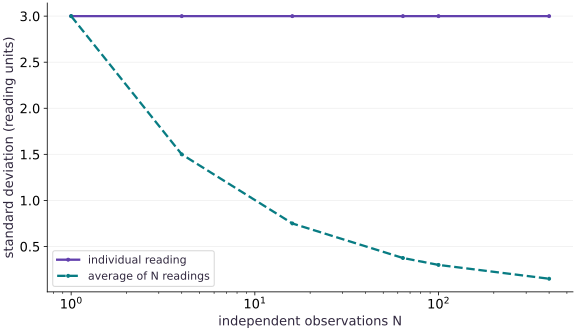

# Distributions and sampling

Phase 11: Probabilistic modeling · about 90 minutes · CPU

This worked reference is validated on CPU. Accelerator compatibility requires a separate source review and target execution receipt. Use the execution matrix to review device selection and data ownership before adapting a separate target program.

## What you will be able to do

- Distinguish samples, density, variance and standard error
- Check normal moments against independent analytic expectations
- Use log-space arithmetic for an extreme mixture likelihood
- Demonstrate both key replay and independent split-key draws

## The problem

A sensor model says that a future reading has mean $2$ and standard deviation $3$. What should a finite collection of simulated readings look like, and how can we check our simulator? We will compare independent formulas with JAX samples, then deliberately underflow a likelihood calculation. This is the numerical foundation for the Bayesian model in the next lesson.

## The idea

A distribution describes variability in outcomes. Averaging independent observations can reduce uncertainty in their mean without removing the spread of individual outcomes. Keep these two uncertainties on separate labels and scales.

## A precise mean does not make individual outcomes predictable

For independent readings with standard deviation $3$, the sample mean of $100$ readings has standard deviation $3/\sqrt{100}=0.3$, while a new reading still has standard deviation $3$. The first quantity describes variation in an average across repeated samples; the second describes the data-generating spread of individual values.

The displayed standard-error curve is calculated from the independence assumption, not estimated from repeated experimental batches. Positive correlation would make $2/\sqrt{N}$ too optimistic because the effective amount of independent information is smaller. Before using a narrow band, identify whether its random quantity is a mean, parameter or future observation.

### Pause and reason

Does a tenfold smaller standard error mean future individual observations are ten times less variable?

<details><summary>Compare your reasoning</summary>

No. Standard error concerns the estimator of the mean. The observation distribution can retain the same variability.

</details>

## Start with units, not an API

A standard deviation has the same units as a sensor reading. Variance has squared units. To change a standard-normal draw $z$ into a reading, multiply by the standard deviation and add the mean: $x=2+3z$. The expected variance is $9$, not $3$. This is why the scale parameter in our log-density divides the residual before squaring. We assume a strictly positive finite scale; validation belongs at a public input boundary.

$$
p(x\mid\mu,\sigma)=\frac{1}{\sigma\sqrt{2\pi}}\exp\!\left[-\frac12\left(\frac{x-\mu}{\sigma}\right)^2\right],\quad \sigma>0
$$

## One draw and a sample average answer different questions

A single future reading has standard deviation $3$. An average of $N$ independent readings has standard error $3/\sqrt{N}$. More simulation improves an estimate of the model mean; it does not make the next sensor reading less noisy. At $N=20000$, the mean standard error is about $0.0212$. Our deterministic seeded test uses a generous five-standard-error bound and a separate variance check. A statistical tolerance can fail by chance for other seeds, so keep the seed, sample size and actual discrepancy.

## Logarithms preserve ratios that densities lose

A probability density is not the probability of observing one exact real-valued reading. Density has inverse-reading units, and probability comes from integrating it over an interval or region. For example, the normal density at its peak can exceed one for a sufficiently small standard deviation without violating probability rules.

A normal log-density is a negative quadratic plus normalization terms. Summing log-densities for independent observations avoids multiplying many small values. A mixture instead adds weighted densities, so use log-sum-exp: for component log-densities $-1000$ and $-1001$, subtracting the maximum before exponentiation preserves their relative contribution. The executed stable mixture log density is about $-1000.380$; direct exponentiation underflows at this scale even though the log result remains finite.

$$
\log\!\left(\frac{e^a+e^b}{2}\right)=m+\log(e^{a-m}+e^{b-m})-\log 2,\quad m=\max(a,b)
$$

## A random key is part of the experiment

Calling a random function twice with the same key and shape replays the same values in this tested environment. It does not create two independent samples. Split the key before assigning it to separate draws. NumPy and JAX need not return matching random arrays for the same integer seed: compare distributional properties, not bit patterns across libraries. Our sample checks establish a small numerical example, not a universal test of a random-number generator.

## 1. Define a density and its contract

Create main.py in the activated CPU environment. Add the imports and the scalar normal log-density. A scale is a positive standard deviation, not a variance.

```python
# Step 1 — 1. Define a density and its contract
import math
import numpy as np
import jax
import jax.numpy as jnp
from jax.scipy.special import logsumexp

def normal_logpdf(value, loc, scale):
    return -0.5*((value-loc)/scale)**2 - jnp.log(scale) - 0.5*jnp.log(2*jnp.pi)
```

The normalization term matters when comparing different scales; the squared residual alone is not a density.

## 2. Sample with explicit ownership

Append the sampler. Split one parent key before drawing two samples; retain each array so replay and variation can be checked.

```python
# Step 2 — 2. Sample with explicit ownership
# Create or split explicit PRNG key(s) (`(key_a, key_b)`) for reproducible randomness.
key_a, key_b = jax.random.split(jax.random.key(23))
# Sample deterministic random values into `a` using an explicit PRNG key.
a = 2. + 3.*jax.random.normal(key_a, (20000,))
# Sample deterministic random values into `b` using an explicit PRNG key.
b = 2. + 3.*jax.random.normal(key_b, (20000,))
expected_mean, expected_variance = 2., 9.
assert abs(float(a.mean())-expected_mean) < 5*3/math.sqrt(a.size)
assert abs(float(a.var())-expected_variance) < .4
assert not jnp.array_equal(a,b)
assert jnp.array_equal(a, 2.+3.*jax.random.normal(key_a,(20000,)))
```

The broad mean bound is five analytic standard errors for this independent normal sample; it is not a guarantee for arbitrary Monte Carlo samples.

## 3. Compare an independent calculation

Append the independent scalar reference and stable mixture calculation, then run python main.py. Inspect the density, mean and variance.

```python
# Step 3 — 3. Compare an independent calculation
actual = normal_logpdf(jnp.array([2.,5.]),2.,3.)
reference = [-math.log(3*math.sqrt(2*math.pi)), -.5-math.log(3*math.sqrt(2*math.pi))]
np.testing.assert_allclose(actual,reference,rtol=1e-6)
components = jnp.array([-1000.,-1001.])
stable = logsumexp(components)-jnp.log(2.)
assert jnp.isfinite(stable)
assert jnp.isneginf(jnp.log(jnp.exp(components).mean()))
print('sample mean, variance:',float(a.mean()),float(a.var()))
print('stable equal-mixture log density:',float(stable))
```

A log density near negative one thousand remains representable even when exponentiating it underflows in float32.

## Run the example

```python
# Step 1 — 1. Define a density and its contract
import math
import numpy as np
import jax
import jax.numpy as jnp
from jax.scipy.special import logsumexp

def normal_logpdf(value, loc, scale):
    return -0.5*((value-loc)/scale)**2 - jnp.log(scale) - 0.5*jnp.log(2*jnp.pi)

# Step 2 — 2. Sample with explicit ownership
# Create or split explicit PRNG key(s) (`(key_a, key_b)`) for reproducible randomness.
key_a, key_b = jax.random.split(jax.random.key(23))
# Sample deterministic random values into `a` using an explicit PRNG key.
a = 2. + 3.*jax.random.normal(key_a, (20000,))
# Sample deterministic random values into `b` using an explicit PRNG key.
b = 2. + 3.*jax.random.normal(key_b, (20000,))
expected_mean, expected_variance = 2., 9.
assert abs(float(a.mean())-expected_mean) < 5*3/math.sqrt(a.size)
assert abs(float(a.var())-expected_variance) < .4
assert not jnp.array_equal(a,b)
assert jnp.array_equal(a, 2.+3.*jax.random.normal(key_a,(20000,)))

# Step 3 — 3. Compare an independent calculation
actual = normal_logpdf(jnp.array([2.,5.]),2.,3.)
reference = [-math.log(3*math.sqrt(2*math.pi)), -.5-math.log(3*math.sqrt(2*math.pi))]
np.testing.assert_allclose(actual,reference,rtol=1e-6)
components = jnp.array([-1000.,-1001.])
stable = logsumexp(components)-jnp.log(2.)
assert jnp.isfinite(stable)
assert jnp.isneginf(jnp.log(jnp.exp(components).mean()))
print('sample mean, variance:',float(a.mean()),float(a.var()))
print('stable equal-mixture log density:',float(stable))
```

Expected: The sample mean is close to $2$, the variance is close to $9$, and the stable mixture log-density is approximately $-1000.38$.

## A precise mean does not remove observation noise

**Predict:** Which band shrinks when we increase the number of independent observations?



**Recorded CPU computation**

### Read the figure

The horizontal axis is independent sample count $N$ on a logarithmic scale, so equal horizontal steps multiply sample size by the same ratio. The vertical axis is standard deviation in sensor-reading units. The individual-reading curve stays at 3; the sample-mean curve is $3/\sqrt{N}$, reaching 0.3 at $N=100$. These are analytic standard deviations under independence, not observed confidence-interval coverage.

### Connect it to the computation

At $N=100$, averaging reduces uncertainty about the mean by a factor of ten but does not shrink the spread of the next reading. The seeded sample check reports mean 2.0067 and variance 9.0353, close to the model values 2 and 9 for this finite draw. Correlated draws would not follow the same standard-error curve without accounting for dependence.

```python
# Transfer the device result to the host for an independent NumPy comparison.
sizes = np.array([1,4,16,64,100,400])
visual_data = {"kind":"line","x":sizes.tolist(),"xlabel":"independent observations N","ylabel":"standard deviation (reading units)","xscale":"log","series":[{"label":"individual reading","y":[3.]*len(sizes)},{"label":"average of N readings","y":(3/np.sqrt(sizes)).tolist()}]}
```

## Recorded reference execution

CPU run: 2026-10-27T17:13:56.914419+00:00. JAX 0.9.2.

```text
sample mean, variance: 2.0067408084869385 9.035282135009766
stable equal-mixture log density: -1000.3799438476562
sample mean, variance: 2.0067408084869385 9.035282135009766
stable equal-mixture log density: -1000.3799438476562
peak density: 3.9894230365753174
-5.0 -2.379885673522949
PASS: probability-01

```

## Density can exceed one

**Predict before running:** For a normal with standard deviation $0.1$, can its density at its mean exceed $1$?

```python
# Experiment — Density can exceed one
peak = jnp.exp(normal_logpdf(0.,0.,.1))
assert peak > 1
print("peak density:",float(peak))
```

**Expected:** The peak density is approximately $3.99$.

A narrow continuous density can exceed one; its area, not its height at a point, sums to one.

## Separate sum and mixture

**Predict before running:** Do two independent observations with log densities $-2,-3$ have the same log likelihood as one equal mixture of those components?

```python
# Experiment — Separate sum and mixture
values = jnp.array([-2.,-3.])
independent_log = values.sum()
mixture_log = logsumexp(values)-jnp.log(2.)
assert jnp.allclose(independent_log,-5.)
assert mixture_log > -3.
print(float(independent_log),float(mixture_log))
```

**Expected:** The independent joint log likelihood is $-5$; the mixture log density is approximately $-2.38$.

Independence multiplies probabilities, while alternative mixture components add weighted probabilities.

## Make it yours

Change the sensor to mean $-1$, standard deviation $0.5$, and draw $30000$ readings from a new key. Predict the variance and the standard error of the sample mean, then verify both moments.

### How to write this exercise — Step-by-step recipe & starter scaffold

**Inputs:**
- A seed for a fresh observation key; mean and standard deviation of the sensor.

**Outputs:**
- One reading vector, its sample variance, and the standard error of its sample mean.

**Invariants to check:**
- The input key is not reused for another random draw.
- The reported standard error uses the number of readings, not the variance alone.

**Hints:**
- Split a key before sampling.
- For independent readings, standard error scales as standard deviation divided by the square root of the sample count.
- Compare empirical moments with finite-sample tolerances rather than exact equality.

**Starter code scaffold (fill in the TODOs):**

```python
def compare_sample_moments(key, mean, scale, count):
    """Return readings, sample variance, and standard error of the mean."""
    # TODO: split the key, draw readings, and compute both summaries.
    raise NotImplementedError
```

<details><summary>Reference solution</summary>

```python
# Exercise solution
# Create or split explicit PRNG key(s) (`changed`) for reproducible randomness.
changed = -1.+.5*jax.random.normal(jax.random.key(51),(30000,))
assert abs(float(changed.mean())+1.) < 5*.5/math.sqrt(30000)
assert abs(float(changed.var())-.25) < .015
```

</details>

## Detect a missing normalization

**Transfer / diagnosis**

Compare scales $1$ and $2$ at their common mean. Show why a residual-only objective incorrectly ties them.

<details><summary>Hint</summary>

The residual is zero for both; retain $-\log\sigma$.

</details>

### How to write: Detect a missing normalization — Step-by-step recipe & starter scaffold

**Inputs:**
- The shared mean and two normal scales, 1 and 2.

**Outputs:**
- The two log densities at the common mean and the change in the normalized density across scales.

**Invariants to check:**
- The residual-only term is identical at the shared mean, while the full log densities differ because scale changes the normalizer.

**Hints:**
- Evaluate both normalized log densities at the same zero-residual point.
- Compare the full expression with the residual-only term.

**Starter code scaffold (fill in the TODOs):**

```python
import jax.numpy as jnp

def compare_normal_scales_at_common_mean(normal_logpdf):
    # TODO: Evaluate scales one and two at their common mean and expose the residual-only tie.
    raise NotImplementedError
```

<details><summary>Reference solution and reasoning</summary>

```python
# Detect a missing normalization (Transfer / diagnosis): Scale changes density even with identical zero residuals.
scores = normal_logpdf(0.,0.,jnp.array([1.,2.]))
assert jnp.allclose(scores[0]-scores[1],jnp.log(2.))
```

Scale changes density even with identical zero residuals.

</details>

## Demonstrate key ownership

**Transfer / diagnosis**

Produce two separately owned standard-normal draws and show replay of the first. Explain why replay alone does not test independence.

<details><summary>Hint</summary>

Split before use; compare arrays with the same shape.

</details>

### How to write: Demonstrate key ownership — Step-by-step recipe & starter scaffold

**Inputs:**
- An explicit JAX key, two child-work labels, and a changed seed.

**Outputs:**
- Two reproducible but independent random arrays.

**Invariants to check:**
- Reusing a key replays its random values; splitting creates independent child streams.

**Hints:**
- Split once for each random operation. Verify replay and changed-seed behavior separately.

**Starter code scaffold (fill in the TODOs):**

```python
def check_key_ownership(key, seed):
    """Return two draws and a replay/changed-seed comparison."""
    # TODO: allocate child keys and record the random-stream checks.
    raise NotImplementedError
```

<details><summary>Reference solution and reasoning</summary>

```python
# Demonstrate key ownership (Transfer / diagnosis)
# Create or split explicit PRNG key(s) (`(left, right)`) for reproducible randomness.
left,right = jax.random.split(jax.random.key(17))
# Sample deterministic random values into `first` using an explicit PRNG key.
first = jax.random.normal(left,(32,))
# Sample deterministic random values into `second` using an explicit PRNG key.
second = jax.random.normal(right,(32,))
assert jnp.array_equal(first,jax.random.normal(left,(32,)))
assert not jnp.array_equal(first,second)
```

Different split keys avoid accidental replay; one differing pair does not prove every statistical property of a generator.

</details>

## Check your understanding

Which statement explains why a large Monte Carlo sample can have a precise mean while individual readings remain variable?

1. Every sample becomes equal to the mean as sample size increases
2. The variance of each reading is divided by the sample size
3. The standard error of the average decreases, while the distribution of an individual reading stays the same

<details><summary>Answer and explanation</summary>

**1. Every sample becomes equal to the mean as sample size increases**

The mean becomes more precisely estimated while individual draws remain variable. Compare the sampling distribution with the distribution of sample means.

**2. The variance of each reading is divided by the sample size**

Dividing variance by sample count describes uncertainty in the mean estimator, not the variability of one future reading.

**3. The standard error of the average decreases, while the distribution of an individual reading stays the same (correct)**

For independent draws the average has variance $\sigma^2/N$; a new reading still has variance $\sigma^2$. These are different random variables.

</details>

## Diagnose the result

If the simulated variance is near three instead of nine, inspect whether you multiplied by sqrt$3$ when the stated scale was three. If two supposedly independent arrays match exactly, inspect key reuse before changing the distribution. If a mixture likelihood becomes negative infinity, compare the log-sum-exp result before widening dtype.

## Carry forward

- A density is not a point probability.
- Moment checks need sample size, units and a justified tolerance.
- Log-space arithmetic and explicit keys make likelihood experiments inspectable.

## Keep your evidence

Seeded arrays, independent density values, moment discrepancies and underflow diagnosis. Keep the environment, observed outputs and your explanation of the figure.

Save your predictions, modified code, terminal outputs, and reasoning in your engineering portfolio.

## Primary references

- [JAX explicit random keys](https://docs.jax.dev/en/latest/random-numbers.html)
- [JAX logsumexp](https://docs.jax.dev/en/latest/_autosummary/jax.scipy.special.logsumexp.html)

