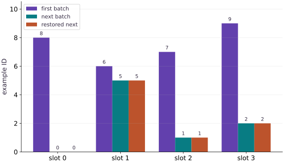

# Load, batch, and checkpoint order with Grain

Phase 06: Data & checkpoint recovery · about 75 minutes · CPU

This worked reference is validated on CPU. Accelerator compatibility requires a separate source review and target execution receipt. Use the execution matrix to review device selection and data ownership before adapting a separate target program.

**Before this lesson:** [Design an input pipeline](https://www.tahabouhsine.com/jaxpathways/lesson-recovery-01.html).

## What you will be able to do

- Build a Grain source/sampler/batch pipeline and verify its record order.
- Restore the next-read boundary rather than restarting from a seed.
- Check each epoch coverage independently.
- Distinguish tested serial iteration from unmeasured worker/prefetch performance.

## The problem

Now that you can check example order yourself, let’s use Grain to manage the input pipeline. We’ll shuffle two small epochs, batch the records, save the iterator position, and replay the next batch. Using zero worker processes keeps the sequence easy to inspect; this exercise does not measure prefetch speed.

## The idea

A resumable iterator preserves a position in a particular data sequence. Restoring it should reproduce the next batch under the same dataset and configuration. Prefetching makes it especially important to separate requested data from consumed data.

## Restore the next batch by identity

The loader first returns IDs $[8,6,7,9]$. After that batch is consumed, its iterator snapshot describes the next-read position; the uninterrupted next batch is $[0,5,1,2]$. A fresh compatible loader given those opaque bytes returns those same four IDs, features, and labels.

Saving before consuming the first batch would repeat it; saving after consuming the second would skip the intended next batch. Compare exact record identities and values, not just array shapes. Repeating the seed restarts the sampler and is not equivalent to restoring the iterator state.

$$
\operatorname{IDs}\!\left(\operatorname{next}(\operatorname{restore}(I_t;D,c))\right)=\operatorname{IDs}(B_{t+1})
$$

### Pause and reason

Why can a correct cursor still produce an incorrect resume?

<details><summary>Compare your reasoning</summary>

Position only has meaning relative to its data sequence and configuration. Recovery needs those identities as well as the cursor.

</details>

## Map a record key to a testable source

In this fixture, key $i$ always returns ID $i$, feature $x=i/10$, and label $2x-1$. The stable relation lets the check detect a transform that keeps IDs but scrambles feature/label alignment. A real source needs a versioned record identity as file paths and row counts can stay constant while content changes.

The source repr and sampler configuration are part of Grain's compatibility check. Keep a dataset revision or content digest too; a repr alone is not a cryptographic dataset identity.

## Follow the sampler-to-batch boundary

The sampler chooses keys, then the loader reads records and groups four at a time. For the first batch, those stages yield IDs $[8,6,7,9]$; the next is $[0,5,1,2]$. These vectors show the actual order after sampler and batching, which a feature shape cannot reveal.

The check also verifies every epoch covers all twelve IDs exactly once. Keep transforms at the intended boundary: a per-record transform sees one record, while a batch transform sees a group. Then check that labels remain attached to the same IDs.

```text
IndexSampler → record keys → TutorialSource[key]
             → Batch(4) → iterator → {id[4],x[4],y[4]}
```

## Snapshot the iterator after consumption

Call `get_state()` after the first `next(iterator)`. In this run, the resulting state occupies 329 bytes, and the next uninterrupted batch is $[0,5,1,2]$. A newly constructed compatible loader restored with `set_state()` returns the same IDs, features, and labels.

The state is opaque: let Grain interpret it rather than editing counters yourself. A seed repeats the first batch, while the saved iterator state resumes at the next-read boundary. If sampler settings differ, reject or revalidate the snapshot instead of assuming the cursor has the same meaning.

## Worker and buffer settings are workload choices

This run sets `worker_count=0`, so source reads happen serially in the current process and the sequence is easy to inspect. It verifies restoration, not prefetch throughput. With workers, transforms and buffers can move the boundary between requested and consumed records; source classes and transforms also need to work with the multiprocessing start method.

Choose worker and buffer settings from a representative workload and measure the full input-to-update path. The small in-memory source has no expensive decoding to hide, so its timing cannot show whether prefetching helps a real training job.

## Prepare the data and state

Create main.py in your course workspace. Use the tested course environment and add this block first.

```python
# Step 1 — Prepare the data and state: This setup makes the dataset and software assumptions explicit.
import numpy as np
import grain.python as grain
# Define `TutorialSource` module / container with explicit state and forward pass:
class TutorialSource:
    def __init__(self,count=12):
        self.count = count
    def __len__(self):
        return self.count
    def __getitem__(self,index):
        value = np.float32(index/10)
        return {"id":np.int64(index),"x":value,"y":np.float32(2*value-1)}
    def __repr__(self):
        return f"TutorialSource(v1,n={self.count})"
def make_loader(seed=42,batch_size=4,count=12,drop_remainder=False):
    return grain.DataLoader(
        data_source=TutorialSource(count),
        sampler=grain.IndexSampler(num_records=count,num_epochs=2,shuffle=True,seed=seed),
        operations=[grain.Batch(batch_size,drop_remainder=drop_remainder)],
        worker_count=0)
```

This setup makes the dataset and software assumptions explicit. No external dataset or accelerator is required.

## Build the pipeline or state transition

Append this block to the same file; follow the named state objects through each function.

```python
# Step 2 — Build the pipeline or state transition
loader = make_loader()
iterator = iter(loader)
first_batch = next(iterator)
snapshot = iterator.get_state()
second_batch = next(iterator)
restored_iterator = iter(make_loader())
restored_iterator.set_state(snapshot)
replayed_batch = next(restored_iterator)
```

The function boundaries expose which inputs determine the next output and which state must be preserved.

## Run the comparison

Append the checks, save main.py and run python main.py. Predict what should agree before running.

```python
# Step 3 — Run the comparison
np.testing.assert_array_equal(second_batch["id"],replayed_batch["id"])
for key in ("x","y"):
    np.testing.assert_array_equal(second_batch[key],replayed_batch[key])
for batch in (first_batch,second_batch):
    np.testing.assert_allclose(batch["y"],2*batch["x"]-1,atol=1e-7)
one_epoch = list(make_loader())[:3]
np.testing.assert_array_equal(np.sort(np.concatenate([b["id"] for b in one_epoch])),np.arange(12))
print("First IDs:",first_batch["id"].tolist())
print("Next IDs:",second_batch["id"].tolist())
print("Iterator state bytes:",len(snapshot))
print("Restored next batch matches")
```

The comparison checks the next behavior, not merely whether a save call succeeded.

## Run the example

```python
# Step 1 — Prepare the data and state: This setup makes the dataset and software assumptions explicit.
import numpy as np
import grain.python as grain
# Define `TutorialSource` module / container with explicit state and forward pass:
class TutorialSource:
    def __init__(self,count=12):
        self.count = count
    def __len__(self):
        return self.count
    def __getitem__(self,index):
        value = np.float32(index/10)
        return {"id":np.int64(index),"x":value,"y":np.float32(2*value-1)}
    def __repr__(self):
        return f"TutorialSource(v1,n={self.count})"
def make_loader(seed=42,batch_size=4,count=12,drop_remainder=False):
    return grain.DataLoader(
        data_source=TutorialSource(count),
        sampler=grain.IndexSampler(num_records=count,num_epochs=2,shuffle=True,seed=seed),
        operations=[grain.Batch(batch_size,drop_remainder=drop_remainder)],
        worker_count=0)

# Step 2 — Build the pipeline or state transition
loader = make_loader()
iterator = iter(loader)
first_batch = next(iterator)
snapshot = iterator.get_state()
second_batch = next(iterator)
restored_iterator = iter(make_loader())
restored_iterator.set_state(snapshot)
replayed_batch = next(restored_iterator)

# Step 3 — Run the comparison
np.testing.assert_array_equal(second_batch["id"],replayed_batch["id"])
for key in ("x","y"):
    np.testing.assert_array_equal(second_batch[key],replayed_batch[key])
for batch in (first_batch,second_batch):
    np.testing.assert_allclose(batch["y"],2*batch["x"]-1,atol=1e-7)
one_epoch = list(make_loader())[:3]
np.testing.assert_array_equal(np.sort(np.concatenate([b["id"] for b in one_epoch])),np.arange(12))
print("First IDs:",first_batch["id"].tolist())
print("Next IDs:",second_batch["id"].tolist())
print("Iterator state bytes:",len(snapshot))
print("Restored next batch matches")
```

Expected: The restored next IDs, features and labels match. One epoch contains twelve unique IDs. Exact shuffled order is determined by tested Grain version/configuration.

## Restoring the iterator repeats the next batch

**Predict:** Does the restored sequence start at the first batch again?



**Recorded CPU computation**

### Read the figure

The horizontal axis lists four within-batch slots; bar height is the example ID in that slot, not a measurement of feature size. The first batch is $[8,6,7,9]$. The next batch is $[0,5,1,2]$, and the restored-next bars have those same four heights slot by slot.

### Connect it to the computation

The exact match shows the iterator snapshot was taken after consuming the first batch and resumes at the second. Compare feature and label values along with IDs, then verify epoch coverage and reject a changed sampler configuration. Matching this batch proves the next-read boundary only, not a complete model-training restart.

```python
visual_data = {'kind': 'bar', 'labels': ['slot 0', 'slot 1', 'slot 2', 'slot 3'], 'ylabel': 'example ID', 'series': [{'label': 'first batch', 'y': first_batch['id'].tolist()}, {'label': 'next batch', 'y': second_batch['id'].tolist()}, {'label': 'restored next', 'y': replayed_batch['id'].tolist()}]}
```

## Recorded reference execution

CPU run: 2026-10-27T17:13:49.556223+00:00. JAX 0.9.2.

```text
First IDs: [8, 6, 7, 9]
Next IDs: [0, 5, 1, 2]
Iterator state bytes: 329
Restored next batch matches
First IDs: [8, 6, 7, 9]
Next IDs: [0, 5, 1, 2]
Iterator state bytes: 329
Restored next batch matches
Same seed restarts; it does not resume
Each epoch covers all twelve IDs
Next-epoch IDs replayed: [[2, 0, 11, 1], [5, 7, 6, 8]]
Expected sampler compatibility rejection
PASS: recovery-02

```

## A fresh iterator restarts

**Predict before running:** If you use the same seed but do not restore state, which batch arrives next?

```python
# Experiment — A fresh iterator restarts: The seed fixes ordering.
fresh_first = next(iter(make_loader()))
np.testing.assert_array_equal(fresh_first["id"],first_batch["id"])
assert not np.array_equal(fresh_first["id"],second_batch["id"])
print("Same seed restarts; it does not resume")
```

**Expected:** The first batch repeats, rather than replaying the saved next batch.

The seed fixes ordering. Position is separate state.

## Audit both epochs

**Predict before running:** Predict total record count and uniqueness per epoch.

```python
# Experiment — Audit both epochs: Across epochs, repeated IDs are intentional.
two_epochs = list(make_loader())
assert len(two_epochs)==6
for start in (0,3):
    values = np.concatenate([b["id"] for b in two_epochs[start:start+3]])
    np.testing.assert_array_equal(np.sort(values),np.arange(12))
print("Each epoch covers all twelve IDs")
```

**Expected:** Six batches; each set of three covers twelve records exactly once.

Across epochs, repeated IDs are intentional. Check coverage at the correct epoch boundary instead of treating every repeat as a bug.

## Make it yours

Consume two batches, snapshot, and replay the third batch with a new compatible iterator.

### How to write this exercise — Step-by-step recipe & starter scaffold

**Inputs:**
- A dataset, saved iterator snapshot, and matching loader configuration.

**Outputs:**
- A restored iterator whose next batches match uninterrupted iteration.

**Invariants to check:**
- Restore validates the sampler contract before yielding; compare IDs and values across epoch boundaries.

**Hints:**
- Save iterator state after a known batch, then restore into a fresh compatible iterator.
- Change one compatibility field to confirm early rejection.

**Starter code scaffold (fill in the TODOs):**

```python
import numpy as np
import grain.python as grain

def restore_loader(dataset, snapshot, expected_seed):
    """A restored iterator whose next batches match uninterrupted iteration."""
    # TODO: Restore a compatible Grain iterator snapshot and compare its next batches with uninterrupted iteration.
    raise NotImplementedError
```

<details><summary>Reference solution</summary>

```python
# Exercise solution
later = iter(make_loader())
next(later)
next(later)
later_state = later.get_state()
expected_third = next(later)
new_iterator = iter(make_loader())
new_iterator.set_state(later_state)
np.testing.assert_array_equal(next(new_iterator)["id"],expected_third["id"])
```

</details>

## Replay through an epoch boundary

**Transfer**

Save the iterator after the third batch and compare the next two batches with a fresh restored iterator. Check IDs and values. Explain why reproducing only the last batch of one epoch is not sufficient.

<details><summary>Hint</summary>

The loader has two epochs; the fourth and fifth batches belong to the next epoch.

</details>

### How to write: Replay through an epoch boundary — Step-by-step recipe & starter scaffold

**Inputs:**
- Save the iterator after the third batch and compare the next two batches with a fresh restored iterator. Check IDs and values. Explain why reproducing only the last batch of one epoch is not sufficient.

**Outputs:**
- Two matching subsequent batches across the epoch boundary.

**Invariants to check:**
- The snapshot includes epoch/order position, not merely the last batch contents.

**Hints:**
- The loader has two epochs; the fourth and fifth batches belong to the next epoch.

**Starter code scaffold (fill in the TODOs):**

```python
import numpy as np
import grain.python as grain

def practice_replay_through_an_epoch_boundary(loader, snapshot):
    """Implement the replay through an epoch boundary check."""
    # TODO: Restore the saved iterator at the boundary and compare the next two batch IDs and values with uninterrupted iteration.
    raise NotImplementedError
```

<details><summary>Reference solution and reasoning</summary>

```python
# Replay through an epoch boundary (Transfer): An epoch boundary changes the sampling context.
boundary=iter(make_loader())
for _ in range(3):next(boundary)
boundary_state=boundary.get_state()
expected=[next(boundary) for _ in range(2)]
replay=iter(make_loader())
replay.set_state(boundary_state)
for reference in expected:
    actual=next(replay)
    for name in ('id','x','y'):np.testing.assert_array_equal(actual[name],reference[name])
print('Next-epoch IDs replayed:',[b['id'].tolist() for b in expected])
```

An epoch boundary changes the sampling context. Testing across it checks more of the iterator contract than replaying one batch inside an epoch.

</details>

## Reject a changed sampler

**Challenge**

Try restoring the original snapshot into a loader with a different seed. Capture the compatibility error, then rebuild the matching loader.

<details><summary>Hint</summary>

Read the restore diagnostic; changing the seed changes sampler identity.

</details>

### How to write: Reject a changed sampler — Step-by-step recipe & starter scaffold

**Inputs:**
- Try restoring the original snapshot into a loader with a different seed. Capture the compatibility error, then rebuild the matching loader.

**Outputs:**
- Early rejection for the incompatible seed and successful replay with matching configuration.

**Invariants to check:**
- Compatibility is checked before any batch is consumed.

**Hints:**
- Read the restore diagnostic; changing the seed changes sampler identity.

**Starter code scaffold (fill in the TODOs):**

```python
import numpy as np
import grain.python as grain

def practice_reject_a_changed_sampler(loader, snapshot, changed_seed):
    """Implement the reject a changed sampler check."""
    # TODO: Restore the original snapshot with a changed seed, capture the contract error, and retry with the matching seed.
    raise NotImplementedError
```

<details><summary>Reference solution and reasoning</summary>

```python
# Reject a changed sampler (Challenge)
incompatible = iter(make_loader(seed=99))
try:
    incompatible.set_state(snapshot)
except ValueError:
    print("Expected sampler compatibility rejection")
else:
    raise AssertionError("Expected changed sampler rejection")
compatible = iter(make_loader(seed=42))
compatible.set_state(snapshot)
np.testing.assert_array_equal(next(compatible)["id"],second_batch["id"])
```

A snapshot cannot be assumed to apply to a different ordering configuration. Recreate the same pipeline configuration before restoring; explicit version/data identity checks remain necessary.

</details>

## Check your understanding

What makes a fresh loader resume at the saved next batch?

1. Only using the original seed.
2. Restoring compatible iterator state after rebuilding its source/sampler configuration.
3. Calling next once regardless of checkpoint position.

<details><summary>Answer and explanation</summary>

**1. Only using the original seed.**

A seed restarts an initial sequence; it does not specify the current cursor. Rebuild the compatible pipeline and restore its iterator state.

**2. Restoring compatible iterator state after rebuilding its source/sampler configuration. (correct)**

Seed and source determine order, but iterator state determines where the resumed reader begins.

**3. Calling next once regardless of checkpoint position.**

Consuming one batch moves the cursor and can skip data. Verify the restored next batch against the uninterrupted run before advancing.

</details>

## Diagnose the result

A snapshot cannot be assumed to apply to a different ordering configuration. Recreate the same pipeline configuration before restoring; explicit version/data identity checks remain necessary.

## Carry forward

- Map a record key to a testable source
- Follow the sampler-to-batch boundary
- Snapshot the iterator after consumption
- Worker and buffer settings are workload choices

## Keep your evidence

Keep Grain sampler configuration and exact example IDs for full and partial batches; save iterator bytes, recreate the loader, and compare the next batch before/after restore. Record the incompatible configuration failure.

Save your predictions, modified code, terminal outputs, and reasoning in your engineering portfolio.

## Primary references

- [NumPy Generator permutation](https://numpy.org/doc/stable/reference/random/generated/numpy.random.Generator.permutation.html)
- [Grain DataLoader guide](https://google-grain.readthedocs.io/en/latest/tutorials/data_loader_tutorial.html)

