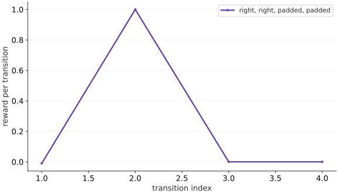

# Write a functional environment

Phase 12: Reinforcement learning · about 75 minutes · CPU

This worked reference is validated on CPU. Accelerator compatibility requires a separate source review and target execution receipt. Use the execution matrix to review device selection and data ownership before adapting a separate target program.

## What you will be able to do

- Implement reset and step as pure functions with explicit state.
- Distinguish termination, time-limit truncation and an absorbing finished state.
- Check transitions independently before using rewards to train a policy.

## The problem

A learner agent reaches a goal, but its reported reward keeps increasing afterward. Is the policy improving, or is the environment paying it repeatedly? Before training anything, we will build a small environment whose entire transition table can be checked. You will leave with explicit rules for starting, moving, ending and resetting an episode.

## The idea

A functional environment receives state and action and returns the next state, reward and termination information. Define exactly which transition earns reward and what later terminal padding means. This keeps rollouts and return calculations consistent.

## Reward belongs to a transition

The goal reward belongs to the move that enters position 3. For example, `step` at position 2 with action 1 returns next position 3, reward 1, and `terminated=True`; calling it again returns reward 0 because `done` is already true. This distinction matters because a correct final position alone cannot reveal a reward counted repeatedly during padding.

Follow the transition row in `step`: compute `active`, choose the new position, set the ending event, then choose the reward. Try one move into the goal and one call after it; compare both reward values.

### Pause and reason

Why can checking only the final state miss a reward bug?

<details><summary>Compare your reasoning</summary>

A rollout can end in the correct goal while counting its reward repeatedly during padding. Check transition rewards and accumulated return as well as final state.

</details>

## State contains what the next transition needs

`State(position, elapsed, done)` carries the information `step` needs without a hidden Python counter. A concrete path starts at `(1, 0, False)`: two right actions produce positions 2 then 3, and elapsed becomes 2. `observation` is only position, which suits the stationary policy here; a policy that must choose differently with one action left would also need time remaining in its observation. NamedTuple fields are pytree leaves, so the same transition can be transformed with `jit` or `vmap`.

## Walk through the reward before naming the return

First list transition rewards, then name their sum the return. Starting at position 1 and moving right gives rewards `(-0.01, 1)`, so this lesson's undiscounted return is 0.99. Starting at 0 adds one `-0.01` move and gives 0.98; averaging the two equally likely starts gives 0.985. A reward is attached to one transition, while a return is the sum over the episode. Here future rewards are not discounted.

$$
G=\sum_{t=0}^{H-1}r_t,\qquad H=8
$$

## Ending is an event; finished is a state

`terminated` and `truncated` describe this transition; `done` records that the episode is finished for later calls. Reaching the goal on the horizon wins as termination, as the deadline experiment confirms. A timeout away from the goal sets truncation. In either case this finite-horizon `step` keeps the final observation and does not auto-reset; later fixed-shape padding is a finished state with zero reward and no new event. The collector must explicitly reset before another episode.

## A timeout does not always mean a zero future value

Ask what the time limit means before building a target. For this lesson's eight-action task, the deadline ends the objective, so there is no value after it. A collection cutoff in a continuing task only stops data collection: preserve the final pre-reset observation and bootstrap from it. With reward `-0.01`, discount 0.9 and next value 2, the continuing target is $-0.01 + 0.9\cdot 2 = 1.79$; masking that cutoff like a true terminal would incorrectly make it `-0.01`. A reset observation belongs to the next episode, not this target.

$$
y=r+\gamma(1-\mathbb{1}_{\mathrm{terminated}})V(s_{\mathrm{next}})
$$

## Make the contract small enough to test

The JAX transition is deterministic; only `reset(key)` draws a start. Reusing key 7 deliberately reproduces a start, while `split` supplies separate starts. Validate binary integer actions and a positive horizon before compiled calls, since Python assertions cannot inspect traced values. These tiny transition checks establish the environment contract; they do not measure policy skill.

## Define state and the transition

Create main.py with this block. Run python3 main.py in the course CPU environment.

```python
# Step 1: Define state and the transition
"""Finite-horizon tabular policy training. CPU teaching environment, not a benchmark."""
from functools import partial
from typing import NamedTuple
import jax
import jax.numpy as jnp
import numpy as np


# Define `State` module / container with explicit state and forward pass:
class State(NamedTuple):
    position: jax.Array
    elapsed: jax.Array
    done: jax.Array


def reset(key):
    """Start uniformly at position 0 or 1; goal is position 3."""
    return State(jax.random.randint(key, (), 0, 2), jnp.int32(0), jnp.bool_(False))


def step(state, action, horizon=8):
    """Action 0: left, 1: right. Caller supplies binary action and positive horizon.

    Returns next state, reward, termination event, truncation event. Finished
    states absorb without more rewards/events. No implicit reset or lost final observation.
    """
    active = ~state.done
    proposed = jnp.clip(state.position + 2 * action - 1, 0, 3)
    position = jnp.where(active, proposed, state.position)
    elapsed = state.elapsed + active.astype(jnp.int32)
    terminated = active & (position == 3)
    truncated = active & ~terminated & (elapsed >= horizon)
    reward = jnp.where(active, jnp.where(terminated, 1., -.01), 0.)
    return State(position, elapsed, state.done | terminated | truncated), reward, terminated, truncated
```

The function returns all information needed by the next call. No hidden counter or reset changes the episode.

## Check a complete episode

Append this block to main.py. Run python3 main.py in the course CPU environment.

```python
# Step 2 — Check a complete episode
s = State(jnp.int32(1), jnp.int32(0), jnp.bool_(False))
positions, rewards = [int(s.position)], []
for action in [1, 1, 0, 0]:
    s, reward, terminated, truncated = step(s, jnp.int32(action))
    positions.append(int(s.position))
    rewards.append(float(reward))
assert positions == [1, 2, 3, 3, 3]
assert jnp.allclose(jnp.array(rewards), jnp.array([-.01, 1., 0., 0.]))
assert int(s.elapsed) == 2
print('positions:', positions, 'rewards:', rewards)
```

The known two-action path produces one terminal reward and then zero padding.

## Step 3: Verify invariants on the completed state

Run the final shape and numerical assertions to confirm the state built in Steps 1 and 2.

```python
assert jnp.allclose(jnp.array(rewards), jnp.array([-.01, 1., 0., 0.]))
assert int(s.elapsed) == 2
```

Checking these invariants confirms the computation is ready for the full worked experiment.

## Run the example

```python
# Complete runnable example (rl-01)
"""Finite-horizon tabular policy training. CPU teaching environment, not a benchmark."""
from functools import partial
from typing import NamedTuple
import jax
import jax.numpy as jnp
import numpy as np


# Define `State` module / container with explicit state and forward pass:
class State(NamedTuple):
    position: jax.Array
    elapsed: jax.Array
    done: jax.Array


def reset(key):
    """Start uniformly at position 0 or 1; goal is position 3."""
    return State(jax.random.randint(key, (), 0, 2), jnp.int32(0), jnp.bool_(False))


def step(state, action, horizon=8):
    """Action 0: left, 1: right. Caller supplies binary action and positive horizon.

    Returns next state, reward, termination event, truncation event. Finished
    states absorb without more rewards/events. No implicit reset or lost final observation.
    """
    active = ~state.done
    proposed = jnp.clip(state.position + 2 * action - 1, 0, 3)
    position = jnp.where(active, proposed, state.position)
    elapsed = state.elapsed + active.astype(jnp.int32)
    terminated = active & (position == 3)
    truncated = active & ~terminated & (elapsed >= horizon)
    reward = jnp.where(active, jnp.where(terminated, 1., -.01), 0.)
    return State(position, elapsed, state.done | terminated | truncated), reward, terminated, truncated

# Step 2 — Check a complete episode
s = State(jnp.int32(1), jnp.int32(0), jnp.bool_(False))
positions, rewards = [int(s.position)], []
for action in [1, 1, 0, 0]:
    s, reward, terminated, truncated = step(s, jnp.int32(action))
    positions.append(int(s.position))
    rewards.append(float(reward))
assert positions == [1, 2, 3, 3, 3]
assert jnp.allclose(jnp.array(rewards), jnp.array([-.01, 1., 0., 0.]))
assert int(s.elapsed) == 2
print('positions:', positions, 'rewards:', rewards)
```

Expected: Positions are $(1,2,3,3,3)$. Rewards are $(-0.01,1,0,0)$; elapsed time stops at $2$.

## One goal reward, then absorbing padding

**Predict:** Will the reward stay at one after the goal?



**Recorded CPU computation**

### Read the figure

The x-axis is transition index (action number); the y-axis is reward on that transition. The plotted trace is `right, right, padded, padded`: from position 1 it visits 2, then goal 3, so rewards are `-0.01, 1, 0, 0`. Predict the sum before reading on: the first two rewards give return 0.99, while the last two are padding rather than new reward events.

### Connect it to the computation

The execution prints positions `(1,2,3,3,3)` and rewards `(-0.01,1,0,0)`, matching all four plotted points. Compare the single peak at transition 2 with the zero tail: the peak marks entry to the goal, and the tail is the absorbing-state behavior of `step`. If the tail were 1, repeated calls after `done` would be paying again. This figure checks reward semantics, not policy improvement.

```python
visual_data = {'kind':'line','x':[1,2,3,4],'xlabel':'transition index','ylabel':'reward per transition','series':[{'label':'right, right, padded, padded','y':rewards}]}
```

## Recorded reference execution

CPU run: 2026-10-27T17:14:00.436497+00:00. JAX 0.9.2.

```text
positions: [1, 2, 3, 3, 3] rewards: [-0.009999999776482582, 1.0, 0.0, 0.0]
positions: [1, 2, 3, 3, 3] rewards: [-0.009999999776482582, 1.0, 0.0, 0.0]
deadline goal: True False
fraction starting at one: 0.5020000338554382
PASS: rl-01

```

## A goal at the deadline

**Predict before running:** Which event wins if the final permitted action reaches the goal?

```python
# Experiment — A goal at the deadline
s = State(jnp.int32(2), jnp.int32(1), jnp.bool_(False))
s, r, term, trunc = step(s, jnp.int32(1), horizon=2)
assert bool(term) and not bool(trunc) and float(r) == 1.
print('deadline goal:', bool(term), bool(trunc))
```

**Expected:** Termination is true; truncation is false.

The goal transition defines a completed task, so the two flags remain mutually exclusive.

## The same key is the same start

**Predict before running:** Will resetting twice with one key produce two independent trials?

```python
# Experiment — The same key is the same start
# Create or split explicit PRNG key(s) (`key`) for reproducible randomness.
key = jax.random.key(7)
a, b = reset(key), reset(key)
assert int(a.position) == int(b.position)
# Create or split explicit PRNG key(s) (`starts`) for reproducible randomness.
starts = jax.vmap(reset)(jax.random.split(key, 1000)).position
assert 0.4 < float(starts.mean()) < 0.6
print('fraction starting at one:', float(starts.mean()))
```

**Expected:** Replay is exact; a split-key batch contains both starts.

This verifies the randomness contract, not a guarantee that every tiny batch is balanced.

## Make it yours

Begin at position $0$, choose left for three actions with horizon $3$, and then attempt one more action. Verify the event flags, total reward and absorbing state.

### How to write this exercise — Step-by-step recipe & starter scaffold

**Inputs:**
- Initial state is position 0, elapsed count 0, and not done.
- The attempted action is left (0), and the horizon is 3.
- Use the lesson’s `State` and `step` definitions.

**Outputs:**
- A trace with one next state, reward, termination flag, and truncation flag per transition.
- A check for a repeated call after the state has finished.

**Invariants to check:**
- The step at the deadline remains part of the return.
- A call after finishing emits no new reward or ending event.
- Position and elapsed count follow the declared environment contract.

**Hints:**
- Keep event flags separate from the persistent `done` state.
- Record the reward from each transition before checking the next state.

**Starter code scaffold (fill in the TODOs):**

```python
from typing import NamedTuple
import jax.numpy as jnp

class State(NamedTuple):
    position: jnp.ndarray
    elapsed: jnp.ndarray
    done: jnp.ndarray

def step(state, action, horizon=3):
    # TODO: implement the transition contract from the lesson
    raise NotImplementedError

def inspect_deadline():
    state = State(jnp.int32(0), jnp.int32(0), jnp.bool_(False))
    rewards = []
    events = []
    # TODO: record the three requested transitions and one call after done
    raise NotImplementedError
```

<details><summary>Reference solution</summary>

```python
# Exercise solution
s = State(jnp.int32(0), jnp.int32(0), jnp.bool_(False))
total = 0.
for i in range(3):
    s, r, term, trunc = step(s, jnp.int32(0), 3)
    # Accumulate the next contribution into `total`.
    total += float(r)
    assert not bool(term) and bool(trunc) == (i == 2)
assert abs(total + .03) < 1e-6
s2, r, term, trunc = step(s, jnp.int32(1), 3)
assert int(s2.position) == 0 and int(s2.elapsed) == 3 and float(r) == 0.
```

</details>

## Separate the two target meanings

**Transfer / diagnosis**

Compute the continuing-task bootstrap target for a timeout and a true terminal transition when $r=-0.01$, $\gamma=0.9$ and $V=2$. Compare with our finite-horizon objective.

<details><summary>Hint</summary>

Use the termination flag for the continuing task. The finite-horizon task assigns zero value after its own deadline.

</details>

### How to write: Separate the two target meanings — Step-by-step recipe & starter scaffold

**Inputs:**
- A transition reward of -0.01, discount 0.9, and next-state value 2.
- Two meanings for the ending event: a continuing-task timeout and a true terminal.

**Outputs:**
- Both candidate targets and a comparison with the finite-horizon contract.

**Invariants to check:**
- A true terminal has no future value.
- The finite-horizon deadline and a continuing-task collection cutoff express different objectives.

**Hints:**
- Write the one-step target before substituting the timeout or terminal mask.
- Keep the reward term in both cases.

**Starter code scaffold (fill in the TODOs):**

```python
import jax.numpy as jnp

def compare_ending_targets(reward, discount, next_value):
    # TODO: compute the continuing-cutoff and terminal targets
    timeout_target = ...
    terminal_target = ...
    raise NotImplementedError
```

<details><summary>Reference solution and reasoning</summary>

```python
# Separate the two target meanings (Transfer / diagnosis): The arithmetic exposes a modeling choice.
r, gamma, value = -.01, .9, 2.
continuing_timeout = r + gamma * value
terminal = r
finite_horizon_timeout = r
assert abs(continuing_timeout - 1.79) < 1e-7
assert terminal == finite_horizon_timeout == -.01
```

The arithmetic exposes a modeling choice. Copying a done mask from a different task can silently change the objective.

</details>

## Enumerate all one-step moves

**Transfer / diagnosis**

Check both actions at every unfinished position with a Python reference, then compare the jitted function.

<details><summary>Hint</summary>

Use ordinary min and max for the independent reference.

</details>

### How to write: Enumerate all one-step moves — Step-by-step recipe & starter scaffold

**Inputs:**
- Every unfinished corridor position and both binary actions.
- The lesson’s transition function.

**Outputs:**
- A Python reference result and the compiled transition result for each case.

**Invariants to check:**
- Both action choices are checked at both boundaries.
- The reference check does not call the JAX transition to compute its expected result.

**Hints:**
- Represent the independent reference using ordinary Python integers.
- Compare next state, reward, and both ending flags.

**Key functions & syntax to use:**
- `jax.jit(fn) / @jax.jit` — Traces a function for its input signatures and compiles it; changed shapes, dtypes, or static arguments can trigger another compilation.

**Starter code scaffold (fill in the TODOs):**

```python
import jax

def compare_all_moves(step, State):
    compiled_step = jax.jit(step)
    # TODO: enumerate positions/actions and compare with an independent rule
    raise NotImplementedError
```

<details><summary>Reference solution and reasoning</summary>

```python
# Enumerate all one-step moves (Transfer / diagnosis)
# Wrap with `jax.jit` (`compiled`) so XLA traces and compiles the function.
compiled = jax.jit(step)
for position in range(3):
    for action in [0, 1]:
        s = State(jnp.int32(position), jnp.int32(0), jnp.bool_(False))
        nxt, reward, term, trunc = compiled(s, jnp.int32(action))
        expected = min(3, max(0, position + (1 if action else -1)))
        assert int(nxt.position) == expected
        assert bool(term) == (expected == 3)
        assert abs(float(reward) - (1. if expected == 3 else -.01)) < 1e-6
```

Enumeration checks boundary behavior separately from the vectorized implementation.

</details>

## Check your understanding

What should step emit when called on a finished state?

1. Another goal reward because the agent is still at the goal
2. A new random start and its first reward
3. The unchanged state, zero reward and no new ending event

<details><summary>Answer and explanation</summary>

**1. Another goal reward because the agent is still at the goal**

Repeated terminal rewards would change the return. Step the absorbing state again and check for zero additional reward.

**2. A new random start and its first reward**

An implicit reset would mix episodes and change the next observation contract. Reset explicitly after the terminal transition.

**3. The unchanged state, zero reward and no new ending event (correct)**

Absorbing padding preserves one episode. Reset is a separate explicit operation, and ending flags mark events rather than every later padded row.

</details>

## Diagnose the result

If return exceeds the always-right value, inspect rewards after the first ending event. If a trajectory jumps from the goal to a start, look for auto-reset before storing the final observation. If all starts match, inspect whether keys were split before batching.

## Carry forward

- Environment state, observation and policy parameters are different objects.
- Explicit ending contracts make fixed-shape rollouts safe to interpret.

## Keep your evidence

Keep independent transition enumeration, reward/terminal checks and the absorbing-state diagnosis. Explain the state and observation contract.

Save your predictions, modified code, terminal outputs, and reasoning in your engineering portfolio.

## Primary references

- [JAX: explicit pseudorandom keys](https://docs.jax.dev/en/latest/random-numbers.html)
- [JAX scan: fixed-shape carry](https://docs.jax.dev/en/latest/_autosummary/jax.lax.scan.html)
- [Schulman et al.: Proximal Policy Optimization Algorithms](https://arxiv.org/abs/1707.06347)
- [Gymnasium: termination and truncation](https://gymnasium.farama.org/tutorials/gymnasium_basics/handling_time_limits/)

