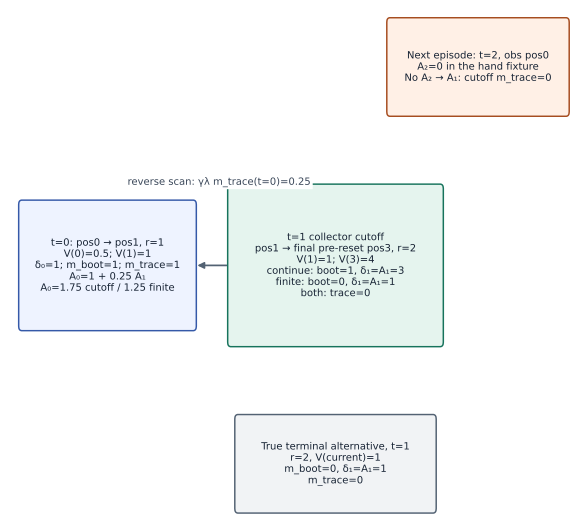
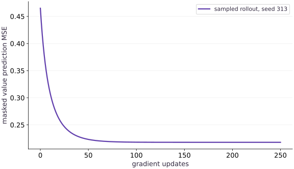

# Learn value functions and generalized advantage estimation

Phase 12: Reinforcement learning · about 45 minutes · CPU

This worked reference is validated on CPU. Accelerator compatibility requires a separate source review and target execution receipt. Use the execution matrix to review device selection and data ownership before adapting a separate target program.

**Before this lesson:** [Evaluate agents across seeds](https://www.tahabouhsine.com/jaxpathways/lesson-rl-04.html).

## What you will be able to do

- Fit a tabular value function to sampled discounted returns using gamma=0.9 over the finite horizon of at most eight actions, and report its error before and after optimization.
- Compute generalized advantages with a reverse scan over time and an independently hand-calculated multi-step example.
- Use the retained final observation to bootstrap a continuing task cutoff while stopping the trace across episode resets.
- Explain why the existing finite-horizon REINFORCE/PPO objective opts out of time-limit bootstrapping.

## The problem

For a finite task lasting at most eight actions, how can a tabular critic estimate the expected discounted return with gamma=0.9 from sampled trajectories? We will fit the table to those same discounted targets, then compute GAE with the same discount. At a true terminal there is no bootstrap; a collector cutoff in a continuing task can bootstrap from the final pre-reset observation while stopping the trace.

## The idea

The table minimizes masked squared error to sampled discounted returns G_t = r_t + 0.9 r_(t+1) + ... through the episode end, over at most eight actions. GAE uses gamma=0.9 and lambda=0.95. This critic target matches that discount. The position-only table remains an approximation because position omits remaining time and sampled stochastic returns vary. A lower critic loss describes fit to these targets; by itself it says nothing about policy improvement.

## One retained transition has two observations

The fitted objective is the expected discounted return for the finite task: G_t = r_t + 0.9 r_(t+1) + 0.9^2 r_(t+2) + ... until termination or the eight-action task deadline. Before fitting, make the target match this gamma=0.9 definition. For each action, keep the observation used to choose it and the actual observation returned by the transition. In the corridor collector these are `observation` and `next_observation`; the latter is saved before any reset. At an external collector cutoff, the row after the cutoff may begin a new episode at position 0 even though the final observation from the cutoff was position 3. A continuing-task critic bootstraps from position 3. The reset observation belongs to the next transition, not the previous transition's target.

The value table has one trainable scalar for each of the four positions. We fit it by minimizing squared error to sampled discounted returns on live rows. Padding rows stay in the array for a fixed shape but contribute neither loss nor gradient. The fit is a real optimization over sampled trajectories; noisy outcomes and the missing remaining-time feature mean the final error should fall without reaching zero.

### A cutoff bootstraps value but stops reverse GAE

**Predict:** If the collector cutoff is the task’s true finite deadline, which bootstrap term and advantage values change?



*Deterministic hand fixture with gamma=0.5 and lambda=0.5; the critic loss plot separately uses gamma=0.9 discounted targets.*

This is a hand-computed mechanism example with gamma=0.5 and lambda=0.5, separate from the gamma=0.9 critic-fit rollout plot. Read each transition from left to right in increasing time. The reverse-scan arrow points from A1 back to A0. At t=0, delta0 = 1 + 0.5(1) - 0.5 = 1, bootstrap mask is 1 and trace mask is 1, so A0 = 1 + 0.25(3) = 1.75 for a continuing cutoff. At t=1, the final pre-reset observation is position 3 with V=4: a continuing collector uses bootstrap mask 1 and delta1=2+0.5(4)-1=3. The trace mask is 0, so the reset episode at position 0 cannot send A2 backward across the boundary. If this same cutoff is the finite task deadline, bootstrap mask becomes 0, delta1=1, and A0=1.25. A true terminal also has bootstrap mask 0; for reward 2 and current value 1, its residual is 1 even if a terminal observation has a stored value.

```text
Case                         delta1  m_boot  m_trace1  A1   A0
Continuing collector cutoff      3       1       0      3    1.75
Finite-horizon deadline          1       0       0      1    1.25
True terminal                    1       0       0      1    n/a
```

Changed-input prediction: turning the continuing cutoff into a task deadline removes the 0.5 x V(position 3)=2 bootstrap contribution from delta1; because the trace mask was already zero, the difference reaches A0 only through the earlier t=0 trace.

### Pause and reason

At a collector cutoff, the next rollout row shows reset position 0 but the transition record says the final observation was position 3. Which observation supplies the bootstrap value?

<details><summary>Compare your reasoning</summary>

Use position 3, the actual transition result retained in `next_observation`. Position 0 is the start of another episode and must not enter the earlier episode's target.

</details>

## Bootstrapping and trace continuation answer different questions

A true terminal state has no future value, so its bootstrap mask is zero. A collector cutoff in a continuing task still has future value, so it can bootstrap from the final pre-reset observation. In both cases the recursive trace stops at the boundary. Otherwise an advantage from the new episode would flow backward through a reset. Padding also has a zero mask and contributes no value loss.

The finite-horizon critic target discounts rewards by gamma=0.9 through the eight-action task deadline. At that deadline, the finite task has no value beyond its objective horizon. For that objective, the horizon has no future value, so use `bootstrap_on_truncation=False`. Set it true only when truncation means the collector stopped a continuing task whose process would otherwise continue.

$$
\delta_t = r_t + \gamma\,m_t^{\mathrm{boot}} V(s_{t+1}) - V(s_t) \quad A_t = \delta_t + \gamma\lambda\,m_t^{\mathrm{trace}} A_{t+1}
$$

## Work the reverse scan by hand

Let $\gamma=0.5$, $\lambda=0.5$, and let $V(0)=0.5$, $V(1)=1$, $V(2)=2$, $V(3)=4$. The first transition has reward 1 from position 0 to 1, so $\delta_0=1+0.5(1)-0.5=1$. The second has reward 2 from position 1 and is cut off at final position 3, so $\delta_1=2+0.5(4)-1=3$. It bootstraps from position 3 but ends the trace. Thus $A_1=3$, then $A_0=1+0.5(0.5)(3)=1.75$. The reset observation in the next row is position 0 and has no effect on either value.

Discount matching matters even when the table fits the training targets closely. For rewards [1,1], gamma=0.9, terminal V=0, and the undiscounted table [2,1,0], the TD residuals are 1+0.9(1)-2=-0.1 and 1-1=0. The matching discounted table [1.9,1,0] gives 1+0.9(1)-1.9=0 and 1-1=0. These hand values are an exact check, not a policy comparison.

## A lower fit error is evidence of optimization, not policy quality

The fitted table estimates expected discounted return from each observed position for the stated gamma=0.9 objective. It cannot represent time remaining, and sampled returns vary, so it cannot predict an individual trajectory exactly. Read the error plot as training evidence for this small critic. It does not establish that a policy improved, that a neural critic works, or that a continuous-control agent is effective. Policy improvement requires an actor update and held-out rollout evaluation under a stated seed set and action budget.

## Define the rollout and return target

Import the local CPU dependencies, define the fixed-shape collector, and retain each transition’s actual next observation. Add the finite-horizon discounted-return helper with gamma=0.9.

```python
import jax
import jax.numpy as jnp
import numpy as np

def rollout(theta, key, batch_size=512, horizon=8):
    """Collect fixed-shape trajectories and retain each pre-reset next state."""
    reset_key, action_key = jax.random.split(key)
    position = jax.vmap(lambda subkey: jax.random.randint(subkey, (), 0, 2))(jax.random.split(reset_key, batch_size))
    elapsed = jnp.zeros((batch_size,), dtype=jnp.int32)
    done = jnp.zeros((batch_size,), dtype=jnp.bool_)
    time_keys = jax.random.split(action_key, horizon)

    def collect(carry, time_key):
        position, elapsed, done = carry
        observation = position
        active = ~done
        keys = jax.random.split(time_key, batch_size)
        probability = jax.nn.sigmoid(theta[jnp.minimum(position, 2)])
        action = jax.vmap(jax.random.bernoulli)(keys, probability).astype(jnp.int32)
        proposed = jnp.clip(position + 2 * action - 1, 0, 3)
        next_position = jnp.where(active, proposed, position)
        next_elapsed = elapsed + active.astype(jnp.int32)
        terminated = active & (next_position == 3)
        truncated = active & ~terminated & (next_elapsed >= horizon)
        reward = jnp.where(active, jnp.where(terminated, 1., -.01), 0.)
        next_done = done | terminated | truncated
        record = {
            "observation": observation,
            "next_observation": next_position,
            "reward": reward,
            "active": active,
            "terminated": terminated,
            "truncated": truncated,
        }
        return (next_position, next_elapsed, next_done), record

    final_state, records = jax.lax.scan(collect, (position, elapsed, done), time_keys)
    return final_state, records

def discounted_returns_to_go(rewards, gamma):
    """Compute finite-horizon discounted returns along the time axis."""
    discounts = gamma ** jnp.arange(rewards.shape[0], dtype=rewards.dtype)
    weighted = rewards * discounts.reshape((-1,) + (1,) * (rewards.ndim - 1))
    return jnp.cumsum(weighted[::-1], axis=0)[::-1] / discounts.reshape((-1,) + (1,) * (rewards.ndim - 1))
```

The collector stores `next_observation` before any reset and returns time-major records. No repository module is needed.

## Define and fit the tabular value function

Define a masked mean-squared objective and its gradient-update scan. Padded rows are sanitized before residual arithmetic and do not affect the denominator.

```python
def value_loss(value_table, records, targets):
    """Masked MSE with fixed targets and padding sanitized before arithmetic."""
    active = jnp.asarray(records["active"], dtype=jnp.bool_)
    predictions = value_table[jnp.clip(records["observation"], 0, 3)]
    targets = jax.lax.stop_gradient(jnp.asarray(targets))
    safe_targets = jnp.where(active, targets, jnp.zeros_like(targets))
    residual = jnp.where(active, predictions - safe_targets, jnp.zeros_like(predictions))
    return jnp.sum(jnp.square(residual)) / jnp.maximum(jnp.sum(active), 1)


def fit_value_function(records, targets, updates=250, learning_rate=.1):
    """Fit one scalar per state and retain the initial and updated losses."""
    table = jnp.zeros((4,), dtype=jnp.float32)
    loss_fn = lambda candidate: value_loss(candidate, records, targets)
    initial = loss_fn(table)

    def update(candidate, _):
        _, gradient = jax.value_and_grad(loss_fn)(candidate)
        next_table = candidate - learning_rate * gradient
        return next_table, loss_fn(next_table)

    table, history = jax.lax.scan(update, table, None, length=updates)
    return table, jnp.concatenate((initial[None], history))
```

The four table entries correspond to positions. The target is fixed rollout reward-to-go; the optimizer changes the table through gradient descent.

## Define GAE and choose the reproducible policy

Implement reverse GAE with separate bootstrap and trace-continuation masks, then set the policy logits used by the example.

```python
def generalized_advantage_estimate(records, value_table, gamma=.9, lam=.95,
                                   bootstrap_on_truncation=False):
    """Reverse GAE; bootstrap mask and trace-continuation mask stay separate."""
    observations = records["observation"]
    next_observations = records["next_observation"]
    active = records["active"].astype(jnp.bool_)
    terminated = records["terminated"].astype(jnp.bool_)
    truncated = records["truncated"].astype(jnp.bool_)
    values = value_table[jnp.clip(observations, 0, 3)]
    next_values = value_table[jnp.clip(next_observations, 0, 3)]
    bootstrap = ~(terminated | (truncated & ~jnp.asarray(bootstrap_on_truncation)))
    delta = records["reward"] + gamma * bootstrap.astype(values.dtype) * next_values - values
    delta = jnp.where(active, delta, 0.)
    next_active = jnp.concatenate((active[1:], jnp.zeros_like(active[:1])), axis=0)
    trace = active & ~(terminated | truncated) & next_active

    def reverse_step(carry, inputs):
        residual, continues = inputs
        advantage = residual + gamma * lam * continues.astype(residual.dtype) * carry
        return advantage, advantage

    reverse_values = jnp.zeros(observations.shape[1:], dtype=values.dtype)
    _, reverse_advantages = jax.lax.scan(
        reverse_step, reverse_values, (delta[::-1], trace[::-1]))
    return jnp.where(active, reverse_advantages[::-1], 0.)

theta = jnp.array([-.7, .3, 1.1])
```

A terminal or cutoff can stop the trace while a continuing-task cutoff may still bootstrap from its retained final observation. This finite-horizon example selects no bootstrap beyond its deadline.

## Collect a rollout and fit values

Collect seed 313 data, compute return targets, fit the table for 250 updates, and retain the full loss history.

```python
_, rollout_records = rollout(theta, jax.random.key(313), batch_size=512, horizon=8)
targets = discounted_returns_to_go(rollout_records["reward"], gamma=.9)

value_table, loss_history = fit_value_function(rollout_records, targets)

print("initial / final masked value MSE:", float(loss_history[0]), float(loss_history[-1]))
print("fitted V(position 0..3):", np.asarray(value_table).round(4))
```

Both the initial and updated errors are retained so the exercise can inspect actual learning rather than a hard-coded expected answer.

## Estimate GAE and prepare the learning plot

Estimate advantages with the finite-horizon setting, check their shape and finiteness, and build plot data from the retained loss history.

```python
advantages = generalized_advantage_estimate(
    rollout_records, value_table, gamma=.9, lam=.95,
    bootstrap_on_truncation=False)
print("initial / final masked value MSE:", float(loss_history[0]), float(loss_history[-1]))
print("fitted V(position 0..3):", np.asarray(value_table).round(4))
print("GAE shape:", advantages.shape, "all finite:", bool(jnp.all(jnp.isfinite(advantages))))

visual_data = {
    "kind": "line",
    "x": list(range(len(loss_history))),
    "xlabel": "gradient updates",
    "ylabel": "masked value prediction MSE",
    "series": [{"label": "sampled rollout targets, seed 313", "y": np.asarray(loss_history).tolist()}],
}
```

Every plotted point is a measured masked-MSE value from this run. The four-state critic and finite corridor do not demonstrate actor improvement or continuous control.

## Run the example

```python
"""Self-contained CPU example: tabular value fitting and masked GAE."""

import jax
import jax.numpy as jnp
import numpy as np

def rollout(theta, key, batch_size=512, horizon=8):
    """Collect fixed-shape trajectories and retain each pre-reset next state."""
    reset_key, action_key = jax.random.split(key)
    position = jax.vmap(lambda subkey: jax.random.randint(subkey, (), 0, 2))(jax.random.split(reset_key, batch_size))
    elapsed = jnp.zeros((batch_size,), dtype=jnp.int32)
    done = jnp.zeros((batch_size,), dtype=jnp.bool_)
    time_keys = jax.random.split(action_key, horizon)

    def collect(carry, time_key):
        position, elapsed, done = carry
        observation = position
        active = ~done
        keys = jax.random.split(time_key, batch_size)
        probability = jax.nn.sigmoid(theta[jnp.minimum(position, 2)])
        action = jax.vmap(jax.random.bernoulli)(keys, probability).astype(jnp.int32)
        proposed = jnp.clip(position + 2 * action - 1, 0, 3)
        next_position = jnp.where(active, proposed, position)
        next_elapsed = elapsed + active.astype(jnp.int32)
        terminated = active & (next_position == 3)
        truncated = active & ~terminated & (next_elapsed >= horizon)
        reward = jnp.where(active, jnp.where(terminated, 1., -.01), 0.)
        next_done = done | terminated | truncated
        record = {
            "observation": observation,
            "next_observation": next_position,
            "reward": reward,
            "active": active,
            "terminated": terminated,
            "truncated": truncated,
        }
        return (next_position, next_elapsed, next_done), record

    final_state, records = jax.lax.scan(collect, (position, elapsed, done), time_keys)
    return final_state, records

def discounted_returns_to_go(rewards, gamma):
    """Compute finite-horizon discounted returns along the time axis."""
    discounts = gamma ** jnp.arange(rewards.shape[0], dtype=rewards.dtype)
    weighted = rewards * discounts.reshape((-1,) + (1,) * (rewards.ndim - 1))
    return jnp.cumsum(weighted[::-1], axis=0)[::-1] / discounts.reshape((-1,) + (1,) * (rewards.ndim - 1))

def value_loss(value_table, records, targets):
    """Masked MSE with fixed targets and padding sanitized before arithmetic."""
    active = jnp.asarray(records["active"], dtype=jnp.bool_)
    predictions = value_table[jnp.clip(records["observation"], 0, 3)]
    targets = jax.lax.stop_gradient(jnp.asarray(targets))
    safe_targets = jnp.where(active, targets, jnp.zeros_like(targets))
    residual = jnp.where(active, predictions - safe_targets, jnp.zeros_like(predictions))
    return jnp.sum(jnp.square(residual)) / jnp.maximum(jnp.sum(active), 1)


def fit_value_function(records, targets, updates=250, learning_rate=.1):
    """Fit one scalar per state and retain the initial and updated losses."""
    table = jnp.zeros((4,), dtype=jnp.float32)
    loss_fn = lambda candidate: value_loss(candidate, records, targets)
    initial = loss_fn(table)

    def update(candidate, _):
        _, gradient = jax.value_and_grad(loss_fn)(candidate)
        next_table = candidate - learning_rate * gradient
        return next_table, loss_fn(next_table)

    table, history = jax.lax.scan(update, table, None, length=updates)
    return table, jnp.concatenate((initial[None], history))

def generalized_advantage_estimate(records, value_table, gamma=.9, lam=.95,
                                   bootstrap_on_truncation=False):
    """Reverse GAE; bootstrap mask and trace-continuation mask stay separate."""
    observations = records["observation"]
    next_observations = records["next_observation"]
    active = records["active"].astype(jnp.bool_)
    terminated = records["terminated"].astype(jnp.bool_)
    truncated = records["truncated"].astype(jnp.bool_)
    values = value_table[jnp.clip(observations, 0, 3)]
    next_values = value_table[jnp.clip(next_observations, 0, 3)]
    bootstrap = ~(terminated | (truncated & ~jnp.asarray(bootstrap_on_truncation)))
    delta = records["reward"] + gamma * bootstrap.astype(values.dtype) * next_values - values
    delta = jnp.where(active, delta, 0.)
    next_active = jnp.concatenate((active[1:], jnp.zeros_like(active[:1])), axis=0)
    trace = active & ~(terminated | truncated) & next_active

    def reverse_step(carry, inputs):
        residual, continues = inputs
        advantage = residual + gamma * lam * continues.astype(residual.dtype) * carry
        return advantage, advantage

    reverse_values = jnp.zeros(observations.shape[1:], dtype=values.dtype)
    _, reverse_advantages = jax.lax.scan(
        reverse_step, reverse_values, (delta[::-1], trace[::-1]))
    return jnp.where(active, reverse_advantages[::-1], 0.)

theta = jnp.array([-.7, .3, 1.1])

_, rollout_records = rollout(theta, jax.random.key(313), batch_size=512, horizon=8)
targets = discounted_returns_to_go(rollout_records["reward"], gamma=.9)

value_table, loss_history = fit_value_function(rollout_records, targets)

print("initial / final masked value MSE:", float(loss_history[0]), float(loss_history[-1]))
print("fitted V(position 0..3):", np.asarray(value_table).round(4))

advantages = generalized_advantage_estimate(
    rollout_records, value_table, gamma=.9, lam=.95,
    bootstrap_on_truncation=False)
print("initial / final masked value MSE:", float(loss_history[0]), float(loss_history[-1]))
print("fitted V(position 0..3):", np.asarray(value_table).round(4))
print("GAE shape:", advantages.shape, "all finite:", bool(jnp.all(jnp.isfinite(advantages))))

visual_data = {
    "kind": "line",
    "x": list(range(len(loss_history))),
    "xlabel": "gradient updates",
    "ylabel": "masked value prediction MSE",
    "series": [{"label": "sampled rollout targets, seed 313", "y": np.asarray(loss_history).tolist()}],
}

```

Expected: A four-entry value table, its retained masked-MSE history, and time-major GAE advantages from one sampled finite-horizon rollout.

## Value error falls while the table learns sampled returns

**Predict:** Will the error reach zero, and does a decreasing critic loss prove that the policy improved?



**Recorded CPU computation**

### Read the figure

The line plots masked mean-squared error after each gradient update on 512 episodes collected with seed 313. With gamma=0.9 discounted targets, it falls from about 0.3258 to 0.1359. The remaining error is expected because the four-entry position table omits remaining time and sampled returns vary. This plot measures critic fit only.

### Connect it to the computation

Every plotted point comes from `fit_value_function` on retained rollout data. The task's existing policy objectives and their exact-return evaluation remain separate; the critic extension has no continuous-control or actor-improvement claim.

```python
visual_data = {'kind':'line','x':list(range(len(loss_history))),'xlabel':'gradient updates','ylabel':'masked value prediction MSE','series':[{'label':'sampled rollout, seed 313','y':np.asarray(loss_history).tolist()}]}
```

## Recorded reference execution

CPU run: 2026-10-27T15:33:20.289211+00:00. JAX 0.9.2.

```text
initial / final masked value MSE: 0.3257838487625122 0.13587723672389984
fitted V(position 0..3): [0.1953 0.4592 0.8403 0.    ]
initial / final masked value MSE: 0.3257838487625122 0.13587723672389984
fitted V(position 0..3): [0.1953 0.4592 0.8403 0.    ]
GAE shape: (8, 512) all finite: True
initial / final masked value MSE: 0.3257838487625122 0.13587723672389984
fitted V(position 0..3): [0.1953 0.4592 0.8403 0.    ]
initial / final masked value MSE: 0.3257838487625122 0.13587723672389984
fitted V(position 0..3): [0.1953 0.4592 0.8403 0.    ]
GAE shape: (8, 512) all finite: True
undiscounted / matched / terminal / continuing-cutoff: [np.float64(-0.10000000000000009), np.float64(0.0), np.float64(0.0), 4.6]
cutoff residual: 3.0
initial / final MSE: 0.3257838487625122 0.13587723672389984
V table: [0.19529999792575836, 0.459199994802475, 0.8403000235557556, 0.0]
seed 313 initial/final MSE: 0.3257838487625122 0.13587723672389984
seed 313 fitted table: [0.19529999792575836, 0.459199994802475, 0.8403000235557556, 0.0]
seed 314 initial/final MSE: 0.33639785647392273 0.13899469375610352
seed 314 fitted table: [0.20389999449253082, 0.45910000801086426, 0.8177000284194946, 0.0]
continuing cutoff GAE: [1.75, 3.0, 0.0]
finite-horizon GAE: [1.25, 1.0, 0.0]
cutoff / reset / terminal residual: 3.0 1.25 1.0
finite-horizon/cutoff GAE at first transition: 1.25 1.75
PASS: rl-05

```

## Match value targets to the GAE discount

**Predict before running:** For rewards [1,1], gamma=0.9, and terminal V=0, compare TD residuals for undiscounted values [2,1,0] and discounted values [1.9,1,0]. What residual does a continuing-task cutoff produce when reward=2, current V=1, and final pre-reset V=4?

```python
gamma = .9
rewards = np.array([1., 1.])
undiscounted_v = np.array([2., 1., 0.])
discounted_v = np.array([1.9, 1., 0.])
undiscounted_delta = rewards[0] + gamma * undiscounted_v[1] - undiscounted_v[0]
discounted_delta = rewards[0] + gamma * discounted_v[1] - discounted_v[0]
terminal_delta = rewards[1] + gamma * 0. - discounted_v[1]
cutoff_delta = 2. + gamma * 4. - 1.
np.testing.assert_allclose([undiscounted_delta, terminal_delta], [-.1, 0.])
np.testing.assert_allclose([discounted_delta, terminal_delta], [0., 0.])
np.testing.assert_allclose(cutoff_delta, 4.6)
print("undiscounted / matched / terminal / continuing-cutoff:", [undiscounted_delta, discounted_delta, terminal_delta, cutoff_delta])
```

**Expected:** Undiscounted-target residuals [-0.1, 0]; matched discounted-target residuals [0, 0]; continuing cutoff residual 4.6. A true terminal uses zero bootstrap.

The TD target uses the same gamma as the value objective. At a true terminal the bootstrap is zero. At an external cutoff of a continuing task, use the retained final pre-reset value; the GAE trace still stops at that boundary.

## Predict the time-limit target

**Predict before running:** If gamma is 0.5, reward is 2, V(position 1)=1 and the final pre-reset observation is position 3 with value 4, what is the TD residual?

```python
gamma = .5
reward, current_value, final_value = 2., 1., 4.
delta = reward + gamma * final_value - current_value
assert delta == 3.
print('cutoff residual:', delta)
```

**Expected:** cutoff residual: 3.0

The old episode's final observation supplies the next value. The reset state in the following row is excluded from this transition.

## Train the value table on a retained rollout

**Predict before running:** Will fitting four shared state values drive error to zero when targets are sampled returns?

```python
_, value_records = rollout(jnp.array([-.7,.3,1.1]), jax.random.key(313), 512, 8)
value_targets = discounted_returns_to_go(value_records['reward'], gamma=.9)
value_table, value_history = fit_value_function(value_records, value_targets, 250, .1)
assert value_history[-1] < value_history[0] * .7
print('initial / final MSE:', float(value_history[0]), float(value_history[-1]))
print('V table:', np.asarray(value_table).round(4).tolist())
```

**Expected:** CPU JAX 0.9.2, seed 313: initial MSE 0.325784; final MSE 0.135877; fitted values [0.1953, 0.4592, 0.8403, 0.0].

The loss falls through gradient updates on actual sampled episodes. It remains positive because a four-state table cannot predict the stochastic return of every individual trajectory.

## Make it yours

The task lasts at most eight actions and the value target is discounted return with gamma=0.9, matching GAE gamma. Change the collection key from 313 to 314. Before running, predict which of the fitted values and final MSE should remain identical. Then retain both error histories and explain why changed trajectories should change the fitted table.

### How to write this exercise — Step-by-step recipe & starter scaffold

**Inputs:**
- A policy, an explicit collection key, and a retained rollout with `observation`, `next_observation`, and `active`.
- A changed collection key 314 after the recorded seed 313 run.
- The gamma=0.9 discounted-return and value-fit functions.

**Outputs:**
- The fitted four-state value table and initial/per-update masked-MSE history for discounted targets.
- A comparison that keeps both seed-specific fits visible.

**Invariants to check:**
- Only active transitions contribute to value loss.
- The value target discounts rewards with gamma=0.9, the same discount used by GAE.
- The fit uses sampled rollout targets and reports real optimization error.
- Different collection keys can produce different trajectories and fitted values.

**Hints:**
- Build targets from the collected reward array.
- Use gamma=.9 in both the discounted return targets and the GAE call.
- Keep the retained `next_observation` for the later GAE step.
- Compare final errors without expecting stochastic targets to produce zero error.

**Starter code scaffold (fill in the TODOs):**

```python
import jax
import jax.numpy as jnp

def fit_changed_rollout(theta, seed, rollout, discounted_returns_to_go, fit_value_function):
    # TODO: collect a new rollout using the supplied seed
    final_state, records = ...
    # TODO: form targets and fit the state-value table
    targets = ...
    value_table, loss_history = ...
    # TODO: return the learned table and retained error history
    raise NotImplementedError
```

<details><summary>Reference solution</summary>

```python
# Refit from a changed collection key and retain both complete learning records.
seed313_records = rollout_records
seed313_targets = targets
seed313_table = value_table
seed313_history = loss_history
seed314_final_state, seed314_records = rollout(
    theta, jax.random.key(314), batch_size=512, horizon=8
)
seed314_targets = discounted_returns_to_go(seed314_records["reward"], gamma=.9)
seed314_table, seed314_history = fit_value_function(
    seed314_records, seed314_targets, updates=250, learning_rate=.1
)


def independent_numpy_masked_mse(table, records, target_values):
    active = np.asarray(records["active"], dtype=bool)
    observation = np.asarray(records["observation"], dtype=np.int64)
    prediction = np.asarray(table)[np.clip(observation, 0, 3)]
    target_values = np.asarray(target_values)
    safe_targets = np.where(active, target_values, 0.0)
    residual = np.where(active, prediction - safe_targets, 0.0)
    return float(np.square(residual).sum() / max(int(active.sum()), 1))


# Independently audit the initial zero table and the returned fitted table for each seed.
for records, targets_for_run, table, history in (
    (seed313_records, seed313_targets, seed313_table, seed313_history),
    (seed314_records, seed314_targets, seed314_table, seed314_history),
):
    initial_numpy_mse = independent_numpy_masked_mse(
        np.zeros((4,), dtype=np.float32), records, targets_for_run
    )
    final_numpy_mse = independent_numpy_masked_mse(table, records, targets_for_run)
    np.testing.assert_allclose(initial_numpy_mse, float(history[0]), rtol=1e-6, atol=1e-7)
    np.testing.assert_allclose(final_numpy_mse, float(history[-1]), rtol=1e-6, atol=1e-7)
    assert float(history[-1]) < float(history[0])

assert not np.array_equal(
    np.asarray(seed313_records["observation"]),
    np.asarray(seed314_records["observation"]),
)
assert not np.allclose(np.asarray(seed313_table), np.asarray(seed314_table))
print("seed 313 initial/final MSE:", float(seed313_history[0]), float(seed313_history[-1]))
print("seed 313 fitted table:", np.asarray(seed313_table).round(4).tolist())
print("seed 314 initial/final MSE:", float(seed314_history[0]), float(seed314_history[-1]))
print("seed 314 fitted table:", np.asarray(seed314_table).round(4).tolist())

# Exact two-transition discount-mismatch example and boundary bootstrap check.
gamma = .9
rewards_np = np.array([1., 1.])
undiscounted_v = np.array([2., 1., 0.])
discounted_v = np.array([1.9, 1., 0.])
undiscounted_deltas = np.array([
    rewards_np[0] + gamma * undiscounted_v[1] - undiscounted_v[0],
    rewards_np[1] + gamma * undiscounted_v[2] - undiscounted_v[1],
])
matched_deltas = np.array([
    rewards_np[0] + gamma * discounted_v[1] - discounted_v[0],
    rewards_np[1] + gamma * discounted_v[2] - discounted_v[1],
])
np.testing.assert_allclose(undiscounted_deltas, [-.1, 0.])
np.testing.assert_allclose(matched_deltas, [0., 0.])
terminal_delta = 2. + gamma * 0. - 1.
continuing_cutoff_delta = 2. + gamma * 4. - 1.
np.testing.assert_allclose([terminal_delta, continuing_cutoff_delta], [1., 4.6])
terminal_records = {
    "observation": jnp.array([[1]], dtype=jnp.int32),
    "next_observation": jnp.array([[3]], dtype=jnp.int32),
    "reward": jnp.array([[2.]]),
    "active": jnp.array([[True]]),
    "terminated": jnp.array([[True]]),
    "truncated": jnp.array([[False]]),
}
terminal_advantage = generalized_advantage_estimate(
    terminal_records, jnp.array([.5, 1., 2., 4.]), gamma=.9, lam=.95,
    bootstrap_on_truncation=True
)
np.testing.assert_allclose(np.asarray(terminal_advantage), [[1.]], atol=1e-6)

# Hand-check a two-transition episode followed by a reset observation.
hand_table = jnp.array([.5, 1., 2., 4.])
hand_records = {
    "observation": jnp.array([[0], [1], [0]], dtype=jnp.int32),
    "next_observation": jnp.array([[1], [3], [1]], dtype=jnp.int32),
    "reward": jnp.array([[1.], [2.], [0.]]),
    "active": jnp.array([[True], [True], [True]]),
    "terminated": jnp.array([[False], [False], [False]]),
    "truncated": jnp.array([[False], [True], [False]]),
}
continuing_cutoff_advantages = generalized_advantage_estimate(
    hand_records, hand_table, gamma=.5, lam=.5, bootstrap_on_truncation=True
)
np.testing.assert_allclose(
    np.asarray(continuing_cutoff_advantages[:, 0]), np.array([1.75, 3., 0.]), atol=1e-6
)
reset_used_as_bootstrap = {
    **hand_records,
    "next_observation": hand_records["next_observation"].at[1, 0].set(0),
}
wrong_reset_advantages = generalized_advantage_estimate(
    reset_used_as_bootstrap, hand_table, gamma=.5, lam=.5, bootstrap_on_truncation=True
)
assert not np.allclose(
    np.asarray(wrong_reset_advantages[:2]), np.asarray(continuing_cutoff_advantages[:2])
)
finite_horizon_advantages = generalized_advantage_estimate(
    hand_records, hand_table, gamma=.5, lam=.5, bootstrap_on_truncation=False
)
np.testing.assert_allclose(
    np.asarray(finite_horizon_advantages[:, 0]), np.array([1.25, 1., 0.]), atol=1e-6
)
print("continuing cutoff GAE:", np.asarray(continuing_cutoff_advantages[:, 0]).tolist())
print("finite-horizon GAE:", np.asarray(finite_horizon_advantages[:, 0]).tolist())
```

</details>

## Find a reset leak

**Transfer / diagnosis**

A collector resets immediately after a time limit. The previous transition stores the reset observation as `next_observation`; its value is large. What failed, and what should the record preserve?

<details><summary>Hint</summary>

Compare the environment's transition result before reset with the observation used to start the next episode.

</details>

### How to write: Find a reset leak — Step-by-step recipe & starter scaffold

**Inputs:**
- A continuing-task transition ending at a collection cutoff.
- A retained final pre-reset observation that differs from the next episode’s reset observation.

**Outputs:**
- A target using the final transition observation and a trace that stops at reset.

**Invariants to check:**
- The reset observation cannot replace the saved transition result.
- The bootstrap mask and trace mask are checked independently.

**Hints:**
- Inspect both `next_observation` on the cutoff row and `observation` on the following row.
- Change a later-episode reward to see whether the prior trace leaks across reset.

**Starter code scaffold (fill in the TODOs):**

```python
import jax.numpy as jnp

def inspect_cutoff(records, value_table, gae):
    # TODO: calculate advantages for the retained cutoff record
    advantages = ...
    # TODO: perturb a following-episode reward and compare earlier advantages
    raise NotImplementedError
```

<details><summary>Reference solution and reasoning</summary>

```python
# The continuing cutoff bootstraps from the recorded final observation, not reset position zero.
tiny_table = jnp.array([.5, 1., 2., 4.])
reward, current_value, final_value, reset_value, gamma = 2., 1., 4., .5, .5
cutoff_residual = reward + gamma * final_value - current_value
wrong_reset_residual = reward + gamma * reset_value - current_value
terminal_residual = reward - current_value
assert cutoff_residual == 3.
assert wrong_reset_residual == 1.25
assert terminal_residual == 1.
print("cutoff / reset / terminal residual:", cutoff_residual, wrong_reset_residual, terminal_residual)
```

Bootstrapping and trace continuation are separate masks. A correct trace mask cannot repair a next-observation value that already points to the wrong episode.

</details>

## Choose the finite-horizon contract

**Transfer / application**

The corridor objective ends after exactly eight actions, even if the agent has not reached the goal. Should its horizon row bootstrap from a hypothetical next value? Explain which GAE argument to set.

<details><summary>Hint</summary>

Ask whether the task itself continues after the deadline or whether only data collection stopped.

</details>

### How to write: Choose the finite-horizon contract — Step-by-step recipe & starter scaffold

**Inputs:**
- A task whose objective ends after exactly eight actions.
- A rollout with a truncation flag at its finite-horizon deadline.

**Outputs:**
- GAE advantages under the declared finite-horizon contract.

**Invariants to check:**
- There is no future objective value beyond the true task deadline.
- The caller explicitly chooses the no-bootstrap truncation setting.

**Hints:**
- Distinguish the end of a task from the end of a data-collection window.
- Inspect the helper’s default and the call site.

**Starter code scaffold (fill in the TODOs):**

```python
import jax.numpy as jnp

def finite_horizon_advantages(records, value_table, gae):
    # TODO: call the estimator with the finite-horizon bootstrap contract
    raise NotImplementedError
```

<details><summary>Reference solution and reasoning</summary>

```python
# The finite eight-action objective ends at its deadline and does not bootstrap beyond it.
finite_horizon_advantage = generalized_advantage_estimate(
    hand_records, hand_table, gamma=.5, lam=.5, bootstrap_on_truncation=False
)
continuing_task_advantage = generalized_advantage_estimate(
    hand_records, hand_table, gamma=.5, lam=.5, bootstrap_on_truncation=True
)
np.testing.assert_allclose(np.asarray(finite_horizon_advantage[:, 0]), [1.25, 1., 0.], atol=1e-6)
np.testing.assert_allclose(np.asarray(continuing_task_advantage[:, 0]), [1.75, 3., 0.], atol=1e-6)
assert not np.allclose(np.asarray(finite_horizon_advantage), np.asarray(continuing_task_advantage))
print("finite-horizon/cutoff GAE at first transition:", float(finite_horizon_advantage[0, 0]), float(continuing_task_advantage[0, 0]))
```

A boolean flag is not a substitute for declaring the task semantics; it chooses between two different objectives. In this three-row hand fixture, the last row starts the next episode and has reward zero, current value $0.5$ and next value $1$. At discount $0.5$ its own residual is $0+0.5\cdot1-0.5=0$. It cannot propagate across the preceding reset boundary. The earlier row at the deadline uses no bootstrap under the finite-horizon contract.

</details>

## Check your understanding

At a continuing-task time-limit cutoff, what should happen to the value bootstrap and the reverse GAE trace?

1. Zero both because the environment reset
2. Bootstrap from the final pre-reset observation, then stop the trace
3. Bootstrap from the reset observation and continue the trace
4. Continue the trace but suppress the bootstrap

<details><summary>Answer and explanation</summary>

**1. Zero both because the environment reset**

The cutoff ends collection, not the underlying continuing process; it keeps its final-state bootstrap but breaks the trace.

**2. Bootstrap from the final pre-reset observation, then stop the trace (correct)**

A collector cutoff does not end the continuing task, so its final pre-reset state supplies the value bootstrap. The trace stops at the cutoff to prevent advantages from a later reset episode from crossing the boundary.

**3. Bootstrap from the reset observation and continue the trace**

The reset observation belongs to the new episode and must not replace the retained transition result.

**4. Continue the trace but suppress the bootstrap**

The trace must stop at the boundary, while the value bootstrap remains enabled for a continuing task.

</details>

## Diagnose the result

If the timeout target changes when the reset state changes, inspect whether the collector overwrote `next_observation`. If advantages cross episode boundaries, inspect the trace mask separately from the bootstrap mask. If the fitted error is flat, verify active rows and target gradients; padding should neither train the table nor count in the denominator.

## Carry forward

- Fit value predictions on live transitions to sampled discounted returns using the same gamma as GAE, and keep targets fixed during each critic update.
- Use the actual final observation for an external cutoff bootstrap, then stop the reverse trace at the reset boundary.
- A true terminal suppresses bootstrap; a true finite-horizon deadline also has no future objective beyond the task horizon.

## Keep your evidence

Keep the discounted target definition, seed-313/314 value tables and fit histories, independent two-transition TD residuals, terminal-versus-cutoff bootstrap/trace checks and a note on the position-only approximation. Critic-fit loss is not policy-improvement evidence.

Save your predictions, modified code, terminal outputs, and reasoning in your engineering portfolio.

## Primary references

- [JAX: scan over a leading axis](https://docs.jax.dev/en/latest/_autosummary/jax.lax.scan.html)
- [JAX: value and gradient](https://docs.jax.dev/en/latest/_autosummary/jax.value_and_grad.html)
- [Schulman et al.: High-Dimensional Continuous Control Using Generalized Advantage Estimation](https://arxiv.org/abs/1506.02438)
- [Gymnasium: handling time limits](https://gymnasium.farama.org/tutorials/gymnasium_basics/handling_time_limits/)

