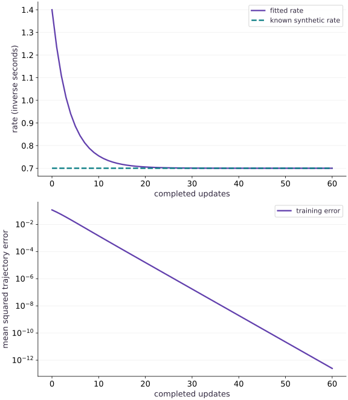

# Fit parameters and scale the simulation

Phase 10: Scientific computing · about 115 minutes · CPU

This worked reference is validated on CPU. Accelerator compatibility requires a separate source review and target execution receipt. Use the execution matrix to review device selection and data ownership before adapting a separate target program.

**Before this lesson:** [Differentiate through a solver](https://www.tahabouhsine.com/jaxpathways/lesson-science-03.html).

## What you will be able to do

- Fit a constrained physical parameter through an executed simulator.
- Separate training fit, held-out prediction and solver refinement.
- Diagnose unidentifiable observations and discretization-induced parameter bias.
- Measure synchronized batched CPU execution without claiming accelerator scaling.

## The problem

Suppose we can observe cooling trajectories but do not know the rate. Can we recover it without confusing optimizer success with a trustworthy physical inference? We will fit a positive rate, test new initial conditions, examine non-identifiability, and measure a batched CPU workload with explicit timing boundaries.

## The idea

An inverse problem uses observations to infer parameters of a forward model. A small fitting error is meaningful only if the observations contain information about those parameters and the forward model matches the observation process.

## Ask whether observations identify the parameter

For exponential decay $y(t)=y_0e^{-at}$, an observation only at $t=0$ equals $y_0$ for every rate $a$. No optimizer can recover the rate from that observation alone. Later observations supply rate information, provided their noise and timing are understood.

The fitting loop changes the parameter, runs the solver at the declared observation times and compares with the data. Keep those times fixed when comparing candidate parameters. Solver error can otherwise be mistaken for a physical parameter effect.

Read the fitted trajectory alongside the residuals and objective history. A decreasing objective shows progress on that objective; it is separate from uniqueness or uncertainty. Test a changed observation schedule to see which part of the result is supported by data.

### Pause and reason

Can zero fitting error imply that the parameter is uniquely identified?

<details><summary>Compare your reasoning</summary>

No. Several parameter settings can fit the same insufficient observations. Examine identifiability and changed observation conditions, not only residual size.

</details>

## Choose data that can reveal the parameter

We generate observations from the exponential at forty-one times for initial values $0.7$, $1.5$ and $2.3$. The analytic generator is independent of RK4, avoiding a perfect fit caused merely by using exactly the same numerical algorithm twice. The data are noiseless and synthetic. Their provenance and split must remain explicit in any report.

## Enforce positivity through a parameterization

An unconstrained update to $k$ could make the cooling rate negative, turning decay into growth. Instead train $\theta=\log k$. The chain rule gives $dL/d\theta=k\,dL/dk$; this changes the optimization geometry as well as enforcing positivity. We start at $k=1.4$, twice the true value, and use an explicit fixed learning rate. No claim is made that this rate is suitable for other units or systems.

$$
\theta_{m+1}=\theta_m-\eta\frac{dL(e^{\theta_m})}{d\theta_m},\qquad k_m=e^{\theta_m}>0
$$

## Inspect the recovered model beyond the training curve

The recovered rate is about $0.700000009$, close to the known $0.7$. The tiny difference is numerical: RK4 slightly approximates the exponential. We test new initial conditions $0.4$, $1.1$ and $3.2$, then halve the simulation step. A fitted parameter that changes materially under grid refinement may be compensating for solver error. Good held-out performance here tests the same equation on new starts; it is separate from generalization to a different physical law. On this noiseless fixture, the fitted rate compensates for the tiny RK4 bias: the original-grid held-out error is near roundoff, while finer-grid error is about $7.3\times10^{-9}$. Refinement can therefore increase this already tiny residual. The check requires a small error, not automatic improvement.

## Recognize observations that cannot identify a parameter

The fitted rate on the original grid is about $0.700000009$, against the synthetic truth $0.7$. On new initial values, the original-grid RMSE is near roundoff; refining the step gives an RMSE around $7.3\times10^{-9}$, slightly larger because the original fitted rate had compensated for RK4's tiny grid bias. A residual need not decrease monotonically when a numerical solver is refined.

This held-out check changes initial conditions but keeps the same equation and noiseless observation rule. It tests whether the recovered rate transfers across starts within this model, not whether the model matches a real physical process. If observations existed only at time zero, the rate gradient would be exactly zero for every candidate; more optimizer steps could not add missing information.

## Keep numerical bias separate from physical estimates

For an Euler step, matching an exact exponential interval means $1-k_{\mathrm{Euler}}h=e^{-k_{\mathrm{true}}h}$. Thus a coarse Euler fit can perfectly match these observations using the wrong physical rate. With $h=0.5$, a true rate of $0.7$ looks like about $0.5906$. Low training error is not enough to justify the inferred parameter.

$$
k_{\mathrm{Euler}}=\frac{1-e^{-k_{\mathrm{true}}h}}{h}
$$

## Measure a bounded scaling experiment

Compile and warm up each batch shape, place its inputs before the timed region, and wait for results with block_until_ready. Report both total milliseconds and time per trajectory. Changing batch shape may compile a new program. This CPU experiment measures a fixed forty-step output-producing solve; it does not measure training, input transfer, multi-host communication or TPU performance. A batch can amortize overhead without implying unlimited scaling.

## Move from this audit to a scientific workflow

The staged scientific-inverse project asks for a reusable simulation and fitting API with changed parameters, noisy observations, held-out checks and a reproducible report. For stiff or adaptive models, choose and validate a suitable solver before reusing the optimizer. Diffrax, Equinox and Lineax provide ecosystem building blocks, but this phase’s executed core intentionally uses the installed JAX environment; no optional library or target hardware execution is implied.

## Optional adaptive solve: stiffness and rate identifiability

The optional project uses a forced-decay equation with exact solution $y(t)=\cos t+(y_0-1)e^{-kt}$. Tsit5 is an adaptive explicit solver for the nonstiff fixture; Kvaerno3 and Kvaerno5 with a PID step-size controller handle the stiff fixture. Compare accepted/rejected step counts and analytic errors, and treat solver status as part of the result. For inference, early off-manifold observations can reveal the rate, while $y_0=1$ makes predictions exactly independent of $k$. Late observations can be practically insensitive because the transient $e^{-kt}$ has decayed.

$$
\ell(k)=\frac12\sum_i\left[\frac{y(t_i;k)-y_i}{\sigma}\right]^2,\qquad y_0=1\implies\frac{\partial y}{\partial k}=0\quad\text{for all }t,k>0
$$

### Pause and reason

Can a low residual establish that the rate is identifiable?

<details><summary>Compare your reasoning</summary>

No. A parameter is structurally unidentifiable when changing it leaves predictions and the profile objective flat, even if an optimizer returns a particular value.

</details>

## Define the simulator and immutable observations

Append this block to main.py in your CPU course environment; for the first block create the file. Run blocks in order.

```python
# Step 1 — Define the simulator and immutable observations
import jax
# Enable 64-bit arithmetic before importing jax.numpy or creating arrays.
jax.config.update("jax_enable_x64", True)
import jax.numpy as jnp
import numpy as np

def rk4_step(rate, value, dt):
    a = -rate*value
    b = -rate*(value + dt*a/2)
    c = -rate*(value + dt*b/2)
    d = -rate*(value + dt*c)
    return value + dt*(a + 2*b + 2*c + d)/6

# Define `solve(rate, initial, steps, dt)` to carry state across steps with `jax.lax.scan`:
def solve(rate, initial, steps=40, dt=0.05):
    def advance(value, unused):
        next_value = rk4_step(rate, value, dt)
        return next_value, next_value
    _, tail = jax.lax.scan(advance, initial, None, length=steps)
    return jnp.concatenate((jnp.atleast_1d(initial), tail))

train_initials = jnp.array([0.7,1.5,2.3])
times = jnp.arange(41)*0.05
true_rate = 0.7
observations = train_initials[:,None]*jnp.exp(-true_rate*times)
def predict(rate, initials):
    return jax.vmap(lambda initial: solve(rate,initial))(initials)
def objective(log_rate):
    residual = predict(jnp.exp(log_rate),train_initials)-observations
    return jnp.mean(residual**2)
```

Observations come from the analytic physical model, not the same discrete solver used for fitting. Different initial values are reserved for evaluation.

## Fit a positive rate with an explicit update

Append this block to main.py in your CPU course environment; for the first block create the file. Run blocks in order.

```python
# Step 2 — Fit a positive rate with an explicit update: The logarithm parameterization keeps the rate positive.
# Define and JIT-compile `update(log_rate)` so XLA traces and fuses the operations:
@jax.jit
def update(log_rate):
    return log_rate - 0.4*jax.grad(objective)(log_rate)
log_rate = jnp.log(1.4)
loss_history = [float(objective(log_rate))]
rate_history = [float(jnp.exp(log_rate))]
for _ in range(160):
    log_rate = update(log_rate)
    loss_history.append(float(objective(log_rate)))
    rate_history.append(float(jnp.exp(log_rate)))
fitted_rate = float(jnp.exp(log_rate))
assert abs(fitted_rate-true_rate) < 2e-7
assert loss_history[-1] < 1e-20
print("Initial/fitted rate:",rate_history[0],fitted_rate)
print("Initial/final loss:",loss_history[0],loss_history[-1])
```

The logarithm parameterization keeps the rate positive. The recorded first point is before any update; every later point evaluates the updated parameter.

## Validate on unseen initial conditions and a finer grid

Append this block to main.py in your CPU course environment; for the first block create the file. Run blocks in order.

```python
# Step 3 — Validate on unseen initial conditions and a finer grid: Held-out starts test transfer within this known equation.
held_initials=jnp.array([0.4,1.1,3.2])
# Transfer the device result to the host for an independent NumPy comparison.
held_truth=np.asarray(held_initials)[:,None]*np.exp(-true_rate*np.asarray(times))
# Transfer the device result to the host for an independent NumPy comparison.
held_prediction=np.asarray(predict(fitted_rate,held_initials))
held_rmse=float(np.sqrt(np.mean((held_prediction-held_truth)**2)))
assert held_rmse < 1e-7
# Vectorize across the batch dimension with `jax.vmap` (`fine`).
fine=np.asarray(jax.vmap(lambda initial:solve(fitted_rate,initial,80,0.025))(held_initials))[:,::2]
fine_rmse=float(np.sqrt(np.mean((fine-held_truth)**2)))
assert fine_rmse < 1e-7
initial_only_gradient=jax.grad(lambda p:jnp.mean((predict(jnp.exp(p),train_initials)[:,0]-observations[:,0])**2))(jnp.log(1.4))
assert float(initial_only_gradient)==0.0
print("Held-out RMSE:",held_rmse,"finer-grid RMSE:",fine_rmse)
print("Initial-time-only gradient:",float(initial_only_gradient))
```

Held-out starts test transfer within this known equation. Refinement tests whether fitting exploited numerical bias. Initial-time-only data cannot identify the decay rate at all.

## Run the example

```python
# Step 1 — Define the simulator and immutable observations
import jax
# Enable 64-bit arithmetic before importing jax.numpy or creating arrays.
jax.config.update("jax_enable_x64", True)
import jax.numpy as jnp
import numpy as np

def rk4_step(rate, value, dt):
    a = -rate*value
    b = -rate*(value + dt*a/2)
    c = -rate*(value + dt*b/2)
    d = -rate*(value + dt*c)
    return value + dt*(a + 2*b + 2*c + d)/6

# Define `solve(rate, initial, steps, dt)` to carry state across steps with `jax.lax.scan`:
def solve(rate, initial, steps=40, dt=0.05):
    def advance(value, unused):
        next_value = rk4_step(rate, value, dt)
        return next_value, next_value
    _, tail = jax.lax.scan(advance, initial, None, length=steps)
    return jnp.concatenate((jnp.atleast_1d(initial), tail))

train_initials = jnp.array([0.7,1.5,2.3])
times = jnp.arange(41)*0.05
true_rate = 0.7
observations = train_initials[:,None]*jnp.exp(-true_rate*times)
def predict(rate, initials):
    return jax.vmap(lambda initial: solve(rate,initial))(initials)
def objective(log_rate):
    residual = predict(jnp.exp(log_rate),train_initials)-observations
    return jnp.mean(residual**2)

# Step 2 — Fit a positive rate with an explicit update: The logarithm parameterization keeps the rate positive.
# Define and JIT-compile `update(log_rate)` so XLA traces and fuses the operations:
@jax.jit
def update(log_rate):
    return log_rate - 0.4*jax.grad(objective)(log_rate)
log_rate = jnp.log(1.4)
loss_history = [float(objective(log_rate))]
rate_history = [float(jnp.exp(log_rate))]
for _ in range(160):
    log_rate = update(log_rate)
    loss_history.append(float(objective(log_rate)))
    rate_history.append(float(jnp.exp(log_rate)))
fitted_rate = float(jnp.exp(log_rate))
assert abs(fitted_rate-true_rate) < 2e-7
assert loss_history[-1] < 1e-20
print("Initial/fitted rate:",rate_history[0],fitted_rate)
print("Initial/final loss:",loss_history[0],loss_history[-1])

# Step 3 — Validate on unseen initial conditions and a finer grid: Held-out starts test transfer within this known equation.
held_initials=jnp.array([0.4,1.1,3.2])
# Transfer the device result to the host for an independent NumPy comparison.
held_truth=np.asarray(held_initials)[:,None]*np.exp(-true_rate*np.asarray(times))
# Transfer the device result to the host for an independent NumPy comparison.
held_prediction=np.asarray(predict(fitted_rate,held_initials))
held_rmse=float(np.sqrt(np.mean((held_prediction-held_truth)**2)))
assert held_rmse < 1e-7
# Vectorize across the batch dimension with `jax.vmap` (`fine`).
fine=np.asarray(jax.vmap(lambda initial:solve(fitted_rate,initial,80,0.025))(held_initials))[:,::2]
fine_rmse=float(np.sqrt(np.mean((fine-held_truth)**2)))
assert fine_rmse < 1e-7
initial_only_gradient=jax.grad(lambda p:jnp.mean((predict(jnp.exp(p),train_initials)[:,0]-observations[:,0])**2))(jnp.log(1.4))
assert float(initial_only_gradient)==0.0
print("Held-out RMSE:",held_rmse,"finer-grid RMSE:",fine_rmse)
print("Initial-time-only gradient:",float(initial_only_gradient))
```

Expected: The rate moves from 1.4 to approximately 0.700000009. Held-out and refined-grid RMSE stay below 1e-7; initial-only observations have zero rate gradient.

## Recover a physical rate, then check what the fit means

**Predict:** Does a falling loss alone prove that the recovered rate is physically correct?



**Recorded CPU computation**

### Read the figure

The top panel's horizontal axis counts completed optimizer updates and its vertical axis is the positive rate in inverse seconds. The fitted curve starts at 1.4, approaches the known synthetic rate 0.7, and is about 0.7055 at update 20 and 0.70006 at update 40. The lower panel uses the same update axis and shows mean squared trajectory error in squared excess-temperature units on a log scale, falling from about 0.1168 to about $1.55\times10^{-5}$ by update 20.

### Connect it to the computation

The observations come from the analytic exponential, while the fit uses RK4, so the curve compares an independently generated target with the numerical forward model. The training fixture is noiseless; its final near-zero loss is not a parameter-uncertainty estimate. New starts and grid refinement expose whether the fitted rate transfers, and the initial-time-only case predicts no recovery because the rate has zero sensitivity there.

```python
indices=list(range(61))
visual_data={'panels':[{'kind':'line','x':indices,'xlabel':'completed updates','ylabel':'rate (inverse seconds)','series':[{'label':'fitted rate','y':rate_history[:61]},{'label':'known synthetic rate','y':[true_rate]*61}]},{'kind':'line','x':indices,'xlabel':'completed updates','ylabel':'mean squared trajectory error','yscale':'log','series':[{'label':'training error','y':loss_history[:61]}]}]}
```

## Recorded reference execution

CPU run: 2026-10-29T13:58:27.720016+00:00. JAX 0.9.2.

```text
Initial/fitted rate: 1.4 0.7000000090128304
Initial/final loss: 0.11676630453561089 1.9484774169068916e-32
Held-out RMSE: 4.572895313141112e-16 finer-grid RMSE: 7.282689372293896e-09
Initial-time-only gradient: 0.0
Initial/fitted rate: 1.4 0.7000000090128304
Initial/final loss: 0.11676630453561089 1.9484774169068916e-32
Held-out RMSE: 4.572895313141112e-16 finer-grid RMSE: 7.282689372293896e-09
Initial-time-only gradient: 0.0
True rate: 0.7 perfect coarse Euler rate: 0.5906238205625731
batch, median milliseconds, milliseconds per trajectory: [(1, 0.006542075425386429, 0.006542075425386429), (16, 0.0069998204708099365, 0.00043748877942562103), (256, 0.07137469947338104, 0.0002788074198178947)]
Changed true/recovered rate: 0.4 0.40000000054230433
Recovered initial amplitude: 2.8000000000000003
Noisy grid-search estimate: 0.7 residual MSE: 2.6000611439697964e-05
PASS: science-04

```

## A perfect Euler fit can infer the wrong rate

**Predict before running:** Will a coarse Euler fit overestimate or underestimate the true cooling rate?

```python
# Experiment — A perfect Euler fit can infer the wrong rate: The model parameter absorbs discretization error.
h=0.5
biased_rate=(1-np.exp(-true_rate*h))/h
coarse_times=np.arange(5)*h
matched=2*(1-biased_rate*h)**np.arange(5)
np.testing.assert_allclose(matched,2*np.exp(-true_rate*coarse_times),rtol=1e-12)
assert abs(biased_rate-true_rate)>0.1
print("True rate:",true_rate,"perfect coarse Euler rate:",biased_rate)
```

**Expected:** True rate 0.7; Euler fit approximately 0.59062382.

The model parameter absorbs discretization error. Refining the numerical model is necessary before giving the estimate a physical interpretation.

## Measure fixed-shape CPU batches

**Predict before running:** Will total time and time per trajectory necessarily move in the same direction?

```python
# Experiment — Measure fixed-shape CPU batches
import time
measurements=[]
for batch_size in (1,16,256):
    starts=jnp.linspace(0.4,3.2,batch_size)
    # Wrap with `jax.jit` (`compiled`) so XLA traces and compiles the function.
    compiled=jax.jit(lambda values:predict(fitted_rate,values))
    # Wait for device work to finish before timing it or comparing its result on the host.
    compiled(starts).block_until_ready()
    samples=[]
    for _ in range(7):
        beginning=time.perf_counter()
        # Wait for device work to finish before timing it or comparing its result on the host.
        compiled(starts).block_until_ready()
        samples.append((time.perf_counter()-beginning)*1000)
    median_ms=float(np.median(samples))
    assert median_ms>0
    measurements.append((batch_size,median_ms,median_ms/batch_size))
print("batch, median milliseconds, milliseconds per trajectory:",measurements)
```

**Expected:** Measured positive timings vary by machine and load; the code makes no ordering or speedup assertion.

The warmed, synchronized boundary excludes compilation and explicit host-to-device transfer. Report the observed samples and device instead of copying a reference timing.

## Make it yours

Repeat inference for a new true rate $0.4$ using analytically generated observations, starting at $0.9$. Show that the recovered parameter and held-out predictions change consistently.

### How to write this exercise — Step-by-step recipe & starter scaffold

**Inputs:**
- Training initial conditions and times with analytically generated observations at true rate 0.4.
- A rate-optimization start of 0.9 and held-out times/initial conditions.

**Outputs:**
- Recovered rate from training observations.
- Predictions at held-out times and initial conditions using the fitted rate.

**Invariants to check:**
- The rate parameter starts at 0.9 and converges toward the generating rate 0.4.
- Held-out labels are not used to choose the fitted parameter.
- Predictions use the new fitted rate and corresponding initial conditions.

**Hints:**
- Generate training observations from each initial condition and the shared decay rate.
- Optimize the rate using training observations only; evaluate held-out conditions afterward.

**Starter code scaffold (fill in the TODOs):**

```python
import jax
import jax.numpy as jnp

def fit_changed_rate(train_times, train_initials, train_values, held_out_times, held_out_initials, initial_rate=0.9):
    # TODO: fit the shared rate from training trajectories and predict held-out ones.
    raise NotImplementedError("Fit from training trajectories and preserve held-out separation")
```

<details><summary>Reference solution</summary>

```python
# Exercise solution
changed_truth=0.4
changed_observations=train_initials[:,None]*jnp.exp(-changed_truth*times)
def changed_objective(theta):
    return jnp.mean((predict(jnp.exp(theta),train_initials)-changed_observations)**2)
changed_update=jax.jit(lambda theta:theta-0.4*jax.grad(changed_objective)(theta))
changed_theta=jnp.log(0.9)
for _ in range(200):
    changed_theta=changed_update(changed_theta)
changed_rate=float(jnp.exp(changed_theta))
assert abs(changed_rate-changed_truth)<1e-6
# Transfer the device result to the host for an independent NumPy comparison.
changed_held=np.asarray(held_initials)[:,None]*np.exp(-changed_truth*np.asarray(times))
np.testing.assert_allclose(predict(changed_rate,held_initials),changed_held,rtol=2e-6,atol=1e-7)
print("Changed true/recovered rate:",changed_truth,changed_rate)
```

</details>

## Infer a different physical quantity

**Practice**

Hold the rate fixed and estimate an unknown initial amplitude from a trajectory using linear least squares. Verify the estimate with a NumPy closed form.

<details><summary>Hint</summary>

At fixed rate, predictions are amplitude multiplied by a known decay vector.

</details>

### How to write: Infer a different physical quantity — Step-by-step recipe & starter scaffold

**Inputs:**
- A fixed rate, observation times, and a trajectory with unknown initial amplitude.

**Outputs:**
- Least-squares amplitude estimate and NumPy closed-form estimate.

**Invariants to check:**
- The fitted amplitude uses training observations only.
- The closed form matches a one-parameter linear least-squares solution.

**Hints:**
- Factor the unit-amplitude trajectory from the unknown scalar.
- Use dot(b,y)/dot(b,b) for the independent closed form.

**Starter code scaffold (fill in the TODOs):**

```python
import numpy as np

def estimate_initial_amplitude(rate, times, observations):
    # TODO: solve the scalar least-squares problem and verify its closed form.
    raise NotImplementedError("Estimate amplitude as a linear parameter")
```

<details><summary>Reference solution and reasoning</summary>

```python
# Infer a different physical quantity (Practice): The inverse problem becomes linear when rate is fixed.
basis=np.exp(-0.7*np.asarray(times))
unknown_initial=2.8
measured=unknown_initial*basis
estimate=float(np.dot(basis,measured)/np.dot(basis,basis))
assert abs(estimate-unknown_initial)<1e-12
def amplitude_loss(amplitude):
    return jnp.mean((amplitude*jnp.asarray(basis)-jnp.asarray(measured))**2)
assert abs(float(jax.grad(amplitude_loss)(estimate)))<1e-12
print("Recovered initial amplitude:",estimate)
```

The inverse problem becomes linear when rate is fixed. Jointly unknown amplitude and rate require enough distinct observation times to distinguish their effects.

</details>

## Compare noisy inference with an independent search

**Challenge**

Create a deterministic noisy dataset and quantify rate sensitivity with an independent grid search, without selecting a fit using held-out labels.

<details><summary>Hint</summary>

Search a dense one-dimensional grid using the analytic forward model and report the minimizing rate and residual scale.

</details>

### How to write: Compare noisy inference with an independent search — Step-by-step recipe & starter scaffold

**Inputs:**
- A deterministic noisy trajectory generated with seed 19, training times, and a candidate rate grid.

**Outputs:**
- Training residual per candidate and selected rate.
- Held-out prediction error reported after selection.

**Invariants to check:**
- Selection uses training labels only.
- The search is independent of the JAX autodiff fit.

**Hints:**
- Generate noise from a local seeded generator.
- Keep held-out values out of the candidate scoring loop.

**Starter code scaffold (fill in the TODOs):**

```python
import numpy as np

def grid_search_noisy_rate(train_times, train_values, candidates, initial, held_out_times, held_out_values):
    # TODO: score candidates on training data, select, then report held-out error.
    raise NotImplementedError("Keep candidate selection independent of held-out labels")
```

<details><summary>Reference solution and reasoning</summary>

```python
# Compare noisy inference with an independent search (Challenge): A noisy optimum need not equal the generating parameter exactly.
noisy=np.asarray(observations)+0.005*np.random.default_rng(19).normal(size=observations.shape)
candidates=np.linspace(0.65,0.75,1001)
# Transfer the device result to the host for an independent NumPy comparison.
reference_predictions=np.asarray(train_initials)[None,:,None]*np.exp(-candidates[:,None,None]*np.asarray(times)[None,None,:])
# Reduce along axis=(1 to compute `reference_losses`.
reference_losses=np.mean((reference_predictions-noisy[None,:,:])**2,axis=(1,2))
best=float(candidates[np.argmin(reference_losses)])
assert abs(best-0.7)<0.01
assert float(np.min(reference_losses))>0
print("Noisy grid-search estimate:",best,"residual MSE:",float(np.min(reference_losses)))
```

A noisy optimum need not equal the generating parameter exactly. One fixed-seed recovery check is not a calibrated uncertainty interval; repeated datasets or a justified statistical model are needed.

</details>

## Fit and independently audit an adaptive noisy rate estimate

**Optional extension**

Use the optional `fit_rate` API on early off-manifold observations with initial state $2.6$ and rate near $1.25$. Score the returned rate with an analytic NumPy profile over a positive candidate grid. Then calculate predictions for held-out initial states without using held-out values to select the fit. Independently inspect supplied on-manifold and late-time profiles.

<details><summary>Hint</summary>

Use the same known noise scale in fitting and profile scoring. A small residual alone is not evidence of identifiability; check whether predictions and the entire likelihood profile change across the candidate rates.

</details>

### How to write: Fit and independently audit an adaptive noisy rate estimate — Step-by-step recipe & starter scaffold

**Inputs:**
- Early off-manifold training observations at times from 0 to 1.2, initial state 2.6, known noise scale 0.025, and starting rate 0.45.
- Separate observations for an on-manifold initial state 1.0 and late off-manifold times from 6 to 9, plus a positive rate grid.
- Held-out initial states and times that are not used to choose a rate.

**Outputs:**
- Positive fitted rate and an analytic early-profile minimum with their objective difference.
- Held-out predictions computed only after rate selection.
- Likelihood-profile range and prediction spread for early, on-manifold, and late observation regimes.

**Invariants to check:**
- Rate selection uses training observations only.
- Independent profiles use the closed-form solution and do not reuse the fitted solver.
- A case is structurally unidentifiable only when predictions and profile remain flat over distinct positive rates.

**Hints:**
- Use a local seeded NumPy generator for any noise you create.
- Report prediction spread across several rates as well as the profile range; optimization difficulty alone does not establish non-identifiability.

**Starter code scaffold (fill in the TODOs):**

```python
import numpy as np

def fit_and_audit_rate(fit_rate, times, observations, initial, noise_scale, candidate_rates,
                       held_out_times, held_out_initials, on_times, on_observations,
                       late_times, late_observations):
    # TODO: fit from early training data and independently score all three profiles.
    raise NotImplementedError("Separate fit selection, analytic profile audit, and held-out prediction")
```

<details><summary>Reference solution and reasoning</summary>

```python
import numpy as np

def fit_and_audit_rate(fit_rate, times, observations, initial, noise_scale, candidate_rates,
                       held_out_times, held_out_initials, on_times, on_observations,
                       late_times, late_observations):
    times = np.asarray(times, dtype=np.float64)
    observations = np.asarray(observations, dtype=np.float64)
    rates = np.asarray(candidate_rates, dtype=np.float64)
    if rates.ndim != 1 or np.any(rates <= 0) or not np.isfinite(rates).all():
        raise ValueError("candidate rates must be finite and positive")
    fitted = float(fit_rate(times, observations, initial, initial_rate=0.45,
                            noise_scale=noise_scale))

    def profile(times_for_profile, values, y0):
        times_for_profile = np.asarray(times_for_profile, dtype=np.float64)
        values = np.asarray(values, dtype=np.float64)
        prediction = np.cos(times_for_profile)[None, :] + (y0 - 1.0) * np.exp(
            -rates[:, None] * times_for_profile[None, :]
        )
        nll = 0.5 * np.sum(((prediction - values[None, :]) / noise_scale) ** 2, axis=1)
        return {"nll": nll, "nll_range": float(np.ptp(nll)),
                "prediction_spread": float(np.max(np.ptp(prediction, axis=0)))}

    early = profile(times, observations, initial)
    on_manifold = profile(on_times, on_observations, 1.0)
    late = profile(late_times, late_observations, initial)
    fitted_nll = float(profile_nll(np.array([fitted]), times, observations, initial, noise_scale)[0])
    early_minimum_rate = float(rates[np.argmin(early["nll"])])
    early_minimum_nll = float(np.min(early["nll"]))
    held_out = np.cos(np.asarray(held_out_times))[None, :] + (
        np.asarray(held_out_initials)[:, None] - 1.0
    ) * np.exp(-fitted * np.asarray(held_out_times)[None, :])
    return {"fitted_rate": fitted, "early_profile": early,
            "early_profile_minimum_rate": early_minimum_rate,
            "early_profile_minimum_nll": early_minimum_nll,
            "fitted_rate_nll": fitted_nll,
            "fitted_delta_nll": fitted_nll - early_minimum_nll,
            "on_manifold_profile": on_manifold, "late_profile": late,
            "held_out_predictions": held_out}

```

This is a synthetic, known-noise inverse problem. The profile distinguishes structural non-identifiability from weak late-time sensitivity, but it is not a confidence interval or a scientific validation of field measurements.

</details>

## Check your understanding

You fit only observations at time zero and every rate gives zero loss. What is the problem?

1. The batch is too small for a TPU.
2. The step size is too accurate.
3. The observations contain no information about the cooling rate.

<details><summary>Answer and explanation</summary>

**1. The batch is too small for a TPU.**

A larger accelerator batch repeats the same uninformative time-zero observations. Add measurements that depend on the unknown rate.

**2. The step size is too accurate.**

A smaller integration step cannot make a time-zero observation informative about dynamics. Inspect parameter sensitivity of the data.

**3. The observations contain no information about the cooling rate. (correct)**

The initial state is independent of rate. No optimizer can recover a rate from data whose predictions do not depend on it.

</details>

## Diagnose the result

If the training loss is tiny but the parameter changes with step size, suspect solver bias. If every candidate has zero derivative, inspect observation times and parameter dependence before adjusting the optimizer. If timing results are implausibly tiny, confirm synchronization and warmup. If test performance drove your learning-rate choice, the test set is no longer untouched.

## Carry forward

- Choose data that can reveal the parameter
- Enforce positivity through a parameterization
- Inspect the recovered model beyond the training curve
- Recognize observations that cannot identify a parameter
- Keep numerical bias separate from physical estimates
- Measure a bounded scaling experiment
- Move from this audit to a scientific workflow

## Keep your evidence

Full loss/rate histories, held-out and refined-grid metrics, noisy reference search, timing boundary and limitations. Keep the environment, observed outputs and your explanation of the figure.

Save your predictions, modified code, terminal outputs, and reasoning in your engineering portfolio.

## Primary references

- [JAX scan: fixed carry structure and reverse-mode differentiation](https://docs.jax.dev/en/latest/_autosummary/jax.lax.scan.html)
- [JAX automatic vectorization](https://docs.jax.dev/en/latest/_autosummary/jax.vmap.html)
- [JAX derivative checking and Jacobian products](https://docs.jax.dev/en/latest/notebooks/autodiff_cookbook.html)
- [Diffrax solver terms, saved values and solution inspection](https://docs.kidger.site/diffrax/usage/getting-started/)
- [Diffrax solver choice and adaptive solver families](https://docs.kidger.site/diffrax/usage/how-to-choose-a-solver/)
- [Diffrax solution saving and status inspection](https://docs.kidger.site/diffrax/usage/getting-started/)

