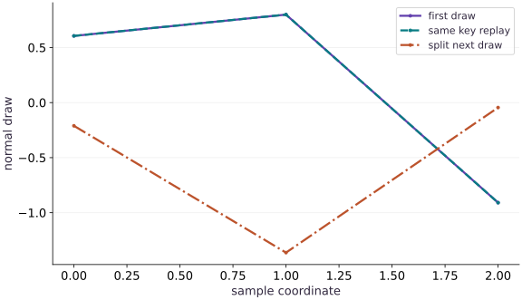

# Random keys without surprises

Phase 03: State, randomness & control flow · about 60 minutes · CPU

This worked reference is validated on CPU. Accelerator compatibility requires a separate source review and target execution receipt. Use the execution matrix to review device selection and data ownership before adapting a separate target program.

## What you will be able to do

- Treat a key as an explicit input
- Carry the continuation key explicitly
- Separate replay from a statistical claim
- Allocate randomness by sample identity

## The problem

You saved the seed, yet your simulation repeats exactly the same noise at every step. Let’s follow the random key. In JAX, using a key again repeats the same draw; splitting it gives you keys for separate draws. We’ll practice both deliberate replay and fresh sampling before adding randomness to a training loop.

## The idea

A random sampler in JAX receives an explicit key. Reusing the same key with the same sampler repeats the same computation. Splitting gives us separately owned keys, so the program can show which operation receives which randomness.

## A key is an input, not a moving cursor

Reproducible randomness begins with ownership: a function receives a key, uses it for one draw, and returns or derives the key for later work. Splitting makes this flow visible instead of relying on a hidden generator that mutates itself.

The diagram should be read as a branch: one child continues the stream and one child belongs to the immediate sample. If dropout and augmentation both need randomness, give them distinct child keys. Passing the same key to two identical draws intentionally replays the same result, even if the variables have different names.

$$
S_{t+1} = \operatorname{update}(S_t, X_t), \qquad \text{pure transition } (S_t, X_t) \mapsto (S_{t+1}, Y_t)
$$

### Pause and reason

Does calling a sampler consume or mutate the key variable?

<details><summary>Compare your reasoning</summary>

No. The key is an explicit value. Your program must choose new child keys and carry the next key forward; otherwise repeated calls can replay the same sample.

</details>

## Treat a key as an explicit input

A JAX random operation is deterministic from its key and arguments. The plotted horizontal coordinate is the position in a length-three draw; the vertical value is the sampled number. The first-draw and same-key replay curves overlap exactly at approximately $(0.606,0.799,-0.909)$; the split-key draw is approximately $(-0.211,-1.363,-0.045)$. The connected lines help compare coordinates, but this is neither time nor a probability-density plot.

The execution output confirms replay equality and a different split-key draw for this seed. Unequal samples in one example do not establish statistical independence. Use the same key for deliberate replay, and split before requesting a distinct stochastic operation.

```text
seed → root key
root key --split--> continuation key + sample key
sample key --normal(shape=(3,))--> one sample
```

## Carry the continuation key explicitly

In the code, `key, sample_key = split(key)` rebinds the name `key` to the continuation value; it does not mutate the old key. `sample_key` is passed to the immediate sampler, and the continuation is what the next step splits.

That makes the random stream part of the transition state: receive a key, derive the next sample, return the continuation. A checkpoint that stores parameters but omits this continuation cannot reproduce the next stochastic step. Save the key at the same boundary as the rest of the simulation state.

## Separate replay from a statistical claim

A replay test asks whether the same program and initial key reproduce the same result. It says nothing by itself about distribution quality or independence. In the recorded run, identical-key draws compare equal and a split-key draw differs; a coincidence between distinct draws would still be possible.

For reproducible work, record the seed, key derivation and PRNG implementation as well as the program. Changes to key allocation can change later draws. Avoid promising bitwise-identical streams across versions or implementations unless that specific boundary has been established.

## Allocate randomness by sample identity

Splitting a root key into a fixed batch of child keys assigns randomness by position. If the batch is reordered, the same sample identity may receive another key. `fold_in` can instead derive a key from a base key and stable integer identity.

Use distinct identifiers when distinct per-example randomness is intended; reusing an identifier derives the same key under the same base. Check the result by reordering rows and matching draws by identifier. This is deterministic allocation, not a claim that samples are statistically independent or that the construction is a security mechanism.

## Prepare the inputs

Create main.py in your lesson workspace. Add this first block; use the environment from setup.

```python
# Step 1 — Prepare the inputs
import jax
import jax.numpy as jnp
```

These explicit inputs define the case that the later checks will verify.

## Build the computation

Append this block below the inputs in the same file.

```python
# Step 2 — Build the computation: random.split returns two new keys.
# Create or split explicit PRNG key(s) (`key`) for reproducible randomness.
key = jax.random.key(42)
# Create or split explicit PRNG key(s) (`(key, sample_key)`) for reproducible randomness.
key, sample_key = jax.random.split(key)
# Sample deterministic random values into `a` using an explicit PRNG key.
a = jax.random.normal(sample_key, (3,))
# Sample deterministic random values into `repeated` using an explicit PRNG key.
repeated = jax.random.normal(sample_key, (3,))
# Create or split explicit PRNG key(s) (`(key, next_key)`) for reproducible randomness.
key, next_key = jax.random.split(key)
# Sample deterministic random values into `b` using an explicit PRNG key.
b = jax.random.normal(next_key, (3,))
```

random.split returns two new keys. noise_step returns the continuation key as part of its result so the caller can use fresh noise on the next transition.

## Run and check the result

Append the checks, save main.py, and run python main.py from this folder using your course environment.

```python
# Step 3 — Run and check the result
print("Replay equal:", bool(jnp.array_equal(a, repeated)))
print("Fresh draw equal:", bool(jnp.array_equal(a, b)))
assert jnp.array_equal(a, repeated)
assert not jnp.array_equal(a, b)
```

Compare the output to the expected result below before making the exercise change.

## Run the example

```python
# Step 1 — Prepare the inputs
import jax
import jax.numpy as jnp
# Step 2 — Build the computation: random.split returns two new keys.
# Create or split explicit PRNG key(s) (`key`) for reproducible randomness.
key = jax.random.key(42)
# Create or split explicit PRNG key(s) (`(key, sample_key)`) for reproducible randomness.
key, sample_key = jax.random.split(key)
# Sample deterministic random values into `a` using an explicit PRNG key.
a = jax.random.normal(sample_key, (3,))
# Sample deterministic random values into `repeated` using an explicit PRNG key.
repeated = jax.random.normal(sample_key, (3,))
# Create or split explicit PRNG key(s) (`(key, next_key)`) for reproducible randomness.
key, next_key = jax.random.split(key)
# Sample deterministic random values into `b` using an explicit PRNG key.
b = jax.random.normal(next_key, (3,))
# Step 3 — Run and check the result
print("Replay equal:", bool(jnp.array_equal(a, repeated)))
print("Fresh draw equal:", bool(jnp.array_equal(a, b)))
assert jnp.array_equal(a, repeated)
assert not jnp.array_equal(a, b)
```

Expected: Replay equal: True; Fresh draw equal: False.

## Reused keys replay the same sample

**Predict:** Will a repeated draw lie on top of the original?



**Recorded CPU computation**

### Read the figure

The horizontal axis indexes the three entries in one draw; the vertical axis is sampled value. The solid first draw and dashed same-key replay overlap at approximately $(0.606,0.799,-0.909)$. The dash-dot split-key draw is approximately $(-0.211,-1.363,-0.045)$. The connected lines only make coordinate-by-coordinate equality visible; they do not show time or a distribution.

### Connect it to the computation

The overlapping curves demonstrate deterministic replay for this key and sampler. A split key produces the displayed different draw, but one pair of different values does not establish statistical independence. Use the plot to check key ownership: reuse for replay, split when the next operation needs its own random input.

```python
visual_data = {'kind': 'line', 'x': [0, 1, 2], 'xlabel': 'sample coordinate', 'ylabel': 'normal draw', 'series': [{'label': 'first draw', 'y': a.tolist()}, {'label': 'same key replay', 'y': repeated.tolist()}, {'label': 'split next draw', 'y': b.tolist()}]}
```

## Recorded reference execution

CPU run: 2026-10-27T17:03:04.619098+00:00. JAX 0.9.2.

```text
Replay equal: True
Fresh draw equal: False
Replay equal: True
Fresh draw equal: False
PASS: state-01

```

## Implement one random state transition

**Predict before running:** Predict which part of the return value must be reused for the next draw.

```python
# Experiment — Implement one random state transition: Replay compares complete state transitions.
def noise_step(key):
    # Create or split explicit PRNG key(s) (`(next_key, draw_key)`) for reproducible randomness.
    next_key,draw_key=jax.random.split(key)
    return next_key,jax.random.normal(draw_key,(2,))
# Create or split explicit PRNG key(s) (`root`) for reproducible randomness.
root=jax.random.key(9)
k1,n1=noise_step(root)
k2,n2=noise_step(k1)
# Create or split explicit PRNG key(s) (`(r1, replay1)`) for reproducible randomness.
r1,replay1=noise_step(jax.random.key(9))
r2,replay2=noise_step(r1)
assert jnp.array_equal(n1,replay1) and jnp.array_equal(n2,replay2)
assert jnp.array_equal(jax.random.key_data(k2),jax.random.key_data(r2))
```

**Expected:** Reconstructing the two steps reproduces both samples and the continuation key.

Replay compares complete state transitions. It catches lost continuation state, not only a repeated final number.

## Keep identity under reordering

**Predict before running:** If examples $3$ and $8$ swap order, should their identity-derived noise swap too?

```python
# Experiment — Keep identity under reordering: fold_in makes the assignment explicit.
# Create or split explicit PRNG key(s) (`base`) for reproducible randomness.
base=jax.random.key(11)
def by_id(ids):
    return jax.vmap(lambda i:jax.random.normal(jax.random.fold_in(base,i),()))(ids)
forward=by_id(jnp.array([3,8]))
reverse=by_id(jnp.array([8,3]))
assert jnp.array_equal(forward,reverse[::-1])
```

**Expected:** Noise follows the identifiers, not their batch positions.

fold_in makes the assignment explicit. Repeated IDs would deliberately reproduce a draw.

## Make it yours

Split a fresh seed into four keys, then use vmap to draw two normal values from each. Replay from the seed and compare.

### How to write this exercise — Step-by-step recipe & starter scaffold

**Inputs:**
- An integer seed and a batch-shaped input array x.

**Outputs:**
- A noisy prediction batch that can be replayed exactly from the same seed.

**Invariants to check:**
- Randomness is derived from an explicit JAX PRNG key.
- Changing x while holding the seed fixed changes the deterministic prediction by the corresponding 2x+1 input difference.

**Hints:**
- Create a root key from the seed and draw one noise value for every element of x.
- Do not reuse a consumed subkey for another independent draw.

**Starter code scaffold (fill in the TODOs):**

```python
import jax
import jax.numpy as jnp

def noisy_prediction(seed: int, x: jax.Array) -> jax.Array:
    """Return 2*x+1 plus reproducible elementwise Gaussian noise."""
    # TODO: derive a key from seed, sample noise with x.shape, and form the prediction.
    raise NotImplementedError
```

<details><summary>Reference solution</summary>

```python
# Exercise solution
def draw(seed):
    # Create or split explicit PRNG key(s) (`keys`) for reproducible randomness.
    keys = jax.random.split(jax.random.key(seed), 4)
    return jax.vmap(lambda k: jax.random.normal(k, (2,)))(keys)
# Check tensor shape invariant: `draw(7).shape == (4, 2)`
assert draw(7).shape == (4, 2)
assert jnp.array_equal(draw(7), draw(7))
```

</details>

## Replay a noisy prediction

**Practice**

Draw one noise value per example for prediction $2x+1$. Reconstruct the same batch from the seed, then change only $x$.

<details><summary>Hint</summary>

Reuse the random construction for a controlled comparison, not accidentally across independent training steps.

</details>

### How to write: Replay a noisy prediction — Step-by-step recipe & starter scaffold

**Inputs:**
- A seed and a one-dimensional input array x.

**Outputs:**
- A reproducible batch of noisy predictions.

**Invariants to check:**
- The same seed and x produce identical results.
- Holding the seed fixed while shifting every x by one shifts each prediction by two.

**Hints:**
- Use one normal draw per input element.
- Reconstruct the key from the seed on every call to make replay explicit.

**Starter code scaffold (fill in the TODOs):**

```python
import jax
import jax.numpy as jnp

def noisy_prediction(seed: int, x: jax.Array) -> jax.Array:
    """Add replayable, elementwise noise to the prediction 2*x+1."""
    # TODO: sample noise from a key made from seed and preserve x.shape.
    raise NotImplementedError
```

<details><summary>Reference solution and reasoning</summary>

```python
# Replay a noisy prediction (Practice): Holding noise fixed isolates the changed numerical input.
def noisy_prediction(seed,x):
    # Create or split explicit PRNG key(s) (`eps`) for reproducible randomness.
    eps=jax.random.normal(jax.random.key(seed),x.shape)
    return 2*x+1+eps
inputs=jnp.array([0.,1.,2.])
assert jnp.array_equal(noisy_prediction(4,inputs),noisy_prediction(4,inputs))
assert jnp.allclose(noisy_prediction(4,inputs+1)-noisy_prediction(4,inputs),2.,atol=1e-6)
```

Holding noise fixed isolates the changed numerical input. That is a deliberately coupled experiment.

</details>

## Diagnose key reuse in a loop

**Challenge**

Write the broken loop that draws with one key three times, demonstrate repeated rows, then repair it by threading the continuation.

<details><summary>Hint</summary>

The draw function does not mutate the key.

</details>

### How to write: Diagnose key reuse in a loop — Step-by-step recipe & starter scaffold

**Inputs:**
- A root PRNG key and a requested number of two-value draws.

**Outputs:**
- A broken batch showing repeated draws and a repaired batch of independent subkey draws.

**Invariants to check:**
- Reusing a key reproduces the same row.
- Each repaired draw consumes a new key and has shape (2,).

**Hints:**
- Keep the broken case as a diagnostic demonstration.
- Thread the continuation key through the loop; collect only the sample subkeys.

**Starter code scaffold (fill in the TODOs):**

```python
import jax
import jax.numpy as jnp

def compare_key_use(root: jax.Array, count: int = 3) -> tuple[jax.Array, jax.Array]:
    """Return repeated-key draws and draws made from distinct subkeys."""
    # TODO: build both batches and return arrays with shape (count, 2).
    raise NotImplementedError
```

<details><summary>Reference solution and reasoning</summary>

```python
# Diagnose key reuse in a loop (Challenge): The repeated-row symptom comes from key allocation.
# Create or split explicit PRNG key(s) (`root`) for reproducible randomness.
root=jax.random.key(5)
# Sample deterministic random values into `broken` using an explicit PRNG key.
broken=jnp.stack([jax.random.normal(root,(2,)) for _ in range(3)])
assert jnp.array_equal(broken[0],broken[1])
current=root
rows=[]
for _ in range(3):
    current,noise=noise_step(current)
    rows.append(noise)
fixed=jnp.stack(rows)
# Check tensor shape invariant: `fixed.shape==(3,2)`
assert fixed.shape==(3,2)
assert not jnp.array_equal(fixed[0],fixed[1])
```

The repeated-row symptom comes from key allocation. The last inequality checks this fixed demonstration, not every possible random stream.

</details>

## Check your understanding

What happens if the same key is used twice for the same random operation?

1. The generator automatically advances
2. The same sample is reproduced
3. JAX guarantees an exception

<details><summary>Answer and explanation</summary>

**1. The generator automatically advances**

A JAX key is an explicit value, not an advancing generator. Split it and pass a distinct key for each intended random draw.

**2. The same sample is reproduced (correct)**

Keys are explicit immutable inputs. Identical inputs reproduce the draw; split keys to describe independent randomness.

**3. JAX guarantees an exception**

Key reuse need not raise an exception. Compare the actual samples; reproducibility requires managing keys even when execution succeeds.

</details>

## Diagnose the result

The repeated-row symptom comes from key allocation. The last inequality checks this fixed demonstration, not every possible random stream.

## Carry forward

- Replay compares complete state transitions. It catches lost continuation state, not only a repeated final number.
- fold_in makes the assignment explicit. Repeated IDs would deliberately reproduce a draw.

## Keep your evidence

Keep a key-ownership tree, two-step replay including the final key, the per-ID reorder check, and the broken/repaired repeated-noise loop.

Save your predictions, modified code, terminal outputs, and reasoning in your engineering portfolio.

## Primary references

- [JAX pseudorandom numbers](https://docs.jax.dev/en/latest/101/random.html)

