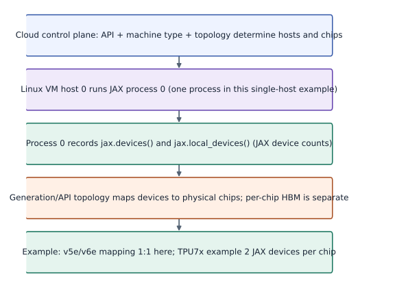
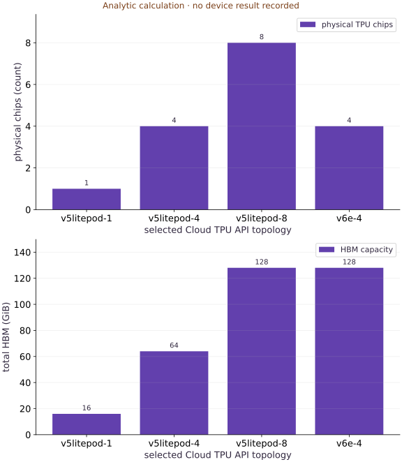

# Select a TPU slice and provision your Cloud TPU VM

Phase 19: TPU Setup: Provisioning & Runtime Verification · about 25 minutes · CPU

This worked reference is validated on CPU. Accelerator compatibility requires a separate source review and target execution receipt. Use the execution matrix to review device selection and data ownership before adapting a separate target program.

## What you will be able to do

- Choose between a free notebook TPU (Colab/Kaggle) and a single-host Google Cloud TPU VM (`v5litepod-4` or `v6e-4`).
- Provision a Cloud TPU VM using `gcloud compute tpus tpu-vm create` or a Flex-start instance group, then connect over SSH.
- Create an isolated `.venv` on the TPU VM, install `jax[tpu]`, and validate `jax.default_backend()`, `jax.device_count()`, and a synchronized `jax.pmap` computation.
- Delete the Cloud TPU VM and confirm with `gcloud compute tpus tpu-vm list` that zero active TPU nodes remain.

## The problem

Before you run a Transformer, sharded step, Pallas kernel, or distributed workload on a TPU, you need a working TPU runtime and a repeatable receipt that proves JAX actually discovered TPU chips—and you need a teardown habit so an idle Cloud TPU VM never keeps billing.

## The idea

Getting a TPU running separates into four explicit boundaries: choosing an access route (free Colab/Kaggle TPU vs single-host Google Cloud TPU VM via on-demand or Flex-start), creating the TPU VM in a supported zone, installing `jax[tpu]` inside an isolated `.venv` on the TPU VM host, and recording a machine-checkable runtime receipt before deleting the VM.

## Why a TPU VM is a host computer attached to accelerator chips

When you create a Cloud TPU VM, Google Cloud allocates a Linux host machine directly attached over PCIe/ICI to the TPU chips on that board—for example, a `v5litepod-4` VM is one Linux host attached to $4$ TPU v5e chips (`16` GiB HBM each). Your SSH session lands on that Linux host, not inside a chip.

Because your commands run on the TPU VM's Linux host, standard Linux environment rules still apply: you create a Python virtual environment (`.venv`), install `jax[tpu]` from the libtpu wheel index, and run Python scripts there. When Python imports `jax`, `libtpu` initializes the attached TPU chips and `jax.default_backend()` reports `'tpu'`.

A completed Python process does not release a READY TPU. The pricing page describes TPU charges in the READY state; storage and other resources can have separate charges. Do not assume that every stopped VM or unallocated queued request incurs TPU compute charges. This lab ends by retrieving evidence, deleting its allocated VM and owning queued request, and checking the named resources are absent. A control-plane absence check is cleanup evidence, not a final billing statement.

$$
N_{\text{chips}} = \text{device\_count}(\texttt{'tpu'}), \qquad \text{HBM}_{\text{total}} = N_{\text{chips}} \times \text{HBM}_{\text{chip}}
$$

### End-to-end Cloud TPU VM lifecycle from create to verified teardown

**Predict:** Where does Python execute when you SSH into a Cloud TPU VM, and when does billing stop?



*Architecture and dataflow mechanism diagram.*

Read top to bottom: your workstation runs `gcloud` to allocate the Cloud TPU VM, SSH starts Python inside `~/jax-tpu-lab/.venv` on the TPU VM host, `libtpu` dispatches XLA programs to the attached TPU chips, `scp` retrieves the runtime receipt, and `tpu-vm delete` releases the resource.

### Pause and reason

Why does creating a Cloud TPU VM and seeing `STATUS: READY` in `gcloud` not prove that your JAX experiment can run on TPU?

<details><summary>Compare your reasoning</summary>

`STATUS: READY` only confirms that the Linux VM and attached TPU hardware were allocated. You still must verify inside Python on that VM that `libtpu` loads, `jax.default_backend() == 'tpu'`, `jax.device_count()` matches the topology, and a synchronized computation completes.

</details>

## 1. Choose how to get a TPU: Colab/Kaggle vs Google Cloud TPU VM

Choose the runtime that matches the task. A hosted notebook can support a small single-process backend check if TPU access is available. It does not provide every topology, shell permission or multi-host workflow in this course. Availability and quotas depend on the provider.

For the v5e lab below, use the Cloud TPU API: direct TPU VM creation or a bounded Flex-start queued resource. Keep creation, status, SSH and deletion commands within that API. Google now recommends Compute Engine or GKE for newer features. Its Compute Engine TPU Flex-start workflow uses supported TPU machine types and MIGs, but does not support GPU-style resize requests. Do not mix that workflow with this v5e queued-resource example. See both linked API guides before adapting the lab.

## 2. Authenticate `gcloud`, enable the TPU API, and check quota

On your local workstation (or inside Google Cloud Shell), set your project ID, zone, and TPU name, enable `tpu.googleapis.com`, and inspect the available accelerator types in your chosen zone before requesting hardware. Using a single-host slice such as `v5litepod-4` (`4` chips on `1` host) avoids multi-host coordination while still letting you run real `jax.pmap` and mesh sharding across $4$ TPU devices.

The example zone is a starting choice for v5e Flex-start, not a capacity promise. Check supported zones, quota and current pricing before creating a request. Set both a queue expiry and a run duration; a budget alert is not a spending cap.

**Configure project, zone, and enable the Cloud TPU API**

```bash
# Configure project, zone, and enable the Cloud TPU API
export PROJECT_ID="your-gcp-project-id"
export ZONE="us-west4-a"
export TPU_NAME="jax-tpu-course"
export ACCELERATOR_TYPE="v5litepod-4"
export RUNTIME_VERSION="v2-alpha-tpuv5-lite"

gcloud auth login
gcloud config set project "$PROJECT_ID"
gcloud services enable tpu.googleapis.com
gcloud compute tpus accelerator-types list --zone="$ZONE"
```

**Expected:** Lists the accelerator types supported in the selected zone. Confirm the requested type is listed; quota and free capacity are separate checks.

## 3. Select one Cloud TPU API provisioning route

Choose one route, not both. A direct VM must reach READY. A Flex-start request must reach ACTIVE and its named VM must become READY before SSH. A queued request is not proof that capacity has been allocated. Inspect FAILED or expired requests and delete them instead of leaving a future allocation behind.

**Route 2A: Create a single-host Cloud TPU v5e-4 VM directly**

```bash
# Route 2A: Create a single-host Cloud TPU v5e-4 VM directly
gcloud compute tpus tpu-vm create "$TPU_NAME" \
  --zone="$ZONE" \
  --accelerator-type="$ACCELERATOR_TYPE" \
  --version="$RUNTIME_VERSION"

gcloud compute tpus tpu-vm describe "$TPU_NAME" \
  --zone="$ZONE" \
  --format="value(state,acceleratorType,networkEndpoints[0].ipAddress)"
```

**Expected:** Outputs READY, v5litepod-4, and the internal IP address of the newly provisioned TPU VM.

**Route 2B: Bounded Cloud TPU API Flex-start request for v5e**

```bash
export QUEUED_RESOURCE_ID="${TPU_NAME}-request"
gcloud alpha compute tpus queued-resources create "$QUEUED_RESOURCE_ID" \
  --project="$PROJECT_ID" --zone="$ZONE" --node-id="$TPU_NAME" \
  --accelerator-type="$ACCELERATOR_TYPE" --runtime-version="$RUNTIME_VERSION" \
  --provisioning-model=flex-start --max-run-duration=1h \
  --valid-until-duration=30m

gcloud alpha compute tpus queued-resources describe "$QUEUED_RESOURCE_ID" \
  --project="$PROJECT_ID" --zone="$ZONE" --format='value(state.state)'
# Continue only after ACTIVE, then check the named VM is READY.
gcloud compute tpus tpu-vm describe "$TPU_NAME" \
  --project="$PROJECT_ID" --zone="$ZONE" --format='value(state)'
```

**Expected:** The queue can wait or fail. Proceed only after ACTIVE and READY; the requested run duration starts after allocation. No capacity or cost-free execution is promised.

## 4. SSH into the TPU VM, create `.venv`, and install `jax[tpu]`

Once the TPU VM is `READY`, bootstrap a clean virtual environment on the remote host and install `jax[tpu]` from the official `libtpu` wheel index. Keeping this `.venv` at `~/jax-tpu-lab/.venv` gives every subsequent lesson in the course a known interpreter path.

**Bootstrap ~/jax-tpu-lab/.venv with jax[tpu] on the TPU VM**

```bash
# Bootstrap ~/jax-tpu-lab/.venv with jax[tpu] on the TPU VM
gcloud compute tpus tpu-vm ssh "$TPU_NAME" --zone="$ZONE" --command="
  set -euo pipefail
  mkdir -p ~/jax-tpu-lab
  python3 -m venv ~/jax-tpu-lab/.venv
  source ~/jax-tpu-lab/.venv/bin/activate
  pip install -U pip
  pip install 'jax[tpu]' -f https://storage.googleapis.com/jax-releases/libtpu_releases.html
  pip install flax optax orbax-checkpoint numpy matplotlib
  python -c 'import jax; print(\"BACKEND:\", jax.default_backend(), \"COUNT:\", jax.device_count(), \"DEVICES:\", jax.devices())'
"
```

**Expected:** Prints BACKEND: tpu COUNT: 4 and lists 4 TpuDevice objects (for v5litepod-4).

## 5. Run the runtime contract check and always delete the TPU VM when finished

Before claiming a TPU runtime is ready—or before starting a long run—execute a script that checks both the requested backend/device count and a synchronized computation across all local devices, writes a JSON receipt, copies the receipt back to your laptop, and deletes the TPU VM when your session is finished.

**Copy back any receipts and delete the Cloud TPU VM to stop billing**

```bash
# First copy the receipt/checkpoints you intend to keep from the VM.
# Flex-start route: delete the owning request and its allocated VM.
if [ -n "${QUEUED_RESOURCE_ID:-}" ]; then
  gcloud alpha compute tpus queued-resources delete "$QUEUED_RESOURCE_ID" \
    --project="$PROJECT_ID" --zone="$ZONE" --force --quiet
else
  gcloud compute tpus tpu-vm delete "$TPU_NAME" \
    --project="$PROJECT_ID" --zone="$ZONE" --quiet
fi
gcloud compute tpus tpu-vm list --project="$PROJECT_ID" --zone="$ZONE"
gcloud alpha compute tpus queued-resources list --project="$PROJECT_ID" --zone="$ZONE"
```

**Expected:** The named VM and, if used, its queued request are absent. Other resources may remain; inspect their ownership rather than deleting unrelated work. Check storage retention and billing separately.

## Write the runtime contract and synchronized pmap verifier

Create main.py with verify_runtime_contract so the same function validates CPU locally and TPU on your Cloud TPU VM.

```python
# Step 1 — Write the runtime contract and synchronized pmap verifier
import hashlib
import json
import os
import platform
import jax
import jax.numpy as jnp
import numpy as np


def verify_runtime_contract(expected_backend=None, min_devices=1):
    # Check which hardware backend (`cpu`, `gpu`, or `tpu`) JAX selected for `backend`.
    backend = jax.default_backend()
    devices = jax.devices()
    local_devices = jax.local_devices()
    target = expected_backend or backend
    x = jnp.arange(len(local_devices) * 8, dtype=jnp.float32).reshape(len(local_devices), 8)
    # Reduce across the target axis to summarize `per_device`.
    per_device = jax.pmap(lambda row: jnp.sum(row * row))(x)
    # Wait for device work to finish before timing it or comparing its result on the host.
    total = float(jax.block_until_ready(jnp.sum(per_device)))
    expected_total = float(np.sum(np.arange(len(local_devices) * 8, dtype=np.float64) ** 2))
    contract_ok = (
        backend == target
        and len(devices) >= min_devices
        and np.isclose(total, expected_total)
    )
    receipt = {
        "python": platform.python_version(),
        "jax": jax.__version__,
        "expected_backend": target,
        "observed_backend": backend,
        "device_count": len(devices),
        "local_device_count": len(local_devices),
        "device_kinds": [str(d.device_kind) for d in devices],
        "pmap_sum_of_squares": total,
        "expected_sum_of_squares": expected_total,
        "contract_ok": bool(contract_ok),
    }
    receipt["receipt_sha256"] = hashlib.sha256(
        json.dumps(receipt, sort_keys=True, separators=(",", ":")).encode()
    ).hexdigest()[:16]
    return receipt
```

The verifier checks both device discovery and a synchronized pmap reduction across all local devices, then hashes the receipt.

## Compare single-host TPU slice topologies and emit the receipt

Append the slice topology table and runtime receipt check to main.py.

```python
# Step 2 — Compare single-host TPU slice topologies and emit the receipt
topologies = [
    {"slice": "v5litepod-1", "hosts": 1, "chips_per_host": 1, "hbm_gib_per_chip": 16},
    {"slice": "v5litepod-4", "hosts": 1, "chips_per_host": 4, "hbm_gib_per_chip": 16},
    {"slice": "v5litepod-8", "hosts": 1, "chips_per_host": 8, "hbm_gib_per_chip": 16},
    {"slice": "v6e-4", "hosts": 1, "chips_per_host": 4, "hbm_gib_per_chip": 32},
]
for spec in topologies:
    spec["total_chips"] = spec["hosts"] * spec["chips_per_host"]
    spec["total_hbm_gib"] = spec["total_chips"] * spec["hbm_gib_per_chip"]

# Check which hardware backend (`cpu`, `gpu`, or `tpu`) JAX selected for `receipt`.
receipt = verify_runtime_contract(expected_backend=jax.default_backend(), min_devices=1)
# Assert invariant `receipt["contract_ok"] is True` holds
assert receipt["contract_ok"] is True
print("Verified runtime receipt:", json.dumps(receipt, sort_keys=True))
print("Single-host TPU slice HBM totals (GiB):", {t["slice"]: t["total_hbm_gib"] for t in topologies})
```

Calculating total chips and HBM per slice makes the hardware capacity concrete before you provision a Cloud TPU VM.

## Step 3: Verify invariants on the completed state

Run the final shape and numerical assertions to confirm the state built in Steps 1 and 2.

```python
receipt = verify_runtime_contract(expected_backend=jax.default_backend(), min_devices=1)
assert receipt["contract_ok"] is True
```

Checking these invariants confirms the computation is ready for the full worked experiment.

## Run the example

```python
# Step 1 — Write the runtime contract and synchronized pmap verifier
import hashlib
import json
import os
import platform
import jax
import jax.numpy as jnp
import numpy as np


def verify_runtime_contract(expected_backend=None, min_devices=1):
    # Record the backend selected by this JAX process.
    backend = jax.default_backend()
    devices = jax.devices()
    local_devices = jax.local_devices()
    target = expected_backend or backend
    # Build one eight-value row for each local device.
    x = jnp.arange(len(local_devices) * 8, dtype=jnp.float32).reshape(len(local_devices), 8)
    # Each device reduces its eight values to one local sum of squares.
    per_device = jax.pmap(lambda row: jnp.sum(row * row))(x)
    # Wait for device work to finish before timing it or comparing its result on the host.
    total = float(jax.block_until_ready(jnp.sum(per_device)))
    expected_total = float(np.sum(np.arange(len(local_devices) * 8, dtype=np.float64) ** 2))
    contract_ok = (
        backend == target
        and len(devices) >= min_devices
        and np.isclose(total, expected_total)
    )
    receipt = {
        "python": platform.python_version(),
        "jax": jax.__version__,
        "expected_backend": target,
        "observed_backend": backend,
        "device_count": len(devices),
        "local_device_count": len(local_devices),
        "device_kinds": [str(d.device_kind) for d in devices],
        "pmap_sum_of_squares": total,
        "expected_sum_of_squares": expected_total,
        "contract_ok": bool(contract_ok),
    }
    receipt["receipt_sha256"] = hashlib.sha256(
        json.dumps(receipt, sort_keys=True, separators=(",", ":")).encode()
    ).hexdigest()[:16]
    return receipt


# Step 2 — Compare single-host TPU slice topologies and emit the receipt
topologies = [
    {"slice": "v5litepod-1", "hosts": 1, "chips_per_host": 1, "hbm_gib_per_chip": 16},
    {"slice": "v5litepod-4", "hosts": 1, "chips_per_host": 4, "hbm_gib_per_chip": 16},
    {"slice": "v5litepod-8", "hosts": 1, "chips_per_host": 8, "hbm_gib_per_chip": 16},
    {"slice": "v6e-4", "hosts": 1, "chips_per_host": 4, "hbm_gib_per_chip": 32},
]
for spec in topologies:
    spec["total_chips"] = spec["hosts"] * spec["chips_per_host"]
    spec["total_hbm_gib"] = spec["total_chips"] * spec["hbm_gib_per_chip"]

# Record the backend selected by this JAX process in the receipt.
receipt = verify_runtime_contract(expected_backend=jax.default_backend(), min_devices=1)
# Assert invariant `receipt["contract_ok"] is True` holds
assert receipt["contract_ok"] is True
print("Verified runtime receipt:", json.dumps(receipt, sort_keys=True))
print("Single-host TPU slice HBM totals (GiB):", {t["slice"]: t["total_hbm_gib"] for t in topologies})
```

Expected: Prints a JSON runtime receipt and the supplied single-host slice HBM table. The exercise checks that v5litepod-4 has 4 chips and 64 GiB, v6e-4 has 4 chips and 128 GiB, and the supplied single-host entries at or above 64 GiB are v5litepod-4, v5litepod-8, and v6e-4. A 128 GiB threshold returns the latter two entries.

## Single-host Cloud TPU slice chip counts and total HBM capacity

**Predict:** How does total HBM scale across `v5litepod-1`, `v5litepod-4`, `v5litepod-8`, and `v6e-4` single-host TPU VMs?



**Recorded CPU computation**

### Read the figure

The horizontal axis lists four single-host Cloud TPU VM slice types. The two bars per slice show the number of attached TPU chips on that single Linux host and the total High Bandwidth Memory (HBM in GiB) across those chips.

### Connect it to the computation

Moving from `v5litepod-1` (`16` GiB) to `v5litepod-4` (`64` GiB) or `v6e-4` (`128` GiB) multiplies HBM capacity while keeping a single VM host, so you can test `jax.pmap` and `NamedSharding` across `4` or `8` chips from one SSH command.

```python
visual_data = {
    'kind': 'bar',
    'labels': [t['slice'] for t in topologies],
    'xlabel': 'single-host Cloud TPU slice',
    'ylabel': 'count / capacity',
    'series': [
        {'label': 'TPU chips on host', 'y': [float(t['total_chips']) for t in topologies]},
        {'label': 'total HBM (GiB)', 'y': [float(t['total_hbm_gib']) for t in topologies]},
    ],
}
```

## Recorded reference execution

CPU run: 2026-10-21T18:13:16.112380+00:00. JAX 0.9.2.

```text
Verified runtime receipt: {"contract_ok": true, "device_count": 1, "device_kinds": ["cpu"], "expected_backend": "cpu", "expected_sum_of_squares": 140.0, "jax": "0.9.2", "local_device_count": 1, "observed_backend": "cpu", "pmap_sum_of_squares": 140.0, "python": "3.14.3", "receipt_sha256": "4ddc0cbb323fe3bd"}
Single-host TPU slice HBM totals (GiB): {'v5litepod-1': 16, 'v5litepod-4': 64, 'v5litepod-8': 128, 'v6e-4': 128}
Verified runtime receipt: {"contract_ok": true, "device_count": 1, "device_kinds": ["cpu"], "expected_backend": "cpu", "expected_sum_of_squares": 140.0, "jax": "0.9.2", "local_device_count": 1, "observed_backend": "cpu", "pmap_sum_of_squares": 140.0, "python": "3.14.3", "receipt_sha256": "4ddc0cbb323fe3bd"}
Single-host TPU slice HBM totals (GiB): {'v5litepod-1': 16, 'v5litepod-4': 64, 'v5litepod-8': 128, 'v6e-4': 128}
Mismatch contract_ok: False observed: cpu devices: 1
Requires --worker=all and jax.distributed.initialize(): {'v5litepod-1': False, 'v5litepod-4': False, 'v5litepod-8': False, 'v5litepod-16': True}
Checked receipt sha256: 4ddc0cbb323fe3bd
v5litepod-4 hosts: 1 chips: 4 total HBM GiB: 64
v6e-4 hosts: 1 chips: 4 total HBM GiB: 128
Single-host slices with at least 64 GiB: ['v5litepod-4', 'v5litepod-8', 'v6e-4']
Single-host slices with at least 128 GiB: ['v5litepod-8', 'v6e-4']
Slices fitting 48 GiB: ['v5litepod-4', 'v5litepod-8', 'v6e-4']
Expected 4-device pmap sum of squares: 10416.0
PASS: tpu-01

```

## Reject a mismatched backend or missing TPU devices immediately

**Predict before running:** What should verify_runtime_contract return if you require 4 TPU devices on a single-CPU host?

```python
# Experiment — Reject a mismatched backend or missing TPU devices immediately
mismatch = verify_runtime_contract(expected_backend="tpu", min_devices=4)
print("Mismatch contract_ok:", mismatch["contract_ok"], "observed:", mismatch["observed_backend"], "devices:", mismatch["device_count"])
assert mismatch["contract_ok"] == (jax.default_backend() == "tpu" and jax.device_count() >= 4)
```

**Expected:** On CPU, mismatch['contract_ok'] is False while still recording the observed backend and device count.

Failing the contract check explicitly prevents a script from silently running on CPU when you intended to benchmark or train on a TPU VM.

## Verify single-host vs multi-host process counts

**Predict before running:** Why does v5litepod-4 need only one SSH command while v5litepod-16 requires --worker=all?

```python
# Experiment — Verify single-host vs multi-host process counts
slice_hosts = {"v5litepod-1": 1, "v5litepod-4": 1, "v5litepod-8": 1, "v5litepod-16": 4}
needs_multi_host = {k: (v > 1) for k, v in slice_hosts.items()}
print("Requires --worker=all and jax.distributed.initialize():", needs_multi_host)
assert needs_multi_host["v5litepod-4"] is False and needs_multi_host["v5litepod-16"] is True
```

**Expected:** v5litepod-1, v5litepod-4, and v5litepod-8 run on 1 host (False); v5litepod-16 spans 4 hosts (True).

Single-host TPU VMs attach all chips to one Linux VM; multi-host slices attach chips across multiple Linux VMs that must all launch the Python process.

## Make it yours

Call `verify_runtime_contract` for the active backend with `min_devices=1`. Compute and verify the chip count and total HBM GiB for `v5litepod-4` and `v6e-4`, confirm both have `hosts == 1`, and list every supplied single-host slice with at least 64 GiB of HBM.

### How to write this exercise — Step-by-step recipe & starter scaffold

**Inputs:**
- The verify_runtime_contract callable, active backend expectation, minimum local device count, and topology rows with slice, hosts, chips_per_host, hbm_gib_per_chip, total_chips, and total_hbm_gib fields.

**Outputs:**
- The runtime receipt, verified host/chip/HBM rows for v5litepod-4 and v6e-4, and names of supplied single-host slices meeting the 64 GiB threshold.

**Invariants to check:**
- Require hosts == 1 for both named rows and derive capacity from the supplied total fields.
- The qualifying list includes only single-host rows whose total_hbm_gib meets the inclusive threshold.

**Hints:**
- Call the verifier for the active backend with a minimum of one local device.
- Filter the topology catalog by both host count and total HBM; repeat the filter at a changed threshold to check the boundary.

**Starter code scaffold (fill in the TODOs):**

```python
import jax

def inspect_runtime_and_slice(verify_runtime_contract, expected_backend, min_devices, topologies):
    # TODO: check the active runtime, audit both named slice rows, and filter the supplied catalog by host count and HBM threshold.
    raise NotImplementedError
```

<details><summary>Reference solution</summary>

```python
# Exercise solution

def inspect_runtime_and_slice(verify_runtime_contract, expected_backend, min_devices, topologies):
    receipt = verify_runtime_contract(expected_backend=expected_backend, min_devices=min_devices)
    if not receipt["contract_ok"]:
        raise AssertionError("The active runtime did not satisfy its requested contract")
    by_name = {row["slice"]: row for row in topologies}
    summaries = []
    for name, expected_chips, expected_hbm in [("v5litepod-4", 4, 64), ("v6e-4", 4, 128)]:
        row = by_name[name]
        chips = row["hosts"] * row["chips_per_host"]
        hbm_gib = chips * row["hbm_gib_per_chip"]
        assert row["hosts"] == 1
        assert chips == expected_chips and hbm_gib == expected_hbm
        assert row["total_chips"] == chips and row["total_hbm_gib"] == hbm_gib
        summaries.append({"slice": name, "hosts": row["hosts"], "chips": chips, "total_hbm_gib": hbm_gib})
    qualifying = [
        row["slice"] for row in topologies
        if row["hosts"] == 1 and row["hosts"] * row["chips_per_host"] * row["hbm_gib_per_chip"] >= 64
    ]
    at_128_gib = [
        row["slice"] for row in topologies
        if row["hosts"] == 1 and row["hosts"] * row["chips_per_host"] * row["hbm_gib_per_chip"] >= 128
    ]
    return {"receipt": receipt, "summaries": summaries, "at_least_64_gib": qualifying, "at_least_128_gib": at_128_gib}

result = inspect_runtime_and_slice(verify_runtime_contract, jax.default_backend(), 1, topologies)
print("Checked receipt sha256:", result["receipt"]["receipt_sha256"])
for row in result["summaries"]:
    print(row["slice"], "hosts:", row["hosts"], "chips:", row["chips"], "total HBM GiB:", row["total_hbm_gib"])
print("Single-host slices with at least 64 GiB:", result["at_least_64_gib"])
print("Single-host slices with at least 128 GiB:", result["at_least_128_gib"])
assert result["at_least_64_gib"] == ["v5litepod-4", "v5litepod-8", "v6e-4"]
assert result["at_least_128_gib"] == ["v5litepod-8", "v6e-4"]
```

</details>

## Check whether a model state fits on a single-host TPU slice

**Foundations**

Given a training state requiring $48$ GiB of HBM, determine which slices in `topologies` have at least $48$ GiB of total HBM.

<details><summary>Hint</summary>

Filter `topologies` by `t['total_hbm_gib'] >= 48`.

</details>

### How to write: Check whether a model state fits on a single-host TPU slice — Step-by-step recipe & starter scaffold

**Inputs:**
- A slice catalog with total HBM values and a required state size of 48 GiB.

**Outputs:**
- The names of slices with enough catalogued aggregate HBM.

**Invariants to check:**
- Capacity filtering uses the provided requirement and catalog units consistently; it does not prove per-device fit.

**Hints:**
- Filter the catalog by total_hbm_gib.
- Keep memory capacity claims separate from runtime verification.

**Starter code scaffold (fill in the TODOs):**

```python
import jax.numpy as jnp
import numpy as np

def slices_meeting_hbm_requirement(topologies, required_gib):
    # TODO: return the catalog slices whose aggregate HBM meets the requirement.
    raise NotImplementedError
```

<details><summary>Reference solution and reasoning</summary>

```python
# Check whether a model state fits on a single-host TPU slice (Foundations)
fitting_slices = [t["slice"] for t in topologies if t["total_hbm_gib"] >= 48]
print("Slices fitting 48 GiB:", fitting_slices)
# Assert invariant `fitting_slices == ["v5litepod-4"` holds
assert fitting_slices == ["v5litepod-4", "v5litepod-8", "v6e-4"]
```

A single v5litepod-1 chip has 16 GiB HBM, whereas v5litepod-4 (64 GiB), v5litepod-8 (128 GiB), and v6e-4 (128 GiB) fit a 48 GiB sharded state on a single host.

</details>

## Verify the pmap sum-of-squares formula for 4 TPU devices

**Transfer / diagnosis**

Compute the exact sum of squares that `verify_runtime_contract` expects when `len(local_devices) == 4` (`32` elements `0..31`).

<details><summary>Hint</summary>

Sum `np.arange(32, dtype=np.float64) ** 2`.

</details>

### How to write: Verify the pmap sum-of-squares formula for 4 TPU devices — Step-by-step recipe & starter scaffold

**Inputs:**
- Four local TPU devices and the mapped range of 32 integers from zero through 31.

**Outputs:**
- Expected exact sum of squares for the four-device pmap fixture.

**Invariants to check:**
- The expected value sums each integer exactly once; it is an oracle for the four-device test only.

**Hints:**
- Use the closed-form sum-of-squares identity or an integer reference sum.
- Run the pmap assertion on a real four-chip TPU to qualify runtime behavior.

**Key functions & syntax to use:**
- `Mesh + PartitionSpec + NamedSharding` — Maps logical tensor axes onto physical device mesh axes for SPMD data, tensor, or pipeline parallelism.

**Starter code scaffold (fill in the TODOs):**

```python
import jax.numpy as jnp
import numpy as np

def expected_four_chip_sum():
    # TODO: compute the integer oracle for the range consumed by the four-device pmap.
    raise NotImplementedError
```

<details><summary>Reference solution and reasoning</summary>

```python
# Verify the pmap sum-of-squares formula for 4 TPU devices (Transfer / diagnosis)
four_device_expected = float(np.sum(np.arange(4 * 8, dtype=np.float64) ** 2))
print("Expected 4-device pmap sum of squares:", four_device_expected)
# Assert invariant `four_device_expected == 10416.0` holds
assert four_device_expected == 10416.0
```

On a 4-chip TPU VM (`v5litepod-4` or `v6e-4`), `x` has shape `(4, 8)` and the synchronized sum of squares across the 4 chips is `10416.0`.

</details>

## Check your understanding

Which workflow records a small synchronized TPU computation and checks that the lab’s cloud resources were removed?

1. Running `gcloud compute tpus tpu-vm create` and closing your laptop lid when done
2. Assert the remote TPU backend, run and synchronize the verifier, retrieve evidence, delete the VM and any owning request, then check their absence
3. Checking `pip list` on your local laptop

<details><summary>Answer and explanation</summary>

**1. Running `gcloud compute tpus tpu-vm create` and closing your laptop lid when done**

Closing a laptop does not stop a remote job or release capacity. Retrieve the receipt, then inspect both the VM and any owning request.

**2. Assert the remote TPU backend, run and synchronize the verifier, retrieve evidence, delete the VM and any owning request, then check their absence (correct)**

The computation receipt identifies a bounded tested runtime. The separate cleanup checks cover the named VM and request. Neither a small arithmetic pass nor an empty resource listing proves all workload behavior or a final bill.

**3. Checking `pip list` on your local laptop**

Local packages describe the workstation, not the remote backend. Execute and synchronize the verifier on the TPU host.

</details>

## Diagnose the result

If `gcloud compute tpus tpu-vm create` fails with `RESOURCE_EXHAUSTED`, switch zones or use Flex-start (`Route 2B`). If `jax.default_backend()` prints `cpu` on the TPU VM, confirm that `jax[tpu]` was installed from `libtpu_releases.html` inside the active `.venv` and that no other process holds `/dev/accel*` or `/dev/vfio/*`.

## Carry forward

- A Cloud TPU VM is a Linux host directly attached to TPU chips; you SSH into the host and run Python inside a `.venv` with `jax[tpu]`.
- Single-host slices (`v5litepod-1`, `v5litepod-4`, `v5litepod-8`, `v6e-4`) let you run 1 to 8 TPU chips from a single SSH command without multi-host coordination.
- Always pair `tpu-vm create` with a saved runtime receipt and `tpu-vm delete` verified by `tpu-vm list`.

## Keep your evidence

Keep the slice HBM capacity table, single-host vs Pod classification, and gcloud create/describe/delete command log.

Save your predictions, modified code, terminal outputs, and reasoning in your engineering portfolio.

## Primary references

- [Google Cloud TPU VM user guide and architecture](https://cloud.google.com/tpu/docs/system-architecture-tpu-vm)
- [Manage TPU VMs with gcloud](https://cloud.google.com/tpu/docs/managing-tpus-tpu-vm)
- [JAX installation for Cloud TPU](https://docs.jax.dev/en/latest/installation.html)
- [Cloud TPU API Flex-start requests (checked 2026-10-21)](https://docs.cloud.google.com/tpu/docs/request-using-flex-start)
- [Compute Engine TPU Flex-start and MIG limitations](https://docs.cloud.google.com/tpu/docs/create-flex-start-compute)
- [Cloud TPU pricing and READY-state charges](https://cloud.google.com/tpu/pricing)

