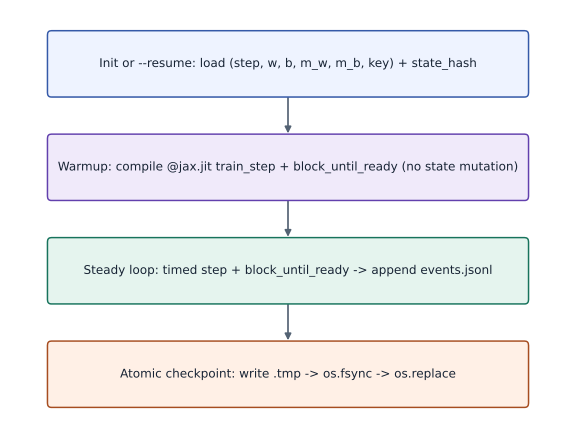
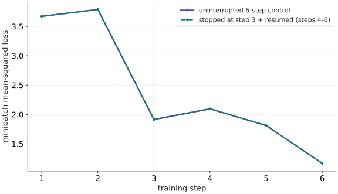

# Stage and launch checkpointed TPU jobs

Phase 20: TPU Workflows: Launching Jobs & Checkpointed Experiments · about 25 minutes · CPU

This worked reference is validated on CPU. Accelerator compatibility requires a separate source review and target execution receipt. Use the execution matrix to review device selection and data ownership before adapting a separate target program.

## What you will be able to do

- Stage the TPU launcher (`resources/tpu-gcp/launch.py`) to a Cloud TPU VM with `gcloud compute tpus tpu-vm scp`.
- Separate XLA compile warmup time from steady-state step time in structured `events.jsonl` logs.
- Write atomic checkpoints using `temp` + `os.fsync` + `os.replace` so preemption does not expose a partially replaced destination under the tested single-writer local-filesystem model the latest checkpoint.
- Interrupt, resume from an atomic checkpoint, and verify zero drift against an uninterrupted control run.

## The problem

Once a Cloud TPU VM is running, typing ad-hoc interactive commands in an SSH shell is fragile: if the connection drops or a Spot TPU is preempted, you lose progress and cannot tell compilation time from step time. You need a repeatable way to stage code, launch TPU jobs, log structured JSONL events, and checkpoint atomically.

## The idea

The launcher records warmup and synchronized updates separately, then checkpoints the complete deterministic state with an integrity hash and a run-configuration identity. A requested resume must find a checkpoint, validate its contents and configuration, and define completed-run behavior explicitly.

## Why launching a TPU experiment is different from running a notebook cell

A script makes the run sequence and its evidence repeatable. The first `@jax.jit` call traces and compiles; the launcher records that synchronized warmup separately, then synchronizes each timed update before writing its event. The CPU fixture records both intervals so you can compare their own samples; exact timings vary across captures. For example, a hypothetical $1$-second warmup followed by $100$ updates of $0.01$ seconds takes $1+100\times0.01=2$ seconds in total. Averaging that total gives $2/100=0.02$ seconds per update including startup, while the steady update interval is $0.01$ seconds. State which question your summary answers; neither CPU duration estimates TPU performance. Use the actual number of `step` events to compute a steady-state summary, and leave `compile_warmup_s` outside that summary.

The checkpoint contains parameters, optimizer moments and PRNG key, plus a state hash and run-configuration identity. The tested single-writer local-filesystem path writes a sibling `.tmp`, flushes it, and replaces the destination. If interrupted, load only the published checkpoint after checking schema, hash and run identity; a leftover temp file is not a checkpoint. If the destination is missing or invalid, this fixture has no backup to restore, so restart from initial state or use a separately retained validated checkpoint. Atomic name replacement does not by itself promise power-loss durability, concurrent-writer safety or distributed publication.

$$
\bar{T}_{\text{step}} = \frac{\sum_{i=1}^{N_{\text{updates}}} \Delta t_i}{N_{\text{updates}}}, \quad \Delta t_i = t^{\text{end}}_i - t^{\text{start}}_i
$$

### Checkpointed TPU job launcher lifecycle from warmup to zero-drift resume

**Predict:** Why must the warmup compilation step run before the timed step loop without overwriting the restored checkpoint state?



*Architecture and dataflow mechanism diagram.*

Read the arrows as a job lifecycle: load initial or validated checkpoint state, compile one synchronized warmup without changing that state, run synchronized updates while appending `step` events, then publish a checkpoint through `.tmp` and atomic replacement. After interruption, validate the published file's schema, state hash and run identity before resume; discard a leftover `.tmp`. The measured CPU example separates about 196.9 ms warmup from a 1.018 ms median step. The next decision is whether the named checkpoint is valid; an invalid or missing destination needs a separately saved backup or a restart, not a guess.

### Pause and reason

Why does restoring model weights alone after a Spot TPU preemption cause the resumed training curve to diverge from an uninterrupted run?

<details><summary>Compare your reasoning</summary>

Without restoring the optimizer momentum/variance buffers (`m_w`, `m_b`) and the PRNG key (`key`) alongside the step counter and weights, the next update uses zeroed momentum and a repeated or mismatched random batch.

</details>

## 1. Stage the launcher and run a checkpoint-resumed TPU experiment

First run the CPU fixture to check the resume contract, then treat its receipt as a logical rehearsal. It stops at step 4, resumes to step 8 and compares the final state hash with the uninterrupted control; both are `eba1c0bc…eccbed9`, an exact match in the recorded run. It also rejects a modified checkpoint hash. This establishes the tested deterministic resume path on CPU only. A TPU job needs its own saved receipt naming the source, pinned environment, requested topology and observed TPU backend before its timing or recovery result is called TPU evidence.

**Stage launch.py and verify checkpoint resume on the Cloud TPU VM**

```bash
# Stage launch.py and verify checkpoint resume on the Cloud TPU VM
gcloud compute tpus tpu-vm scp resources/tpu-gcp/launch.py "$TPU_NAME":~/jax-tpu-lab/ --zone="$ZONE"

gcloud compute tpus tpu-vm ssh "$TPU_NAME" --zone="$ZONE" --command="
  set -euo pipefail
  source ~/jax-tpu-lab/.venv/bin/activate
  python ~/jax-tpu-lab/launch.py --platform tpu --run-dir ~/jax-tpu-lab/run-resumed --steps 4 --save-every 2
  python ~/jax-tpu-lab/launch.py --platform tpu --run-dir ~/jax-tpu-lab/run-resumed --steps 8 --save-every 2 --resume
  python ~/jax-tpu-lab/launch.py --platform tpu --run-dir ~/jax-tpu-lab/run-control --steps 8 --save-every 2
"
```

**Expected:** Both runs emit started, warmup, step, checkpoint, and completed JSONL events with backend: tpu, and their step-8 state hashes match.

## Define deterministic hashing and atomic checkpoint writes

Create main.py with digest_obj and atomic_write_json so interrupted writes never corrupt the latest checkpoint.

```python
# Step 1 — Define deterministic hashing and atomic checkpoint writes
import hashlib
import json
import os
from pathlib import Path
import tempfile
import time
import jax
import jax.numpy as jnp
import numpy as np


def digest_obj(value):
    return hashlib.sha256(
        json.dumps(value, sort_keys=True, separators=(",", ":")).encode()
    ).hexdigest()


def atomic_write_json(path, payload):
    path = Path(path)
    path.parent.mkdir(parents=True, exist_ok=True)
    tmp = path.with_suffix(path.suffix + ".tmp")
    # Enter managed runtime/context scope for this block:
    with tmp.open("w", encoding="utf-8") as f:
        json.dump(payload, f, sort_keys=True)
        f.flush()
        os.fsync(f.fileno())
    os.replace(tmp, path)
```

Writing to a temporary sibling file, flushing with fsync, and calling os.replace guarantees that checkpoint-latest.json is always complete.

## Implement the TPU-ready job runner with warmup separation and resume

Append run_tpu_ready_job to main.py.

```python
# Step 2 — Implement the TPU-ready job runner with warmup separation and resume
def run_tpu_ready_job(run_dir, steps=6, save_every=2, resume=False, seed=0, lr=0.05):
    run_dir = Path(run_dir)
    run_dir.mkdir(parents=True, exist_ok=True)
    events_path = run_dir / "events.jsonl"
    ckpt_path = run_dir / "checkpoint-latest.json"

    def emit(event, **fields):
        # Check which hardware backend (`cpu`, `gpu`, or `tpu`) JAX selected for `record`.
        record = {"event": event, "backend": jax.default_backend(), "devices": jax.device_count(), **fields}
        # Enter managed runtime/context scope for this block:
        with events_path.open("a", encoding="utf-8") as f:
            f.write(json.dumps(record, sort_keys=True) + "\n")
        return record

    x = jnp.linspace(-1.0, 1.0, 64, dtype=jnp.float32).reshape(64, 1)
    target_y = 3.0 * x - 0.5

    config = {"schema": 1, "seed": int(seed), "lr": float(lr), "data": "linspace64-target-3x-minus-0.5-v1", "batch_size": 16, "optimizer": "momentum-0.8-noise-key-v1"}
    config_hash = digest_obj(config)
    # A requested resume requires an existing, compatible, intact checkpoint.
    if resume:
        if not ckpt_path.exists():
            raise FileNotFoundError(f"resume requested but checkpoint is missing: {ckpt_path}")
        saved = json.loads(ckpt_path.read_text(encoding="utf-8"))
        supplied_hash = saved.pop("state_hash", None)
        if supplied_hash != digest_obj(saved):
            raise ValueError("checkpoint state hash mismatch")
        if saved.get("config_hash") != config_hash or saved.get("config") != config:
            raise ValueError("checkpoint run configuration mismatch")
        step = int(saved["step"])
        w = jnp.array(saved["w"], dtype=jnp.float32)
        b = jnp.array(saved["b"], dtype=jnp.float32)
        m_w = jnp.array(saved["m_w"], dtype=jnp.float32)
        m_b = jnp.array(saved["m_b"], dtype=jnp.float32)
        key = jnp.array(saved["key"], dtype=jnp.uint32)
        state_payload = dict(saved)
        state_payload["state_hash"] = supplied_hash
        emit("restored", step=step, state_hash=supplied_hash)
    else:
        step = 0
        w = jnp.zeros((1, 1), dtype=jnp.float32)
        b = jnp.zeros((1,), dtype=jnp.float32)
        m_w = jnp.zeros_like(w)
        m_b = jnp.zeros_like(b)
        key = jax.random.PRNGKey(seed)
        emit("started", step=step)
        state_payload = {"step": 0, "w": np.asarray(w).tolist(), "b": np.asarray(b).tolist(), "m_w": np.asarray(m_w).tolist(), "m_b": np.asarray(m_b).tolist(), "key": np.asarray(key).tolist(), "config": config, "config_hash": config_hash}
        state_payload["state_hash"] = digest_obj(state_payload)
        atomic_write_json(ckpt_path, state_payload)
    if step > steps:
        raise ValueError(f"checkpoint step {step} exceeds requested final step {steps}")

    @jax.jit
    def train_step(w, b, m_w, m_b, key):
        # Split the PRNG key deterministically into independent subkeys (`(key, subkey)`).
        key, subkey = jax.random.split(key)
        idx = jax.random.choice(subkey, 64, shape=(16,), replace=False)
        xb, yb = x[idx], target_y[idx]

        def loss_fn(w_in, b_in):
            # Perform matrix contraction / projection to compute `pred`.
            pred = xb @ w_in + b_in
            return jnp.mean((pred - yb) ** 2)

        loss, (gw, gb) = jax.value_and_grad(loss_fn, argnums=(0, 1))(w, b)
        m_w = 0.8 * m_w + gw
        m_b = 0.8 * m_b + gb
        w = w - lr * m_w
        b = b - lr * m_b
        return w, b, m_w, m_b, key, loss

    if step == steps:
        emit("completed", step=step, state_hash=state_payload["state_hash"])
        return {"final_step": step, "state_hash": state_payload["state_hash"], "w": float(np.asarray(w).squeeze()), "b": float(np.asarray(b).squeeze()), "warmup_ms": 0.0, "step_losses": [], "step_times_ms": []}

    t0 = time.perf_counter()
    warm = train_step(w, b, m_w, m_b, key)
    # Wait for device work to finish before timing it or comparing its result on the host.
    jax.block_until_ready(warm)
    warmup_ms = (time.perf_counter() - t0) * 1000.0
    emit("warmup", warmup_ms=warmup_ms, step=step)

    step_losses = []
    step_times_ms = []
    while step < steps:
        t_step = time.perf_counter()
        w, b, m_w, m_b, key, loss = train_step(w, b, m_w, m_b, key)
        jax.block_until_ready((w, b, m_w, m_b, key, loss))
        elapsed_ms = (time.perf_counter() - t_step) * 1000.0
        step += 1
        state_payload = {
            "step": step,
            "w": np.asarray(w).tolist(),
            "b": np.asarray(b).tolist(),
            "m_w": np.asarray(m_w).tolist(),
            "m_b": np.asarray(m_b).tolist(),
            "key": np.asarray(key).tolist(),
            "config": config,
            "config_hash": config_hash,
        }
        state_payload["state_hash"] = digest_obj(state_payload)
        step_losses.append(float(loss))
        step_times_ms.append(float(elapsed_ms))
        emit("step", step=step, loss=float(loss), step_ms=elapsed_ms, state_hash=state_payload["state_hash"])
        if step % save_every == 0 or step == steps:
            atomic_write_json(ckpt_path, state_payload)
            emit("checkpoint", step=step, state_hash=state_payload["state_hash"])

    emit("completed", step=step, state_hash=state_payload["state_hash"])
    return {
        "final_step": step,
        "state_hash": state_payload["state_hash"],
        "w": float(np.asarray(w).squeeze()),
        "b": float(np.asarray(b).squeeze()),
        "warmup_ms": warmup_ms,
        "step_losses": step_losses,
        "step_times_ms": step_times_ms,
    }

```

Warmup compiles the JIT function without mutating w, b, m_w, m_b, or key, so step 1 starts from the exact initial or restored state.

## Compare a checkpoint-resumed run against an uninterrupted control run

Append the 3-step + 3-step resumed run and 6-step uninterrupted control comparison to main.py.

```python
# Step 3 — Compare a checkpoint-resumed run against an uninterrupted control run
# Keep this run’s database and artifacts in a scratch directory removed on exit.
with tempfile.TemporaryDirectory(prefix="tpu-launch-") as tmp:
    root = Path(tmp)
    part1 = run_tpu_ready_job(root / "resumed", steps=3, save_every=3, resume=False)
    part2 = run_tpu_ready_job(root / "resumed", steps=6, save_every=3, resume=True)
    control = run_tpu_ready_job(root / "control", steps=6, save_every=3, resume=False)
    resumed_losses = part1["step_losses"] + part2["step_losses"]

# Assert invariant `part2["state_hash"] == control["state_hash"]` holds
assert part2["state_hash"] == control["state_hash"]
assert np.allclose(resumed_losses, control["step_losses"])
print("Resumed state_hash matches uninterrupted control:", part2["state_hash"])
print("Losses across 6 steps:", [round(v, 5) for v in control["step_losses"]])
```

Because parameters, momentum buffers, and PRNG keys are all restored, the resumed trajectory matches the uninterrupted trajectory bit-for-bit.

## Run the example

```python
# Step 1 — Define deterministic hashing and atomic checkpoint writes
import hashlib
import json
import os
from pathlib import Path
import tempfile
import time
import jax
import jax.numpy as jnp
import numpy as np


def digest_obj(value):
    return hashlib.sha256(
        json.dumps(value, sort_keys=True, separators=(",", ":")).encode()
    ).hexdigest()


def atomic_write_json(path, payload):
    path = Path(path)
    path.parent.mkdir(parents=True, exist_ok=True)
    tmp = path.with_suffix(path.suffix + ".tmp")
    with tmp.open("w", encoding="utf-8") as f:
        json.dump(payload, f, sort_keys=True)
        f.flush()
        os.fsync(f.fileno())
    os.replace(tmp, path)


# Step 2 — Implement the TPU-ready job runner with warmup separation and resume
def run_tpu_ready_job(run_dir, steps=6, save_every=2, resume=False, seed=0, lr=0.05):
    run_dir = Path(run_dir)
    run_dir.mkdir(parents=True, exist_ok=True)
    events_path = run_dir / "events.jsonl"
    ckpt_path = run_dir / "checkpoint-latest.json"

    def emit(event, **fields):
        # Record the backend selected by this JAX process in the event.
        record = {"event": event, "backend": jax.default_backend(), "devices": jax.device_count(), **fields}
        with events_path.open("a", encoding="utf-8") as f:
            f.write(json.dumps(record, sort_keys=True) + "\n")
        return record

    x = jnp.linspace(-1.0, 1.0, 64, dtype=jnp.float32).reshape(64, 1)
    target_y = 3.0 * x - 0.5

    config = {"schema": 1, "seed": int(seed), "lr": float(lr), "data": "linspace64-target-3x-minus-0.5-v1", "batch_size": 16, "optimizer": "momentum-0.8-noise-key-v1"}
    config_hash = digest_obj(config)
    # A requested resume requires an existing, compatible, intact checkpoint.
    if resume:
        if not ckpt_path.exists():
            raise FileNotFoundError(f"resume requested but checkpoint is missing: {ckpt_path}")
        saved = json.loads(ckpt_path.read_text(encoding="utf-8"))
        supplied_hash = saved.pop("state_hash", None)
        if supplied_hash != digest_obj(saved):
            raise ValueError("checkpoint state hash mismatch")
        if saved.get("config_hash") != config_hash or saved.get("config") != config:
            raise ValueError("checkpoint run configuration mismatch")
        step = int(saved["step"])
        w = jnp.array(saved["w"], dtype=jnp.float32)
        b = jnp.array(saved["b"], dtype=jnp.float32)
        m_w = jnp.array(saved["m_w"], dtype=jnp.float32)
        m_b = jnp.array(saved["m_b"], dtype=jnp.float32)
        key = jnp.array(saved["key"], dtype=jnp.uint32)
        state_payload = dict(saved)
        state_payload["state_hash"] = supplied_hash
        emit("restored", step=step, state_hash=supplied_hash)
    else:
        step = 0
        w = jnp.zeros((1, 1), dtype=jnp.float32)
        b = jnp.zeros((1,), dtype=jnp.float32)
        m_w = jnp.zeros_like(w)
        m_b = jnp.zeros_like(b)
        key = jax.random.PRNGKey(seed)
        emit("started", step=step)
        state_payload = {"step": 0, "w": np.asarray(w).tolist(), "b": np.asarray(b).tolist(), "m_w": np.asarray(m_w).tolist(), "m_b": np.asarray(m_b).tolist(), "key": np.asarray(key).tolist(), "config": config, "config_hash": config_hash}
        state_payload["state_hash"] = digest_obj(state_payload)
        atomic_write_json(ckpt_path, state_payload)
    if step > steps:
        raise ValueError(f"checkpoint step {step} exceeds requested final step {steps}")

    @jax.jit
    def train_step(w, b, m_w, m_b, key):
        # Split the PRNG key deterministically into independent subkeys (`(key, subkey)`).
        key, subkey = jax.random.split(key)
        idx = jax.random.choice(subkey, 64, shape=(16,), replace=False)
        xb, yb = x[idx], target_y[idx]

        def loss_fn(w_in, b_in):
            pred = xb @ w_in + b_in
            return jnp.mean((pred - yb) ** 2)

        loss, (gw, gb) = jax.value_and_grad(loss_fn, argnums=(0, 1))(w, b)
        m_w = 0.8 * m_w + gw
        m_b = 0.8 * m_b + gb
        w = w - lr * m_w
        b = b - lr * m_b
        return w, b, m_w, m_b, key, loss

    if step == steps:
        emit("completed", step=step, state_hash=state_payload["state_hash"])
        return {"final_step": step, "state_hash": state_payload["state_hash"], "w": float(np.asarray(w).squeeze()), "b": float(np.asarray(b).squeeze()), "warmup_ms": 0.0, "step_losses": [], "step_times_ms": []}

    t0 = time.perf_counter()
    warm = train_step(w, b, m_w, m_b, key)
    # Wait for device work to finish before timing it or comparing its result on the host.
    jax.block_until_ready(warm)
    warmup_ms = (time.perf_counter() - t0) * 1000.0
    emit("warmup", warmup_ms=warmup_ms, step=step)

    step_losses = []
    step_times_ms = []
    while step < steps:
        t_step = time.perf_counter()
        w, b, m_w, m_b, key, loss = train_step(w, b, m_w, m_b, key)
        jax.block_until_ready((w, b, m_w, m_b, key, loss))
        elapsed_ms = (time.perf_counter() - t_step) * 1000.0
        step += 1
        state_payload = {
            "step": step,
            "w": np.asarray(w).tolist(),
            "b": np.asarray(b).tolist(),
            "m_w": np.asarray(m_w).tolist(),
            "m_b": np.asarray(m_b).tolist(),
            "key": np.asarray(key).tolist(),
            "config": config,
            "config_hash": config_hash,
        }
        state_payload["state_hash"] = digest_obj(state_payload)
        step_losses.append(float(loss))
        step_times_ms.append(float(elapsed_ms))
        emit("step", step=step, loss=float(loss), step_ms=elapsed_ms, state_hash=state_payload["state_hash"])
        if step % save_every == 0 or step == steps:
            atomic_write_json(ckpt_path, state_payload)
            emit("checkpoint", step=step, state_hash=state_payload["state_hash"])

    emit("completed", step=step, state_hash=state_payload["state_hash"])
    return {
        "final_step": step,
        "state_hash": state_payload["state_hash"],
        "w": float(np.asarray(w).squeeze()),
        "b": float(np.asarray(b).squeeze()),
        "warmup_ms": warmup_ms,
        "step_losses": step_losses,
        "step_times_ms": step_times_ms,
    }


# Step 3 — Compare a checkpoint-resumed run against an uninterrupted control run
# Keep this run’s database and artifacts in a scratch directory removed on exit.
with tempfile.TemporaryDirectory(prefix="tpu-launch-") as tmp:
    root = Path(tmp)
    part1 = run_tpu_ready_job(root / "resumed", steps=3, save_every=3, resume=False)
    part2 = run_tpu_ready_job(root / "resumed", steps=6, save_every=3, resume=True)
    control = run_tpu_ready_job(root / "control", steps=6, save_every=3, resume=False)
    resumed_losses = part1["step_losses"] + part2["step_losses"]

# Assert invariant `part2["state_hash"] == control["state_hash"]` holds
assert part2["state_hash"] == control["state_hash"]
assert np.allclose(resumed_losses, control["step_losses"])
print("Resumed state_hash matches uninterrupted control:", part2["state_hash"])
print("Losses across 6 steps:", [round(v, 5) for v in control["step_losses"]])
```

Expected: Prints the matching 64-character state_hash for the resumed and control runs and the monotonically decreasing 6-step loss trajectory.

## Interrupted-and-resumed trajectory vs uninterrupted 6-step control run

**Predict:** Does stopping after step 3 and resuming in a fresh call change the loss trajectory on steps 4 through 6?



**Recorded CPU computation**

### Read the figure

The horizontal axis is training step 1 through 6; the vertical axis is minibatch mean-squared loss (unitless). The solid curve is the uninterrupted CPU control; the dashed curve stops after step 3 and resumes at step 4. At steps 1 to 6 both show 3.6712, 3.78913, 1.91372, 2.09553, 1.81174 and 1.16636, so their maximum absolute difference is 0. The overlap means this recorded CPU resume reproduced the control trajectory. It does not measure TPU speed. For a changed checkpoint or configuration, first expect the state-hash check to reject a mismatch.

### Connect it to the computation

The plotted six-step example saves after step $3$, carrying $(w,b,m_w,m_b,key)$ into the next update. The runnable launcher example uses a separate eight-step check that pauses after step $4$; its resumed and uninterrupted final state hashes also match (`eba1c0bc…eccbed9`). Keep each example's step boundary with its own results rather than mixing their step numbers.

Both examples ask the same recovery question: does restoring the complete accepted state produce the continuation that the control run would have produced? Use the curve for step-by-step loss agreement and the complete-state comparison for information a scalar loss can hide. Obtain a separate named target receipt before interpreting either CPU example as TPU recovery evidence.

```python
visual_data = {
    'kind': 'line',
    'x': [1, 2, 3, 4, 5, 6],
    'xlabel': 'training step',
    'ylabel': 'minibatch mean-squared loss',
    'boundaries': [3],
    'series': [
        {'label': 'uninterrupted 6-step control', 'y': [float(v) for v in control['step_losses']]},
        {'label': 'stopped at step 3 + resumed (steps 4-6)', 'y': [float(v) for v in resumed_losses]},
    ],
}
```

## Recorded reference execution

CPU run: 2026-10-27T17:17:01.239752+00:00. JAX 0.9.2.

```text
Resumed state_hash matches uninterrupted control: ecba6a13e41beb0003af0371f8422efa3b08538c4420efb07a9bc61b0a10cdc1
Losses across 6 steps: [3.6712, 3.78913, 1.91372, 2.09553, 1.81174, 1.16636]
Resumed state_hash matches uninterrupted control: ecba6a13e41beb0003af0371f8422efa3b08538c4420efb07a9bc61b0a10cdc1
Losses across 6 steps: [3.6712, 3.78913, 1.91372, 2.09553, 1.81174, 1.16636]
Warmup ms: 148.079 Median steady step ms: 0.2248
Resume rejection: checkpoint state hash mismatch
Step 8 resumed vs control hash: eba1c0bcfb80184d9f5108c1d6539369e21f95276e5d6806234237f41eccbed9 eba1c0bcfb80184d9f5108c1d6539369e21f95276e5d6806234237f41eccbed9
Recorded event sequence: ['started', 'warmup', 'step', 'step', 'checkpoint', 'completed', 'restored', 'warmup', 'step', 'step', 'checkpoint', 'completed']
Loaded step: 4 Leftover tmp files: []
PASS: tpu-02

```

## Compare JIT warmup latency against steady-state step latency

**Predict before running:** How does the warmup call duration compare to the median steady-state step duration?

```python
# Experiment — Compare JIT warmup latency against steady-state step latency
median_step_ms = float(np.median(control["step_times_ms"]))
print("Warmup ms:", round(control["warmup_ms"], 3), "Median steady step ms:", round(median_step_ms, 4))
# Assert invariant `control["warmup_ms"] > median_step_ms` holds
assert control["warmup_ms"] > median_step_ms
```

**Expected:** Warmup takes significantly longer than a steady-state compiled step because it includes tracing and XLA compilation.

Logging warmup separately in events.jsonl prevents compilation overhead from distorting per-step throughput numbers on CPU or TPU.

## Verify checkpoint integrity rejects omitted momentum

**Predict before running:** If the momentum buffers are changed in a saved checkpoint without updating its state hash, will resume continue with the altered state?

```python
# Verify checkpoint integrity rejects a modified momentum buffer
with tempfile.TemporaryDirectory(prefix="tpu-bad-resume-") as tmp:
    bad_dir = Path(tmp) / "bad"
    run_tpu_ready_job(bad_dir, steps=3, save_every=3, resume=False)
    ckpt_path = bad_dir / "checkpoint-latest.json"
    ckpt = json.loads(ckpt_path.read_text(encoding="utf-8"))
    ckpt["m_w"] = [[0.0]]
    ckpt["m_b"] = [0.0]
    ckpt_path.write_text(json.dumps(ckpt), encoding="utf-8")
    try:
        run_tpu_ready_job(bad_dir, steps=6, save_every=3, resume=True)
    except ValueError as exc:
        message = str(exc)
    else:
        raise AssertionError("modified checkpoint was accepted")
print("Resume rejection:", message)
assert message == "checkpoint state hash mismatch"
```

**Expected:** Resume raises ValueError with checkpoint state hash mismatch before loading or training from the modified state.

The state hash covers the serialized step, parameters, optimizer moments, PRNG key, and run configuration. A changed momentum buffer is corruption and must be rejected. To study the trajectory of a buggy weight-only resume, use a separate intentionally weakened loader that recomputes a valid hash after omitting momentum; that demonstrates the modeling error but is not an acceptable checkpoint path.

## Make it yours

Run `run_tpu_ready_job` for $4$ steps (`save_every=2`), resume to $8$ steps, and verify that the final `state_hash` at step $8$ equals an uninterrupted $8$-step run.

### How to write this exercise — Step-by-step recipe & starter scaffold

**Inputs:**
- A scratch job directory, checkpoint interval, deterministic job config, and step targets four and eight.

**Outputs:**
- Resumed and uninterrupted final state hashes at step eight.

**Invariants to check:**
- The final hashes match only when resume restores the complete deterministic state and compatible configuration.

**Hints:**
- Run the first segment, resume from its checkpoint, then run an uninterrupted control.
- Keep each run's files isolated.

**Starter code scaffold (fill in the TODOs):**

```python
import jax.numpy as jnp
import numpy as np

def compare_resumed_and_uninterrupted_runs(run_tpu_ready_job, root):
    # TODO: run the staged and control trajectories and compare final state hashes.
    raise NotImplementedError
```

<details><summary>Reference solution</summary>

```python
# Exercise solution
# Keep this run’s database and artifacts in a scratch directory removed on exit.
with tempfile.TemporaryDirectory(prefix="tpu-ex-") as tmp:
    ex_root = Path(tmp)
    r1 = run_tpu_ready_job(ex_root / "resumed", steps=4, save_every=2, resume=False)
    r2 = run_tpu_ready_job(ex_root / "resumed", steps=8, save_every=2, resume=True)
    ctrl8 = run_tpu_ready_job(ex_root / "control", steps=8, save_every=2, resume=False)
print("Step 8 resumed vs control hash:", r2["state_hash"], ctrl8["state_hash"])
assert r2["state_hash"] == ctrl8["state_hash"] and len(r1["step_losses"] + r2["step_losses"]) == 8
```

</details>

## Inspect the JSONL event sequence from a resumed run

**Foundations**

Run a $2$-step job followed by a `--resume` to step $4$ and list the ordered `event` names recorded in `events.jsonl`.

<details><summary>Hint</summary>

Read `events.jsonl` line by line with `json.loads`.

</details>

### How to write: Inspect the JSONL event sequence from a resumed run — Step-by-step recipe & starter scaffold

**Inputs:**
- A temporary job directory and the public two-step/resume-to-four-step launcher.

**Outputs:**
- The ordered event names recorded in JSONL after resume.

**Invariants to check:**
- Event order comes from the durable log, not from an assumed event sequence.

**Hints:**
- Parse one JSON object per line.
- Include both the initial and resumed launch events.

**Starter code scaffold (fill in the TODOs):**

```python
import jax.numpy as jnp
import numpy as np

def read_resumed_event_names(run_tpu_ready_job, root):
    # TODO: launch both segments and return the event names in file order.
    raise NotImplementedError
```

<details><summary>Reference solution and reasoning</summary>

```python
# Inspect the JSONL event sequence from a resumed run (Foundations)
# Keep this run’s database and artifacts in a scratch directory removed on exit.
with tempfile.TemporaryDirectory(prefix="tpu-events-") as tmp:
    ev_dir = Path(tmp) / "job"
    run_tpu_ready_job(ev_dir, steps=2, save_every=2, resume=False)
    run_tpu_ready_job(ev_dir, steps=4, save_every=2, resume=True)
    event_names = [json.loads(line)["event"] for line in (ev_dir / "events.jsonl").read_text().splitlines()]
print("Recorded event sequence:", event_names)
assert "started" in event_names and "restored" in event_names and event_names[-1] == "completed"
```

The single append-only events.jsonl log captures both the initial run (`started` -> `warmup` -> `step` -> `checkpoint` -> `completed`) and the resumed run (`restored` -> `warmup` -> `step` -> `checkpoint` -> `completed`).

</details>

## Verify atomic checkpoint file replacement

**Transfer / diagnosis**

Write a small test that calls `atomic_write_json` twice on the same path and confirms that no `.tmp` file remains alongside the final JSON file.

<details><summary>Hint</summary>

Check `list(Path(tmp).glob('*.tmp')) == []`.

</details>

### How to write: Verify atomic checkpoint file replacement — Step-by-step recipe & starter scaffold

**Inputs:**
- A temporary target path and two JSON payloads written through atomic_write_json.

**Outputs:**
- The final decoded second payload and a check for leftover temporary siblings.

**Invariants to check:**
- The destination contains a complete JSON object; no staging temp file remains after success.

**Hints:**
- Write twice to the same target.
- Inspect the directory after the second replacement.

**Starter code scaffold (fill in the TODOs):**

```python
import jax.numpy as jnp
import numpy as np

def check_atomic_json_replacement(atomic_write_json, root):
    # TODO: write two payloads and inspect the final file and temporary-file cleanup.
    raise NotImplementedError
```

<details><summary>Reference solution and reasoning</summary>

```python
# Verify atomic checkpoint file replacement (Transfer / diagnosis)
# Keep this run’s database and artifacts in a scratch directory removed on exit.
with tempfile.TemporaryDirectory(prefix="tpu-atomic-") as tmp:
    target = Path(tmp) / "checkpoint-latest.json"
    atomic_write_json(target, {"step": 2})
    atomic_write_json(target, {"step": 4})
    leftovers = list(Path(tmp).glob("*.tmp"))
    loaded = json.loads(target.read_text(encoding="utf-8"))
print("Loaded step:", loaded["step"], "Leftover tmp files:", leftovers)
# Assert invariant `loaded["step"] == 4 and leftovers == []` holds
assert loaded["step"] == 4 and leftovers == []
```

`os.replace` atomically swaps the flushed `.tmp` file into `checkpoint-latest.json`, leaving zero partial files behind.

</details>

## Check your understanding

Why does `run_tpu_ready_job` execute `train_step` once and discard its outputs before starting the timed `while step < steps` loop?

1. To mutate the parameters one extra time before step 1
2. To trigger XLA compilation and synchronize the warmup result without altering the initial or restored training state, keeping compilation latency out of steady-state step measurements
3. Because JAX cannot save checkpoints without a warmup call

<details><summary>Answer and explanation</summary>

**1. To mutate the parameters one extra time before step 1**

Retaining warmup output would advance this example’s state. Discard its returned state and begin the measured trajectory from the intended checkpoint.

**2. To trigger XLA compilation and synchronize the warmup result without altering the initial or restored training state, keeping compilation latency out of steady-state step measurements (correct)**

This fixed-signature example warms and synchronizes the compiled step, then discards its returned state so the measured trajectory starts at the intended state. A later shape, dtype or static-argument change can still recompile. Warmup is not a general steady-state guarantee.

**3. Because JAX cannot save checkpoints without a warmup call**

Checkpoint compatibility is not created by warmup. Warmup separates initial compilation from timing for the tested signature.

</details>

## Diagnose the result

If a resumed TPU run diverges from an uninterrupted run, check whether optimizer moments (`m_w`, `m_b`), PRNG `key`, or dataset position were omitted from the checkpoint.

## Carry forward

- Always separate `@jax.jit` warmup compilation from steady-state step timing and call `jax.block_until_ready`.
- Atomic checkpoints (`temp` + `fsync` + `os.replace`) containing parameters, optimizer state, and PRNG keys allow interrupted or Spot TPU runs to resume without numerical drift.

## Keep your evidence

Keep events.jsonl (started, warmup, step, checkpoint, restored, completed), checkpoint-latest.json, and matching resumed vs control state hashes.

Save your predictions, modified code, terminal outputs, and reasoning in your engineering portfolio.

## Primary references

- [Run JAX code on Cloud TPU VMs](https://cloud.google.com/tpu/docs/run-calculation-jax)
- [Orbax checkpointing guide](https://orbax.readthedocs.io/en/latest/)

