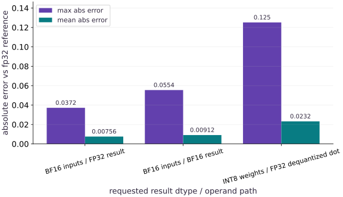

# bfloat16, int8 precision, and XProf profiling on TPU

Phase 21: TPU Systems: Generations, Memory, Precision & XProf · about 25 minutes · CPU

This worked reference is validated on CPU. Accelerator compatibility requires a separate source review and target execution receipt. A separate precision and profiling runner is implemented in the target instructions. Bounded hardware receipts cover v5e1 launch, resume and precision checks; four single-device Pallas cases; and a four-device v5e collective fixture. Each receipt applies only to its recorded source, environment, cases and hardware. Other lessons and TPU configurations require separate qualification.

## What you will be able to do

- Measure numerical error for `bfloat16` matmuls with `float32` accumulation versus `bfloat16` accumulation.
- Implement per-column INT8 weight quantization and an FP32 dequantization reference; account for scales and test a zero-valued channel.
- Capture a warmed `jax.profiler.trace` (`*.xplane.pb`) on a Cloud TPU VM (or local CPU rehearsal) after synchronizing warmup.
- Download the trace directory with `gcloud compute tpus tpu-vm scp --recurse` and inspect it in TensorBoard / XProf.

## The problem

Compare BF16 operand rounding and a per-column INT8 weight-quantization reference on CPU, while distinguishing stored values, dequantized operands, accumulation type, and device-kernel execution. Retain a trace of the actual worked workload in a user-selected directory so its events can be inspected.

## The idea

This lesson measures numerical error for a BF16 matmul and an FP32 dequantization reference for INT8 weights. The INT8 path stores quantized weights plus scale metadata, then casts and rescales them to FP32 before the dot; it does not demonstrate a native INT8 kernel, packed runtime storage, or reduced device-memory traffic. The FP32 result is a finite-precision reference, not exact arithmetic. Keep the generated XProf directory after the example returns.

## Why TPU matmuls use `bfloat16` operands with `float32` accumulation

BF16 has the same exponent width as FP32, but its shorter significand still rounds values; this does not eliminate all underflow, overflow, or accuracy problems. `preferred_element_type=jnp.float32` requests a FP32 result/accumulation type through the JAX dot API, but a CPU run does not establish a TPU kernel’s internal implementation.

The INT8 example quantizes each output column using `scale = max(abs(W[:, j])) / 127`, stores one signed byte per weight plus one FP32 scale per column, and then dequantizes to FP32 before the dot. A zero column uses scale zero and must produce a zero quantized column without division by zero. This is a numerical reference only: it does not show a native INT8 dot, packed storage, activation quantization, or reduced device memory traffic. Compare against the FP32 JAX computation, which is finite precision. The measured error is specific to the fixed input and weight arrays.

$$
\text{Cost per } 10^6 \text{ tokens} = \frac{C_{\text{chip\_hour}} \times N_{\text{chips}} \times (T_{\text{run}} / 3600)}{\text{Tokens}_{\text{processed}} / 10^6}
$$

### Pause and reason

Why does accumulating a dot product in `bfloat16` (`preferred_element_type=jnp.bfloat16`) have higher error than `preferred_element_type=jnp.float32` even when both inputs are `bfloat16`?

<details><summary>Compare your reasoning</summary>

When accumulating in `bfloat16`, every partial sum across the inner dimension `K` is rounded to 7 mantissa bits, whereas `float32` accumulation retains 23 mantissa bits for the entire reduction.

</details>

## 1. Capture a warmed XProf trace on your Cloud TPU VM and inspect in TensorBoard

The worked CPU example warms the exact function it profiles and writes its trace under `TPU_TRACE_DIR` (default `./tpu-xprof-trace`). The directory remains after the function returns. Open that directory in TensorBoard/XProf and inspect the actual event names, timestamp units, host dispatch, compilation boundary, device work, synchronization, and input stalls that are present in your trace. A CPU trace teaches event reading; it does not establish TPU performance. For timing comparisons, measure synchronized steps outside the profiler.

**Run tpu-06.py and capture a 5-step warmed XProf trace on the Cloud TPU VM**

```bash
gcloud compute tpus tpu-vm scp public/exercises/tpu-06.py "$TPU_NAME":~/jax-tpu-lab/ --zone="$ZONE"
gcloud compute tpus tpu-vm ssh "$TPU_NAME" --zone="$ZONE" --command="set -euo pipefail; source ~/jax-tpu-lab/.venv/bin/activate; export TPU_TRACE_DIR=~/jax-tpu-lab/tpu-xprof-trace; JAX_PLATFORMS=tpu python ~/jax-tpu-lab/tpu-06.py"
mkdir -p ./tpu-xprof-trace
gcloud compute tpus tpu-vm scp --recurse "$TPU_NAME":~/jax-tpu-lab/tpu-xprof-trace ./ --zone="$ZONE"
```

**Expected:** Runs the lesson workload, captures that workload in the persistent TPU_TRACE_DIR, then copies the retained trace directory back. Inspect actual events in XProf; CPU and TPU traces remain separately identified.

**Launch TensorBoard with the XProf profile plugin on your workstation**

```bash
# Launch TensorBoard with the XProf profile plugin on your workstation
pip install tensorboard tensorboard-plugin-profile xprof
tensorboard --logdir ./tpu-xprof-trace --port 6006
```

**Expected:** Serves the XProf Trace Viewer, Overview Page, and Memory Viewer at http://localhost:6006.

## Compare BF16 (FP32 vs BF16 accumulation) and per-channel INT8 matmul errors

Create main.py with evaluate_precision_policies.

```python
# Step 1 — Compare BF16 (FP32 vs BF16 accumulation) and per-channel INT8 matmul errors
from pathlib import Path
import os
import tempfile
import time
import jax
import jax.numpy as jnp
import numpy as np


def evaluate_precision_policies(seed=0):
    # Create or split explicit PRNG key(s) (`(k1, k2)`) for reproducible randomness.
    k1, k2 = jax.random.split(jax.random.PRNGKey(seed))
    # Sample deterministic random values into `x` using an explicit PRNG key.
    x = jax.random.normal(k1, (64, 256), dtype=jnp.float32)
    # Sample deterministic random values into `w` using an explicit PRNG key.
    w = jax.random.normal(k2, (256, 64), dtype=jnp.float32) * 0.25
    # Cast or evaluate `ref_fp32` in explicit floating-point precision.
    ref_fp32 = jnp.dot(x, w, preferred_element_type=jnp.float32)
    # Cast or evaluate `out_bf16_fp32acc` in explicit floating-point precision.
    out_bf16_fp32acc = jnp.dot(
        x.astype(jnp.bfloat16), w.astype(jnp.bfloat16), preferred_element_type=jnp.float32
    )
    # Cast or evaluate `out_bf16_bf16acc` in explicit floating-point precision.
    out_bf16_bf16acc = jnp.dot(
        x.astype(jnp.bfloat16), w.astype(jnp.bfloat16), preferred_element_type=jnp.bfloat16
    ).astype(jnp.float32)
    # Reduce across the target axis to summarize `scale`.
    column_max = jnp.max(jnp.abs(w), axis=0, keepdims=True)
    scale = jnp.where(column_max == 0, 1.0, column_max / 127.0)
    # The scale of 1 for a zero column avoids division by zero; its quantized values remain zero.
    w_int8 = jnp.clip(jnp.round(w / scale), -127, 127).astype(jnp.int8)
    # Cast or evaluate `out_int8_fp32acc` in explicit floating-point precision.
    out_int8_fp32acc = jnp.dot(x, w_int8.astype(jnp.float32) * scale, preferred_element_type=jnp.float32)
    policies = [
        ("bf16 (fp32 accum)", out_bf16_fp32acc),
        ("bf16 (bf16 accum)", out_bf16_bf16acc),
        ("int8 per-col (fp32 accum)", out_int8_fp32acc),
    ]
    results = []
    # Loop over `(label, tensor)` in `policies`:
    for label, tensor in policies:
        diff = jnp.abs(tensor - ref_fp32)
        # Append the computed value via `results.append({`.
        results.append({
            "policy": label,
            "max_abs_err": round(float(jnp.max(diff)), 5),
            "mean_abs_err": round(float(jnp.mean(diff)), 5),
            "weight_bytes": int(w_int8.size),
            "scale_bytes": int(scale.size * 4),
        })
    return results

```

Measuring both max and mean absolute error across accumulation dtypes quantifies why FP32 accumulation is standard on TPU MXUs.

## Capture a warmed XProf trace and verify *.xplane.pb output

Append capture_warmed_trace and the verification assertions to main.py.

```python
# Step 2 — Capture a warmed XProf trace and verify *.xplane.pb output
def capture_warmed_trace(steps=4, trace_dir=None):
    x = jnp.ones((256, 256), dtype=jnp.bfloat16)
    # Wrap with `jax.jit` (`step_fn`) so XLA traces and compiles the function.
    step_fn = jax.jit(lambda a: jnp.dot(a, a, preferred_element_type=jnp.float32).astype(jnp.bfloat16))
    t0 = time.perf_counter()
    # Wait for device work to finish before timing it or comparing its result on the host.
    jax.block_until_ready(step_fn(x))
    warmup_ms = (time.perf_counter() - t0) * 1000.0
    # Enter managed runtime/context scope for this block:
    trace_dir = Path(trace_dir or os.environ.get("TPU_TRACE_DIR", "./tpu-xprof-trace")).expanduser().resolve()
    trace_dir.mkdir(parents=True, exist_ok=True)
    with jax.profiler.trace(str(trace_dir)):
        t1 = time.perf_counter()
        # Repeat the update loop over `range(steps)` steps:
        for _ in range(steps):
            x = step_fn(x)
        # Wait for device work to finish before timing it or comparing its result on the host.
        jax.block_until_ready(x)
        steady_ms = (time.perf_counter() - t1) * 1000.0 / steps
    # Collect files from the retained trace directory.
    xplane_files = list(trace_dir.rglob("*.xplane.pb"))
    return {"warmup_ms": warmup_ms, "steady_ms": steady_ms, "xplane_count": len(xplane_files), "trace_dir": str(trace_dir)}


prec_table = evaluate_precision_policies()
trace_info = capture_warmed_trace()
# Assert invariant `trace_info["xplane_count"] >= 1` holds
assert trace_info["xplane_count"] >= 1
# Assert invariant `prec_table[0]["max_abs_err"] < prec_table[1]["max_abs_err"]` holds
assert prec_table[0]["max_abs_err"] < prec_table[1]["max_abs_err"]
print("Precision comparison:", prec_table)
print("Captured *.xplane.pb trace count:", trace_info["xplane_count"], "steady_ms:", round(trace_info["steady_ms"], 4))
```

Warming up before entering jax.profiler.trace ensures the captured *.xplane.pb file records steady-state execution rather than first-call compilation.

## Step 3: Verify invariants on the completed state

Run the final shape and numerical assertions to confirm the state built in Steps 1 and 2.

```python
assert trace_info["xplane_count"] >= 1
assert prec_table[0]["max_abs_err"] < prec_table[1]["max_abs_err"]
```

Checking these invariants confirms the computation is ready for the full worked experiment.

## Run the example

```python
# Step 1 — Compare BF16 (FP32 vs BF16 accumulation) and per-channel INT8 matmul errors
from pathlib import Path
import os
import time
import jax
import jax.numpy as jnp
import numpy as np


def evaluate_precision_policies(seed=0):
    # Create or split explicit PRNG key(s) (`(k1, k2)`) for reproducible randomness.
    k1, k2 = jax.random.split(jax.random.PRNGKey(seed))
    # Sample deterministic random values into `x` using an explicit PRNG key.
    x = jax.random.normal(k1, (64, 256), dtype=jnp.float32)
    # Sample deterministic random values into `w` using an explicit PRNG key.
    w = jax.random.normal(k2, (256, 64), dtype=jnp.float32) * 0.25
    # Keep the reference matrix product in float32 for comparison.
    ref_fp32 = jnp.dot(x, w, preferred_element_type=jnp.float32)
    # Round both inputs to BF16, but accumulate and return the dot product in float32.
    out_bf16_fp32acc = jnp.dot(
        x.astype(jnp.bfloat16), w.astype(jnp.bfloat16), preferred_element_type=jnp.float32
    )
    # Accumulate this BF16 dot product in BF16, then cast back for a same-dtype comparison.
    out_bf16_bf16acc = jnp.dot(
        x.astype(jnp.bfloat16), w.astype(jnp.bfloat16), preferred_element_type=jnp.bfloat16
    ).astype(jnp.float32)
    # Take one maximum per output column so each column gets its own quantization scale.
    column_max = jnp.max(jnp.abs(w), axis=0, keepdims=True)
    scale = jnp.where(column_max == 0, 1.0, column_max / 127.0)
    # The scale of 1 for a zero column avoids division by zero; its quantized values remain zero.
    w_int8 = jnp.clip(jnp.round(w / scale), -127, 127).astype(jnp.int8)
    # Dequantize the int8 weights before a float32-accumulation dot product.
    out_int8_fp32acc = jnp.dot(x, w_int8.astype(jnp.float32) * scale, preferred_element_type=jnp.float32)
    policies = [
        ("bf16 (fp32 accum)", out_bf16_fp32acc),
        ("bf16 (bf16 accum)", out_bf16_bf16acc),
        ("int8 per-col (fp32 accum)", out_int8_fp32acc),
    ]
    results = []
    # Loop over `(label, tensor)` in `policies`:
    for label, tensor in policies:
        diff = jnp.abs(tensor - ref_fp32)
        # Append the computed value via `results.append({`.
        results.append({
            "policy": label,
            "max_abs_err": round(float(jnp.max(diff)), 5),
            "mean_abs_err": round(float(jnp.mean(diff)), 5),
            "weight_bytes": int(w_int8.size),
            "scale_bytes": int(scale.size * 4),
        })
    return results


# Step 2 — Capture a warmed XProf trace and verify *.xplane.pb output
def capture_warmed_trace(steps=4, trace_dir=None):
    x = jnp.ones((256, 256), dtype=jnp.bfloat16)
    # Wrap with `jax.jit` (`step_fn`) so XLA traces and compiles the function.
    step_fn = jax.jit(lambda a: jnp.dot(a, a, preferred_element_type=jnp.float32).astype(jnp.bfloat16))
    t0 = time.perf_counter()
    # Wait for device work to finish before timing it or comparing its result on the host.
    jax.block_until_ready(step_fn(x))
    warmup_ms = (time.perf_counter() - t0) * 1000.0
    trace_dir = Path(trace_dir or os.environ.get("TPU_TRACE_DIR", "./tpu-xprof-trace")).expanduser().resolve()
    trace_dir.mkdir(parents=True, exist_ok=True)
    with jax.profiler.trace(str(trace_dir)):
        t1 = time.perf_counter()
        # Repeat the update loop over `range(steps)` steps:
        for _ in range(steps):
            x = step_fn(x)
        # Wait for device work to finish before timing it or comparing its result on the host.
        jax.block_until_ready(x)
        steady_ms = (time.perf_counter() - t1) * 1000.0 / steps
    # Collect files from the retained trace directory.
    xplane_files = list(trace_dir.rglob("*.xplane.pb"))
    return {"warmup_ms": warmup_ms, "steady_ms": steady_ms, "xplane_count": len(xplane_files), "trace_dir": str(trace_dir)}


prec_table = evaluate_precision_policies()
trace_info = capture_warmed_trace()
# Assert invariant `trace_info["xplane_count"] >= 1` holds
assert trace_info["xplane_count"] >= 1
# Assert invariant `prec_table[0]["max_abs_err"] < prec_table[1]["max_abs_err"]` holds
assert prec_table[0]["max_abs_err"] < prec_table[1]["max_abs_err"]
print("Precision comparison:", prec_table)
print("Retained trace directory:", trace_info["trace_dir"])
print("Captured *.xplane.pb trace count:", trace_info["xplane_count"], "steady_ms:", round(trace_info["steady_ms"], 4))
```

Expected: Prints the precision error table (showing lower error for fp32 accumulation than bf16 accumulation) and confirms that at least one *.xplane.pb trace file was captured.

## Measured numerical error for BF16 and an FP32 INT8 dequantization reference

**Predict:** How do `bf16 (fp32 accum)`, `bf16 (bf16 accum)`, and `int8 per-col (fp32 accum)` compare in maximum and mean absolute error against an `fp32` reference?



**Recorded CPU computation**

### Read the figure

Errors are measured against the finite-precision FP32 JAX dot for this seeded input. The INT8 row quantizes weights, then dequantizes to FP32 before the dot; it is not a native INT8 kernel result.

### Connect it to the computation

The measured INT8 error belongs to this fixed example. Its storage estimate must include one FP32 scale per output column, and this code does not demonstrate runtime memory traffic savings.

```python
# Perform matrix contraction / projection to compute `visual_data`.
visual_data = {
    'kind': 'bar',
    'labels': [r['policy'] for r in prec_table],
    'xlabel': 'matmul precision policy',
    'ylabel': 'absolute error vs fp32 reference',
    'series': [
        {'label': 'max abs error', 'y': [float(r['max_abs_err']) for r in prec_table]},
        {'label': 'mean abs error', 'y': [float(r['mean_abs_err']) for r in prec_table]},
    ],
}
```

## Recorded reference execution

CPU run: 2026-10-29T12:44:24.403915+00:00. JAX 0.9.2.

```text
Precision comparison: [{'policy': 'bf16 (fp32 accum)', 'max_abs_err': 0.03718, 'mean_abs_err': 0.00756, 'weight_bytes': 16384, 'scale_bytes': 256}, {'policy': 'bf16 (bf16 accum)', 'max_abs_err': 0.05545, 'mean_abs_err': 0.00912, 'weight_bytes': 16384, 'scale_bytes': 256}, {'policy': 'int8 per-col (fp32 accum)', 'max_abs_err': 0.12516, 'mean_abs_err': 0.02322, 'weight_bytes': 16384, 'scale_bytes': 256}]
Captured *.xplane.pb trace count: 2 steady_ms: 0.0609
Precision comparison: [{'policy': 'bf16 (fp32 accum)', 'max_abs_err': 0.03718, 'mean_abs_err': 0.00756, 'weight_bytes': 16384, 'scale_bytes': 256}, {'policy': 'bf16 (bf16 accum)', 'max_abs_err': 0.05545, 'mean_abs_err': 0.00912, 'weight_bytes': 16384, 'scale_bytes': 256}, {'policy': 'int8 per-col (fp32 accum)', 'max_abs_err': 0.12516, 'mean_abs_err': 0.02322, 'weight_bytes': 16384, 'scale_bytes': 256}]
Retained trace directory: /Users/tahabsn/.codex/worktrees/testing-artifact-fixes/jaxpathways/tpu-xprof-trace
Captured *.xplane.pb trace count: 2 steady_ms: 0.069
BF16-accum / FP32-accum max error ratio: 1.49
Warmup ms: 17.706 Traced steady step ms: 0.069
Seed 42 mean errors: {'bf16 (fp32 accum)': 0.0075, 'bf16 (bf16 accum)': 0.00902, 'int8 per-col (fp32 accum)': 0.02182} xplane files: 2
Mean error (per-channel vs per-tensor): 0.01389 0.0979
xplane.pb bytes: 259917
PASS: tpu-06

```

## Compare FP32 accumulation vs BF16 accumulation error ratio

**Predict before running:** How much larger is the maximum absolute error when accumulating BF16 matmuls in BF16 instead of FP32?

```python
# Experiment — Compare FP32 accumulation vs BF16 accumulation error ratio
fp32_acc_err = prec_table[0]["max_abs_err"]
bf16_acc_err = prec_table[1]["max_abs_err"]
ratio = round(bf16_acc_err / fp32_acc_err, 2)
print("BF16-accum / FP32-accum max error ratio:", ratio)
# Assert invariant `ratio > 1.3` holds
assert ratio > 1.3
```

**Expected:** Accumulating in BF16 increases maximum absolute error by roughly $1.5\times$ compared to FP32 accumulation.

Passing `preferred_element_type=jnp.float32` to `jnp.dot` or `lax.dot_general` preserves FP32 accumulation on TPU.

## Compare warmup duration vs traced steady-state step duration

**Predict before running:** Does the warmup step outside the profiler take longer than the traced steady-state steps?

```python
# Experiment — Compare warmup duration vs traced steady-state step duration
print("Warmup ms:", round(trace_info["warmup_ms"], 3), "Traced steady step ms:", round(trace_info["steady_ms"], 4))
# Assert invariant `trace_info["warmup_ms"] > trace_info["steady_ms"]` holds
assert trace_info["warmup_ms"] > trace_info["steady_ms"]
```

**Expected:** Warmup takes significantly longer than a single steady-state step inside the profiler block.

Keeping warmup outside `jax.profiler.trace` prevents XLA compilation from dominating the captured XProf timeline.

## Make it yours

Run `evaluate_precision_policies(seed=42)` and `capture_warmed_trace(steps=3)`, then verify that `bf16 (fp32 accum)` has strictly lower `mean_abs_err` than `bf16 (bf16 accum)` and that `xplane_count >= 1`.

### How to write this exercise — Step-by-step recipe & starter scaffold

**Inputs:**
- The seeded precision-policy evaluator and warmed trace capture helper.

**Outputs:**
- Seed-42 policy error measurements, trace receipt, and the observed backend.

**Invariants to check:**
- The stated BF16 error ordering holds for this run, and the trace receipt records at least one XPlane file; report the backend that actually ran.

**Hints:**
- Compare rows by policy name rather than relying on incidental table formatting.
- A CPU trace is a valid local exercise result; reserve TPU-performance claims for a TPU receipt.

**Starter code scaffold (fill in the TODOs):**

```python
import jax

def compare_precision_run(evaluate_precision_policies, capture_warmed_trace):
    # TODO: Run the seeded comparison and trace, then validate the requested results and backend.
    raise NotImplementedError
```

<details><summary>Reference solution</summary>

```python
# Exercise solution
p42 = evaluate_precision_policies(seed=42)
t3 = capture_warmed_trace(steps=3)
print("Seed 42 mean errors:", {r["policy"]: r["mean_abs_err"] for r in p42}, "xplane files:", t3["xplane_count"])
assert p42[0]["mean_abs_err"] < p42[1]["mean_abs_err"] and t3["xplane_count"] >= 1
```

</details>

## Compare per-channel vs per-tensor INT8 quantization error

**Foundations**

Quantize `w` with a single global scalar `scale_global = jnp.max(jnp.abs(w)) / 127.0` and compare its max error against per-channel quantization when one column of `w` is scaled by `10.0`.

<details><summary>Hint</summary>

Multiply `w[:, :1]` by `10.0` and compare per-column `axis=0` scale vs global scalar scale.

</details>

### How to write: Compare per-channel vs per-tensor INT8 quantization error — Step-by-step recipe & starter scaffold

**Inputs:**
- A weight matrix with one column scaled by ten and per-channel and global INT8 quantizers.

**Outputs:**
- Maximum reconstruction errors for both quantization scales.

**Invariants to check:**
- The global scale covers the largest magnitude; per-channel scales are computed per output column (axis 0 for this weight layout).

**Hints:**
- Construct the skewed matrix deterministically by multiplying one column by ten.
- Compare dequantized weights with the same original matrix using global and per-column scales.

**Starter code scaffold (fill in the TODOs):**

```python
import jax.numpy as jnp
import numpy as np

def compare_int8_scale_granularity(weights):
    # TODO: skew one column and compare max error from global and per-channel scales.
    raise NotImplementedError
```

<details><summary>Reference solution and reasoning</summary>

```python
# Compare per-channel vs per-tensor INT8 quantization error (Foundations)
# Create or split explicit PRNG key(s) (`w_skew`) for reproducible randomness.
w_skew = jax.random.normal(jax.random.PRNGKey(9), (128, 32), dtype=jnp.float32) * 0.2
w_skew = w_skew.at[:, 0].multiply(10.0)
# Create or split explicit PRNG key(s) (`x_in`) for reproducible randomness.
x_in = jax.random.normal(jax.random.PRNGKey(10), (32, 128), dtype=jnp.float32)
# Cast or evaluate `ref` in explicit floating-point precision.
ref = jnp.dot(x_in, w_skew, preferred_element_type=jnp.float32)
# Reduce along axis=0 to compute `s_col`.
s_col = jnp.max(jnp.abs(w_skew), axis=0, keepdims=True) / 127.0
s_glb = jnp.max(jnp.abs(w_skew)) / 127.0
q_col = jnp.clip(jnp.round(w_skew / s_col), -127, 127).astype(jnp.int8)
q_glb = jnp.clip(jnp.round(w_skew / s_glb), -127, 127).astype(jnp.int8)
err_col = float(jnp.mean(jnp.abs(jnp.dot(x_in, q_col.astype(jnp.float32) * s_col) - ref)))
err_glb = float(jnp.mean(jnp.abs(jnp.dot(x_in, q_glb.astype(jnp.float32) * s_glb) - ref)))
print("Mean error (per-channel vs per-tensor):", round(err_col, 5), round(err_glb, 5))
# Assert invariant `err_col < err_glb` holds
assert err_col < err_glb
```

One outlier channel stretches a per-tensor scale factor and crushes small channels into a few integer buckets; per-channel scaling isolates each column.

</details>

## Verify non-empty XProf *.xplane.pb byte size

**Transfer / diagnosis**

Capture a trace in a temporary directory and verify that the generated `*.xplane.pb` file has `stat().st_size > 0`.

<details><summary>Hint</summary>

Check `xplane_files[0].stat().st_size > 0`.

</details>

### How to write: Verify non-empty XProf *.xplane.pb byte size — Step-by-step recipe & starter scaffold

**Inputs:**
- A temporary trace directory and the public capture_warmed_trace function.

**Outputs:**
- The captured XPlane file path and its byte size.

**Invariants to check:**
- The reported trace must be an actual file with positive size; a directory count alone is insufficient.

**Hints:**
- Capture a short warmed run.
- Inspect each generated xplane.pb file with stat.

**Starter code scaffold (fill in the TODOs):**

```python
import jax.numpy as jnp
import numpy as np

def inspect_xplane_file(capture_warmed_trace, root):
    # TODO: capture a trace and return the nonempty XPlane file evidence.
    raise NotImplementedError
```

<details><summary>Reference solution and reasoning</summary>

```python
# Verify non-empty XProf *.xplane.pb byte size (Transfer / diagnosis)
# Keep this run’s database and artifacts in a scratch directory removed on exit.
with tempfile.TemporaryDirectory(prefix="tpu-xplane-size-") as d:
    a = jnp.ones((128, 128), dtype=jnp.bfloat16)
    # Wrap with `jax.jit` (`fn`) so XLA traces and compiles the function.
    fn = jax.jit(lambda z: z @ z)
    # Wait for device work to finish before timing it or comparing its result on the host.
    jax.block_until_ready(fn(a))
    # Enter managed runtime/context scope for this block:
    with jax.profiler.trace(d):
        # Wait for device work to finish before timing it or comparing its result on the host.
        jax.block_until_ready(fn(a))
    pb = list(Path(d).rglob("*.xplane.pb"))[0]
    size_bytes = pb.stat().st_size
print("xplane.pb bytes:", size_bytes)
# Assert invariant `size_bytes > 0` holds
assert size_bytes > 0
```

Verifying a non-empty `*.xplane.pb` file confirms the profiler flushed device and host events before closing.

</details>

## Check your understanding

Why should you run and synchronize at least one warmup step before entering `with jax.profiler.trace(trace_dir):` on a TPU VM?

1. Because `jax.profiler.trace` deletes all model weights if warmup is skipped
2. So the captured `*.xplane.pb` trace measures steady-state TPU execution and collective communication rather than one-time Python tracing and XLA HLO compilation
3. Because `bfloat16` only works inside a profiler context

<details><summary>Answer and explanation</summary>

**1. Because `jax.profiler.trace` deletes all model weights if warmup is skipped**

Tracing should observe execution, not delete model state. Warmup prepares the tested executable before the recorded window.

**2. So the captured `*.xplane.pb` trace measures steady-state TPU execution and collective communication rather than one-time Python tracing and XLA HLO compilation (correct)**

Warming and synchronizing the same signature reduces initial compilation in the recorded window. Inspect the trace to confirm: new shapes or static arguments can still compile, and cache state can still affect timing. Record target latency outside profiler overhead too.

**3. Because `bfloat16` only works inside a profiler context**

Profiling is not restricted to BF16. Record the precision used and the actual operations in the captured target workload.

</details>

## Diagnose the result

If XProf shows large gaps between device steps on your TPU VM, check for un-jitted Python work, host-side NumPy conversions, or synchronous `print(array)` calls inside the training step.

## Carry forward

- Use `bfloat16` matmul operands with `preferred_element_type=jnp.float32` accumulation, and use per-channel scales when quantizing weights to `int8`.
- Capture warmed `jax.profiler.trace` (`*.xplane.pb`) artifacts on the TPU VM and copy them back with `gcloud compute tpus tpu-vm scp --recurse` before deleting the VM.

## Keep your evidence

Keep the BF16 vs INT8 error summary, FP32-vs-BF16 accumulator drift comparison, and captured *.xplane.pb trace receipt.

Save your predictions, modified code, terminal outputs, and reasoning in your engineering portfolio.

## Primary references

- [Profile JAX programs with XProf and TensorBoard](https://docs.jax.dev/en/latest/profiling.html)
- [Cloud TPU performance guide](https://cloud.google.com/tpu/docs/performance-guide)

