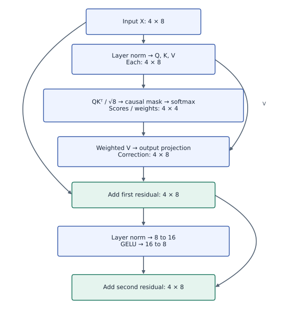
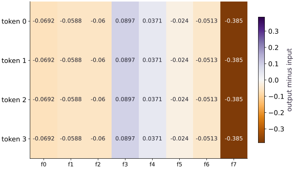

# A Transformer block and mixed precision

Phase 07: Transformers & language models · about 90 minutes · CPU

This worked reference is validated on CPU. Accelerator compatibility requires a separate source review and target execution receipt. Use the execution matrix to review device selection and data ownership before adapting a separate target program.

**Before this lesson:** [Masking, tokenization, and sequence packing](https://www.tahabouhsine.com/jaxpathways/lesson-transformers-02.html).

## What you will be able to do

- Follow the two residual paths
- Normalize features rather than examples
- Test causal independence and differentiation
- Separate storage precision from sensitive arithmetic

## The problem

An attention head mixes information across positions. What else makes it a Transformer block? We’ll add normalization, a small feature-processing network and two residual connections. Then we’ll inspect gradients and compare a lower-precision version. This is a deliberately small CPU teaching block, not a production architecture.

## The idea

A Transformer block adds learned corrections to token representations. This lesson uses a single attention head, normalization before each branch, and two residual additions. Follow the implemented dimensions rather than assuming all Transformer architectures are interchangeable.

## Follow the residual stream through the actual block

A transformer block must both mix context and preserve a route for the original representation. Here four token rows each have eight features. Attention forms four-by-four scores, mixes eligible value rows, and projects the result back to width eight so it can be added to the input. The feed-forward branch acts on each token independently, expanding 8 to 16 features and back to 8 before the second residual addition.

The recorded block returns shape $(4,8)$. Its heatmap shows output minus input, not the raw token representation. The nearly repeated correction has a fixture-specific cause: input rows differ by constant feature offsets, which per-token normalization removes. Change one feature of one row to test whether that pattern persists.

$$
N(x)_i=\frac{x_i-\mu(x)}{\sqrt{\operatorname{var}(x)+\epsilon}},\qquad h^{\prime}=h+f(N(h)),\quad\epsilon=10^{-5}
$$

### The actual single-head pre-LN block

**Predict:** What should happen when every learned projection is zero?



*Architecture and dataflow mechanism diagram.*

Follow the downward arrows: $X$ is normalized to form Q/K/V, Q/K scores become a causal four-by-four weight matrix, and the weighted values are projected back to a four-by-eight correction. The curved left bypass carries $X$ directly to the first residual addition. The next path normalizes that sum, expands each token from 8 to 16 features, applies GELU, contracts back to 8, and adds a second correction; the curved right bypass carries the intermediate residual to this addition. Every arrow carries four token rows, while the feature width changes only inside the MLP. The side arrow labeled $V$ routes values into the weighted-value step.

### Pause and reason

What should happen when every learned projection is zero?

<details><summary>Compare your reasoning</summary>

The block returns its input: both correction branches are zero and the residual path remains. This checks the structure independently of learned performance.

</details>

## Follow the two residual paths

Read the diagram down the center for the main computation: normalize, form Q/K/V, apply causal attention, project a correction, and add it to the carried input. The next normalization and MLP produce another correction before the second addition. The curved arrows are skip paths carrying the original $X$ to the first add and the intermediate residual to the second; each add preserves shape $(4,8)$.

If all six projection matrices are zero, both learned branches contribute zero and the output must equal $X$. This makes a useful prediction before inspecting the implementation.

```text
x → norm → Q/K/V → causal attention → output projection
└────────────────────────────── add → residual
residual → norm → expansion → GELU → contraction
└────────────────────────────────── add → output
```

## Normalize features rather than examples

Layer normalization computes mean and variance across the feature axis of each token row, then divides by $\sqrt{\mathrm{variance}+\epsilon}$. For $[1,3]$, the mean is 2, variance is 1, and the normalized values are approximately $[-1,1]$. A shared finite offset across one row disappears within tolerance, while a change to one feature need not.

This minimal function has no learned scale or bias and does not aggregate across batch or sequence. Its output shape matches its input, so the following residual addition stays well-formed.

## Test causal independence and differentiation

The causal mask gives a direct independence test: heavily perturb the final token and the first three output rows should remain fixed. Normalization and the MLP work per token; the mask prevents earlier queries from reading the last key. Then check that the gradient pytree has the same leaf shapes as the parameters and finite values for this input.

Finite gradients alone do not validate the block. Pair them with the zero-projection identity case and eager/compiled agreement; interpret gradient magnitude in light of the loss reduction.

## Separate storage precision from sensitive arithmetic

Casting every input and parameter to bfloat16 is a controlled low-precision comparison, not a full mixed-precision training recipe. The second policy keeps normalization and score softmax reductions in float32, then casts results back for lower-precision projections. Compare both against the float32 output on this fixed input.

The recorded maximum absolute error is about $0.01346$ for each policy. That shared value does not establish equal behavior on other inputs or workloads. Inspect which operations retain precision and evaluate an error tolerance against the intended task before choosing a policy.

## Configure depth without changing the block contract

This worked function remains one eight-wide block. The separate foundations model config varies width, depth, head count, MLP width, context, dropout and tied-output policy; it checks the parameter-count formula against the actual parameter tree. Its small CPU pilot uses a two-layer FP32 decoder, finite padding rows excluded from loss, and per-block projected keys and values for cached decoding.

A formula for a larger model is a sizing estimate, not an allocated model or a training result. Inspect the configuration and evidence together before transferring conclusions from this four-token example.

## 1. Prepare the experiment

In the CPU environment from setup, create main.py and add this block. Write down the dimensions and the known result before continuing.

```python
# Step 1 — 1. Prepare the experiment
import jax
import jax.numpy as jnp
import numpy as np
```

These imports provide JAX array transformations and NumPy reference calculations. Define the numerical functions next; the final build block supplies the concrete fixture and checks.

## 2. Implement the mechanism

Append this block in the same file. Follow the shape diagram above and identify each reduction or state transition.

```python
# Step 2 — 2. Implement the mechanism
def layer_norm(x):
    # Reduce along axis=-1 to compute `mean`.
    mean = jnp.mean(x, axis=-1, keepdims=True)
    # Reduce along axis=-1 to compute `variance`.
    variance = jnp.mean((x-mean)**2, axis=-1, keepdims=True)
    return (x-mean) / jnp.sqrt(variance + 1e-5)

def init_block(key, width=8):
    # Create or split explicit PRNG key(s) (`keys`) for reproducible randomness.
    keys = jax.random.split(key, 6)
    shapes = [(width,width)]*4 + [(width,2*width),(2*width,width)]
    return {name: jax.random.normal(k,s)*0.1 for name,k,s in zip(
        ["q","k","v","o","up","down"], keys, shapes)}

def block_forward(p, x):
    h = layer_norm(x)
    q, k, v = h@p["q"], h@p["k"], h@p["v"]
    scores = q@k.T / jnp.sqrt(x.shape[-1])
    allowed = jnp.arange(x.shape[0])[:,None] >= jnp.arange(x.shape[0])[None,:]
    weights = jax.nn.softmax(jnp.where(allowed, scores, -jnp.inf), axis=-1)
    residual = x + (weights@v)@p["o"]
    return residual + jax.nn.gelu(layer_norm(residual)@p["up"])@p["down"]
```

$x$ → norm → Q/K/V → causal attention → output projection
└────────────────────────────── add → residual
residual → norm → expansion → GELU → contraction
└────────────────────────────────── add → output

## 3. Run and check

Append this block and run python main.py. Compare its output with your prediction. An assertion failure means a stated contract needs investigation.

```python
# Step 3 — 3. Run and check
# Create or split explicit PRNG key(s) (`p`) for reproducible randomness.
p = init_block(jax.random.key(7))
x = jnp.arange(32, dtype=jnp.float32).reshape(4,8)/10
output = block_forward(p, x)
# Check tensor shape invariant: `output.shape == x.shape`
assert output.shape == x.shape
# Ensure all array elements remain finite: `jnp.all(jnp.isfinite(output))`
assert jnp.all(jnp.isfinite(output))
zero = jax.tree.map(jnp.zeros_like, p)
assert jnp.allclose(block_forward(zero, x), x)
assert jnp.allclose(jax.jit(block_forward)(p,x), output, atol=1e-5)
print("Block shape:", output.shape)
```

Output shape $(4, 8)$; finite values, zero-projection identity, compiled/eager agreement.

## Run the example

```python
# Step 1 — 1. Prepare the experiment
import jax
import jax.numpy as jnp
import numpy as np

# Step 2 — 2. Implement the mechanism
def layer_norm(x):
    # Normalize each token over its feature channels by computing its mean.
    mean = jnp.mean(x, axis=-1, keepdims=True)
    # Measure each token’s variance across its feature channels.
    variance = jnp.mean((x-mean)**2, axis=-1, keepdims=True)
    return (x-mean) / jnp.sqrt(variance + 1e-5)

def init_block(key, width=8):
    # Create or split explicit PRNG key(s) (`keys`) for reproducible randomness.
    keys = jax.random.split(key, 6)
    shapes = [(width,width)]*4 + [(width,2*width),(2*width,width)]
    return {name: jax.random.normal(k,s)*0.1 for name,k,s in zip(
        ["q","k","v","o","up","down"], keys, shapes)}

def block_forward(p, x):
    h = layer_norm(x)
    q, k, v = h@p["q"], h@p["k"], h@p["v"]
    scores = q@k.T / jnp.sqrt(x.shape[-1])
    allowed = jnp.arange(x.shape[0])[:,None] >= jnp.arange(x.shape[0])[None,:]
    weights = jax.nn.softmax(jnp.where(allowed, scores, -jnp.inf), axis=-1)
    residual = x + (weights@v)@p["o"]
    return residual + jax.nn.gelu(layer_norm(residual)@p["up"])@p["down"]

# Step 3 — 3. Run and check
# Create or split explicit PRNG key(s) (`p`) for reproducible randomness.
p = init_block(jax.random.key(7))
x = jnp.arange(32, dtype=jnp.float32).reshape(4,8)/10
output = block_forward(p, x)
# Check tensor shape invariant: `output.shape == x.shape`
assert output.shape == x.shape
# Ensure all array elements remain finite: `jnp.all(jnp.isfinite(output))`
assert jnp.all(jnp.isfinite(output))
zero = jax.tree.map(jnp.zeros_like, p)
assert jnp.allclose(block_forward(zero, x), x)
assert jnp.allclose(jax.jit(block_forward)(p,x), output, atol=1e-5)
print("Block shape:", output.shape)
```

Expected: Output shape $(4, 8)$; finite values, zero-projection identity, compiled/eager agreement.

## A residual block adds a correction to its input

**Predict:** Does a residual connection force the output to equal the input?



**Recorded CPU computation**

### Read the figure

Rows are the four token positions; columns are features 0–7. Each cell is the signed correction $\mathrm{output}-X$, with the diverging colors showing positive versus negative values and near-white showing a small change. Feature 3 increases by about $0.0897$, while feature 7 decreases by about $0.3853$; those values repeat across rows to floating-point precision.

### Connect it to the computation

The code subtracts the input from the block output for this plot, so a large color means a large correction, not a large final activation. The repeated rows follow from the chosen constant-offset inputs and per-token normalization; they are not a general property of attention. Predict how changing feature 3 in only token 1 will affect its row and later causal rows, then compare the new correction map.

```python
visual_data = {'kind': 'heatmap', 'values': (output - x).tolist(), 'rows': ['token ' + str(i) for i in range(4)], 'columns': ['f' + str(i) for i in range(8)], 'unit': 'output minus input', 'diverging': True}
```

## Recorded reference execution

CPU run: 2026-10-29T13:57:38.941064+00:00. JAX 0.9.2.

```text
Block shape: (4, 8)
Block shape: (4, 8)
bfloat16 max absolute error: 0.013455629348754883
Float32 reduction policy max absolute error: 0.013455629348754883
PASS: transformers-03

```

## Verify the residual identity and causal boundary

**Predict before running:** Which output rows can change when only the last token changes?

```python
# Experiment — Verify the residual identity and causal boundary
changed_x = x.at[-1].add(100.)
changed_output = block_forward(p, changed_x)
assert jnp.allclose(changed_output[:3], output[:3], atol=1e-5)
assert not jnp.allclose(changed_output[-1], output[-1])
```

**Expected:** First three rows agree; the last row changes.

Masking and per-token operations preserve causal independence through both sublayers.

## Compare two precision policies

**Predict before running:** Which operations use float32 in mixed_block? Will its error necessarily be smaller for every input?

```python
# Experiment — Compare two precision policies
low_p = jax.tree.map(lambda z:z.astype(jnp.bfloat16), p)
low_x = x.astype(jnp.bfloat16)
low_out = block_forward(low_p, low_x).astype(jnp.float32)
error = jnp.max(jnp.abs(low_out-output))
print("bfloat16 max absolute error:", float(error))
assert jnp.all(jnp.isfinite(low_out))
assert error < 0.1

def mixed_block(p, x):
    h = layer_norm(x.astype(jnp.float32)).astype(jnp.bfloat16)
    q,k,v = h@p["q"], h@p["k"], h@p["v"]
    scores = (q@k.T).astype(jnp.float32)/jnp.sqrt(x.shape[-1])
    allowed = jnp.arange(x.shape[0])[:,None] >= jnp.arange(x.shape[0])[None,:]
    weights = jax.nn.softmax(jnp.where(allowed,scores,-jnp.inf),axis=-1).astype(jnp.bfloat16)
    residual = x+(weights@v)@p["o"]
    normalized = layer_norm(residual.astype(jnp.float32)).astype(jnp.bfloat16)
    activation = jax.nn.gelu((normalized@p["up"]).astype(jnp.float32)).astype(jnp.bfloat16)
    return residual + activation@p["down"]

mixed_out = mixed_block(low_p,low_x).astype(jnp.float32)
mixed_error = jnp.max(jnp.abs(mixed_out-output))
print("Float32 reduction policy max absolute error:",float(mixed_error))
# Ensure all array elements remain finite: `jnp.all(jnp.isfinite(mixed_out))`
assert jnp.all(jnp.isfinite(mixed_out))
assert mixed_error < 0.1
```

**Expected:** Both outputs are finite, with max absolute errors below $0.1$ for this fixture. Record both actual errors; their relative order is not guaranteed.

Storage/activation casts and sensitive-reduction precision are separate choices. One fixture is distinct from an accuracy or throughput guarantee.

## Make it yours

Differentiate the mean squared block output with respect to every projection. Check each gradient leaf’s shape and finite values, then perturb one parameter coordinate and compare a central difference.

### How to write this exercise — Step-by-step recipe & starter scaffold

**Inputs:**
- The transformer block parameters, one sequence input, and a selected parameter coordinate with a finite-difference step.

**Outputs:**
- Mean-squared output loss, gradient leaves with their shapes and finite checks, and the selected autodiff/central-difference comparison.

**Invariants to check:**
- Every projection gradient matches its parameter shape and is finite; the central difference checks the selected loss derivative.

**Hints:**
- Differentiate the scalar mean-squared block output with respect to the full parameter pytree.
- Perturb one scalar parameter coordinate in both directions and compare the resulting loss difference.

**Starter code scaffold (fill in the TODOs):**

```python
import jax
import jax.numpy as jnp

def check_block_parameter_gradients(params, inputs, parameter_path, coordinate, epsilon):
    # TODO: Check every gradient leaf and compare one selected derivative with central differences.
    raise NotImplementedError
```

<details><summary>Reference solution</summary>

```python
# Exercise solution
def objective(params):
    return jnp.mean(block_forward(params,x)**2)
g = jax.grad(objective)(p)
# Check tensor shape invariant: `all(a.shape==b.shape and jnp.all(jnp.isfinite(b)) for a,b in zip(...`
assert all(a.shape==b.shape and jnp.all(jnp.isfinite(b)) for a,b in zip(jax.tree.leaves(p),jax.tree.leaves(g)))
def shifted_objective(delta):
    altered = {**p, "down": p["down"].at[0,0].add(delta)}
    return objective(altered)
fd = (shifted_objective(1e-2)-shifted_objective(-1e-2))/(2e-2)
assert jnp.allclose(fd,g["down"][0,0],atol=1e-4,rtol=2e-2)
```

</details>

## Check normalization without autodiff

**Transfer / diagnosis**

Compute the first normalized row using NumPy and compare. Also check a constant row.

<details><summary>Hint</summary>

Use population variance over features and epsilon $10^{-5}$.

</details>

### How to write: Check normalization without autodiff — Step-by-step recipe & starter scaffold

**Inputs:**
- Compute the first normalized row using NumPy and compare. Also check a constant row.

**Outputs:**
- JAX/NumPy parity and finite output for a constant row.

**Invariants to check:**
- Normalization uses the same epsilon and feature axis in both implementations.

**Hints:**
- Use population variance over features and epsilon $10^{-5}$.

**Starter code scaffold (fill in the TODOs):**

```python
import jax
import jax.numpy as jnp
import numpy as np

def practice_check_normalization_without_autodiff(inputs):
    """Implement the check normalization without autodiff check."""
    # TODO: Normalize the first row using a separate NumPy mean/variance calculation and check the constant-row case.
    raise NotImplementedError
```

<details><summary>Reference solution and reasoning</summary>

```python
# Check normalization without autodiff (Transfer / diagnosis)
row = np.asarray(x[0])
reference = (row-row.mean())/np.sqrt(np.mean((row-row.mean())**2)+1e-5)
np.testing.assert_allclose(layer_norm(x)[0],reference,atol=1e-6)
assert jnp.allclose(layer_norm(jnp.ones((2,8))),0.)
```

The independent reduction and constant-row case check the normalization mechanism.

</details>

## Repair a residual width mismatch

**Transfer / diagnosis**

Remove the contraction from the MLP and reproduce the residual addition failure. Restore the contraction and verify shape.

<details><summary>Hint</summary>

The expanded tensor has twice the model width.

</details>

### How to write: Repair a residual width mismatch — Step-by-step recipe & starter scaffold

**Inputs:**
- Remove the contraction from the MLP and reproduce the residual addition failure. Restore the contraction and verify shape.

**Outputs:**
- The incompatible-shape failure and repaired output shape.

**Invariants to check:**
- Both residual operands share the same final feature dimension.

**Hints:**
- The expanded tensor has twice the model width.

**Starter code scaffold (fill in the TODOs):**

```python
import numpy as np

def practice_repair_a_residual_width_mismatch(params, inputs):
    """Implement the repair a residual width mismatch check."""
    # TODO: Remove the MLP contraction to reproduce the residual-add shape error, restore it, and assert both branches match residual width.
    raise NotImplementedError
```

<details><summary>Reference solution and reasoning</summary>

```python
# Repair a residual width mismatch (Transfer / diagnosis)
expanded = jax.nn.gelu(layer_norm(x)@p["up"])
# Check tensor shape invariant: `expanded.shape == (4,16)`
assert expanded.shape == (4,16)
try:
    _ = x + expanded
except TypeError:
    pass
else:
    raise AssertionError("expected width mismatch")
# Check tensor shape invariant: `(x + expanded@p["down"]).shape == x.shape`
assert (x + expanded@p["down"]).shape == x.shape
```

Residual paths require matching widths; the down projection restores the model-width contract.

</details>

## Check your understanding

If all projection matrices are zero in this block, what should the output be?

1. Zero
2. The original input
3. Undefined because attention has zero scores

<details><summary>Answer and explanation</summary>

**1. Zero**

The attention branch vanishes but the skip connection remains. Substitute a zero branch into input plus branch.

**2. The original input (correct)**

Zero scores create uniform attention, but zero projections make sublayer contributions zero; both residual paths preserve $x$.

**3. Undefined because attention has zero scores**

Zero scores produce a defined softmax over valid keys. The zero value/output projections remove the branch contribution, leaving the residual.

</details>

## Diagnose the result

A residual width error means the expanded MLP tensor was added before its contraction. Check $(T,2D)$ versus $(T,D)$, restore the down projection and verify the zero-projection identity. For nonfinite or inaccurate lower-precision results, inspect feature variance, epsilon and reduction dtype. Report both measured precision errors rather than assuming a policy must always improve them.

## Carry forward

- Masking and per-token operations preserve causal independence through both sublayers.
- The error bound is a checked example, not an accuracy guarantee for arbitrary models.

## Keep your evidence

Keep the architecture diagram, zero-projection identity, causal perturbation, independent normalization, finite-difference coordinate check, precision discrepancy and residual-width repair.

Save your predictions, modified code, terminal outputs, and reasoning in your engineering portfolio.

## Primary references

- [JAX softmax API](https://docs.jax.dev/en/latest/_autosummary/jax.nn.softmax.html)
- [JAX attention API](https://docs.jax.dev/en/latest/_autosummary/jax.nn.dot_product_attention.html)
- [Optax cross entropy](https://optax.readthedocs.io/en/latest/api/losses.html)

