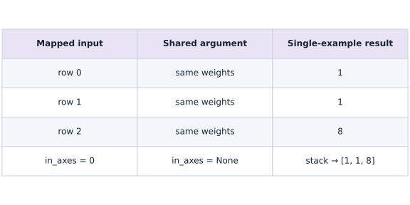
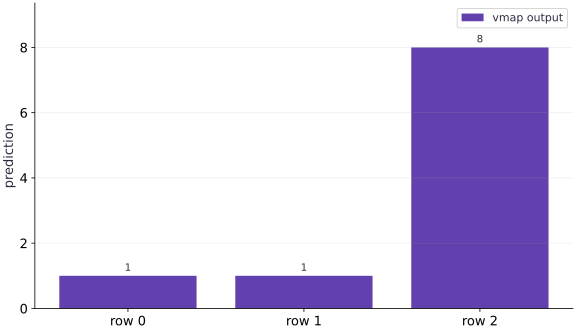

# Batch a function with vmap

Phase 02: JAX transformations · about 60 minutes · CPU

This worked reference is validated on CPU. Accelerator compatibility requires a separate source review and target execution receipt. Use the execution matrix to review device selection and data ownership before adapting a separate target program.

**Before this lesson:** [Losses and value_and_grad](https://www.tahabouhsine.com/jaxpathways/lesson-transforms-02.html).

## What you will be able to do

- Write and check a single-example function before batching it.
- Predict vmap input/output axes and distinguish shared parameters from mapped data.
- Verify batched results against a Python-loop reference.
- Relate per-example loss gradients to the gradient of a batch mean.

## The problem

You have a prediction function that works for one example. Now you need it for a batch. Rather than keep two versions of the model in sync, we’ll tell JAX which input axis contains examples. You’ll compare vmap with a short Python loop and learn which inputs stay shared.

## The idea

Vectorization lets us describe one example clearly and then apply that rule across an axis. The crucial decision is which arguments vary by example and which are shared. `vmap` expresses that decision; it does not require us to write a Python loop or assign hardware threads.

## Map examples without changing the single-example rule

A single-example function is easier to reason about than a hand-written batch version, but training data arrive as rows. `vmap` applies the same rule to each selected row and stacks the answers. The key design choice is which arguments vary across examples and which remain common.

Here the shared weights are $(2,-1)$, and the three inputs are $(1,1)$, $(2,3)$, and $(4,0)$. Their dot products are $1,1,8$. The bar chart’s horizontal positions name rows and its vertical axis is prediction; the first two rows differ even though their predictions match. Use the values to check row mapping, not to infer runtime or hardware parallelism.

$$
\operatorname{vmap}(f)(X)_i = f(X_i), \qquad i = 0, \dots, B-1
$$

### Mapped rows and shared weights

**Predict:** What should happen if you duplicate an input row while keeping the same shared weights?



*Architecture and dataflow mechanism diagram.*

Read the graph left to right as the shared-parameter computation. Each input-row node feeds its corresponding single-example step; the one shared weight vector is used by all three steps. Each step sends one scalar down to its output node, giving $1,1,8$ in row order. The links describe mapped dataflow, not allocated hardware threads.

### Pause and reason

What should happen if you duplicate an input row while keeping the same shared weights?

<details><summary>Compare your reasoning</summary>

The duplicated row should produce the same deterministic output. If it does not, inspect argument mapping and any state/randomness before blaming batching itself.

</details>

## Write down the axis contract

An axis contract prevents a batch dimension from being confused with a feature dimension. The single-example function accepts one feature vector of shape $(D,)$ and one shared weight vector of shape $(D,)$, then returns a scalar. For a batch of $B$ rows, map only the data’s leading axis and keep the weights unmapped.

In this example, $D=2$ and $B=3$: data shape is $(3,2)$, weights shape $(2,)$, and the result shape is $(3,)$. Check a row explicitly: $(2,3)\cdot(2,-1)=1$. Write the input and output shapes before setting `in_axes` or `out_axes`; those options describe how existing axes are interpreted and where results are stacked.

```text
single: (D,), (D,) → ()
batched: shared (D,), mapped (B,D) → (B,)
```

## Build a reference that is easy to trust

A loop is a useful reference because it spells out what mapping means: select row zero, call the single-example function, repeat, then stack. The matrix product gives a second formulation for this linear example.

The retained execution output is $[1,1,8]$ for the loop, `vmap`, and matrix product. Matching these checks catches an axis mistake more effectively than comparing two calls built from the same mistaken convention. Try reordering the rows: the output should reorder in the same way. That permutation check tests the row-to-result relationship directly.

## Shared does not mean copied or frozen

An unmapped argument is shared across the mapped examples, not frozen as compile-time configuration. In `in_axes`, `None` means there is no batch axis to slice from that argument at this level. The weight vector remains an ordinary runtime argument and can still be differentiated.

If both data and weights are mapped on axis zero, each row is paired with its own weight vector. That can represent an ensemble, but it is a different computation from one shared model applied to a batch. To verify the distinction, change the shared weights on a later call: all row predictions should respond to that one new vector.

## Change layout without changing semantics

Sometimes examples are stored as columns, giving data shape $(D,B)$ rather than $(B,D)$. Mapping axis $1$ selects a column of shape $(D,)$; it does not change the single-example function. `out_axes` places the newly collected result axis, and does not transpose feature dimensions by itself.

For scalar predictions, mapping columns still produces three outputs in batch order. Compare the column-mapped result with the row-mapped result after transposing the same data. This is a layout check: equal values show that changing where examples live in the array did not change which example each call receives.

## Separate per-example and aggregate gradients

The gradient of a per-example loss and the gradient of an aggregate batch loss answer different questions. Mapping `grad` over examples retains one gradient per row, while differentiating a mean over those losses reduces the example axis.

If there are $B$ examples and $D$ shared weights, the per-example gradient has shape $(B,D)$; the mean-loss gradient has shape $(D,)$. For equally weighted examples, the latter equals the mean of the former. Check this on two different target sets so the equality is not accidentally relying on identical residuals.

## Compose transformations around the question

Compose transformations in the order that matches the quantity you need. `vmap(grad(single_loss))` asks for one parameter gradient per example; `grad(mean(vmap(single_loss)))` asks for the gradient of one batch mean. They are related by averaging here, but have different output shapes and can have different memory costs.

The practical sequence is to validate the single-row rule, batch it, then reduce if the objective calls for an aggregate. Only after those values and shapes match the loop reference should you add `jit`. Each transformation has a distinct job: differentiation changes the requested quantity, mapping adds a batch axis, and compilation stages that resulting computation.

## Import JAX array and transformation APIs

Import jax for vmap and jax.numpy for vectors and batches.

```python
import jax
import jax.numpy as jnp
```

The predictor will handle one feature vector; vmap will supply the batch axis.

## Write a single-example dot-product predictor

Define a function that contracts a length-two weight with one length-two input.

```python
def predict(weight, x):
    return jnp.dot(weight, x)
weight = jnp.array([2., -1.])
```

For one example, the two products are summed to produce one scalar prediction.

## Map the predictor over three input rows

Create a batch of three feature vectors, map over input axis 0 while sharing weights, and check the predictions.

```python
batch = jnp.array([[1., 1.], [2., 3.], [4., 0.]])
# Vectorize across the batch dimension with `jax.vmap` (`batched`).
batched = jax.vmap(predict, in_axes=(None, 0))
assert jnp.allclose(batched(weight, batch), jnp.array([1.,1.,8.]))
```

The expected outputs [1, 1, 8] are hand-computed row by row. The leading output axis corresponds to the three input examples.

## Run the example

```python
# Batch a function with vmap
import jax
import jax.numpy as jnp
def predict(weight, x):
    return jnp.dot(weight, x)
weight = jnp.array([2., -1.])
batch = jnp.array([[1., 1.], [2., 3.], [4., 0.]])
# Vectorize across the batch dimension with `jax.vmap` (`batched`).
batched = jax.vmap(predict, in_axes=(None, 0))
print(batched(weight, batch))
assert jnp.allclose(batched(weight, batch), jnp.array([1.,1.,8.]))
```

Expected: [$1$. $1$. $8$.]

## Vectorization keeps one result per row

**Predict:** Which observation produces the largest prediction?



**Recorded CPU computation**

### Read the figure

Each bar is one example’s scalar prediction; horizontal positions are row labels and the vertical axis is prediction value. Reading left to right gives $1,1,8$, computed from rows $(1,1),(2,3),(4,0)$ with shared weights $(2,-1)$. For instance, the last row gives $4(2)+0(-1)=8$. Compare the first two equal bars: equal outputs do not imply equal inputs.

### Connect it to the computation

There are three bars because mapping the single-row rule retains one result for each of the three rows. Reordering rows should reorder bars in the same way. This checks the batch-to-result correspondence; bar height is numerical output and does not represent execution time or hardware work.

```python
visual_data = {'kind': 'bar', 'labels': ['row 0', 'row 1', 'row 2'], 'ylabel': 'prediction', 'series': [{'label': 'vmap output', 'y': batched(weight, batch).tolist()}]}
```

## Recorded reference execution

CPU run: 2026-10-27T17:02:54.395352+00:00. JAX 0.9.2.

```text
[1. 1. 8.]
loop / vmap / matmul: [1. 1. 8.] [1. 1. 8.] [1. 1. 8.]
PASS: transforms-03

```

## Verify against a loop and a matrix product

**Predict before running:** Predict the values and output shape. Which reference will catch an incorrectly mapped parameter axis?

```python
# Experiment — Verify against a loop and a matrix product
loop_predictions = jnp.stack([predict(weight, row) for row in batch])
vector_predictions = batched(weight, batch)
matrix_predictions = batch @ weight
# Check tensor shape invariant: `vector_predictions.shape == (3,)`
assert vector_predictions.shape == (3,)
assert jnp.allclose(vector_predictions, loop_predictions)
assert jnp.allclose(vector_predictions, matrix_predictions)
print("loop / vmap / matmul:", loop_predictions, vector_predictions, matrix_predictions)
```

**Expected:** All three formulations produce $[1, 1, 8]$.

The loop makes example selection explicit; the matrix product checks an independent formulation. Keep both as bounded checks of this linear case.

## Move the example axis

**Predict before running:** Transpose the batch to shape $(2, 3)$. Which axis must be mapped to give a length-2 input to predict?

```python
# Experiment — Move the example axis: The examples axis and output placement are separate choices.
column_batch = batch.T
# Vectorize across the batch dimension with `jax.vmap` (`column_predict`).
column_predict = jax.vmap(predict, in_axes=(None, 1))
assert jnp.allclose(column_predict(weight, column_batch), vector_predictions)
def feature_pair(row):
    return jnp.array([jnp.sum(row), jnp.sum(row ** 2)])
# Vectorize across the batch dimension with `jax.vmap` (`features_rows`).
features_rows = jax.vmap(feature_pair)(batch)
# Vectorize across the batch dimension with `jax.vmap` (`features_columns`).
features_columns = jax.vmap(feature_pair, out_axes=1)(batch)
# Check tensor shape invariant: `features_rows.shape == (3, 2)`
assert features_rows.shape == (3, 2)
# Check tensor shape invariant: `features_columns.shape == (2, 3)`
assert features_columns.shape == (2, 3)
assert jnp.allclose(features_rows.T, features_columns)
```

**Expected:** Column-mapped predictions match the original. Feature layouts are $(3, 2)$ and $(2, 3)$.

The examples axis and output placement are separate choices. Use values as well as shapes to verify a layout change.

## Make it yours

Foundation · Compute each prediction gradient with respect to the shared weight. Predict the shape and the derivative of the dot product, then verify against the input batch.

### How to write this exercise — Step-by-step recipe & starter scaffold

**Inputs:**
- A single-example prediction function and shared weight vector.
- A batch of three rows.

**Outputs:**
- One weight gradient per row and the dot-product gradient.

**Invariants to check:**
- Map the batch axis while sharing parameters.
- Predict the output shape before execution.

**Hints:**
- Compare vectorized output with independent row calculations.
- Map only the example input axis.

**Starter code scaffold (fill in the TODOs):**

```python
import jax
import jax.numpy as jnp

def batched_prediction_grad(predict, weight, batch):
    # TODO: map the single-example gradient across rows
    raise NotImplementedError
```

<details><summary>Reference solution</summary>

```python
# Exercise solution
per_example_gradient = jax.vmap(jax.grad(predict), in_axes=(None, 0))(weight, batch)
# Check tensor shape invariant: `per_example_gradient.shape == (3, 2)`
assert per_example_gradient.shape == (3, 2)
assert jnp.allclose(per_example_gradient, batch)
```

</details>

## Turn sensitivities into training gradients

**Practice**

Use targets $[0, 2, 7]$. Define a scalar squared-error function for one example. Compute all per-example parameter gradients and derive the first row independently.

<details><summary>Hint</summary>

The per-example squared-loss gradient is $2(\hat y-y)x$: twice the residual times the input. A prediction gradient by itself is not a loss gradient.

</details>

### How to write: Turn sensitivities into training gradients — Step-by-step recipe & starter scaffold

**Inputs:**
- The lesson batch and targets `[0, 2, 7]`.
- A scalar squared-error function for one example.

**Outputs:**
- One parameter gradient per example.
- An independent first-row calculation.

**Invariants to check:**
- Each example loss is scalar.
- A prediction sensitivity is not substituted for a loss gradient.
- The mapped result preserves the batch axis.

**Hints:**
- Differentiate the per-example loss with respect to parameters.
- Keep targets aligned with rows.

**Starter code scaffold (fill in the TODOs):**

```python
import jax
import jax.numpy as jnp

def single_loss(parameters, row, target):
    # TODO: define one scalar example loss
    raise NotImplementedError

def collect_example_gradients(parameters, rows, targets):
    # TODO: map the loss gradient across aligned examples
    raise NotImplementedError
```

<details><summary>Reference solution and reasoning</summary>

```python
# Turn sensitivities into training gradients (Practice): The first residual is 1, so the first loss gradient is [2, 2].
targets = jnp.array([0., 2., 7.])
def single_loss(parameters, row, target):
    return (predict(parameters, row) - target) ** 2
individual_grads = jax.vmap(jax.grad(single_loss), in_axes=(None, 0, 0))(weight, batch, targets)
manual_grads = 2. * (batch @ weight - targets)[:, None] * batch
# Check tensor shape invariant: `individual_grads.shape == (3, 2)`
assert individual_grads.shape == (3, 2)
assert jnp.allclose(individual_grads, manual_grads)
assert jnp.allclose(individual_grads[0], jnp.array([2., 2.]))
```

The first residual is $1$, so the first loss gradient is $[2, 2]$. The batch axis records three separate contributions.

</details>

## Prove the mean-gradient identity with an experiment

**Challenge**

Define the mean loss from the mapped single loss. Compare its parameter gradient with the mean of individual_grads. Repeat after changing targets and explain why a sum changes the relationship.

<details><summary>Hint</summary>

Differentiation is linear over these independent sums. Ensure your function actually averages over the example axis.

</details>

### How to write: Prove the mean-gradient identity with an experiment — Step-by-step recipe & starter scaffold

**Inputs:**
- A mapped single-example loss and parameter tree.
- Original targets and a changed target vector.

**Outputs:**
- The batch-mean gradient and average individual gradient for both target sets.

**Invariants to check:**
- The mean reduction uses the example axis.
- Changed targets are included in the comparison.
- A sum is identified as a different objective.

**Hints:**
- Define the batch objective from the mapped single loss.
- Keep the parameter axis shared in `vmap`.

**Starter code scaffold (fill in the TODOs):**

```python
import jax
import jax.numpy as jnp

def compare_batch_and_individual_gradients(single_loss, parameters, rows, targets):
    # TODO: compare a batch-mean gradient with mapped gradients
    raise NotImplementedError
```

<details><summary>Reference solution and reasoning</summary>

```python
# Prove the mean-gradient identity with an experiment (Challenge)
def batch_mean_loss(parameters, rows, labels):
    return jnp.mean(jax.vmap(single_loss, in_axes=(None, 0, 0))(parameters, rows, labels))
for labels in (targets, targets + 0.5):
    each = jax.vmap(jax.grad(single_loss), in_axes=(None, 0, 0))(weight, batch, labels)
    aggregate = jax.grad(batch_mean_loss)(weight, batch, labels)
    # Check tensor shape invariant: `aggregate.shape == weight.shape`
    assert aggregate.shape == weight.shape
    assert jnp.allclose(aggregate, jnp.mean(each, axis=0))
```

The aggregate has parameter shape, while per-example gradients add an examples axis. This identity relies on the stated independent-example loss and mean reduction, not on every model that has a batch dimension.

</details>

## Check your understanding

For $B$ examples and $D$ shared parameters, what shapes do per-example loss gradients and the mean-loss gradient have?

1. Both have shape $(B, D)$.
2. Per-example: $(B, D)$; mean-loss: $(D,)$.
3. Per-example: $(D,)$; mean-loss: $(B,)$.

<details><summary>Answer and explanation</summary>

**1. Both have shape $(B, D)$.**

The per-example Jacobian keeps the batch axis. Differentiating a scalar mean reduces that axis, leaving one value per parameter.

**2. Per-example: $(B, D)$; mean-loss: $(D,)$. (correct)**

Mapping collects one parameter gradient per example. Reducing independent losses to a mean produces one gradient matching the shared parameter shape.

**3. Per-example: $(D,)$; mean-loss: $(B,)$.**

This reverses the two contracts. Inspect whether the differentiated function returns one scalar per example or one scalar for the batch.

</details>

## Diagnose the result

If mapped axes have inconsistent sizes, inspect every mapped input before changing the model. If dot-product shapes fail, check whether you selected a row or a column. If gradients have an unexpected examples axis, distinguish a mapped gradient from the gradient of a reduced loss. If an implementation seems faster, first establish value equivalence and use the synchronized benchmark procedure from the next lesson.

## Carry forward

- Reason about one example before describing the batch axis.
- `in_axes=None` shares an input at that map level; it does not make it static or nondifferentiable.
- A loop reference and asymmetric data expose many axis mistakes.
- Per-example gradients and aggregate gradients answer different questions.

## Keep your evidence

Keep the shape contract, loop/vmap/matrix equivalence, row/column layout checks, per-example gradient array, and mean-gradient identity under two target sets. Explain what each gradient shape means.

Save your predictions, modified code, terminal outputs, and reasoning in your engineering portfolio.

## Primary references

- [JAX: automatic vectorization](https://docs.jax.dev/en/latest/automatic-vectorization.html)
- [JAX: vmap axis contract](https://docs.jax.dev/en/latest/_autosummary/jax.vmap.html)

