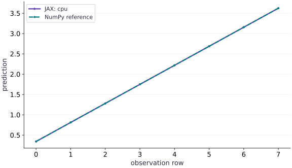

# Move your experiment to a TPU

Phase 00: Setup & first steps · about 45 minutes · CPU

This worked reference is validated on CPU. Accelerator compatibility requires a separate source review and target execution receipt. Use the execution matrix to review device selection and data ownership before adapting a separate target program.

## What you will be able to do

- Verify the requested platform, observed device, completed prediction, and independent numerical reference.
- Provision a single-host Cloud TPU VM for a named qualification target and verify device discovery without treating it as workload evidence.
- Run the downloadable launcher or precision target with the pinned qualification environment and retain its observed TPU-backend receipt.
- Review each additional program’s source, dependencies, topology, and data ownership before considering a TPU run.

## The problem

Your notebook imports JAX successfully, but is the prediction actually running on a TPU? We will build a portable device check with an independent numerical answer, then require the requested backend so an unavailable accelerator cannot silently become a successful CPU demonstration.

## The idea

Moving an experiment to a TPU gives us two questions: did it calculate the intended result, and did it actually execute on the requested device? We answer the first with an independent numerical reference and the second with an observed device receipt.

## Check arithmetic and placement separately

Consider a prediction that adds a scalar bias after a dot product. Reducing the bias by $0.25$ should reduce every prediction by $0.25$, whatever compatible device performs the computation. That is a numerical invariant you can derive before running.

Now inspect where the completed result resides. A correct NumPy comparison on CPU does not show that a TPU was selected. Conversely, a TPU device label does not show that the formula or input data was correct. Keep both checks.

Wait for the result before recording completion or timing. A returned array handle can precede finished device work. Preserve the requested platform, observed platform, environment and error tolerance alongside the values.

### Pause and reason

The values match NumPy but the requested TPU run reports a CPU result. Which part passed?

<details><summary>Compare your reasoning</summary>

The arithmetic comparison passed. The requested placement did not. Investigate runtime/device selection instead of treating the numerical match as TPU validation.

</details>

## Carry a prediction, not just an installation

We will move one small function between runtimes: a matrix-vector prediction with a scalar bias. Each row is an observation; three columns are three features. The weights are fixed so we can calculate the answer independently. For the first row, $[0,1/8,2/8]$, the prediction is $0-1/32+1/4+1/8=11/32$. A working package import is useful, but it is separate from where this computation finished.

$$
\hat y_i=\sum_{j=1}^{3}x_{ij}w_j+b,\qquad X\in\mathbb{R}^{8\times3},\quad w\in\mathbb{R}^{3},\quad b=1/8
$$

## Establish the CPU reference first

Save the assembled code as main.py in your course workspace and run it in a fresh process. By default COURSE_EXPECT_PLATFORM is cpu. The program selects that backend explicitly, places both inputs on its first device and waits for the compiled prediction to finish. NumPy independently calculates the same arithmetic. Keep the environment report and predictions.

The tolerance allows small floating-point differences; a successful comparison means this prediction agrees within that tolerance. It is separate from accuracy for a larger model. We use float32 inputs deliberately. Implicit dtype changes and reduced-precision matrix multiplication should be separate experiments after the placement check.

**Run the CPU reference**

```bash
# Run the CPU reference using the course Python environment
python main.py
```

**Expected:** The report names cpu, shape [8], float32, a completed output device and a small maximum absolute error. The first prediction is 0.34375.

## Set up a single-host TPU VM for reviewed targets

For the first physical TPU practice, use only the qualification targets in the [downloadable TPU qualification workspace](https://www.tahabouhsine.com/jaxpathways/downloads/jax-tpu-gcp.zip) (`jax-tpu-gcp.zip`) on a single-host v5e1 TPU VM. This lesson’s `main.py` is a CPU-validated reference; its recorded output is not a physical TPU result. Other course scripts need their own source, dependency, topology, and data-ownership review before target execution.

A Cloud TPU VM is billable and stays active after Python exits. Choose an approved project and zone, verify access and quota, and set a bounded lifetime before provisioning. Follow the same cleanup steps after collecting the target receipts.

**From your laptop: request a bounded Flex Start TPU and inspect the queue**

```bash
# Use your approved project; this recorded v5e setup uses us-west4-a.
export PROJECT_ID="REPLACE_WITH_YOUR_PROJECT"
export ZONE="us-west4-a"
export TPU_NAME="jax-course-tpu-01"
gcloud alpha compute tpus queued-resources create "$TPU_NAME" \
  --project="$PROJECT_ID" --zone="$ZONE" --node-id="$TPU_NAME" \
  --accelerator-type=v5litepod-1 --runtime-version=v2-alpha-tpuv5-lite \
  --provisioning-model=FLEX_START --max-run-duration=1h \
  --valid-until-duration=30m --scopes=https://www.googleapis.com/auth/devstorage.read_only --async
gcloud alpha compute tpus queued-resources describe "$TPU_NAME" \
  --project="$PROJECT_ID" --zone="$ZONE" --format="value(state.state)"
# Only after the queue reports ACTIVE:
gcloud compute tpus tpu-vm describe "$TPU_NAME" \
  --project="$PROJECT_ID" --zone="$ZONE" --format="value(state)"
```

**Expected:** The asynchronous request may report WAITING_FOR_RESOURCES or PROVISIONING before ACTIVE. Repeat describe and wait for ACTIVE and a READY VM before uploading or connecting. The request has a 30-minute queue window and a one-hour run cap. If it expires or fails, inspect its status and delete your queued request using the cleanup command below, even if no VM became active.

**From your laptop: upload the qualification workspace and connect**

```bash
# From the folder containing the downloaded jax-tpu-gcp.zip
gcloud compute tpus tpu-vm scp jax-tpu-gcp.zip "$TPU_NAME:~/jax-tpu-gcp.zip" --project="$PROJECT_ID" --zone="$ZONE"
gcloud compute tpus tpu-vm ssh "$TPU_NAME" --project="$PROJECT_ID" --zone="$ZONE"
```

**Expected:** Copy the ZIP from the folder containing the downloaded workspace, then SSH into the TPU VM and keep the session open for the following extraction and installation commands.

**Inside the TPU VM: extract the workspace and install the pinned qualification environment**

```bash
# Run inside the TPU VM after uploading jax-tpu-gcp.zip.
python3 -m zipfile -e ~/jax-tpu-gcp.zip ~/
cd ~/jax-tpu-gcp
python3 -m pip install --user 'uv==0.11.11'
~/.local/bin/uv venv --python 3.12.13 --managed-python .venv
~/.local/bin/uv pip install --python .venv/bin/python \
  -r resources/tpu-gcp/requirements-qualification.txt \
  --find-links https://storage.googleapis.com/jax-releases/libtpu_releases.html
~/.local/bin/uv pip freeze --python .venv/bin/python > tpu-environment.txt
.venv/bin/python --version
JAX_PLATFORMS=tpu .venv/bin/python -c "import jax; devices=jax.devices(); assert jax.default_backend() == 'tpu' and devices and all(d.platform == 'tpu' for d in devices); print(jax.__version__, jax.local_device_count(), devices)"
```

**Expected:** The base image Python extracts the ZIP and installs uv. uv creates the tested Python 3.12.13 environment and installs the pinned qualification packages. Keep tpu-environment.txt. Device discovery asserts the active backend is TPU; discovery alone is not a workload receipt.

## Run reviewed TPU targets, retrieve receipts, and delete the queued resource

The lesson’s `main.py` remains a CPU reference; do not use it as evidence of physical TPU execution. For the reviewed first target run, upload and extract the ZIP workspace, install `resources/tpu-gcp/requirements-qualification.txt`, then run its launcher and precision target with the TPU backend explicitly required. The launcher receipt should show a `started` event with backend `tpu`, a completed run and checkpoint; the precision report should record `platform: tpu` and its one-device scope. These receipts apply only to the named targets and configurations. They do not qualify another lesson script, a multi-chip collective, a multi-host job, or production model quality.

**Inside the TPU VM: run the reviewed launcher and precision targets**

```bash
# Run inside the TPU VM from ~/jax-tpu-gcp after installing the pinned requirements
set -o pipefail
.venv/bin/python resources/tpu-gcp/launch.py --platform tpu --run-dir runs/tpu-first --steps 4 --timeout 180
.venv/bin/python resources/tpu-gcp/launch.py --platform tpu --run-dir runs/tpu-first --steps 8 --timeout 180 --resume
.venv/bin/python resources/tpu-gcp/precision_profile.py --platform tpu --run-dir runs/precision-tpu --steps 5 --trace
```

**Expected:** Inspect `runs/tpu-first/events.jsonl` and verify the started event names `backend: tpu`; the final summary should be completed at step 8, with the first attempt retained under history. Inspect `runs/precision-tpu/report.json` and verify `platform` is `tpu`, `local_device_count` is 1, and the five synchronized samples are present. Copy the evidence and `tpu-environment.txt` to your laptop before deleting the VM.

**From your laptop: retrieve receipts and delete your queued resource**

```bash
# Run from your laptop after the target commands finish
mkdir -p evidence/tpu-first
gcloud compute tpus tpu-vm scp --recurse "$TPU_NAME:~/jax-tpu-gcp/runs/tpu-first" evidence/tpu-first/ --project="$PROJECT_ID" --zone="$ZONE"
gcloud compute tpus tpu-vm scp --recurse "$TPU_NAME:~/jax-tpu-gcp/runs/precision-tpu" evidence/tpu-first/ --project="$PROJECT_ID" --zone="$ZONE"
gcloud compute tpus tpu-vm scp "$TPU_NAME:~/jax-tpu-gcp/tpu-environment.txt" evidence/tpu-first/ --project="$PROJECT_ID" --zone="$ZONE"
# Delete this request and its VM, including after a failed or expired attempt.
gcloud alpha compute tpus queued-resources delete "$TPU_NAME" \
  --project="$PROJECT_ID" --zone="$ZONE" --force --quiet
gcloud alpha compute tpus queued-resources list --project="$PROJECT_ID" --zone="$ZONE" \
  --filter="name~'(^|/)${TPU_NAME}$'" --format="value(name)"
gcloud compute tpus tpu-vm list --project="$PROJECT_ID" --zone="$ZONE" \
  --filter="name~'(^|/)${TPU_NAME}$'" --format="value(name)"
```

**Expected:** Both target folders and the resolved environment are copied locally before cleanup. The forced queued-resource deletion removes this request and its VM. Both name-filtered lists should be empty; repeat the checks if deletion is still in progress. Other workloads in your project may remain active.

## Keep CPU lessons separate from reviewed TPU targets

Continue the course using its recorded CPU references. The ZIP launcher and precision target provide bounded physical TPU practice with pinned dependencies and explicit backend receipts; use only the exact programs and configurations described by those receipts. Do not upload arbitrary lesson scripts or infer compatibility from a successful CPU run. Before another TPU workload, review its source, dependencies, backend assertion, topology, and input ownership, then collect target-specific evidence.

## Diagnose the boundary that failed

If import fails, check the interpreter and installation. If explicit backend selection fails, check whether you are in the intended runtime and whether its TPU service is available. If device placement succeeds but the independent comparison fails, inspect shapes, dtype, precision and the arithmetic. Do not widen tolerance just to hide a large error.

An old notebook kernel may retain an initialized CPU backend or stale variables. Restart it, set runtime choices before the first device operation and run every cell. A CPU plot from the recorded course run remains a CPU plot when viewed on a machine that happens to have TPU access; only a fresh recorded execution supplies new evidence.

## Choose the requested platform

Add this block to main.py after the preceding block. Run the assembled file in a fresh process.

```python
# Step 1 — Choose the requested platform
import os
import json
import platform
import numpy as np
import jax
import jax.numpy as jnp
```

Keep the requested backend, observed output placement and independent arithmetic check together in the final report.

## Place inputs and compare a completed prediction

Add this block to main.py after the preceding block. Run the assembled file in a fresh process.

```python
# Step 2 — Place inputs and compare a completed prediction
expected = os.environ.get('COURSE_EXPECT_PLATFORM', 'cpu')
if expected not in {'cpu', 'tpu'}:
    raise ValueError('COURSE_EXPECT_PLATFORM must be cpu or tpu')
# Selecting a requested backend must fail when it is unavailable.
devices = jax.devices(expected)
assert devices and all(d.platform == expected for d in devices)
x_host = np.arange(24, dtype=np.float32).reshape(8, 3) / 8
w_host = np.array([0.5, -0.25, 1.0], dtype=np.float32)
# Place `x` explicitly onto the target JAX device.
x = jax.device_put(x_host, devices[0])
# Place `w` explicitly onto the target JAX device.
w = jax.device_put(w_host, devices[0])
# Wrap with `jax.jit` (`predict`) so XLA traces and compiles the function.
predict = jax.jit(lambda a, b: a @ b + jnp.float32(0.125))
y = predict(x, w)
# Wait for device work to finish before timing it or comparing its result on the host.
y.block_until_ready()
reference = x_host @ w_host + np.float32(0.125)
# Transfer the device result to the host for an independent NumPy comparison.
np.testing.assert_allclose(np.asarray(y), reference, rtol=1e-5, atol=1e-5)
assert {d.platform for d in y.devices()} == {expected}
# Transfer the device result to the host for an independent NumPy comparison.
report = dict(expected=expected, output_devices=[str(d) for d in y.devices()],
              platform=next(iter(y.devices())).platform, jax=jax.__version__,
              python=platform.python_version(), shape=list(y.shape), dtype=str(y.dtype),
              max_absolute_error=float(np.max(np.abs(np.asarray(y)-reference))),
              process_index=jax.process_index(), process_count=jax.process_count())
print(json.dumps(report, indent=2))
print('Completed prediction:', np.asarray(y).tolist())
```

Keep the requested backend, observed output placement and independent arithmetic check together in the final report.

## Step 3: Verify invariants on the completed state

Run the final shape and numerical assertions to confirm the state built in Steps 1 and 2.

```python
# Assert that the device output matches the NumPy reference and print the portability report:
assert report["max_absolute_error"] < 1e-6
print(json.dumps(report, indent=2))
print("Completed prediction:", np.asarray(y).tolist())
```

Checking these invariants confirms the computation is ready for the full worked experiment.

## Run the example

```python
# Step 1 — Choose the requested platform
import os
import json
import platform
import numpy as np
import jax
import jax.numpy as jnp

# Step 2 — Place inputs and compare a completed prediction
expected = os.environ.get('COURSE_EXPECT_PLATFORM', 'cpu')
if expected not in {'cpu', 'tpu'}:
    raise ValueError('COURSE_EXPECT_PLATFORM must be cpu or tpu')
# Selecting a requested backend must fail when it is unavailable.
devices = jax.devices(expected)
assert devices and all(d.platform == expected for d in devices)
x_host = np.arange(24, dtype=np.float32).reshape(8, 3) / 8
w_host = np.array([0.5, -0.25, 1.0], dtype=np.float32)
# Place `x` explicitly onto the target JAX device.
x = jax.device_put(x_host, devices[0])
# Place `w` explicitly onto the target JAX device.
w = jax.device_put(w_host, devices[0])
# Wrap with `jax.jit` (`predict`) so XLA traces and compiles the function.
predict = jax.jit(lambda a, b: a @ b + jnp.float32(0.125))
y = predict(x, w)
# Wait for device work to finish before timing it or comparing its result on the host.
y.block_until_ready()
reference = x_host @ w_host + np.float32(0.125)
# Transfer the device result to the host for an independent NumPy comparison.
np.testing.assert_allclose(np.asarray(y), reference, rtol=1e-5, atol=1e-5)
assert {d.platform for d in y.devices()} == {expected}
# Transfer the device result to the host for an independent NumPy comparison.
report = dict(expected=expected, output_devices=[str(d) for d in y.devices()],
              platform=next(iter(y.devices())).platform, jax=jax.__version__,
              python=platform.python_version(), shape=list(y.shape), dtype=str(y.dtype),
              max_absolute_error=float(np.max(np.abs(np.asarray(y)-reference))),
              process_index=jax.process_index(), process_count=jax.process_count())
print(json.dumps(report, indent=2))
print('Completed prediction:', np.asarray(y).tolist())
```

Expected: The recorded CPU reference predicts [0.34375, 0.8125, 1.28125, 1.75, 2.21875, 2.6875, 3.15625, 3.625]. Its report names the actual output device. There is no recorded TPU result.

## The same prediction checked two ways

**Predict:** Should the JAX line overlap the independent NumPy points, and would overlap alone prove TPU execution?



**Recorded CPU computation**

### Read the figure

The horizontal axis is the observation row index, starting at $0$. The vertical axis is the scalar prediction. The two series use the same inputs and weights: one comes from the completed JAX array, the other from NumPy. They overlap in this recorded CPU example. The first value is $11/32$; the constant rise of $15/32$ follows from increasing every feature by $3/8$ while the weights sum to $5/4$.

### Connect it to the computation

The line is a check of arithmetic and ordering for these eight observations. Read the printed platform report to determine placement; a curve cannot identify the device that produced it. The changed-bias exercise translates this line downward, while row reversal changes the order. This recorded figure comes from the CPU path and carries no TPU timing or correctness claim.

```python
# Transfer the device result to the host for an independent NumPy comparison.
visual_data={'kind':'line','x':list(range(8)),'xlabel':'observation row','ylabel':'prediction','series':[{'label':'JAX: '+expected,'y':np.asarray(y).tolist()},{'label':'NumPy reference','y':reference.tolist()}]}
```

## Recorded reference execution

CPU run: 2026-10-21T16:03:19.884116+00:00. JAX 0.9.2.

```text
{
  "expected": "cpu",
  "output_devices": [
    "TFRT_CPU_0"
  ],
  "platform": "cpu",
  "jax": "0.9.2",
  "python": "3.14.3",
  "shape": [
    8
  ],
  "dtype": "float32",
  "max_absolute_error": 0.0,
  "process_index": 0,
  "process_count": 1
}
Completed prediction: [0.34375, 0.8125, 1.28125, 1.75, 2.21875, 2.6875, 3.15625, 3.625]
{
  "expected": "cpu",
  "output_devices": [
    "TFRT_CPU_0"
  ],
  "platform": "cpu",
  "jax": "0.9.2",
  "python": "3.14.3",
  "shape": [
    8
  ],
  "dtype": "float32",
  "max_absolute_error": 0.0,
  "process_index": 0,
  "process_count": 1
}
Completed prediction: [0.34375, 0.8125, 1.28125, 1.75, 2.21875, 2.6875, 3.15625, 3.625]
{
  "expected": "cpu",
  "output_devices": [
    "TFRT_CPU_0"
  ],
  "platform": "cpu",
  "jax": "0.9.2",
  "python": "3.14.3",
  "shape": [
    8
  ],
  "dtype": "float32",
  "max_absolute_error": 0.0,
  "process_index": 0,
  "process_count": 1
}
Completed prediction: [0.34375, 0.8125, 1.28125, 1.75, 2.21875, 2.6875, 3.15625, 3.625]
Mismatched platform report rejected.
Changed bias, first prediction: -0.03125
Row reversal preserved values and requested placement.
PASS: welcome-03

```

## Reject a mismatched report

**Predict before running:** Would a correct numeric answer be enough if the report says CPU but the requested target is TPU?

```python
# Experiment — Reject a mismatched report
def verify_report(record, required):
    if record['platform'] != required or record['expected'] != required:
        raise ValueError('requested and observed platform disagree')
    if record['shape'] != [8] or record['dtype'] != 'float32':
        raise ValueError('prediction contract changed')
    return True
assert verify_report(report, expected)
wrong = {**report, 'platform': 'cpu' if expected == 'tpu' else 'tpu'}
try:
    verify_report(wrong, expected)
except ValueError:
    print('Mismatched platform report rejected.')
else:
    raise AssertionError('a mismatched report was accepted')
```

**Expected:** The deliberately inconsistent report raises ValueError; the actual report passes.

Numerical agreement and requested placement are separate requirements. This experiment tests report validation; the main program performs the actual backend selection and array-placement check.

## Make it yours

Predict the effect of replacing the bias by minus one quarter. Run a second compiled prediction on the selected device. Compare against the original prediction plus the expected constant shift and an independent NumPy calculation.

### How to write this exercise — Step-by-step recipe & starter scaffold

**Inputs:**
- The original inputs, weights, prediction function, and selected device.
- A compiled prediction path and changed bias.

**Outputs:**
- The changed device result, an independent NumPy comparison, and device metadata.

**Invariants to check:**
- The observed result comes from the selected device.
- Check against both a shift-based prediction and an independent calculation.
- Unavailable requested hardware cannot silently pass as CPU evidence.

**Hints:**
- Keep the original model inputs fixed.
- Wait for device work before transferring a result for comparison.

**Starter code scaffold (fill in the TODOs):**

```python
import jax
import jax.numpy as jnp
import numpy as np

def check_changed_bias(x, weight, predict, device):
    # TODO: run the changed compiled prediction on the selected device
    changed = ...
    # TODO: compare with an independent host calculation
    raise NotImplementedError
```

<details><summary>Reference solution</summary>

```python
# Exercise solution: Predict the effect of replacing the bias by minus one quarter.
# Wrap with `jax.jit` (`changed_predict`) so XLA traces and compiles the function.
changed_predict = jax.jit(lambda a, b: a @ b - jnp.float32(0.25))
changed = changed_predict(x, w)
# Wait for device work to finish before timing it or comparing its result on the host.
changed.block_until_ready()
# Transfer the device result to the host for an independent NumPy comparison.
np.testing.assert_allclose(np.asarray(changed), reference - 0.375, atol=1e-5, rtol=1e-5)
# Transfer the device result to the host for an independent NumPy comparison.
np.testing.assert_allclose(np.asarray(changed), x_host @ w_host - 0.25, atol=1e-5, rtol=1e-5)
assert {d.platform for d in changed.devices()} == {expected}
print('Changed bias, first prediction:', float(changed[0]))
```

</details>

## Test row order without changing the model

**Transfer**

Reverse the observation rows and predict the result order before execution. Verify the first and last values, the complete vector and device placement. Explain why this is a stronger check than only comparing the vector sum.

<details><summary>Hint</summary>

A row-wise affine prediction commutes with row permutation. A sum would conceal an ordering bug.

</details>

### How to write: Test row order without changing the model — Step-by-step recipe & starter scaffold

**Inputs:**
- Observation rows, model weights, and the selected device.
- A reversed copy of the input rows.

**Outputs:**
- The reversed prediction vector and a NumPy reference.

**Invariants to check:**
- Output row order follows input row order.
- Compare the full vector, not only its sum.
- The result is placed on the selected device.

**Hints:**
- Reverse a host copy so the original stays unchanged.
- Check endpoints and every value after execution completes.

**Starter code scaffold (fill in the TODOs):**

```python
import jax
import numpy as np

def check_reversed_rows(x_host, weights, device, predict):
    # TODO: place reversed rows, predict, and compare the full result
    raise NotImplementedError
```

<details><summary>Reference solution and reasoning</summary>

```python
# Test row order without changing the model (Transfer)
reversed_x = jax.device_put(x_host[::-1].copy(), devices[0])
reversed_y = predict(reversed_x, w)
# Wait for device work to finish before timing it or comparing its result on the host.
reversed_y.block_until_ready()
# Transfer the device result to the host for an independent NumPy comparison.
np.testing.assert_allclose(np.asarray(reversed_y), reference[::-1], atol=1e-5, rtol=1e-5)
assert {d.platform for d in reversed_y.devices()} == {expected}
assert np.isclose(float(reversed_y[0]), 3.625)
assert np.isclose(float(reversed_y[-1]), 0.34375)
print('Row reversal preserved values and requested placement.')
```

Reversing rows should reverse predictions because each observation is evaluated independently. Matching a sum would not reveal a misplaced or reordered prediction.

</details>

## Check your understanding

The values match NumPy, but the output array is on CPU when the requested platform was TPU. What has been demonstrated?

1. The TPU installation and its execution are validated.
2. The arithmetic matches the reference on the fallback CPU backend, so the requested TPU backend was not active.
3. The model must be numerically wrong.

<details><summary>Answer and explanation</summary>

**1. The TPU installation and its execution are validated.**

Backend qualification is a separate claim. A matching CPU result checks those numerical cases; it cannot show that a TPU executed the program.

**2. The arithmetic matches the reference on the fallback CPU backend, so the requested TPU backend was not active. (correct)**

A correct value can be produced on the wrong device. Require both reference agreement and the output placement before recording a successful target run.

**3. The model must be numerically wrong.**

Different hardware is not itself a mathematical failure. Compare the requested and observed backend before diagnosing the model.

</details>

## Diagnose the result

Read the first failing boundary: interpreter/import, explicit backend discovery, output placement or numerical comparison. Keep the original error and requested platform in the report. Restart a stale notebook kernel before trying the target again.

## Carry forward

- Keep the recorded CPU baseline separate from physical TPU evidence. For first TPU practice, use the pinned downloadable launcher and precision targets; review other programs before a target run.
- Check an actual completed array, not only the installed package.
- Request TPU explicitly so its absence produces an error, and delete Cloud TPU VMs after copying your evidence.

## Keep your evidence

Keep the lesson’s CPU output separate from physical TPU evidence. For TPU practice, retain the launcher events/checkpoint, precision report/trace, and resolved environment from the downloadable qualification workspace. The lesson’s recorded `main.py` output is CPU-only evidence.

Save your predictions, modified code, terminal outputs, and reasoning in your engineering portfolio.

## Primary references

- [JAX installation and TPU support](https://docs.jax.dev/en/latest/installation.html)
- [Manage Cloud TPU VMs with gcloud](https://docs.cloud.google.com/tpu/docs/managing-tpus-tpu-vm)
- [Course guide: From a laptop experiment to a TPU training run](https://www.tahabouhsine.com/jaxpathways/tpu-gcp.html)
- [Course guide: TPU generations, precision and profiling](https://www.tahabouhsine.com/jaxpathways/tpu-performance.html)
- [JAX device placement](https://docs.jax.dev/en/latest/sharded-computation.html)

