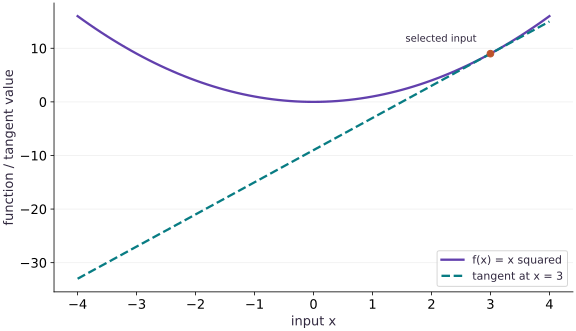

# Your first gradient

Phase 02: JAX transformations · about 55 minutes · CPU

This worked reference is validated on CPU. Accelerator compatibility requires a separate source review and target execution receipt. Use the execution matrix to review device selection and data ownership before adapting a separate target program.

## What you will be able to do

- Predict the sign and magnitude of a derivative from a local change.
- Trace the chain rule through a composed numerical function.
- Compare an analytic derivative, a finite-difference estimate, and JAX autodiff.
- Distinguish a stationary point from a minimum and repair scalar-output/input-type errors.

## The problem

Imagine that you can turn one dial, and a score tells you how far you are from the result you want. Which way should you turn it? We’ll begin with the curve $f(x)=x^2$, where we can check the answer by hand. A derivative tells us how the score changes nearby; then JAX will calculate that derivative for us. You do not need to guess what the tool is doing.

## The idea

A derivative tells us how an output changes near a particular input. We can understand it before using autodiff: move the input a small amount, estimate the output change from the local slope, then compare that prediction with the function.

## Use a slope to predict a nearby change

A derivative is useful because it predicts the effect of a small adjustment before we make it. For $f(x)=x^2$, the slope at $x=3$ is $6$. Increasing the input by $0.01$ predicts an output increase of $6(0.01)=0.06$, from $9$ to $9.06$; the exact output is $9.0601$. The extra $0.0001$ is curvature, not an autodiff error.

The tangent plot uses input on the horizontal axis and function or predicted value on the vertical axis. At $x=3$, both curves pass through $(3,9)$. At $x=2$, the square is $4$ while the tangent predicts $3$; at $x=0$, they are $0$ and $-9$. Use the tangent only nearby: its negative value at zero is not a negative square.

### Pause and reason

Does a positive derivative mean the function value itself is positive?

<details><summary>Compare your reasoning</summary>

No. The derivative describes local change. For $f(x)=x-10$ at $x=0$, the value is $-10$ while the derivative is $1$.

</details>

## Read a slope before you compute it

Use a negative input to check what the sign means. At $x=-3$, the derivative of the square is $-6$. A move right by $0.01$ therefore predicts a change of $-0.06$, from $9$ to $8.94$. The exact value at $-2.99$ is $8.9401$. A negative slope means the output decreases when the input increases locally; it does not mean that the output itself is negative.

At zero, the derivative is zero, so the linear prediction is no change. Yet moving to $0.01$ gives $0.0001$. This is consistent: the first-order change vanishes, leaving the smaller squared term. A zero derivative at one point does not mean the function is constant around it. Compare positive, negative and zero inputs before checking the derivative rule with JAX.

$$
\begin{aligned}f(x+\delta)-f(x)&=2x\delta+\delta^2\\f\prime(x)&=2x\end{aligned}
$$

## Three ways to obtain a derivative

There are three ways to answer the same local-change question, and comparing them catches mistakes. Algebra gives the exact derivative; finite differences estimate it from nearby function values; autodiff composes derivative rules for the operations in the program.

For the executed check at $x=3$, autodiff and the analytic result are both $6$, while a finite difference with step $10^{-3}$ is about $6$. With a much smaller step, floating-point subtraction can lose useful digits; the recorded sweep for the composed function shows error growing again at $10^{-5}$ and a zero estimate at $10^{-7}$. Autodiff does not have a hidden finite-difference step, but it still differentiates the numerical program you wrote, including any poorly conditioned or unintended calculation.

## Follow the chain rule through the program

The chain rule matters when a program is built from multiple operations: a change to the input passes through each intermediate value. Let $u=3x+1$, then $y=u^2$. The first operation changes $u$ three times as fast as $x$; the square changes $y$ at rate $2u$.

At $x=2$, the code’s intermediate is $u=7$, so the total slope is $2(7)\cdot3=42$. The execution receipt also checks $x=-1$ and $x=0$, giving $-12$ and $6$. These values make a concrete reference for `grad`: it follows the same operation sequence and chain rule rather than nudging the input repeatedly.

$$
\begin{aligned}u&=3x+1,\qquad y=u^2\\\frac{dy}{dx}&=\frac{dy}{du}\frac{du}{dx}=2u\cdot3\end{aligned}
$$

## Know the contract of grad

`grad` is designed for a scalar objective because it returns one derivative value per differentiated input value. Its default target is the first positional argument, and that argument needs an inexact type such as a floating-point scalar or array. A vector output such as residuals is not yet one objective; choose a sum or mean, or use a Jacobian when every output derivative is wanted.

A scalar array has shape $()$, while a one-element vector has shape $(1,)$. Those are different contracts even if both display one number. Likewise, Python `3.0` is a floating-point input while `3` is an integer. Check argument position, dtype and output shape when a valid-looking function cannot be differentiated.

## A zero gradient is a question, not a verdict

A zero gradient only says the first-order change is zero at that point; it does not classify the point. For $x^2$, zero is a minimum; for $x^3$, the derivative is also zero there although the function continues decreasing to the left; a constant function has zero slope everywhere.

When a model unexpectedly reports zero, first check whether the objective depends on the parameter and whether `grad` received the intended argument. Then compare the function at nearby points and hand-check a simple case. Changing an optimizer cannot repair a derivative of the wrong objective.

## Import JAX automatic differentiation

Import jax and jax.numpy for the scalar function and derivative.

```python
import jax
import jax.numpy as jnp
```

The differentiation API will operate on the function defined in the next block.

## Define the square and differentiate it

Write $f(x) = x^2$ and create a callable derivative with `jax.grad`.

```python
def f(x):
    return x ** 2
derivative = jax.grad(f)
```

The derivative is $2x$. `jax.grad` transforms the scalar-output function, so `derivative(3)` should return $6$.

## Check the derivative at two points

Evaluate the derivative at 3 and at the minimum x=0.

```python
assert jnp.allclose(derivative(3.0), 6.)
assert jnp.allclose(derivative(0.0), 0.)
```

The values 6 and 0 test the rule at a nonzero point and at the stationary point.

## Build a numerical estimate

```python
# Numerical estimate: Approximately 6.0.
def central_difference(function, x, h=1e-3):
    return (function(x + h) - function(x - h)) / (2 * h)

def square(x):
    return x * x

estimate = central_difference(square, 3.0)
print("Finite-difference estimate:", estimate)
assert abs(estimate - 6.0) < 1e-8
```

Approximately $6.0$. This estimate evaluates the function at two nearby points; it is not automatic differentiation.

## Run the example

```python
# Your first gradient: A derivative tells us how an output changes near a particular input.
import jax
import jax.numpy as jnp
def f(x):
    return x ** 2
derivative = jax.grad(f)
print(float(derivative(3.0)))
assert jnp.allclose(derivative(3.0), 6.)
assert jnp.allclose(derivative(0.0), 0.)
```

Expected: $6.0$

## A tangent describes local change

**Predict:** At $x=3$, is the slope equal to the height of the curve?



**Recorded CPU computation**

### Read the figure

The horizontal axis is input $x$, and both plotted vertical values are function or tangent predictions. The solid square curve and dashed tangent meet at the marked $(3,9)$. At $x=2$, compare $4$ with $3$; at $x=0$, compare $0$ with $-9$. These coordinates show where a local slope prediction begins to separate from the curved function.

### Connect it to the computation

The tangent slope at $x=3$ is $6$, so for a small change $\Delta x$, it predicts $9+6\Delta x$. The exact square adds $(\Delta x)^2$. Use the plotted gap as a reminder that a derivative predicts nearby change, not the entire function; then try a small move on either side of the marked input.

```python
grid = jnp.linspace(-4.0, 4.0, 81)
point = 3.0
slope = derivative(point)
# Vectorize across the batch dimension without a Python loop (`visual_data`).
visual_data = {'kind': 'line', 'x': grid.tolist(), 'xlabel': 'input x', 'ylabel': 'function / tangent value', 'series': [{'label': 'f(x) = x squared', 'y': jax.vmap(f)(grid).tolist()}, {'label': 'tangent at x = 3', 'y': (f(point) + slope * (grid - point)).tolist()}]}
visual_data['markers'] = [{'x': point, 'y': float(f(point)), 'label': 'selected input'}]
```

## Recorded reference execution

CPU run: 2026-10-27T17:02:47.265557+00:00. JAX 0.9.2.

```text
Finite-difference estimate: 5.999999999999339
6.0
chain rule: -1.0 -12.0
chain rule: 0.0 6.0
chain rule: 2.0 42.0
h / estimate / error: 0.1 27.009973526000977 0.009973526000976562
h / estimate / error: 0.01 27.000045776367188 4.57763671875e-05
h / estimate / error: 0.001 26.9975643157959 0.0024356842041015625
h / estimate / error: 1e-05 27.0843505859375 0.0843505859375
h / estimate / error: 1e-07 0.0 27.0
PASS: first-gradient

```

## Check the chain rule at three inputs

**Predict before running:** For $g(x)=(3x+1)^2$, predict the derivative at $-1$, $0$, and $2$. Explain why the sign changes.

```python
# Experiment — Check the chain rule at three inputs: The inner derivative contributes a factor of 3.
def composed(x):
    return (3. * x + 1.) ** 2
for point in (-1., 0., 2.):
    observed = jax.grad(composed)(point)
    expected = 6. * (3. * point + 1.)
    print("chain rule:", point, float(observed))
    assert jnp.allclose(observed, expected)
```

**Expected:** The three derivatives are $-12$, $6$, and $42$.

The inner derivative contributes a factor of $3$. Omitting that factor is a chain-rule error; matching only one point can hide a wrong expression.

## Choose a finite-difference scale

**Predict before running:** For the float32 function $x^3$ at $x=3$, will shrinking $h$ forever keep improving the estimate? Run the sweep and compare with $27$.

```python
# Experiment — Choose a finite-difference scale
def cubic32(x):
    return x ** 3
point = jnp.array(3., dtype=jnp.float32)
for step in (1e-1, 1e-2, 1e-3, 1e-5, 1e-7):
    estimate = (cubic32(point + step) - cubic32(point - step)) / (2. * step)
    print("h / estimate / error:", step, float(estimate), float(jnp.abs(estimate - 27.)))
assert jnp.allclose(jax.grad(cubic32)(point), 27.)
```

**Expected:** The errors need not decrease monotonically. At sufficiently small $h$, rounding can erase the input change.

A central difference has truncation error at larger $h$ and cancellation/rounding error at very small $h$. The original numerical-estimate example used Python floats; this sweep deliberately uses a JAX float32 array. Do not silently compare their precision as if it were identical.

## Make it yours

Foundation · Define $f(x)=x^3$. Derive $f\prime(x)$, predict the values at $-2$, $0$, and $3$, then verify every prediction with JAX. Explain why the zero at $x=0$ is separate from a minimum.

### How to write this exercise — Step-by-step recipe & starter scaffold

**Inputs:**
- A scalar cubic function defined by the learner.
- Evaluation points -2, 0, and 3.

**Outputs:**
- The function and its JAX derivatives at each point.
- An explanation that separates a stationary point from a minimum.

**Invariants to check:**
- `grad` receives a scalar-output function.
- Every requested point is checked.
- A zero derivative alone does not classify a minimum.

**Hints:**
- Derive the polynomial rule before calling autodiff.
- Check function behavior on either side of the stationary point.

**Starter code scaffold (fill in the TODOs):**

```python
import jax
import jax.numpy as jnp

def cubic(x):
    # TODO: define the scalar cubic
    raise NotImplementedError

def check_cubic(points):
    # TODO: evaluate and retain one JAX derivative per point
    raise NotImplementedError
```

<details><summary>Reference solution</summary>

```python
# Exercise solution: Foundation · Define f(x)=x^3.
def cubic(x):
    return x ** 3
for point in (-2., 0., 3.):
    assert jnp.allclose(jax.grad(cubic)(point), 3. * point ** 2)
assert cubic(-0.1) < cubic(0.) < cubic(0.1)
```

</details>

## Differentiate the parameter you intended

**Practice**

For the prediction $\hat y=wx$, find the derivative with respect to $w$ and then with respect to $x$. Evaluate them at $w=2$ and $x=3$. Predict both answers before choosing `argnums`.

<details><summary>Hint</summary>

grad defaults to `argnums=0.` The other input remains an input to the transformed callable.

</details>

### How to write: Differentiate the parameter you intended — Step-by-step recipe & starter scaffold

**Inputs:**
- The scalar prediction `weight * x`.
- Weight 2 and input 3.
- Two requested differentiation arguments.

**Outputs:**
- A derivative with respect to each argument.

**Invariants to check:**
- The unselected argument remains an ordinary input.
- Distinguish prediction from derivative.

**Hints:**
- Name the differentiation argument explicitly.
- Check each derivative against its own input.

**Starter code scaffold (fill in the TODOs):**

```python
import jax

def scalar_prediction(weight, x):
    # TODO: define the scalar prediction
    raise NotImplementedError

def compare_argument_gradients():
    # TODO: transform the function for each requested argument
    raise NotImplementedError
```

<details><summary>Reference solution and reasoning</summary>

```python
# Differentiate the parameter you intended (Practice)
def scalar_prediction(weight, x):
    return weight * x
assert jnp.allclose(jax.grad(scalar_prediction, argnums=0)(2., 3.), 3.)
assert jnp.allclose(jax.grad(scalar_prediction, argnums=1)(2., 3.), 2.)
```

A parameter gradient and an input sensitivity answer different questions even when they originate from the same function.

</details>

## Repair an objective without hiding its meaning

**Challenge**

A function returns $[x^2,(x-2)^2]$. Explain why ordinary grad rejects it. Build a scalar objective using their mean, derive its derivative, and check $x=0$, $1$, and $2$. Would a sum have the same derivative magnitude?

<details><summary>Hint</summary>

Write the reduction as a mathematical function first: its mean is $x^2-2x+2$.

</details>

### How to write: Repair an objective without hiding its meaning — Step-by-step recipe & starter scaffold

**Inputs:**
- A two-element output containing squared costs.
- Inputs 0, 1, and 2.

**Outputs:**
- A scalar mean objective and its derivatives.
- A comparison with the sum objective’s derivative scale.

**Invariants to check:**
- `grad` receives one scalar objective.
- Mean and sum remain distinct objectives.

**Hints:**
- Choose the reduction before differentiating.
- Compare the factors analytically.

**Starter code scaffold (fill in the TODOs):**

```python
import jax
import jax.numpy as jnp

def mean_objective(x):
    # TODO: construct the two costs and reduce to one scalar
    raise NotImplementedError

def compare_reductions(points):
    # TODO: evaluate derivatives for the mean and sum objectives
    raise NotImplementedError
```

<details><summary>Reference solution and reasoning</summary>

```python
# Repair an objective without hiding its meaning (Challenge)
def two_costs(x):
    return jnp.array([x ** 2, (x - 2.) ** 2])
def mean_cost(x):
    return jnp.mean(two_costs(x))
for point in (0., 1., 2.):
    assert jnp.allclose(jax.grad(mean_cost)(point), 2. * point - 2.)
    assert jnp.allclose(jax.grad(lambda z: jnp.sum(two_costs(z)))(point), 2. * jax.grad(mean_cost)(point))
```

Mean and sum agree on the minimizer here but differ by a factor of two in gradient magnitude. Reducing output is a modeling choice, not just a syntax repair.

</details>

## Check your understanding

For $f(x)=x^3$, JAX reports $f\prime(0)=0$. What can you conclude?

1. $x=0$ is a global minimum.
2. The first-order local slope is zero; optimality requires more evidence.
3. JAX has stopped differentiating because the output is zero.

<details><summary>Answer and explanation</summary>

**1. $x=0$ is a global minimum.**

A zero first derivative is compatible with a maximum, minimum or stationary inflection. Compare nearby values on both sides of zero.

**2. The first-order local slope is zero; optimality requires more evidence. (correct)**

The cubic is stationary at zero but takes smaller values to the left. A zero first derivative alone does not prove a minimum.

**3. JAX has stopped differentiating because the output is zero.**

The derivative is zero because the function is locally flat to first order at this input. Differentiate at a nonzero input to check the rule.

</details>

## Diagnose the result

If grad reports a scalar-output error, inspect the output shape before adding an arbitrary reduction. If it reports an integer-input error, check the dtype of the differentiated argument. If a gradient is unexpectedly zero, evaluate the function at nearby inputs and verify argument selection. If finite differences disagree, record dtype and $h$, sweep $h$, and compare with an analytic test case. Each symptom calls for different evidence.

## Carry forward

- A derivative is a local sensitivity; a gradient transformation returns a callable.
- Autodiff applies the chain rule to program operations, while finite differences approximate with input perturbations.
- Scalar objective, input dtype, and differentiated argument are part of the contract.
- A stationary point and a minimum are different claims.

## Keep your evidence

Keep predictions and analytic derivations at multiple inputs, the finite-difference step/error sweep with dtype, both argnums checks, and the scalar-objective repair. Explain why a zero gradient need not mark a minimum.

Save your predictions, modified code, terminal outputs, and reasoning in your engineering portfolio.

## Primary references

- [JAX: automatic differentiation](https://docs.jax.dev/en/latest/automatic-differentiation.html)
- [JAX: grad API and argument contract](https://docs.jax.dev/en/latest/_autosummary/jax.grad.html)

