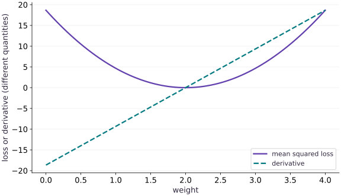

# Losses and value_and_grad

Phase 02: JAX transformations · about 55 minutes · CPU

This worked reference is validated on CPU. Accelerator compatibility requires a separate source review and target execution receipt. Use the execution matrix to review device selection and data ownership before adapting a separate target program.

**Before this lesson:** [Your first gradient](https://www.tahabouhsine.com/jaxpathways/lesson-first-gradient.html).

## What you will be able to do

- Derive a batch mean-squared-error gradient for one weight.
- Use value_and_grad to return a loss and its parameter gradient together.
- Predict how sum versus mean and residual scaling change an update.
- Verify an update with independent arithmetic and diagnose an unstable step.

## The problem

Let’s turn the slope idea into a learning problem. We have three measurements and a model with one weight. How should that weight change to make its predictions better? We’ll calculate the prediction errors, combine them into one loss, and check the gradient by hand before asking JAX for the same result.

## The idea

A loss value tells us how the current prediction is scored. Its derivative tells us how a small parameter change affects that score locally. `value_and_grad` returns both so we can inspect progress and choose an update without confusing the two quantities.

## Read the value and derivative at the same point

We need both the score and its direction because they answer different questions: the loss says how this parameter setting performs, while the derivative predicts how a small adjustment changes that score. For the separate objective $L(w)=(w-2)^2+1$, at $w=0$ the loss is $5$ and the slope is $-4$, so increasing $w$ slightly should lower the loss. At $w=2$, the slope is zero but the loss is still $1$.

The plot has weight on both horizontal axes, loss in the upper panel and loss-per-weight in the lower. For the lesson’s unshifted data, $w=1$ gives $(L,L')=(14/3,-28/3)$, and $w=2$ gives $(0,0)$. A zero derivative is a stationary point; it does not generally mean zero loss. Adding a constant shifts loss values without moving the derivative’s zero.

### Pause and reason

If every loss value is multiplied by $10$, what happens to the gradient?

<details><summary>Compare your reasoning</summary>

It is multiplied by $10$ as well. Unlike adding a constant, scaling the objective changes an unadjusted gradient-descent step. Learning-rate comparisons must account for the loss normalization.

</details>

## From three residuals to one decision

A batch needs one scalar score before `grad` can return a single objective gradient. For each row, compute prediction, subtract its target, square the residual, then average the squared errors. This order makes the reduction and its scale visible.

With inputs $[1,2,3]$, targets $[2,4,6]$, and $w=1$, predictions are $[1,2,3]$, residuals are $[-1,-2,-3]$, and squared errors sum to $14$. The mean loss is $14/3$. At $w=2$, predictions match all targets and the loss is zero. These hand values check both the model and the averaging before differentiating.

$$
L(w)=\frac{1}{N}\sum_{i=1}^{N}(wx_i-y_i)^2
$$

## Derive the gradient independently

Differentiating the mean loss preserves one contribution from every example, then averages them. Each squared residual contributes twice the residual, and differentiating the prediction $wx_i$ contributes the input $x_i$.

For this dataset, each residual is $x_i(w-2)$, so the loss is $(14/3)(w-2)^2$. At $w=1$, its slope is $-28/3$. The negative sign predicts that raising the weight lowers the loss. Since gradient descent subtracts the gradient, the update should move upward; this direction check can reveal a missing minus sign before running code.

$$
\begin{aligned}\frac{dL}{dw}&=\frac{2}{N}\sum_{i=1}^{N}(wx_i-y_i)x_i\\L(w)&=\frac{14}{3}(w-2)^2\quad\text{for our three examples}\end{aligned}
$$

## Read value_and_grad as an interface

`value_and_grad` returns the objective value and its derivative together, which keeps evaluation and update tied to the same parameter value. In the scalar example both outputs have shape $()$. With a vector parameter the gradient has the parameter’s shape, and with a parameter pytree it has matching structure; it does not acquire the batch shape just because the loss used a batch.

By default, the first positional argument is differentiated. Passing data as later arguments makes the boundary explicit: differentiate parameters while treating this batch as input. The returned pair is an interface contract, not a promise of speed. Inspect both value and gradient shapes when moving from this scalar example to a model.

## Predict whether a step improves the objective

An update is useful only if its sign and size move the objective in the intended direction. Starting at $w=1$, with gradient $-28/3$ and step size $\alpha=0.1$, gradient descent gives $w_{new}=1.9333$, closer to the zero-loss weight $2$; the loss falls to about $0.02074$.

For this quadratic the error is multiplied by $1-28\alpha/3$ each step. At $\alpha=0.3$, that multiplier is $-1.8$: the update crosses the solution and leaves a larger error, so loss rises. Read this as a property of this quadratic and dataset, not a universal learning-rate rule. The plotted slope tells direction; this calculation tells whether the chosen step overshoots.

$$
\begin{aligned}w_{\mathrm{new}}&=w-\alpha g\\e_{\mathrm{new}}&=\left(1-\frac{28\alpha}{3}\right)e,\qquad e=w-2\end{aligned}
$$

## Separate objective value from useful metrics

A mean loss compresses a batch to one number, so it can hide which example is still wrong. Keep residuals or another diagnostic as auxiliary output when they help explain behavior. With `has_aux=True`, `value_and_grad` differentiates only the scalar loss and carries auxiliary data alongside its value.

For example, predictions can be useful to inspect while optimizing their mean squared error. They are not a second objective merely because the function returns them. Read the result nesting carefully: objective plus auxiliary data is paired with the gradient. This distinction prevents logging outputs from being mistaken for quantities that receive gradients.

## Import JAX differentiation and array operations

Import jax and jax.numpy for the loss and its derivative.

```python
import jax
import jax.numpy as jnp
```

The loss below is scalar-valued, which is the input contract for value_and_grad.

## Define the three-example squared-error loss

Set $x=[1,2,3]$, choose targets $y=2x$, and average squared prediction errors for a scalar weight.

```python
x = jnp.array([1., 2., 3.])
y = 2. * x
def loss(weight):
    return jnp.mean((weight * x - y) ** 2)
```

At weight 1, the residuals are [-1,-2,-3]. The mean squared error is 14/3; averaging matters because it scales the gradient too.

## Compute loss and gradient in one evaluation

Call value_and_grad at weight 1 and compare both results with hand calculations.

```python
value, gradient = jax.value_and_grad(loss)(1.0)
assert jnp.allclose(value, 14./3.)
assert jnp.allclose(gradient, -28./3.)
```

The derivative is the mean of $2x(wx-y)$, giving $-28/3$ at $w=1$. Checking value and derivative catches errors in both the objective and its reduction.

## Run the example

```python
# Losses and value_and_grad: A loss value tells us how the current prediction is scored.
import jax
import jax.numpy as jnp
x = jnp.array([1., 2., 3.])
y = 2. * x
def loss(weight):
    return jnp.mean((weight * x - y) ** 2)
value, gradient = jax.value_and_grad(loss)(1.0)
print("Loss:", float(value), "gradient:", float(gradient))
assert jnp.allclose(value, 14./3.)
assert jnp.allclose(gradient, -28./3.)
```

Expected: Loss ≈ $4.666667$; gradient ≈ $-9.333334$. Small floating-point differences are normal.

## Loss and derivative use separate vertical scales

**Predict:** At which weight is the derivative zero, and what is the loss at that same weight?



**Recorded CPU computation**

### Read the figure

Both panels use the same horizontal weight coordinate. The upper vertical axis is mean squared loss; the lower is derivative per weight unit. At $w=1$, read loss $14/3$ and slope $-28/3$; at $w=2$, both are zero for this dataset. Follow the lower curve to its zero, then read the upper curve at that same weight. The panels have separate units and scales.

### Connect it to the computation

The lower curve crosses zero at the minimum of this convex quadratic, while the upper curve gives the objective value there. A stationary point need not have zero loss: adding a constant would lift only the upper curve and leave the lower zero crossing fixed. Use the two panels together to distinguish objective height from local direction.

```python
grid = jnp.linspace(0.0, 4.0, 81)
loss_values = jax.vmap(loss)(grid)
gradient_values = jax.vmap(jax.grad(loss))(grid)
assert jnp.allclose(loss(1.0), 14. / 3.)
assert jnp.allclose(jax.grad(loss)(1.0), -28. / 3.)
assert jnp.allclose(jax.grad(loss)(2.0), 0.)
visual_data = {'panels': [{'kind': 'line', 'x': grid.tolist(), 'xlabel': 'weight w', 'ylabel': 'mean squared loss (squared target units)', 'series': [{'label': 'L(w)', 'y': loss_values.tolist()}]}, {'kind': 'line', 'x': grid.tolist(), 'xlabel': 'weight w (same coordinates)', 'ylabel': 'dL/dw (loss units per weight unit)', 'series': [{'label': 'gradient', 'y': gradient_values.tolist()}, {'label': 'zero derivative', 'y': [0.0] * len(grid)}]}]}
```

## Recorded reference execution

CPU run: 2026-10-27T17:02:51.126054+00:00. JAX 0.9.2.

```text
Loss: 4.6666669845581055 gradient: -9.333333969116211
weight / loss / gradient: 0.0 18.666667938232422 -18.666667938232422
weight / loss / gradient: 1.0 4.6666669845581055 -9.333333969116211
weight / loss / gradient: 2.0 0.0 0.0
PASS: transforms-02

```

## Check JAX against the handwritten gradient

**Predict before running:** Predict the derivative at weights $0$, $1$, and $2$. Does the loss decrease just because the derivative is negative?

```python
# Experiment — Check JAX against the handwritten gradient: A derivative describes the direction.
def analytic_loss_gradient(weight):
    return 2. * jnp.mean((weight * x - y) * x)
for weight in (0., 1., 2.):
    value_here, grad_here = jax.value_and_grad(loss)(weight)
    print("weight / loss / gradient:", weight, float(value_here), float(grad_here))
    assert jnp.allclose(grad_here, analytic_loss_gradient(weight))
```

**Expected:** The gradients are $-56/3$, $-28/3$, and $0$; the losses are $56/3$, $14/3$, and $0$.

A derivative describes the direction. A new objective value is obtained only after a chosen update and a new evaluation.

## Return residuals without changing the objective

**Predict before running:** What nested structure will `has_aux=True` return, and which part determines the parameter gradient?

```python
# Experiment — Return residuals without changing the objective
def loss_with_residuals(weight):
    residuals = weight * x - y
    return jnp.mean(residuals ** 2), residuals
(aux_value, residuals), aux_gradient = jax.value_and_grad(loss_with_residuals, has_aux=True)(1.)
# Check tensor shape invariant: `residuals.shape == (3,)`
assert residuals.shape == (3,)
assert jnp.allclose(residuals, jnp.array([-1., -2., -3.]))
assert jnp.allclose(aux_value, value)
assert jnp.allclose(aux_gradient, gradient)
```

**Expected:** The objective and gradient match the original; residuals are a separate array of shape $(3,)$.

The return structure separates logging data from a scalar optimization target. Reducing or selecting the wrong return value is a common source of interface bugs.

## Make it yours

Foundation · Starting from $w=1$, calculate the next weight and loss for $\alpha=0.1$ and $\alpha=0.3$. Verify both. Explain the overshoot using the error multiplier rather than concluding that autodiff is wrong.

### How to write this exercise — Step-by-step recipe & starter scaffold

**Inputs:**
- The lesson model inputs and targets.
- Starting weight 1 and learning rates 0.1 and 0.3.

**Outputs:**
- Each candidate weight and its post-update loss.

**Invariants to check:**
- Both updates use a gradient evaluated at the same starting weight.
- Loss is recomputed at each candidate.
- Overshoot is explained through the objective, not an autodiff failure.

**Hints:**
- Keep the initial gradient separate from the candidate evaluations.
- Compare each rate independently.

**Starter code scaffold (fill in the TODOs):**

```python
import jax
import jax.numpy as jnp

def compare_updates(loss, initial_weight, rates):
    # TODO: compute the initial gradient and evaluate each candidate
    raise NotImplementedError
```

<details><summary>Reference solution</summary>

```python
# Exercise solution
small_step = 1. - 0.1 * gradient
large_step = 1. - 0.3 * gradient
assert jnp.allclose(small_step, 29. / 15.)
assert loss(small_step) < value
assert loss(large_step) > value
assert jnp.allclose(loss(2.), 0.)
```

</details>

## Make the data boundary explicit

**Practice**

Rewrite `loss(weight, inputs, targets)` with data as arguments. Use value_and_grad and verify the gradient at $w=1$ against the hand-derived result.

<details><summary>Hint</summary>

Default differentiation is with respect to the first argument, not every floating-point input.

</details>

### How to write: Make the data boundary explicit — Step-by-step recipe & starter scaffold

**Inputs:**
- A scalar weight and input/target arrays passed as arguments.
- Starting weight 1.

**Outputs:**
- Loss and weight gradient from `value_and_grad`.

**Invariants to check:**
- Data are explicit function inputs.
- Differentiation is with respect to the weight.
- Compare with an independent hand result.

**Hints:**
- Place the parameter as the first argument.
- Use the same fixed data in both checks.

**Starter code scaffold (fill in the TODOs):**

```python
import jax
import jax.numpy as jnp

def explicit_loss(weight, inputs, targets):
    # TODO: return the scalar batch objective
    raise NotImplementedError

def check_value_and_gradient(inputs, targets):
    # TODO: evaluate value_and_grad at the requested weight
    raise NotImplementedError
```

<details><summary>Reference solution and reasoning</summary>

```python
# Make the data boundary explicit (Practice)
def explicit_loss(weight, inputs, targets):
    return jnp.mean((weight * inputs - targets) ** 2)
v_explicit, g_explicit = jax.value_and_grad(explicit_loss)(1., x, y)
assert jnp.allclose(v_explicit, 14. / 3.)
assert jnp.allclose(g_explicit, -28. / 3.)
```

Keeping data explicit prepares the function for new batches and avoids accidentally closing over stale training data.

</details>

## Audit reduction and batch replication

**Challenge**

Compare the mean and sum loss gradients. Repeat this batch twice and predict the gradient under both reductions. Explain which learning-rate adjustment makes a sum-based update match a mean-based update.

<details><summary>Hint</summary>

Duplicate data are not new information. Track the factor $N$ in the mathematical objective.

</details>

### How to write: Audit reduction and batch replication — Step-by-step recipe & starter scaffold

**Inputs:**
- Inputs and targets for one batch.
- A repeated copy of that batch.

**Outputs:**
- Mean-loss and sum-loss gradients before and after repetition.

**Invariants to check:**
- Repeating the batch preserves a mean gradient.
- A sum gradient scales with repeated example count.
- State the learning-rate adjustment that matches the update.

**Hints:**
- Keep mean and sum in separate functions.
- Track the batch duplication factor.

**Starter code scaffold (fill in the TODOs):**

```python
import jax
import jax.numpy as jnp

def compare_reductions_and_repeats(inputs, targets, weight):
    # TODO: compute both reductions before and after repeating data
    raise NotImplementedError
```

<details><summary>Reference solution and reasoning</summary>

```python
# Audit reduction and batch replication (Challenge)
def summed_loss(weight, inputs, targets):
    return jnp.sum((weight * inputs - targets) ** 2)
g_mean = jax.grad(explicit_loss)(1., x, y)
g_sum = jax.grad(summed_loss)(1., x, y)
x_twice, y_twice = jnp.tile(x, 2), jnp.tile(y, 2)
assert jnp.allclose(g_sum, len(x) * g_mean)
assert jnp.allclose(jax.grad(explicit_loss)(1., x_twice, y_twice), g_mean)
assert jnp.allclose(jax.grad(summed_loss)(1., x_twice, y_twice), 2. * g_sum)
assert jnp.allclose(1. - 0.1 * g_mean, 1. - (0.1 / len(x)) * g_sum)
```

Mean gradients stay fixed under exact batch replication; sum gradients scale with the count. Compensating the rate by 1/N makes this particular SGD update match.

</details>

## Check your understanding

You duplicate every example and keep the same learning rate. What happens to a sum-loss SGD update compared with the original batch?

1. Its gradient and update magnitude double.
2. It stays unchanged because the data values are unchanged.
3. value_and_grad silently converts the sum to a mean.

<details><summary>Answer and explanation</summary>

**1. Its gradient and update magnitude double. (correct)**

A sum counts each replicated contribution again. A mean divides by the new batch size and would preserve the gradient in this example.

**2. It stays unchanged because the data values are unchanged.**

A sum counts both copies, so its gradient doubles. A mean would cancel the duplication through its denominator.

**3. value_and_grad silently converts the sum to a mean.**

value_and_grad preserves the objective you supply. Compare sum and mean explicitly; the transform does not normalize a loss for you.

</details>

## Diagnose the result

If an update increases loss, verify the subtraction sign, reduction scale, and learning rate before blaming the gradient transform. If the objective is nonscalar, inspect the residual and reduction shapes. If metrics look plausible but gradients are wrong, compare against the independently derived formula at more than one parameter setting. These checks separate implementation mistakes from an unstable optimization choice.

## Carry forward

- A scalar reduction defines both the objective and the update scale.
- value_and_grad returns a value/gradient pair; the gradient follows the parameter shape.
- Independent arithmetic and multiple parameter settings provide a useful numerical check.
- Descent direction does not guarantee descent with an arbitrary step size.

## Keep your evidence

Keep handwritten loss/gradient arithmetic, checks at three weights, small/large-rate update results, auxiliary residuals, and mean-versus-sum batch-replication results. Explain the update-scale change.

Save your predictions, modified code, terminal outputs, and reasoning in your engineering portfolio.

## Primary references

- [JAX: value_and_grad](https://docs.jax.dev/en/latest/_autosummary/jax.value_and_grad.html)

