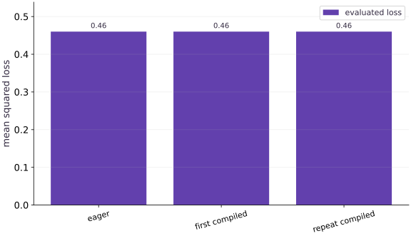

# Compile a function with jit

Phase 02: JAX transformations · about 55 minutes · CPU

This worked reference is validated on CPU. Accelerator compatibility requires a separate source review and target execution receipt. Use the execution matrix to review device selection and data ownership before adapting a separate target program.

**Before this lesson:** [Batch a function with vmap](https://www.tahabouhsine.com/jaxpathways/lesson-transforms-03.html).

## What you will be able to do

- Explain tracing, compilation, dispatch, and synchronization as separate work.
- Validate a compiled numerical function against its eager and analytic results.
- Measure first-call latency and repeated-call latency with explicit completion.
- Compile a value-and-gradient computation without claiming a universal speedup.

## The problem

Your calculation is correct, and now you want to run it many times. What does compilation actually change? We’ll compare the original function with its jitted version, separate the first call from later calls, and wait for the result before stopping the timer. A small CPU example is enough to learn a fair comparison; a speedup is not guaranteed.

## The idea

Compilation prepares a program that can be reused for compatible calls. The first call can include tracing and compilation as well as execution; later compatible calls can reuse that work. Numerical equality and performance are separate checks.

## Separate changing data from preparing a program

Compilation is useful when the same computation will be called repeatedly, but it adds preparation work that must be distinguished from execution. JIT traces a function for an input signature and can reuse a compatible compiled specialization. Changing array values alone can reuse it; relevant shape, dtype or static choices can request another one.

For this lesson the function consumes $X$ of shape $(4,3)$, $w$ of shape $(3,)$, and $y$ of shape $(4,)$. Predictions have four entries and the weight gradient has three. JIT should preserve this calculation. First compare outputs; only then ask whether setup cost is repaid by repeated calls.

$$
L(w;X,y)=\frac{1}{n}\lVert Xw-y\rVert_2^2,\qquad \nabla_wL=\frac{2}{n}X^{\mathsf T}(Xw-y),\qquad n=4
$$

### Pause and reason

Why can a tiny function be slower on its first compiled call?

<details><summary>Compare your reasoning</summary>

The call includes preparation costs that may exceed the work itself. Reuse can amortize those costs, but a speed claim still needs measurements of the intended workload.

</details>

## Separate the work hidden in one call

A reported call duration can combine several different jobs. The first relevant call may trace, lower, compile, dispatch and execute; a later compatible call may reuse setup but still dispatch and execute. This is why a single “JIT time” can be misleading.

The right first-call label is specific: this callable, process, shape and dtype, with whatever cache state the run actually had. The receipt measures first and repeated calls on CPU, but does not isolate compilation from execution. Keep those quantities named separately so a timing observation is not given a broader meaning than the experiment supports.

```text
first relevant call → trace / compile / dispatch / execute
compatible repeated call → reuse / dispatch / execute
```

## Check values before timing

Numerical agreement is the prerequisite for a performance comparison. In the four-row example, the predictions are $[0,0.6,1.2,1.8]$, residuals are $[-1,-0.4,0.2,0.8]$, and mean squared loss is $0.46$. An independent calculation also gives gradient $[0.36,0.34,0.32]$.

The plot has three categories: eager, first compiled call, and repeated compiled call. All bars are at about $0.46$ on the mean-squared-loss axis. Equal heights show numerical agreement for this input, not a speed comparison; no timing information is encoded in the bars. Use another input and a suitable tolerance to check that the compiled path remains faithful.

## Wait for the quantity you are timing

JAX arrays can be returned before their device work has completed. If the timer stops immediately after the Python call, it may mostly measure dispatch. `block_until_ready` makes the measured interval include completion of the selected result.

When the function returns several leaves, such as a value and gradient, wait on all results being measured. Keep the wait boundary the same when comparing eager and compiled calls. This makes the reported number correspond to completed work rather than how quickly Python received a future result.

## Use repetitions and report a distribution

Repeated measurements help separate a typical call from scheduling noise. Warm the exact callable and signature, synchronize each measured result, and report a median with the range and repeat count. Use comparable inputs and completion waits for both paths.

The receipt records CPU timings for this particular small workload, including first-call and repeated-call intervals. Those numbers are evidence for this setup only. Do not carry them to a different device, program size or cache condition; first check the measurement boundary and workload before interpreting a ratio.

## Compile the computation you intend to repeat

For a training calculation, the useful compiled unit often includes both loss and parameter gradient because the update consumes both. `jit(value_and_grad(loss))` keeps the transformed value-and-gradient function as the callable being prepared. Check its value against the loss and its gradient against an independent formula before using the pair.

Keep the jitted function identity stable across loop iterations so compatible calls can reuse its specialization. Building a fresh jitted function every iteration changes the reuse question. The lesson’s independent calculation at the stated shape gives a numerical reference; the benchmark then times the completed pair rather than just its dispatch.

## Decide when compilation is worth its setup

Compilation setup is an upfront cost, so whether it is useful depends on how often a compatible computation is reused. A one-off small calculation may not recover setup time; many repeated calls may amortize it. Estimate this from measured first-call and repeated-call work for the intended program.

This CPU exercise checks parity and a synchronized timing protocol. It does not establish TPU execution or model-training speedup. Before using a performance claim elsewhere, reproduce the workload, input signature, device and waiting boundary that the claim depends on.

## Define mean squared error and a four-example input matrix

Import timing and JAX tools, define the loss, and create a (4, 3) feature matrix.

```python
import time
import jax
import jax.numpy as jnp
def loss(w, x, y):
    return jnp.mean((x @ w - y) ** 2)
x = jnp.arange(12, dtype=jnp.float32).reshape(4, 3) / 10.
```

Each row is one example, so x @ w produces four predictions and the mean reduces their squared errors to one scalar.

## Compile the loss and run its first synchronized call

Add the weight and targets, wrap loss with jax.jit, then wait for the first result to finish.

```python
w = jnp.array([1., 2., -1.])
y = jnp.ones(4)
# Wrap with `jax.jit` (`compiled`) so XLA traces and compiles the function.
compiled = jax.jit(loss)
t0 = time.perf_counter()
# Wait for device work to finish before timing it or comparing its result on the host.
first = compiled(w, x, y).block_until_ready()
```

The first call includes tracing and compilation as well as execution. block_until_ready prevents asynchronous dispatch from making the measured interval end too early.

## Measure a repeat call and compare numerical results

Record the first-call duration, run the same compiled function again, and compare both outputs with the eager loss.

```python
first_seconds = time.perf_counter() - t0
t0 = time.perf_counter()
# Wait for device work to finish before timing it or comparing its result on the host.
second = compiled(w, x, y).block_until_ready()
repeat_seconds = time.perf_counter() - t0
assert jnp.allclose(first, loss(w, x, y))
assert jnp.allclose(second, first)
```

The repeated call can reuse the compiled executable for matching shapes and dtypes. These timings are observations for this run, not a portable speed claim.

## Run the example

```python
# Compile a function with jit
import time
import jax
import jax.numpy as jnp
def loss(w, x, y):
    return jnp.mean((x @ w - y) ** 2)
x = jnp.arange(12, dtype=jnp.float32).reshape(4, 3) / 10.
w = jnp.array([1., 2., -1.])
y = jnp.ones(4)
# Wrap with `jax.jit` (`compiled`) so XLA traces and compiles the function.
compiled = jax.jit(loss)
t0 = time.perf_counter()
# Wait for device work to finish before timing it or comparing its result on the host.
first = compiled(w, x, y).block_until_ready()
first_seconds = time.perf_counter() - t0
t0 = time.perf_counter()
# Wait for device work to finish before timing it or comparing its result on the host.
second = compiled(w, x, y).block_until_ready()
repeat_seconds = time.perf_counter() - t0
print("Loss:", float(second))
print("First/repeat seconds:", first_seconds, repeat_seconds)
assert jnp.allclose(first, loss(w, x, y))
assert jnp.allclose(second, first)
```

Expected: Loss ≈ $0.46$. Timings depend on the device, process, and workload; no speed threshold is required.

## Compilation preserves the result

**Predict:** Should compilation change the loss value?



**Recorded CPU computation**

### Read the figure

The horizontal categories are eager, first compiled call and repeated compiled call; the vertical axis is mean squared loss. All three bars are about $0.46$ for the same $(4,3)$ matrix, $(3,)$ weights and $(4,)$ targets. Compare heights to check that the compiled paths preserve this result. The categories are not a time axis.

### Connect it to the computation

Equal loss bars establish numerical agreement for this input, not a speedup. First-call and repeated-call durations are separate measurements in the execution receipt; the bar plot does not encode those times. Before interpreting timing, warm the same signature, wait for completed results and compare repeated measurements.

```python
visual_data = {'kind': 'bar', 'labels': ['eager', 'first compiled', 'repeat compiled'], 'ylabel': 'mean squared loss', 'series': [{'label': 'evaluated loss', 'y': [float(loss(w, x, y)), float(first), float(second)]}]}
```

## Recorded reference execution

CPU run: 2026-10-27T17:02:57.787504+00:00. JAX 0.9.2.

```text
Loss: 0.46000000834465027
First/repeat seconds: 0.02620441699400544 2.7124769985675812e-05
eager median / min / max seconds: 4.8562418669462204e-05 4.229089245200157e-05 0.00017616711556911469
compiled median / min / max seconds: 6.395392119884491e-06 5.917157977819443e-06 8.458271622657776e-06
backend / shapes / dtype: cpu (4, 3) (3,) (4,) float32
Independent NumPy loss / gradient: 0.46000000834465027 [0.36000004 0.34000006 0.32000008]
Benchmark boundary: warm the same signature first; start the clock, call,
then jax.block_until_ready((value, gradient)) before stopping it.
compiled value-and-grad median seconds: 1.241639256477356e-05
PASS: transforms-04

```

## Derive predictions and gradients outside the transform

**Predict before running:** Predict the loss $0.46$ and derive $\frac{2}{N}X^\mathsf{T}(Xw-y)$. Does the compiled result match both independent quantities?

```python
# Experiment — Derive predictions and gradients outside the transform
expected_predictions = jnp.array([0., 0.6, 1.2, 1.8])
assert jnp.allclose(x @ w, expected_predictions, atol=1e-6)
assert jnp.allclose(compiled(w, x, y), 0.46, atol=1e-6)
manual_gradient = (2. / len(y)) * x.T @ (x @ w - y)
compiled_value_gradient = jax.jit(jax.value_and_grad(loss))
checked_value, checked_gradient = compiled_value_gradient(w, x, y)
assert jnp.allclose(checked_gradient, manual_gradient, rtol=1e-5, atol=1e-6)
```

**Expected:** The loss is $0.46$; the gradient matches the independent matrix expression.

The analytic value check detects mistakes that eager-versus-compiled equality alone would miss.

## Collect a synchronized latency sample

**Predict before running:** Which costs are included in these measurements? Predict whether the tiny compiled loss must be faster, then report what you actually observe.

```python
# Experiment — Collect a synchronized latency sample
import statistics
def completed_samples(function, repeats=20):
    # Wait for device work to finish before timing it or comparing its result on the host.
    function(w, x, y).block_until_ready()
    durations = []
    for _ in range(repeats):
        start = time.perf_counter()
        # Wait for device work to finish before timing it or comparing its result on the host.
        function(w, x, y).block_until_ready()
        durations.append(time.perf_counter() - start)
    return durations
for name, function in (("eager", loss), ("compiled", compiled)):
    samples = completed_samples(function)
    print(name, "median / min / max seconds:", statistics.median(samples), min(samples), max(samples))
print("backend / shapes / dtype:", jax.default_backend(), x.shape, w.shape, y.shape, x.dtype)
```

**Expected:** Twenty completed calls are measured after a warmup for each callable. Durations vary; no speed threshold is asserted.

The report includes Python invocation and completed numerical work on already prepared data. It is a bounded latency observation, not a universal accelerator benchmark.

## Make it yours

Foundation · Compile `value_and_grad(loss)`, check the loss and gradient against both the eager transform and the manual matrix formula, and explain how you would synchronize a benchmark of its two outputs.

### How to write this exercise — Step-by-step recipe & starter scaffold

**Inputs:**
- The lesson loss, weight, input and target arrays.
- Eager and compiled value-and-gradient computations.

**Outputs:**
- Compiled and eager outputs checked against independent formulas.
- A synchronization plan for every timed output.

**Invariants to check:**
- Validate numerical results before interpreting speed.
- Wait for every result leaf before stopping the timer.
- Do not infer a universal speedup.
- Compare the value and every gradient entry to an independent host matrix calculation; benchmark completion includes both returned arrays.

**Hints:**
- Keep shape and dtype fixed for equivalence.
- Synchronize the full returned tree.

**Starter code scaffold (fill in the TODOs):**

```python
import jax
import jax.numpy as jnp

def compare_compiled_value_gradient(loss, weight, inputs, targets):
    # TODO: compile value_and_grad and compare against independent checks
    raise NotImplementedError
```

<details><summary>Reference solution</summary>

```python
# Exercise solution: compare independent arithmetic, not only two JAX paths.
import numpy as np
compiled_step = jax.jit(jax.value_and_grad(loss))
v, g = compiled_step(w, x, y)
# Wait for both outputs. Timing only dispatch does not measure completed work.
jax.block_until_ready((v, g))
eager_v, eager_g = jax.value_and_grad(loss)(w, x, y)
host_x, host_w, host_y = np.asarray(x), np.asarray(w), np.asarray(y)
residual = host_x @ host_w - host_y
manual_v = float(np.dot(residual, residual) / len(host_y))
manual_g = (2.0 / len(host_y)) * host_x.T @ residual
np.testing.assert_allclose(v, manual_v, rtol=1e-5, atol=1e-6)
np.testing.assert_allclose(g, manual_g, rtol=1e-5, atol=1e-6)
np.testing.assert_allclose(v, eager_v, rtol=1e-5, atol=1e-6)
np.testing.assert_allclose(g, eager_g, rtol=1e-5, atol=1e-6)
np.testing.assert_allclose(manual_v, 0.46, atol=1e-6)
print('Independent NumPy loss / gradient:', manual_v, manual_g)
print('Benchmark boundary: warm the same signature first; start the clock, call,')
print('then jax.block_until_ready((value, gradient)) before stopping it.')

```

</details>

## Check that a new value remains runtime data

**Practice**

Keep shapes and dtypes fixed, change $w$, and compare the compiled loss against an independently computed residual mean. Explain why a different numerical answer does not itself imply a new compilation.

<details><summary>Hint</summary>

Compilation specializes to relevant properties, not each ordinary array element value.

</details>

### How to write: Check that a new value remains runtime data — Step-by-step recipe & starter scaffold

**Inputs:**
- A compiled loss and two weights with fixed shapes and dtypes.
- The same lesson inputs and targets.

**Outputs:**
- Two compiled outputs and independent residual-mean references.

**Invariants to check:**
- Changing numerical values alone keeps the array signature fixed.
- Check each result independently.
- Timing alone is not evidence of retracing.

**Hints:**
- Build the reference from residuals, not by calling the compiled function.
- Keep shape and dtype unchanged.

**Starter code scaffold (fill in the TODOs):**

```python
import jax.numpy as jnp

def compare_runtime_weights(compiled_loss, weight_a, weight_b, inputs, targets):
    # TODO: evaluate both weights and create independent references
    raise NotImplementedError
```

<details><summary>Reference solution and reasoning</summary>

```python
# Check that a new value remains runtime data (Practice): The same computation accepts different runtime values.
for new_w in (w, w + 0.25):
    expected = jnp.mean((x @ new_w - y) ** 2)
    observed = compiled(new_w, x, y)
    assert jnp.allclose(observed, expected, rtol=1e-5, atol=1e-6)
```

The same computation accepts different runtime values. The next lesson inspects tracing explicitly rather than inferring it from timing noise.

</details>

## Build a report whose timing claim can be checked

**Challenge**

Benchmark the compiled value-and-gradient function for $20$ calls after warmup, waiting on every output leaf. Include backend, input shapes, dtype, and median. State what your measurement excludes.

<details><summary>Hint</summary>

Use `jax.tree.map` to block on every returned array, then stop the timer.

</details>

### How to write: Build a report whose timing claim can be checked — Step-by-step recipe & starter scaffold

**Inputs:**
- A compiled value-and-gradient function and one warmup call.
- Twenty measured calls with backend, shapes, and dtype metadata.

**Outputs:**
- A synchronized median latency and workload report.

**Invariants to check:**
- Synchronize all output leaves before stopping each timer.
- Exclude warmup from the repeated-call distribution.
- State what the measurement does not include.

**Hints:**
- Use tree traversal to wait for every leaf.
- Store metadata beside the latency statistic.

**Starter code scaffold (fill in the TODOs):**

```python
import time
import jax

def benchmark_compiled(compiled_step, weight, inputs, targets):
    # TODO: warm up, synchronize every output, and retain repeated durations
    raise NotImplementedError
```

<details><summary>Reference solution and reasoning</summary>

```python
# Build a report whose timing claim can be checked (Challenge)
def wait_for_outputs(outputs):
    return jax.tree.map(lambda array: array.block_until_ready(), outputs)
wait_for_outputs(compiled_value_gradient(w, x, y))
gradient_times = []
for _ in range(20):
    started = time.perf_counter()
    wait_for_outputs(compiled_value_gradient(w, x, y))
    gradient_times.append(time.perf_counter() - started)
print("compiled value-and-grad median seconds:", statistics.median(gradient_times))
assert len(gradient_times) == 20
```

The measurement excludes input construction and first compilation, and includes repeated invocation and completion. It cannot be compared with another report without matching those boundaries.

</details>

## Check your understanding

Why wait with block_until_ready when timing a computation?

1. To change its gradient
2. To include completion of device work in elapsed time
3. To force a different result

<details><summary>Answer and explanation</summary>

**1. To change its gradient**

Waiting changes when the host proceeds, not the derivative. Compare the numerical results before and after synchronization.

**2. To include completion of device work in elapsed time (correct)**

Without waiting, elapsed time can primarily measure dispatch rather than the completion of the numerical work.

**3. To force a different result**

Synchronization waits for completion; it does not choose or constrain the answer. Without it, a timer can mostly measure dispatch.

</details>

## Diagnose the result

A suspiciously tiny time may measure dispatch only; inspect synchronization. A slow first call followed by faster calls may reflect setup, but timing alone does not identify which setup stage. Inconsistent eager/compiled results call for shape, dtype, and tolerance checks before performance tuning. Repeatedly slow setup can come from recreating transformed functions or changing specialization inputs; the next lesson tests those hypotheses directly.

## Carry forward

- Compilation setup and repeated invocation are different measurements.
- Correctness needs independent numerical checks before performance interpretation.
- Asynchronous execution requires completion synchronization.
- A useful report records workload, backend, dtype, warmup, repetitions, and timing boundaries.

## Keep your evidence

Keep the independent loss/gradient calculation, backend/shapes/dtype, first-call interval, warmup/repeat policy, median/range samples, and synchronization of every output leaf. State what the benchmark excludes.

Save your predictions, modified code, terminal outputs, and reasoning in your engineering portfolio.

## Primary references

- [JAX: just-in-time compilation](https://docs.jax.dev/en/latest/jit-compilation.html)
- [JAX: benchmarking](https://docs.jax.dev/en/latest/benchmarking.html)

