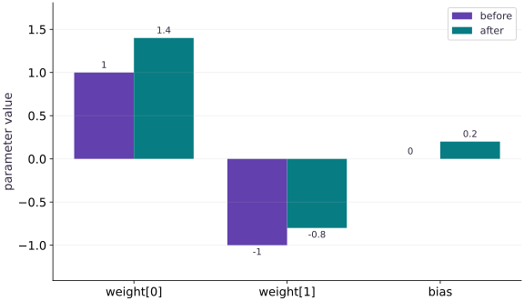

# Pytrees and structured parameters

Phase 03: State, randomness & control flow · about 60 minutes · CPU

This worked reference is validated on CPU. Accelerator compatibility requires a separate source review and target execution receipt. Use the execution matrix to review device selection and data ownership before adapting a separate target program.

**Before this lesson:** [Random keys without surprises](https://www.tahabouhsine.com/jaxpathways/lesson-state-01.html).

## What you will be able to do

- Identify containers, leaves and structure
- Derive the matching gradient tree
- Apply corresponding leaves, not unrelated arrays
- Keep metadata separate from differentiated state

## The problem

Our model has a weight vector and a bias. How do we keep each parameter paired with its gradient? We’ll store them in a small nested structure called a pytree, calculate one update by hand, and check that JAX follows the same structure. The tree is just a way to keep related values organized.

## The idea

A pytree is a nested structure whose leaves hold values such as parameters. JAX can transform the leaves while preserving the structure. This makes a model's parameter groups explicit and lets us compare the gradient tree with the parameters it differentiates.

## Match leaves by meaning as well as shape

A model can have several parameter groups, so the gradient must stay paired with the parameter it describes. A pytree preserves these relationships through dictionaries, lists and tuples while allowing transformations to act on array leaves. The container gives identity; each leaf holds a scalar or array.

In the diagram, follow each parameter path to its gradient partner. The two weight coordinates and bias are distinct values even if two leaves happen to share a shape. Optimizer state may add its own moment trees or counters, so do not assume every state object has exactly the parameter structure.

### Pause and reason

Two parameter leaves have the same shape. Is swapping their gradients safe?

<details><summary>Compare your reasoning</summary>

No. Shape compatibility does not identify which parameter a derivative belongs to. Preserve tree paths and compare the result with an independently known update.

</details>

## Identify containers, leaves and structure

Pytree structure matters because JAX transformations preserve the organization of nested inputs and outputs. In the example, the dictionary contains a weight vector of shape $(2,)$ and scalar bias of shape $()$: two leaves, three numerical parameter values. The leaf count is not the number of scalar parameters.

`tree.flatten` returns both an ordered list of leaves and a tree definition that can reconstruct their containers. Keep that definition with the values; manually guessing the flattening order risks reconnecting a number to the wrong parameter path.

```text
params
├── weight: float32[2]
└── bias: float32[]
2 leaves, 3 numerical parameter values
```

## Derive the matching gradient tree

The gradient tree is easiest to trust when one update can be calculated by hand. With input $(2,1)$, weights $(1,-1)$, bias $0$, and target $3$, prediction is $1$, residual is $-2$, and squared loss is $4$. The derivative with respect to prediction is $-4$; multiplying by the input gives weight gradient $(-8,-4)$, and the bias gradient is $-4$.

At step size $0.05$, subtracting this gradient gives weights $(1.4,-0.8)$ and bias $0.2$. The updated prediction is $2.2$ and loss about $0.64$, matching the execution receipt. Check each leaf’s value and role, not just the final loss decrease.

$$
\begin{aligned}\hat y&=2(1)+1(-1)+0=1\\L&=(1-3)^2=4\\\nabla_w L&=(-8,-4),\qquad \frac{\partial L}{\partial b}=-4\end{aligned}
$$

## Apply corresponding leaves, not unrelated arrays

An elementwise update must pair each parameter leaf with its corresponding gradient leaf. `tree.map` can apply $p-\eta g$ over two matching structures, but matching structure alone is not proof of semantic identity. A swapped pair of equal-shaped leaves may produce valid arithmetic and a wrong model.

Compare paths, shape and dtype before applying an update. A missing dictionary key is a tree-structure mismatch; incompatible leaf dimensions are a shape mismatch. Then verify an independently calculated prediction or update, as in the one-example check, to catch errors that structure checks cannot see.

## Keep metadata separate from differentiated state

Differentiation needs numerical trainable leaves, while configuration and bookkeeping have different meanings. A model name string is not a floating-point parameter; keep it outside the differentiated tree unless a custom pytree explicitly defines how it participates.

Optimizer state is also not interchangeable with parameters. It may contain moment estimates shaped like the parameter leaves plus a scalar counter. Preserve those meanings and structures separately, then update each with its appropriate rule. The useful invariant is correspondence by path and role, not that every object in training has one identical tree.

## Prepare the inputs

Create main.py in your lesson workspace. Add this first block; use the environment from setup.

```python
# Step 1 — Prepare the inputs
import jax
import jax.numpy as jnp
```

These explicit inputs define the case that the later checks will verify.

## Build the computation

Append this block below the inputs in the same file.

```python
# Step 2 — Build the computation: loss reads both parameter leaves.
params = {"weight": jnp.array([1., -1.]), "bias": jnp.array(0.)}
x = jnp.array([2., 1.])
def loss(p):
    prediction = jnp.dot(p["weight"], x) + p["bias"]
    return (prediction - 3.) ** 2
```

loss reads both parameter leaves. grad returns a matching gradient tree; tree.map pairs each parameter with its corresponding derivative for the update.

## Run and check the result

Append the checks, save main.py, and run python main.py from this folder using your course environment.

```python
# Step 3 — Run and check the result
value, grads = jax.value_and_grad(loss)(params)
updated = jax.tree.map(lambda p, g: p - 0.05 * g, params, grads)
print("Before/after:", float(value), float(loss(updated)))
assert grads.keys() == params.keys()
assert loss(updated) < value
```

Compare the output to the expected result below before making the exercise change.

## Run the example

```python
# Step 1 — Prepare the inputs
import jax
import jax.numpy as jnp
# Step 2 — Build the computation: loss reads both parameter leaves.
params = {"weight": jnp.array([1., -1.]), "bias": jnp.array(0.)}
x = jnp.array([2., 1.])
def loss(p):
    prediction = jnp.dot(p["weight"], x) + p["bias"]
    return (prediction - 3.) ** 2
# Step 3 — Run and check the result
value, grads = jax.value_and_grad(loss)(params)
updated = jax.tree.map(lambda p, g: p - 0.05 * g, params, grads)
print("Before/after:", float(value), float(loss(updated)))
assert grads.keys() == params.keys()
assert loss(updated) < value
```

Expected: Before/after: $4.0$, approximately $0.64$.

## A gradient tree matches parameter leaves

**Predict:** Which weight changes more, and why?



**Recorded CPU computation**

### Read the figure

The horizontal categories name weight coordinate one, weight coordinate two and bias; the vertical axis is parameter value. Each pair compares before and after one update: weights move from $(1,-1)$ to $(1.4,-0.8)$, and bias from $0$ to $0.2$. The second weight remains negative but moves upward toward zero.

### Connect it to the computation

For input $(2,1)$, the initial prediction is $1$ against target $3$, giving gradient leaves $(-8,-4,-4)$. Subtracting that gradient with step $0.05$ produces the plotted increases $(0.4,0.2,0.2)$. The updated prediction $2.2$ lowers loss from $4$ to about $0.64$; the chart shows parameter values, so verify loss separately.

```python
visual_data = {'kind': 'bar', 'labels': ['weight[0]', 'weight[1]', 'bias'], 'ylabel': 'parameter value', 'series': [{'label': 'before', 'y': [float(params['weight'][0]), float(params['weight'][1]), float(params['bias'])]}, {'label': 'after', 'y': [float(updated['weight'][0]), float(updated['weight'][1]), float(updated['bias'])]}]}
```

## Recorded reference execution

CPU run: 2026-10-27T17:03:07.732705+00:00. JAX 0.9.2.

```text
Before/after: 4.0 0.6399999260902405
Before/after: 4.0 0.6399999260902405
Expected tree mismatch
PASS: state-02

```

## Verify every gradient leaf

**Predict before running:** Predict both weight derivatives and the bias derivative from the residual before inspecting grads.

```python
# Experiment — Verify every gradient leaf
assert jnp.allclose(grads["weight"],jnp.array([-8.,-4.]))
assert jnp.allclose(grads["bias"],-4.)
assert jnp.allclose(updated["weight"],jnp.array([1.4,-0.8]))
assert jnp.allclose(updated["bias"],0.2)
assert jnp.allclose(loss(updated),0.64,atol=1e-6)
```

**Expected:** All leaves agree with the hand-derived update.

This check verifies parameter identity and the actual gradient values, not just a matching container.

## Flatten and reconstruct without losing identity

**Predict before running:** What is retained by the tree definition when array values are replaced?

```python
# Experiment — Flatten and reconstruct without losing identity
leaves,definition=jax.tree.flatten(params)
rebuilt=jax.tree.unflatten(definition,leaves)
assert jax.tree.structure(rebuilt)==jax.tree.structure(params)
assert jnp.array_equal(rebuilt["weight"],params["weight"])
assert jnp.array_equal(rebuilt["bias"],params["bias"])
```

**Expected:** The original keys and corresponding values are reconstructed.

The tree definition describes containers; leaves supply numerical values. Both are needed for reconstruction.

## Make it yours

Compute the squared norm of all gradient leaves. Verify it by adding the weight and bias contributions directly.

### How to write this exercise — Step-by-step recipe & starter scaffold

**Inputs:**
- A nested parameter pytree with weight and bias leaves and a matching gradient pytree.

**Outputs:**
- The squared Euclidean norm of all gradient leaves.

**Invariants to check:**
- Every gradient leaf contributes exactly once.
- The pytree structure is preserved while reducing the scalar contributions.

**Hints:**
- Map a square operation over gradient leaves, then reduce the resulting leaves.
- Compare your result to direct weight and bias contributions.

**Starter code scaffold (fill in the TODOs):**

```python
import jax
import jax.numpy as jnp

def squared_gradient_norm(grads: dict) -> jax.Array:
    """Return the sum of squared values across all gradient leaves."""
    # TODO: traverse the pytree leaves and reduce their squared entries.
    raise NotImplementedError
```

<details><summary>Reference solution</summary>

```python
# Exercise solution: Compute the squared norm of all gradient leaves.
norm_squared = sum(jnp.sum(g ** 2) for g in jax.tree.leaves(grads))
manual = jnp.sum(grads["weight"] ** 2) + grads["bias"] ** 2
assert jnp.allclose(norm_squared, manual)
assert jnp.allclose(norm_squared, 96.)
```

</details>

## Extend to a nested model

**Practice**

Place weight and bias under a layer dictionary and add a scalar scale parameter. Verify the derivative of scale for $s(wx+b)$.

<details><summary>Hint</summary>

At the starting point prediction is $1$ and residual is $-2$, so the scale derivative is $-4$.

</details>

### How to write: Extend to a nested model — Step-by-step recipe & starter scaffold

**Inputs:**
- A weight vector, scalar bias, scalar scale, and input vector.

**Outputs:**
- The gradient pytree for the squared prediction loss of scale*(weight dot x + bias).

**Invariants to check:**
- Gradient leaves follow the same nested structure as the parameters.
- The scale derivative is computed by autodiff for the supplied values.

**Hints:**
- Put weight and bias below a layer key, with scale as a separate leaf.
- Differentiate a scalar loss with jax.grad.

**Starter code scaffold (fill in the TODOs):**

```python
import jax
import jax.numpy as jnp

def nested_gradients(weight: jax.Array, bias: jax.Array, scale: jax.Array, x: jax.Array, target: jax.Array) -> dict:
    """Return gradients for a nested scaled linear model."""
    # TODO: construct the parameter pytree and differentiate its scalar loss.
    raise NotImplementedError
```

<details><summary>Reference solution and reasoning</summary>

```python
# Extend to a nested model (Practice): Nested parameter identity survives differentiation.
nested={"layer":params,"scale":jnp.array(1.)}
def nested_loss(p):
    pred=p["scale"]*(jnp.dot(p["layer"]["weight"],x)+p["layer"]["bias"])
    return (pred-3.)**2
g=jax.grad(nested_loss)(nested)
assert jax.tree.structure(g)==jax.tree.structure(nested)
assert jnp.allclose(g["scale"],-4.)
```

Nested parameter identity survives differentiation. The independent scale calculation checks the new path.

</details>

## Repair a mismatched update tree

**Challenge**

Remove bias from the gradient dictionary, reproduce the structural error, then restore it and verify the hand update.

<details><summary>Hint</summary>

Matching leaf counts is not enough; key paths matter.

</details>

### How to write: Repair a mismatched update tree — Step-by-step recipe & starter scaffold

**Inputs:**
- A parameter pytree and a matching gradient pytree.

**Outputs:**
- A gradient tree validated against the parameter structure and a matching updated parameter pytree.

**Invariants to check:**
- Every parameter path has exactly one gradient leaf.
- A missing bias gradient is rejected instead of broadcast or silently omitted.

**Hints:**
- Use tree structure comparison or a tree map to validate alignment.
- Apply the hand update only after the structures match.

**Starter code scaffold (fill in the TODOs):**

```python
import jax
import jax.numpy as jnp

def checked_tree_update(params: dict, grads: dict, learning_rate: float = 0.05) -> dict:
    """Reject a mismatched pytree and otherwise perform one aligned update."""
    # TODO: check structure compatibility, then update corresponding leaves.
    raise NotImplementedError
```

<details><summary>Reference solution and reasoning</summary>

```python
# Repair a mismatched update tree (Challenge): A missing bias gradient is a tree mismatch.
try:
    jax.tree.map(lambda p,g:p-0.05*g,params,{"weight":grads["weight"]})
except ValueError:
    print("Expected tree mismatch")
else:
    raise AssertionError("Expected a missing-key failure")
fixed=jax.tree.map(lambda p,g:p-0.05*g,params,grads)
assert jnp.allclose(loss(fixed),0.64,atol=1e-6)
```

A missing bias gradient is a tree mismatch. Broadcasting weights or changing a learning rate cannot supply the missing parameter identity.

</details>

## Check your understanding

What structure does `grad(loss)(params)` have?

1. One scalar regardless of parameters
2. A pytree corresponding to params
3. A list of Python source lines

<details><summary>Answer and explanation</summary>

**1. One scalar regardless of parameters**

The loss is scalar, but there is one gradient leaf for each differentiable parameter leaf. Compare tree structures and leaf shapes.

**2. A pytree corresponding to params (correct)**

The differentiated input determines the gradient structure. Each floating-point parameter leaf gets a corresponding gradient leaf.

**3. A list of Python source lines**

Automatic differentiation follows array operations, not source line numbers. Inspect the gradient pytree alongside the parameter pytree.

</details>

## Diagnose the result

A missing bias gradient is a tree mismatch. Broadcasting weights or changing a learning rate cannot supply the missing parameter identity.

## Carry forward

- This check verifies parameter identity and the actual gradient values, not just a matching container.
- The tree definition describes containers; leaves supply numerical values. Both are needed for reconstruction.

## Keep your evidence

Keep the parameter/gradient tree diagram, hand-derived leaves and update, flatten/unflatten round trip, nested-scale derivative and missing-key repair.

Save your predictions, modified code, terminal outputs, and reasoning in your engineering portfolio.

## Primary references

- [JAX pytrees](https://docs.jax.dev/en/latest/101/pytrees.html)

