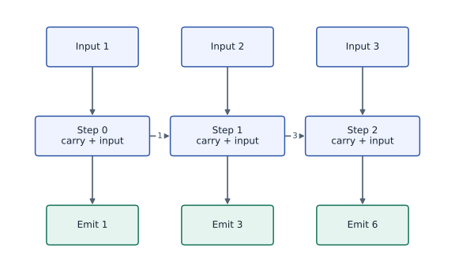
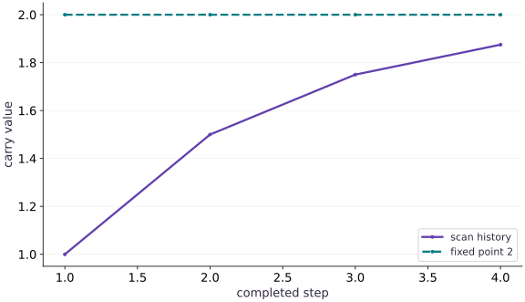

# Compiled loops with lax.scan

Phase 03: State, randomness & control flow · about 65 minutes · CPU

This worked reference is validated on CPU. Accelerator compatibility requires a separate source review and target execution receipt. Use the execution matrix to review device selection and data ownership before adapting a separate target program.

**Before this lesson:** [Pytrees and structured parameters](https://www.tahabouhsine.com/jaxpathways/lesson-state-02.html).

## What you will be able to do

- Separate carry from recorded outputs
- Keep the carry contract invariant
- Differentiate the recurrence by hand
- Compile the repeated transition without a timing promise

## The problem

Suppose a simulator keeps part of its current value and adds a new input at each step. Let’s write out four steps so we know what should happen. Then we’ll express the same loop with scan, compare it with Python, and see how changing the retained fraction affects the final value.

## The idea

A scan separates the state carried between steps from the outputs collected at each step. This is useful whenever the same rule repeats over time while the state keeps a fixed structure, shape and dtype.

## Unroll three steps before compiling the loop

A repeated update is easier to translate when we first make its state flow concrete. Start with carry $0$, add inputs $[1,2,3]$, and emit each new carry: the successive values are $1,3,6$. The final carry is the last state $6$; the output history is the three emitted values $[1,3,6]$.

The diagram’s input nodes feed the step nodes, horizontal arrows pass carry from one step to the next, and downward arrows collect outputs. The edge labels $1$ and $3$ are the carry values passed onward; the emitted values are $1,3,6$. Trace these arrows when deciding which Python variables belong in scan’s carry and which belong in its stacked output.

### Carry moves through time; outputs are collected

**Predict:** What changes if the step emits the old carry instead of the new carry?



*Architecture and dataflow mechanism diagram.*

Follow each input node into its step node, then follow the horizontal arrows for carry: initial $0$, then $1$, then $3$, and final $6$. Each downward arrow collects the updated carry as an output, producing $[1,3,6]$. Thus final carry and stacked outputs are separate results. Arrow lengths and node spacing show dataflow only, not runtime.

### Pause and reason

What changes if the step emits the old carry instead of the new carry?

<details><summary>Compare your reasoning</summary>

The final carry is still $6$, but outputs become $[0,1,3]$. A final-state check alone would miss this off-by-one output convention.

</details>

## Separate carry from recorded outputs

A scan step has the contract $(carry_t,input_t)\mapsto(carry_{t+1},output_t)$. The carry is the small state needed by the next transition; the output is a record collected for inspection or later computation. They may contain related values without being the same conceptual object.

For the plotted decay recurrence $c_{t+1}=0.5c_t+1$ from initial carry zero, the horizontal axis is completed step and the vertical axis is carry value. The four outputs are $1,1.5,1.75,1.875$, approaching the dashed fixed point $2$. The initial zero is not plotted. Use the index to avoid labeling the first update as step zero.

```text
(state_t, input_t) → transition → (state_(t+1), recorded_t)
state: 0 → 1 → 1.5 → 1.75 → 1.875
```

## Keep the carry contract invariant

A compiled scan needs a stable carry contract: same pytree structure, shapes and dtypes at every transition. The numerical contents may change, as the carry goes from $0$ to $1.5$, but the container and dimensions stay fixed. A growing Python list or a concatenated history changes the carry shape and violates this contract.

Keep history in the separately stacked outputs, as the example does, while the carry remains one scalar. For a bounded variable-size problem, represent capacity explicitly and use masks as needed; do not make the repeated state grow implicitly each step.

## Differentiate the recurrence by hand

Differentiating a recurrence is clearer when the final answer is written as a function of the parameter. With four unit inputs and initial zero, the final carry is $1+d+d^2+d^3$, whose derivative at $d=0.5$ is $2.75$. The recurrence for the sensitivity is $s_{t+1}=state_t+d s_t$, starting at zero.

Autodiff through `scan` follows the represented transition and this same dependency through time. It cannot validate whether the model itself is stable or whether the recurrence was encoded correctly. Compare the short polynomial and one changed input sequence before trusting a long run.

$$
\begin{aligned}s_{\mathrm{final}}(d)&=1+d+d^2+d^3\\\frac{ds_{\mathrm{final}}}{dd}&=1+2d+3d^2\\s_{\mathrm{final}}(0.5)&=1.875,\qquad s_{\mathrm{final}}\prime(0.5)=2.75\end{aligned}
$$

## Compile the repeated transition without a timing promise

`scan` describes a fixed repeated transition compactly, while a Python loop inside `jit` may be unrolled during tracing. This distinction can matter for compilation of long loops, but it does not guarantee that scan is faster for every workload.

The retained receipt checks that Python and scan produce history $[1,1.5,1.75,1.875]$ and final value $1.875$, and that a changing carry shape is rejected. Those are correctness and contract checks, not a timing result. If measuring later, compare the same steps, inputs and precision and wait for completion.

## Prepare the inputs

Create main.py in your lesson workspace. Add this first block; use the environment from setup.

```python
# Step 1 — Prepare the inputs
import jax
import jax.numpy as jnp
```

These explicit inputs define the case that the later checks will verify.

## Build the computation

Append this block below the inputs in the same file.

```python
# Step 2 — Build the computation: step returns the next scalar carry and one recorded scalar.
def step(carry, increment):
    next_value = 0.5 * carry + increment
    return next_value, next_value
increments = jnp.array([1., 1., 1., 1.])
```

step returns the next scalar carry and one recorded scalar. scan feeds that carry back into step and stacks the four recorded outputs.

## Run and check the result

Append the checks, save main.py, and run python main.py from this folder using your course environment.

```python
# Step 3 — Run and check the result
final, history = jax.lax.scan(step, jnp.array(0.), increments)
print("History:", history)
print("Final:", float(final))
assert jnp.allclose(history, jnp.array([1.,1.5,1.75,1.875]))
assert jnp.allclose(final, history[-1])
```

Compare the output to the expected result below before making the exercise change.

## Run the example

```python
# Step 1 — Prepare the inputs
import jax
import jax.numpy as jnp
# Step 2 — Build the computation: step returns the next scalar carry and one recorded scalar.
def step(carry, increment):
    next_value = 0.5 * carry + increment
    return next_value, next_value
increments = jnp.array([1., 1., 1., 1.])
# Step 3 — Run and check the result
final, history = jax.lax.scan(step, jnp.array(0.), increments)
print("History:", history)
print("Final:", float(final))
assert jnp.allclose(history, jnp.array([1.,1.5,1.75,1.875]))
assert jnp.allclose(final, history[-1])
```

Expected: History: $[1., 1.5, 1.75, 1.875]$; Final: $1.875$.

## The carry approaches a fixed point

**Predict:** Why does the increment between successive states shrink?



**Recorded CPU computation**

### Read the figure

The horizontal axis counts completed scan steps, and the vertical axis is carry value. The solid history is $1,1.5,1.75,1.875$ at steps one through four; the dashed line is the fixed point $2$. The initial carry $0$ is not included, so the first plotted point already follows one update. Notice that the gap to $2$ shrinks from $1$ to $0.125$.

### Connect it to the computation

The recurrence $c_{t+1}=0.5c_t+1$ halves the remaining gap to $2$ each step. In scan terms, each updated scalar is carried to the next transition, while each plotted value is also collected in the output history. Use the horizontal step labels to distinguish final carry from the sequence of emitted values.

```python
visual_data = {'kind': 'line', 'x': [1, 2, 3, 4], 'xlabel': 'completed step', 'ylabel': 'carry value', 'series': [{'label': 'scan history', 'y': history.tolist()}, {'label': 'fixed point 2', 'y': [2.0] * 4}]}
```

## Recorded reference execution

CPU run: 2026-10-27T17:03:10.197100+00:00. JAX 0.9.2.

```text
History: [1.    1.5   1.75  1.875]
Final: 1.875
History: [1.    1.5   1.75  1.875]
Final: 1.875
Expected carry-shape mismatch
PASS: state-03

```

## Compare scan to the Python recurrence

**Predict before running:** Predict every output for inputs $[1,-1,2,0]$ and decay $0.5$.

```python
# Experiment — Compare scan to the Python recurrence
inputs=jnp.array([1.,-1.,2.,0.])
state=0.
reference=[]
for inc in [1.,-1.,2.,0.]:
    state=0.5*state+inc
    reference.append(state)
last,observed=jax.lax.scan(step,jnp.array(0.),inputs)
assert jnp.allclose(observed,jnp.array([1.,-0.5,1.75,0.875]))
assert jnp.allclose(observed,jnp.array(reference))
assert jnp.allclose(last,state)
```

**Expected:** History $[1,-0.5,1.75,0.875]$; final $0.875$.

The loop is an independent control-flow reference and the fixed numbers verify time indexing.

## Verify state and sensitivity together

**Predict before running:** How do the state and derivative recurrences differ?

```python
# Experiment — Verify state and sensitivity together: The scalar objective is the final state.
# Define `terminal(d)` to carry state across steps with `jax.lax.scan`:
def terminal(d):
    return jax.lax.scan(lambda c,u:(d*c+u,d*c+u),jnp.array(0.),increments)[0]
value,sensitivity=jax.value_and_grad(terminal)(0.5)
assert jnp.allclose(value,1.875)
assert jnp.allclose(sensitivity,2.75)
assert jnp.allclose(jax.jit(terminal)(0.5),value)
```

**Expected:** Final state $1.875$ and sensitivity $2.75$.

The scalar objective is the final state. Returning the whole history to ordinary grad would need a deliberate scalar reduction.

## Make it yours

Make the decay an explicit scalar argument. Differentiate the final value with respect to decay and compare at $0.5$ with the analytic derivative $2.75$.

### How to write this exercise — Step-by-step recipe & starter scaffold

**Inputs:**
- The initial scalar state, increments, and explicit decay scalar from the exercise.

**Outputs:**
- The final scan value, per-step history, autodiff derivative with respect to decay, and comparison with the analytic value at 0.5.

**Invariants to check:**
- The final value is differentiated through the scan; the derivative check uses decay 0.5 and the stated analytic reference.

**Hints:**
- Pass decay as an explicit scan-transition input.
- Differentiate the function returning only the final carry, then compare at the requested decay.

**Starter code scaffold (fill in the TODOs):**

```python
import jax
import jax.numpy as jnp

def check_scan_decay_derivative(initial, increments, decay):
    # TODO: Return the scan history and final carry, then differentiate the final carry with respect to decay.
    raise NotImplementedError
```

<details><summary>Reference solution</summary>

```python
# Exercise solution: Make the decay an explicit scalar argument.
# Define `simulate(decay)` to carry state across steps with `jax.lax.scan`:
def simulate(decay):
    def transition(carry, increment):
        value = decay * carry + increment
        return value, value
    return jax.lax.scan(transition, jnp.array(0.), increments)[0]
assert jnp.allclose(jax.grad(simulate)(0.5), 2.75)
```

</details>

## Record a different output

**Practice**

Carry the state, but record its squared value. Confirm that final carry still means state.

<details><summary>Hint</summary>

The second returned value is only the recorded output.

</details>

### How to write: Record a different output — Step-by-step recipe & starter scaffold

**Inputs:**
- An initial scalar carry and a sequence of increments.

**Outputs:**
- The final state and the squared state recorded at every step.

**Invariants to check:**
- The carry remains unsquared between transitions.
- Recorded output has the same leading length as increments.

**Hints:**
- Compute the next state once in the transition.
- Return that state as carry and its square as the scan output.

**Starter code scaffold (fill in the TODOs):**

```python
import jax
import jax.numpy as jnp

def state_and_energy(initial: jax.Array, increments: jax.Array, decay: float = 0.5) -> tuple[jax.Array, jax.Array]:
    """Scan a scalar state while recording its squared energy."""
    # TODO: define the transition and return lax.scan outputs.
    raise NotImplementedError
```

<details><summary>Reference solution and reasoning</summary>

```python
# Record a different output (Practice): Carry and history need not have the same interpretation.
last,energy=jax.lax.scan(lambda c,u:(0.5*c+u,(0.5*c+u)**2),jnp.array(0.),increments)
assert jnp.allclose(last,1.875)
assert jnp.allclose(energy,jnp.array([1.,2.25,3.0625,3.515625]))
```

Carry and history need not have the same interpretation. The state remains unsquared for the next transition.

</details>

## Diagnose a growing carry

**Challenge**

Try appending each input to the carry with concatenate. Explain why scan rejects it and replace it with stacked output.

<details><summary>Hint</summary>

The carry shape is part of the loop type.

</details>

### How to write: Diagnose a growing carry — Step-by-step recipe & starter scaffold

**Inputs:**
- A fixed-shape scan carry and a sequence whose values are to be recorded.

**Outputs:**
- A scan result whose carry shape stays fixed while all per-step values are stacked in output.

**Invariants to check:**
- Carry shape and dtype agree on every iteration.
- History length equals the sequence length, including empty sequences.

**Hints:**
- A growing array belongs in the scan output, not in carry.
- Keep the carry fixed and return each new value as the output.

**Starter code scaffold (fill in the TODOs):**

```python
import jax
import jax.numpy as jnp

def collect_scan(initial: jax.Array, values: jax.Array) -> tuple[jax.Array, jax.Array]:
    """Keep a fixed carry and collect each input in the scan history."""
    # TODO: implement a fixed-type carry transition with per-step output.
    raise NotImplementedError
```

<details><summary>Reference solution and reasoning</summary>

```python
# Diagnose a growing carry (Challenge): The error identifies incompatible carry input/output types.
def growing(c,u):
    return jnp.concatenate([c,u[None]]),u
try:
    jax.lax.scan(growing,jnp.zeros((0,)),increments)
except TypeError:
    print("Expected carry-shape mismatch")
else:
    raise AssertionError("Expected scan type failure")
_,saved=jax.lax.scan(lambda c,u:(c,u),jnp.array(0.),increments)
assert jnp.array_equal(saved,increments)
```

The error identifies incompatible carry input/output types. Store per-step values in scan outputs instead of growing the carry.

</details>

## Check your understanding

What must remain consistent across scan steps?

1. The numerical value of the carry
2. The carry structure, shapes, and dtypes
3. Every recorded output must be zero

<details><summary>Answer and explanation</summary>

**1. The numerical value of the carry**

The carry values are meant to change. It is their structure, shapes and dtypes that must stay compatible across iterations.

**2. The carry structure, shapes, and dtypes (correct)**

The carry value changes through time, but its structural and array type properties must remain consistent.

**3. Every recorded output must be zero**

Outputs can contain arbitrary computed values with a consistent per-step structure. They do not need to be zero.

</details>

## Diagnose the result

The error identifies incompatible carry input/output types. Store per-step values in scan outputs instead of growing the carry.

## Carry forward

- The loop is an independent control-flow reference and the fixed numbers verify time indexing.
- The scalar objective is the final state. Returning the whole history to ordinary grad would need a deliberate scalar reduction.

## Keep your evidence

Keep the labeled carry/output transition, Python-reference trajectory, polynomial derivative, compiled value check and growing-carry failure with a fixed-shape repair.

Save your predictions, modified code, terminal outputs, and reasoning in your engineering portfolio.

## Primary references

- [JAX scan contract](https://docs.jax.dev/en/latest/_autosummary/jax.lax.scan.html)
- [JAX control flow](https://docs.jax.dev/en/latest/control-flow.html)

