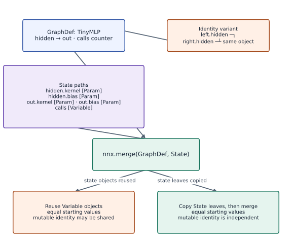

# Model and state with Flax NNX

Phase 05: Neural network training · about 80 minutes · CPU

This worked reference is validated on CPU. Accelerator compatibility requires a separate source review and target execution receipt. Use the execution matrix to review device selection and data ownership before adapting a separate target program.

**Before this lesson:** [Build a tiny multilayer perceptron](https://www.tahabouhsine.com/jaxpathways/lesson-networks-01.html).

## What you will be able to do

- Move the explicit equations into a module
- Separate parameter state from diagnostic state
- Reconstruct an independent graph from a snapshot
- Check a library forward pass independently

## The problem

A model library can organize weights for us, but we still want to see what is being learned. We’ll build a small Flax NNX module, compare its predictions with NumPy, and inspect its state. A diagnostic counter will help us distinguish trainable parameters from other values a model carries.

## The idea

A model has a computation structure and state values. Some state is trainable; other state may record statistics or randomness. Flax NNX helps manage these objects, but we still need to understand which identities are shared and which values an update changes.

## Distinguish shared structure from changing values

Think of `nnx.split(model)` as separating the model's wiring from the arrays currently attached to it. The unfiltered split returns exactly two objects, a `GraphDef` and complete `State`. Here that state has 13 `Param` scalars plus the `calls` variable. Filtering state for `Param` and `Not(Param)` inspects those groups; it does not change the two-result unfiltered call.

The identity variant in the diagram gives `left` and `right` the same hidden layer object. Replacing its bias through one reference is visible through the other because both names reach the same variable. To get an independent snapshot, copy state leaves before merging; equal initial values alone do not imply separate mutable state. The tested run confirms the distinction: the cloned counter advances to 2 while the original stays at 1.

$$
(\mathcal G,S)=\operatorname{nnx.split}(M),\qquad M^{\prime}=\operatorname{nnx.merge}(\mathcal G,S^{\prime})
$$

### NNX GraphDef and State with shared and copied module identity

**Predict:** If `left` and `right` point to the same hidden module, what changes when only one reference is assigned a new bias?



*Architecture and dataflow mechanism diagram.*

Read the upper `GraphDef` node as the module wiring and named edges; the side node states the alias relation `left is right`. The middle `State` node lists `hidden.kernel`, `hidden.bias`, `out.kernel`, `out.bias`, and `calls`. Arrows from both inputs to `nnx.merge(GraphDef, State)` show that structure and current values are needed to rebuild the model. The two lower arrows contrast reusing mutable Variable objects with copying state leaves first. Test the distinction by changing a bias through one alias and by incrementing a cloned counter; the retained run gives source/clone counters 1 and 2.

### Pause and reason

What should a diagram show when two attributes use the same layer?

<details><summary>Compare your reasoning</summary>

One shared parameter identity with two uses. Show independent copies only after an explicit operation and identity/value checks establish independence.

</details>

## Move the explicit equations into a module

`nnx.Linear(2, 3)` stores a $2\times3$ kernel and a length-three bias; the output layer stores $3\times1$ weights and one bias. The parameter total is $6+3+3+1=13$, matching the printed count. A batch of one or five rows changes the leading batch dimension, not these stored arrays.

The forward pass remains the earlier computation: affine map, tanh, then affine map. Extract the named kernels and biases and compute those operations in NumPy to check that the module wiring matches the explicit equations. An input with the wrong feature count violates the constructor's fixed input contract.

## Separate parameter state from diagnostic state

The `calls` variable is incremented only when this example is called with `record=True`. It is ordinary mutable state, not a learned weight, so `nnx.Optimizer(..., wrt=nnx.Param)` excludes it from parameter updates. Exclusion from gradients does not freeze a value that the forward method changes.

Real models add other non-parameter state. BatchNorm stores running statistics, and Dropout uses RNG state; later evaluation must specify whether those collections are allowed to change. For this toy module, inspect `Param` and its complement and check the counter before and after each call.

```text
model
├─ hidden: kernel, bias [Param]
├─ out: kernel, bias [Param]
└─ calls: diagnostic counter [Variable]
```

## Reconstruct an independent graph from a snapshot

`GraphDef` carries module structure and `State` carries current variable values. Merging them reconstructs the same graph shape, but in the tested Flax version a merge with the original `State` may reuse its mutable Variable objects. Copy the state leaves before merging when you need an isolated clone, then test identity through behavior: call the clone with `record=True` and confirm its counter changes while the source counter remains $1$.

The chart counts the four named parameter paths: 6 values in `hidden.kernel`, 3 in `hidden.bias`, 3 in `out.kernel`, and 1 in `out.bias`. It omits `calls`, which is the single non-Param value. The diagram's `left`/`right` alias case illustrates a reference-identity variant, not extra layers in that 13-parameter count. This is an in-memory ownership check, not a durable checkpoint format.

## Check a library forward pass independently

Read `hidden.kernel`, `hidden.bias`, `out.kernel`, and `out.bias` from the model, then apply the affine, tanh, and affine operations in NumPy to several inputs. Matching logits checks the computation and the final squeeze. It does not test whether initialization is good or whether a classifier generalizes.

A useful algebraic follow-up is to add one to the output bias: every logit should rise by exactly one, while hidden activations stay fixed. The script's clone check separately shows that the copied state can change without changing the original parameter values.

## 1. Define typed state and the model

Create `main.py`. From the repository root, run `python3 -m pip install -r requirements-cpu.txt` in your activated environment; the course pins Flax `0.12.6`. Copy the model before adding any optimizer.

```python
# Step 1 : 1. Define typed state and the model: nnx.Rngs manages initializer keys.
from flax import nnx
import jax
import jax.numpy as jnp
import numpy as np
# Define `TinyMLP` module / container with explicit state and forward pass:
class TinyMLP(nnx.Module):
    def __init__(self,seed=0):
        rngs=nnx.Rngs(seed)
        self.hidden=nnx.Linear(2,3,rngs=rngs)
        self.out=nnx.Linear(3,1,rngs=rngs)
        self.calls=nnx.Variable(jnp.array(0,dtype=jnp.int32))
    def __call__(self,x,record=False):
        if record:self.calls[...] += 1
        return self.out(nnx.tanh(self.hidden(x))).squeeze(-1)
model=TinyMLP()
batch=jnp.array([[1.,2.],[-1.,.5],[0.,0.]])
```

`nnx.Rngs` manages initializer keys. The optional diagnostic counter changes only when explicitly requested.

## 2. Verify equations and inspect the filters

Append an independent NumPy computation. Count only `nnx.Param` leaves, not the counter.

```python
# Step 2 : 2. Verify equations and inspect the filters: The matching forward pass verifies the network wiring.
scores=model(batch,record=True)
# Transfer the device result to the host for an independent NumPy comparison.
h=np.tanh(np.asarray(batch)@np.asarray(model.hidden.kernel[...])+np.asarray(model.hidden.bias[...]))
# Transfer the device result to the host for an independent NumPy comparison.
expected=(h@np.asarray(model.out.kernel[...])+np.asarray(model.out.bias[...])).squeeze(-1)
np.testing.assert_allclose(scores,expected,rtol=1e-5,atol=1e-6)
param_state=nnx.state(model,nnx.Param)
other_state=nnx.state(model,nnx.Not(nnx.Param))
assert sum(a.size for a in jax.tree.leaves(param_state))==13
assert sum(a.size for a in jax.tree.leaves(other_state))==1
assert int(model.calls[...])==1
```

The matching forward pass verifies the network wiring. The filters identify $13$ learned scalars and one unlearned state scalar.

## 3. Split, merge, and test independence

Append the clone test. Predict which counter changes when the clone executes.

```python
# Step 3 : 3. Split, merge, and test independence: nnx.grad differentiates Param variables by default.
graphdef,state=nnx.split(model)
clone=nnx.merge(graphdef,jax.tree.map(lambda a:jnp.array(a,copy=True),state))
np.testing.assert_allclose(clone(batch),model(batch),rtol=1e-6)
clone(batch,record=True)
assert int(clone.calls[...])==2 and int(model.calls[...])==1
grads=nnx.grad(lambda m:jnp.mean(m(batch)**2))(model)
assert sum(a.size for a in jax.tree.leaves(grads))==13
assert 'calls' not in grads
print('Trainable scalars: 13; other state: 1; clone counters:',int(model.calls[...]),int(clone.calls[...]))
```

`nnx.grad` differentiates Param variables by default. Counter independence is a state-ownership invariant, not a performance measurement.

## Run the example

```python
# Step 1 : 1. Define typed state and the model: nnx.Rngs manages initializer keys.
from flax import nnx
import jax
import jax.numpy as jnp
import numpy as np
# Define `TinyMLP` module / container with explicit state and forward pass:
class TinyMLP(nnx.Module):
    def __init__(self,seed=0):
        rngs=nnx.Rngs(seed)
        self.hidden=nnx.Linear(2,3,rngs=rngs)
        self.out=nnx.Linear(3,1,rngs=rngs)
        self.calls=nnx.Variable(jnp.array(0,dtype=jnp.int32))
    def __call__(self,x,record=False):
        if record:self.calls[...] += 1
        return self.out(nnx.tanh(self.hidden(x))).squeeze(-1)
model=TinyMLP()
batch=jnp.array([[1.,2.],[-1.,.5],[0.,0.]])

# Step 2 : 2. Verify equations and inspect the filters: The matching forward pass verifies the network wiring.
scores=model(batch,record=True)
# Transfer the device result to the host for an independent NumPy comparison.
h=np.tanh(np.asarray(batch)@np.asarray(model.hidden.kernel[...])+np.asarray(model.hidden.bias[...]))
# Transfer the device result to the host for an independent NumPy comparison.
expected=(h@np.asarray(model.out.kernel[...])+np.asarray(model.out.bias[...])).squeeze(-1)
np.testing.assert_allclose(scores,expected,rtol=1e-5,atol=1e-6)
param_state=nnx.state(model,nnx.Param)
other_state=nnx.state(model,nnx.Not(nnx.Param))
assert sum(a.size for a in jax.tree.leaves(param_state))==13
assert sum(a.size for a in jax.tree.leaves(other_state))==1
assert int(model.calls[...])==1

# Step 3 : 3. Split, merge, and test independence: nnx.grad differentiates Param variables by default.
graphdef,state=nnx.split(model)
clone=nnx.merge(graphdef,jax.tree.map(lambda a:jnp.array(a,copy=True),state))
np.testing.assert_allclose(clone(batch),model(batch),rtol=1e-6)
clone(batch,record=True)
assert int(clone.calls[...])==2 and int(model.calls[...])==1
grads=nnx.grad(lambda m:jnp.mean(m(batch)**2))(model)
assert sum(a.size for a in jax.tree.leaves(grads))==13
assert 'calls' not in grads
print('Trainable scalars: 13; other state: 1; clone counters:',int(model.calls[...]),int(clone.calls[...]))
```

Expected: Trainable scalars: $13$; other state: $1$; original and cloned counters are $1$ and $2$.

## Trainable values at named NNX paths

**Predict:** Which path contributes six kernel values, and which contributes the diagnostic counter?


**Recorded CPU computation**

### Read the figure

The horizontal axis lists four named NNX parameter paths; bar height is the number of scalar parameter elements at that path. The observed counts are 6 for `hidden.kernel`, 3 for `hidden.bias`, 3 for `out.kernel`, and 1 for `out.bias`, summing to the printed 13 trainable scalars. The separate `calls` variable is not a parameter and is absent.

### Connect it to the computation

Use the named counts to reconcile the module with its forward pass: the hidden kernel has shape $2\times3$, and the output kernel has shape $3\times1$. Then inspect the graph/state diagram to find the counter, and check that a copied-state clone can advance its counter without changing the source.

```python
visual_data = {'kind': 'bar', 'x': [0, 1, 2, 3], 'labels': ['hidden.kernel', 'hidden.bias', 'out.kernel', 'out.bias'], 'xlabel': 'NNX module path', 'ylabel': 'parameter elements', 'series': [{'label': 'trainable values', 'y': [int(model.hidden.kernel.size), int(model.hidden.bias.size), int(model.out.kernel.size), int(model.out.bias.size)]}]}
assert visual_data['series'][0]['y'] == [6, 3, 3, 1]
```

## Recorded reference execution

CPU run: 2026-10-27T17:26:30.847038+00:00. JAX 0.9.2.

```text
Trainable scalars: 13; other state: 1; clone counters: 1 2
Trainable scalars: 13; other state: 1; clone counters: 1 2
Clone logits shifted by one; original parameters unchanged.
PASS: networks-02

```

## Bias shifts every score equally

**Predict before running:** Adding $0.25$ to the output bias should do what to each logit?

```python
# Experiment : Bias shifts every score equally
before=np.asarray(model(batch))
saved=model.out.bias[...]
model.out.bias[...] = saved+.25
np.testing.assert_allclose(model(batch),before+.25,atol=1e-6)
model.out.bias[...] = saved
```

**Expected:** All logits increase by $0.25$.

An affine output bias changes the decision threshold uniformly; the hidden representation is unchanged.

## Repeated construction reproduces state

**Predict before running:** Will two modules initialized with the same seed produce equal parameters?

```python
# Experiment : Repeated construction reproduces state: Replay is checked in one pinned environment.
replay=TinyMLP(0)
for a,b in zip(jax.tree.leaves(nnx.state(replay,nnx.Param)),jax.tree.leaves(param_state)):
    np.testing.assert_array_equal(a,b)
different=TinyMLP(1)
assert not np.array_equal(np.asarray(different.hidden.kernel[...]),np.asarray(model.hidden.kernel[...]))
```

**Expected:** Equal seeds reproduce the parameter arrays; a changed seed changes the hidden kernel.

Replay is checked in one pinned environment. Seeds alone do not promise identical bytes across package versions or backends.

## Make it yours

Apply the model to one new row and to five rows. Verify the scalar parameter count stays $13$ and the batch axis survives.

### How to write this exercise — Step-by-step recipe & starter scaffold

**Inputs:**
- The lesson’s Flax NNX model and one input row plus a five-row batch.

**Outputs:**
- Predictions whose leading dimensions match the input batch sizes, and the trainable scalar count.

**Invariants to check:**
- Applying the same model to one row and five rows preserves the leading batch axis; the parameter count remains unchanged.

**Hints:**
- Use inputs shaped (1, 2) and (5, 2), then inspect output shapes.
- Count only nnx.Param leaves, not the non-parameter call counter.

**Starter code scaffold (fill in the TODOs):**

```python
from flax import nnx
import jax
import jax.numpy as jnp

def check_model_batch_contract(model, single_row, five_rows):
    # TODO: Apply the model to both batches and verify output shapes and trainable scalar count.
    raise NotImplementedError
```

<details><summary>Reference solution</summary>

```python
# Exercise solution: Apply the model to one new row and to five rows.
single=jnp.array([[.3,-.7]])
# Check tensor shape invariant: `model(single).shape==(1,)`
assert model(single).shape==(1,)
# Check tensor shape invariant: `model(jnp.repeat(single,5,axis=0)).shape==(5,)`
assert model(jnp.repeat(single,5,axis=0)).shape==(5,)
assert sum(a.size for a in jax.tree.leaves(nnx.state(model,nnx.Param)))==13
```

</details>

## Change a clone without changing its source

**Transfer**

Increase only the cloned model’s output bias by one. Predict the change in every logit and verify the original model’s parameter leaves remain unchanged.

<details><summary>Hint</summary>

Snapshot the original parameters before editing clone.out.bias.

</details>

### How to write: Change a clone without changing its source — Step-by-step recipe & starter scaffold

**Inputs:**
- Increase only the cloned model’s output bias by one. Predict the change in every logit and verify the original model’s parameter leaves remain unchanged.

**Outputs:**
- Logit shift on the clone and an unchanged source snapshot.

**Invariants to check:**
- The clone owns independent variable state rather than aliasing the original module.

**Hints:**
- Snapshot the original parameters before editing clone.out.bias.

**Starter code scaffold (fill in the TODOs):**

```python
from flax import nnx
import jax.numpy as jnp

def practice_change_a_clone_without_changing_its_source(model, cloned_model):
    """Implement the change a clone without changing its source check."""
    # TODO: Clone model state, increment only the clone output bias, and compare all source parameter leaves before and after.
    raise NotImplementedError
```

<details><summary>Reference solution and reasoning</summary>

```python
# Change a clone without changing its source (Transfer)
original_leaves=[np.array(a,copy=True) for a in jax.tree.leaves(nnx.state(model,nnx.Param))]
# Transfer the device result to the host for an independent NumPy comparison.
old_clone=np.asarray(clone(batch)).copy()
clone.out.bias[...] = clone.out.bias[...] + 1.
np.testing.assert_allclose(clone(batch),old_clone+1.,rtol=1e-5,atol=1e-6)
for before,after in zip(original_leaves,jax.tree.leaves(nnx.state(model,nnx.Param))):
    np.testing.assert_array_equal(before,after)
print('Clone logits shifted by one; original parameters unchanged.')
```

The bias is broadcast over observations, so every logit shifts equally. Comparing original leaves detects accidental aliasing; equal parameter counts cannot detect that bug.

</details>

## Diagnose a shared module reference

**Intermediate**

Assign `shared = model`, increment its counter, and demonstrate why this is not a snapshot. Then reconstruct an independent module.

<details><summary>Hint</summary>

Assignment changes which name refers to the same object.

</details>

### How to write: Diagnose a shared module reference — Step-by-step recipe & starter scaffold

**Inputs:**
- Assign `shared = model`, increment its counter, and demonstrate why this is not a snapshot. Then reconstruct an independent module.

**Outputs:**
- The shared-reference mutation and an isolated copy check.

**Invariants to check:**
- Assignment preserves object identity; a snapshot must preserve values without shared mutable state.

**Hints:**
- Assignment changes which name refers to the same object.

**Starter code scaffold (fill in the TODOs):**

```python
from flax import nnx

def practice_diagnose_a_shared_module_reference(model):
    """Implement the diagnose a shared module reference check."""
    # TODO: Assign an alias, mutate its counter, compare the original object, and then construct an independent copy.
    raise NotImplementedError
```

<details><summary>Reference solution and reasoning</summary>

```python
# Diagnose a shared module reference (Intermediate)
saved_count=int(model.calls[...])
shared=model
shared(batch,record=True)
assert int(model.calls[...])==saved_count+1
graph,state=nnx.split(model)
independent=nnx.merge(graph,jax.tree.map(lambda a:jnp.array(a,copy=True),state))
independent(batch,record=True)
assert int(model.calls[...])==saved_count+1
assert int(independent.calls[...])==saved_count+2
```

Sharing a graph is useful for tied layers but wrong for an independent evaluation copy. Split, copy state, and merge supply independent variables in this example.

</details>

## Check your understanding

What does excluding the counter from `nnx.Param` guarantee?

1. It is excluded from parameter gradients, but may still change in a forward pass
2. It can never change
3. It is automatically saved to disk

<details><summary>Answer and explanation</summary>

**1. It is excluded from parameter gradients, but may still change in a forward pass (correct)**

Trainability and mutability are different properties. Filtering controls differentiation; the forward function still controls state updates.

**2. It can never change**

Excluding a value from nnx.Param does not freeze it. State such as a counter can still change in the forward computation.

**3. It is automatically saved to disk**

State classification does not persist anything to disk. Saving and restoring requires an explicit checkpoint contract.

</details>

## Diagnose the result

If evaluation changes state, inspect every nonparameter variable and forward flag. If a clone changes the original, inspect shared references. If an NNX module fails under a raw JAX transform, use nnx transformations or split it into graph/state deliberately instead of hiding the error.

## Carry forward

- Move the explicit equations into a module
- Separate parameter state from diagnostic state
- Reconstruct an independent graph from a snapshot
- Check a library forward pass independently

## Keep your evidence

Keep the NumPy forward comparison, count of 13 trainable scalars and one diagnostic counter, counter independence after copying state, and logits for batch size one and five.

Save your predictions, modified code, terminal outputs, and reasoning in your engineering portfolio.

## Primary references

- [Flax NNX basics](https://flax.readthedocs.io/en/latest/nnx_basics.html)
- [NNX module and pytree guide](https://flax.readthedocs.io/en/latest/guides/pytree.html)

