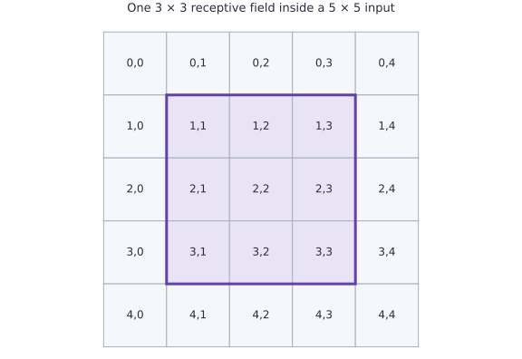
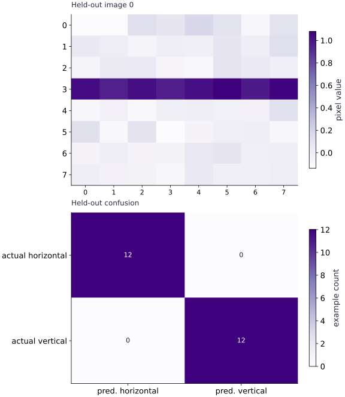

# Train a CNN on a small dataset

Phase 05: Neural network training · about 110 minutes · CPU

This worked reference is validated on CPU. Accelerator compatibility requires a separate source review and target execution receipt. Use the execution matrix to review device selection and data ownership before adapting a separate target program.

**Before this lesson:** [A compiled train and evaluation step](https://www.tahabouhsine.com/jaxpathways/lesson-networks-03.html).

## What you will be able to do

- Generate images with an explicit label rule
- Derive the convolution output shape
- Pool spatial responses and retain class scores
- Read a confusion matrix rather than a success label

## The problem

Can a small model tell horizontal bars from vertical bars in noisy images? We’ll create the images locally and train a convolutional classifier on CPU. You’ll then test images from a different random seed and read a confusion matrix. The task is small enough to inspect without downloading a dataset.

## The idea

A convolution combines a local input patch with weights reused across spatial positions. Layout, stride and padding decide which pixels contribute to each output. Trace one position first; the full feature map repeats that same rule.

## Trace one convolution output

For one output cell, take the matching $3\times3$ image patch, multiply element by element by one filter, sum over the patch's height, width, and input channels, then add that filter's bias. The same filter values are reused at the next location; only the selected pixels move. The independent NumPy dot product checks one interior cell before training.

The 5-by-5 diagram is a separate shape example: with stride one and no padding, the top-left patch can move to three positions across and three down, giving a 3-by-3 output map. The trained images are 8-by-8, so the same kernel yields 6-by-6 positions. Use the confusion matrix afterward to see which held-out orientations were mistaken.

$$
H_{\text{out}} = \left\lfloor \frac{H_{\text{in}} + 2P - K}{S} \right\rfloor + 1, \qquad W_{\text{out}} = \left\lfloor \frac{W_{\text{in}} + 2P - K}{S} \right\rfloor + 1
$$

### Pixels behind one convolution output

**Predict:** What stays shared when the kernel moves?



*Architecture and dataflow mechanism diagram.*

The highlighted purple square is one $3\times3$ receptive field on a $5\times5$ input. Its nine selected cells contribute, with their corresponding filter weights, to one output location. Move the square one cell at a time: at stride one and no padding it has three valid positions across and three down, producing a $3\times3$ map. The filter is reused at each position. Then compare this shape example with the trained $8\times8$ inputs, which produce $6\times6$ spatial outputs; the diagram shows the indexing rule, not learned filter values.

### Pause and reason

What stays shared when the kernel moves?

<details><summary>Compare your reasoning</summary>

The filter weights and bias. The input patch changes. This is different from learning unrelated weights at every spatial location.

</details>

## Generate images with an explicit label rule

Each example is an $8\times8\times1$ image. Horizontal bars are class zero and vertical bars are class one; the bar's interior position varies, and Gaussian noise perturbs every pixel. Alternating labels keeps the generated split balanced. A different seed creates new held-out images without changing the label rule.

In the retained held-out image, a bright horizontal band appears around row 3, while other pixels remain near zero with noise. Inspecting an image and its label makes the task concrete before the CNN is fit. This generator has no perspective, occlusion, or natural objects, so its result says nothing about photographs.

## Derive the convolution output shape

The input layout is $(B,H,W,C)$. With an $8\times8$ image and a $3\times3$ filter, VALID padding and stride one allow $8-3+1=6$ positions along each spatial axis. Four output channels mean four learned filters, so each image produces a $6\times6\times4$ activation array. The kernel shape is $(3,3,1,4)$ with four bias values.

The patch reference uses cross-correlation, the operation used by this convolution API: it does not flip the filter. Matching the NumPy result at the selected output checks channel order, patch indexing, and bias addition before the optimizer can obscure a layout error.

```text
(B,8,8,1) → Conv3×3/VALID → (B,6,6,4) → ReLU → spatial mean → (B,4) → Linear → (B,2)
```

## Pool spatial responses and retain class scores

After ReLU, averaging spatial axes $1$ and $2$ turns each $6\times6$ map into one value per filter. The result retains four features per image, regardless of where the bar appears. That invariance fits orientation classification, but it discards location information that a localization task would need.

The head produces two raw class scores. Pass those logits and integer labels directly to the stable cross-entropy; applying softmax first is unnecessary and changes the expected input. The NumPy reference subtracts the largest score before log-sum-exp and averages over images.

## Read a confusion matrix rather than a success label

Rows in the matrix are true classes and columns are predicted classes. The retained counts are $[[12,0],[0,12]]$: all 12 horizontal and all 12 vertical held-out images land on the diagonal. The matrix totals 24, and its trace divided by 24 equals the reported accuracy $1.0$; held-out mean loss is $0.015700625$.

A horizontal-only baseline would get 12 of 24 correct, or $0.5$, because the set is balanced. If an off-diagonal count appears after a change, its row tells you the true orientation and its column the predicted one; inspect examples from that cell. Zero observed errors is not a guarantee on other images.

## 1. Generate two disjoint synthetic splits

Create main.py. Print a training image as an $8\times8$ array if you want to inspect the task before fitting.

```python
# Step 1 — 1. Generate two disjoint synthetic splits: Two seeds produce separate examples.
from flax import nnx
import jax
import jax.numpy as jnp
import numpy as np
import optax
def bars(seed,n,noise=.08):
    rng=np.random.default_rng(seed)
    images=np.zeros((n,8,8,1),np.float32)
    labels=np.arange(n,dtype=np.int32)%2
    for i,label in enumerate(labels):
        position=int(rng.integers(2,6))
        if label==0:images[i,position,:,0]=1.
        else:images[i,:,position,0]=1.
    # Accumulate the next contribution into `images`.
    images+=rng.normal(0,noise,images.shape).astype(np.float32)
    return jnp.array(images),jnp.array(labels)
train_x,train_y=bars(20,48)
test_x,test_y=bars(21,24)
# Check tensor shape invariant: `train_x.shape==(48,8,8,1) and test_x.shape==(24,8,8,1)`
assert train_x.shape==(48,8,8,1) and test_x.shape==(24,8,8,1)
assert not np.array_equal(np.asarray(train_x[:24]),np.asarray(test_x))
```

Two seeds produce separate examples. Both labels are balanced by construction; noise can make orientation harder as its scale grows.

## 2. Build and independently inspect the convolution

Append the small CNN and the patch dot-product check before defining an optimizer.

```python
# Step 2 — 2. Build and independently inspect the convolution
# Define `BarCNN` module / container with explicit state and forward pass:
class BarCNN(nnx.Module):
    def __init__(self):
        rngs=nnx.Rngs(0)
        self.conv=nnx.Conv(1,4,(3,3),padding='VALID',rngs=rngs)
        self.head=nnx.Linear(4,2,rngs=rngs)
    def __call__(self,x):
        features=jnp.mean(nnx.relu(self.conv(x)),axis=(1,2))
        return self.head(features)
model=BarCNN()
raw=model.conv(train_x[:1])
# Check tensor shape invariant: `raw.shape==(1,6,6,4)`
assert raw.shape==(1,6,6,4)
# Transfer the device result to the host for an independent NumPy comparison.
patch=np.asarray(train_x[0,:3,:3,:])
# Transfer the device result to the host for an independent NumPy comparison.
kernel=np.asarray(model.conv.kernel[...])
expected=np.sum(patch*kernel[:,:,:,0])+np.asarray(model.conv.bias[...])[0]
np.testing.assert_allclose(raw[0,0,0,0],expected,rtol=1e-5,atol=1e-6)
def loss(m,x,y):return jnp.mean(optax.softmax_cross_entropy_with_integer_labels(m(x),y))
optimizer=nnx.Optimizer(model,optax.adam(.03),wrt=nnx.Param)
@nnx.jit
def train_step(m,o,x,y):
    value,grads=nnx.value_and_grad(loss)(m,x,y)
    # Apply the parameter gradients to the mutable Flax model and optimizer state.
    o.update(m,grads)
    return value
```

The first output at $(0,0)$ consumes exactly the top-left $3\times3$ patch. The NumPy result validates filter orientation and layout.

## 3. Fit, then measure the held-out split once

Append $80$ full-batch updates, stable NumPy loss, and confusion accounting. Every update uses only train_x/train_y.

```python
# Step 3 — 3. Fit, then measure the held-out split once: The output is a measured CPU result for synthetic bars.
initial=float(loss(model,train_x,train_y))
for _ in range(80):train_step(model,optimizer,train_x,train_y)
# Transfer the device result to the host for an independent NumPy comparison.
# Transfer the device result to the host for an independent NumPy comparison.
scores=np.asarray(model(test_x))
labels=np.asarray(test_y)
predictions=scores.argmax(axis=-1)
# Reduce along axis=-1 to compute `shifted`.
shifted=scores-scores.max(axis=-1,keepdims=True)
# Reduce along axis=-1 to compute `reference_loss`.
reference_loss=np.mean(np.log(np.exp(shifted).sum(axis=-1))-shifted[np.arange(len(labels)),labels])
np.testing.assert_allclose(loss(model,test_x,test_y),reference_loss,rtol=1e-5,atol=1e-6)
confusion=np.zeros((2,2),dtype=int)
np.add.at(confusion,(labels,predictions),1)
accuracy=np.mean(predictions==labels)
assert confusion.sum()==24 and np.isclose(np.trace(confusion)/24,accuracy)
assert accuracy>=.9 and float(loss(model,train_x,train_y))<initial*.3
print('Held-out loss:',reference_loss,'accuracy:',accuracy,'confusion:\n',confusion)
```

The output is a measured CPU result for synthetic bars. No MNIST, TPU, or throughput claim is implied.

## Run the example

```python
# Step 1 — 1. Generate two disjoint synthetic splits: Two seeds produce separate examples.
from flax import nnx
import jax
import jax.numpy as jnp
import numpy as np
import optax
def bars(seed,n,noise=.08):
    rng=np.random.default_rng(seed)
    images=np.zeros((n,8,8,1),np.float32)
    labels=np.arange(n,dtype=np.int32)%2
    for i,label in enumerate(labels):
        position=int(rng.integers(2,6))
        if label==0:images[i,position,:,0]=1.
        else:images[i,:,position,0]=1.
    # Accumulate the next contribution into `images`.
    images+=rng.normal(0,noise,images.shape).astype(np.float32)
    return jnp.array(images),jnp.array(labels)
train_x,train_y=bars(20,48)
test_x,test_y=bars(21,24)
# Check tensor shape invariant: `train_x.shape==(48,8,8,1) and test_x.shape==(24,8,8,1)`
assert train_x.shape==(48,8,8,1) and test_x.shape==(24,8,8,1)
assert not np.array_equal(np.asarray(train_x[:24]),np.asarray(test_x))

# Step 2 — 2. Build and independently inspect the convolution
# Define `BarCNN` module / container with explicit state and forward pass:
class BarCNN(nnx.Module):
    def __init__(self):
        rngs=nnx.Rngs(0)
        self.conv=nnx.Conv(1,4,(3,3),padding='VALID',rngs=rngs)
        self.head=nnx.Linear(4,2,rngs=rngs)
    def __call__(self,x):
        features=jnp.mean(nnx.relu(self.conv(x)),axis=(1,2))
        return self.head(features)
model=BarCNN()
raw=model.conv(train_x[:1])
# Check tensor shape invariant: `raw.shape==(1,6,6,4)`
assert raw.shape==(1,6,6,4)
# Transfer the device result to the host for an independent NumPy comparison.
patch=np.asarray(train_x[0,:3,:3,:])
# Transfer the device result to the host for an independent NumPy comparison.
kernel=np.asarray(model.conv.kernel[...])
expected=np.sum(patch*kernel[:,:,:,0])+np.asarray(model.conv.bias[...])[0]
np.testing.assert_allclose(raw[0,0,0,0],expected,rtol=1e-5,atol=1e-6)
def loss(m,x,y):return jnp.mean(optax.softmax_cross_entropy_with_integer_labels(m(x),y))
optimizer=nnx.Optimizer(model,optax.adam(.03),wrt=nnx.Param)
@nnx.jit
def train_step(m,o,x,y):
    value,grads=nnx.value_and_grad(loss)(m,x,y)
    # Apply the parameter gradients to the mutable Flax model and optimizer state.
    o.update(m,grads)
    return value

# Step 3 — 3. Fit, then measure the held-out split once: The output is a measured CPU result for synthetic bars.
initial=float(loss(model,train_x,train_y))
for _ in range(80):train_step(model,optimizer,train_x,train_y)
# Transfer the device result to the host for an independent NumPy comparison.
# Transfer the device result to the host for an independent NumPy comparison.
scores=np.asarray(model(test_x))
labels=np.asarray(test_y)
predictions=scores.argmax(axis=-1)
# Subtract each example’s largest class logit before exponentiation for numerical stability.
shifted=scores-scores.max(axis=-1,keepdims=True)
# The log-sum-exp term normalizes over classes; the indexed term selects each true class.
reference_loss=np.mean(np.log(np.exp(shifted).sum(axis=-1))-shifted[np.arange(len(labels)),labels])
np.testing.assert_allclose(loss(model,test_x,test_y),reference_loss,rtol=1e-5,atol=1e-6)
confusion=np.zeros((2,2),dtype=int)
np.add.at(confusion,(labels,predictions),1)
accuracy=np.mean(predictions==labels)
assert confusion.sum()==24 and np.isclose(np.trace(confusion)/24,accuracy)
assert accuracy>=.9 and float(loss(model,train_x,train_y))<initial*.3
print('Held-out loss:',reference_loss,'accuracy:',accuracy,'confusion:\n',confusion)
```

Expected: Held-out accuracy is at least $0.9$ for the fixed fixture; confusion counts total $24$. The runnable script prints the actual measured loss and counts.

## See the image task and its classification errors

**Predict:** Which axis of the confusion matrix is the actual label?



**Recorded CPU computation**

### Read the figure

The top heatmap has pixel columns on the horizontal axis and pixel rows on the vertical axis; its color bar is pixel value. This held-out example shows a bright horizontal band around row 3. In the lower heatmap, row labels are actual orientation and columns are predicted orientation; the color bar counts examples. Its observed cells are ([[12,0],[0,12]]), with all 24 images on the diagonal.

### Connect it to the computation

The image panel explains one input, while the confusion panel compares all 24 held-out labels with predictions: 12 horizontal and 12 vertical are correct, with no observed off-diagonal errors. Check that the matrix sum is 24 and trace/24 is the reported accuracy $1.0$. If a changed run has a nonzero off-diagonal cell, use its row and column to select examples for inspection. The zero errors apply only to this synthetic split.

```python
visual_data = {'kind': 'panels', 'panels': [{'kind': 'heatmap', 'title': 'Held-out image 0', 'values': test_x[0, :, :, 0].tolist(), 'unit': 'pixel value'}, {'kind': 'heatmap', 'title': 'Held-out confusion', 'values': confusion.tolist(), 'rows': ['actual horizontal', 'actual vertical'], 'columns': ['pred. horizontal', 'pred. vertical'], 'unit': 'example count'}]}
```

## Recorded reference execution

CPU run: 2026-10-27T17:26:39.317194+00:00. JAX 0.9.2.

```text
Held-out loss: 0.015700625 accuracy: 1.0 confusion:
 [[12  0]
 [ 0 12]]
Held-out loss: 0.015700625 accuracy: 1.0 confusion:
 [[12  0]
 [ 0 12]]
True-class counts: [12 12] row-normalized confusion: [[1. 0.]
 [0. 1.]]
Absent class recall: undefined, not zero.
PASS: networks-04

```

## Trace a second patch and a second filter

**Predict before running:** If the spatial location changes to $(2,3)$, which input patch produces that output?

```python
# Experiment — Trace a second patch and a second filter
patch=np.asarray(test_x[0,2:5,3:6,:])
# Transfer the device result to the host for an independent NumPy comparison.
weights=np.asarray(model.conv.kernel[...])[:,:,:,2]
expected=np.sum(patch*weights)+np.asarray(model.conv.bias[...])[2]
np.testing.assert_allclose(model.conv(test_x[:1])[0,2,3,2],expected,rtol=1e-5,atol=1e-6)
```

**Expected:** The output uses rows $2$–$4$ and columns $3$–$5$ of the input.

The same learned filter is reused at each valid location; changing the output coordinate changes the patch, not the filter.

## Predict the chance classifier

**Predict before running:** On a balanced held-out split, what is the accuracy of always predicting class zero?

```python
# Experiment — Predict the chance classifier: A majority or constant-label baseline is part of evaluation.
always_zero=np.zeros_like(labels)
baseline=np.mean(always_zero==labels)
assert baseline==.5
baseline_confusion=np.zeros((2,2),dtype=int)
np.add.at(baseline_confusion,(labels,always_zero),1)
# Transfer the device result to the host for an independent NumPy comparison.
np.testing.assert_array_equal(baseline_confusion,np.array([[12,0],[12,0]]))
```

**Expected:** Accuracy is $0.5$ with confusion $[[12,0]$,$[12,0]]$.

A majority or constant-label baseline is part of evaluation. A good-looking class-specific count alone can hide a useless predictor.

## Make it yours

Apply the trained model to one $10\times10$ image. Predict the intermediate activation shape and total parameter count before executing, then verify both assertions.

### How to write this exercise — Step-by-step recipe & starter scaffold

**Inputs:**
- The trained convolutional classifier and one image with shape (1, 10, 10, channels).

**Outputs:**
- The intermediate activation shape for that image, the trainable parameter count, and the prediction shape.

**Invariants to check:**
- The observed activation dimensions follow the convolution and pooling sequence; parameter count is independent of input batch size.

**Hints:**
- Trace spatial dimensions through each convolution and pooling operation.
- Count model parameter leaves once; do not count activations as parameters.

**Starter code scaffold (fill in the TODOs):**

```python
import jax
import jax.numpy as jnp
from flax import nnx

def inspect_single_image(model, image):
    # TODO: Run one image, capture the requested intermediate shape, and count trainable parameter scalars.
    raise NotImplementedError
```

<details><summary>Reference solution</summary>

```python
# Exercise solution: Apply the trained model to one 10\times10 image.
larger=jnp.zeros((1,10,10,1))
larger=larger.at[0,4,:,0].set(1.)
# Check tensor shape invariant: `model.conv(larger).shape==(1,8,8,4)`
assert model.conv(larger).shape==(1,8,8,4)
# Check tensor shape invariant: `model(larger).shape==(1,2)`
assert model(larger).shape==(1,2)
assert sum(a.size for a in jax.tree.leaves(nnx.state(model,nnx.Param)))==50
```

</details>

## Read a confusion matrix as conditional rates

**Transfer**

Normalize each confusion-matrix row by its true-class count. Explain the diagonal and verify that weighting class recalls by class counts reproduces overall accuracy. Then remove a class in a constructed case and report its recall as undefined.

<details><summary>Hint</summary>

Keep the integer counts; a normalized row without a count hides how much evidence supports it.

</details>

### How to write: Read a confusion matrix as conditional rates — Step-by-step recipe & starter scaffold

**Inputs:**
- Normalize each confusion-matrix row by its true-class count. Explain the diagonal and verify that weighting class recalls by class counts reproduces overall accuracy. Then remove a class in a constructed case and report its recall as undefined.

**Outputs:**
- Per-class recalls, undefined absent-class recall, and reconstructed accuracy.

**Invariants to check:**
- Rows are conditioned on true labels; classes with zero support are not assigned a numeric recall.

**Hints:**
- Keep the integer counts; a normalized row without a count hides how much evidence supports it.

**Starter code scaffold (fill in the TODOs):**

```python
import jax.numpy as jnp

def practice_read_a_confusion_matrix_as_conditional_rates(confusion, class_counts):
    """Implement the read a confusion matrix as conditional rates check."""
    # TODO: Divide each true-class row by its support, mask zero-support recall, and reconstruct accuracy by support weighting.
    raise NotImplementedError
```

<details><summary>Reference solution and reasoning</summary>

```python
# Read a confusion matrix as conditional rates (Transfer): Each row asks where examples of one true class went.
# Reduce along axis=1 to compute `counts`.
counts=confusion.sum(axis=1)
rates=np.divide(confusion,counts[:,None],out=np.full(confusion.shape,np.nan),where=counts[:,None]!=0)
np.testing.assert_allclose(rates.sum(axis=1),np.ones(2))
np.testing.assert_allclose((np.diag(rates)*counts).sum()/counts.sum(),accuracy)
missing=np.array([[3,1],[0,0]])
# Reduce along axis=1 to compute `n`.
n=missing.sum(axis=1)
missing_rates=np.divide(missing,n[:,None],out=np.full(missing.shape,np.nan),where=n[:,None]!=0)
# Ensure all array elements remain finite: `np.isnan(missing_rates[1]).all()`
assert np.isnan(missing_rates[1]).all()
print('True-class counts:',counts,'row-normalized confusion:',rates)
print('Absent class recall: undefined, not zero.')
```

Each row asks where examples of one true class went. A missing class has no observed recall; assigning zero confuses missing evidence with demonstrated failure.

</details>

## Catch a channel-order mistake

**Intermediate**

Transpose NHWC images to NCHW and show why this convolution rejects them. Repair the layout and compare predictions.

<details><summary>Hint</summary>

The final axis is the input-channel dimension for NNX Conv.

</details>

### How to write: Catch a channel-order mistake — Step-by-step recipe & starter scaffold

**Inputs:**
- Transpose NHWC images to NCHW and show why this convolution rejects them. Repair the layout and compare predictions.

**Outputs:**
- The failure case and repaired NHWC output/prediction comparison.

**Invariants to check:**
- The input batch follows the convolution module’s declared spatial/channel axis order.

**Hints:**
- The final axis is the input-channel dimension for NNX Conv.

**Starter code scaffold (fill in the TODOs):**

```python
import jax.numpy as jnp

def practice_catch_a_channel_order_mistake(model, images):
    """Implement the catch a channel-order mistake check."""
    # TODO: Transpose the declared NHWC batch to NCHW to reproduce the shape rejection, then restore NHWC and compare predictions.
    raise NotImplementedError
```

<details><summary>Reference solution and reasoning</summary>

```python
# Catch a channel-order mistake (Intermediate)
wrong=jnp.transpose(test_x[:2],(0,3,1,2))
caught=False
try:model(wrong)
except (ValueError,TypeError):caught=True
assert caught
# Rearrange tensor axes to match the required layout for `repaired`.
repaired=jnp.transpose(wrong,(0,2,3,1))
np.testing.assert_allclose(model(repaired),model(test_x[:2]),rtol=1e-6)
```

The mistaken array has eight channels where the layer expects one. Explicit layout conversion is the repair; changing the declared channel count would silently change the model task.

</details>

## Check your understanding

What does spatial mean pooling discard in this classifier?

1. The exact location of local responses
2. The number of output channels
3. All orientation-sensitive features

<details><summary>Answer and explanation</summary>

**1. The exact location of local responses (correct)**

Pooling summarizes each feature channel over positions. This can support orientation classification, but it cannot preserve exact bar coordinates.

**2. The number of output channels**

A mean over spatial axes preserves the channel axis. Inspect which axes disappear from the output shape.

**3. All orientation-sensitive features**

Convolutional channels can encode orientation responses before pooling. The direct information lost here is the exact spatial arrangement.

</details>

## Diagnose the result

Before tuning, inspect sample labels and input layout. Validate a convolution patch numerically, inspect prediction counts, and compare the constant baseline. If all predictions choose one class, examine class balance, score ranges, and per-class errors. If held-out samples equal training samples, repair the split before reporting metrics.

## Carry forward

- Generate images with an explicit label rule
- Derive the convolution output shape
- Pool spatial responses and retain class scores
- Read a confusion matrix rather than a success label

## Keep your evidence

Keep the 8-by-8-to-6-by-6 shape diagram, NumPy patch dot product, seeds 20/21, independent held-out cross-entropy, 24-observation confusion matrix, constant-class baseline, and layout failure repair.

Save your predictions, modified code, terminal outputs, and reasoning in your engineering portfolio.

## Primary references

- [Flax NNX Conv API](https://flax.readthedocs.io/en/latest/api_reference/flax.nnx/nn/linear.html)
- [Optax classification losses](https://optax.readthedocs.io/en/latest/api/losses.html)

