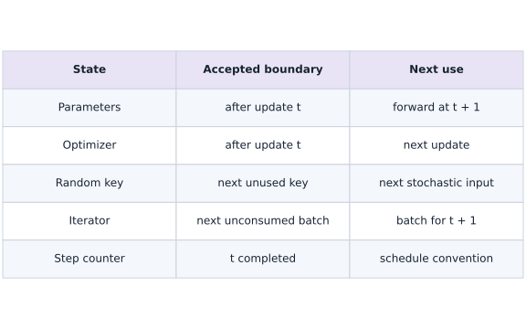
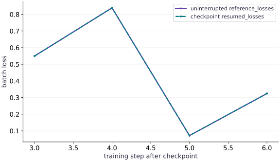

# Recover data position and resume

Phase 06: Data & checkpoint recovery · about 110 minutes · CPU

This worked reference is validated on CPU. Accelerator compatibility requires a separate source review and target execution receipt. Use the execution matrix to review device selection and data ownership before adapting a separate target program.

## What you will be able to do

- Persist model/optimizer/key and Grain iterator position at one boundary.
- Replay across an epoch transition and compare every future batch.
- Diagnose reader-only and model-only restores.
- Reject changed pipeline configuration and state the tested recovery limits.

## The problem

Let’s bring model recovery and data recovery together. We’ll interrupt training after two batches, save both the model state and the next-read position, then continue. Comparing the remaining batches with an uninterrupted run will show whether we really resumed at the same point, including across an epoch boundary.

## The idea

Exact recovery joins numerical state and input-pipeline state at one completed update. Mixing boundaries can repeat or skip examples while producing a plausible training curve.

## Align model time with data time

If saved weights include the C/D update but the iterator still points to C/D, recovery trains on that batch again. If the iterator is one batch too far ahead, it skips data. Both runs can continue without a shape error.

Draw one vertical boundary after an update and align parameters, optimizer, key and cursor with it. The next restored arrow must consume the same examples as the uninterrupted run.

When comparing loss trajectories, align measurement conventions too. A loss before an update and a loss after it describe different states. Compare IDs and state values alongside loss, because similar scalar losses can conceal different training histories.

$$
(k_{t+1}, k_{\text{step}}) = \operatorname{split}(k_t), \qquad i_{t+1} = (i_t + B) \bmod N
$$

### One checkpoint, one completed-step boundary

**Predict:** Why reject a resume even when its first loss nearly matches the reference?



*Architecture and dataflow mechanism diagram.*

Read down the middle column: all state describes the same completed update. Across each row is its next use. An older cursor repeats data and a newer cursor skips it. The table shows logical state, not wall-clock timing.

### Pause and reason

Why reject a resume even when its first loss nearly matches the reference?

<details><summary>Compare your reasoning</summary>

Different data or optimizer state can coincidentally produce similar loss. Exact continuation requires the intended full state and data boundary.

</details>

## Commit one logical boundary

consume retrieves a batch, computes an update and returns the updated training state. After two calls, the model step is two and the iterator points at batch three. We pack that iterator snapshot in the same Orbax payload as the model, Adam memory, random stream and contract.

A real prefetcher may prepare data ahead of consumption; the snapshot semantics must refer to the iterator boundary supported by its implementation. This tutorial uses a serial Grain loader and synchronous checkpointing, so no speculative workers or asynchronous outstanding writes complicate the boundary. Do not extrapolate this protocol to an arbitrary data queue without checking its restore contract.

```text
read batch 1 → update 1
read batch 2 → update 2 → save {state_2,next_read_3}
restore → read batch 3 → update 3
```

## Persist opaque iterator bytes without editing them

Grain get_state returns bytes. We store them as a fixed-size uint8 buffer plus length so the Orbax restore target has a predictable shape. set_state receives the original byte sequence recovered from that buffer. The application does not inspect or patch Grain internal counters.

The buffer capacity is $4096$ bytes and over-capacity snapshots fail. It is a teaching representation, not a general replacement for Grain checkpoint integration handlers. Restore is supported for this tested source/sampler/worker configuration. Changing those settings may invalidate a snapshot, so our contract also records seed, batch size, record count and source revision.

## Audit the future, including an epoch transition

There are twelve records in each of two epochs and three four-example batches per epoch. We checkpoint after two batches. The remaining four batches are the final batch of epoch zero followed by all three batches of epoch one. Compare each future ID vector and each future loss in order, then compare every final state leaf.

Comparing only final loss can miss skipped or repeated observations, particularly on an easy dataset. Comparing only IDs can miss an optimizer/key reset. Comparing only weights can miss a count or random-state error that changes a subsequent step. The combined check targets all three failure classes.

```text
epoch 0: batch 1 | batch 2 | checkpoint | batch 3
epoch 1: batch 4 | batch 5 | batch 6
replay compares IDs + losses + params + Adam + key + step
```

## Define the limits of this recovery claim

The payload contract contains dataset SHA256, source revision, counts, ordering configuration, update configuration, PRNG implementation and package versions. Refuse a mismatch rather than silently announcing a resumed run. This is intentionally stricter than claiming compatibility between arbitrary versions.

The local directory is temporary and the writer is synchronous. The lesson verifies readable files and CPU replay after reconstructing objects in the same process; it does not simulate power loss, a separate machine, multi-host orchestration, async interruption or remote storage behavior. Your portfolio report should state those limits and identify the next failure mode to test. Production use should adopt the library-supported combined handlers/manager and test its completion/recovery boundaries.

## Prepare the data and state

Create main.py in your course workspace. Use the tested course environment and add this block first.

```python
# Step 1 — Prepare the data and state: This setup makes the dataset and software assumptions explicit.
import jax
# Select the CPU backend and virtual device count before initializing JAX.
jax.config.update("jax_platforms","cpu")
import jax.numpy as jnp
import numpy as np
import optax
import orbax.checkpoint as ocp
import tempfile
import json
import hashlib
from pathlib import Path
tx = optax.adam(0.05)
def initial_state():
    params = {"weight":jnp.array(0.,jnp.float32),"bias":jnp.array(0.,jnp.float32)}
    return {"params":params,"optimizer":tx.init(params),
            "key_data":jax.random.key_data(jax.random.key(7,impl="threefry2x32")),
            "step":jnp.array(0,jnp.int32)}
def pack_bytes(raw,capacity=4096):
    if len(raw)>capacity:
        raise ValueError("Snapshot exceeds tutorial fixed-byte capacity")
    buffer = np.zeros(capacity,dtype=np.uint8)
    buffer[:len(raw)] = np.frombuffer(raw,dtype=np.uint8)
    return {"buffer":buffer,"length":np.array(len(raw),dtype=np.int32)}
def unpack_bytes(packed):
    length = int(packed["length"])
    if not 0 <= length <= len(packed["buffer"]):
        raise ValueError("Invalid snapshot length")
    return np.asarray(packed["buffer"],dtype=np.uint8)[:length].tobytes()
def same_tree(left,right):
    assert jax.tree.structure(left)==jax.tree.structure(right)
    for a,b in zip(jax.tree.leaves(left),jax.tree.leaves(right)):
        # Transfer the device result to the host for an independent NumPy comparison.
        host_a,host_b = np.asarray(a),np.asarray(b)
        # Check tensor shape invariant: `host_a.shape==host_b.shape and host_a.dtype==host_b.dtype`
        assert host_a.shape==host_b.shape and host_a.dtype==host_b.dtype
        if np.issubdtype(host_a.dtype,np.integer):
            np.testing.assert_array_equal(host_a,host_b)
        else:
            np.testing.assert_allclose(host_a,host_b,rtol=1e-6,atol=1e-7)
def step(state,x,y):
    # Sample deterministic random values into `key` using an explicit PRNG key.
    key = jax.random.wrap_key_data(state["key_data"],impl="threefry2x32")
    # Create or split explicit PRNG key(s) (`(next_key, sample_key)`) for reproducible randomness.
    next_key,sample_key = jax.random.split(key)
    # Sample deterministic random values into `target_noise` using an explicit PRNG key.
    target_noise = 0.01*jax.random.normal(sample_key,y.shape)
    def objective(params):
        residual = params["weight"]*x+params["bias"]-(y+target_noise)
        return jnp.mean(residual**2)
    value,gradient = jax.value_and_grad(objective)(state["params"])
    updates,opt_state = tx.update(gradient,state["optimizer"],state["params"])
    next_state = {"params":optax.apply_updates(state["params"],updates),
                  "optimizer":opt_state,"key_data":jax.random.key_data(next_key),
                  "step":state["step"]+1}
    return next_state,value
def package_versions():
    import importlib.metadata
    return {name:importlib.metadata.version(name) for name in ("jax","numpy","optax","orbax-checkpoint")}
def encode_contract(contract):
    return pack_bytes(json.dumps(contract,sort_keys=True).encode())
def validate_contract(saved,expected):
    actual = json.loads(unpack_bytes(saved))
    if actual != expected:
        raise ValueError("Checkpoint contract differs: verify dataset, optimizer configuration, key implementation and package versions")
workspace = tempfile.TemporaryDirectory()
root = Path(workspace.name)

import numpy as np
import grain.python as grain
# Module/container class `TutorialSource` encapsulating model parameters and forward pass:
class TutorialSource:
    def __init__(self,count=12):
        self.count = count
    def __len__(self):
        return self.count
    def __getitem__(self,index):
        value = np.float32(index/10)
        return {"id":np.int64(index),"x":value,"y":np.float32(2*value-1)}
    def __repr__(self):
        return f"TutorialSource(v1,n={self.count})"
def make_loader(seed=42,batch_size=4,count=12,drop_remainder=False):
    return grain.DataLoader(
        data_source=TutorialSource(count),
        sampler=grain.IndexSampler(num_records=count,num_epochs=2,shuffle=True,seed=seed),
        operations=[grain.Batch(batch_size,drop_remainder=drop_remainder)],
        worker_count=0)
```

This setup makes the dataset and software assumptions explicit. No external dataset or accelerator is required.

## Build the pipeline or state transition

Append this block to the same file; follow the named state objects through each function.

```python
# Step 2 — Build the pipeline or state transition
def data_contract(seed=42):
    source = TutorialSource()
    values = np.array([[source[i]["x"],source[i]["y"]] for i in range(len(source))],dtype=np.float32)
    return {"schema":1,"seed":seed,"batch_size":4,"count":12,"source":"TutorialSource(v1,n=12)",
            "sha256":hashlib.sha256(values.tobytes()).hexdigest(),
            "learning_rate":0.05,"optimizer":"adam","key_impl":"threefry2x32",
            "versions":dict(package_versions(),grain=__import__("importlib.metadata",fromlist=["version"]).version("grain"))}
def consume(state,iterator,count):
    losses=[]
    orders=[]
    for _ in range(count):
        batch = next(iterator)
        orders.append(batch["id"].copy())
        state,value = step(state,jnp.asarray(batch["x"]),jnp.asarray(batch["y"]))
        losses.append(float(value))
    return state,np.array(losses),orders
contract = data_contract()
reference_iterator = iter(make_loader())
reference_state,_,_ = consume(initial_state(),reference_iterator,2)
payload = {"training":reference_state,"pipeline":pack_bytes(reference_iterator.get_state()),"contract":encode_contract(contract)}
resume_path = root/"completed_step_2"
with ocp.StandardCheckpointer() as cp:
    cp.save(resume_path,payload)
    cp.wait_until_finished()
    restored_payload = cp.restore(resume_path,target={"training":initial_state(),"pipeline":pack_bytes(b""),"contract":encode_contract(contract)})
validate_contract(restored_payload["contract"],contract)
resumed_iterator = iter(make_loader())
resumed_iterator.set_state(unpack_bytes(restored_payload["pipeline"]))
```

The function boundaries expose which inputs determine the next output and which state must be preserved.

## Run the comparison

Append the checks, save main.py and run python main.py. Predict what should agree before running.

```python
# Step 3 — Run the comparison
reference_final,reference_losses,reference_ids = consume(reference_state,reference_iterator,4)
resumed_final,resumed_losses,resumed_ids = consume(restored_payload["training"],resumed_iterator,4)
for a,b in zip(reference_ids,resumed_ids):np.testing.assert_array_equal(a,b)
np.testing.assert_allclose(reference_losses,resumed_losses,rtol=1e-6,atol=1e-7)
same_tree(reference_final,resumed_final)
assert int(resumed_final["step"])==6
print("Restored next four ID batches:",[a.tolist() for a in resumed_ids])
print("Restored next four losses:",resumed_losses.tolist())
print("Full state agrees at step six")
```

The comparison checks the next behavior, not merely whether a save call succeeded.

## Run the example

```python
# Step 1 — Prepare the data and state: This setup makes the dataset and software assumptions explicit.
import jax
# Select the CPU backend and virtual device count before initializing JAX.
jax.config.update("jax_platforms","cpu")
import jax.numpy as jnp
import numpy as np
import optax
import orbax.checkpoint as ocp
import tempfile
import json
import hashlib
from pathlib import Path
tx = optax.adam(0.05)
def initial_state():
    params = {"weight":jnp.array(0.,jnp.float32),"bias":jnp.array(0.,jnp.float32)}
    return {"params":params,"optimizer":tx.init(params),
            "key_data":jax.random.key_data(jax.random.key(7,impl="threefry2x32")),
            "step":jnp.array(0,jnp.int32)}
def pack_bytes(raw,capacity=4096):
    if len(raw)>capacity:
        raise ValueError("Snapshot exceeds tutorial fixed-byte capacity")
    buffer = np.zeros(capacity,dtype=np.uint8)
    buffer[:len(raw)] = np.frombuffer(raw,dtype=np.uint8)
    return {"buffer":buffer,"length":np.array(len(raw),dtype=np.int32)}
def unpack_bytes(packed):
    length = int(packed["length"])
    if not 0 <= length <= len(packed["buffer"]):
        raise ValueError("Invalid snapshot length")
    return np.asarray(packed["buffer"],dtype=np.uint8)[:length].tobytes()
def same_tree(left,right):
    assert jax.tree.structure(left)==jax.tree.structure(right)
    for a,b in zip(jax.tree.leaves(left),jax.tree.leaves(right)):
        # Transfer the device result to the host for an independent NumPy comparison.
        host_a,host_b = np.asarray(a),np.asarray(b)
        # Check tensor shape invariant: `host_a.shape==host_b.shape and host_a.dtype==host_b.dtype`
        assert host_a.shape==host_b.shape and host_a.dtype==host_b.dtype
        if np.issubdtype(host_a.dtype,np.integer):
            np.testing.assert_array_equal(host_a,host_b)
        else:
            np.testing.assert_allclose(host_a,host_b,rtol=1e-6,atol=1e-7)
def step(state,x,y):
    # Sample deterministic random values into `key` using an explicit PRNG key.
    key = jax.random.wrap_key_data(state["key_data"],impl="threefry2x32")
    # Create or split explicit PRNG key(s) (`(next_key, sample_key)`) for reproducible randomness.
    next_key,sample_key = jax.random.split(key)
    # Sample deterministic random values into `target_noise` using an explicit PRNG key.
    target_noise = 0.01*jax.random.normal(sample_key,y.shape)
    def objective(params):
        residual = params["weight"]*x+params["bias"]-(y+target_noise)
        return jnp.mean(residual**2)
    value,gradient = jax.value_and_grad(objective)(state["params"])
    updates,opt_state = tx.update(gradient,state["optimizer"],state["params"])
    next_state = {"params":optax.apply_updates(state["params"],updates),
                  "optimizer":opt_state,"key_data":jax.random.key_data(next_key),
                  "step":state["step"]+1}
    return next_state,value
def package_versions():
    import importlib.metadata
    return {name:importlib.metadata.version(name) for name in ("jax","numpy","optax","orbax-checkpoint")}
def encode_contract(contract):
    return pack_bytes(json.dumps(contract,sort_keys=True).encode())
def validate_contract(saved,expected):
    actual = json.loads(unpack_bytes(saved))
    if actual != expected:
        raise ValueError("Checkpoint contract differs: verify dataset, optimizer configuration, key implementation and package versions")
workspace = tempfile.TemporaryDirectory()
root = Path(workspace.name)

import numpy as np
import grain.python as grain
# Module/container class `TutorialSource` encapsulating model parameters and forward pass:
class TutorialSource:
    def __init__(self,count=12):
        self.count = count
    def __len__(self):
        return self.count
    def __getitem__(self,index):
        value = np.float32(index/10)
        return {"id":np.int64(index),"x":value,"y":np.float32(2*value-1)}
    def __repr__(self):
        return f"TutorialSource(v1,n={self.count})"
def make_loader(seed=42,batch_size=4,count=12,drop_remainder=False):
    return grain.DataLoader(
        data_source=TutorialSource(count),
        sampler=grain.IndexSampler(num_records=count,num_epochs=2,shuffle=True,seed=seed),
        operations=[grain.Batch(batch_size,drop_remainder=drop_remainder)],
        worker_count=0)

# Step 2 — Build the pipeline or state transition
def data_contract(seed=42):
    source = TutorialSource()
    values = np.array([[source[i]["x"],source[i]["y"]] for i in range(len(source))],dtype=np.float32)
    return {"schema":1,"seed":seed,"batch_size":4,"count":12,"source":"TutorialSource(v1,n=12)",
            "sha256":hashlib.sha256(values.tobytes()).hexdigest(),
            "learning_rate":0.05,"optimizer":"adam","key_impl":"threefry2x32",
            "versions":dict(package_versions(),grain=__import__("importlib.metadata",fromlist=["version"]).version("grain"))}
def consume(state,iterator,count):
    losses=[]
    orders=[]
    for _ in range(count):
        batch = next(iterator)
        orders.append(batch["id"].copy())
        state,value = step(state,jnp.asarray(batch["x"]),jnp.asarray(batch["y"]))
        losses.append(float(value))
    return state,np.array(losses),orders
contract = data_contract()
reference_iterator = iter(make_loader())
reference_state,_,_ = consume(initial_state(),reference_iterator,2)
payload = {"training":reference_state,"pipeline":pack_bytes(reference_iterator.get_state()),"contract":encode_contract(contract)}
resume_path = root/"completed_step_2"
with ocp.StandardCheckpointer() as cp:
    cp.save(resume_path,payload)
    cp.wait_until_finished()
    restored_payload = cp.restore(resume_path,target={"training":initial_state(),"pipeline":pack_bytes(b""),"contract":encode_contract(contract)})
validate_contract(restored_payload["contract"],contract)
resumed_iterator = iter(make_loader())
resumed_iterator.set_state(unpack_bytes(restored_payload["pipeline"]))

# Step 3 — Run the comparison
reference_final,reference_losses,reference_ids = consume(reference_state,reference_iterator,4)
resumed_final,resumed_losses,resumed_ids = consume(restored_payload["training"],resumed_iterator,4)
for a,b in zip(reference_ids,resumed_ids):np.testing.assert_array_equal(a,b)
np.testing.assert_allclose(reference_losses,resumed_losses,rtol=1e-6,atol=1e-7)
same_tree(reference_final,resumed_final)
assert int(resumed_final["step"])==6
print("Restored next four ID batches:",[a.tolist() for a in resumed_ids])
print("Restored next four losses:",resumed_losses.tolist())
print("Full state agrees at step six")
```

Expected: The next four ID batches and losses match; parameters, Adam state, continuation key and step agree at step six. One epoch boundary is crossed.

## Loss trajectory parity: uninterrupted vs. checkpoint-resumed run

**Predict:** Predict whether resuming training at step 2 with restored optimizer, iterator, and PRNG state matches an uninterrupted trajectory.



**Recorded CPU computation**

### Read the figure

The uninterrupted and resumed loss curves overlap to machine precision across steps 3 through 6.

### Connect it to the computation

Saving and restoring the step counter, PRNG key, data iterator state, and optimizer moments alongside model weights ensures exact continuation.

```python
# Compare step losses for the 4 post-checkpoint updates (`reference_losses` vs `resumed_losses`):
visual_data = {'kind': 'line', 'x': [3, 4, 5, 6], 'xlabel': 'training step after checkpoint', 'ylabel': 'batch loss', 'series': [{'label': 'uninterrupted reference_losses', 'y': [float(v) for v in reference_losses]}, {'label': 'checkpoint resumed_losses', 'y': [float(v) for v in resumed_losses]}]}
```

## Recorded reference execution

CPU run: 2026-10-20T22:21:40.677925+00:00. JAX 0.9.2.

```text
Restored next four ID batches: [[4, 10, 11, 3], [2, 0, 11, 1], [5, 7, 6, 8], [4, 3, 10, 9]]
Restored next four losses: [0.5496272444725037, 0.8390463590621948, 0.07169045507907867, 0.32427603006362915]
Full state agrees at step six
Restored next four ID batches: [[4, 10, 11, 3], [2, 0, 11, 1], [5, 7, 6, 8], [4, 3, 10, 9]]
Restored next four losses: [0.5496272444725037, 0.8390463590621948, 0.07169045507907867, 0.32427603006362915]
Full state agrees at step six
Missing iterator restore repeats earlier IDs and changes the next loss
Correct IDs alone do not restore the training transition
Rejected incompatible seed
Rejected incompatible sha256
Original run contract remains valid.
Expected batch-configuration mismatch
PASS: recovery-04

```

## Restart only the reader

**Predict before running:** Keep restored training state but start a fresh iterator. Which IDs arrive first, and should the next update match?

```python
# Experiment — Restart only the reader: A model step counter does not automatically seek a data iterator.
fresh = iter(make_loader())
wrong_state,wrong_losses,wrong_ids = consume(restored_payload["training"],fresh,1)
assert not np.array_equal(wrong_ids[0],reference_ids[0])
assert not np.isclose(wrong_losses[0],reference_losses[0],rtol=1e-6,atol=1e-7)
print("Missing iterator restore repeats earlier IDs and changes the next loss")
```

**Expected:** The first batch repeats instead of the saved next batch; the next loss differs.

A model step counter does not automatically seek a data iterator.

## Restore only the reader

**Predict before running:** Replay the correct IDs but initialize model/optimizer/key from scratch. Will losses match?

```python
# Experiment — Restore only the reader
reader_only = iter(make_loader())
reader_only.set_state(unpack_bytes(restored_payload["pipeline"]))
wrong_model,wrong_model_losses,correct_ids = consume(initial_state(),reader_only,1)
np.testing.assert_array_equal(correct_ids[0],reference_ids[0])
assert not np.isclose(wrong_model_losses[0],reference_losses[0],rtol=1e-6,atol=1e-7)
assert int(wrong_model["step"])==1
print("Correct IDs alone do not restore the training transition")
```

**Expected:** IDs agree but loss and step differ.

Input replay and model-state replay are complementary requirements; either alone can look superficially successful.

## Make it yours

Repeat the protocol after one batch and compare the next five batches through step six. Save to a distinct directory.

### How to write this exercise — Step-by-step recipe & starter scaffold

**Key functions & syntax to use:**
- `jnp.allclose(actual, expected, rtol=..., atol=...)` — Checks that two arrays match elementwise within floating-point tolerance.

**Step-by-step implementation plan:**
1. Exercise solution

**Starter code scaffold (fill in the TODOs):**

```python
# Exercise solution
other_iterator = iter(...)  # TODO: compute other_iterator
other_state,_,_ = consume(...)  # TODO: compute other_state,_,_
other_payload = ...  # TODO: compute other_payload
with ocp.StandardCheckpointer() as cp:
    other_path = Path(...)  # TODO: compute other_path
    cp.save(other_path,other_payload)
    cp.wait_until_finished()
    other_saved = cp.restore(...)  # TODO: compute other_saved
other_resumed = iter(...)  # TODO: compute other_resumed
other_resumed.set_state(unpack_bytes(other_saved["pipeline"]))
a,loss_a,ids_a = consume(...)  # TODO: compute a,loss_a,ids_a
b,loss_b,ids_b = consume(...)  # TODO: compute b,loss_b,ids_b
for l,r in zip(ids_a,ids_b):np.testing.assert_array_equal(l,r)
np.testing.assert_allclose(loss_a,loss_b,rtol = ...  # TODO: compute np.testing.assert_allclose(loss_a,loss_b,rtol
same_tree(a,b)
assert int(b["step"])  # TODO: complete assertion check
```

<details><summary>Reference solution</summary>

```python
# Exercise solution
other_iterator = iter(make_loader())
other_state,_,_ = consume(initial_state(),other_iterator,1)
other_payload = {"training":other_state,"pipeline":pack_bytes(other_iterator.get_state()),"contract":encode_contract(contract)}
with ocp.StandardCheckpointer() as cp:
    other_path = Path(tempfile.mkdtemp(dir=root))/"completed_step_1"
    cp.save(other_path,other_payload)
    cp.wait_until_finished()
    other_saved = cp.restore(other_path,target={"training":initial_state(),"pipeline":pack_bytes(b""),"contract":encode_contract(contract)})
other_resumed = iter(make_loader())
other_resumed.set_state(unpack_bytes(other_saved["pipeline"]))
a,loss_a,ids_a = consume(other_state,other_iterator,5)
b,loss_b,ids_b = consume(other_saved["training"],other_resumed,5)
for l,r in zip(ids_a,ids_b):np.testing.assert_array_equal(l,r)
np.testing.assert_allclose(loss_a,loss_b,rtol=1e-6,atol=1e-7)
same_tree(a,b)
assert int(b["step"])==6
```

</details>

## Reject an incompatible resume before consuming data

**Transfer**

Try the saved contract with a changed sampler seed and then a changed dataset fingerprint. Both must fail before training resumes. Verify that the unchanged contract still passes.

<details><summary>Hint</summary>

Use validate_contract on copies of the expected contract; do not rewrite the saved payload.

</details>

### How to write: Reject an incompatible resume before consuming data — Step-by-step recipe & starter scaffold

**Step-by-step implementation plan:**
1. Set up the changed input or configuration parameters requested in the prompt.
2. Run the target function or transformation and assert that the output matches your prediction.

**Starter code scaffold (fill in the TODOs):**

```python
# Reject an incompatible resume before consuming data (Transfer)
for field,value in [('seed',43),('sha256','different-dataset')]:
    incompatible = dict(...)  # TODO: compute incompatible
    try:validate_contract(restored_payload['contract'],incompatible)
    except ValueError:print('Rejected incompatible',field)
    else:raise AssertionError('Incompatible resume was accepted')
validate_contract(restored_payload['contract'],contract)
print('Original run contract remains valid.')
```

<details><summary>Reference solution and reasoning</summary>

```python
# Reject an incompatible resume before consuming data (Transfer)
for field,value in [('seed',43),('sha256','different-dataset')]:
    incompatible=dict(contract,**{field:value})
    try:validate_contract(restored_payload['contract'],incompatible)
    except ValueError:print('Rejected incompatible',field)
    else:raise AssertionError('Incompatible resume was accepted')
validate_contract(restored_payload['contract'],contract)
print('Original run contract remains valid.')
```

Exact state replay only makes sense under a compatible data and update contract. Rejecting a mismatch before consuming a batch keeps an invalid resume from looking like a successful run.

</details>

## Reject changed batch size before consuming

**Challenge**

Pretend the resumed application now uses batch size three. Reject the saved contract before a reader is used, then restore the original configuration and check the next IDs.

<details><summary>Hint</summary>

The stored cursor is interpreted in a particular pipeline configuration.

</details>

### How to write: Reject changed batch size before consuming — Step-by-step recipe & starter scaffold

**Step-by-step implementation plan:**
1. Set up the changed input or configuration parameters requested in the prompt.
2. Run the target function or transformation and assert that the output matches your prediction.

**Starter code scaffold (fill in the TODOs):**

```python
# Reject changed batch size before consuming (Challenge): Changing batching changes consumption semantics.
changed = dict(...)  # TODO: compute changed
try:
    validate_contract(restored_payload["contract"],changed)
except ValueError:
    print("Expected batch-configuration mismatch")
else:
    raise AssertionError("Expected incompatible restore rejection")
validate_contract(restored_payload["contract"],contract)
fixed_reader = iter(...)  # TODO: compute fixed_reader
fixed_reader.set_state(unpack_bytes(restored_payload["pipeline"]))
np.testing.assert_array_equal(next(fixed_reader)["id"],reference_ids[0])
```

<details><summary>Reference solution and reasoning</summary>

```python
# Reject changed batch size before consuming (Challenge): Changing batching changes consumption semantics.
changed = dict(contract,batch_size=3)
try:
    validate_contract(restored_payload["contract"],changed)
except ValueError:
    print("Expected batch-configuration mismatch")
else:
    raise AssertionError("Expected incompatible restore rejection")
validate_contract(restored_payload["contract"],contract)
fixed_reader = iter(make_loader())
fixed_reader.set_state(unpack_bytes(restored_payload["pipeline"]))
np.testing.assert_array_equal(next(fixed_reader)["id"],reference_ids[0])
```

Changing batching changes consumption semantics. Refuse the mismatched configuration instead of assuming that training step two corresponds to the same next examples.

</details>

## Check your understanding

Which evidence supports a consistent restart boundary?

1. The checkpoint directory exists.
2. The next IDs, losses and full training state match the uninterrupted future under a compatible contract.
3. The final loss eventually decreases.

<details><summary>Answer and explanation</summary>

The next IDs, losses and full training state match the uninterrupted future under a compatible contract.

A consistent restart preserves both data position and transition state, not just a readable file or a favorable metric.

</details>

## Diagnose the result

Changing batching changes consumption semantics. Refuse the mismatched configuration instead of assuming that training step two corresponds to the same next examples.

## Carry forward

- Commit one logical boundary
- Persist opaque iterator bytes without editing them
- Audit the future, including an epoch transition
- Define the limits of this recovery claim

## Keep your evidence

Keep the committed model/optimizer/key/iterator snapshot, uninterrupted and resumed batch-ID ledger across the epoch boundary, exact keys/counts, declared floating tolerances and inconsistent model-only/reader-only restart failures.

Save your predictions, modified code, terminal outputs, and reasoning in your engineering portfolio.

## Primary references

- [NumPy Generator permutation](https://numpy.org/doc/stable/reference/random/generated/numpy.random.Generator.permutation.html)
- [Grain DataLoader guide](https://google-grain.readthedocs.io/en/latest/tutorials/data_loader_tutorial.html)
- [Orbax StandardCheckpointer](https://orbax.readthedocs.io/en/latest/api_reference/checkpoint.checkpointers.html)
- [Optax Adam](https://optax.readthedocs.io/en/latest/api/optimizers.html#optax.adam)
- [JAX random key data](https://docs.jax.dev/en/latest/_autosummary/jax.random.key_data.html)

