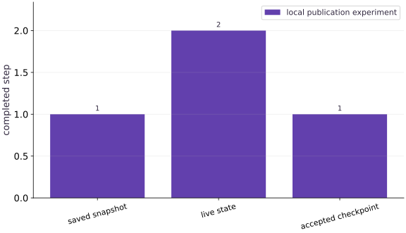

# Asynchronous checkpoints and failure boundaries

Phase 06: Data & checkpoint recovery · about 90 minutes · CPU

This worked reference is validated on CPU. Accelerator compatibility requires a separate source review and target execution receipt. Use the execution matrix to review device selection and data ownership before adapting a separate target program.

**Before this lesson:** [Recover data position and resume](https://www.tahabouhsine.com/jaxpathways/lesson-recovery-04.html).

## What you will be able to do

- Distinguish requested, completed, verified and published checkpoint state.
- Continue a functional update while an asynchronous writer is alive.
- Recover from the last accepted checkpoint after an interrupted publication.
- Surface an asynchronous failure before announcing a checkpoint.

## The problem

Your training loop says “saved,” then the process disappears. Which step can you safely resume? We will separate an asynchronous save request, completed storage work and the application’s announcement of a recoverable checkpoint. You will interrupt publication deliberately and show which state recovery selects.

## The idea

Asynchronous saving overlaps writing with training. A snapshot moves through requested, writing, completed and accepted states. Recovery must select a checkpoint whose completion and validity satisfy the actual storage contract.

## Distinguish a save request from a recovery point

A save request, a completed write, a verified restore, and an application-accepted checkpoint are separate events. In the injected publication failure, step (2)'s directory exists, but the `LATEST` manifest still points to verified step (1). The live state is at step (2), so recovery chooses step (1) and may replay work.

The diagram bars count completed steps, not time: saved snapshot (1), live state (2), accepted checkpoint (1). The gap is work the process completed but the application has not made eligible for recovery. `wait_until_finished()` completes writer work before this example validates and publishes the manifest; completion alone is not acceptance.

$$
t_{\rm request}\le t_{\rm return}\le t_{\rm wait\ done}\le t_{\rm validated}\le t_{\rm published}
$$

### Pause and reason

Can a “save requested” message justify deleting the previous accepted checkpoint?

<details><summary>Compare your reasoning</summary>

No. The replacement may never complete or validate. Retention should preserve a recoverable accepted checkpoint until the replacement meets the acceptance contract.

</details>

## Define a completed training boundary

The teaching state is a weight vector plus its completed-step counter. The code applies a known increment and snapshots step (1); live computation can advance to step (2) without changing the already captured vector. This makes the restore comparison direct instead of relying on a loss that might move unpredictably.

A full training checkpoint must also carry optimizer memory, random state, and the consumed-input position. An asynchronous writer changes when the bytes finish, not which state is required to continue.

## Separate save latency from acceptance

The timer around `save()` records the call's blocking time. A second interval covers the continued update and the remaining wait. In the retained observation, these were about (0.0031) s and (0.0143) s, but they vary by machine and this tiny local fixture does not isolate disk throughput.

Keep the checkpointer alive until its work finishes. Small saves may finish before the caller can observe overlap, so do not require a race. The application invariant is to leave the accepted manifest unchanged until completion and restore checks pass.

## Publish a checkpoint you can actually restore

After the wait, restore against the expected target and compare the saved step and every value with the captured snapshot. Only after that check does the example write a temporary sibling manifest and replace the existing `LATEST` record. The replace keeps a local reader from observing a partially written JSON file.

That local rename is not a general durability or distributed-commit guarantee. Remote object stores, power failures, and concurrent writers need their own supported protocol and failure tests.

## Practice interruption without relying on lucky timing

The injected interruption happens after step (2)'s directory is written but before the application publishes it. The unchanged manifest selects step (1), even though the newer directory is visible. A separate finalization callback failure surfaces from the wait, and no manifest is published for that attempt.

These checks test application ordering and error propagation; they do not reproduce every storage failure. Keep the old accepted point until the new point restores and validates successfully.

## Translate the boundary into an operational rule

Record requested, completed, and accepted steps separately. This run's failed publication leaves accepted step (1) while live work reaches (2); on restart, the application chooses the former and the replay policy accounts for work after it. If a save is outstanding during orderly shutdown, wait for it; abrupt exit resumes from the last accepted artifact.

When a continuation differs, compare data IDs, optimizer state, key, and contract before loosening numerical tolerances. A matching weight vector or bar height alone does not prove the next transition matches.

## Define functional state and publication

Create a Python file in the course environment. Add this block after the preceding block, then run the assembled file.

```python
# Step 1 — Define functional state and publication: The manifest has its own acceptance boundary.
import json
import tempfile
import time
from pathlib import Path
import jax
import jax.numpy as jnp
import numpy as np
import orbax.checkpoint as ocp
root=Path(tempfile.mkdtemp(prefix='jax-async-lesson-'))
def transition(state):
    return {'weight':state['weight']+.25,'step':state['step']+1}
def publish(path, step):
    pending=root/'LATEST.pending'
    # Write the serialized artifact payload to disk.
    pending.write_text(json.dumps({'path':str(path),'step':step}))
    pending.replace(root/'LATEST.json')
def accepted():
    return json.loads((root/'LATEST.json').read_text())
```

The manifest has its own acceptance boundary. State updates return new arrays so later work cannot redefine the snapshot.

## Save, continue and verify

Create a Python file in the course environment. Add this block after the preceding block, then run the assembled file.

```python
# Step 2 — Save, continue and verify
state={'weight':jnp.arange(1024,dtype=jnp.float32),'step':jnp.array(0,jnp.int32)}
snapshot=transition(state)
path=root/'step_1'
t0=time.perf_counter()
with ocp.AsyncCheckpointer(ocp.StandardCheckpointHandler()) as cp:
    cp.save(path,args=ocp.args.StandardSave(snapshot))
    returned=time.perf_counter()
    assert not (root/'LATEST.json').exists()
    live=transition(snapshot)
    cp.wait_until_finished()
    committed=time.perf_counter()
    restored=cp.restore(path,args=ocp.args.StandardRestore(snapshot))
    np.testing.assert_array_equal(restored['weight'],snapshot['weight'])
    assert int(restored['step'])==1 and int(live['step'])==2
    publish(path,1)
report={'save_call_seconds':returned-t0,'remaining_work_and_wait_seconds':committed-returned,
        'accepted_step':accepted()['step'],'live_step':int(live['step'])}
assert report['accepted_step']==1
```

Wait on the real background writer, restore against the snapshot contract and publish only after the comparison passes.

## Interrupt publication deliberately

Create a Python file in the course environment. Add this block after the preceding block, then run the assembled file.

```python
# A deliberately interrupted application publication leaves the previous commit selected.
unpublished=root/'step_2'
with ocp.AsyncCheckpointer(ocp.StandardCheckpointHandler()) as cp:
    cp.save(unpublished,args=ocp.args.StandardSave(live))
    cp.wait_until_finished()
    try:
        raise RuntimeError('injected interruption before updating LATEST')
    except RuntimeError:
        pass
assert accepted()['step']==1
with ocp.StandardCheckpointer() as cp:
    previous=cp.restore(accepted()['path'],target=snapshot)
np.testing.assert_array_equal(previous['weight'],snapshot['weight'])
assert int(previous['step'])==1
print('Checkpoint workspace:',root)
print(json.dumps(report,indent=2))
print('Unpublished step 2 exists; application recovery still selects verified step 1.')
```

The injected application interruption leaves the old accepted checkpoint intact even though a newer directory exists.

## Run the example

```python
# Step 1 — Define functional state and publication: The manifest has its own acceptance boundary.
import json
import tempfile
import time
from pathlib import Path
import jax
import jax.numpy as jnp
import numpy as np
import orbax.checkpoint as ocp
root=Path(tempfile.mkdtemp(prefix='jax-async-lesson-'))
def transition(state):
    return {'weight':state['weight']+.25,'step':state['step']+1}
def publish(path, step):
    pending=root/'LATEST.pending'
    # Write the serialized artifact payload to disk.
    pending.write_text(json.dumps({'path':str(path),'step':step}))
    pending.replace(root/'LATEST.json')
def accepted():
    return json.loads((root/'LATEST.json').read_text())

# Step 2 — Save, continue and verify
state={'weight':jnp.arange(1024,dtype=jnp.float32),'step':jnp.array(0,jnp.int32)}
snapshot=transition(state)
path=root/'step_1'
t0=time.perf_counter()
with ocp.AsyncCheckpointer(ocp.StandardCheckpointHandler()) as cp:
    cp.save(path,args=ocp.args.StandardSave(snapshot))
    returned=time.perf_counter()
    assert not (root/'LATEST.json').exists()
    live=transition(snapshot)
    cp.wait_until_finished()
    committed=time.perf_counter()
    restored=cp.restore(path,args=ocp.args.StandardRestore(snapshot))
    np.testing.assert_array_equal(restored['weight'],snapshot['weight'])
    assert int(restored['step'])==1 and int(live['step'])==2
    publish(path,1)
report={'save_call_seconds':returned-t0,'remaining_work_and_wait_seconds':committed-returned,
        'accepted_step':accepted()['step'],'live_step':int(live['step'])}
assert report['accepted_step']==1

# A deliberately interrupted application publication leaves the previous commit selected.
unpublished=root/'step_2'
with ocp.AsyncCheckpointer(ocp.StandardCheckpointHandler()) as cp:
    cp.save(unpublished,args=ocp.args.StandardSave(live))
    cp.wait_until_finished()
    try:
        raise RuntimeError('injected interruption before updating LATEST')
    except RuntimeError:
        pass
assert accepted()['step']==1
with ocp.StandardCheckpointer() as cp:
    previous=cp.restore(accepted()['path'],target=snapshot)
np.testing.assert_array_equal(previous['weight'],snapshot['weight'])
assert int(previous['step'])==1
print('Checkpoint workspace:',root)
print(json.dumps(report,indent=2))
print('Unpublished step 2 exists; application recovery still selects verified step 1.')
```

Expected: The accepted step remains $1$ while the live state reaches $2$. A real local checkpoint restores the saved vector. Both timing intervals are observed and vary by machine.

## A live step can be ahead of the accepted checkpoint

**Predict:** After the publication interruption, which step will application recovery select?



**Recorded CPU computation**

### Read the figure

The horizontal axis names three state positions and the vertical axis counts completed steps, not seconds. Saved snapshot is at step 1, live state at step 2, and accepted checkpoint at step 1. The equal saved and accepted bars contrast with the live bar, which is one step ahead.

### Connect it to the computation

After the injected publication interruption, the application selects step 1 even though a step-2 directory exists. Use the acceptance manifest and restored vector to choose the recovery point; bar height alone does not verify contents. The timing intervals and surfaced finalization error answer different questions and do not turn this local experiment into a durability measurement.

```python
visual_data={'kind':'bar','labels':['saved snapshot','live state','accepted checkpoint'],'ylabel':'completed step','series':[{'label':'local publication experiment','y':[int(snapshot["step"]),int(live["step"]),report["accepted_step"]]}]}
```

## Recorded reference execution

CPU run: 2026-10-27T17:05:08.241974+00:00. JAX 0.9.2.

```text
Checkpoint workspace: /var/folders/mp/_mq7srqx2y10p5nhjz9m7hj40000gn/T/jax-async-lesson-oukfh9cs
{
  "save_call_seconds": 0.0038282088935375214,
  "remaining_work_and_wait_seconds": 0.017898499965667725,
  "accepted_step": 1,
  "live_step": 2
}
Unpublished step 2 exists; application recovery still selects verified step 1.
Checkpoint workspace: /var/folders/mp/_mq7srqx2y10p5nhjz9m7hj40000gn/T/jax-async-lesson-rlb94myr
{
  "save_call_seconds": 0.0023883748799562454,
  "remaining_work_and_wait_seconds": 0.013635833747684956,
  "accepted_step": 1,
  "live_step": 2
}
Unpublished step 2 exists; application recovery still selects verified step 1.
Expected background failure surfaced: injected finalization callback failure
Step two verified and accepted; next transition agrees.
Missing target rejected; accepted checkpoint unchanged.
PASS: recovery-05

```

## Trigger an asynchronous error

**Predict before running:** If finalization reports an error, should directory existence justify announcing success?

```python
# Experiment — Trigger an asynchronous error: The controlled failure happens in the finalization callback.
def injected_failure():
    raise RuntimeError('injected finalization callback failure')
failed_path=root/'callback_failure'
cp=ocp.AsyncCheckpointer(ocp.StandardCheckpointHandler(),async_options=ocp.options.AsyncOptions(post_finalization_callback=injected_failure))
try:
    cp.save(failed_path,args=ocp.args.StandardSave(live))
    try:
        cp.wait_until_finished()
    except RuntimeError as error:
        assert 'injected' in str(error)
        print('Expected background failure surfaced:',error)
    else:
        raise AssertionError('background error was hidden')
finally:
    cp.close()
assert accepted()['step']==1
```

**Expected:** An intentional error log and caught RuntimeError; the accepted step is unchanged.

The controlled failure happens in the finalization callback. Some storage may already exist; the application still requires successful completion and verification before accepting it.

## Make it yours

Verify and publish the already written second checkpoint. Restore it and compare the next functional transition against the live state. Keep the original snapshot unchanged.

### How to write this exercise — Step-by-step recipe & starter scaffold

**Inputs:**
- The already written second-checkpoint path, its live state, and the original step-one snapshot.

**Outputs:**
- The restored second state, a comparison of its next transition with the live continuation, and a published step-two pointer.

**Invariants to check:**
- The restored step-two state matches the live state; both next transitions agree; the original snapshot remains at step one.

**Hints:**
- Restore the second checkpoint against a target shaped like the live state.
- Publish only after restored values and the next transition have been checked.

**Starter code scaffold (fill in the TODOs):**

```python
import json
from pathlib import Path
import jax.numpy as jnp
import numpy as np
import orbax.checkpoint as ocp

def verify_publish_and_compare(checkpoint_path, live_state, original_snapshot, publish_fn):
    # TODO: Restore step two, compare its next transition with the live continuation, then publish it.
    raise NotImplementedError
```

<details><summary>Reference solution</summary>

```python
# Exercise solution: Verify and publish the already written second checkpoint.
with ocp.StandardCheckpointer() as cp:
    verified=cp.restore(unpublished,target=live)
np.testing.assert_array_equal(verified['weight'],live['weight'])
assert int(verified['step'])==2
publish(unpublished,2)
np.testing.assert_array_equal(transition(verified)['weight'],transition(live)['weight'])
assert accepted()['step']==2 and int(snapshot['step'])==1
print('Step two verified and accepted; next transition agrees.')
```

</details>

## Keep only a genuinely accepted target

**Transfer**

Create a manifest pointing to a nonexistent checkpoint in a disposable variable. Write a preflight that rejects it without replacing the real accepted manifest. Explain why a preflight alone cannot prove numerical correctness.

<details><summary>Hint</summary>

Check path existence and the declared step before restoration; still compare restored contents afterward.

</details>

### How to write: Keep only a genuinely accepted target — Step-by-step recipe & starter scaffold

**Inputs:**
- Create a manifest pointing to a nonexistent checkpoint in a disposable variable. Write a preflight that rejects it without replacing the real accepted manifest. Explain why a preflight alone cannot prove numerical correctness.

**Outputs:**
- Rejected missing target and byte-identical accepted manifest.

**Invariants to check:**
- Preflight failure never publishes or replaces the accepted checkpoint pointer.

**Hints:**
- Check path existence and the declared step before restoration; still compare restored contents afterward.

**Starter code scaffold (fill in the TODOs):**

```python
import json
import tempfile
import time
from pathlib import Path
import jax
import jax.numpy as jnp
import numpy as np
import orbax.checkpoint as ocp

def practice_keep_only_a_genuinely_accepted_target(accepted_manifest, candidate_path):
    """Implement the keep only a genuinely accepted target check."""
    # TODO: Build a disposable manifest for a nonexistent checkpoint and reject it without modifying the accepted manifest.
    raise NotImplementedError
```

<details><summary>Reference solution and reasoning</summary>

```python
# Keep only a genuinely accepted target (Transfer)
def preflight(record):
    if not Path(record['path']).is_dir() or int(record['step'])<0:
        raise ValueError('checkpoint target unavailable')
    return record
before=accepted()
try:preflight({'path':str(root/'never_saved'),'step':99})
except ValueError:pass
else:raise AssertionError('missing target accepted')
assert accepted()==before
preflight(before)
print('Missing target rejected; accepted checkpoint unchanged.')
```

File presence is a necessary local preflight, not proof that metadata, data or training state is correct. The restore comparison supplies the stronger check.

</details>

## Check your understanding

A new checkpoint directory exists but the completion wait raises an exception. Which recovery decision follows this lesson’s protocol?

1. Accept the newest directory immediately.
2. Delete the previous checkpoint because save returned.
3. Retain the previous accepted checkpoint and investigate the failed attempt.

<details><summary>Answer and explanation</summary>

**1. Accept the newest directory immediately.**

Directory creation can precede a failed asynchronous write. A candidate becomes accepted only after completion and validation.

**2. Delete the previous checkpoint because save returned.**

Deleting the last accepted checkpoint removes the recovery path. Retain it until a new candidate has completed and passed validation.

**3. Retain the previous accepted checkpoint and investigate the failed attempt. (correct)**

A directory is not the application’s acceptance signal. Completion, restoration checks and publication must succeed before replacing the previous recovery point.

</details>

## Diagnose the result

If the accepted step is ahead of the restored state, inspect publication order and the saved step counter. If wait raises, keep that error and the last accepted manifest; do not suppress the error and publish anyway.

## Carry forward

- Record save request, completion and acceptance separately.
- Keep the asynchronous writer alive until completion or reported failure.
- Verify a restored next transition before replacing the accepted recovery point.

## Keep your evidence

Keep the requested/completed/accepted step log, the restored snapshot comparison, interrupted-publication result and surfaced finalization error. Explain why directory presence alone is separate from acceptance.

Save your predictions, modified code, terminal outputs, and reasoning in your engineering portfolio.

## Primary references

- [Orbax asynchronous checkpointing](https://orbax.readthedocs.io/en/latest/guides/checkpoint/async_checkpointing.html)

