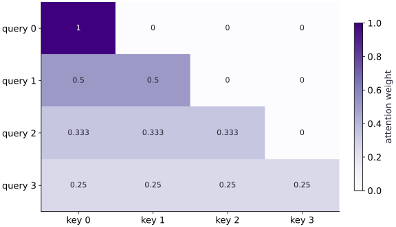

# Masking, tokenization, and sequence packing

Phase 07: Transformers & language models · about 90 minutes · CPU

This worked reference is validated on CPU. Accelerator compatibility requires a separate source review and target execution receipt. Use the execution matrix to review device selection and data ownership before adapting a separate target program.

**Before this lesson:** [Attention from small pieces](https://www.tahabouhsine.com/jaxpathways/lesson-transformers-01.html).

## What you will be able to do

- Build a causal mask from positions
- Keep token IDs and targets aligned
- Combine causal and segment boundaries
- Handle padding without an all-masked softmax

## The problem

An attention head should not always see every token. For example, a next-token model must not peek at the future. We’ll build a causal mask one row at a time, then add padding and boundaries between packed examples. Before training, you’ll be able to explain exactly which positions may read each other.

## The idea

An attention mask controls which positions supply context. A loss mask controls which targets contribute to the objective. Tokenization, target shifting and sequence packing decide the positions to which those different rules apply.

## Keep context eligibility separate from scored targets

Next-token training has two separate questions: what may a position read, and which target contributes to loss? At input position $t$, the target is token $t+1$, so a response-only role flag must follow that shifted target. Otherwise the prompt/response boundary can score the wrong token.

A prompt token can be excluded from direct loss while still influencing a scored response through attention. A blocked attention edge changes context; a loss mask changes supervision. For packed examples, also prevent the next segment from reading the previous one and stop targets at the boundary. Trace one query, its allowed keys, and its shifted target before trusting the batch loss.

### Pause and reason

Why is a triangular mask alone insufficient for packed documents?

<details><summary>Compare your reasoning</summary>

It blocks future positions but can allow one document to attend to another earlier document. Segment eligibility must enforce the intended document separation.

</details>

## Build a causal mask from positions

For query position $i$, the causal rule permits keys $j\le i$, including the diagonal. With equal allowed scores, values $(2,4,8,16)$ give prefix means $2,3,14/3,7.5$, matching the recorded output. The last position sees all four values; earlier positions see shorter prefixes.

Change the final value and check that the first three outputs remain fixed. That counterfactual tests whether future information can leak backward. If you use a strict triangle that excludes the diagonal, input and target alignment must be changed to match.

```text
allowed key columns
query 0: 1 0 0 0
query 1: 1 1 0 0
query 2: 1 1 1 0
query 3: 1 1 1 1
```

## Keep token IDs and targets aligned

Token IDs are positions in a vocabulary table, so the miniature mapping $a\mapsto0,b\mapsto1,c\mapsto2$ turns `abcab` into $[0,1,2,0,1]$. Next-token training pairs inputs $[0,1,2,0]$ with targets $[1,2,0,1]$: each target is one step ahead.

At the end of a packed example, do not use the next unrelated example as its target. Mark the boundary with a separator or an ignored loss position. Larger tokenizers add normalization and subword rules, but the ID and target alignment still needs an explicit check; reject unknown characters rather than silently reusing an ID.

## Combine causal and segment boundaries

A causal triangle only knows order. For packed segment IDs $[0,0,1,1]$, positions 2 and 3 begin a new example, so a valid key must be both earlier-or-equal and in the same segment. With the fixture's values, the outputs are $2,3,8,12$: the second segment averages only its own values, rather than inheriting the earlier segment's mean.

Check both halves of the contract separately: the attention mask blocks cross-segment context, and target eligibility stops next-token loss at the segment edge. Reusing one segment ID for unrelated spans would reconnect them.

## Handle padding without an all-masked softmax

A padded query may have no valid key. Softmax of an all-negative-infinity row has no normalized distribution and can produce NaNs. The code gives such a query a harmless fallback key, then zeros its output and excludes its loss; real queries keep their original allowed keys.

Treat that fallback as numerical bookkeeping, not semantic content. Perturb padded values and verify real outputs stay unchanged. A real query with no valid key should still fail if that state violates the model contract.

## Turn the allowed positions into weights

The heatmap makes the causal rule visible: row $i$ is query $i$, column $j$ is key $j$; a blocked future edge is replaced by negative infinity before softmax and therefore gets zero weight when the row has an allowed key. Allowed scores are unchanged. If a row has no allowed key, the code handles it explicitly instead of asking softmax to normalize an empty set.

This mask sets eligibility, not preference: learned scores can still favor one allowed key over another. After a row is normalized, use its weights with the matching value rows to compute the result.

$$
\widetilde S_{ij}=\begin{cases}S_{ij}&\text{if key }j\text{ is allowed for query }i\\-\infty&\text{otherwise}\end{cases}
$$

## Carry token and segment identity into packed training

The character example isolates index alignment and boundaries. The optional foundations workflow adds reversible UTF-8 bytes and a train-only ByteLevel BPE processor with explicit PAD/BOS/EOS/UNK IDs and byte fallback. Its records are deduplicated and grouped by Project Gutenberg chapter before tokenization; chapters I–IV train, V validates, and VI–VIII remain final test.

Chunk packing records document IDs, preserves each selected text token, masks padding, and blocks attention and next-token loss across document boundaries. Inspect `projects/text-harness/foundations/data.py` and its report counts to verify that each boundary survives preprocessing.

## 1. Prepare the experiment

In the CPU environment from setup, create main.py and add this block. Write down the dimensions and the known result before continuing.

```python
# Step 1 — 1. Prepare the experiment
import jax
import jax.numpy as jnp
import numpy as np
```

These imports provide JAX array transformations and NumPy reference calculations. Define the numerical functions next; the final build block supplies the concrete fixture and checks.

## 2. Implement the mechanism

Append this block in the same file. Follow the shape diagram above and identify each reduction or state transition.

```python
# Step 2 — 2. Implement the mechanism
def masked_mean(values, allowed):
    scores = jnp.where(allowed, 0., -jnp.inf)
    weights = jax.nn.softmax(scores, axis=-1)
    return weights @ values, weights

def make_mask(segment_ids, valid):
    positions = jnp.arange(segment_ids.shape[0])
    causal = positions[:, None] >= positions[None, :]
    same_segment = segment_ids[:, None] == segment_ids[None, :]
    return causal & same_segment & valid[:, None] & valid[None, :]
```

allowed key columns
query $0$: $1$ $0$ $0$ $0$
query $1$: $1$ $1$ $0$ $0$
query $2$: $1$ $1$ $1$ $0$
query $3$: $1$ $1$ $1$ $1$

## 3. Run and check

Append this block and run python main.py. Compare its output with your prediction. An assertion failure means a stated contract needs investigation.

```python
# Step 3 — 3. Run and check: Causal means [2, 3, 4.666667, 7.5]; no weight above the diagonal.
values = jnp.array([[2.], [4.], [8.], [16.]])
causal = jnp.arange(4)[:, None] >= jnp.arange(4)[None, :]
out, weights = masked_mean(values, causal)
assert jnp.allclose(out[:, 0], jnp.array([2., 3., 14/3, 7.5]))
assert jnp.allclose(jnp.triu(weights, 1), 0.)
print("Causal means:", out[:, 0])
```

Causal means $[2, 3, 4.666667, 7.5]$; no weight above the diagonal.

## Run the example

```python
# Step 1 — 1. Prepare the experiment
import jax
import jax.numpy as jnp
import numpy as np

# Step 2 — 2. Implement the mechanism
def masked_mean(values, allowed):
    scores = jnp.where(allowed, 0., -jnp.inf)
    weights = jax.nn.softmax(scores, axis=-1)
    return weights @ values, weights

def make_mask(segment_ids, valid):
    positions = jnp.arange(segment_ids.shape[0])
    causal = positions[:, None] >= positions[None, :]
    same_segment = segment_ids[:, None] == segment_ids[None, :]
    return causal & same_segment & valid[:, None] & valid[None, :]

# Step 3 — 3. Run and check: Causal means [2, 3, 4.666667, 7.5]; no weight above the diagonal.
values = jnp.array([[2.], [4.], [8.], [16.]])
causal = jnp.arange(4)[:, None] >= jnp.arange(4)[None, :]
out, weights = masked_mean(values, causal)
assert jnp.allclose(out[:, 0], jnp.array([2., 3., 14/3, 7.5]))
assert jnp.allclose(jnp.triu(weights, 1), 0.)
print("Causal means:", out[:, 0])
```

Expected: Causal means $[2, 3, 4.666667, 7.5]$; no weight above the diagonal.

## A causal mask blocks future information

**Predict:** Which cells must remain zero?



**Recorded CPU computation**

### Read the figure

Rows are query positions and columns are key positions; cell color encodes attention weight from 0 to 1. The diagonal and cells left of it are eligible, while cells to the right are future positions and have weight exactly zero. Row 0 puts weight 1 on key 0; row 1 splits $0.5/0.5$ across keys 0 and 1; row 2 splits about $1/3$ across keys 0–2; row 3 splits $1/4$ across all four.

### Connect it to the computation

The fixture uses equal scores among the keys that remain eligible, which is why the allowed cells are uniform; a causal mask alone does not impose uniform weights. With values $(2,4,8,16)$, query 2 therefore returns $(2+4+8)/3=14/3$, while the final query returns $7.5$. Its zero at key 3 is the concrete protection against reading the future value 16. Next, perturb that last value and predict which rows can change; only the final query can use it.

```python
visual_data = {'kind': 'heatmap', 'values': weights.tolist(), 'rows': ['query ' + str(i) for i in range(4)], 'columns': ['key ' + str(i) for i in range(4)], 'unit': 'attention weight'}
```

## Recorded reference execution

CPU run: 2026-10-29T13:57:26.696315+00:00. JAX 0.9.2.

```text
Causal means: [2.       3.       4.666667 7.5     ]
Causal means: [2.       3.       4.666667 7.5     ]
PASS: transformers-02

```

## Perturb the future

**Predict before running:** If the last value becomes $1000$, which outputs may change?

```python
# Experiment — Perturb the future
changed = values.at[-1, 0].set(1000.)
changed_out, _ = masked_mean(changed, causal)
assert jnp.allclose(changed_out[:3], out[:3])
assert not jnp.allclose(changed_out[-1], out[-1])
```

**Expected:** Only the last output changes.

Perturbation tests whether earlier representations depend on future information.

## Pack two independent examples

**Predict before running:** What are the means for segments $[0,0,1,1]$?

```python
# Experiment — Pack two independent examples: Causal order alone does not isolate independent packed examples.
segments = jnp.array([0, 0, 1, 1])
valid = jnp.ones(4, dtype=bool)
packed = make_mask(segments, valid)
packed_out, _ = masked_mean(values, packed)
assert jnp.allclose(packed_out[:, 0], jnp.array([2., 3., 8., 12.]))
```

**Expected:** Packed means $[2, 3, 8, 12]$.

Causal order alone does not isolate independent packed examples.

## Make it yours

Encode abcab with a three-character vocabulary. Create shifted inputs/targets, and a loss-eligibility vector for packed segments $[0,0,0,1,1]$ that excludes a cross-segment next-token target.

### How to write this exercise — Step-by-step recipe & starter scaffold

**Inputs:**
- Token IDs, shifted targets, segment IDs, and a validity mask.

**Outputs:**
- A causal attention mask and loss-eligibility mask that respect segment boundaries.

**Invariants to check:**
- No future token or cross-segment token is visible; padded queries have finite zero outputs.

**Hints:**
- Separate attention permission from target-loss eligibility.
- Give all-masked padded queries an explicit fallback before applying the output mask.

**Starter code scaffold (fill in the TODOs):**

```python
import jax.numpy as jnp

def packed_causal_mask(segment_ids, valid):
    """A causal attention mask and loss-eligibility mask that respect segment boundaries."""
    # TODO: Build causal and segment-aware permission masks, then define which shifted targets enter loss.
    raise NotImplementedError
```

<details><summary>Reference solution</summary>

```python
# Exercise solution: Encode abcab with a three-character vocabulary.
vocab = {"a":0, "b":1, "c":2}
ids = jnp.array([vocab[c] for c in "abcab"])
assert jnp.array_equal(ids[:-1], jnp.array([0,1,2,0]))
assert jnp.array_equal(ids[1:], jnp.array([1,2,0,1]))
seg = jnp.array([0,0,0,1,1])
loss_valid = seg[:-1] == seg[1:]
assert jnp.array_equal(loss_valid, jnp.array([True,True,False,True]))
```

</details>

## Repair padding-query NaNs

**Transfer / diagnosis**

Use `valid=[True,True,False,False]`. Reproduce the undefined all-masked rows, then give padded queries a fallback and zero their outputs.

<details><summary>Hint</summary>

Insert a diagonal fallback only for invalid queries.

</details>

### How to write: Repair padding-query NaNs — Step-by-step recipe & starter scaffold

**Inputs:**
- Use `valid=[True,True,False,False]`. Reproduce the undefined all-masked rows, then give padded queries a fallback and zero their outputs.

**Outputs:**
- Finite attention outputs with padded query rows exactly zero.

**Invariants to check:**
- Valid queries preserve their allowed keys; only invalid padded-query rows use the fallback.

**Hints:**
- Insert a diagonal fallback only for invalid queries.

**Starter code scaffold (fill in the TODOs):**

```python
import jax.numpy as jnp

def practice_repair_padding_query_nans(valid, logits):
    """Implement the repair padding-query nans check."""
    # TODO: Create an all-masked padded query, add a numerically safe fallback for that row, and zero its output afterward.
    raise NotImplementedError
```

<details><summary>Reference solution and reasoning</summary>

```python
# Repair padding-query NaNs (Transfer / diagnosis)
pad_valid = jnp.array([True,True,False,False])
pad_mask = make_mask(jnp.zeros(4, dtype=int), pad_valid)
bad_pad, _ = masked_mean(values, pad_mask)
assert not jnp.all(jnp.isfinite(bad_pad))
fallback = (~pad_valid[:, None]) & jnp.eye(4, dtype=bool)
pad_out, _ = masked_mean(values, pad_mask | fallback)
pad_out = jnp.where(pad_valid[:, None], pad_out, 0.)
assert jnp.all(jnp.isfinite(pad_out))
assert jnp.allclose(pad_out[:,0], jnp.array([2.,3.,0.,0.]))
```

A fallback makes normalization defined; zeroing and loss masking retain the semantic padding contract.

</details>

## Detect packed-example leakage

**Transfer / diagnosis**

Compare causal-only and segment-aware outputs at query $2$. Explain which prior values caused the difference.

<details><summary>Hint</summary>

Query $2$ should see only value $8$ from its own segment.

</details>

### How to write: Detect packed-example leakage — Step-by-step recipe & starter scaffold

**Inputs:**
- Compare causal-only and segment-aware outputs at query $2$. Explain which prior values caused the difference.

**Outputs:**
- Two outputs and a boundary-leakage difference check.

**Invariants to check:**
- A packed query attends only to causal keys from its own segment.

**Hints:**
- Query $2$ should see only value $8$ from its own segment.

**Starter code scaffold (fill in the TODOs):**

```python
import jax.numpy as jnp

def practice_detect_packed_example_leakage(segment_ids, values):
    """Implement the detect packed-example leakage check."""
    # TODO: Compare outputs at query two with causal-only and segment-aware masks, then identify the prior-segment values that change the result.
    raise NotImplementedError
```

<details><summary>Reference solution and reasoning</summary>

```python
# Detect packed-example leakage (Transfer / diagnosis)
assert jnp.allclose(out[2,0], 14/3)
assert jnp.allclose(packed_out[2,0], 8.)
assert not jnp.allclose(out[2,0], packed_out[2,0])
```

The earlier values $2$ and $4$ belong to another example; they must be excluded despite being past positions.

</details>

## Check your understanding

What must a packed causal mask enforce?

1. Causal order only
2. Same segment and permitted causal keys, plus explicit padding behavior
3. Equal token IDs

<details><summary>Answer and explanation</summary>

**1. Causal order only**

A causal mask still allows earlier tokens from another packed example. Require the same segment as well as a valid causal position.

**2. Same segment and permitted causal keys, plus explicit padding behavior (correct)**

Packing combines positions in storage, not their semantic context. Segment and validity constraints retain example boundaries.

**3. Equal token IDs**

Equal token IDs do not imply the same example or a valid attention edge. Use segment IDs, positions and padding validity.

</details>

## Diagnose the result

NaN in a padded output can mean that its mask row permits no keys; count allowed keys before blaming the optimizer. Add a fallback only for invalid queries, zero their outputs, and ignore their loss. If a packed output includes another example’s values, inspect equal-segment and causal conditions separately. Recheck the hand-derived $[2,3,8,12]$ result.

## Carry forward

- Perturbation tests whether earlier representations depend on future information.
- Causal order alone does not isolate independent packed examples.

## Keep your evidence

Keep token/target alignment, the two masks, future perturbation, segment-leakage comparison and all-masked-row repair. Verify that masks and ignored loss positions enforce the same boundaries.

Save your predictions, modified code, terminal outputs, and reasoning in your engineering portfolio.

## Primary references

- [JAX softmax API](https://docs.jax.dev/en/latest/_autosummary/jax.nn.softmax.html)
- [JAX attention API](https://docs.jax.dev/en/latest/_autosummary/jax.nn.dot_product_attention.html)
- [Optax cross entropy](https://optax.readthedocs.io/en/latest/api/losses.html)

