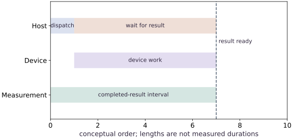
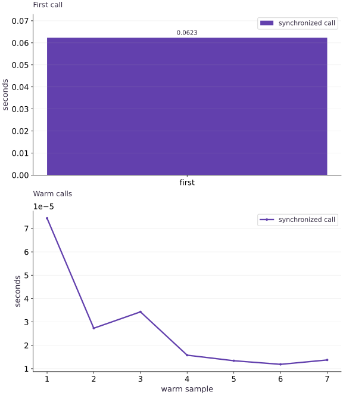

# Benchmark asynchronous work correctly

Phase 08: Performance diagnosis · about 80 minutes · CPU

This reference explicitly selects CPU. Uploading the same file or setting JAX_PLATFORMS does not adapt it to TPU. Use the execution matrix to review device selection and data ownership before adapting a separate target program.

## What you will be able to do

- Draw the interval a timing actually measures.
- Exclude initial placement from a device-resident benchmark.
- Check an independent NumPy result before comparing timings.
- Produce a report containing first-call and warmed sample distributions.

## The problem

A first timing suggests a tenfold speedup. Before celebrating, let’s ask when the timer started and stopped. We’ll separate the first call from warm calls, wait for JAX to finish, and compare numerical results. By the end, you’ll have a timing report another learner can reproduce.

## The idea

JAX can return an array handle before device work finishes. A benchmark must define what starts the interval and what counts as completion. First-call preparation, warm execution and end-to-end requests answer different performance questions.

## Time a completed result

If a timer stops as soon as dispatch returns, it may exclude most of the computation. Blocking on the result inside the interval includes completion of the work required to produce that result.

Warm up the intended specialization before measuring repeated execution, and retain startup separately if it matters to the application. Include preprocessing and transfers in a separately named end-to-end measurement when they belong to the request.

The first-call and warm bars represent different intervals. Their ratio depends on the workload and environment. A short dispatch time is not evidence of device throughput, and a warm kernel timing does not describe an entire service request.

Both observations start with already placed inputs and end with completed outputs. The first call can include tracing, lowering, compilation, dispatch and execution. The warm median is computed from separate repeated calls; subtracting it from the first call does not isolate exact compiler time. For warm observations $[2,3,8]$ milliseconds, report the median $3$ and retain all samples. A first observation of $20$ milliseconds establishes its own elapsed interval, not a measured $17$-millisecond compilation phase.

$$
T_{\rm first}=t_{\rm first,ready}-t_{\rm first,start},\qquad T_{\rm warm}=\operatorname{median}_r(t_{r,\rm ready}-t_{r,\rm start})
$$

### Time the completed result

**Predict:** Where should synchronization occur in completed-result latency measurement?



*Architecture and dataflow mechanism diagram.*

The host dispatches and waits while device work proceeds. The measurement lane includes readiness. Lengths illustrate ordering only and are not measured durations. Compilation and data preparation need separately chosen boundaries when included in a benchmark.

### Pause and reason

Where should synchronization occur in completed-result latency measurement?

<details><summary>Compare your reasoning</summary>

Before stopping the timer. Synchronizing afterward can omit unfinished work from the reported interval.

</details>

## Draw the boundary before starting the clock

For our workload, the input has shape $(64, 32)$, the weights have shape $(32, 16)$, and the result has shape $(64, 16)$. Matrix multiplication contracts the feature dimension, then tanh transforms each prediction. The timer starts after both input arrays are placed on CPU and ready. It stops after the output is ready.

That interval includes Python dispatch, execution and the final wait. It is not an isolated kernel duration. Data generation, initial placement and output conversion to NumPy are outside it. A serving request or data-loading benchmark would deliberately include different boundaries; specify which question your measurement answers.

```text
prepare host arrays → place → wait | start → call → result handle → wait → stop | inspect host values
```

## A handle is not proof of completion

Python can receive a JAX array before its contents finish computing. Reading shape or dtype can use metadata without reading the values. Calling block_until_ready on the result waits for readiness. Converting it to NumPy also requires the values, but adds a host-materialization boundary.

CPU dispatch behavior and workload size may make the difference difficult to see. If a handle-only interval is close to a synchronized interval on this machine, that does not justify removing synchronization from a portable benchmark. Timing two independent calls cannot be subtracted to obtain an exact queue or execution cost.

## First call and steady state answer different questions

A fresh jitted function can trace its Python body, lower the resulting program, obtain an executable and run it. The first-call timer combines these stages. Persistent caches and prior process activity can alter the result, so call it first-call latency for this process rather than an exact compilation measurement.

We then run seven synchronized repeats with identical shapes and dtypes. The list reveals variation; the median gives a compact center. Seven samples are an instructional start, not a confidence interval. Increase repetitions and document contention, power state and process initialization before drawing deployment conclusions.

## Correctness comes before a speed ratio

The NumPy reference uses the same float32 inputs and computes the same matrix product and tanh. Floating-point reduction order can vary, so the comparison permits small absolute and relative differences rather than demanding bit equality. We record maximum absolute error as well.

Comparing a float64 reference against an unreported float32 JAX computation, or comparing different matrix sizes, would mix numerical work with implementation differences. A faster answer to a different problem is not evidence of optimization. Retain both workload contracts and both checks in the report.

## Prepare and place the workload

Create benchmark.py in your activated course environment and add this block.

```python
# Step 1 — Prepare and place the workload: CPU placement and waiting occur before timing.
import json
import platform
import time
import statistics
import numpy as np
import jax
import jax.numpy as jnp
cpu = jax.devices("cpu")[0]
rng = np.random.default_rng(4)
x_host = rng.normal(size=(64, 32)).astype(np.float32)
w_host = rng.normal(size=(32, 16)).astype(np.float32)
# Place `x` explicitly onto the target JAX device.
x = jax.device_put(x_host, cpu)
# Place `w` explicitly onto the target JAX device.
w = jax.device_put(w_host, cpu)
# Wait for device work to finish before timing it or comparing its result on the host.
jax.block_until_ready((x, w))
```

CPU placement and waiting occur before timing. The deterministic host inputs make the numerical check reproducible.

## Define the contract and timer

Append this block to the same file. Run the assembled file with python benchmark.py.

```python
# Step 2 — Define the contract and timer
def predict(x, w):
    return jnp.tanh(x @ w)
# Wrap with `jax.jit` (`compiled_predict`) so XLA traces and compiles the function.
compiled_predict = jax.jit(predict)
def synchronized_samples(fn, args, repeats=7):
    if repeats < 1:
        raise ValueError("at least one repeat is required")
    samples = []
    for _ in range(repeats):
        start = time.perf_counter()
        result = fn(*args)
        # Wait for device work to finish before timing it or comparing its result on the host.
        jax.block_until_ready(result)
        samples.append(time.perf_counter() - start)
    return result, samples
```

The timer accepts arbitrary result pytrees because `jax.block_until_ready` waits across their array leaves. It collects observations without asserting which implementation is faster.

## Separate first call from warm calls

Append this block to the same file. Run the assembled file with python benchmark.py.

```python
# Step 3 — Separate first call from warm calls: The report prints variable measured times.
start = time.perf_counter()
first = compiled_predict(x, w)
# Wait for device work to finish before timing it or comparing its result on the host.
first.block_until_ready()
first_call_seconds = time.perf_counter() - start
result, samples = synchronized_samples(compiled_predict, (x, w))
reference = np.tanh(x_host @ w_host)
# Transfer the device result to the host for an independent NumPy comparison.
np.testing.assert_allclose(np.asarray(result), reference, atol=2e-5, rtol=2e-5)
report = {
    "backend": str(cpu), "jax": jax.__version__, "numpy": np.__version__,
    "python": platform.python_version(), "input_shape": list(x.shape),
    "weight_shape": list(w.shape), "dtype": str(x.dtype),
    "boundary": "input already placed; call plus output synchronization",
    "first_call_seconds": first_call_seconds,
    "warm_samples_seconds": samples, "warm_median_seconds": statistics.median(samples),
    "max_abs_error": float(np.max(np.abs(np.asarray(result) - reference))),
}
assert len(samples) == 7 and all(t >= 0 for t in samples)
print(json.dumps(report, indent=2))
```

The report prints variable measured times. Redirect the full run output to a text file and keep the benchmark script with it.

## Run the example

```python
# Step 1 — Prepare and place the workload: CPU placement and waiting occur before timing.
import json
import platform
import time
import statistics
import numpy as np
import jax
import jax.numpy as jnp
cpu = jax.devices("cpu")[0]
rng = np.random.default_rng(4)
x_host = rng.normal(size=(64, 32)).astype(np.float32)
w_host = rng.normal(size=(32, 16)).astype(np.float32)
# Place `x` explicitly onto the target JAX device.
x = jax.device_put(x_host, cpu)
# Place `w` explicitly onto the target JAX device.
w = jax.device_put(w_host, cpu)
# Wait for device work to finish before timing it or comparing its result on the host.
jax.block_until_ready((x, w))
# Step 2 — Define the contract and timer
def predict(x, w):
    return jnp.tanh(x @ w)
# Wrap with `jax.jit` (`compiled_predict`) so XLA traces and compiles the function.
compiled_predict = jax.jit(predict)
def synchronized_samples(fn, args, repeats=7):
    if repeats < 1:
        raise ValueError("at least one repeat is required")
    samples = []
    for _ in range(repeats):
        start = time.perf_counter()
        result = fn(*args)
        # Wait for device work to finish before timing it or comparing its result on the host.
        jax.block_until_ready(result)
        samples.append(time.perf_counter() - start)
    return result, samples
# Step 3 — Separate first call from warm calls: The report prints variable measured times.
start = time.perf_counter()
first = compiled_predict(x, w)
# Wait for device work to finish before timing it or comparing its result on the host.
first.block_until_ready()
first_call_seconds = time.perf_counter() - start
result, samples = synchronized_samples(compiled_predict, (x, w))
reference = np.tanh(x_host @ w_host)
# Transfer the device result to the host for an independent NumPy comparison.
np.testing.assert_allclose(np.asarray(result), reference, atol=2e-5, rtol=2e-5)
report = {
    "backend": str(cpu), "jax": jax.__version__, "numpy": np.__version__,
    "python": platform.python_version(), "input_shape": list(x.shape),
    "weight_shape": list(w.shape), "dtype": str(x.dtype),
    "boundary": "input already placed; call plus output synchronization",
    "first_call_seconds": first_call_seconds,
    "warm_samples_seconds": samples, "warm_median_seconds": statistics.median(samples),
    "max_abs_error": float(np.max(np.abs(np.asarray(result) - reference))),
}
assert len(samples) == 7 and all(t >= 0 for t in samples)
print(json.dumps(report, indent=2))
```

Expected: A JSON benchmark report: input_shape $[64, 32]$, weight_shape $[32, 16]$, dtype float32, seven nonnegative warmed samples, and a checked maximum error. Times vary by run; there is no required speedup.

## Separate the first call from warm measurements

**Predict:** Why should the first call not be averaged into steady-state latency?



**Recorded CPU computation**

### Read the figure

The upper panel measures the first synchronized call. The lower panel measures repeated warm calls, with sample number on the horizontal axis. Both report seconds, but they have independent vertical scales. Compare the tick values and any scientific-notation multiplier, not the physical heights of the panels.

The recorded first call is much longer than the warm calls. For orientation, $10^{-2}$ seconds is $10$ milliseconds, while $10^{-5}$ seconds is $10$ microseconds. A multiplier printed beside an axis applies to all its tick labels; overlooking it can hide a difference of orders of magnitude.

### Connect it to the computation

The first measurement includes work needed to prepare this specialization, including tracing and compilation. Compatible warm calls reuse it. Each measurement waits for the result, so it includes completed computation rather than only the time needed to dispatch work. Inputs are already placed before this measured boundary.

The warm line shows variation between individual samples. An isolated higher point is a slower sample, not proof of recompilation or a changing model. Read the recorded median alongside the full sample list, and rerun before comparing implementations. These measurements describe this small CPU workload; they are separate from accelerator speed or end-to-end request latency.

```python
visual_data = {'kind': 'panels', 'panels': [{'kind': 'bar', 'title': 'First call', 'labels': ['first'], 'ylabel': 'seconds', 'series': [{'label': 'synchronized call', 'y': [first_call_seconds]}]}, {'kind': 'line', 'title': 'Warm calls', 'x': list(range(1, len(samples) + 1)), 'xlabel': 'warm sample', 'ylabel': 'seconds', 'series': [{'label': 'synchronized call', 'y': samples}]}]}
```

## Recorded reference execution

CPU run: 2026-10-27T12:30:56.205615+00:00. JAX 0.9.2.

```text
{
  "backend": "TFRT_CPU_0",
  "jax": "0.9.2",
  "numpy": "2.4.4",
  "python": "3.14.3",
  "input_shape": [
    64,
    32
  ],
  "weight_shape": [
    32,
    16
  ],
  "dtype": "float32",
  "boundary": "input already placed; call plus output synchronization",
  "first_call_seconds": 0.036204333417117596,
  "warm_samples_seconds": [
    7.50003382563591e-05,
    3.750016912817955e-05,
    1.800013706088066e-05,
    3.7250109016895294e-05,
    4.987511783838272e-05,
    5.308398976922035e-05,
    4.924973472952843e-05
  ],
  "warm_median_seconds": 4.924973472952843e-05,
  "max_abs_error": 2.384185791015625e-07
}
{
  "backend": "TFRT_CPU_0",
  "jax": "0.9.2",
  "numpy": "2.4.4",
  "python": "3.14.3",
  "input_shape": [
    64,
    32
  ],
  "weight_shape": [
    32,
    16
  ],
  "dtype": "float32",
  "boundary": "input already placed; call plus output synchronization",
  "first_call_seconds": 0.024481584317982197,
  "warm_samples_seconds": [
    5.2833929657936096e-05,
    5.116686224937439e-05,
    5.1083043217658997e-05,
    5.104159936308861e-05,
    5.016569048166275e-05,
    5.050003528594971e-05,
    5.5250246077775955e-05
  ],
  "warm_median_seconds": 5.1083043217658997e-05,
  "max_abs_error": 2.384185791015625e-07
}
Handle-only seconds: 1.0541174560785294e-05
Complete-call samples: [3.845803439617157e-05, 4.208320751786232e-05, 1.766672357916832e-05]
Structured samples: [8.029118180274963e-05, 4.858383908867836e-05, 4.933401942253113e-05]
Changed workload: (96, 32) [6.837490946054459e-05, 4.5209191739559174e-05, 5.3999945521354675e-05, 5.299970507621765e-05, 5.5958982557058334e-05]
Energy shape and samples: (64,) [0.00024233339354395866, 0.00019133370369672775, 6.041675806045532e-05, 5.9416983276605606e-05, 5.5208802223205566e-05]
{'boundary': 'placed inputs; warm call plus output wait', 'samples': [3.470899537205696e-05, 4.1250139474868774e-05, 3.954209387302399e-05, 3.795791417360306e-05, 3.0375085771083832e-05]}
PASS: performance-01

```

## Compare handle-only and synchronized boundaries

**Predict before running:** Will the handle-only number necessarily be smaller on this CPU? Which interval guarantees output completion?

```python
# Experiment — Compare handle-only and synchronized boundaries
start = time.perf_counter()
handle = compiled_predict(x, w)
handle_seconds = time.perf_counter() - start
handle.block_until_ready()  # drain this call before the separate comparison
_, complete_samples = synchronized_samples(compiled_predict, (x, w), repeats=3)
print("Handle-only seconds:", handle_seconds)
print("Complete-call samples:", complete_samples)
```

**Expected:** One handle-only interval and three complete-call intervals, all observed rather than fixed.

The separate intervals have different measurement boundaries and noise. Only synchronized samples guarantee completed output before the timer stops; no strict timing ordering is asserted.

## Return structured results without host copies

**Predict before running:** If a function returns predictions and their mean, does waiting for the prediction alone clearly document the readiness of every reported result?

```python
# Experiment — Return structured results without host copies
# Wrap with `jax.jit` (`structured`) so XLA traces and compiles the function.
structured = jax.jit(lambda a, b: {"prediction": jnp.tanh(a @ b), "mean": jnp.mean(jnp.tanh(a @ b))})
# Wait for device work to finish before timing it or comparing its result on the host.
jax.block_until_ready(structured(x, w))
structured_result, structured_times = synchronized_samples(structured, (x, w), 3)
# Transfer the device result to the host for an independent NumPy comparison.
np.testing.assert_allclose(np.asarray(structured_result["prediction"]), reference, atol=2e-5, rtol=2e-5)
# Transfer the device result to the host for an independent NumPy comparison.
np.testing.assert_allclose(np.asarray(structured_result["mean"]), reference.mean(), atol=2e-5, rtol=2e-5)
print("Structured samples:", structured_times)
```

**Expected:** Three timings and independently verified prediction/mean leaves.

A tree-level wait makes the benchmark contract explicit for every array leaf. Host inspection occurs after the timer, so the report describes device-ready computation rather than transfer-inclusive output consumption.

## Make it yours

Repeat the benchmark with $96$ rows while preserving the feature and output dimensions. Keep a separate report rather than overwriting the original workload label.

### How to write this exercise — Step-by-step recipe & starter scaffold

**Inputs:**
- A JAX function, fixed workload, warmup count, and repeat count.

**Outputs:**
- Raw synchronized timings with compilation separated from warmed execution.

**Invariants to check:**
- Every sample waits for completed output; workload shape/dtype and timing boundary are recorded.

**Hints:**
- Call block_until_ready inside each measured interval.
- Use an independent NumPy result for the changed equivalent workload.

**Starter code scaffold (fill in the TODOs):**

```python
import jax.numpy as jnp
import time
import statistics

def synchronized_benchmark(function, arguments, warmup, repeats):
    """Raw synchronized timings with compilation separated from warmed execution."""
    # TODO: Warm the selected JAX function and synchronize every timed result while retaining raw samples.
    raise NotImplementedError
```

<details><summary>Reference solution</summary>

```python
# Exercise solution
larger_host = rng.normal(size=(96, 32)).astype(np.float32)
# Place `larger` explicitly onto the target JAX device.
larger = jax.device_put(larger_host, cpu)
# Wait for device work to finish before timing it or comparing its result on the host.
larger.block_until_ready()
# Wait for device work to finish before timing it or comparing its result on the host.
compiled_predict(larger, w).block_until_ready()
larger_result, larger_times = synchronized_samples(compiled_predict, (larger, w), 5)
# Transfer the device result to the host for an independent NumPy comparison.
np.testing.assert_allclose(np.asarray(larger_result), np.tanh(larger_host @ w_host), atol=2e-5, rtol=2e-5)
print("Changed workload:", larger.shape, larger_times)
```

</details>

## Benchmark a different equivalent workload

**Transfer**

Replace tanh with a row-wise sum of squared predictions, returning one scalar per row. Derive the NumPy reference, warm this new function, collect five synchronized samples and record the changed output shape.

<details><summary>Hint</summary>

Square before reducing the output-feature axis; the result has shape $(64,)$.

</details>

### How to write: Benchmark a different equivalent workload — Step-by-step recipe & starter scaffold

**Inputs:**
- Replace tanh with a row-wise sum of squared predictions, returning one scalar per row. Derive the NumPy reference, warm this new function, collect five synchronized samples and record the changed output shape.

**Outputs:**
- Per-row scalar outputs, NumPy parity, and five completed timing samples.

**Invariants to check:**
- The benchmark synchronizes each output and records the changed output shape.

**Hints:**
- Square before reducing the output-feature axis; the result has shape $(64,)$.

**Starter code scaffold (fill in the TODOs):**

```python
import jax.numpy as jnp
import numpy as np
import time
import statistics

def practice_benchmark_a_different_equivalent_workload(features, weights):
    """Implement the benchmark a different equivalent workload check."""
    # TODO: Implement row-wise squared-sum predictions, derive a NumPy reference, warm the changed function, and collect five synchronized samples.
    raise NotImplementedError
```

<details><summary>Reference solution and reasoning</summary>

```python
# Benchmark a different equivalent workload (Transfer): Changing the computation changes the performance question.
# Wrap with `jax.jit` (`energy`) so XLA traces and compiles the function.
energy = jax.jit(lambda a, b: jnp.sum((a @ b)**2, axis=1))
# Wait for device work to finish before timing it or comparing its result on the host.
energy(x, w).block_until_ready()
energy_result, energy_times = synchronized_samples(energy, (x, w), 5)
# Reduce along axis=1 to compute `energy_reference`.
energy_reference = np.sum((x_host @ w_host)**2, axis=1)
# Check tensor shape invariant: `energy_result.shape == (64,)`
assert energy_result.shape == (64,)
# Transfer the device result to the host for an independent NumPy comparison.
np.testing.assert_allclose(np.asarray(energy_result), energy_reference, atol=2e-3, rtol=2e-5)
print("Energy shape and samples:", energy_result.shape, energy_times)
```

Changing the computation changes the performance question. The shape and independent numerical check prevent a benchmark from accidentally timing an unrelated scalar reduction.

</details>

## Repair a timer that includes setup but omits completion

**Diagnosis**

Inspect the broken timer below conceptually: start; create inputs; call `jit(predict)(inputs)`; stop. Write a repaired runner and show its explicit boundary. Explain which stages the broken interval mixes and misses.

<details><summary>Hint</summary>

Prepare and wait for inputs, reuse one compiled callable, warm it, then synchronize the returned output inside every measured interval.

</details>

### How to write: Repair a timer that includes setup but omits completion — Step-by-step recipe & starter scaffold

**Inputs:**
- Inspect the broken timer below conceptually: start; create inputs; call `jit(predict)(inputs)`; stop. Write a repaired runner and show its explicit boundary. Explain which stages the broken interval mixes and misses.

**Outputs:**
- A runner with separately stated setup and completed-work timing boundaries.

**Invariants to check:**
- The measured interval contains the declared workload and waits for its result.

**Hints:**
- Prepare and wait for inputs, reuse one compiled callable, warm it, then synchronize the returned output inside every measured interval.

**Starter code scaffold (fill in the TODOs):**

```python
import jax.numpy as jnp
import time

def practice_repair_a_timer_that_includes_setup_but_omits_completion(function, arguments):
    """Implement the repair a timer that includes setup but omits completion check."""
    # TODO: Move input creation outside the timed region and block on the output before stopping the clock.
    raise NotImplementedError
```

<details><summary>Reference solution and reasoning</summary>

```python
# Repair a timer that includes setup but omits completion (Diagnosis)
def repaired_benchmark(fn, args):
    # Wait for device work to finish before timing it or comparing its result on the host.
    jax.block_until_ready(args)
    # Wait for device work to finish before timing it or comparing its result on the host.
    jax.block_until_ready(fn(*args))
    result, measured = synchronized_samples(fn, args, 5)
    return {"boundary": "placed inputs; warm call plus output wait", "samples": measured}, result
fixed_report, fixed_result = repaired_benchmark(compiled_predict, (x, w))
# Transfer the device result to the host for an independent NumPy comparison.
np.testing.assert_allclose(np.asarray(fixed_result), reference, atol=2e-5, rtol=2e-5)
assert len(fixed_report["samples"]) == 5
print(fixed_report)
```

The repaired boundary excludes setup, separates warmup and waits before stopping. A speedup cannot be reconstructed from the flawed interval; rerun both implementations under the same contract.

</details>

## Check your understanding

What does the synchronized warmed timer in this lesson measure?

1. Only the accelerator kernel, with all dispatch overhead removed
2. A warmed call including dispatch and waiting for output readiness, excluding prior input placement
3. Exactly the compiler duration

<details><summary>Answer and explanation</summary>

**1. Only the accelerator kernel, with all dispatch overhead removed**

The measured boundary includes host dispatch and the wait. Calling it pure device-kernel time requires a device trace.

**2. A warmed call including dispatch and waiting for output readiness, excluding prior input placement (correct)**

The boundary includes the call and its completion wait. It excludes input placement and does not isolate compiler or kernel stages.

**3. Exactly the compiler duration**

Warmup has already performed compilation for the tested signature. A new shape or static argument may still introduce another compilation.

</details>

## Diagnose the result

If samples vary, first check workload identity, dtype, the warmup call, where synchronization occurs and system contention. Do not change a timer until its start/stop boundary answers the intended question.

## Carry forward

- Keep first-call latency separate from warmed samples.
- Wait for results before reporting completed computation.
- Report numerical equivalence and workload details beside times.

## Keep your evidence

Keep benchmark.py, complete observed JSON/sample output, workload shapes/dtypes, numerical tolerance/error, first-call versus warmed boundaries, changed-workload report and repaired timer explanation.

Save your predictions, modified code, terminal outputs, and reasoning in your engineering portfolio.

## Primary references

- [Benchmarking JAX code](https://docs.jax.dev/en/latest/benchmarking.html)
- [Asynchronous dispatch](https://docs.jax.dev/en/latest/async_dispatch.html)

