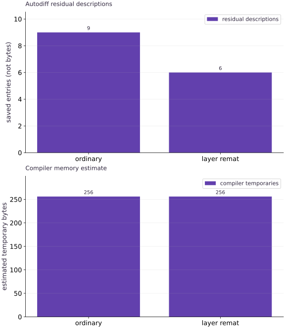

# Memory, rematerialization, and optimization tradeoffs

Phase 08: Performance diagnosis · about 100 minutes · CPU

This worked reference is validated on CPU. Accelerator compatibility requires a separate source review and target execution receipt. Use the execution matrix to review device selection and data ownership before adapting a separate target program.

**Before this lesson:** [Reason with HLO and the roofline model](https://www.tahabouhsine.com/jaxpathways/lesson-performance-04.html).

## What you will be able to do

- Explain why reverse-mode differentiation needs forward intermediates.
- Compare ordinary and rematerialized gradients with an independent reverse recurrence.
- Inspect saved residual descriptions and compiled memory estimates without equating them.
- Measure warm gradient calls and explain why a memory benefit is workload-dependent.

## The problem

A model runs out of memory during differentiation. Someone suggests checkpointing every layer. Will that change the answer, and will it necessarily reduce this program’s memory? We will compare gradients, inspect saved residuals and measure compiled estimates and timings before making that decision.

## The idea

Reverse-mode differentiation needs information from forward execution. Rematerialization recomputes some of that information instead of retaining it. This exchanges storage for work inside a computation and is distinct from saving a training checkpoint to disk.

## Follow an intermediate from creation to last use

During reverse-mode differentiation, a backward rule may need a value produced earlier. Keeping it saves recomputation but extends its lifetime; discarding it can shorten retention if the program recomputes it when needed. Trace one value from creation to last use to predict what a checkpoint boundary can change.

A residual description, a compiler temporary-byte estimate, and peak device memory are separate quantities. The plot has two panels precisely because they need different units and can respond differently.

### Pause and reason

Why might fewer saved values leave compiled memory unchanged?

<details><summary>Compare your reasoning</summary>

The compiler may already eliminate or reuse them, while other temporaries dominate peak usage. Source-level counts do not fully determine compiled buffer lifetimes.

</details>

## Follow one layer backward

For $h=\tanh(xW)$, the local tanh derivative uses the forward output: $1-h^2$. Given an incoming cotangent, multiply by that factor and then by the transposed weight matrix to propagate sensitivity to $x$. Keeping $h$ lets the backward pass reuse it; rematerializing can reconstruct selected values from the input and weights.

The independent NumPy recurrence checks this chain explicitly, giving a numerical reference for the automatic gradient.

$$
\bar x=W^\top\bigl(\bar h\odot(1-h^2)\bigr)
$$

## Choose a boundary around pure work

The example wraps a pure layer in `jax.checkpoint` inside a four-layer objective that sums squared final outputs. Both policies use the same input and weights, so they compare differentiation choices under one workload. Mutation, hidden randomness or side effects would need explicit treatment because recomputation executes the function again.

Choose a boundary around meaningful repeated work. Rematerializing too much can redo most of the objective without removing the values you meant to release.

## Inspect what autodiff saves

`print_saved_residuals` names values retained for differentiation, including a constant $16\times16$ weight matrix and selected 16-element intermediates. In the recorded example, ordinary differentiation lists nine descriptions and layer rematerialization lists six. The decrease confirms that the reported autodiff residual set changed, but entries are not bytes and have different shapes.

Read the shapes as well as the count before predicting storage impact.

## Read compiled memory estimates separately

The compiled gradient's memory report separates argument, output, temporary and alias bytes. In the recorded CPU run, both policies estimate 256 temporary bytes, despite the residual-description count changing from nine to six. That comparison shows no reduction in this compiler-reported category for these input shapes.

Compiler fusion and buffer reuse mediate between autodiff's saved values and compiled storage. If a backend does not provide this analysis, report it as unavailable rather than treating missing data as zero.

## Measure the tradeoff you actually care about

The independent recurrence agrees with both gradients, so the numerical comparison passes for this fixture. Synchronized runtime samples are reported separately; rematerialization can add arithmetic, and these tiny CPU timings vary enough that a strict speed ordering is not a useful decision rule.

To choose a policy for training memory, compare the full representative step on the target device, including optimizer state and inputs. Ask whether it enables the intended batch size while preserving the objective, then verify runtime and model quality.

## Define two differentiation policies

Create a Python file in the course environment. Add this block after the preceding block, then run the assembled file.

```python
# Step 1 — Define two differentiation policies
import contextlib
import io
import time
import numpy as np
import jax
import jax.numpy as jnp
from jax.ad_checkpoint import print_saved_residuals
rng=np.random.default_rng(18)
w=jnp.asarray((rng.normal(size=(16,16))*.1).astype(np.float32))
x=jnp.asarray(np.linspace(-.5,.5,16,dtype=np.float32))
def layer(v):return jnp.tanh(w@v)
def objective(v,rematerialize=False):
    operation=jax.checkpoint(layer) if rematerialize else layer
    for _ in range(4):v=operation(v)
    return jnp.sum(v*v)
plain=lambda v:objective(v,False)
remat=lambda v:objective(v,True)
def residual_report(fn):
    stream=io.StringIO()
    with contextlib.redirect_stdout(stream):print_saved_residuals(fn,x)
    lines=[line for line in stream.getvalue().splitlines() if line.strip()]
    return lines
reports=[residual_report(plain),residual_report(remat)]
```

Both functions compute the same pure objective; only the recomputation boundary differs. The diagnostic records descriptions rather than claiming physical byte savings.

## Verify with an independent reverse pass

Create a Python file in the course environment. Add this block after the preceding block, then run the assembled file.

```python
# Independent reverse recurrence through the same explicitly specified network.
host_w=np.asarray(w)
values=[np.asarray(x)]
for _ in range(4):values.append(np.tanh(host_w@values[-1]))
cotangent=2*values[-1]
for i in range(4,0,-1):cotangent=host_w.T@(cotangent*(1-values[i]**2))
for fn in (plain,remat):
    np.testing.assert_allclose(jax.grad(fn)(x),cotangent,rtol=3e-5,atol=1e-7)
np.testing.assert_allclose(jax.grad(plain)(x),jax.grad(remat)(x),rtol=1e-6,atol=1e-7)
executables=[jax.jit(jax.grad(fn)).lower(x).compile() for fn in (plain,remat)]
memory=[]
times=[]
for executable in executables:
    analysis=executable.memory_analysis()
    memory.append(None if analysis is None else {name:getattr(analysis,name) for name in ('argument_size_in_bytes','output_size_in_bytes','temp_size_in_bytes','alias_size_in_bytes')})
    # Wait for device work to finish before timing it or comparing its result on the host.
    # Wait for device work to finish before timing it or comparing its result on the host.
    executable(x).block_until_ready()
    samples=[]
    for _ in range(5):
        # Wait for device work to finish before timing it or comparing its result on the host.
        # Wait for device work to finish before timing it or comparing its result on the host.
        # Wait for device work to finish before timing it or comparing its result on the host.
        start=time.perf_counter()
        executable(x).block_until_ready()
        samples.append(time.perf_counter()-start)
    times.append(samples)
print('Saved residual descriptions:')
for name,lines in zip(['plain','remat'],reports):print(name,'\n'+'\n'.join(lines))
print('Compiler memory estimates:',memory)
print('Synchronized gradient samples:',times)
print('Independent reverse recurrence agrees with both gradients.')
```

The NumPy recurrence propagates cotangents through saved host activations, providing an oracle independent of JAX differentiation.

## Step 3: Verify invariants on the completed state

Run the final shape and numerical assertions to confirm the state built in Steps 1 and 2.

```python
# Inspect residual live tensors and compare compiler memory and wall-clock gradient samples:
for name, lines in zip(["plain", "remat"], reports):
    print(name, "\n" + "\n".join(lines))
print("Compiler memory estimates:", memory)
print("Synchronized gradient samples:", times)
```

Checking these invariants confirms the computation is ready for the full worked experiment.

## Run the example

```python
# Step 1 — Define two differentiation policies
import contextlib
import io
import time
import numpy as np
import jax
import jax.numpy as jnp
from jax.ad_checkpoint import print_saved_residuals
rng=np.random.default_rng(18)
w=jnp.asarray((rng.normal(size=(16,16))*.1).astype(np.float32))
x=jnp.asarray(np.linspace(-.5,.5,16,dtype=np.float32))
def layer(v):return jnp.tanh(w@v)
def objective(v,rematerialize=False):
    operation=jax.checkpoint(layer) if rematerialize else layer
    for _ in range(4):v=operation(v)
    return jnp.sum(v*v)
plain=lambda v:objective(v,False)
remat=lambda v:objective(v,True)
def residual_report(fn):
    stream=io.StringIO()
    with contextlib.redirect_stdout(stream):print_saved_residuals(fn,x)
    lines=[line for line in stream.getvalue().splitlines() if line.strip()]
    return lines
reports=[residual_report(plain),residual_report(remat)]

# Independent reverse recurrence through the same explicitly specified network.
host_w=np.asarray(w)
values=[np.asarray(x)]
for _ in range(4):values.append(np.tanh(host_w@values[-1]))
cotangent=2*values[-1]
for i in range(4,0,-1):cotangent=host_w.T@(cotangent*(1-values[i]**2))
for fn in (plain,remat):
    np.testing.assert_allclose(jax.grad(fn)(x),cotangent,rtol=3e-5,atol=1e-7)
np.testing.assert_allclose(jax.grad(plain)(x),jax.grad(remat)(x),rtol=1e-6,atol=1e-7)
executables=[jax.jit(jax.grad(fn)).lower(x).compile() for fn in (plain,remat)]
memory=[]
times=[]
for executable in executables:
    analysis=executable.memory_analysis()
    memory.append(None if analysis is None else {name:getattr(analysis,name) for name in ('argument_size_in_bytes','output_size_in_bytes','temp_size_in_bytes','alias_size_in_bytes')})
    # Wait for device work to finish before timing it or comparing its result on the host.
    # Wait for device work to finish before timing it or comparing its result on the host.
    executable(x).block_until_ready()
    samples=[]
    for _ in range(5):
        # Wait for device work to finish before timing it or comparing its result on the host.
        # Wait for device work to finish before timing it or comparing its result on the host.
        # Wait for device work to finish before timing it or comparing its result on the host.
        start=time.perf_counter()
        executable(x).block_until_ready()
        samples.append(time.perf_counter()-start)
    times.append(samples)
print('Saved residual descriptions:')
for name,lines in zip(['plain','remat'],reports):print(name,'\n'+'\n'.join(lines))
print('Compiler memory estimates:',memory)
print('Synchronized gradient samples:',times)
print('Independent reverse recurrence agrees with both gradients.')
```

Expected: Both gradients agree with the independent reverse recurrence. The saved-residual descriptions differ; the small tested CPU program reports equal temporary-memory estimates. Timings vary and no speedup is asserted.

## Changed autodiff storage does not guarantee changed compiled buffers

**Predict:** Must the two panels tell the same story about memory?



**Recorded CPU computation**

### Read the figure

The upper panel's y-axis counts saved autodiff residual descriptions: ordinary differentiation has 9 and layer rematerialization has 6, including a shared constant matrix. These are entries, not bytes. The lower panel's y-axis is compiler-estimated temporary storage in bytes; both recorded bars are 256 bytes for this CPU example. Equal lower bars mean no estimated temporary-byte reduction in this category.

### Connect it to the computation

The independently checked reverse recurrence supports that both policies compute the same gradient on this fixture. The two panels measure different views: rematerialization changes which values autodiff names as residuals, while the compiler still reports 256 temporary bytes for each program. Neither panel measures peak accelerator allocation or total training memory. Next inspect a representative full training step and its target-device memory before choosing a policy.

```python
panels=[{'kind':'bar','title':'Autodiff residual descriptions','labels':['ordinary','layer remat'],'ylabel':'saved entries (not bytes)','series':[{'label':'residual descriptions','y':[len(r) for r in reports]}]}]
if all(m is not None for m in memory):
    panels.append({'kind':'bar','title':'Compiler memory estimate','labels':['ordinary','layer remat'],'ylabel':'estimated temporary bytes','series':[{'label':'compiler temporaries','y':[m['temp_size_in_bytes'] for m in memory]}]})
else:
    panels.append({'kind':'bar','title':'Compiler memory analysis unavailable','labels':['ordinary','layer remat'],'ylabel':'analysis available (1=yes)','series':[{'label':'availability, not byte count','y':[int(m is not None) for m in memory]}]})
visual_data={'kind':'panels','panels':panels}
```

## Recorded reference execution

CPU run: 2026-10-27T17:06:00.920916+00:00. JAX 0.9.2.

```text
Saved residual descriptions:
plain 
f32[16,16] from a constant
f32[16] output of tanh from <string>:15:20 (layer)
f32[16] output of sub from <string>:15:20 (layer)
f32[16] output of tanh from <string>:15:20 (layer)
f32[16] output of sub from <string>:15:20 (layer)
f32[16] output of tanh from <string>:15:20 (layer)
f32[16] output of sub from <string>:15:20 (layer)
f32[16] output of tanh from <string>:15:20 (layer)
f32[16] output of sub from <string>:15:20 (layer)
remat 
f32[16,16] from a constant
f32[16] from the argument v
f32[16] output of tanh from <string>:15:20 (layer)
f32[16] output of tanh from <string>:15:20 (layer)
f32[16] output of tanh from <string>:15:20 (layer)
f32[16] output of tanh from <string>:15:20 (layer)
Compiler memory estimates: [{'argument_size_in_bytes': 64, 'output_size_in_bytes': 64, 'temp_size_in_bytes': 256, 'alias_size_in_bytes': 0}, {'argument_size_in_bytes': 64, 'output_size_in_bytes': 64, 'temp_size_in_bytes': 256, 'alias_size_in_bytes': 0}]
Synchronized gradient samples: [[6.245775148272514e-05, 5.400041118264198e-05, 4.358310252428055e-05, 3.929203376173973e-05, 3.899959847331047e-05], [4.158308729529381e-05, 4.2833853513002396e-05, 6.041722372174263e-05, 5.133310332894325e-05, 3.700004890561104e-05]]
Independent reverse recurrence agrees with both gradients.
plain 
f32[16,16] from a constant
f32[16] output of tanh from <string>:15:20 (layer)
f32[16] output of sub from <string>:15:20 (layer)
f32[16] output of tanh from <string>:15:20 (layer)
f32[16] output of sub from <string>:15:20 (layer)
f32[16] output of tanh from <string>:15:20 (layer)
f32[16] output of sub from <string>:15:20 (layer)
f32[16] output of tanh from <string>:15:20 (layer)
f32[16] output of sub from <string>:15:20 (layer)
remat 
f32[16,16] from a constant
f32[16] from the argument v
f32[16] output of tanh from <string>:15:20 (layer)
f32[16] output of tanh from <string>:15:20 (layer)
f32[16] output of tanh from <string>:15:20 (layer)
f32[16] output of tanh from <string>:15:20 (layer)
Compiler memory estimates: [{'argument_size_in_bytes': 64, 'output_size_in_bytes': 64, 'temp_size_in_bytes': 256, 'alias_size_in_bytes': 0}, {'argument_size_in_bytes': 64, 'output_size_in_bytes': 64, 'temp_size_in_bytes': 256, 'alias_size_in_bytes': 0}]
Synchronized gradient samples: [[6.245775148272514e-05, 5.400041118264198e-05, 4.358310252428055e-05, 3.929203376173973e-05, 3.899959847331047e-05], [4.158308729529381e-05, 4.2833853513002396e-05, 6.041722372174263e-05, 5.133310332894325e-05, 3.700004890561104e-05]]
Saved residual descriptions:
plain 
f32[16,16] from a constant
f32[16] output of tanh from <string>:81:20 (layer)
f32[16] output of sub from <string>:81:20 (layer)
f32[16] output of tanh from <string>:81:20 (layer)
f32[16] output of sub from <string>:81:20 (layer)
f32[16] output of tanh from <string>:81:20 (layer)
f32[16] output of sub from <string>:81:20 (layer)
f32[16] output of tanh from <string>:81:20 (layer)
f32[16] output of sub from <string>:81:20 (layer)
remat 
f32[16,16] from a constant
f32[16] from the argument v
f32[16] output of tanh from <string>:81:20 (layer)
f32[16] output of tanh from <string>:81:20 (layer)
f32[16] output of tanh from <string>:81:20 (layer)
f32[16] output of tanh from <string>:81:20 (layer)
Compiler memory estimates: [{'argument_size_in_bytes': 64, 'output_size_in_bytes': 64, 'temp_size_in_bytes': 256, 'alias_size_in_bytes': 0}, {'argument_size_in_bytes': 64, 'output_size_in_bytes': 64, 'temp_size_in_bytes': 256, 'alias_size_in_bytes': 0}]
Synchronized gradient samples: [[6.358325481414795e-05, 3.262516111135483e-05, 3.1750183552503586e-05, 2.270890399813652e-05, 9.291805326938629e-06], [1.237494871020317e-05, 8.792150765657425e-06, 7.83335417509079e-06, 1.7334241420030594e-05, 1.2707896530628204e-05]]
Independent reverse recurrence agrees with both gradients.
Whole-objective residuals: ['f32[16,16] from a constant', 'f32[16] from the argument v']
Whole-objective memory estimate: CompiledMemoryStats(generated_code_size_in_bytes=0, argument_size_in_bytes=64, output_size_in_bytes=64, alias_size_in_bytes=0, temp_size_in_bytes=256, host_generated_code_size_in_bytes=0, host_argument_size_in_bytes=0, host_output_size_in_bytes=0, host_alias_size_in_bytes=0, host_temp_size_in_bytes=0)
Directional derivative finite/automatic: 0.007404538337141275 0.00740453926846385 epsilon 0.001
Higher-order directional derivatives agree.
PASS: performance-05

```

## Move the boundary to the entire objective

**Predict before running:** Will checkpointing the whole objective preserve the gradient? Does that alone demonstrate useful memory savings?

```python
# Experiment — Move the boundary to the entire objective: Correctness is necessary but does not choose the best policy.
whole=jax.checkpoint(plain)
np.testing.assert_allclose(jax.grad(whole)(x),cotangent,rtol=3e-5,atol=1e-7)
print('Whole-objective residuals:',residual_report(whole))
whole_executable=jax.jit(jax.grad(whole)).lower(x).compile()
print('Whole-objective memory estimate:',whole_executable.memory_analysis())
```

**Expected:** The derivative remains correct; residual and compiled-memory reports describe this additional boundary.

Correctness is necessary but does not choose the best policy. The boundary determines what is retained and recomputed; inspect actual memory and timing for the intended workload.

## Make it yours

Use the direction $v=(1,\ldots,1)$ and central differences to independently check a directional derivative of the original objective at the existing input. Compare it with the gradient dot direction and report the perturbation.

### How to write this exercise — Step-by-step recipe & starter scaffold

**Inputs:**
- The original objective, its existing evaluation point, an all-ones direction, and the finite-difference perturbation.

**Outputs:**
- The central-difference directional derivative, gradient dot direction, and their discrepancy at the stated perturbation.

**Invariants to check:**
- The derivative uses the original objective and existing input; the finite-difference direction is the requested all-ones vector.

**Hints:**
- Evaluate the scalar objective at the point plus and minus epsilon times the direction.
- Compute the autodiff gradient once and take its dot product with the same direction.

**Starter code scaffold (fill in the TODOs):**

```python
import jax
import jax.numpy as jnp

def check_directional_derivative(objective, point, direction, epsilon):
    # TODO: Compare the directional central difference with the gradient dot direction.
    raise NotImplementedError
```

<details><summary>Reference solution</summary>

```python
# Exercise solution
direction=jnp.ones_like(x)
eps=.001
finite=(float(plain(x+eps*direction))-float(plain(x-eps*direction)))/(2*eps)
automatic=float(jnp.vdot(jax.grad(plain)(x),direction))
np.testing.assert_allclose(finite,automatic,rtol=3e-3,atol=1e-6)
print('Directional derivative finite/automatic:',finite,automatic,'epsilon',eps)
```

</details>

## Check higher-order differentiation

**Transfer**

Compare Hessian-vector products of the ordinary and rematerialized objectives along a nonuniform direction. Explain why equal first derivatives alone would be a weaker test.

<details><summary>Hint</summary>

Apply jvp to each gradient function with the same primal point and tangent.

</details>

### How to write: Check higher-order differentiation — Step-by-step recipe & starter scaffold

**Inputs:**
- Compare Hessian-vector products of the ordinary and rematerialized objectives along a nonuniform direction. Explain why equal first derivatives alone would be a weaker test.

**Outputs:**
- Both HVP vectors and an independent parity check.

**Invariants to check:**
- The comparison uses the same point, direction, and objective for both differentiation paths.

**Hints:**
- Apply jvp to each gradient function with the same primal point and tangent.

**Starter code scaffold (fill in the TODOs):**

```python
import jax
import jax.numpy as jnp
import numpy as np
from jax.ad_checkpoint import print_saved_residuals

def practice_check_higher_order_differentiation(objective, point, direction):
    """Implement the check higher-order differentiation check."""
    # TODO: Compare ordinary and rematerialized Hessian-vector products along the nonuniform direction.
    raise NotImplementedError
```

<details><summary>Reference solution and reasoning</summary>

```python
# Check higher-order differentiation (Transfer)
direction=jnp.linspace(-1.,1.,len(x))
_,hvp_plain=jax.jvp(jax.grad(plain),(x,),(direction,))
_,hvp_remat=jax.jvp(jax.grad(remat),(x,),(direction,))
np.testing.assert_allclose(hvp_plain,hvp_remat,rtol=3e-5,atol=1e-7)
assert np.isfinite(np.asarray(hvp_plain)).all()
print('Higher-order directional derivatives agree.')
```

Recomputation should preserve the differentiable function in this pure example, including its higher-order directional behavior. This still is separate from a device-memory improvement.

</details>

## Check your understanding

Rematerialization reduces the number of saved residual descriptions but the compiled temporary-byte estimates are equal. What is the supported conclusion?

1. The compiler’s report must be wrong.
2. The differentiation strategy changed, but this evidence does not show reduced compiled temporary storage.
3. The model must train faster because fewer values were listed.

<details><summary>Answer and explanation</summary>

**1. The compiler’s report must be wrong.**

AD residuals and compiler temporary-buffer estimates describe different stages. Fewer saved intermediates need not lower the reported buffer peak.

**2. The differentiation strategy changed, but this evidence does not show reduced compiled temporary storage. (correct)**

Residual lists and compiler buffer estimates describe different levels. Report the observed equality and investigate the real target workload before claiming a memory or speed benefit.

**3. The model must train faster because fewer values were listed.**

Rematerialization trades storage for recomputation. Measure latency and peak memory separately before claiming an improvement.

</details>

## Diagnose the result

If gradients differ, first compare inputs, weights, random keys and any hidden effects. If memory does not improve, inspect the checkpoint boundary, residual shapes, compiler buffer estimates and full-step peak measurements before adding more checkpoint wrappers.

## Carry forward

- Recomputation trades retained intermediate values for extra work.
- Verify the derivative independently before evaluating a policy.
- Saved values, estimated buffers and measured peak memory must remain distinct.

## Keep your evidence

Keep the plain/rematerialized gradient and HVP comparisons, saved-residual counts, compiler-memory observations and synchronized timings. Explain why fewer residuals do not guarantee lower measured memory.

Save your predictions, modified code, terminal outputs, and reasoning in your engineering portfolio.

## Primary references

- [JAX gradient checkpointing](https://docs.jax.dev/en/latest/gradient-checkpointing.html)
- [JAX benchmarking](https://docs.jax.dev/en/latest/benchmarking.html)

