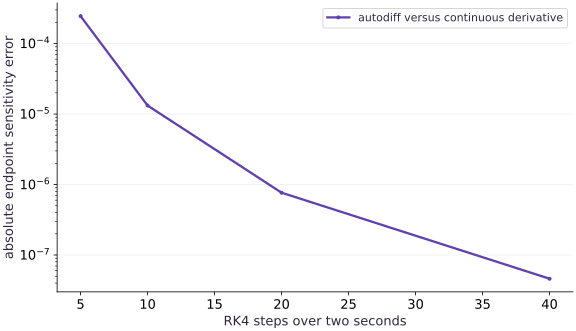

# Differentiate through a solver

Phase 10: Scientific computing · about 105 minutes · CPU

This worked reference is validated on CPU. Accelerator compatibility requires a separate source review and target execution receipt. Use the execution matrix to review device selection and data ownership before adapting a separate target program.

**Before this lesson:** [Vectorize trajectories and scan time](https://www.tahabouhsine.com/jaxpathways/lesson-science-02.html).

## What you will be able to do

- Derive an independent discrete solver sensitivity.
- Check an observation-loss gradient at a nonoptimal parameter.
- Separate derivative implementation error from discretization error.
- Explain static-grid differentiation and the limits of this solver.

## The problem

A simulation can produce a convincing curve and an incorrect sensitivity. Before using gradients to infer a physical parameter, how can we tell whether the derivative is right, and whether it describes the continuous equation closely enough?

## The idea

Differentiating a numerical solver gives sensitivity of its discrete computation. That sensitivity can approach the continuous system's sensitivity as the discretization improves, but the two are not automatically identical at a finite step size.

## Differentiate the computation you actually executed

For the executed RK4 example, the final state is $u_0R(-kh)^N$, where $R$ is the fourth-order step polynomial and $T=Nh=2$ seconds. Differentiating this discrete expression gives the sensitivity of the calculation that actually ran. The continuous model's sensitivity is instead $-Tu_0e^{-kT}$, a different reference at finite step size.

JAX gives $-0.9863878097$; the independently differentiated RK4 expression agrees to float64 roundoff, while the continuous derivative is $-0.9863878558$. That small difference is solver bias, not autodiff failure. Hold the two-second horizon fixed while refining, then check whether the discrete sensitivity approaches the continuous one.

### Pause and reason

Which reference isolates an autodiff implementation error from solver approximation error?

<details><summary>Compare your reasoning</summary>

The derivative of the same discrete update rule. The continuous sensitivity is valuable for convergence, but includes the effect of discretization.

</details>

## Follow one parameter through every time step

Changing $k$ changes every state transition. RK4 on this linear equation is multiplication by $R(-kh)$, so the final state after $N$ steps is $u_0R(-kh)^N$. Differentiate that expression with the chain rule. The derivative includes $-h$, which is easy to lose when differentiating the polynomial. For our parameters it is about $-0.98638781$: increasing the rate lowers the remaining temperature.

$$
\frac{\partial u_N}{\partial k}=u_0N R(-kh)^{N-1}\left[-h\left(1-kh+\frac{(kh)^2}{2}-\frac{(kh)^3}{6}\right)\right]
$$

## Check the discrete derivative before asking about physics

JAX and the polynomial derivative agree to near float64 roundoff. The continuous derivative is $-tu_0e^{-kt}$, approximately $-0.98638786$ at two seconds. Their small difference is expected from the numerical method. A perfect autodiff check cannot remove that bias. Refine the grid and see whether both the state and its sensitivity approach the continuous reference.

## Turn a trajectory into a scalar objective

The loss averages squared errors over all forty-one saved times. Its derivative adds each residual multiplied by the sensitivity of that observation, including the factor of two and mean normalization. The initial observation contributes zero rate sensitivity because the initial value is fixed. Evaluate the gradient away from the optimum: at the optimum, both a broken zero gradient and a correct gradient may look similar.

$$
L(k)=\frac{1}{N+1}\sum_{n=0}^N\left(u_n(k)-y_n\right)^2
$$

## Use a finite-difference window, not one magical epsilon

A central finite difference probes the change in the whole objective. If the perturbation is too large, curvature biases the estimate; if it is too small, subtracting nearly equal floating-point values loses information. Sweep several perturbations and look for a range of agreement. Keep initial state, observations, grid and precision fixed across the comparison. This lesson uses float64; copying its smallest perturbation into a float32 program requires rechecking tolerances.

## Know which solver problem you have solved

The grid is fixed and the output length is static. We have not implemented adaptive error control, event handling, stiffness detection or a custom adjoint. A Python integer controls scan length; a parameter-dependent early exit would introduce a different differentiation problem. For richer systems, Diffrax exposes solver choice, tolerances, saved times and adjoint strategies. Its optional extension belongs in a separately pinned and executed environment; these core CPU checks do not validate that library or an adaptive solver.

## Optional extension: adaptive ODE sensitivities

The project extension solves a forced decay equation with an adaptive Diffrax solver and saves values at requested observation times. Its closed-form solution is $y(t)=\cos t+(y_0-1)e^{-kt}$, so the continuous log-rate sensitivity is $\partial y/\partial\log k=-kt(y_0-1)e^{-kt}$. Reverse-mode autodiff through an adaptive solve differentiates the numerical computation; compare it with the continuous derivative at more than one tolerance. Diffrax defaults to RecursiveCheckpointAdjoint, which supports reverse-mode differentiation; use ForwardMode explicitly for forward-mode JVPs.

$$
y\prime=-k(y-\cos t)-\sin t,\qquad y(t)=\cos t+(y_0-1)e^{-kt},\qquad \frac{\partial y}{\partial\log k}=-kt(y_0-1)e^{-kt}
$$

### Pause and reason

What changes when you tighten the adaptive solver tolerance?

<details><summary>Compare your reasoning</summary>

The sensitivity of the executed numerical solve can approach the continuous derivative as numerical error decreases, but finite tolerances and adaptive step choices still affect the computed derivative.

</details>

## Rebuild the differentiable solver

Append this block to main.py in your CPU course environment; for the first block create the file. Run blocks in order.

```python
# Step 1 — Rebuild the differentiable solver
import jax
# Enable 64-bit arithmetic before importing jax.numpy or creating arrays.
jax.config.update("jax_enable_x64", True)
import jax.numpy as jnp
import numpy as np

def rk4_step(rate, value, dt):
    a = -rate*value
    b = -rate*(value + dt*a/2)
    c = -rate*(value + dt*b/2)
    d = -rate*(value + dt*c)
    return value + dt*(a + 2*b + 2*c + d)/6

# Define `solve(rate, initial, steps, dt)` to carry state across steps with `jax.lax.scan`:
def solve(rate, initial, steps=40, dt=0.05):
    def advance(value, unused):
        next_value = rk4_step(rate, value, dt)
        return next_value, next_value
    _, tail = jax.lax.scan(advance, initial, None, length=steps)
    return jnp.concatenate((jnp.atleast_1d(initial), tail))
```

The solver remains a pure JAX function with a static number of scan steps. No host conversion occurs inside the differentiated calculation.

## Check the derivative of the discrete endpoint

Append this block to main.py in your CPU course environment; for the first block create the file. Run blocks in order.

```python
# Step 2 — Check the derivative of the discrete endpoint: Autodiff gives the derivative of the actual RK4 program.
rate, initial, steps, dt = 0.7, jnp.array(2.0), 40, 0.05
endpoint = lambda k: solve(k,initial,steps,dt)[-1]
autodiff = float(jax.grad(endpoint)(rate))
z = -rate*dt
r = 1+z+z*z/2+z**3/6+z**4/24
dr_dk = -dt*(1+z+z*z/2+z**3/6)
discrete_gradient = 2.0*steps*r**(steps-1)*dr_dk
continuous_gradient = -2.0*(steps*dt)*np.exp(-rate*steps*dt)
np.testing.assert_allclose(autodiff,discrete_gradient,rtol=1e-11,atol=1e-12)
np.testing.assert_allclose(autodiff,continuous_gradient,rtol=1e-7)
print("Autodiff:",autodiff,"discrete oracle:",discrete_gradient,"continuous oracle:",continuous_gradient)
```

Autodiff gives the derivative of the actual RK4 program. Compare first against the discrete polynomial derivative, then assess how closely that approximates the continuous sensitivity.

## Differentiate an observation loss and check its direction

Append this block to main.py in your CPU course environment; for the first block create the file. Run blocks in order.

```python
# Step 3 — Differentiate an observation loss and check its direction: The candidate rate is too large.
times = jnp.arange(steps+1)*dt
observations = 2.0*jnp.exp(-0.7*times)
def objective(k):
    return jnp.mean((solve(k,initial,steps,dt)-observations)**2)
probe = 1.0
value, derivative = jax.value_and_grad(objective)(probe)
epsilon = 1e-4
finite_difference = (float(objective(probe+epsilon))-float(objective(probe-epsilon)))/(2*epsilon)
np.testing.assert_allclose(derivative,finite_difference,rtol=2e-7,atol=1e-10)
assert float(derivative) > 0
assert float(objective(probe-0.1*derivative)) < float(value)
print("Loss:",float(value),"gradient:",float(derivative),"finite difference:",finite_difference)
```

The candidate rate is too large. Its predictions decay too quickly. A positive loss derivative tells gradient descent to decrease the rate, consistent with that physical diagnosis.

## Run the example

```python
# Step 1 — Rebuild the differentiable solver
import jax
# Enable 64-bit arithmetic before importing jax.numpy or creating arrays.
jax.config.update("jax_enable_x64", True)
import jax.numpy as jnp
import numpy as np

def rk4_step(rate, value, dt):
    a = -rate*value
    b = -rate*(value + dt*a/2)
    c = -rate*(value + dt*b/2)
    d = -rate*(value + dt*c)
    return value + dt*(a + 2*b + 2*c + d)/6

# Define `solve(rate, initial, steps, dt)` to carry state across steps with `jax.lax.scan`:
def solve(rate, initial, steps=40, dt=0.05):
    def advance(value, unused):
        next_value = rk4_step(rate, value, dt)
        return next_value, next_value
    _, tail = jax.lax.scan(advance, initial, None, length=steps)
    return jnp.concatenate((jnp.atleast_1d(initial), tail))

# Step 2 — Check the derivative of the discrete endpoint: Autodiff gives the derivative of the actual RK4 program.
rate, initial, steps, dt = 0.7, jnp.array(2.0), 40, 0.05
endpoint = lambda k: solve(k,initial,steps,dt)[-1]
autodiff = float(jax.grad(endpoint)(rate))
z = -rate*dt
r = 1+z+z*z/2+z**3/6+z**4/24
dr_dk = -dt*(1+z+z*z/2+z**3/6)
discrete_gradient = 2.0*steps*r**(steps-1)*dr_dk
continuous_gradient = -2.0*(steps*dt)*np.exp(-rate*steps*dt)
np.testing.assert_allclose(autodiff,discrete_gradient,rtol=1e-11,atol=1e-12)
np.testing.assert_allclose(autodiff,continuous_gradient,rtol=1e-7)
print("Autodiff:",autodiff,"discrete oracle:",discrete_gradient,"continuous oracle:",continuous_gradient)

# Step 3 — Differentiate an observation loss and check its direction: The candidate rate is too large.
times = jnp.arange(steps+1)*dt
observations = 2.0*jnp.exp(-0.7*times)
def objective(k):
    return jnp.mean((solve(k,initial,steps,dt)-observations)**2)
probe = 1.0
value, derivative = jax.value_and_grad(objective)(probe)
epsilon = 1e-4
finite_difference = (float(objective(probe+epsilon))-float(objective(probe-epsilon)))/(2*epsilon)
np.testing.assert_allclose(derivative,finite_difference,rtol=2e-7,atol=1e-10)
assert float(derivative) > 0
assert float(objective(probe-0.1*derivative)) < float(value)
print("Loss:",float(value),"gradient:",float(derivative),"finite difference:",finite_difference)
```

Expected: Endpoint autodiff approximately -0.9863878097; continuous reference approximately -0.9863878558. The loss gradient agrees with central differences and decreases the loss when subtracted.

## A solver gradient converges toward the physical sensitivity

**Predict:** How much should the gradient error fall when a fourth-order method doubles its steps?



**Recorded CPU computation**

### Read the figure

The horizontal axis is the number of RK4 updates over a fixed two-second horizon. The vertical axis is absolute endpoint derivative error relative to the exact continuous sensitivity, in excess-temperature units per rate unit, on a logarithmic scale. The plotted errors fall from about $2.449\times10^{-4}$ at 5 steps to $4.609\times10^{-8}$ at 40 steps; the last doubling improves the error by about 16.6 times, consistent with fourth-order behavior over this range.

### Connect it to the computation

The plotted derivative is JAX autodiff through the discrete `scan`; the reference is $-tu_0e^{-kt}$ for the continuous cooling equation. A separate polynomial oracle checks that autodiff differentiated the RK4 computation correctly. If we compared only against that discrete oracle, we would validate differentiation but miss physical-sensitivity bias; if the system were stiff or the precision fixed at a coarser value, this refinement trend need not continue.

```python
counts=[5,10,20,40]
errors=[abs(float(jax.grad(lambda k: solve(k,jnp.array(2.0),n,2.0/n)[-1])(0.7))+4*np.exp(-1.4)) for n in counts]
visual_data={'kind':'line','x':counts,'xlabel':'RK4 steps over two seconds','ylabel':'absolute endpoint sensitivity error','yscale':'log','series':[{'label':'autodiff versus continuous derivative','y':errors}]}
```

## Recorded reference execution

CPU run: 2026-10-29T13:58:00.448338+00:00. JAX 0.9.2.

```text
Autodiff: -0.9863878096749447 discrete oracle: -0.9863878096749429 continuous oracle: -0.9863878557664257
Loss: 0.04837454286198381 gradient: 0.2686922266772409 finite difference: 0.26869222316237146
Autodiff: -0.9863878096749447 discrete oracle: -0.9863878096749429 continuous oracle: -0.9863878557664257
Loss: 0.04837454286198381 gradient: 0.2686922266772409 finite difference: 0.26869222316237146
Sensitivity errors: [np.float64(0.0002448795513753099), np.float64(1.3192617195456613e-05), np.float64(7.654351459329689e-07), np.float64(4.6091481076260266e-08)]
Finite-difference absolute errors: [3.515348206362123e-05, 3.5151551858181307e-07, 3.514869451048952e-09, 3.5118241648035564e-11, 1.1179057679555626e-11]
Rate and initial-state sensitivities: -2.695973769291141 0.44932896460456245
Weighted derivative reference: 0.30367311533053687
Detached autodiff is zero; actual value sensitivity: 0.26869222316237146
PASS: science-03

```

## Watch derivative discretization error shrink

**Predict before running:** When doubling the number of RK4 steps, should the gradient become closer to the analytic sensitivity?

```python
# Experiment — Watch derivative discretization error shrink
step_counts = np.array([5,10,20,40])
gradient_errors = []
for n in step_counts:
    numerical = jax.grad(lambda k: solve(k,jnp.array(2.0),int(n),2.0/int(n))[-1])(0.7)
    gradient_errors.append(abs(float(numerical)-continuous_gradient))
assert np.all(np.diff(gradient_errors) < 0)
assert 12 < gradient_errors[-2]/gradient_errors[-1] < 20
print("Sensitivity errors:",gradient_errors)
```

**Expected:** Errors approximately [2.449e-4, 1.319e-5, 7.654e-7, 4.609e-8].

Fourth-order convergence becomes visible as an error ratio near sixteen when the step is halved. Roundoff will eventually limit this trend.

## Sweep central-difference perturbations

**Predict before running:** Will the smallest perturbation necessarily be the most accurate?

```python
# Experiment — Sweep central-difference perturbations: Use the measured errors to select a tolerance.
epsilons = [1e-2,1e-3,1e-4,1e-5,1e-6]
fd_errors=[]
for eps in epsilons:
    fd=(float(objective(probe+eps))-float(objective(probe-eps)))/(2*eps)
    fd_errors.append(abs(fd-float(derivative)))
assert min(fd_errors) < 1e-8
print("Finite-difference absolute errors:",fd_errors)
```

**Expected:** There is a useful agreement window; very small perturbations eventually encounter subtraction error.

Use the measured errors to select a tolerance. Do not require every epsilon to improve monotonically.

## Make it yours

Change the initial value to $3$ and the rate to $0.4$. Verify the endpoint gradient against the continuous derivative, then check the derivative with respect to the initial value as well.

### How to write this exercise — Step-by-step recipe & starter scaffold

**Inputs:**
- RK4 endpoint solver, initial value 3.0, rate 0.4, and the lesson final time.

**Outputs:**
- Endpoint derivatives with respect to rate and initial value.
- An analytic continuous-time comparison for both sensitivities.

**Invariants to check:**
- The rate derivative matches -t*u0*exp(-rate*t) within numerical tolerance.
- The initial-value derivative matches exp(-rate*t).
- Derivatives are taken through the discrete solver before comparison with the continuous reference.

**Hints:**
- Differentiate the actual discrete endpoint with respect to each input separately.
- Use the same final time in the two analytic sensitivity formulas.

**Starter code scaffold (fill in the TODOs):**

```python
import numpy as np
import jax
import jax.numpy as jnp

def endpoint_sensitivities(solve_endpoint, final_time, initial=3.0, rate=0.4):
    # TODO: differentiate the discrete endpoint with respect to both inputs.
    # Compare each result with its continuous-time sensitivity.
    raise NotImplementedError("Check rate and initial-state endpoint sensitivities")
```

<details><summary>Reference solution</summary>

```python
# Exercise solution: Change the initial value to 3 and the rate to 0.4.
changed_rate, changed_initial = 0.4, 3.0
g_rate = jax.grad(lambda k: solve(k,jnp.array(changed_initial))[-1])(changed_rate)
g_initial = jax.grad(lambda u: solve(changed_rate,u)[-1])(changed_initial)
np.testing.assert_allclose(g_rate,-2*changed_initial*np.exp(-0.8),rtol=1e-7)
np.testing.assert_allclose(g_initial,np.exp(-0.8),rtol=1e-8)
print("Rate and initial-state sensitivities:",float(g_rate),float(g_initial))
```

</details>

## Weight observations without losing normalization

**Practice**

Differentiate a weighted observation loss that emphasizes late times. Compare with a NumPy chain-rule reference built from the RK4 polynomial.

<details><summary>Hint</summary>

Weights change the observation importance and must be normalized explicitly.

</details>

### How to write: Weight observations without losing normalization — Step-by-step recipe & starter scaffold

**Inputs:**
- Observation times, weights emphasizing later observations, initial value, and a rate parameter.

**Outputs:**
- Weighted observation-loss gradient and an independent NumPy chain-rule value.

**Invariants to check:**
- Normalization uses the sum of observation weights.
- The independent path differentiates the RK4 polynomial rather than calling JAX autodiff.

**Hints:**
- Write the weighted residual loss explicitly.
- Propagate a scalar derivative through each RK4 stage in the reference calculation.

**Starter code scaffold (fill in the TODOs):**

```python
import numpy as np
import jax
import jax.numpy as jnp

def weighted_loss_gradient(times, observations, weights, initial, rate):
    # TODO: define the weighted loss and build an independent RK4 derivative check.
    raise NotImplementedError("Preserve weighted-loss normalization and independent derivative check")
```

<details><summary>Reference solution and reasoning</summary>

```python
# Weight observations without losing normalization (Practice)
weights=np.linspace(0.2,2.0,41)
def weighted_objective(k):
    residual=solve(k,jnp.array(2.0))-observations
    return jnp.sum(jnp.asarray(weights)*residual**2)/np.sum(weights)
k=1.0
h=0.05
n=np.arange(41)
z=-k*h
r=1+z+z*z/2+z**3/6+z**4/24
dr=-h*(1+z+z*z/2+z**3/6)
u=2*r**n
sensitivity=2*n*r**np.maximum(n-1,0)*dr
reference=np.sum(2*weights*(u-np.asarray(observations))*sensitivity)/weights.sum()
np.testing.assert_allclose(jax.grad(weighted_objective)(k),reference,rtol=1e-11,atol=1e-12)
print("Weighted derivative reference:",reference)
```

The independent expression checks reduction normalization and the derivative at every saved time, rather than only the endpoint.

</details>

## Diagnose a detached backward path

**Challenge**

Reproduce an accidentally detached simulation and explain why a finite-difference test catches it.

<details><summary>Hint</summary>

stop_gradient preserves values but removes their derivative.

</details>

### How to write: Diagnose a detached backward path — Step-by-step recipe & starter scaffold

**Inputs:**
- The decay solver, observations generated for initial value 2.0, and scalar rate parameter.
- A differentiable objective and the same objective with its simulated prediction detached.
- Parameter point 1.0 and centered finite-difference step 1e-4.

**Outputs:**
- Autodiff gradients for attached and detached objectives.
- Centered finite-difference estimate exposing the detached-path error.

**Invariants to check:**
- The detached autodiff path can be zero while the objective value still changes with the parameter.
- Centered finite differences use the same held observations and initial state.

**Hints:**
- Keep the forward objective identical and detach only its simulated prediction in the intentionally broken variant.
- Compare autodiff with a centered difference around the stated parameter.

**Starter code scaffold (fill in the TODOs):**

```python
import jax
import jax.numpy as jnp

def diagnose_detached_path(solve, observations, parameter=1.0, initial=2.0, epsilon=1e-4):
    # TODO: compare attached and detached autodiff with a centered difference.
    raise NotImplementedError("Find the gradient path severed by stop_gradient")
```

<details><summary>Reference solution and reasoning</summary>

```python
# Diagnose a detached backward path (Challenge): A plausible forward curve does not validate backward behavior.
def detached_objective(k):
    prediction=jax.lax.stop_gradient(solve(k,jnp.array(2.0)))
    return jnp.mean((prediction-observations)**2)
assert float(jax.grad(detached_objective)(1.0)) == 0.0
fd=(float(detached_objective(1.0001))-float(detached_objective(0.9999)))/0.0002
assert abs(fd)>1e-3
print("Detached autodiff is zero; actual value sensitivity:",fd)
```

A plausible forward curve does not validate backward behavior. Remove an unintended gradient barrier and repeat the independent check.

</details>

## Check adaptive log-rate sensitivity at multiple tolerances

**Optional extension**

In the isolated Diffrax environment, evaluate the numerical derivative with respect to $\log k$ at $k=1.1$, $y_0=2.4$, and the stated observation grid. Compare all requested tolerances with the continuous derivative and a centered finite difference. Explain why agreement can improve as tolerances tighten without making the finite-tolerance solve identical to the continuous system.

<details><summary>Hint</summary>

The chain rule gives $\partial y/\partial\log k=k\,\partial y/\partial k$. Differentiate the numerical solve at each tolerance; compute the analytic reference from the closed form, not from another solver call.

</details>

### How to write: Check adaptive log-rate sensitivity at multiple tolerances — Step-by-step recipe & starter scaffold

**Inputs:**
- Rate 1.1, initial state 2.4, observation times from 0 to 2, and tolerances 1e-5, 1e-8, and 1e-10.
- The optional project API `log_rate_sensitivity(log_rate, initial, times, solver, rtol, atol)`.
- The optional project API `solve_forced_decay(rate, initial, times, solver, rtol, atol)` for numerical centered differences.

**Outputs:**
- Numerical dy/dlog(k) at each requested time for every tolerance.
- Maximum error against the continuous derivative and centered finite difference for each tolerance.

**Invariants to check:**
- The differentiated parameter is log(k), so the positive rate equals exp(log_rate).
- All evaluations return one finite sensitivity per requested time in the input order.
- The continuous reference is -k*t*(y0-1)*exp(-k*t) and is calculated independently of Diffrax.

**Hints:**
- Use the same observation grid for all tolerance settings.
- Use a symmetric perturbation in log(k) for the finite-difference check.

**Starter code scaffold (fill in the TODOs):**

```python
import numpy as np

def compare_adaptive_sensitivities(log_rate_sensitivity, solve_forced_decay, rate, initial, times, tolerances):
    # TODO: evaluate the submitted sensitivity API and compare with independent references.
    raise NotImplementedError("Compare numerical and continuous log-rate sensitivities")
```

<details><summary>Reference solution and reasoning</summary>

```python
import numpy as np

def compare_adaptive_sensitivities(log_rate_sensitivity, solve_forced_decay, rate, initial, times, tolerances):
    times = np.asarray(times, dtype=np.float64)
    if times.ndim != 1 or not np.isfinite(times).all():
        raise ValueError("times must be a finite vector starting at zero")
    analytic = -rate * times * (initial - 1.0) * np.exp(-rate * times)
    epsilon = 2e-5
    results = {}
    for tolerance in tolerances:
        values = np.asarray(log_rate_sensitivity(
            np.log(rate), initial, times, rtol=tolerance, atol=tolerance * 1e-2
        ))
        plus = solve_forced_decay(
            rate * np.exp(epsilon), initial, times, rtol=tolerance, atol=tolerance * 1e-2
        )
        minus = solve_forced_decay(
            rate * np.exp(-epsilon), initial, times, rtol=tolerance, atol=tolerance * 1e-2
        )
        if not plus["success"] or not minus["success"]:
            raise RuntimeError("finite-difference solve failed")
        finite_difference = (plus["values"] - minus["values"]) / (2.0 * epsilon)
        if values.shape != times.shape or not np.isfinite(values).all():
            raise ValueError("sensitivity API returned invalid values")
        results[float(tolerance)] = {
            "values": values,
            "continuous_max_error": float(np.max(np.abs(values - analytic))),
            "finite_difference_max_error": float(np.max(np.abs(values - finite_difference))),
        }
    return {"analytic": analytic, "by_tolerance": results}

```

This extension uses adaptive Diffrax and requires its separate pinned environment. It does not change the fixed-grid RK4 contract or install packages into the course CPU environment.

</details>

## Check your understanding

An autodiff derivative matches the discrete RK4 formula, but both differ from the exact ODE derivative. What should you test next?

1. Replace the derivative with zero.
2. Refine the grid at fixed horizon and inspect convergence of sensitivity.
3. Increase the optimizer learning rate until they match.

<details><summary>Answer and explanation</summary>

**1. Replace the derivative with zero.**

A nonzero derivative can be correct for the discretized computation. Compare it with that computation’s independent derivative.

**2. Refine the grid at fixed horizon and inspect convergence of sensitivity. (correct)**

The implementation derivative is consistent with the executed solver. A fixed-horizon refinement study tests whether its discretization bias is becoming small enough.

**3. Increase the optimizer learning rate until they match.**

Changing the optimizer does not reduce the solver’s time-discretization error. Refine the time grid while holding the horizon fixed.

</details>

## Diagnose the result

If the analytic continuous derivative differs from autodiff, first compare with the discrete polynomial derivative. If only the continuous comparison fails, refine the grid. If a finite difference is nonzero but autodiff is zero, inspect stop_gradient or host conversions. If changing the step count also changes the horizon, repair the experiment before interpreting convergence.

## Carry forward

- Follow one parameter through every time step
- Check the discrete derivative before asking about physics
- Turn a trajectory into a scalar objective
- Use a finite-difference window, not one magical epsilon
- Know which solver problem you have solved

## Keep your evidence

Polynomial derivative, finite-difference window, sensitivity refinement and detached-gradient diagnosis. Keep the environment, observed outputs and your explanation of the figure.

Save your predictions, modified code, terminal outputs, and reasoning in your engineering portfolio.

## Primary references

- [JAX scan: fixed carry structure and reverse-mode differentiation](https://docs.jax.dev/en/latest/_autosummary/jax.lax.scan.html)
- [JAX automatic vectorization](https://docs.jax.dev/en/latest/_autosummary/jax.vmap.html)
- [JAX derivative checking and Jacobian products](https://docs.jax.dev/en/latest/notebooks/autodiff_cookbook.html)
- [Diffrax solver terms, saved values and solution inspection](https://docs.kidger.site/diffrax/usage/getting-started/)
- [Diffrax solver choice: Tsit5 for nonstiff systems; Kvaerno methods for stiff systems](https://docs.kidger.site/diffrax/usage/how-to-choose-a-solver/)
- [Diffrax adjoints: reverse-mode and forward-mode choices](https://docs.kidger.site/diffrax/api/adjoints/)

