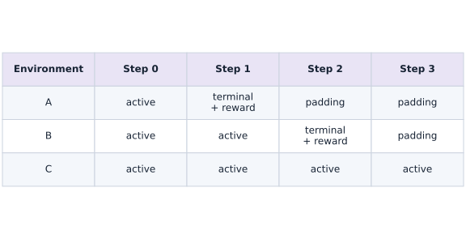
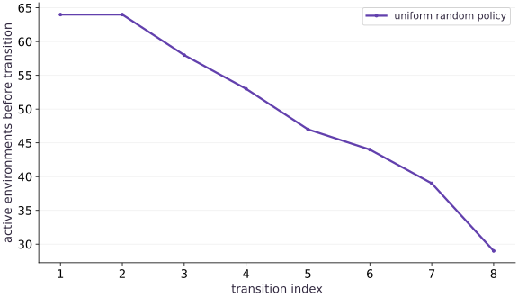

# Batch environments and scan rollouts

Phase 12: Reinforcement learning · about 85 minutes · CPU

This worked reference is validated on CPU. Accelerator compatibility requires a separate source review and target execution receipt. Use the execution matrix to review device selection and data ownership before adapting a separate target program.

**Before this lesson:** [Write a functional environment](https://www.tahabouhsine.com/jaxpathways/lesson-rl-01.html).

## What you will be able to do

- Build a scan over vmapped transitions with explicit key ownership.
- Reconstruct episode returns and reward-to-go from padded trajectories.
- Verify the live-transition mask and distinguish batch dimensions from time dimensions.

## The problem

One episode is easy to inspect, but an agent needs many experiences. How do we collect a batch without mixing time, environments or random streams? We will turn the previous transition into a fixed-shape rollout and prove that its padded rows cannot become training evidence.

## The idea

Batched rollouts put independent environments on one axis and time on another. Some environments finish earlier, so masks describe which transitions remain meaningful while arrays keep fixed shapes.

## Keep the array shape fixed while activity changes

A compiled rollout needs a fixed $(T,B)$ array even when episodes finish at different times. In this collector, `active` is read before `step`, so an action that reaches the goal still contributes its reward; later rows remain as padding. For one row, read `active → terminal + reward → padding`; compare it with an episode that stays active through all columns. This implementation does not auto-reset inside the scan.

### A terminal transition still counts

**Predict:** Should every cell after the first done flag be treated identically to the transition that caused done?



*Architecture and dataflow mechanism diagram.*

Read each table row as an environment and each column as a transition in time. `active → terminal + reward → padding` shows that the ending transition is still data; later cells are fixed-shape padding. Row C stays active through the displayed window. Predict what would be lost if masking used the next state's `done` flag: the transition carrying the goal reward would disappear. This is absorbing padding, not an auto-reset stream.

### Pause and reason

Should every cell after the first done flag be treated identically to the transition that caused done?

<details><summary>Compare your reasoning</summary>

No. The terminating transition can contain valid reward and learning information. Later padding follows the declared terminal policy and should not invent extra transitions.

</details>

## Give each axis one meaning

The rollout stores rewards with shape $(T,B)=(8,64)$: time is axis 0 and environment is axis 1. Summing axis 0 gives 64 episode returns; summing axis 1 gives eight batch totals by time, which answers a different question. `scan` advances the batch state through time while `vmap` handles environments. Check an entry's indices before reducing so time and episode are not accidentally swapped.

## Split randomness where ownership changes

Give independent random draws an owner. The collector splits reset and action keys; reset keys are split across 64 environments, and action keys across time and environments. Reusing one reset key would give identical starts, while reusing an action key at each step would repeat the same draw. The transition itself is deterministic, so it needs no key.

## Store the behavior policy before changing it

At each position, $\theta_s$ is a logit and $\operatorname{sigmoid}(\theta_s)$ is the probability of moving right. The collector stores the sampled action's log probability before training changes `theta`; later policy-gradient code compares against that behavior-policy record. Because the action is discrete, the estimator differentiates log probability times a credit signal rather than differentiating through the random draw. `log_sigmoid` keeps this calculation stable.

$$
\pi_\theta(1\mid s)=\sigma(\theta_s),\qquad \log\pi_\theta(a\mid s)=a\log\sigma(\theta_s)+(1-a)\log\sigma(-\theta_s)
$$

## A final transition is still a learning example

Suppose the state before a step is active and action 1 reaches the goal. That row's mask is true, so its reward 1 stays in the batch; only the next row is padding. Masking from the returned `done` state would erase the successful transition. The stored `next_observation` is the true final position, not a fresh reset state.

## Credit each action with rewards that follow it

Reward-to-go is the sum of current and later rewards. For `(-0.01,-0.01,1,0)`, the stored targets are `(0.98,0.99,1,0)`: the first action is associated with all later reward, and the goal-reaching action gets 1. These complete episodes use no value bootstrap. Returns from sampled episodes vary, so the estimate of an action's expected outcome is noisy; a learned baseline can reduce policy-gradient variance, which the later value/GAE lesson studies.

$$
G_{t,b}=\sum_{u=t}^{T-1}r_{u,b}
$$

## Reuse the verified environment

Create main.py with this block. Run python3 main.py in the course CPU environment.

```python
# Step 1: Reuse the verified environment
"""Finite-horizon tabular policy training. CPU teaching environment, not a benchmark."""
from functools import partial
from typing import NamedTuple
import jax
import jax.numpy as jnp
import numpy as np


# Define `State` module / container with explicit state and forward pass:
class State(NamedTuple):
    position: jax.Array
    elapsed: jax.Array
    done: jax.Array


def reset(key):
    """Start uniformly at position 0 or 1; goal is position 3."""
    return State(jax.random.randint(key, (), 0, 2), jnp.int32(0), jnp.bool_(False))


def step(state, action, horizon=8):
    """Action 0: left, 1: right. Caller supplies binary action and positive horizon.

    Returns next state, reward, termination event, truncation event. Finished
    states absorb without more rewards/events. No implicit reset or lost final observation.
    """
    active = ~state.done
    proposed = jnp.clip(state.position + 2 * action - 1, 0, 3)
    position = jnp.where(active, proposed, state.position)
    elapsed = state.elapsed + active.astype(jnp.int32)
    terminated = active & (position == 3)
    truncated = active & ~terminated & (elapsed >= horizon)
    reward = jnp.where(active, jnp.where(terminated, 1., -.01), 0.)
    return State(position, elapsed, state.done | terminated | truncated), reward, terminated, truncated
```

Keep the state and ending contract identical to the previous lesson.

## Collect a batch and compute targets

Append this block to main.py. Run python3 main.py in the course CPU environment.

```python
# Step 2 — Collect a batch and compute targets
def log_probability(theta, observations, actions):
    logits = theta[jnp.minimum(observations, 2)]
    return jnp.where(actions == 1, jax.nn.log_sigmoid(logits), jax.nn.log_sigmoid(-logits))


# Define and JIT-compile `rollout(theta, key, batch_size, horizon)` so XLA traces and fuses the operations:
@partial(jax.jit, static_argnames=('batch_size', 'horizon'))
def rollout(theta, key, batch_size=256, horizon=8):
    # Create or split explicit PRNG key(s) (`(reset_key, action_key)`) for reproducible randomness.
    reset_key, action_key = jax.random.split(key)
    # Create or split explicit PRNG key(s) (`states`) for reproducible randomness.
    states = jax.vmap(reset)(jax.random.split(reset_key, batch_size))
    # Create or split explicit PRNG key(s) (`time_keys`) for reproducible randomness.
    time_keys = jax.random.split(action_key, horizon)
    def body(states, time_key):
        observations = states.position
        # Split the PRNG key deterministically into independent subkeys (`keys`).
        keys = jax.random.split(time_key, batch_size)
        probabilities = jax.nn.sigmoid(theta[jnp.minimum(observations, 2)])
        actions = jax.vmap(jax.random.bernoulli)(keys, probabilities).astype(jnp.int32)
        # Vectorize across the batch dimension without a Python loop (`(next_states, rewards, terminated, truncated)`).
        next_states, rewards, terminated, truncated = jax.vmap(
            lambda s, a: step(s, a, horizon))(states, actions)
        record = dict(observation=observations, next_observation=next_states.position,
                      next_elapsed=next_states.elapsed, action=actions, reward=rewards,
                      active=~states.done, terminated=terminated, truncated=truncated,
                      old_logp=log_probability(theta, observations, actions))
        return next_states, record
    final, records = jax.lax.scan(body, states, time_keys)
    return final, records


def returns_to_go(rewards):
    """Undiscounted finite-episode objective; rewards after done are already zero."""
    return jnp.cumsum(rewards[::-1], axis=0)[::-1]
```

scan emits time-major arrays; vmap keeps environments independent within each time step.

## Check shapes and episode boundaries

Append this block to main.py. Run python3 main.py in the course CPU environment.

```python
# Step 3 — Check shapes and episode boundaries
theta = jnp.zeros(3)
# Create or split explicit PRNG key(s) (`(final, records)`) for reproducible randomness.
final, records = rollout(theta, jax.random.key(5), batch_size=64, horizon=8)
# Check tensor shape invariant: `records['reward'].shape == (8`
assert records['reward'].shape == (8, 64)
assert bool(final.done.all())
assert bool(jnp.all(jnp.sum(records['terminated'] | records['truncated'], axis=0) == 1))
assert bool(jnp.all(jnp.where(records['active'], 0., records['reward']) == 0.))
# Reduce along axis=0 to compute `episode_returns`.
episode_returns = records['reward'].sum(axis=0)
print('return mean:', float(episode_returns.mean()))
print('active environments by transition:', records['active'].sum(axis=1))
```

Exactly one ending event and zero padded rewards are stronger checks than a plausible mean return.

## Run the example

```python
# Complete runnable example (rl-02)
"""Finite-horizon tabular policy training. CPU teaching environment, not a benchmark."""
from functools import partial
from typing import NamedTuple
import jax
import jax.numpy as jnp
import numpy as np


# Define `State` module / container with explicit state and forward pass:
class State(NamedTuple):
    position: jax.Array
    elapsed: jax.Array
    done: jax.Array


def reset(key):
    """Start uniformly at position 0 or 1; goal is position 3."""
    return State(jax.random.randint(key, (), 0, 2), jnp.int32(0), jnp.bool_(False))


def step(state, action, horizon=8):
    """Action 0: left, 1: right. Caller supplies binary action and positive horizon.

    Returns next state, reward, termination event, truncation event. Finished
    states absorb without more rewards/events. No implicit reset or lost final observation.
    """
    active = ~state.done
    proposed = jnp.clip(state.position + 2 * action - 1, 0, 3)
    position = jnp.where(active, proposed, state.position)
    elapsed = state.elapsed + active.astype(jnp.int32)
    terminated = active & (position == 3)
    truncated = active & ~terminated & (elapsed >= horizon)
    reward = jnp.where(active, jnp.where(terminated, 1., -.01), 0.)
    return State(position, elapsed, state.done | terminated | truncated), reward, terminated, truncated

# Step 2 — Collect a batch and compute targets
def log_probability(theta, observations, actions):
    logits = theta[jnp.minimum(observations, 2)]
    return jnp.where(actions == 1, jax.nn.log_sigmoid(logits), jax.nn.log_sigmoid(-logits))


# Define and JIT-compile `rollout(theta, key, batch_size, horizon)` so XLA traces and fuses the operations:
@partial(jax.jit, static_argnames=('batch_size', 'horizon'))
def rollout(theta, key, batch_size=256, horizon=8):
    # Create or split explicit PRNG key(s) (`(reset_key, action_key)`) for reproducible randomness.
    reset_key, action_key = jax.random.split(key)
    # Create or split explicit PRNG key(s) (`states`) for reproducible randomness.
    states = jax.vmap(reset)(jax.random.split(reset_key, batch_size))
    # Create or split explicit PRNG key(s) (`time_keys`) for reproducible randomness.
    time_keys = jax.random.split(action_key, horizon)
    def body(states, time_key):
        observations = states.position
        # Split the PRNG key deterministically into independent subkeys (`keys`).
        keys = jax.random.split(time_key, batch_size)
        probabilities = jax.nn.sigmoid(theta[jnp.minimum(observations, 2)])
        actions = jax.vmap(jax.random.bernoulli)(keys, probabilities).astype(jnp.int32)
        # Vectorize across the batch dimension without a Python loop (`(next_states, rewards, terminated, truncated)`).
        next_states, rewards, terminated, truncated = jax.vmap(
            lambda s, a: step(s, a, horizon))(states, actions)
        record = dict(observation=observations, next_observation=next_states.position,
                      next_elapsed=next_states.elapsed, action=actions, reward=rewards,
                      active=~states.done, terminated=terminated, truncated=truncated,
                      old_logp=log_probability(theta, observations, actions))
        return next_states, record
    final, records = jax.lax.scan(body, states, time_keys)
    return final, records


def returns_to_go(rewards):
    """Undiscounted finite-episode objective; rewards after done are already zero."""
    return jnp.cumsum(rewards[::-1], axis=0)[::-1]

# Step 3 — Check shapes and episode boundaries
theta = jnp.zeros(3)
# Create or split explicit PRNG key(s) (`(final, records)`) for reproducible randomness.
final, records = rollout(theta, jax.random.key(5), batch_size=64, horizon=8)
# Check tensor shape invariant: `records['reward'].shape == (8`
assert records['reward'].shape == (8, 64)
assert bool(final.done.all())
assert bool(jnp.all(jnp.sum(records['terminated'] | records['truncated'], axis=0) == 1))
assert bool(jnp.all(jnp.where(records['active'], 0., records['reward']) == 0.))
# Sum rewards over rollout time while retaining one return per environment.
episode_returns = records['reward'].sum(axis=0)
print('return mean:', float(episode_returns.mean()))
print('active environments by transition:', records['active'].sum(axis=1))
```

Expected: The trajectory has the stated time and environment axes, exactly one ending event per episode, and zero reward on every padded row.

## The live batch shrinks while the array shape stays fixed

**Predict:** Should every row contain the same number of active environments?



**Recorded CPU computation**

### Read the figure

The x-axis is transition index (1–8); the y-axis counts active environments before that transition. The single uniform-random-policy series reads `[64,64,58,53,47,44,39,29]`: it begins with all 64 active, then fewer remain after goal-reaching transitions. The first two equal counts are expected because even a start at position 1 needs two right moves. Predict the next count's direction: without auto-reset, it can stay level or fall, never rise.

### Connect it to the computation

The plotted values exactly match `active environments by transition` in the CPU execution. The $(8,64)$ rollout allocation stays fixed while the live count falls from 64 to 29; those are different quantities. A falling count only says episodes ended, not whether a policy is good. Check the terminal-transition mask and reward before treating the curve as evidence of successful behavior.

```python
visual_data = {'kind':'line','x':list(range(1,9)),'xlabel':'transition index','ylabel':'active environments before transition','series':[{'label':'uniform random policy','y':records['active'].sum(1).tolist()}]}
```

## Recorded reference execution

CPU run: 2026-10-27T17:14:07.973048+00:00. JAX 0.9.2.

```text
return mean: 0.5848437547683716
active environments by transition: [64 64 58 53 47 44 39 29]
return mean: 0.5848437547683716
active environments by transition: [64 64 58 53 47 44 39 29]
reward-to-go: [0.98 0.99 1.   0.  ]
PASS: rl-02

```

## Replay the entire collector

**Predict before running:** Does replay require restoring only the environment state?

```python
# Experiment — Replay the entire collector: The random stream is part of the experiment state.
# Create or split explicit PRNG key(s) (`again`) for reproducible randomness.
again = rollout(theta, jax.random.key(5), 64, 8)[1]
for name in records:
    assert jnp.array_equal(records[name], again[name])
# Create or split explicit PRNG key(s) (`changed`) for reproducible randomness.
changed = rollout(theta, jax.random.key(6), 64, 8)[1]
assert not jnp.array_equal(records['action'], changed['action'])
```

**Expected:** Every field replays for the same configuration and key; another key changes actions.

The random stream is part of the experiment state. Replay in this environment is not a promise of identical outputs across arbitrary library versions or devices.

## Reward-to-go by hand

**Predict before running:** Predict the four targets for rewards $(-0.01,-0.01,1,0)$.

```python
# Experiment — Reward-to-go by hand
r = jnp.array([[-.01],[-.01],[1.],[0.]])
g = returns_to_go(r)
assert jnp.allclose(g[:,0], jnp.array([.98,.99,1.,0.]))
print('reward-to-go:', g[:,0])
```

**Expected:** The targets are $(0.98,0.99,1,0)$.

Zero padded rewards preserve the finite-episode sum, while the active mask removes meaningless log probabilities.

## Make it yours

Change the batch to $7$ environments and the horizon to $5$. Verify array shapes, one ending event per episode and zero rewards after finishing.

### How to write this exercise — Step-by-step recipe & starter scaffold

**Inputs:**
- A policy parameter vector `theta` and explicit JAX key.
- Changed batch size 7 and horizon 5.
- The lesson’s `rollout` collector and its time-major records.

**Outputs:**
- Final state for each environment and the retained rollout record.
- A small set of assertions about shapes, activity, and ending events.

**Invariants to check:**
- Reward and event arrays have shape `(5, 7)`.
- Every episode has one ending event.
- Rows after finishing are padding and carry no reward.

**Hints:**
- The first axis is time and the second is environment.
- The active flag describes the state before the action.

**Starter code scaffold (fill in the TODOs):**

```python
import jax
import jax.numpy as jnp

def inspect_changed_rollout(theta, key):
    # TODO: collect with seven environments and a five-step horizon
    final_state, records = ...
    # TODO: check time/environment axes and episode endings
    raise NotImplementedError
```

<details><summary>Reference solution</summary>

```python
# Exercise solution: Change the batch to 7 environments and the horizon to 5.
# Create or split explicit PRNG key(s) (`(final7, r7)`) for reproducible randomness.
final7, r7 = rollout(theta, jax.random.key(17), 7, 5)
# Check tensor shape invariant: `r7['reward'].shape == (5`
assert r7['reward'].shape == (5,7)
assert bool(final7.done.all())
assert jnp.array_equal((r7['terminated'] | r7['truncated']).sum(0), jnp.ones(7))
assert bool(jnp.all(jnp.where(r7['active'],0.,r7['reward']) == 0.))
```

</details>

## Catch a shifted mask

**Transfer / diagnosis**

Construct a two-action success from position $1$. Compare masking by the pre-transition done flag with masking by the post-transition done flag.

<details><summary>Hint</summary>

Record the mask before calling step; the successful transition still belongs to the episode.

</details>

### How to write: Catch a shifted mask — Step-by-step recipe & starter scaffold

**Inputs:**
- State at position 1, unfinished.
- Two right actions and the lesson transition.

**Outputs:**
- The accumulated transition reward with the correct pre-action mask.
- A second total showing the effect of a shifted post-action mask.

**Invariants to check:**
- The successful transition remains active.
- The two totals differ because only one uses the pre-transition done flag.

**Hints:**
- Capture activity before calling `step`.
- Do not discard the transition that reaches the goal.

**Starter code scaffold (fill in the TODOs):**

```python
import jax.numpy as jnp

def compare_activity_masks(step, State):
    state = State(jnp.int32(1), jnp.int32(0), jnp.bool_(False))
    # TODO: evaluate both actions using pre-step and post-step masks
    raise NotImplementedError
```

<details><summary>Reference solution and reasoning</summary>

```python
# Catch a shifted mask (Transfer / diagnosis)
s = State(jnp.int32(1),jnp.int32(0),jnp.bool_(False))
correct, broken = 0., 0.
for a in [1,1]:
    active = ~s.done
    s, reward, _, _ = step(s,jnp.int32(a))
    # Accumulate the next contribution into `correct`.
    correct += float(reward*active)
    # Accumulate the next contribution into `broken`.
    broken += float(reward*(~s.done))
assert abs(correct-.99) < 1e-6
assert abs(broken+.01) < 1e-6
```

The broken mask removes the action responsible for success, leaving only a cost.

</details>

## Check a deterministic policy limit

**Transfer / diagnosis**

Use very large positive logits and verify that every episode follows a shortest route.

<details><summary>Hint</summary>

The two start states need different numbers of actions. Compare each return against its own initial position.

</details>

### How to write: Check a deterministic policy limit — Step-by-step recipe & starter scaffold

**Inputs:**
- A policy with strongly positive action logits.
- A batch of 23 environments, a fixed key, and an eight-step horizon.

**Outputs:**
- Collected trajectories and a summary of their action and ending behavior.

**Invariants to check:**
- Repeated calls with the same key replay.
- The sampled rollouts obey the same environment and horizon contract.

**Hints:**
- Use a fresh key to test reproducibility separately.
- A deterministic limit is a behavioral check, not a return benchmark.

**Key functions & syntax to use:**
- `jnp.full(shape, fill_value, dtype=...)` — Creates an array of the requested shape with every element set to `fill_value`.

**Starter code scaffold (fill in the TODOs):**

```python
import jax
import jax.numpy as jnp

def inspect_right_biased_policy(rollout, key):
    theta = jnp.full((3,), 100.)
    # TODO: collect with the requested batch and horizon
    final_state, records = ...
    raise NotImplementedError
```

<details><summary>Reference solution and reasoning</summary>

```python
# Check a deterministic policy limit (Transfer / diagnosis)
# Create or split explicit PRNG key(s) (`(_, easy)`) for reproducible randomness.
_, easy = rollout(jnp.full(3,100.),jax.random.key(42),23,8)
expected = jnp.where(easy['observation'][0] == 0,.98,.99)
assert jnp.allclose(easy['reward'].sum(0),expected,atol=1e-6)
assert jnp.array_equal(easy['active'].sum(0),3-easy['observation'][0])
```

The expected return is calculated from the initial position rather than copied from the collector.

</details>

## Check your understanding

Which axis should be summed to obtain one return per environment from a time-major reward array?

1. The time axis
2. The environment axis
3. Both axes before averaging by live transitions

<details><summary>Answer and explanation</summary>

**1. The time axis (correct)**

Summing over time leaves one scalar for each episode. Averaging these episode returns gives the finite-episode performance objective.

**2. The environment axis**

Summing over environments merges different episodes. Keep one return per environment by reducing the time axis.

**3. Both axes before averaging by live transitions**

Reducing both axes gives one aggregate instead of per-environment returns. Inspect the intended output shape before computing a summary.

</details>

## Diagnose the result

If reported return changes merely by padding an already finished trajectory, inspect reward masking. If success disappears from the objective, check whether active was recorded before step. If trajectories match too often, inspect broadcast or reused keys before increasing the batch.

## Carry forward

- vmap handles independent environments; scan handles the dependent time sequence.
- Store behavior log probabilities and live-transition masks with rewards.

## Keep your evidence

Keep reconstructed trajectories, randomized keys, padding masks and independent return calculations. Show how a changed key affects interaction without changing the environment rules.

Save your predictions, modified code, terminal outputs, and reasoning in your engineering portfolio.

## Primary references

- [JAX: explicit pseudorandom keys](https://docs.jax.dev/en/latest/random-numbers.html)
- [JAX scan: fixed-shape carry](https://docs.jax.dev/en/latest/_autosummary/jax.lax.scan.html)
- [Schulman et al.: Proximal Policy Optimization Algorithms](https://arxiv.org/abs/1707.06347)
- [Gymnasium: termination and truncation](https://gymnasium.farama.org/tutorials/gymnasium_basics/handling_time_limits/)

