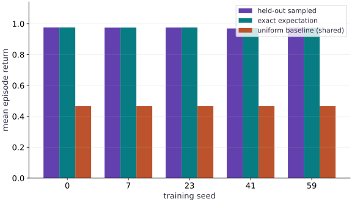

# Evaluate agents across seeds

Phase 12: Reinforcement learning · about 90 minutes · CPU

This worked reference is validated on CPU. Accelerator compatibility requires a separate source review and target execution receipt. Use the execution matrix to review device selection and data ownership before adapting a separate target program.

**Before this lesson:** [Policy gradients and PPO](https://www.tahabouhsine.com/jaxpathways/lesson-rl-03.html).

## What you will be able to do

- Separate training seeds, evaluation streams and individual episodes.
- Report per-agent means and variability with an explicit aggregation unit.
- Compare a trained policy to uniform and known deterministic baselines without mutating it.

## The problem

A single training run looks excellent. Would another random seed learn the same behavior, and did the evaluation quietly reuse the training data? We will separate randomness used to fit an agent from randomness used to test it, retain per-agent results and compare with policies whose behavior we already understand.

## The idea

A policy's result can vary because training produced a different policy and because evaluation sampled different episodes. A useful comparison records both sources instead of pooling every episode as though it came from one independent training run.

## Separate training randomness from evaluation randomness

A policy can look strong on the episodes that guided its updates. Train separate agents with training seeds `(0,7,23,41,59)`, then evaluate each on held-out seeds shared across agents. Episode-to-episode spread describes one policy; spread among five trained-agent means describes sensitivity to training randomness. Keep those units distinct when reading the figure, and do not let thousands of episodes from one agent stand in for more trained agents.

### Pause and reason

Do a thousand episodes from one trained policy establish training-seed robustness?

<details><summary>Compare your reasoning</summary>

No. They improve knowledge of that policy's evaluation behavior. Training variability needs independently trained policies.

</details>

## Write the protocol before inspecting results

Freeze the environment, horizon, training budget and evaluation procedure before looking at test returns. This lesson uses five training seeds and four evaluation seeds, with separate random keys for fitting and testing. Seed labels make the run reproducible; they do not by themselves prove independent samples. If a hyperparameter is changed after inspecting these evaluation results, use a new held-out evaluation set.

## Name the experimental unit

The code evaluates 2,048 episodes per agent, which reduces uncertainty about that particular policy's mean. The five independently trained agents are the units for describing training-seed variation. Their sample standard deviation is a spread summary, not a confidence interval. Retain raw returns and per-agent means so another reader can recompute a summary at the right level.

$$
\bar R_i=\frac1E\sum_{e=1}^E R_{i,e},\qquad s=\sqrt{\frac1{K-1}\sum_{i=1}^K(\bar R_i-\bar R)^2}
$$

## Pair the comparison deliberately

Using the same evaluation reset seeds aligns the initial states for each agent and baseline, which can make paired differences easier to interpret. Policy-dependent actions still lead to different trajectories, so the outcomes are not identical paired paths. Preserve per-seed differences and avoid pooling all episodes as though they were independent training runs. More training seeds would support a broader claim.

## A baseline can catch a broken evaluator

The known ordering is a useful check: always-left earns `-0.08`, uniform earns `0.466875`, and always-right earns `0.985`. If code reports a different order, inspect the reward sum, terminal mask and eight-step horizon before interpreting learned-agent bars. These exact fixture values test the evaluator; they do not certify a learned policy.

## Evaluation must leave training state alone

The evaluator receives the policy, uses fresh evaluation keys, and never calls the optimizer. The code copies policy parameters and checks they are unchanged after evaluation. That makes the test read-only for this tabular case. A neural version would also have to control mutable statistics and stochastic layers, which this example does not test.

## Keep a report another learner can challenge

Record source revision, package versions, parameters, seeds, horizon, raw returns and per-agent means. Here the scope is one small corridor with randomized starts, stationary tabular policies and CPU execution. An exact-return comparison helps catch sampling noise, but high return here is not evidence of general control ability. State the experimental unit whenever reporting uncertainty.

## Assemble the verified learning system

Create main.py with this block. Run python3 main.py in the course CPU environment.

```python
# Step 1: Assemble the verified learning system
"""Finite-horizon tabular policy training. CPU teaching environment, not a benchmark."""
from functools import partial
from typing import NamedTuple
import jax
import jax.numpy as jnp
import numpy as np


# Define `State` module / container with explicit state and forward pass:
class State(NamedTuple):
    position: jax.Array
    elapsed: jax.Array
    done: jax.Array


def reset(key):
    """Start uniformly at position 0 or 1; goal is position 3."""
    return State(jax.random.randint(key, (), 0, 2), jnp.int32(0), jnp.bool_(False))


def step(state, action, horizon=8):
    """Action 0: left, 1: right. Caller supplies binary action and positive horizon.

    Returns next state, reward, termination event, truncation event. Finished
    states absorb without more rewards/events. No implicit reset or lost final observation.
    """
    active = ~state.done
    proposed = jnp.clip(state.position + 2 * action - 1, 0, 3)
    position = jnp.where(active, proposed, state.position)
    elapsed = state.elapsed + active.astype(jnp.int32)
    terminated = active & (position == 3)
    truncated = active & ~terminated & (elapsed >= horizon)
    reward = jnp.where(active, jnp.where(terminated, 1., -.01), 0.)
    return State(position, elapsed, state.done | terminated | truncated), reward, terminated, truncated

def log_probability(theta, observations, actions):
    logits = theta[jnp.minimum(observations, 2)]
    return jnp.where(actions == 1, jax.nn.log_sigmoid(logits), jax.nn.log_sigmoid(-logits))


# Define and JIT-compile `rollout(theta, key, batch_size, horizon)` so XLA traces and fuses the operations:
@partial(jax.jit, static_argnames=('batch_size', 'horizon'))
def rollout(theta, key, batch_size=256, horizon=8):
    # Create or split explicit PRNG key(s) (`(reset_key, action_key)`) for reproducible randomness.
    reset_key, action_key = jax.random.split(key)
    # Create or split explicit PRNG key(s) (`states`) for reproducible randomness.
    states = jax.vmap(reset)(jax.random.split(reset_key, batch_size))
    # Create or split explicit PRNG key(s) (`time_keys`) for reproducible randomness.
    time_keys = jax.random.split(action_key, horizon)
    def body(states, time_key):
        observations = states.position
        # Split the PRNG key deterministically into independent subkeys (`keys`).
        keys = jax.random.split(time_key, batch_size)
        probabilities = jax.nn.sigmoid(theta[jnp.minimum(observations, 2)])
        actions = jax.vmap(jax.random.bernoulli)(keys, probabilities).astype(jnp.int32)
        # Vectorize across the batch dimension without a Python loop (`(next_states, rewards, terminated, truncated)`).
        next_states, rewards, terminated, truncated = jax.vmap(
            lambda s, a: step(s, a, horizon))(states, actions)
        record = dict(observation=observations, next_observation=next_states.position,
                      next_elapsed=next_states.elapsed, action=actions, reward=rewards,
                      active=~states.done, terminated=terminated, truncated=truncated,
                      old_logp=log_probability(theta, observations, actions))
        return next_states, record
    final, records = jax.lax.scan(body, states, time_keys)
    return final, records


def returns_to_go(rewards):
    """Undiscounted finite-episode objective; rewards after done are already zero."""
    return jnp.cumsum(rewards[::-1], axis=0)[::-1]

def policy_loss(theta, records, method='ppo', clip=.2):
    """Normalize by episodes, not live transitions. Freeze behavior data/returns."""
    advantage = jax.lax.stop_gradient(returns_to_go(records['reward']))
    old_logp = jax.lax.stop_gradient(records['old_logp'])
    new_logp = log_probability(theta, records['observation'], records['action'])
    if method == 'reinforce':
        terms = new_logp * advantage
    elif method == 'ppo':
        ratio = jnp.exp(new_logp - old_logp)
        terms = jnp.minimum(ratio * advantage, jnp.clip(ratio, 1-clip, 1+clip) * advantage)
    else:
        raise ValueError('method must be reinforce or ppo')
    return -jnp.sum(jnp.where(records['active'], terms, 0.)) / records['reward'].shape[1]


# Define and JIT-compile `exact_return(theta, horizon)` so XLA traces and fuses the operations:
@partial(jax.jit, static_argnames=('horizon',))
def exact_return(theta, horizon=8):
    """Dynamic programming over states, independent of sampled rollouts."""
    p = jax.nn.sigmoid(theta)
    states = jnp.arange(3)
    left = jnp.maximum(states-1, 0)
    right = states+1
    def backup(_, values):
        q_left = -.01 + values[left]
        q_right = jnp.where(right == 3, 1., -.01 + values[right])
        return jnp.concatenate(((1-p)*q_left+p*q_right, jnp.zeros(1)))
    values = jax.lax.fori_loop(0, horizon, backup, jnp.zeros(4))
    return jnp.mean(values[:2])


# Define and JIT-compile `_train(seed, updates, batch_size, horizon...)` so XLA traces and fuses the operations:
@partial(jax.jit, static_argnames=('updates', 'batch_size', 'horizon', 'method', 'epochs'))
def _train(seed, updates, batch_size, horizon, method, epochs, learning_rate):
    # Create or split explicit PRNG key(s) (`key`) for reproducible randomness.
    key = jax.random.key(seed)
    theta = jnp.zeros(3)
    def update(carry, _):
        theta, key = carry
        # Create or split explicit PRNG key(s) (`(key, sample_key)`) for reproducible randomness.
        key, sample_key = jax.random.split(key)
        _, records = rollout(theta, sample_key, batch_size, horizon)
        def epoch(_, candidate):
            grad = jax.grad(policy_loss)(candidate, records, method)
            return candidate - learning_rate * grad
        theta = jax.lax.fori_loop(0, epochs, epoch, theta)
        return (theta, key), exact_return(theta, horizon)
    (theta, _), history = jax.lax.scan(update, (theta, key), None, length=updates)
    return theta, jnp.concatenate((exact_return(jnp.zeros(3), horizon)[None], history))


def train(seed=0, updates=40, batch_size=256, horizon=8, method='ppo', epochs=3, learning_rate=.5):
    if updates < 1 or batch_size < 1 or horizon < 1 or epochs < 1 or learning_rate <= 0:
        raise ValueError('positive updates, batch_size, horizon, epochs and learning_rate required')
    if method not in ('ppo', 'reinforce'):
        raise ValueError('unknown method')
    if method == 'reinforce' and epochs != 1:
        raise ValueError('REINFORCE uses one update per fresh on-policy rollout')
    return _train(seed, updates, batch_size, horizon, method, epochs, learning_rate)
```

Use the same training protocol for every seed. Changing budgets between agents would confound the comparison.

## Add a read-only evaluator

Append this block to main.py. Run python3 main.py in the course CPU environment.

```python
# Step 2 — Add a read-only evaluator
def evaluate(theta, seeds, batch_size=512, horizon=8):
    """One mean per evaluation stream; preserve raw episode returns too."""
    theta = jnp.asarray(theta)
    if theta.shape != (3,) or not bool(jnp.all(jnp.isfinite(theta))):
        raise ValueError('theta must contain three finite logits')
    seeds = tuple(seeds)
    if len(seeds) < 2 or len(set(seeds)) != len(seeds) or batch_size < 1 or horizon < 1:
        raise ValueError('provide at least two distinct evaluation seeds and positive sizes')
    # Create or split explicit PRNG key(s) (`returns`) for reproducible randomness.
    returns = np.stack([np.asarray(rollout(theta, jax.random.key(s), batch_size, horizon)[1]['reward'].sum(0)) for s in seeds])
    return {'seeds': list(seeds), 'episode_returns': returns, 'stream_means': returns.mean(1),
            'mean': float(returns.mean()), 'exact': float(exact_return(theta, horizon))}
```

The evaluator retains raw returns, reports its seed set and rejects malformed policies or repeated seed identifiers.

## Train several agents and retain every result

Append this block to main.py. Run python3 main.py in the course CPU environment.

```python
# Step 3 — Train several agents and retain every result
training_seeds = [0,7,23,41,59]
evaluation_seeds = [1000,1001,1002,1003]
policies, histories, reports = [], [], []
for seed in training_seeds:
    policy, history = train(seed=seed)
    policies.append(policy)
    histories.append(history)
    reports.append(evaluate(policy,evaluation_seeds))
trained_means = np.array([r['mean'] for r in reports])
exact_means = np.array([r['exact'] for r in reports])
baseline = evaluate(jnp.zeros(3),evaluation_seeds)
assert np.all(trained_means > baseline['mean'] + .4)
assert np.all(np.abs(trained_means-exact_means) < .03)
print('training seeds:', training_seeds)
print('held-out mean per agent:', trained_means)
print('exact mean per agent:', exact_means)
print('uniform baseline mean:', baseline['mean'])
print('across-agent mean / sample sd:', trained_means.mean(),trained_means.std(ddof=1))
```

Each agent receives a separate training key; all use the declared held-out evaluation streams.

## Run the example

```python
# Complete runnable example (rl-04)
"""Finite-horizon tabular policy training. CPU teaching environment, not a benchmark."""
from functools import partial
from typing import NamedTuple
import jax
import jax.numpy as jnp
import numpy as np


# Define `State` module / container with explicit state and forward pass:
class State(NamedTuple):
    position: jax.Array
    elapsed: jax.Array
    done: jax.Array


def reset(key):
    """Start uniformly at position 0 or 1; goal is position 3."""
    return State(jax.random.randint(key, (), 0, 2), jnp.int32(0), jnp.bool_(False))


def step(state, action, horizon=8):
    """Action 0: left, 1: right. Caller supplies binary action and positive horizon.

    Returns next state, reward, termination event, truncation event. Finished
    states absorb without more rewards/events. No implicit reset or lost final observation.
    """
    active = ~state.done
    proposed = jnp.clip(state.position + 2 * action - 1, 0, 3)
    position = jnp.where(active, proposed, state.position)
    elapsed = state.elapsed + active.astype(jnp.int32)
    terminated = active & (position == 3)
    truncated = active & ~terminated & (elapsed >= horizon)
    reward = jnp.where(active, jnp.where(terminated, 1., -.01), 0.)
    return State(position, elapsed, state.done | terminated | truncated), reward, terminated, truncated

def log_probability(theta, observations, actions):
    logits = theta[jnp.minimum(observations, 2)]
    return jnp.where(actions == 1, jax.nn.log_sigmoid(logits), jax.nn.log_sigmoid(-logits))


# Define and JIT-compile `rollout(theta, key, batch_size, horizon)` so XLA traces and fuses the operations:
@partial(jax.jit, static_argnames=('batch_size', 'horizon'))
def rollout(theta, key, batch_size=256, horizon=8):
    # Create or split explicit PRNG key(s) (`(reset_key, action_key)`) for reproducible randomness.
    reset_key, action_key = jax.random.split(key)
    # Create or split explicit PRNG key(s) (`states`) for reproducible randomness.
    states = jax.vmap(reset)(jax.random.split(reset_key, batch_size))
    # Create or split explicit PRNG key(s) (`time_keys`) for reproducible randomness.
    time_keys = jax.random.split(action_key, horizon)
    def body(states, time_key):
        observations = states.position
        # Split the PRNG key deterministically into independent subkeys (`keys`).
        keys = jax.random.split(time_key, batch_size)
        probabilities = jax.nn.sigmoid(theta[jnp.minimum(observations, 2)])
        actions = jax.vmap(jax.random.bernoulli)(keys, probabilities).astype(jnp.int32)
        # Vectorize across the batch dimension without a Python loop (`(next_states, rewards, terminated, truncated)`).
        next_states, rewards, terminated, truncated = jax.vmap(
            lambda s, a: step(s, a, horizon))(states, actions)
        record = dict(observation=observations, next_observation=next_states.position,
                      next_elapsed=next_states.elapsed, action=actions, reward=rewards,
                      active=~states.done, terminated=terminated, truncated=truncated,
                      old_logp=log_probability(theta, observations, actions))
        return next_states, record
    final, records = jax.lax.scan(body, states, time_keys)
    return final, records


def returns_to_go(rewards):
    """Undiscounted finite-episode objective; rewards after done are already zero."""
    return jnp.cumsum(rewards[::-1], axis=0)[::-1]

def policy_loss(theta, records, method='ppo', clip=.2):
    """Normalize by episodes, not live transitions. Freeze behavior data/returns."""
    advantage = jax.lax.stop_gradient(returns_to_go(records['reward']))
    old_logp = jax.lax.stop_gradient(records['old_logp'])
    new_logp = log_probability(theta, records['observation'], records['action'])
    if method == 'reinforce':
        terms = new_logp * advantage
    elif method == 'ppo':
        ratio = jnp.exp(new_logp - old_logp)
        terms = jnp.minimum(ratio * advantage, jnp.clip(ratio, 1-clip, 1+clip) * advantage)
    else:
        raise ValueError('method must be reinforce or ppo')
    return -jnp.sum(jnp.where(records['active'], terms, 0.)) / records['reward'].shape[1]


# Define and JIT-compile `exact_return(theta, horizon)` so XLA traces and fuses the operations:
@partial(jax.jit, static_argnames=('horizon',))
def exact_return(theta, horizon=8):
    """Dynamic programming over states, independent of sampled rollouts."""
    p = jax.nn.sigmoid(theta)
    states = jnp.arange(3)
    left = jnp.maximum(states-1, 0)
    right = states+1
    def backup(_, values):
        q_left = -.01 + values[left]
        q_right = jnp.where(right == 3, 1., -.01 + values[right])
        return jnp.concatenate(((1-p)*q_left+p*q_right, jnp.zeros(1)))
    values = jax.lax.fori_loop(0, horizon, backup, jnp.zeros(4))
    return jnp.mean(values[:2])


# Define and JIT-compile `_train(seed, updates, batch_size, horizon...)` so XLA traces and fuses the operations:
@partial(jax.jit, static_argnames=('updates', 'batch_size', 'horizon', 'method', 'epochs'))
def _train(seed, updates, batch_size, horizon, method, epochs, learning_rate):
    # Create or split explicit PRNG key(s) (`key`) for reproducible randomness.
    key = jax.random.key(seed)
    theta = jnp.zeros(3)
    def update(carry, _):
        theta, key = carry
        # Create or split explicit PRNG key(s) (`(key, sample_key)`) for reproducible randomness.
        key, sample_key = jax.random.split(key)
        _, records = rollout(theta, sample_key, batch_size, horizon)
        def epoch(_, candidate):
            grad = jax.grad(policy_loss)(candidate, records, method)
            return candidate - learning_rate * grad
        theta = jax.lax.fori_loop(0, epochs, epoch, theta)
        return (theta, key), exact_return(theta, horizon)
    (theta, _), history = jax.lax.scan(update, (theta, key), None, length=updates)
    return theta, jnp.concatenate((exact_return(jnp.zeros(3), horizon)[None], history))


def train(seed=0, updates=40, batch_size=256, horizon=8, method='ppo', epochs=3, learning_rate=.5):
    if updates < 1 or batch_size < 1 or horizon < 1 or epochs < 1 or learning_rate <= 0:
        raise ValueError('positive updates, batch_size, horizon, epochs and learning_rate required')
    if method not in ('ppo', 'reinforce'):
        raise ValueError('unknown method')
    if method == 'reinforce' and epochs != 1:
        raise ValueError('REINFORCE uses one update per fresh on-policy rollout')
    return _train(seed, updates, batch_size, horizon, method, epochs, learning_rate)

# Step 2 — Add a read-only evaluator
def evaluate(theta, seeds, batch_size=512, horizon=8):
    """One mean per evaluation stream; preserve raw episode returns too."""
    theta = jnp.asarray(theta)
    if theta.shape != (3,) or not bool(jnp.all(jnp.isfinite(theta))):
        raise ValueError('theta must contain three finite logits')
    seeds = tuple(seeds)
    if len(seeds) < 2 or len(set(seeds)) != len(seeds) or batch_size < 1 or horizon < 1:
        raise ValueError('provide at least two distinct evaluation seeds and positive sizes')
    # Create or split explicit PRNG key(s) (`returns`) for reproducible randomness.
    returns = np.stack([np.asarray(rollout(theta, jax.random.key(s), batch_size, horizon)[1]['reward'].sum(0)) for s in seeds])
    return {'seeds': list(seeds), 'episode_returns': returns, 'stream_means': returns.mean(1),
            'mean': float(returns.mean()), 'exact': float(exact_return(theta, horizon))}

# Step 3 — Train several agents and retain every result
training_seeds = [0,7,23,41,59]
evaluation_seeds = [1000,1001,1002,1003]
policies, histories, reports = [], [], []
for seed in training_seeds:
    policy, history = train(seed=seed)
    policies.append(policy)
    histories.append(history)
    reports.append(evaluate(policy,evaluation_seeds))
trained_means = np.array([r['mean'] for r in reports])
exact_means = np.array([r['exact'] for r in reports])
baseline = evaluate(jnp.zeros(3),evaluation_seeds)
assert np.all(trained_means > baseline['mean'] + .4)
assert np.all(np.abs(trained_means-exact_means) < .03)
print('training seeds:', training_seeds)
print('held-out mean per agent:', trained_means)
print('exact mean per agent:', exact_means)
print('uniform baseline mean:', baseline['mean'])
print('across-agent mean / sample sd:', trained_means.mean(),trained_means.std(ddof=1))
```

Expected: All five independently trained agents outperform the held-out uniform baseline. The printed per-agent values preserve variability instead of hiding it in one pooled number.

## Held-out returns for independently trained agents

**Predict:** Will measured and exact means coincide for every agent?



**Recorded CPU computation**

### Read the figure

The x-axis groups five independently trained agents by training seed; the y-axis is episode return in this fixed corridor. In each group, the sampled held-out mean is compared with that policy's exact expectation; a repeated uniform-policy bar is the shared baseline. Seed 41 is lowest at about 0.9694 sampled and 0.9711 exact, while seed 0 is about 0.9760 and 0.9758. Taller means better return here, not higher confidence. Predict what a large sampled/exact gap would suggest: evaluation noise or a protocol mismatch to investigate.

### Connect it to the computation

All five exact means cluster near the always-right limit 0.985; the uniform baseline is about 0.47. Sampled means sit close to exact values, so this run's episode noise is small relative to the roughly 0.51 baseline gap. Differences among exact bars reflect trained-policy differences, while differences between sampled and exact bars reflect finite evaluation. No uncertainty intervals are plotted; five runs support a descriptive fixture comparison, not a broad claim about PPO.

```python
visual_data = {'kind':'bar','labels':[str(s) for s in training_seeds],'xlabel':'training seed','ylabel':'mean episode return','series':[{'label':'held-out sampled','y':trained_means.tolist()},{'label':'exact expectation','y':exact_means.tolist()},{'label':'uniform baseline (shared)','y':[baseline['mean']]*5}]}
```

## Recorded reference execution

CPU run: 2026-10-27T17:07:45.041603+00:00. JAX 0.9.2.

```text
training seeds: [0, 7, 23, 41, 59]
held-out mean per agent: [0.9759717  0.97472161 0.97537106 0.96944821 0.97455072]
exact mean per agent: [0.97578394 0.9749347  0.97562152 0.97113729 0.97404611]
uniform baseline mean: 0.46628910303115845
across-agent mean / sample sd: 0.9740126609802247 0.0026129212275767476
training seeds: [0, 7, 23, 41, 59]
held-out mean per agent: [0.9759717  0.97472161 0.97537106 0.96944821 0.97455072]
exact mean per agent: [0.97578394 0.9749347  0.97562152 0.97113729 0.97404611]
uniform baseline mean: 0.46628910303115845
across-agent mean / sample sd: 0.9740126609802247 0.0026129212275767476
left / random / right: -0.07999999821186066 0.46628910303115845 0.9850389361381531
paired improvements: [0.5096826  0.50843251 0.50908196 0.50315911 0.50826162]
mean improvement across trained agents: 0.5077235579490662
sample sd / independence-assuming SE: 0.09999999999999998 0.05773502691896257
PASS: rl-04

```

## Check baselines with known returns

**Predict before running:** Which policy should have the highest mean, and by how much?

```python
# Experiment — Check baselines with known returns
left = evaluate(jnp.full(3,-100.),evaluation_seeds)
right = evaluate(jnp.full(3,100.),evaluation_seeds)
assert abs(left['mean']+.08) < 1e-6
assert abs(right['mean']-.985) < .002
assert left['mean'] < baseline['mean'] < right['mean']
assert abs(baseline['mean']-.466875) < .04
print('left / random / right:', left['mean'], baseline['mean'], right['mean'])
```

**Expected:** The means follow the known order and agree with the exact values within the declared sampling tolerances.

The baseline check can fail an evaluator even when the learned policy appears successful.

## Prove isolation and replay

**Predict before running:** Should evaluating a policy twice change either its parameters or the report?

```python
# Experiment — Prove isolation and replay: Repeatability is useful for debugging.
before = np.array(policies[0],copy=True)
a = evaluate(policies[0],evaluation_seeds)
b = evaluate(policies[0],evaluation_seeds)
np.testing.assert_array_equal(before,policies[0])
np.testing.assert_array_equal(a['episode_returns'],b['episode_returns'])
c = evaluate(policies[0],[2000,2001,2002,2003])
assert not np.array_equal(a['episode_returns'],c['episode_returns'])
```

**Expected:** The same stream reproduces the report; new streams change sampled episodes while preserving the policy.

Repeatability is useful for debugging. It does not convert a reused test stream into fresh evidence.

## Make it yours

Compute the paired held-out improvement over the uniform baseline for each trained agent. Report all $5$ differences and their mean, keeping the training run as the unit.

### How to write this exercise — Step-by-step recipe & starter scaffold

**Inputs:**
- A vector of five held-out means, one per trained policy.
- The baseline mean evaluated on the same streams.

**Outputs:**
- The five paired per-agent improvements and their mean.

**Invariants to check:**
- Keep one result per training run.
- The baseline uses the same held-out streams for every agent.
- Do not treat episodes as independent training runs.

**Hints:**
- Subtract the shared baseline from each agent mean before averaging.
- Preserve the per-agent differences for inspection.

**Starter code scaffold (fill in the TODOs):**

```python
import numpy as np

def paired_improvements(agent_means, baseline_mean):
    # TODO: compute one difference for each independently trained policy
    differences = ...
    # TODO: return the individual differences and their average
    raise NotImplementedError
```

<details><summary>Reference solution</summary>

```python
# Exercise solution
deltas = trained_means - baseline['mean']
# Check tensor shape invariant: `deltas.shape == (5,)`
assert deltas.shape == (5,)
assert np.all(deltas > .4)
print('paired improvements:', deltas)
print('mean improvement across trained agents:', deltas.mean())
```

</details>

## Expose an unequal-batch averaging bug

**Transfer / diagnosis**

One evaluation shard contains one episode with return $1$; another contains nine episodes with return $0$. Compare the unweighted mean of shard means with the true episode mean.

<details><summary>Hint</summary>

Weight each shard mean by its episode count.

</details>

### How to write: Expose an unequal-batch averaging bug — Step-by-step recipe & starter scaffold

**Inputs:**
- Two evaluation shards with means 1 and 0.
- Episode counts 1 and 9.

**Outputs:**
- An unweighted average of shard means and the episode-weighted mean.

**Invariants to check:**
- Each episode has equal weight in the episode-level mean.
- Unequal shard sizes change the result if shard means are averaged equally.

**Hints:**
- Use the episode counts as weights.
- Keep the two summaries named to expose the aggregation choice.

**Starter code scaffold (fill in the TODOs):**

```python
import numpy as np

def compare_shard_averages():
    means = np.array([1., 0.])
    counts = np.array([1, 9])
    # TODO: compute an unweighted and episode-weighted summary
    raise NotImplementedError
```

<details><summary>Reference solution and reasoning</summary>

```python
# Expose an unequal-batch averaging bug (Transfer / diagnosis): Equal shard weighting changes the unit from episode to shard.
means = np.array([1.,0.])
counts = np.array([1,9])
wrong = means.mean()
right = np.average(means,weights=counts)
assert wrong == .5 and right == .1
```

Equal shard weighting changes the unit from episode to shard. Our equal-size streams avoid the discrepancy, but exported raw episode counts make the contract explicit.

</details>

## Distinguish spread from standard error

**Transfer / diagnosis**

For agent means $(0.8,0.9,1.0)$, compute sample standard deviation and the naive standard error assuming independent agent measurements. Explain why neither automatically describes our shared-stream protocol.

<details><summary>Hint</summary>

Use sample standard deviation with ddof=1; a standard error divides by the square root of the number of independent units.

</details>

### How to write: Distinguish spread from standard error — Step-by-step recipe & starter scaffold

**Inputs:**
- Three trained-agent means: 0.8, 0.9, and 1.0.
- A sample-standard-deviation calculation and the number of agents.

**Outputs:**
- Across-agent spread and a naive standard-error calculation.

**Invariants to check:**
- Use sample standard deviation with ddof=1.
- Label the unit of observation as a trained agent.

**Hints:**
- The standard error divides spread by the square root of the independent-agent count.
- Explain the limits of that calculation under shared evaluation streams.

**Starter code scaffold (fill in the TODOs):**

```python
import numpy as np

def summarize_agent_spread():
    agent_means = np.array([.8, .9, 1.])
    # TODO: calculate sample spread and the naive standard error
    raise NotImplementedError
```

<details><summary>Reference solution and reasoning</summary>

```python
# Distinguish spread from standard error (Transfer / diagnosis)
values = np.array([.8,.9,1.])
sd = values.std(ddof=1)
naive_se = sd/np.sqrt(3)
assert abs(sd-.1) < 1e-12
assert abs(naive_se-.0577350269) < 1e-9
print('sample sd / independence-assuming SE:',sd,naive_se)
```

The numerical formula is separate from its sampling assumptions. Shared evaluation streams and only five training runs warrant a descriptive report, not a confident general claim.

</details>

## Check your understanding

What does evaluating one policy on many episodes fail to measure?

1. Its mean return on those sampled episodes
2. Sensitivity to training randomness across independently fitted policies
3. Variation in returns between the sampled episodes

<details><summary>Answer and explanation</summary>

**1. Its mean return on those sampled episodes**

Repeated episodes can estimate the return of this fitted policy. They do not measure variation across independently trained policies.

**2. Sensitivity to training randomness across independently fitted policies (correct)**

More evaluation episodes estimate one policy more precisely. To study training variability, repeat training with different seeds and preserve those runs as separate units.

**3. Variation in returns between the sampled episodes**

Episode variation is exactly what those repeated evaluations observe. Add separate training seeds to measure training variability.

</details>

## Diagnose the result

If a result changes after evaluation, compare model state and random-key ownership before inspecting the optimizer. If a reported uncertainty is implausibly tiny, check whether episodes were incorrectly counted as independent training runs. If a baseline is unexpectedly strong, recompute its known return under the exact horizon and reward contract.

## Carry forward

- Separate randomness for fitting from randomness for evaluation.
- Report per-agent results, known baselines and explicit limits before making general claims.

## Keep your evidence

Keep multiple trained seeds, fixed held-out streams, exact versus sampled returns and failed trajectories. Explain uncertainty and demonstrate evaluation leaves the policy unchanged.

Save your predictions, modified code, terminal outputs, and reasoning in your engineering portfolio.

## Primary references

- [JAX: explicit pseudorandom keys](https://docs.jax.dev/en/latest/random-numbers.html)
- [JAX scan: fixed-shape carry](https://docs.jax.dev/en/latest/_autosummary/jax.lax.scan.html)
- [Schulman et al.: Proximal Policy Optimization Algorithms](https://arxiv.org/abs/1707.06347)
- [Gymnasium: termination and truncation](https://gymnasium.farama.org/tutorials/gymnasium_basics/handling_time_limits/)

