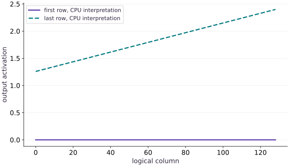

# A first TPU kernel

Phase 13: Pallas kernels · about 110 minutes · CPU

This worked reference is validated on CPU. Accelerator compatibility requires a separate source review and target execution receipt. A separate Pallas TPU kernel is implemented in the target instructions. Bounded hardware receipts cover v5e1 launch, resume and precision checks; four single-device Pallas cases; and a four-device v5e collective fixture. Each receipt applies only to its recorded source, environment, cases and hardware. Other lessons and TPU configurations require separate qualification.

**Before this lesson:** [Pallas grids and BlockSpecs](https://www.tahabouhsine.com/jaxpathways/lesson-kernels-01.html).

## What you will be able to do

- Implement a real TPU-targeted Pallas launch with a broadcast BlockSpec.
- Specify target layout and float32 compute/output-cast policies.
- Verify CPU semantics across tails and precision choices.
- Refuse target execution claims when only interpretation is available.

## The problem

An interpreted kernel can be numerically correct and still violate a TPU layout or compilation restriction. How do we build a genuine TPU launch path without pretending that a CPU test ran on an accelerator? We will implement a fused bias-and-ReLU kernel with separate, enforceable execution modes.

## The idea

Once a tile's inputs are identified, a kernel performs local arithmetic and writes the corresponding outputs. Bias broadcasting, activation and dtype rules must preserve the declared shape and value contract.

## Separate tile ownership from the local arithmetic

The output can have the right shape and still use the wrong bias axis. For a row `[-2,1]` and feature bias `[1,-3]`, addition gives `[-1,-2]` and ReLU gives `[0,0]`. The kernel's matrix tile uses row and column program IDs $(i,j)$, while the bias tile uses $(0,j)$: every row block reads the same feature columns. Trace one loaded column through add, ReLU and store, then predict how an erroneous row-indexed bias would change it.

$$
\epsilon_{\max} = \max_{i,j} \left| Y^{\text{kernel}}_{i,j} - Y^{\text{ref}}_{i,j} \right| \le \tau_{\text{tol}}
$$

### Pause and reason

What can a value reference detect that an output-shape assertion cannot?

<details><summary>Compare your reasoning</summary>

Wrong broadcast axes, incorrect activation order or indexing errors that retain the expected shape. Use distinguishable values so those errors cannot cancel.

</details>

## Map each operand according to its meaning

The matrix has shape $(M,N)$ and bias $(N,)$, so reshape padded bias to $(1,N_p)$. For matrix tile $(i,j)$, its window starts at $(i\cdot bm,j\cdot bn)$; the bias window starts at $(0,j\cdot bn)$, independent of `i`. The output tile belongs to $(i,j)$ and each cell is written once. This is explicit feature broadcasting, not an accidental shape-based broadcast.

## Use a conservative TPU tile contract

The target wrapper accepts block multiples of $(8,128)$ as its supported vector-memory contract, then pads and crops arbitrary positive logical shapes. For the worked $(9,129)$ matrix, $(8,128)$ blocks create a partial second row tile and a one-column tail. These wrapper rules are intentionally narrow; CPU interpretation does not qualify other tile layouts or guarantee target compilation.

## State where precision changes

The contract requires matching float32 or bfloat16 inputs. The kernel promotes each loaded tile to float32 for addition and ReLU, then casts the stored result once. A reference should first use the represented inputs and same output cast; otherwise input rounding is blamed on indexing or arithmetic. The later precision audit compares the represented-input check with the original float32 data separately.

## Make the execution mode inspectable

The wrapper makes the choice explicit: `interpret` runs CPU semantics; `tpu` checks the backend and input devices, then calls with `interpret=False`. A failed target lowering remains a failure instead of silently switching paths. This separation makes a correct CPU result useful for debugging without dressing it up as TPU evidence.

## Run the real target path as a separate lab

The target command is `python3 projects/kernel-audit/target_tpu.py --kernel fused --block 8 128`. It places inputs on a TPU, executes the target branch, synchronizes and records comparisons. The retained lesson execution is CPU interpretation, and no target receipt is present here. Use that command on configured hardware before making a lowering or speed claim.

## Compare with a strong baseline before optimizing

A simple JAX expression may already fuse under XLA, so the hand-written kernel has no assumed speed advantage. On target hardware compare warmed versions using the same represented inputs, dtype, boundary padding and output cast. Include the wrapper's pad/call/crop cost if that is the user-visible operation. Correctness comes first; this CPU exercise provides no timing comparison.

## Define separate interpreted and target-only launch modes

Create main.py for the first block, then append each block in order in your course CPU environment.

```python
# Step 1 — Define separate interpreted and target-only launch modes: The launch path states its execution mode explicitly.
import jax
import jax.numpy as jnp
import numpy as np
from jax.experimental import pallas as pl
from jax.experimental.pallas import tpu as pltpu

def fused_bias_relu(x,bias,block=(8,128),mode="interpret"):
    if x.ndim!=2 or bias.ndim!=1 or bias.shape[0]!=x.shape[1] or min(x.shape)<1:
        raise ValueError("x must be (M,N), bias must be (N,), and dimensions nonempty")
    if x.dtype!=bias.dtype or x.dtype not in (jnp.float32,jnp.bfloat16):
        raise ValueError("matching float32 or bfloat16 required")
    bm,bn=block
    if not isinstance(bm,int) or not isinstance(bn,int) or bm<1 or bn<1:
        raise ValueError("positive integer block sizes required")
    if mode not in ("interpret","tpu"):
        raise ValueError("mode must explicitly be interpret or tpu")
    if mode=="tpu":
        if jax.default_backend()!="tpu" or any(not isinstance(a,jax.core.Tracer) and any(d.platform!="tpu" for d in a.devices()) for a in (x,bias)):
            raise RuntimeError("Real TPU inputs/backend required; CPU fallback is disabled")
        if bm%8 or bn%128:
            raise ValueError("this TPU wrapper requires block multiples of (8,128)")
    m,n=x.shape
    pm=(m+bm-1)//bm*bm
    pn=(n+bn-1)//bn*bn
    px=jnp.pad(x,((0,pm-m),(0,pn-n)))
    pb=jnp.pad(bias,(0,pn-n))[None,:]
    def kernel(x_ref,bias_ref,out_ref):
        value=x_ref[...].astype(jnp.float32)+bias_ref[...].astype(jnp.float32)
        out_ref[...]=jnp.maximum(value,0).astype(out_ref.dtype)
    matrix_spec=pl.BlockSpec((bm,bn),lambda i,j:(i,j))
    bias_spec=pl.BlockSpec((1,bn),lambda i,j:(0,j))
    output=pl.pallas_call(kernel,
        out_shape=jax.ShapeDtypeStruct((pm,pn),x.dtype),
        grid=(pm//bm,pn//bn),in_specs=(matrix_spec,bias_spec),out_specs=matrix_spec,
        interpret=(mode=="interpret"),
        compiler_params=pltpu.CompilerParams(dimension_semantics=("parallel","parallel")))(px,pb)
    return output[:m,:n]
```

The launch path states its execution mode explicitly. TPU mode refuses non-TPU inputs and enforces a conservative target tile contract; interpretation remains a named testing mode.

## Execute the kernel semantics on CPU

Create main.py for the first block, then append each block in order in your course CPU environment.

```python
# Step 2 — Execute the kernel semantics on CPU: The matrix and column bias use different BlockSpecs.
x=jnp.linspace(-2,2,9*129,dtype=jnp.float32).reshape(9,129)
bias=jnp.linspace(-.3,.4,129,dtype=jnp.float32)
actual=fused_bias_relu(x,bias)
# Transfer the device result to the host for an independent NumPy comparison.
reference=np.maximum(np.asarray(x)+np.asarray(bias)[None,:],0)
np.testing.assert_allclose(actual,reference,rtol=1e-6,atol=1e-6)
# Check tensor shape invariant: `actual.shape==(9,129)`
assert actual.shape==(9,129)
print("Interpretation max error:",float(np.max(np.abs(np.asarray(actual)-reference))))
print("Zero fraction and endpoint:",float(np.mean(reference==0)),float(actual[-1,-1]))
```

The matrix and column bias use different BlockSpecs. The bias window is reused across row blocks, while each output tile has unique ownership.

## Prove the target path cannot silently claim CPU success

Create main.py for the first block, then append each block in order in your course CPU environment.

```python
# Step 3 — Prove the target path cannot silently claim CPU success: The registered lesson executes CPU interpretation only.
if jax.default_backend()=="cpu":
    rejected=False
    try:fused_bias_relu(x,bias,mode="tpu")
    except RuntimeError as error:
        rejected=True
        print("Expected target refusal:",error)
    assert rejected
else:
    print("Reference lesson is intended for CPU; target execution uses the separate project runner")
```

The registered lesson executes CPU interpretation only. On real TPU hardware the project runner explicitly chooses mode=tpu, synchronizes, compares against a reference, and records the actual device.

## Run the example

```python
# Step 1 — Define separate interpreted and target-only launch modes: The launch path states its execution mode explicitly.
import jax
import jax.numpy as jnp
import numpy as np
from jax.experimental import pallas as pl
from jax.experimental.pallas import tpu as pltpu

def fused_bias_relu(x,bias,block=(8,128),mode="interpret"):
    if x.ndim!=2 or bias.ndim!=1 or bias.shape[0]!=x.shape[1] or min(x.shape)<1:
        raise ValueError("x must be (M,N), bias must be (N,), and dimensions nonempty")
    if x.dtype!=bias.dtype or x.dtype not in (jnp.float32,jnp.bfloat16):
        raise ValueError("matching float32 or bfloat16 required")
    bm,bn=block
    if not isinstance(bm,int) or not isinstance(bn,int) or bm<1 or bn<1:
        raise ValueError("positive integer block sizes required")
    if mode not in ("interpret","tpu"):
        raise ValueError("mode must explicitly be interpret or tpu")
    if mode=="tpu":
        if jax.default_backend()!="tpu" or any(not isinstance(a,jax.core.Tracer) and any(d.platform!="tpu" for d in a.devices()) for a in (x,bias)):
            raise RuntimeError("Real TPU inputs/backend required; CPU fallback is disabled")
        if bm%8 or bn%128:
            raise ValueError("this TPU wrapper requires block multiples of (8,128)")
    m,n=x.shape
    pm=(m+bm-1)//bm*bm
    pn=(n+bn-1)//bn*bn
    px=jnp.pad(x,((0,pm-m),(0,pn-n)))
    pb=jnp.pad(bias,(0,pn-n))[None,:]
    def kernel(x_ref,bias_ref,out_ref):
        value=x_ref[...].astype(jnp.float32)+bias_ref[...].astype(jnp.float32)
        out_ref[...]=jnp.maximum(value,0).astype(out_ref.dtype)
    matrix_spec=pl.BlockSpec((bm,bn),lambda i,j:(i,j))
    bias_spec=pl.BlockSpec((1,bn),lambda i,j:(0,j))
    output=pl.pallas_call(kernel,
        out_shape=jax.ShapeDtypeStruct((pm,pn),x.dtype),
        grid=(pm//bm,pn//bn),in_specs=(matrix_spec,bias_spec),out_specs=matrix_spec,
        interpret=(mode=="interpret"),
        compiler_params=pltpu.CompilerParams(dimension_semantics=("parallel","parallel")))(px,pb)
    return output[:m,:n]

# Step 2 — Execute the kernel semantics on CPU: The matrix and column bias use different BlockSpecs.
x=jnp.linspace(-2,2,9*129,dtype=jnp.float32).reshape(9,129)
bias=jnp.linspace(-.3,.4,129,dtype=jnp.float32)
actual=fused_bias_relu(x,bias)
# Transfer the device result to the host for an independent NumPy comparison.
reference=np.maximum(np.asarray(x)+np.asarray(bias)[None,:],0)
np.testing.assert_allclose(actual,reference,rtol=1e-6,atol=1e-6)
# Check tensor shape invariant: `actual.shape==(9,129)`
assert actual.shape==(9,129)
print("Interpretation max error:",float(np.max(np.abs(np.asarray(actual)-reference))))
print("Zero fraction and endpoint:",float(np.mean(reference==0)),float(actual[-1,-1]))

# Step 3 — Prove the target path cannot silently claim CPU success: The registered lesson executes CPU interpretation only.
if jax.default_backend()=="cpu":
    rejected=False
    try:fused_bias_relu(x,bias,mode="tpu")
    except RuntimeError as error:
        rejected=True
        print("Expected target refusal:",error)
    assert rejected
else:
    print("Reference lesson is intended for CPU; target execution uses the separate project runner")
```

Expected: CPU interpretation agrees with NumPy, including the (9,129) tail. The final value is approximately 2.4. Requesting TPU mode on CPU raises an explicit refusal.

## Bias and ReLU alter the values, not the tile ownership contract

**Predict:** Where will the biased first and last rows cross the zero threshold?



**Recorded CPU computation**

### Read the figure

The x-axis is logical column index 0–128; the y-axis is output activation after feature-bias addition and ReLU. The two series are first and last rows from the interpreted $(9,129)$ result. The first row is zero throughout this fixture; the last row remains positive and reaches about 2.4 at column 128, including the tail. Compare those rows to predict which side of ReLU their pre-activation values occupy; these are values, not runtimes.

### Connect it to the computation

The per-column NumPy check reports maximum interpretation error 0.0 across the full output, while the plotted rows expose the all-zero first row and final logical column. The bias tile is indexed by $(0,j)$, so it is shared across row tiles; the last point checks the partial column tail. The plot and CPU check establish this fixture's semantics only. They do not establish TPU lowering, schedule or speed.

```python
# Transfer the device result to the host for an independent NumPy comparison.
visual_data={'kind':'line','x':list(range(129)),'xlabel':'logical column','ylabel':'output activation','series':[{'label':'first row, CPU interpretation','y':np.asarray(actual)[0].tolist()},{'label':'last row, CPU interpretation','y':np.asarray(actual)[-1].tolist()}]}
```

## Recorded reference execution

CPU run: 2026-10-27T17:14:38.913065+00:00. JAX 0.9.2.

```text
Interpretation max error: 0.0
Zero fraction and endpoint: 0.48578811369509045 2.4000000953674316
Expected target refusal: Real TPU inputs/backend required; CPU fallback is disabled
Interpretation max error: 0.0
Zero fraction and endpoint: 0.48578811369509045 2.4000000953674316
Expected target refusal: Real TPU inputs/backend required; CPU fallback is disabled
bfloat16 represented-input reference matched exactly
Boundary fixture: [[0. 0. 0.]
 [2. 0. 0.]]
Changed tails and two TPU-compatible blocks verified in interpretation
Malformed bias axes rejected
Column/bias pairing survives a joint permutation
PASS: kernels-02

```

## Check the represented bfloat16 contract

**Predict before running:** Will bfloat16 inputs need comparison against their original float32 values or their rounded representations?

```python
# Experiment — Check the represented bfloat16 contract: This checks the declared compute/cast policy.
bx=x.astype(jnp.bfloat16)
bb=bias.astype(jnp.bfloat16)
bactual=fused_bias_relu(bx,bb)
bref=jnp.maximum(bx.astype(jnp.float32)+bb.astype(jnp.float32)[None,:],0).astype(jnp.bfloat16)
# Transfer the device result to the host for an independent NumPy comparison.
np.testing.assert_array_equal(np.asarray(bactual),np.asarray(bref))
assert bactual.dtype==jnp.bfloat16
print("bfloat16 represented-input reference matched exactly")
```

**Expected:** The represented-input reference matches exactly for this fixture.

This checks the declared compute/cast policy. Any difference from the original float32 experiment is a separate precision-policy observation.

## Place the ReLU boundary deliberately

**Predict before running:** What should happen when a value exactly cancels its column bias?

```python
# Experiment — Place the ReLU boundary deliberately
edge_x=jnp.array([[-1.,0.,1.],[1.,-2.,.5]],dtype=jnp.float32)
edge_bias=jnp.array([1.,0.,-1.],dtype=jnp.float32)
edge=fused_bias_relu(edge_x,edge_bias)
# Transfer the device result to the host for an independent NumPy comparison.
np.testing.assert_array_equal(edge,np.array([[0.,0.,0.],[2.,0.,0.]],dtype=np.float32))
print("Boundary fixture:",np.asarray(edge))
```

**Expected:** Exact cancellations become zero; the only positive result is 2.

Testing activation boundaries catches wrong bias axes and accidental operations applied before or after casting.

## Make it yours

Change the activation shape to (17,257), freeze a NumPy random seed and compare two target-compatible block choices in interpretation. Keep the bias values distinct by column.

### How to write this exercise — Step-by-step recipe & starter scaffold

**Inputs:**
- A frozen-seed random matrix shaped (17,257), distinct per-column bias values, and two target-compatible tile choices.

**Outputs:**
- Interpreted outputs, exact shapes, and NumPy agreement for each tile.

**Invariants to check:**
- Both candidates consume identical inputs and bias values.
- The final partial tiles do not change output shape or values.

**Hints:**
- Generate the fixture once from a local seeded generator.
- Compare block choices with the same reference and tolerance.

**Starter code scaffold (fill in the TODOs):**

```python
import numpy as np

def compare_activation_tiles(interpreter, seed, block_choices):
    # TODO: build one seeded (17,257) fixture with distinct column biases.
    raise NotImplementedError("Compare target-compatible tiles on fixed inputs")
```

<details><summary>Reference solution</summary>

```python
# Exercise solution
rng=np.random.default_rng(5)
changed_x=jnp.asarray(rng.normal(size=(17,257)),dtype=jnp.float32)
changed_bias=jnp.asarray(rng.normal(size=257),dtype=jnp.float32)
# Transfer the device result to the host for an independent NumPy comparison.
expected=np.maximum(np.asarray(changed_x)+np.asarray(changed_bias)[None,:],0)
for block in [(8,128),(16,256)]:
    result=fused_bias_relu(changed_x,changed_bias,block)
    np.testing.assert_allclose(result,expected,rtol=1e-6,atol=1e-6)
print("Changed tails and two TPU-compatible blocks verified in interpretation")
```

</details>

## Reject hidden bias-axis broadcasting

**Practice**

Give the wrapper a matrix-shaped bias and then a wrong-length vector. Verify both fail before launch.

<details><summary>Hint</summary>

A column bias is a vector with exactly one entry per matrix column.

</details>

### How to write: Reject hidden bias-axis broadcasting — Step-by-step recipe & starter scaffold

**Inputs:**
- The lesson wrapper and bias vectors with matrix-shaped and wrong-length variants.

**Outputs:**
- Two captured validation failures before launch.

**Invariants to check:**
- Bias rank and length exactly match the column axis.
- No implicit broadcasting is accepted by this kernel interface.

**Hints:**
- Test rank first, then the expected column length.
- Assert the launch callback was not reached on invalid inputs.

**Starter code scaffold (fill in the TODOs):**

```python
def reject_invalid_bias(wrapper, matrix, bias_matrix, short_bias):
    # TODO: exercise both malformed cases and confirm validation precedes launch.
    raise NotImplementedError("Check rank and length for the per-column bias")
```

<details><summary>Reference solution and reasoning</summary>

```python
# Reject hidden bias-axis broadcasting (Practice)
for malformed in (jnp.ones((1,129),dtype=jnp.float32),jnp.ones(9,dtype=jnp.float32)):
    rejected=False
    try:fused_bias_relu(x,malformed)
    except ValueError:rejected=True
    assert rejected
print("Malformed bias axes rejected")
```

Explicit validation turns a confusing broadcast result into a local contract error.

</details>

## Check a permutation invariant

**Challenge**

Permute columns and bias entries together, then undo the permutation. Verify the output is unchanged.

<details><summary>Hint</summary>

Use a deterministic reversed column order; do not permute the bias independently.

</details>

### How to write: Check a permutation invariant — Step-by-step recipe & starter scaffold

**Inputs:**
- A matrix, distinct per-column bias, and a nontrivial column permutation.

**Outputs:**
- Original output, inverse-permuted output, and equality check.

**Invariants to check:**
- Matrix columns and bias entries move together.
- Undoing the permutation restores the original output.

**Hints:**
- Apply the same permutation to columns and bias.
- Invert the permutation only on the output column axis.

**Starter code scaffold (fill in the TODOs):**

```python
import numpy as np

def check_column_permutation(kernel, matrix, bias, permutation):
    # TODO: compare the original output with the restored permuted output.
    raise NotImplementedError("Test equivariance under joint column and bias permutation")
```

<details><summary>Reference solution and reasoning</summary>

```python
# Check a permutation invariant (Challenge)
order=jnp.arange(128,-1,-1)
permuted=fused_bias_relu(x[:,order],bias[order])
np.testing.assert_allclose(permuted[:,order],actual,rtol=1e-6,atol=1e-6)
print("Column/bias pairing survives a joint permutation")
```

The kernel is columnwise when the corresponding bias travels with each column. This catches a wrong window map without relying only on one original fixture.

</details>

## Check your understanding

What does a successful CPU interpret run establish for this target-oriented kernel?

1. The TPU kernel has measured high throughput.
2. The tested numerical Ref/grid semantics agree with the reference; target lowering and performance remain separate checks.
3. Every TPU generation accepts all block sizes.

<details><summary>Answer and explanation</summary>

**1. The TPU kernel has measured high throughput.**

Interpret mode executes a semantic reference and cannot establish TPU throughput. Time a supported compiled kernel on the target.

**2. The tested numerical Ref/grid semantics agree with the reference; target lowering and performance remain separate checks. (correct)**

Interpretation is useful correctness evidence. It does not execute the target compiler or hardware, so those claims require a separate guarded target run.

**3. Every TPU generation accepts all block sizes.**

The tested grid and shapes do not cover every generation or block choice. Extend cases and qualify each claimed target explicitly.

</details>

## Diagnose the result

If every row has a repeated bias pattern, inspect the bias BlockSpec and its column coordinate. If CPU interpretation passes but TPU lowering fails, preserve the target error and inspect layout/dtype restrictions. If a target command succeeds on a CPU-only environment, its fallback guard is broken and the receipt must not be called TPU validation.

## Carry forward

- Map each operand according to its meaning
- Use a conservative TPU tile contract
- State where precision changes
- Make the execution mode inspectable
- Run the real target path as a separate lab
- Compare with a strong baseline before optimizing

## Keep your evidence

Broadcast/boundary checks, represented-input precision oracle and a tested no-fallback TPU guard; target execution remains separately unverified. Keep the environment, observed outputs and your explanation of the figure.

Save your predictions, modified code, terminal outputs, and reasoning in your engineering portfolio.

## Primary references

- [Pallas grids and block specifications](https://docs.jax.dev/en/latest/pallas/grid_blockspec.html)
- [Writing TPU kernels: layout and memory restrictions](https://docs.jax.dev/en/latest/pallas/tpu/details.html)
- [TPU pipelining and emit_pipeline](https://docs.jax.dev/en/latest/pallas/tpu/pipelining.html)
- [TPU interpretation is simulation, not target execution](https://docs.jax.dev/en/latest/_autosummary/jax.experimental.pallas.tpu.InterpretParams.html)

